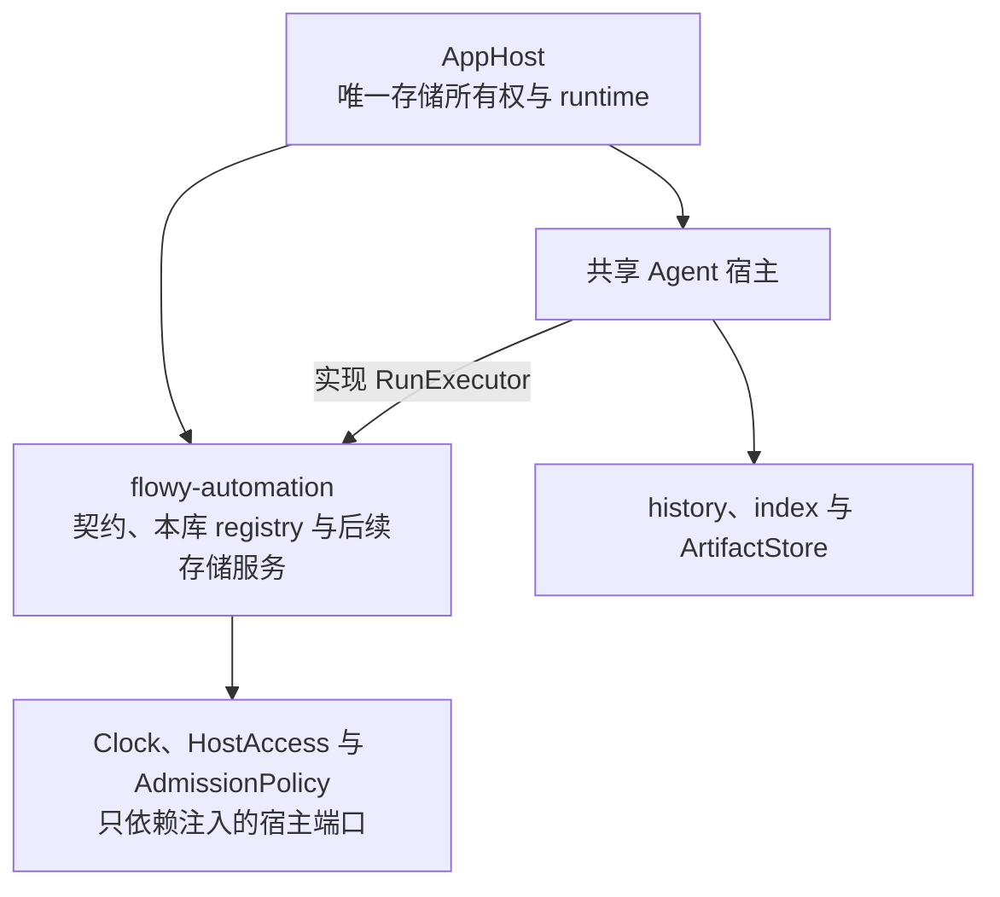
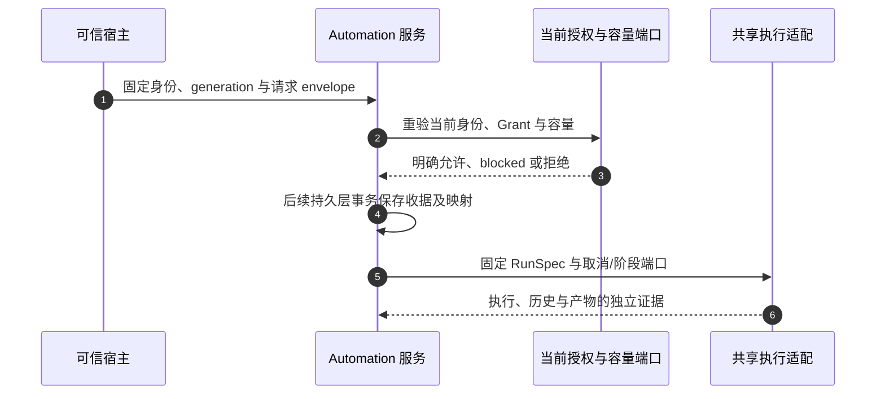

# ADR-0018: Personal Agent 自动化独立数据集与宿主端口

Status: Accepted (PA-B01 contract; persistence implementation follows in PA-B02)

Date: 2026-11-25

## 1. Context

Personal Agent 自动化运行在 `flowy18_wip` 独立 Rust/GPUI workspace。该 workspace
使用一个 Agent Engine 管理 `sessions/history.json`，现有 ArtifactStore 管理产物
提交与删除；不能因引入自动化而创建第二个 Engine 或重置这些既有数据。

V2 图示中的实体主键、复合 revision 主键和 FK 是关系摘要，不能直接翻译为产品
DDL。[统一数据规范](../contributing/data-and-identifier-standards.md)要求技术
自增主键、具名 UUIDv7 和应用维护的逻辑引用。用户已选择遵守这些约束，同时为
GPUI 独立库登记独立 registry，保持现有 GPUI JSON 与账户协议。

| 能力 | 当前事实 | 本决议 |
|---|---|---|
| 自动化数据 | 尚无自动化数据库 | 新独立数据集，后续任务实现持久层 |
| schema registry | nomifun-db 的 registry 绑定其单一 sqlx 数据库 | GPUI 库使用本地 registry，不混入父库表清单 |
| 稳定账户主体 | authority 与服务器 user_id | user_id 分类为外部 ID，不改造成 UUID |
| Agent 历史与产物 | 已有持久化与恢复协议 | 保持所有者和格式，只新增明确自动化元数据 |

## 2. Boundary

PA-B01 只建立端口和可审查契约，不建表、不打开 SQLite、不启动 worker。
`flowy-automation` 不依赖 GPUI、Agent/core、auth UI、nomifun runtime 或 sqlx。
SQLite、执行、调度、UI、daemon 和云执行不是本次骨架的隐含实现。

## 3. Decision

1. 数据集 lineage 为 `flowy-gpui-automation-v1`，数据库目标路径为
   `<store_root>/automation/automations.sqlite3`。复用桌面入口已取得的
   `instance.lock` 所有权，不增加第二个调度锁。
2. 新产品表全部使用 `id INTEGER PRIMARY KEY AUTOINCREMENT`。技术 `id`
   只留在 repository/storage 层，不作为 API、事件或侧存储引用。
   automation/run/attempt/grant/deletion-plan 等跨边界实体使用具名、裸、
   canonical lowercase UUIDv7。revision 用 `(automation_id, revision)`
   业务唯一约束，不用复合物理主键。
3. 产品 DDL 不得包含物理 FK、REFERENCES、trigger 或数据库 cascade。service
   在事务内检查 parent、revision、principal，执行已登记删除策略。
   `flowy-automation::schema_contract` 登记本库表、索引、值契约、作用域、
   删除/重建策略和孤儿审计；它是该独立数据集的可执行 registry 所有者，
   不将表加进 `nomifun-db::id_schema_contract` 的单库清单。
4. registry 必须覆盖 Run→Revision、Attempt→Run、Outbox→Run、收据结果、
   清理计划、水位及 Grant ledger/history/index/manifest/private-workspace
   侧存储关联。仅自动化来源记录参加这些新增侧存储规则；未知 owner 不自动
   认领。Project 的用户根目录不属于自动化私有目录清理对象。实际 schema
   检查和全量关联审计在 PA-B02 与后续恢复任务中实现，空数据库或空 registry
   不能作为“schema 已通过”的证据。
5. Principal 使用宿主选定 authority 加服务器稳定 user_id；服务器 user_id
   是 external ID。现有 session/submission 是 Agent 宿主 opaque 协议引用，
   本次新增不重新编码旧值。request、delivery、occurrence 与 generation
   是目的明确的操作/自然 token，不能仅看 `_id` 后缀套用业务 UUID 规则。
6. GPUI workspace 直接依赖 `uuid 1.29.2` 的 `v7` feature，并使用与上级
   nomifun-common 相同的严格验证契约和测试向量。这是本独立 workspace 的
   具名实现归属，不为任意模块增设生成器；不引入 nomifun-common 的 backend
   依赖图。serde 反序列化必须经过验证，不能只在显式 parse 时验证。
7. 独立新库缺失时可初始化；损坏、未来版本或不明 lineage 保留原件并停执行。
   不将本库接入 nomifun v3 全量 reset，不清除/迁移/认领既有 sessions、
   artifacts、skills 数据或用户项目。既有 GPUI 存储由其现有协议拥有；
   此决议不改变父产品库的 v3 lineage/reset/restore 规则。
8. 业务请求、取消、完成证据、时钟、授权及容量以对象安全端口表达。句柄必须
   显式注入服务，不提供 permissive default、fake success 或隐含 runtime。
   凭证端口只传无秘密引用；任务正文与凭证引用的 Debug 脱敏。

## 4. Trade-offs

| 编号 | 决策 | 放弃的方案与理由 |
|---|---|---|
| D1 | 独立 GPUI registry，统一数据形状 | 将本库表注册到父 sqlx 单库会要求不存在的连接/表 |
| D2 | uuid 库与严格契约在 GPUI workspace 登记 | nomifun-common 会引入不需要的 backend/runtime；自造随机短 ID 不符规范 |
| D3 | 保留既有 Agent 协议引用和 JSON 所有者 | 为新自动化清空所有旧数据超出目标并破坏用户记录 |
| D4 | 端口声明先于存储与行为 | 早期提供默认成功/默认授权会把未实现能力伪装成真实闭环 |

## 5. Verification and consequences

- PA-B01：检查 UUIDv7 parse/serde 拒绝旧格式、主体命名空间、正预算、隐私
  Debug、过期 envelope、对象安全及真实服务错误透传；检查无反向依赖。
- PA-B02：检查真实表的技术主键、业务唯一索引、无物理 FK/trigger、事务归属
  校验、所有登记逻辑引用和侧存储审计、版本/损坏 fail-closed。
- 后续恢复与清理任务：验证跨存储中断后不重跑副作用、保留引用阻止级联清理、
  Project 根目录不被删除，旧 GPUI 数据不被初始化流程重置。
- 本 ADR 不声称这些验证已执行，不声称 PA-B02 及运行能力已经实现。

## Appendix: decision provenance

本文件为新增决议，无被替换历史正文。实施依据为
[开发计划](../../flowy18_wip/docs/plans/personal-agent-automation-development-plan.md)
PA-B01 及其中完整归档的 V2；V2 的旧附录仅作追溯，不覆盖本决议的数据调整。
本机锁文件已有 uuid 1.29.2；其缓存 Cargo.toml 声明 Apache-2.0 OR MIT、
MSRV 1.89，并附两份许可证，满足当前 GPUI MIT workspace 的使用条件。

## 2026-11-26 补充：执行崩溃隔离控制文件

PA-A09 在 `<store_root>/execution-in-progress.lock` 保存无业务引用的写入哨兵。
它只表示此前宿主管理的写入者可能尚未静止，不授予进程所有权，不是第二把
`instance.lock`，也不参与 SQLite 产品表或带 owner 的侧存储实体清单。文件中
不保存主体、任务正文、凭证、session/run/attempt ID。

首个写资源许可在实际执行前创建并同步哨兵；最后一个写入者在真实执行 future
及产物捕获收尾完成后移除。异常丢弃已启动许可、重启时发现哨兵、读写失败或
移除失败均关闭新启动入口。新进程不得根据 UI 的 Stopped 或仅凭 PID 缺失自动
清除；可信宿主必须先确认无残留写入者，再在没有活动或等待写入者时显式恢复。
缺失哨兵只表示本隔离协议没有未决证据，不证明数据库或跨存储恢复已完成。

Grant 仍属于原先登记的 `automation/grants.json` 侧存储，grant_id 遵守 UUIDv7
契约；每 submission 的预算起点、计数与停止原因归既有 Agent history 所有者
原子持久化，submission key 继续采用宿主 opaque 引用。此补充不改变父产品库
的 lineage、DDL、迁移、重建或 reset 规则。
