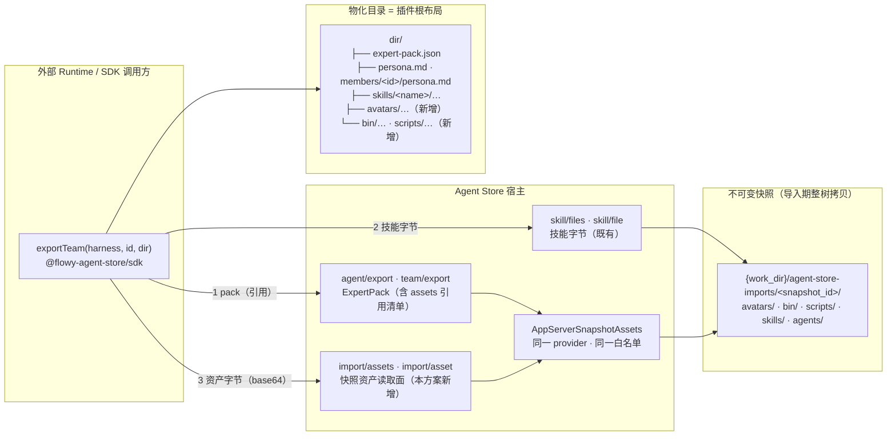

# 专家 / 专家团导出补齐插件级资产（avatars · bin · scripts）· 技术方案

> **状态**：✅ 已实施（2026-10-12，与本方案同批落地；`pack_format 1 → 2`，指纹 `fp-13 → fp-14`）
> **此后**：`pack_format` 继续演进——`44` 提到 `3`（`tags` / `category_id`），`51` 提到 `4`（`skills[].icon` / `connectors[].icon`）。本方案的**资产面决定全部不变**（三前缀白名单、按引用、`kind` 诚实标注）；`51` 唯一改到这里的是一处 F2 边界：`avatars/connectors/` 子路径同样是 `avatars/` 前缀下的普通资产，`collect_assets` 的递归与 `asset_kind` 只看首段，因此**不需要扩白名单**。
> **核心原则**：**定义照旧轻、资产按引用** —— 字节永远走 `import/asset` 拉取面而非内联进包；**地址空间对齐**（pack 能列出的才读得到，读面能读的才列得出，同一 provider 同一白名单）；**可执行内容诚实标注**（`kind: "script"`），操作者可用 `[expert_export] scripts = false` 从包里减掉。

---

## 1. 背景与核心痛点

### 1.1 业务背景

`32-expert-pack-export.zh.md` 与 `35-sdk-expert-export.zh.md` 已经把专家 / 专家团变成一份**可移植定义**（persona / 模型提示 / 按引用的技能 / 连接器开关 / 名单），SDK `exportTeam()` 一行把定义与技能字节物化成本地目录。但真实市场的专家包里还有一类内容**不在导出里**：**插件级资产** —— 与 `skills/` 平级的 `avatars/`、`bin/`、`scripts/`。

实测读数（2026-10-12，官方 experts 市场 `experts.zip`：303 MB / 14,713 文件 / **381 个专家插件 / 3 个专家团**）：

| 读数 | 值 |
|---|---|
| 带插件级 `avatars/` 的插件 | **361 / 381**（403 个文件，合计约 109 MB —— 这个市场的 zip 体积主要就是它） |
| 带插件级 `bin/` 或 `scripts/` 的插件 | **17** |
| `plugin.json` 未声明 `avatar` 的插件 | 24 |
| 声明了 `avatar` 但不在 `avatars/` 前缀下的 | **1**（`viral-topic-master`，值 `./avatars/viral-topic-master.png`，归一 `./` 后仍是同一前缀） |

典型样本就是 `stock-partner-team` 1.0.7（腾讯自选股股票投研专家团）：

```text
plugins/stock-partner-team/
├── agents/…            7 个成员定义          ← 导出 ✔（persona）
├── skills/…            3 个技能              ← 导出 ✔（skill/files）
│   └── md-to-html/scripts/{render,embed_avatars}.py   ← 技能内部脚本，导出 ✔
├── avatars/            team.png + 7 张成员头像，合计 1075 KB   ← 导出 ✘
└── bin/                init_task / .cmd / init_task.py         ← 导出 ✘
```

而**这个团自己的运行说明就依赖被丢掉的那部分**：lead agent 的指令要求「先 Glob 得到 `bin/init_task.py` 的绝对路径记为 `INIT_TASK`」；技能 `md-to-html` 的 `render.py` 写死 `PLUGIN_ROOT = SCRIPT_DIR.parents[2]`、`INIT_TASK = PLUGIN_ROOT/'bin'/'init_task.py'`；`embed_avatars.py` 默认头像目录是 `SCRIPT_DIR/../../../avatars`。三者共同假设的"插件根"，正是导出目录里缺掉的那一层。

### 1.2 现状与三大痛点

1. **导出目录是一个残缺的插件根**。`materializePack` 产出 `expert-pack.json` + `persona.md`（团为 `members/<id>/persona.md`）+ `skills/<name>/**`。技能**内部**的 `bin/`、`scripts/` 能导出（它们在技能目录里，走 `skill/files`，单文件上限 2 MiB、无扩展名过滤），缺的只有**插件级**（`skills/` 的兄弟目录）的 `bin/`、`scripts/`、`avatars/`。结果：按包内指引跑团自己的脚本，`embed_avatars.py` 报「avatars 目录不存在」、`render.py` 找不到 `bin/init_task.py`。
2. **头像是被刻意排除的，但"可移植形态"缺位**。doc `32` §2 明确把 `avatar_url` 排除（它是宿主本机 URL，对远端是死链）；字节本身在不可变快照里（`02` §7「头像资产文件随快照拷贝」），也有公开 HTTP 资产路由（`GET /api/app-server/imports/{snapshot}/assets/{path}`，图片白名单）。缺的是把**字节**交给消费方的面。而「内联进包」被 1 MiB 的 `MAX_EXPERT_PACK_BYTES` 直接堵死（该团头像 1075 KB、`edgeone-makers-experts` 2139 KB）。
3. **`bin/` `scripts/` 的现状是产品边界，不是疏漏**。`02` §5 映射表把 `bin/` `scripts/` 定为「受控 CLI/Workflow 能力：不自动执行；不暴露任意 shell」，`02` §9 写明「生命周期钩子、LSP、bin/scripts 在对应执行安全模型落地前不启用」；导入器只把它们记成 `kind: "script"` 的元数据组件（`{file_count, executable: false}`），从不物化、从不执行。而 doc `32` 的包契约第一句就是 *a definition, not execution semantics*。所以「bin 没导出」与现状是自洽的 —— 要把它交出去，等于把 `02` §9 推迟的那个决定提前落地。**本轮用户已拍板：导**（含可执行字节），因此本方案同时给出诚实的标注与操作者减项。

### 1.3 能力对比矩阵

| 资产类别（插件级） | 现状：`agent/export` / `team/export` + `materializePack` | 本方案 |
|---|---|---|
| `avatars/*.png`（显示资产） | ✘ 完全不可达（包不带、无字节读取面） | ✔ `pack.assets` 列出（`kind: "avatar"`）+ `import/asset` 拉字节 + SDK 落盘 |
| `bin/**`、`scripts/**`（可执行/脚本） | ✘ 完全不可达 | ✔ 同上（`kind: "script"`），操作者可 `scripts = false` 减项 |
| 技能**内部**的 `bin/`、`scripts/` | ✔ 已可达（`skill/files` · `skill/file`） | 不变（不重复建设） |
| `plugin.json` 声明的包级头像路径 | ✘（`avatar_url` 被排除，路径本身也不在包里） | ✔ `pack.avatar`（快照相对路径，且该文件必须在 `assets` 里） |
| persona / 名单 / 连接器开关 / 模型提示 | ✔（doc `32`） | 不变 |

---

## 2. 方案全景与架构设计

### 2.1 端到端拓扑



### 2.2 核心目标 vs. 明确的非目标

**目标**

1. `agent/export` / `team/export` 的包带上插件级资产**引用清单**（路径 / 类别 / 大小 / sha256），`pack_format 1 → 2`。
2. 新增 **WebSocket-only** 读取面 `import/assets`（列清单）与 `import/asset`（单文件字节，base64），能力位 `snapshot_assets`。
3. SDK `materializePack` 把资产落盘为 `<dir>/<快照相对路径>` —— 物化目录因此成为**完整的插件根布局**（团自带脚本按 `PLUGIN_ROOT` 相对寻址的两条路径都能命中）。
4. `bin/` `scripts/` 以 `kind: "script"` 诚实标注；`[expert_export] scripts = false` 可把这一类从包里减掉（缺省导出）。
5. 全部读数确定性可复现：清单按 `path` 排序、无时间戳，同一状态两次导出逐字节相同（doc `32` §4.4 既有性质不回退）。

**非目标**

- **不做 install 侧物化**：宿主自己的托管技能根 `<skills_root>/agent-store/<snapshot_id>/` 仍不落插件级 `bin/` `scripts/` `avatars/`（这是 `02` §9 的执行安全模型范畴，登记为开放项 F1）。本轮只动**导出**。
- **不改组件模型**：`bin/` `scripts/` 的 `kind: "script"` 组件行保持元数据语义；资产不是组件。
- **不提供 HTTP 绑定**：消费方是 SDK / 外部 runtime（WS）；WebUI 显示头像继续走既有的公开图片路由。
- **不内联字节**：pack 只带 `{path, kind, size, digest}`，字节单独拉。
- **不动 `avatar_url` 的排除决定**：进包的是**快照相对路径**（`pack.avatar`），不是宿主 URL —— 前者对着 `pack.assets` 可解析，后者对远端是死链。
- **不做逐成员头像归属**：`plugin.json.members[].avatar` 不进快照 payload（`attach_plugin_display` 只搬包级 `avatar`），成员 ↔ 头像的映射由团自带技能承载（`stock-partner-team` 的 `skills/md-to-html/avatar-mapping.md` 随技能一起导出），不发明第二份映射表。

### 2.3 架构不变量

| 编号 | 不变量 | 落实方式 |
|---|---|---|
| **I1** | **地址空间对齐**：`import/assets` 能列出的路径集合 ≡ `pack.assets` 的地址空间 ≡ `import/asset` 能读的集合 —— 三者同一个 provider、同一份白名单 | 同一 `SnapshotAssetProvider` 实现三个口；测试钉住「清单里的每一条都能读、白名单外的路径（`agents/lead.md`、`SKILL.md`、`.codebuddy-plugin/plugin.json`）既不列出也读不到」 |
| **I2** | **导出适配器不碰文件系统**（doc `32` 既有承诺：*The adapter never touches the filesystem and never returns an absolute path*） | 资产经新 seam `SnapshotAssetProvider` 注入（`with_assets`，与 `ExpertPresetReader` 同型）；适配器只拿 `{path, kind, size, digest}` |
| **I3** | **字节不过包**：pack 只携带引用；单文件字节走 `import/asset`，超限从元数据拒绝（先量后读） | `MAX_SNAPSHOT_ASSET_BYTES = 2 MiB`（对齐 `MAX_SKILL_FILE_BYTES` 的既有取值）；清单上限 `MAX_SNAPSHOT_ASSET_ENTRIES = 512`，超出置 `truncated` |
| **I4** | **确定性**：`assets` 按 `path` 排序、digest 取自内容、无时间戳 | 复用 doc `32` §4.4 的判定，测试保持「两次导出逐字节相同」 |
| **I5** | **快照为界**：只允许三个插件级前缀 `avatars/` `bin/` `scripts/`；词法拒绝（`..`、绝对路径、反斜杠、`:`）先行，`canonicalize + starts_with` 复核；symlink 不跟随、不列出 | 照抄 `app_server_skill_files.rs` 的两级校验骨架 |
| **I6** | **`pack_format` 独立于指纹**：包形状变化只动 `pack_format`（1 → 2），wire 兼容只动 `fp-<n>`（13 → 14） | doc `32` §4.4 的既定分工；两处常量各自独立 |
| **I7** | **快照字节面不做 `[expert_export]` 闸**：`import/assets` / `import/asset` 的权威与 `import/get` 相同（owner 认证 + `imports` 能力位），与 `skill/files` 先例一致 | 闸只落在**定义导出**（persona / 名单）与包的 `assets` 清单上；文档明说这不是隔离边界（同机同用户进程本就能直接读盘） |

---

## 3. 核心设计与模块规范

### 3.1 数据结构与契约

**Rust（`nomifun-api-types/src/app_server.rs`）**：

```rust
/// 插件级资产类别。`script` 覆盖 `bin/` 与 `scripts/` 两个目录（导入器的
/// KIND_SCRIPT 本就把二者并入一个组件），`avatar` 覆盖 `avatars/`。
pub enum AppServerExpertAssetKind { Avatar, Script }        // serde snake_case

/// 一条插件级资产，**按引用**。pack 与 import/assets 共用同一形状：
/// 三个面的地址空间由构造保证一致（本方案 I1）。
pub struct AppServerExpertAssetRef {
    pub path: String,                    // 快照相对路径，POSIX 分隔，如 "bin/init_task.py"
    pub kind: AppServerExpertAssetKind,
    pub size: u64,
    pub digest: String,                  // 单文件 sha256，小写 hex（与 skill/files 同规则）
}

pub struct AppServerExpertPack {
    // …doc 32 既有字段不动…
    /// 插件级资产（avatars/ bin/ scripts/），按 path 排序。成员 pack 恒为空表
    /// （D7）；宿主未接资产 seam 时也为空表 —— 用能力位 snapshot_assets 区分。
    #[serde(default)]
    pub assets: Vec<AppServerExpertAssetRef>,
    /// 包级头像：plugin.json 声明的快照相对路径（如 "avatars/team.png"）。
    /// 仅顶层 pack 携带，且**仅当该文件确实列在 assets 里**（名字不许指向
    /// 取不到的文件）；成员 pack 恒为 None。
    #[serde(default, skip_serializing_if = "Option::is_none")]
    pub avatar: Option<String>,
}

/// import/assets 响应（快照作用域，与 pack 无关的独立入口）。
pub struct AppServerImportAssetList {
    pub snapshot_id: String,
    pub assets: Vec<AppServerExpertAssetRef>,   // 按 path 排序
    pub truncated: bool,
}
```

**TypeScript（`web/packages/protocol/src/protocol.ts`）**：`ExpertAssetKind` / `ExpertAssetRef` / `ImportAssetList` 镜像以上；`ExpertPack` 增 `assets: ExpertAssetRef[]` 与 `avatar?: string | null`；`APP_SERVER_EXPERT_PACK_FORMAT = 2`；`Capabilities` 增 `snapshot_assets: boolean`。

**wire 方法（均 WebSocket-only，`fp-13 → fp-14`，计数 `55 / 80 → 55 / 82`）**：

```text
import/assets { snapshot_id }              → AppServerImportAssetList
import/asset  { snapshot_id, path }        → { snapshot_id, path, content_type,
                                              encoding: "base64", content }   // 与 skill/file 同形
```

错误沿用技能文件面的稳定码：`not_found`（快照或文件不存在）/ `invalid_request`（路径不安全或不在白名单）/ `response_too_large`（单文件超 2 MiB）/ `internal_error`。

### 3.2 策略闸门（`[expert_export]` 扩一项）

```toml
# ~/.agent-store/config.toml —— 仍是「默认开的减项表」，不是新开一套 fail-closed
[expert_export]
enabled = true          # 不变：整体开关
deny    = []            # 不变：按 id 减项
scripts = true          # 新增：缺省 true，pack.assets 携带 bin/ 与 scripts/；
                        # false 时仅去掉 kind:"script" 条目，avatars 不受影响
```

- `AGENT_STORE_EXPERT_EXPORT` 环境变量 JSON 通道自动携带新键（同一结构）。
- 不在 `config/set` 白名单上（与 `enabled` / `deny` 同理由：宿主策略表，不是远端可写的设置）。
- **诚实边界**（写在代码注释与 `06`/`38` 两处文档）：`scripts = false` 修饰的是**包契约**（导出的定义里声明不声明可执行内容），不是字节面的隔离边界 —— `import/asset` 仍可按 I7 读取，正如 `skill/files` 本就不受 `[expert_export]` 约束。要一个真正的隔离开关，等 `02` §9 的执行安全模型。

### 3.3 模块与落点

| 模块 | 文件 | 职责 |
|---|---|---|
| 资产 provider（生产实现） | `crates/backend/nomifun-app/src/app_server_snapshot_assets.rs`（新） | 拥有快照根路径与白名单；`assets(snapshot_id)` / `read(snapshot_id, path)`；路径安全骨架照 `app_server_skill_files.rs`（词法拒绝 → canonicalize → starts_with；symlink 不跟随） |
| seam（协议层 trait） | `crates/backend/nomifun-app-server/src/catalog.rs` | `trait SnapshotAssetProvider`，错误类型复用 `SkillFileError`（四个变体与稳定码一一对应，不另造一套） |
| 协议层 | `crates/backend/nomifun-app-server/src/lib.rs` | `AppServerRouterState.snapshot_assets: Option<Arc<dyn SnapshotAssetProvider>>`；`import/assets` / `import/asset` 分派；`CapabilityAvailability` / `Capabilities` 增 `snapshot_assets`；错误码映射复用 `skill_file_error` |
| 导出适配器 | `crates/backend/nomifun-app/src/app_server_expert_export.rs` | `with_assets(...)` 注入；顶层 pack 填 `assets` + `avatar`（校验「声明的路径必须在清单里」）；成员 pack 两项恒空；`scripts = false` 时过滤 `kind:"script"`；排序与确定性保持 |
| 组合根 | `crates/backend/nomifun-app/src/router/routes.rs` | 用同一个 provider 实例同时喂 `snapshot_assets` 与 `expert_packs.with_assets(...)`（I1 由构造保证）；快照根复用既有 `import_root` |
| 传输客户端 | `web/packages/client/src/client.ts` | 平面方法 `listImportAssets(snapshotId)` / `readImportAsset(snapshotId, path)`（与 `getImport` 同族、同命名风格） |
| SDK | `web/packages/sdk/src/export.ts` | `ExportDeps` 增两个资产方法；`materializePack` 把 `pack.assets` 逐条拉字节写到 `<dir>/<path>`（先建父目录）；`ExportResult.writtenAssets`；读取失败照 doc `35` §6 的「清单成功后读失败 = 宿主 I/O 故障 → 抛」语义 |
| 真机脚本 | `web/scripts/sdk-live-expert-export.ts` | 新增判据 EX-011 ~ EX-013（§5） |
| 新夹具 | `crates/backend/nomifun-importer/tests/fixtures/asset-pack/`（新） | 带包级 `avatar` + `avatars/` + `bin/` + `scripts/` 的最小插件，供 live 脚本与 e2e 使用 |

### 3.4 导出时序

```mermaid
sequenceDiagram
    autonumber
    participant C as 调用方（SDK）
    participant X as App Server（export 适配器）
    participant P as SnapshotAssetProvider
    participant D as 不可变快照（磁盘）

    C->>X: team/export { team_id }
    X->>X: [expert_export] 闸（enabled · deny · scripts）
    X->>P: assets(snapshot_id)
    P->>D: 列 avatars/ bin/ scripts/（白名单前缀内，symlink 不跟随）
    P-->>X: Vec&lt;AssetRef&gt;（path 排序 + size + sha256）
    X-->>C: ExpertPack（assets 引用 · avatar 声明 · pack_format 2）
    loop 每条 assets 引用
        C->>X: import/asset { snapshot_id, path }
        X->>P: read(snapshot_id, path)
        P->>D: 词法拒绝 → canonicalize → 限量 → 读字节
        P-->>X: bytes（content_type）
        X-->>C: base64
    end
    C->>C: materializePack 写 &lt;dir&gt;/&lt;path&gt;（skills/ 与 avatars/ bin/ 同根）
```

### 3.5 物化目录布局（doc `35` §5 的增量）

```text
<dir>/
├── expert-pack.json          # 原样（pack_format: 2，assets/avatar 在内）
├── persona.md                # kind === "agent"
├── members/<id>/persona.md   # kind === "team"
├── skills/<name>/…           # 既有
├── avatars/…                 # 新增：pack.assets 里 kind:"avatar" 的条目，按快照相对路径落位
├── bin/…                     # 新增：kind:"script"
└── scripts/…                 # 新增：kind:"script"
```

落位规则就是**快照相对路径原样**（`bin/init_task.py` → `<dir>/bin/init_task.py`）。这让物化目录成为团自带脚本假设的插件根：`skills/md-to-html/scripts/render.py` 的 `PLUGIN_ROOT = SCRIPT_DIR.parents[2]` 命中 `<dir>`，`PLUGIN_ROOT/bin/init_task.py` 与 `../../../avatars` 全部成立 —— 这一点进真机判据（EX-013）。SDK 在写盘前仍做一次词法校验（拒绝 `..` / 绝对路径 / 反斜杠），与 doc `24` §4.4 的「服务端已拒」互为纵深。

---

## 4. 关键决策与权衡矩阵

| 编号 | 决策点 | 选定方案 | 放弃的替代方案与理由 |
|---|---|---|---|
| **D1** | 资产字节怎么过线 | **新 WS 方法 `import/asset`**（owner 认证、`require_ready`、与 `skill/file` 同形） | ❌ 复用公开 HTTP 资产路由：它为 `` 而生、**匿名无鉴权**，且要求消费方自己拼宿主 base URL —— 这正是 doc `32` §2 拒绝 `avatar_url` 的同一条理由，等于把死链问题换个形式还给消费方 |
| **D2** | 字节内联还是按引用 | **按引用**（pack 只带 `{path,kind,size,digest}`） | ❌ 内联 base64：`MAX_EXPERT_PACK_BYTES = 1 MiB`，`stock-partner-team` 头像 1075 KB、`edgeone-makers-experts` 2139 KB 直接超限；且在包和快照之间制造第二个字节真源 |
| **D3** | 读取面地址空间 | **三前缀白名单**（`avatars/` `bin/` `scripts/`） | ❌ 整快照任意读：会顺手开放 `agents/*.md`（persona 正文）、`SKILL.md` 等定义正文 —— persona 的出口应当只有 `agent/export` 一个（doc `32` §2 的设计）；❌ 只开 `avatars/`：与用户拍板的范围（含 bin/scripts）不符 |
| **D4** | `pack_format` | **1 → 2** | ❌ 沿用 1：`assets` / `avatar` 是新增字段，按 doc `32` §4.4「包形状变化即 bump」的既定规则；外部 runtime 正是靠它区分「包里没有」与「这个格式没有」 |
| **D5** | 可执行内容的缺省与开关 | **缺省导出 + `scripts = false` 减项**（用户本轮拍板导出） | ❌ 缺省不导、`scripts = true` 显式开：`[expert_export]` 的既定教义是 fail-open 减项表，在同一张表里开第二个教义会让「缺省是什么」变成读配置者的猜谜；❌ 完全不加开关：把可执行字节放进一个**可移植契约**而不给操作者说「不」的位置，等于替运营者做了 `02` §9 的决定 |
| **D6** | 资产面要不要过 `[expert_export]` 闸 | **不过**（I7）：与 `import/get` 同权威，闸只落在定义导出与包的 `assets` 清单 | ❌ 逐快照映射到专家 id 再过闸：需要快照 → 组件 id 的反查与策略注入，复杂度高而收益低 —— `skill/files` 先例表明快照字节面本就与定义导出闸分离；真要隔离，等 `02` §9 的执行安全模型一次做对 |
| **D7** | 成员 pack 的 `assets` / `avatar` | **恒空 / 恒 None**（文档写明「资产是快照作用域，读顶层 pack」） | ❌ 逐成员复制整份清单：一个 7 人团会把 ~11 条引用复制 7 遍，制造 N× 膨胀与「成员各有资产」的假语义 |
| **D8** | 包级头像怎么表达 | **`pack.avatar`（快照相对路径）+ 「该文件必须在 `assets` 里」的不变量** | ❌ 维持什么都不给：消费方只能按 `team.png` / `expert.png` 的命名约定猜；❌ 恢复 `avatar_url`：宿主 URL 对远端是死链（doc `32` §2），相对路径 + `assets` 才是可解析的 |
| **D9** | 可执行位的处理 | **不保留、如实**：快照拷贝（`copy_tree`）本就以 0644 落盘，包里也不声明 executable | ❌ 伪称 `executable: true` 或替消费方 chmod：宿主自己从未启用执行（`02` §9），字节给出去、怎么用是消费方的事 —— 诚实比贴金重要 |
| **D10** | 清单/单文件上限取值 | `MAX_SNAPSHOT_ASSET_ENTRIES = 512`、`MAX_SNAPSHOT_ASSET_BYTES = 2 MiB`（对齐技能文件面既有值） | ❌ 复用技能面常量本体：两个面的预算是两个独立决定，将来技能面调大不应连带放宽资产面（反之亦然） |

---

## 5. 验收标准与验证矩阵

### 5.1 验收用例

| 编号 | 层 | 用例 | 断言 |
|---|---|---|---|
| TC-AS-101 | provider 单测 | 清单只含白名单前缀 | 造快照：`avatars/a.png`、`bin/x.py`、`scripts/y.sh`、`agents/lead.md`、`SKILL.md`、`.codebuddy-plugin/plugin.json` → 列表恰为前三者，`agents/lead.md` 等不出现 |
| TC-AS-102 | provider 单测 | 读取与越界 | 白名单内路径读到原字节 + 正确 `content_type`；`../outside`、`/abs`、`a\\b`、`C:x`、`agents/lead.md`（无穿越）一律拒 |
| TC-AS-103 | provider 单测 | symlink | 树内 symlink 不列出、读被拒（照技能面的既有测试写法，环境不能建链则诚实跳过） |
| TC-AS-104 | provider 单测 | 上限 | >2 MiB 从元数据拒（`response_too_large` 且 `size > limit`）；>512 条置 `truncated` 且不谎称完整 |
| TC-AS-105 | provider 单测 | 快照不存在 / 非法 id | `not_found` / `invalid_request`（沿用公开资产路由的 `snapshot_dir_name` 校验） |
| TC-EX-201 | 适配器单测 | 顶层 vs 成员 | 顶层 pack 带 `assets`（按 path 排序）+ `avatar`；每个成员 pack `assets == []` 且无 `avatar` 键 |
| TC-EX-202 | 适配器单测 | avatar 不变量 | `payload.avatar` 指向清单内文件 → 携带；指向清单外（如白名单外路径）→ 整个键缺席，绝不指向取不到的文件 |
| TC-EX-203 | 适配器单测 | `scripts = false` | `[expert_export] scripts = false` → `assets` 只剩 `kind:"avatar"`；缺省全量 |
| TC-EX-204 | 适配器单测 | 确定性 | 同一状态两次导出逐字节相同（既有用例扩展到 assets 排序） |
| TC-EX-205 | 适配器单测 | 未接 seam | `with_assets` 未调用 → `assets: []`、无 `avatar`，导出本身不失败；能力位 `snapshot_assets = false` 是区分信号 |
| TC-W-301 | 协议层单测 | 能力位与错误码 | 未接 provider → `import/assets` 答 `unsupported_operation` 且能力位为 false；接了 → 各 `SkillFileError` 变体映射到既定稳定码 |
| TC-SDK-401 | SDK 单测 | 物化布局 | fake deps 下断言 `<dir>/bin/init_task.py`、`<dir>/avatars/team.png` 与源字节一致、`writtenAssets` 有序、`expert-pack.json` 为 `pack_format: 2` |
| TC-SDK-402 | SDK 单测 | 宿主 I/O 抛错 | 清单成功后 `readImportAsset` 失败 → `materializePack` 抛（不静默产出清单里存在而盘上没有的目录） |
| EX-011 | 真机 | 能力位 | 握手 `capabilities.snapshot_assets === true` |
| EX-012 | 真机 | 资产落盘 | 对新夹具 `asset-pack` 断言 `<dir>/avatars/team.png`、`<dir>/bin/init_task.py` 存在且与 `import/asset` 返回逐字节相同；`writtenAssets` 与 `pack.assets` 的 path 一致 |
| EX-013 | 真机 | 插件根假设 | 物化目录里 `<dir>/bin/init_task.py` 相对 `<dir>/skills/hello/` 满足 `SCRIPT_DIR.parents[2]/bin` 寻址（团自带脚本的既有假设成立） |
| EX-014 | 真机 | 确定性 | 两次 `exportTeam` 的 `expert-pack.json` 逐字节相同（既有 EX-003 扩展到 v2 形状） |
| EX-015 | 真机 | 反向 | `agents/lead.md`（persona 正文）不在 `pack.assets`，`import/asset` 读它被拒 |

### 5.2 验证梯子（从小到大）

1. `cargo test -p nomifun-app snapshot_assets` + `cargo test -p nomifun-app expert_export`（provider / 适配器）
2. `cargo test -p nomifun-app-server`（协议层：能力位、分派、错误码、指纹夹具）
3. `cd web && bun run typecheck && bun run test`（protocol / client / sdk）
4. `bun run check:fingerprint`（`fp-14` 全部落点，含站点 2 处）+ `bun run check:release-sync`
5. `bun scripts/sdk-live-expert-export.ts`（EX-011 ~ EX-015）
6. `cargo check --workspace && bun run check`（提 PR 前的广谱门禁）

> **实施期读数（2026-10-12）**：1~5 全绿——provider 7 例、适配器 18 例（10 既有 + 8 新增/更新）、
> `nomifun-app-server` 191 例、`web` 563 例；live 脚本 **RESULT PASS（15/15）**（EX-012~015 即本方案的
> EX-011~015 判据落地后的编号）。第 6 项按 CI 口径在 Linux 上跑（Windows 本机的 `sherpa-onnx-sys`
> vendored 构建是基线问题，与本方案无关）；`nomifun-app --lib` 的 402/1 中那 1 例
> （`every_production_conversation_service…`）是**既有基线失败**，与本方案无关。

### 5.3 开放项（F）

- **F1（本轮不做）**：install 侧依旧不把插件级 `bin/` `scripts/` `avatars/` 物化到托管技能根 —— 宿主自己跑这个团时，`render.py` 的 `PLUGIN_ROOT/bin/init_task.py` 与 `embed_avatars.py` 的默认头像目录仍只在**不可变快照缓存**里成立（lead agent 指令里的「Glob 拿绝对路径」就是在这条歪路上找文件）。要不要把插件级资产一并物化，属于 `02` §9 执行安全模型的范畴，与导出分开拍。
- **F2**：逐成员头像归属（`plugin.json.members[].avatar` 进快照 payload）—— 当前映射由团自带技能承载，市场 381 个插件里只有 3 个团需要，等真实需求。
- **F3**：`[expert_export] scripts` 目前修饰包契约而非字节面（D6/D5）；若未来要把「可执行字节不出宿主」做成硬边界，应与 `02` §9 的执行安全模型一起设计，而不是给这个键偷偷加语义。
- **F4（已定口径，2026-10-12 用户确认）**：**悬空技能是可接受的现状，不是待修缺陷**。成员 frontmatter 的 `skills:` 声明在源运行时（WorkBuddy/CodeBuddy）本就没有兑现机制——装机只物化包级声明（`plugin.json.skills`），对手写声明不校验、不物化；本仓与源对齐，但在落空场合比源诚实：`agent/run` 失败关闭（`PRESET_SKILLS_UNAVAILABLE`）+ 导出如实上报进 `danglingSkills`（doc `32` §6.5 EX-008、`35` §6）。真实成因是成员声明引用了包里不存在/未列入装机清单/别家插件的技能——官方团包级技能不悬空（EX-011：written = declared）。只有当源运行时自己开始兑现成员声明时，本仓才跟随收紧。
