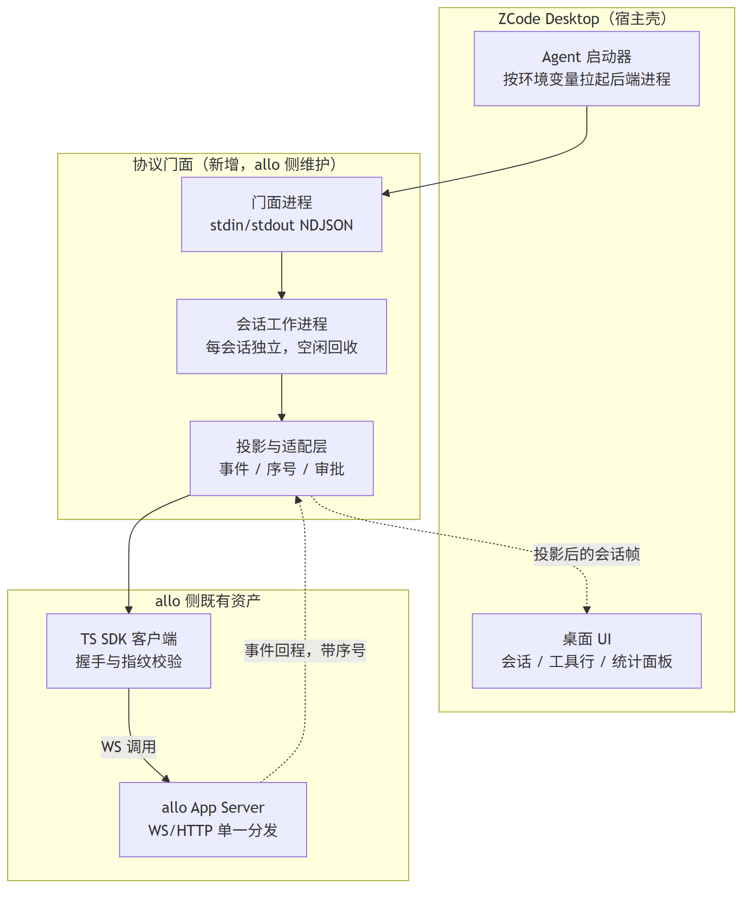
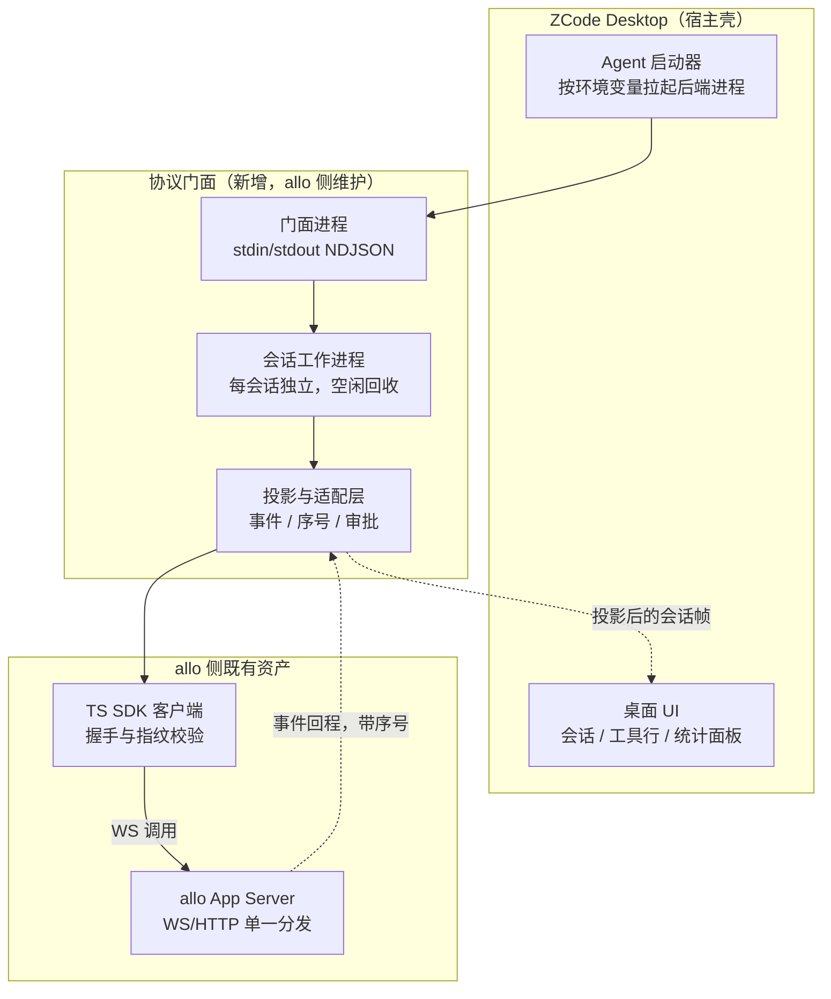
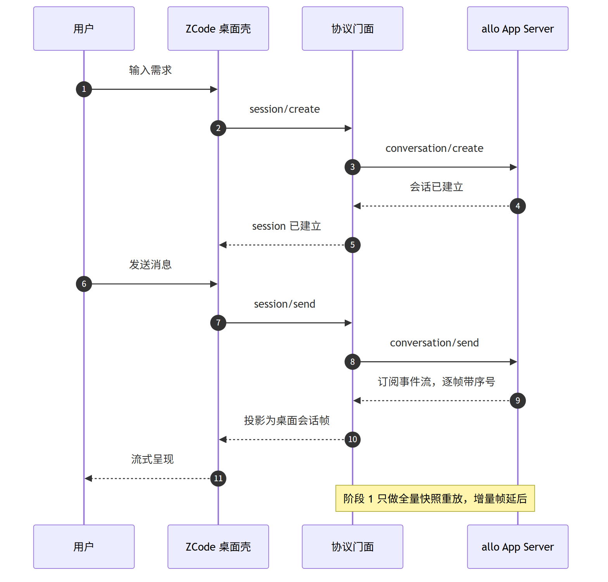
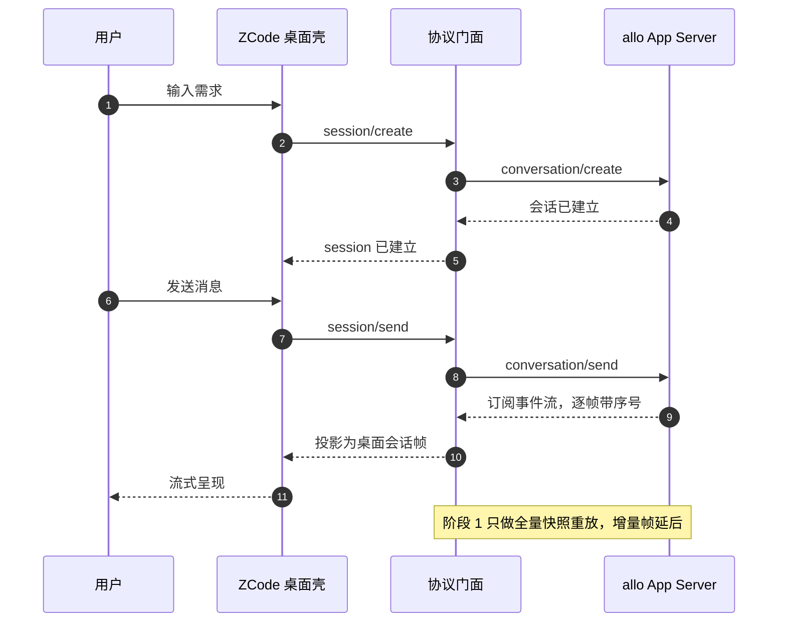
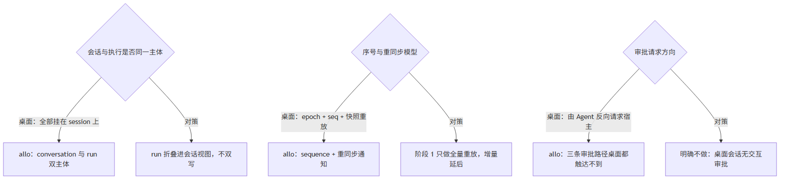
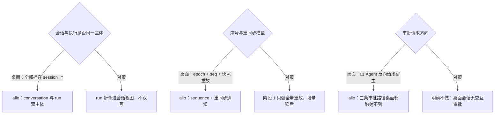

# ZCode Desktop 接入 allo App Server · 可行性与映射方案

> **状态**：🔧 部分实现（阶段 0 / 1 / 2 已完成并经 mock 与真机双重验证；阶段 3 多代理面板与增量帧选做；交互式审批按决策 A 明确不做）
> **核心原则**：App Server 协议边界不变；接入只新增一个协议门面，不改 allo 既有 wire 面；能力诚实优先于面板完整。

---

## 1. 背景与核心痛点

### 1.1 业务背景

Agent Store 目前对外暴露的客户端形态是 Web UI、TypeScript SDK、CLI 与 MCP，缺一个成熟桌面壳。ZCode Desktop（社区 fork 声明继承自 `zai-org/ZCode`，Apache-2.0）是一个完整的 Agent 桌面工作台：会话工具行、多代理工作流面板、Mini 悬浮条、会话统计、内置插件体系。

关键事实是：**该桌面的宿主侧本就预留了"替换 Agent 后端"的通用机制**——通过环境变量指定要拉起的 Agent 进程与其参数，宿主用统一的 NDJSON 行协议与之通信。同仓的 Step-Code 适配层正是消费这个口子把自己接进去的（它没改宿主协议，只写了门面）。

因此"allo 接入 ZCode Desktop"不必然意味着 fork 桌面，也可以是**给 allo 增加一个协议门面，让桌面把 allo 当成又一个 Agent 后端**。

### 1.2 现状与三大痛点

1. **两侧方法面不同构**。已按代码核对：allo App Server 有 80 个请求方法与 4 类服务端通知；ZCode 协议面约 85 个方法。两者不是简单改名关系，存在三处结构性差异（会话与执行双主体、序号与重同步模型、审批请求方向）。
2. **两块能力缺口 + 一处此路不通**：增量 delta 与行模型（流式面板的精度）、多代理工作流展示模型是缺口；**交互式审批经源码核查确认从桌面可达路径上开不了**（详见 §3.3 差异三），不是"没接"而是"没有"。
3. **路线选择成本不对称**。若按"fork 桌面做 allo 自有壳"推进，要长期承担上游同步、打包、更新链路，且与 allo 已有的桌面产品职责重叠；若按"协议门面"推进，改动集中在一个包内，可回退、可分阶段验证。

### 1.3 能力对比矩阵

| 维度 | 现状（仅 Web/SDK/CLI） | 目标（新增桌面客户端） |
| --- | --- | --- |
| 交互形态 | 浏览器/终端 | 桌面工作台：工具行、产物面板、Mini 悬浮条 |
| 流式呈现 | Web UI 已有事件解码 | 复用同一事件流，经投影适配桌面帧 |
| 审批 | Store 层审批与审计（run 面，`ask_user` 仅 gateway caps 可设） | 桌面**无**交互审批（决策 A）；工具由 allo 引擎静态策略决定 |
| 多代理 | Team Runtime（固定成员 + Leader DAG） | 桌面工作流面板（需重做展示投影） |
| 分发/安装 | Market / Store / Install / Import | 不在桌面复用，保持 Web 侧唯一入口 |
| 底座复用度 | App Server 与 SDK 已成型 | 复用 SDK 客户端与协议包，不重写协议 |
| 研发工作量 | — | 集中在一个门面包 + 投影适配层，分三阶段 |

---

## 2. 方案全景与架构设计

### 2.1 端到端拓扑

四层结构：桌面壳 → 门面 → 会话工作进程 → allo 侧既有 SDK 与 App Server。门面只做协议翻译，不持有业务状态；会话工作进程按会话隔离，一个会话异常不拖垮其它会话；最右两层全部复用现有资产，不新增第二套协议实现。

### 2.2 核心目标与非目标

**核心目标**

- 新增一个协议门面进程，让 ZCode 桌面通过既有启动机制拉起 allo 后端；
- 门面复用 allo 现有 TypeScript SDK 客户端与协议包，不手写第二套协议；
- 分三阶段交付：单会话闭环 → 可用性（历史、模型切换、重连）→ 多代理面板选做。交互式审批经核查不可达，明确不做（决策 A）。

**明确非目标**

- 不改 allo App Server 的既有 wire 面（确有必要的新增通知也走既有指纹变更流程，与两仓同步）；
- 不做桌面壳 fork，不承担桌面侧上游同步与打包链路；
- 不把 Market / Store / Install / Import 这套分发体系搬进桌面，分发仍以 Web 侧为唯一入口；
- 不实现桌面的定时自动化与资源统计面板（allo 侧无对应状态，接了只能造假数据）。

### 2.3 架构不变量

- **协议指纹纪律**：门面是 allo 的客户端，握手时与服务端做严格指纹相等校验；任何 wire 面变化都必须同步换指纹并两仓联动，不允许桥侧绕过或猜版本。
- **能力诚实**：未实现的方法返回标准"方法不存在"错误，由宿主按可选能力降级；禁止返回空数组掩盖未实现。
- **凭据边界**：凭据仍归 allo 一侧管理与落盘，门面不透传、不落地、不打印。
- **进程卫生**：宿主 stdin 结束必须优雅终止子进程链，避免 Windows 孤儿进程；测试用的模拟后端在回落时必须显式告警，禁止静默假对话。
- **审批边界（决策 A）**：桌面会话**不做交互式审批**。桥不得伪造审批、不得把"无审批"包装成"已批准"；工具是否执行完全由 allo 引擎的静态策略决定。若引擎侧出现等待授权的非终态工具事件，桥只做 stderr 告警，不静默吞掉。

---

## 3. 核心设计与模块规范

### 3.1 模块职责

| 模块 | 职责 | 归属 |
| --- | --- | --- |
| 门面进程 | NDJSON 收发、方法路由、未知方法降级、生命周期管理 | 新增 |
| 会话工作进程 | 每会话独立运行、序号与持久化归属、空闲回收 | 新增 |
| 投影与适配层 | allo 事件 → 桌面会话帧；序号/重同步映射；模型与模式适配 | 新增 |
| SDK 客户端 | 握手、指纹、订阅、重连、重试 | 复用现有 |
| App Server | 会话、执行、连接器、技能、工作区 | 既有，不改 |

### 3.2 单轮问答时序

### 3.3 三处结构性差异与对策

**差异一：会话与执行双主体。** allo 把"一次执行"独立成 run（含计划、结果、引导、决策回答等语义），桌面只有 session 一个主体。对策：以 conversation 为唯一事实源，run 生命周期折叠进会话视图——当前 run 的计划渲染为计划行，run 结果作为回合终态，引导作为追加消息。严禁两侧各存一份执行状态。

**差异二：序号与重同步。** 桌面用"epoch + 序号 + 快照重放 + 增量帧"，allo 侧已有"序号 + 重同步通知"的同构机制，但缺 epoch 概念与行级增量。对策：阶段 1 只做全量重放（接受精度损失，先验证价值），增量帧列入阶段 3。

**差异三：审批方向——经源码核查，此路当前不通（决策 A：明确不做）。** 桌面协议里 `interaction/*` 族是 Agent 发起、宿主转交 UI 的**反向请求**（权限请求参数见 `zcode-protocol/index.ts:2279`：带 `sessionId`/`toolCallId`/`riskLevel`/`options`；方向判断的依据与保留意见见附录 D 第 2 条）。但 allo 侧的审批并不是"没接"，而是**从桌面可达的两条路径上都开不了**：

| allo 侧审批位置 | 形态 | 桌面能否触达 |
| --- | --- | --- |
| 会话层 HTTP 路由 | `GET /api/conversations/{id}/approvals/check` + 确认列表/提交（`nomifun-conversation/src/routes.rs:94/718/740`） | 否——消费方是 Flowy 桌面壳的 IPC bridge（`ui/src/common/adapter/ipcBridge.ts:1011`），不属 App Server 协议面 |
| run 面 | `run/answer-decision`，要求 execution `decision_policy=ask_user` | 否——`AgentRunRequest` / `TeamRunRequest` 的请求体没有该字段；全仓唯一能把 `decision_policy` 写成 `ask_user` 的是 gateway caps 工具（`nomifun-gateway/src/caps_agent_execution.rs`） |
| agent 层 | Nomi factory 默认安装审批 gate（`nomifun-ai-agent/src/factory/nomi.rs:717`）、OpenClaw 发 `exec.approval.requested` | 否——`conversation/event` 的事件闭集里没有审批类型，事件到 App Server 即被丢弃 |

**决策 A：桌面会话不做交互式审批。** 工具是否执行由 allo 引擎侧的工具策略决定（`nomi-types/src/agent.rs:294` 的 `AgentToolPolicy` 分 `Full`（默认）/ `ReadOnly` / `ReadShell` 三档，并按 host scope 收窄；会话面具体落在哪一档本轮未逐条核对）。桥不伪造审批、不把"无审批"包装成"已批准"；若引擎出现等待授权的非终态工具事件，桥只发 stderr 告警——避免"引擎在等授权、桌面无从知晓"的静默挂死。

放弃的替代方案：① 让桥直接调会话层 HTTP 审批路由——等于把 allo 内部面当公共契约，违背"App Server 协议是唯一边界"；② 给 `agent/run` 透出 `decision_policy` 并给会话面补审批事件与应答方法——属 allo 侧功能开发，单独立项，不在本方案范围。

### 3.4 关键契约要点

- **帧形状由机器校验锁定**：`turn.started` / `part.delta` / `turn.completed` 的 payload 键、`field` 枚举值（思考用 `reasoning`）、会话快照必填字段（`settings.thoughtLevel` / `settings.mode` / `projection` / `runtime` / `messages`，协议名字面量 `"ZCode Protocol"`），都由探针的 schema 校验脚本对照真实 `@zcode/shared` zod 逐个 parse——不是人读 schema 手抄。
- 握手：宿主以工作区目标调 `initialize`，返回可用性、工作区键、协议名与版本、传输类型（stdio 或 websocket）。门面把这个结果映射到 allo 的握手与能力协商上，并声明自身能力子集。
- 事件投影：allo 侧事件已有思考、工具调用、计划、文本四类解码能力，可直接复用；门面补桌面需要的行与终态形状。
- 模型与模式：桌面是三个独立设置入口，allo 是"查询可选值 + 更新"两段式，需在适配层做形状合并。
- 传输选择：宿主支持 stdio 与 websocket 两种传输声明。推荐 stdio（进程生命周期与宿主一致、无端口管理）；websocket 需自担端口、鉴权与进程守护，列为备选而非默认。

---

## 4. 关键决策与权衡矩阵

| 编号 | 决策点 | 选定方案 | 放弃的替代方案与理由 |
| --- | --- | --- | --- |
| **D1** | 接入形态 | **协议门面 + 宿主既有启动覆盖**，不改桌面协议 | ❌ Fork 桌面做自有壳：长期上游同步、打包、更新链路成本高，且与 allo 已有桌面产品职责重叠 |
| **D2** | 门面实现语言与协议来源 | **复用 allo 现有 TypeScript SDK 与协议包**，门面只做翻译 | ❌ 手写第二套协议：指纹与握手要重复实现且易漂移；❌ Rust 内嵌：与 SDK 生态割裂 |
| **D3** | 会话状态归属 | **conversation 为唯一事实源，run 折叠进视图** | ❌ 桥侧另存执行状态：出现双写与不一致，取消/续跑语义全错 |
| **D4** | 未实现能力策略 | **返回"方法不存在"由宿主降级** | ❌ 返回空数组掩盖：宿主以为支持但行为空，问题被推迟到用户侧暴露 |
| **D5** | 桌面侧交互式审批 | **明确不做（决策 A）**：工具由 allo 引擎静态策略决定，桥不介入、不伪造 | ❌ 新建反向通道：核查确认桌面可达路径上无审批可桥（见 §3.3）；❌ 调会话层 HTTP 审批路由：把内部面当公共契约；❌ 自动放行：安全红线 |
| **D6** | 增量帧与多代理面板时机 | **阶段 1 全量重放，阶段 3 再评估** | ❌ 一开始做增量与工作流行模型：v4 子面大，未验证价值前投入不合理 |
| **D7** | 定时自动化与资源统计 | **不接，按可选能力降级** | ❌ 伪造或本地模拟：与"无造假数据"红线冲突 |

---

## 5. 验收标准与验证矩阵

> 工期为范围值，按实测校准、仅供参考非承诺；每阶段一个 2 周迭代，未达标不进入下一阶段。

### 5.1 阶段 1：单会话闭环（约 1.5–2.5 周）

| 编号 | 操作路径 | 验收结果 |
| --- | --- | --- |
| TC-ZC-001 | 桌面壳按启动配置拉起门面 | 门面启动并完成握手，宿主识别后端可用 |
| TC-ZC-002 | 桌面内新建会话并发送一句话 | 会话建立，流式输出可见，思考/工具/文本三类事件均能呈现 |
| TC-ZC-003 | 回合进行中点击停止 | 执行被取消，会话回到可继续状态，无悬挂状态 |
| TC-ZC-004 | 关闭桌面窗口 / 断开 stdin | 门面与工作进程链全部退出，无孤儿进程 |
| TC-ZC-005 | 调用任一未实现方法 | 返回"方法不存在"，宿主对应面板降级而非崩溃 |
| TC-ZC-006 | 门面在无真实后端时回落模拟 | 必须显式告警，禁止静默假对话 |

### 5.1.1 阶段 0 探针（已完成）

门面骨架与双端 mock 已在独立探针目录实现（未并入 mono 仓，落入位置见决策事项 5），以 `node --test` 跑通 9 条断言，覆盖 TC-ZC-001 / 004 / 005 / 006：

- 按宿主 env 契约（`ZCODE_AGENT_SERVER_COMMAND` + `ZCODE_AGENT_SERVER_ARGS_JSON`）拉起，桌面自动追加的 `--surface desktop` 被容忍；
- 未实现方法统一返回 `-32601`，包含宿主拉起后会发的 workspace 级能力同步；连续降级后宿主仍可继续发帧；
- 通知帧（无 id）不产生回复；非法 JSON 行、含未知字段的帧、空行均不击垮门面；
- stdin EOF 后以 0 干净退出；未配置后端时 stderr 显式告警 mock 回落并点明"假数据"；配置了真实端点但未实现则非零退出并拒绝启动。

探针同时确立两条协议事实，直接修正了本稿早期的外部假设：**ZCode 协议没有 wire 层 initialize**（宿主的 initialize 是服务级 spawn 探测，返回结果由宿主自行组装），以及**宿主对 `-32601` 的降级是源码明示的正常路径**（证据见附录 C）。附录 D 原第 1 条未验证项据此部分转为已验证。

### 5.1.2 阶段 1 会话闭环与事件投影（已完成）

门面已实现 `session/create` / `session/send` / `session/subscribe` / `session/stop` 与事件投影层，在两套后端上验证：

- **mock-scripted 后端**（剧本化事件流）：create → send → subscribe 后收到 5 条投影帧，顺序为 `turn.started` → `part.delta`(思考) → `part.delta`(文本 ×2) → `turn.completed`；`seq` 自 1 起逐帧 +1；`response` 由增量拼接；`toolCallCount` 计入工具事件；`resultType` 区分 success / cancelled / error_during_execution；`session/stop` 真实落到 allo `conversation/cancel`。
- **真实后端**（`target/debug/agent-store.exe`，127.0.0.1:8787，本地免登录）：握手通过（`fp-13`，server `flowy-agent-store` 1.6.0），`conversation/create` 成功（默认模型 `mimo-v2.6-flash`），并观察到真实通知 `conversation/list-changed`。

同时确立三项事实：

1. **legacy 路径不产出工具行帧**：参考适配层的 legacy `session/event` 只承载文本增量与回合生命周期，工具行走 v4 conversation rows。桌面要看到工具行就需要 v4 行模型——该项应从"阶段 3 选做"前移为**需尽早决策**的项。
2. **`conversation/send` 必须带 `idempotency_key`**；`conversation/create` 的模型参数形状是 `{provider_id, model}`，与桌面侧 `session/setModel` 的形状不同，适配层必须转换。
3. 指纹三处（dist / TS 源码 / Rust 源码）交叉核对已进探针，任一不一致即失败——这是 allo 严格指纹纪律在桥侧的镜像。
4. **交互式审批经源码核查不可达，已按决策 A 明确不做**（三处审批位置与证据见 §3.3 差异三）；桥侧落地为"非终态工具事件只告警、不伪造审批"，并有对应断言。

阶段 1 遗留项：`session/list` 与 `session/resume`（阶段 2，已完成）。~~真机 `conversation/send`~~ **已跑通**：本机 Agent Store 数据库内配有 `mimo` provider（`api.xiaomimimo.com/v1`，key 加密存库），真机发起一次真实发送，收到 14 条投影帧（`turn.started` → 6 条思考增量 → 6 条文本增量 → `turn.completed`，`resultType=success`，正文 45 字），全链路 6.3s。

### 5.2 阶段 2：可用性（约 2–3 周）

| 编号 | 操作路径 | 验收结果 |
| --- | --- | --- |
| TC-ZC-007 | 重开桌面，列出历史会话并恢复一条 | 列表来自 allo 真实数据，恢复后历史消息完整 ✅ 已完成（含冷恢复） |
| TC-ZC-008 | 切换模型与思考档位 | 落到 allo 的会话配置，下一轮生效 ✅ 已完成 |
| ~~TC-ZC-009~~ | ~~触发一次工具审批~~ | **已取消（决策 A）**：桌面可达路径上无审批可桥；工具由 allo 引擎静态策略决定，桥只对非终态工具事件发 stderr 告警 |
| TC-ZC-010 | 网络中断后恢复 | 订阅重连、序号重同步，无重复帧、无丢帧 ✅ 已完成 |

### 5.2.1 阶段 2 结果（已完成）

| 用例 | 结果 |
| --- | --- |
| TC-ZC-007 | `session/list` → `conversation/list`（按 `updatedAt` 倒序、`limit` 生效）；`session/resume` 支持**冷恢复**——门面内存映射丢失时，桌面回传的 sessionId 即 allo `conversation_id`，直接按 id 取回并重建映射；不存在的会话返回 `-32002` |
| TC-ZC-008 | `session/setModel` / `setThoughtLevel` → `conversation/update`；真实服务端校验 `reasoning_effort ∈ low/medium/high/xhigh`，非法值以 `invalid_request` 原样回传，不在门面内吞 |
| TC-ZC-010 | 断线自动重连（退避 3 次）并恢复订阅；`conversation/resync-required` 触发重新拉取历史，并把"本地还以为在跑"的回合以 `cancelled` 终态收尾；**按 allo `sequence` 去重**，重放帧不会造成重复回合与重复文本 |

真机复核（`agent-store.exe` 1.6.0）：`session/create` / `list`（9 条真实会话）/ `resume` / `setModel` / `setThoughtLevel` 全部通过；真实服务端还会推 `conversation/list-changed` 通知，按设计不在 legacy 路径投影（仅记日志）。

**新增不变量**：`session/list` 条目的 `sessionId` 就是 allo `conversation_id`——这是冷恢复成立的前提，改动它会直接打断 TC-ZC-007。

### 5.3 阶段 3：多代理与精度（原定 2 周以上，选做）

> **2026-10-12 真机联调后修订**：官方宿主（v3.15.1）的订阅/发送/收帧已全部收敛到 V4 会话面，
> 其中"工作行模型"（snapshot/delta）就是桌面看到工具执行过程的数据结构。因此本节对
> **官方宿主集成**而言不再是选做，而是必选项；对 fork / 旧版宿主仍是选做。
> 已摸清未实现的契约见附录 D 第 15 条。

| 编号 | 操作路径 | 验收结果 |
| --- | --- | --- |
| TC-ZC-011 | 运行一个团队任务 | 桌面工作流面板展示阶段与并行子任务，状态与 allo 一致 |
| TC-ZC-012 | 开启增量帧 | 长回合流式精度提升，序号单调不倒退 |
| TC-ZC-013 | 真机宿主建会话后订阅并发消息 | `v4/conversation/subscribe` 回 Ack → `v4/conversation/frame` 首帧 snapshot → `v4/command`(`sendText`) → deltas 帧携带回合内容，宿主侧会话可见一轮完整对话 |

### 5.4 验证梯子

1. `bun run typecheck` 与 `bun run test`（门面包）；
2. 双端 mock 联调（门面 mock 后端 + 桌面 mock 宿主），覆盖 §5.1 全部用例；
3. 真机端到端（真实 allo App Server + 真实桌面），人工走查 §5.1 / §5.2；
4. 若触及 wire 面：走既有指纹变更流程并同步两仓，再跑全量门禁。

---

## 6. 风险与边界

- **合规边界**：桌面上游继承 Apache-2.0，但该社区 fork 的第三方插件与部分原版文档技能带非商业限制；本方案只取协议与壳的接入方式，不搬其第三方资产。上游许可证未在本仓独立核对，实施前需确认。
- **宿主降级行为属外部假设**：桌面"按可选能力降级"的判断来自适配层文档与宿主代码注释，未逐条在宿主源码验证；阶段 1 的 TC-ZC-005 即为验证该项而设。
- **指纹联动成本**：门面作为客户端受指纹严格校验约束，App Server 每次 wire 面变更都会要求门面同步升级；这是既有纪律的延伸，不是新负担，但会让门面发布节奏与服务端绑定。
- **场景边界**：本方案面向单用户本地桌面场景，不涉及多租户、高可用与运营后台；定时任务、资源统计等桌面能力明确不接。
- **Windows 差异**：进程终止、模拟后端回落、打包态启动参数净化均为 Windows 上已踩过的坑，需在阶段 1 一并纳入验收。

---

## 7. 决策事项

1. 确认接入形态为"协议门面"而非 fork 桌面（D1）。
2. 确认阶段 1 范围与验收口径，特别是"全量重放可接受"这一精度取舍（D6）。
3. ~~确认审批反向通道的所有者~~ **已决（决策 A）**：桌面会话不做交互式审批。 allo 侧若要支持，需单独立项（`agent/run` 透出 `decision_policy` + 会话面补审批事件与应答方法）。
4. 确认是否投入阶段 3 的多代理工作流面板；若否，桌面的多代理区域按降级处理。
5. 确认文档与代码的落点：门面作为独立包放入 mono 仓，还是并入现有 SDK 工作区。

---

## 附录：技术底稿与核对底稿归档

> **归档说明**：以下完整保留本次可行性核对的一手底稿：两侧方法面全清单、代码证据索引、未验证项声明与图表源码，供技术审计与后续实施对照。方法清单按代码抓取，未经人工逐条复核语义。

### 附录 A · allo App Server 方法面（80 请求方法 + 4 通知）

**核对口径**：以 `crates/backend/nomifun-app-server/src/lib.rs` 的 `dispatch_connection_request` 匹配臂为服务端真源；以 `web/packages/client/src` 的方法名字面量为客户端真源；两侧交叉比对。

| 分组 | 方法 |
| --- | --- |
| 握手与保活 | `initialize`、`initialized`、`ping` |
| 会话（11） | `conversation/create`、`conversation/send`、`conversation/cancel`、`conversation/subscribe`、`conversation/unsubscribe`、`conversation/list`、`conversation/get`、`conversation/messages`、`conversation/update`、`conversation/model-options`、`conversation/delete` |
| 执行 run（9） | `run/get`、`run/result`、`run/plan`、`run/events`、`run/cancel`、`run/steer`、`run/answer-decision`、`run/subscribe`、`run/unsubscribe` |
| Agent 与 Team（8） | `agent/run`、`agent/list`、`agent/get`、`agent/export`、`team/run`、`team/list`、`team/get`、`team/export` |
| 工作区（3） | `workspace/list`、`workspace/create`、`workspace/revoke` |
| 技能（8） | `skill/list`、`skill/get`、`skill/files`、`skill/file`、`skill/create`、`skill/update`、`skill/delete`、`skill/copy` |
| 连接器（12） | `connector/call`、`connector/list`、`connector/get`、`connector/status`、`connector/test`、`connector/register`、`connector/credential/get`、`connector/credential/set`、`connector/credential/clear`、`connector/auth/status`、`connector/auth/start`、`connector/auth/logout` |
| 配置与模型（6） | `config/get`、`config/set`、`config/get-mcp`、`config/set-mcp`、`config/set-mcp-enabled`、`models/list` |
| 分发与落地（20） | `store/list`、`store/install-entry`、`store/update-entry`、`import/run`、`import/list`、`import/get`、`install/run`、`install/status`、`install/disable`、`install/enable`、`install/uninstall`、`market/add`、`market/list`、`market/get`、`market/remove`、`market/auto-update`、`market/refresh`、`market/entry-import`、`market/settings`、`market/settings-set` |

**服务端通知（4）**：`conversation/event`（会话转写帧，带序号）、`conversation/list-changed`、`conversation/resync-required`、`run/resync-required`。

**两源交叉差异（已核实）**

- 服务端有、Web 客户端未消费的 6 个：`connector/credential/{get,set,clear}`、`connector/auth/{status,start,logout}`——连接器凭据与授权链服务端已就绪，桌面接入反而现成可用。
- 客户端侧的 `conversation/event`、`conversation/resync-required`、`run/resync-required` 是通知而非请求方法，不计入 80。
- `/api/fs/*` 一族（浏览、列举、读取）经客户端源码注释明确**不属于** App Server 协议面，映射时整体归零。

### 附录 B · ZCode Protocol 方法面（80 + 5）

**核对口径**：以 `packages/shared/src/zcode-protocol/index.ts` 的 zod 定义抓取方法字面量，得 80 个；另有 `v4/*` 5 个方法来自适配层文档（`zcode-protocol-v4/` 子包，54 个文件），未在清单文件中直接核对。

| 分组 | 方法 |
| --- | --- |
| 会话（21） | `session/create`、`session/send`、`session/stop`、`session/subscribe`、`session/list`、`session/messages`、`session/read`、`session/resume`、`session/close`、`session/compact`、`session/fork`、`session/goal`、`session/setModel`、`session/setThoughtLevel`、`session/setMode`、`session/subagents`、`session/usage`、`session/events`、`session/cancelBackgroundTask`、`session/debug`、`session/requestRuntimePreferences` |
| 插件（16） | `plugins/list`、`plugins/describe`、`plugins/install`、`plugins/uninstall`、`plugins/update`、`plugins/configure`、`plugins/setEnabled`、`plugins/validate`、`plugins/overview`、`plugins/cancelOperation`、`plugins/operationProgress`、`plugins/referenceCatalog`、`plugins/referenceCatalogWithCategory`、`plugins/resolveSuggestedReference`、`plugins/resetConfig`、`plugins/restoreBuiltin` |
| 交互（8） | `interaction/requestPermission`、`interaction/requestUserInput`、`interaction/prepareModelExecution`、`interaction/browserList`、`interaction/browserExecute`、`interaction/requestProviderRuntimeHeaders`、`interaction/providerRuntimeHeadersCancelled`、`interaction/requestOfficialMcpAuthHeaders` |
| 工作区（7） | `workspace/generateText`、`workspace/cancelGenerateText`、`workspace/readPresentation`、`workspace/updateDynamicWorkflowPolicy`、`workspace/updateInteractionPreferences`、`workspace/updateModelIoPreferences`、`workspace/updateOffPeakToolPolicy` |
| 工作流（6） | `workflows/list`、`workflows/get`、`workflows/runs`、`workflows/move`、`workflows/delete`、`workflows/updateMeta` |
| 自动化与定时（7） | `automation/create`、`automation/list`、`automation/update`、`automation/delete`、`automation/checkTaskBinding`、`offPeak/create`、`offPeak/list` |
| 进程与资源（5） | `process/childProcesses`、`process/mcpResourceSamples`、`process/mcpTelemetry`、`process/resourceSample`、`process/toolExecResource` |
| 启动与存储（4） | `startup/storagePath`、`startup/storagePathReady`、`startup/storagePrepared`、`startup/storageState` |
| 供应商与能力（4） | `provider/updateAccountConfig`、`provider/testModelConnectivity`、`runtime/capabilities`、`usage/stats` |
| 技能与 MCP（2） | `skills/referenceCatalog`、`mcp/list` |
| v4（5，来自适配层文档） | `v4/connection/flow`、`v4/conversation/subscribe`、`v4/conversation/unsubscribe`、`v4/conversation/resync`、`v4/command` |

**适配层自陈的未映射清单（诚实声明，可直接借鉴）**：v4 增量 delta 帧、历史会话冷恢复、`interaction/requestPermission` 反向桥接。其事件投影只做快照重放、不做增量。

### 附录 C · 证据索引

| 结论 | 证据位置 |
| --- | --- |
| 宿主通过环境变量指定后端进程与参数，默认 `app-server --stdio` | `packages/services/src/zcode-agent/zcodeAgentProcessManager.ts:528`（`resolveDefaultZCodeAgentCommand`）、`:304`（参数 JSON 校验） |
| 握手结果形状（可用性、工作区键、协议名/版本、传输类型 stdio 或 websocket） | `packages/services/src/zcode-agent/zcodeAgent.ts:158` |
| 宿主侧初始化与协议版本注入 | `packages/services/src/zcode-agent/zcodeAgentService.ts:3432`、`:4996`（v4 会话初始化） |
| 社区后端开关与 env 注入、模拟后端回落告警 | `packages/desktop/src/main/stepcodeBackend.ts:73-143` |
| 打包态启动参数（后端以 JSON 数组传入）与环境净化 | `packages/desktop/src/harness-environment.mjs:22` |
| 协议门面形态与每会话工作进程隔离、空闲回收 | `packages/stepcode-adapter/bin/zcode-bridge.mjs`、`packages/stepcode-adapter/src/session-router.mjs` |
| 子进程驱动、无握手帧、事件广播、审批 fail-closed、禁伪造终态 | `packages/stepcode-adapter/src/rpc-client.mjs` |
| 桌面壳 → 底座方法映射表与未映射清单 | `docs/stepcode-protocol.md` §7 |
| v4 客户端问候与订阅水位不变量（epoch + seq） | `packages/shared/src/zcode-protocol-v4/transport.ts:90` 起 |
| 交互族为 Agent 反向请求（浏览器项有注释明证，其余为推断） | `packages/shared/src/zcode-protocol/index.ts` 方法表附近注释 |
| allo 服务端方法真源 | `crates/backend/nomifun-app-server/src/lib.rs:7288-8145` |
| allo 客户端真源与"宿主文件服务不属于协议面" | `web/packages/client/src/*`、`web/packages/client/src/http-transport.ts:23` |
| allo 握手指纹常量与事件解码器 | `web/packages/protocol/src/protocol.ts:73`、`web/packages/protocol/src/conversation-events.ts` |
| 协议无 wire 层 initialize；宿主 initialize 为服务级 spawn 探测，结果由宿主组装 | `packages/services/src/zcode-agent/zcodeAgentService.ts:3413-3457` |
| 宿主拉起后才发 workspace 级能力同步，且 `-32601` 是源码明示的正常降级 | `packages/services/src/zcode-agent/zcodeAgentService.ts` offPeakToolPolicyReady / dynamicWorkflowPolicyReady 注释 |
| 宿主在 provider/model readiness 通过前不拉起后端进程 | `packages/services/src/zcode-agent/zcodeAgentService.ts:3113-3138`（`resolveStartupReadiness` 门槛） |
| 阶段 0 探针（门面骨架 + 双端 mock）与 9 条断言结果 | 独立探针目录，未并入 mono 仓；`node --test` 9 通过 / 0 失败 |
| 真实后端握手、建会话与通知实测 | `target/debug/agent-store.exe`（入口 `apps/agent-store/src/main.rs`，`ws://127.0.0.1:8787/api/app-server/ws`，本地 `NoAuth`）；探针 `tools/probe-real-server.mjs` |
| `conversation/send` 的幂等键与 `conversation/create` 的模型形状 | `web/packages/client/src/conversations.ts:118-152` |
| legacy 路径不载工具行（工具行走 v4 conversation rows） | `packages/stepcode-adapter/src/bridge/projection.mjs`（仅 text_delta 产 `part.delta`） |
| `turn.status` 的 running 判定与 payload 键 | `web/src/lib/conversation-events.ts:114-117`、`web/packages/protocol/src/conversation-events.ts` |
| 审批核查①：会话层 HTTP 审批路由只归 Flowy 桌面壳 | `crates/backend/nomifun-conversation/src/routes.rs:94/718/740`；消费方 `ui/src/common/adapter/ipcBridge.ts:1011` |
| 审批核查②：App Server 的 run 面无 `decision_policy` 入口，唯一 `ask_user` 写方是 gateway caps | `crates/backend/nomifun-app-server/src/lib.rs:6464`（`AgentRunRequest`）、`src/team_run.rs:60`（`TeamRunRequest`）、`crates/backend/nomifun-gateway/src/caps_agent_execution.rs`（`DecisionPolicyParam`） |
| 审批核查③：`DecisionPolicy` 枚举与默认值、引擎工具策略三档 | `crates/backend/nomifun-common/src/agent_execution.rs:254`（默认 `Automatic`）、`crates/agent/nomi-types/src/agent.rs:294`（`Full`/`ReadOnly`/`ReadShell`） |
| 审批核查④：会话发送路径不写 `decision_policy`（`None` = 不动） | `crates/backend/nomifun-app-server/src/lib.rs` 会话偏好落库处的 `decision_policy: None` |
| `conversation/update` 形状与服务端校验 | `web/packages/client/src/conversations.ts:86-95`；真机：`reasoning_effort` 必须 ∈ `low/medium/high/xhigh`，`provider_id` 传名称或 UUID 均可 |
| `conversation/list-changed` 通知（legacy 路径不投影） | `web/packages/protocol/src/protocol.ts:128`；真机实测 |
| 指纹变更纪律（换指纹 + 两仓同步 + 门禁） | `web/AGENTS.md` §5 |

### 附录 D · 未验证项声明

1. 宿主"按可选能力降级"已在两处 workspace 能力同步上得到源码验证（注释明示 `-32601` 为旧 CLI 的正常降级）；其余方法的降级路径仍未逐条验证，由阶段 1 的 TC-ZC-005 继续覆盖。
2. `interaction/*` 族中除浏览器执行外，请求方向按命名与注释推断，未逐一验证。
3. v4 五个方法未在协议清单文件中直接核对，取自适配层文档。
4. 上游 ZCode 许可证未在本仓独立核对。
5. 工作量区间为经验估算，未做任务级拆解与实测校准。
6. 阶段 0 探针未对真实桌面做端到端验证（需宿主 provider/model 就绪后才会拉起后端），列入阶段 1 真机项。
7. 阶段 1 投影词汇的机器校验**已建立**：`tools/schema-conformance.mjs`（`npm run test:schema`）用真实 `@zcode/shared` 的 zod schema（strict）逐个 parse 探针产出的帧，**官方 `zai-org/ZCode` v3.15.1 与 fork `stepfun-harness` 双仓各 12/12 通过**（两仓 schema 已分叉：`index.ts` 差 721 行、会话事件 25 项 vs 54 项，但探针用到的形状两版都兼容）。该校验已抓出并修掉两个真 bug（`part.delta.field` 用了枚举外的 `thinking`；会话快照缺 `settings.thoughtLevel`/`settings.mode`/`projection`/`runtime`/`messages` 且协议名不是字面量 `"ZCode Protocol"`）。**剩余 gap**：校验依赖外部工具链目录（`C:\workspace\.schema-tools`，未纳入 CI），且真实 ZCode 桌面宿主仍未运行过。
8. ~~真机已跑通握手与会话创建，但未跑通真机 `conversation/send`（需可达 provider）~~ **已解除**：数据库内 `mimo` provider 可直接调用，真机 `conversation/send` 全链路通过（思考/文本增量 + 终态）。
9. 交互式审批已核查结论为"桌面可达路径上开不了"（决策 A），但**反向请求的方向判断仍有一条保留**：`interaction/requestPermission` 属 agent→host 方向是按 schema 形状与命名推断，仅同族 browser 项有注释明证；若将来 allo 侧开放审批，需先与 ZCode 协议面核对方向与 result 形状。
10. 阶段 2 的冷恢复依赖"`session/list` 条目的 sessionId 即 allo `conversation_id`"这一约定；若将来桌面侧要求宿主自定义 sessionId，需要另建持久化映射（当前只有进程内映射）。
11. **真机宿主联调（2026-10-12，官方 `zai-org/ZCode` v3.15.1 headless `@zcode/server-cli`）已跑通前半段**：驱动脚本经 WS `/ws` → `zcode-agent` channel → `hello`/`clientHello` 握手 → `createSession`，宿主按 `ZCODE_AGENT_SERVER_COMMAND` spawn 门面，门面连真 `agent-store.exe` 建会话并回快照，宿主接受。证据：`createSession → {"protocol":{"name":"ZCode Protocol","version":1},"session":{"sessionId":"allo-session-1",...,"model":{"providerId":"01a12f0f-…","modelId":"mimo-v2.6-flash"}}}`。
12. 真机联调抓出三个 mock 宿主永远发现不了的缺口：①**供应商就绪门槛**——宿主 spawn 后端前要求模型选择视图里有带模型的 provider，判定是**纯配置**（`createProviderReadinessSnapshotFromSelectionView`，不测连通性）；探针用本地端点 + 占位 key 生成 `provider_config.json` 写到 scratch server-root，**不碰 `%APPDATA%/ZCode` 用户数据**。②**`provider/updateAccountConfig`**——建会话前同步账号供应商配置，门面回 `-32601` 被宿主当致命错误；已实现回执（`{receivedRevision, providerCount, status}`，revision 相同回 `unchanged`），**只接收不应用**并 stderr 记账，同族另补 `workspace/updateInteractionPreferences`、`workspace/updateModelIoPreferences`。③**`v4/conversation/subscribe`**——官方 v3.15.1 的订阅已收敛到 V4 会话面（`V4_METHODS` 注释："旧 `session/*` 方法删除后，这里就是唯一协议面"），且**无 legacy 回落**。~~门面尚未实现~~ **已实现并经真机验证**（39 号文档 §7：26 帧 / 31 delta、终态 `completedSuccess`、思考与正文按 rowId 正确分流）。
13. **上游两个 bug（均有源码证据，本地已绕过，未提交上游）**：①用 tsx 跑源码时 `zcode serve` 必崩——`packages/zcode-server-cli/src/cli.ts` 源码模式把 core 路径硬编码成 `new URL("./server-core.js", import.meta.url)`（tsup 产物名），源码树里只有 `server-core/` 目录，`fork()` 直接失败；且 core 的 `stdio` 是 `["ignore","ignore","ignore","ipc"]`，错误不落日志。②构建后跑仍崩——`packages/zcode-server-cli/tsup.config.ts` 的 `external` 漏了 `yazl`（CJS），内联进 ESM bundle 后启动即 `Dynamic require of "fs"`；同一个坑上游在 `packages/server/tsup.config.ts:39,46` 修过并留注释，server-cli 漏改。本地补丁：给 server-cli 的 external 加 `yazl` + `yauzl`。
14. **结论性影响**：官方宿主的订阅/发送/收帧全走 V4（`v4/conversation/subscribe|resync|unsubscribe`、`v4/command` 的 `sendText`、`v4/conversation/frame` 通知）。legacy `session/event` 投影面（`turn.started`/`part.delta`/`turn.completed`）在官方宿主**已无消费者**——阶段 1 的投影与 schema 校验成果降级为"设计参考"，不再是交付面。§5.3 的阶段 3（v4 工作行模型）因此从"选做"变为"官方宿主集成的必选项"——**已由 39 号文档交付并经真机验证**。
15. V4 契约已摸清并落地（`subscribeParamsSchema` + `connectionId/clientMode`；Ack `{subscriptionId, mode: "snapshot"|"resume", logEpoch}`；帧通知 `{topic, subscriptionId, fromSeq, toSeq, sentAt, payload:{kind:"snapshot"|"deltas"}}`；命令信封 `{commandId, clientId, sessionId, baseRevision?, type, payload, issuedAt}` 配 `sendText {text, requestedDelivery?}`）。**实测补两层关键事实**：①宿主 parse 的是 **wire 信封**（判别值 `complete`/`fragment` + `deliveryKind` + `logicalFrameId/Ordinal`），少了它整帧被丢弃；②快照 B 区 `rows` 是行窗口（`{window, totalCount, firstRowId}`），不是空占位。两者均由 schema 机器校验抓出，详见 39 号文档 §3.4/§3.5。

### 附录 E · 图表源码

正文三幅图的 Mermaid 源码与正文代码块一致（拓扑图、单轮时序图、结构性差异对策图），此处不重复存档；如需修改，请同步修改正文代码块并重新导出 `assets/` 下同名 PNG。
