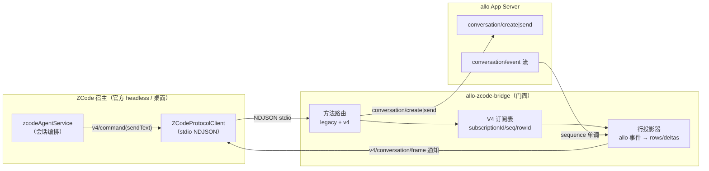
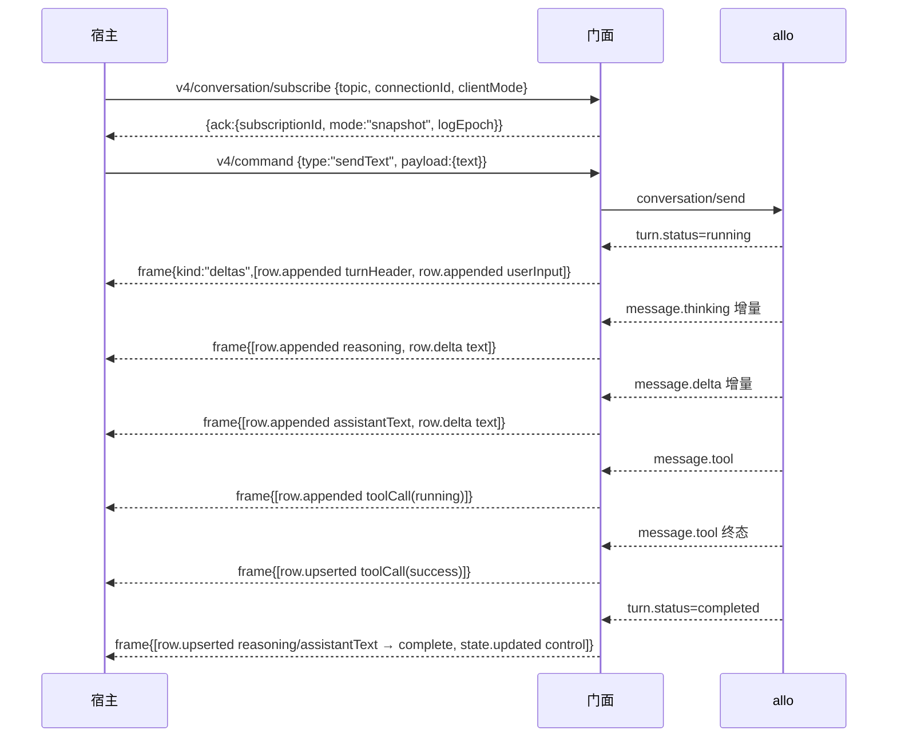

# ZCode V4 会话面接入 allo · 行模型映射方案

> **状态**：🔧 实现中（契约已核实并落地；闭环验收见 §6）
> **上游依据**：官方 `zai-org/ZCode` v3.15.1（`aac4755`），`packages/shared/src/zcode-protocol-v4/`
> **前序文档**：[38 号 · ZCode Desktop 接入可行性与映射方案](38-zcode-desktop-integration-plan.zh.md)
> **核心原则**：allo 既有 wire 面不变；V4 是**宿主侧协议**，接入只发生在门面内；行模型只做"有 allo 事件来源"的行，没有来源的行一律不发。

---

## 1. 为什么需要这份文档

38 号方案把 V4 会话面列为阶段 3（选做）。2026-10-12 用官方 headless 宿主（`@zcode/server-cli`）做真机联调后，这个判断被推翻：

- 真机已跑通：宿主按 `ZCODE_AGENT_SERVER_COMMAND` spawn 门面 → 门面连真 allo 建会话 → 快照被宿主接受（`sessionId=allo-session-1`）。
- 但订阅一发就撞墙：宿主调 `v4/conversation/subscribe`，门面只有 legacy `session/subscribe`，回 `-32601`。
- 官方源码注释写死了方向：`V4_METHODS`（`shared/src/zcode-protocol-v4/transport.ts:330`）——"旧 `session/*` 方法删除后，这里就是唯一协议面"，且宿主侧**无 legacy 回落**（`zcodeAgentService.ts:5797` 起全走 V4）。

**结论**：V4 会话面对"接入官方 ZCode 桌面"不是选做，是必做。legacy `session/event` 投影面在官方宿主已无消费者，其成果（38 号 §3.4 的投影词汇 + schema 校验）降级为设计参考。

---

## 2. 方案全景

### 2.1 端到端拓扑



三个要点：

1. **legacy 与 V4 并存**：宿主建会话仍走 legacy `session/create`（`zcodeAgentService.ts:3817` 调 `zcodeProtocolMethods.sessionCreate`），订阅/发送/收帧走 V4。门面两侧都要实现，不能只做一边。
2. **V4 的内容全部走"通知"而非 RPC 响应**：`subscribe` 只回 Ack，snapshot 与 deltas 都是 post-response 通知帧 `v4/conversation/frame`。
3. **序号唯一来源是 allo 的 `sequence`**：门面不自己造回合序号，重连补帧按 allo sequence 去重（38 号 TC-ZC-010 的不变量在这里继续成立）。

### 2.2 一轮对话的帧序



---

## 3. 行模型映射（本方案主体）

### 3.1 九种行与"有无来源"

`conversationRowSchema` 是九种行的判别联合（`rows.ts:433`）。**只有五种有 allo 事件来源**，首版只发这五种；其余四种没有来源，一律不发——发空壳行比不发更糟（桌面会渲染出假状态）。

| V4 行 | allo 来源 | 首版 |
| --- | --- | --- |
| `turnHeader` | `turn.status=running` | ✅ |
| `userInput` | 门面发出的 send 内容 | ✅ |
| `assistantText` | `message.delta` + 终态 | ✅ |
| `reasoning` | `message.thinking` + 终态 | ✅ |
| `toolCall` | `message.tool`（起始 + 终态） | ✅ |
| `artifact` | allo 无对应事件 | ❌ |
| `subagent` | allo 无对应事件（多代理属阶段 3） | ❌ |
| `hookInvocation` | allo 无对应事件 | ❌ |
| `timelineMarker` | 无来源 | ❌ |

### 3.2 allo 事件 → V4 增量

| allo 事件 | V4 delta |
| --- | --- |
| `turn.status=running` | `row.appended` turnHeader(`origin:"userInput"`) + `row.appended` userInput(`text`=发送内容) |
| `message.thinking` 首次增量 | `row.appended` reasoning(`state:"streaming"`) |
| `message.thinking` 后续增量 | `row.delta{path:"text", append}` |
| `message.delta` 首次增量 | `row.appended` assistantText(`state:"streaming"`) |
| `message.delta` 后续增量 | `row.delta{path:"text", append}` |
| `message.tool` 非终态 | `row.appended` toolCall(`status:"running"`) |
| `message.tool` 终态 | `row.upserted` toolCall(`status` ∈ `success`/`error`/`cancelled`) |
| `turn.status=completed` | `row.upserted` reasoning/assistantText → `state:"complete"`；`state.updated{control:{phase:"completedSuccess"}}` |
| `turn.status=cancelled` | `row.upserted` → `state:"interrupted"`；`state.updated{control:{phase:"completedInterrupted"}}` |

`row.delta` 的 `path` 只可能取 `text`（`streamablePathSchema` 四值中，另外三个 `inputText`/`output.text`/`summaryText` 在最小闭环里不产生）。

### 3.3 序号与身份纪律

- `seq`：直接取 allo 事件的 `sequence`，帧的 `fromSeq`/`toSeq` 按区间记账（snapshot 帧 `fromSeq=0`）。
- `logEpoch`：会话创建时生成一次，订阅生命周期内不变；重连后不变（防旧流交错）。
- `revision`：门面内单调递增，每次 `state.updated` 都带。
- `rowId`：会话内单调、永不复用（schema 注释明确要求），由门面计数器分配。
- `subscriptionId`：宿主传入即用；未传则门面生成。

### 3.4 快照首帧

订阅时若 allo 侧已有内容（冷恢复），首帧发 `kind:"snapshot"`。`conversationSnapshotSchema` 的 **B 区 `rows` 是行窗口**（`rowsWindowSchema`：`{window: ConversationRow[], totalCount, firstRowId}`，尾部窗口上限 `snapshotTailWindowRows=60`），不是空占位——冷恢复时把已累积的行整体下发，客户端据此重建视图。

> **实测订正（2026-10-12 真机）**：本方案初版写的是"行集合由客户端按 delta 累积，不进快照"，那是只读了 A 区得出的错结论。schema 机器校验（`npm run test:schema`）直接把 `rows`/`subagents`/`workflowRuns`/`protocolVersion`/`logEpoch`/`seq`/`revision`/`usage.cumulative.cacheRead|cacheWriteTokens` 九个缺失项全部抓出来——**这九个字段手抄必漏**。

## 3.5 wire 信封（实测抓出的第二层）

宿主解析的不是 topic frame 本身，而是 **wire 信封**（`topicWireFrameCandidateSchema`，判别值 `complete` / `fragment`）：

```
{ wireVersion: 3,                       // V4_WIRE_PROTOCOL_VERSION
  kind: "complete",                     // 或 "fragment"（分片）
  deliveryKind: "initial"|"online"|"recovery",
  logicalFrameId, logicalFrameOrdinal,  // 进程内单调，宿主按它判乱序/重组
  topic, subscriptionId,
  frame: <topic frame> }                // 内层才是 {topic, subscriptionId, fromSeq, toSeq, sentAt, payload}
```

少了这层信封，宿主会**整帧丢弃**并记 `丢弃无效 v4 conversation frame`（真机日志原文，判别值报 `Expected 'complete' | 'fragment'`）。`PROTOCOL_V4_LIMITS.maxFrameBytes = 1MB`：超限必须分片（`fragment` + base64 + checksum），门面当前**未实现分片**，改为超限明确告警不发送（见 §7）。

---

## 4. 控制面状态（A 区）取值口径

宿主 UI 依赖控制面判断"能不能发、能不能停"。门面的取值原则：**没有对应事实的状态给保守缺省，不编造**。

| 字段 | 取值 |
| --- | --- |
| `control.phase` | `draft`（未发过）→ `running`（回合中）→ `completedSuccess` / `completedInterrupted` / `error` |
| `control.sessionEnded` / `canStop` / `stopState` / `stopTargetKind` | `false` / `false` / `"idle"` / `"assistant"`（除 `canStop` 在 running 时为 `true`） |
| `control.activeWorks` | `[{kind:"primaryTurn"}]`（running 时）/ `[]` |
| `control.lastError` / `apiRetry` | `null`（allo 不通过事件面暴露重试态） |
| `availability.*` | 全部 `{allowed:true}`（除 `pauseGoal`/`resumeGoal` 无目标时 `{allowed:false, reasonCode:"no_goal"}`） |
| `inputRouting.mode` | 空闲 `"startNow"`；回合中 `"enqueue"` |
| `meta` | `{title, titleSource:"default"}`，标题来自 allo 会话名 |
| `config` | `{provider, model, thought, thoughtLevels:[], followupMode:"queue", mode:"build"}`，取自 allo 会话设置 |
| `usage.contextWindow` | `null`（allo 事件面不带上下文窗口，不编数字） |
| `queue.items` / `autoDrain` | `[]` / `true` |
| `pendingInteractions` / `pendingCommands` / `backgroundWorks` / `subagents` / `workflowRuns` / `goal` / `plan` | `[]` 或 `null`（**决策 A：桌面无交互审批，故 `pendingInteractions` 恒空**） |

---

## 5. 实现落点

| 组件 | 职责 |
| --- | --- |
| `lib/v4-row-model.mjs` | 纯函数投影器：allo 事件 + 会话状态 → V4 rows/deltas/state patch |
| `lib/v4-protocol.mjs` | V4 方法面：subscribe / command / resync / unsubscribe 的入参出参形状与**帧构造（含 wire 信封）** |
| `lib/v4-sessions-index.mjs` | 侧栏会话列表：allo `ConversationView` → V4 `sessionSummary`、快照与增量 |
| `lib/host-housekeeping.mjs` | 宿主自状态同步（`provider/updateAccountConfig` 等三条）：接收并回执，不应用到 allo |
| `bin/allo-zcode-bridge.mjs` | 注册 V4 handler 与 `session/read`，把 allo 事件流接进行投影器，按订阅表发通知帧 |

**方法面清单**（截至本文档）：

| 方法 / 通知 | 来源 | 说明 |
| --- | --- | --- |
| `session/create` `session/send` `session/list` `session/resume` `session/setModel` `session/setThoughtLevel` `session/stop` `session/subscribe` | legacy | 保留：官方宿主建会话仍走这条 |
| `session/read` | legacy | 宿主 task-index-syncer 回源同步任务索引行（返回同一份 legacy 快照） |
| `provider/updateAccountConfig` `workspace/updateInteractionPreferences` `workspace/updateModelIoPreferences` | 宿主自状态 | 建会话前的同步屏障，缺了会被当致命错误 |
| `v4/conversation/subscribe` `v4/conversation/resync` `v4/conversation/unsubscribe` `v4/command` | V4 | 官方宿主的订阅/发送面 |
| `v4/conversation/frame`（通知） | V4 | conversation 与 sessions-index 两个 topic 共用同一通知方法 |

安全红线不变：门面**不伪造审批**（`pendingInteractions` 恒空是决策 A 的落实，不是"已批准"）；非终态工具事件仍走 stderr 告警。

---

## 6. 验收口径

| 编号 | 操作 | 通过标准 |
| --- | --- | --- |
| TC-ZC-013 | 真机宿主建会话 → 订阅 → 发消息 | subscribe 回 Ack；首帧 snapshot 合法；`v4/command(sendText)` 后收到 `row.delta`；`append` 拼接结果等于 allo 完整正文；终态 `row.upserted` 后 `assistantText.state="complete"` |
| TC-ZC-014 | schema 机器校验 | 全部 V4 帧/行/delta/ Ack 过官方 `@zcode/shared` zod（strict）parse |
| TC-ZC-015 | 序号纪律 | 同一会话内 `seq` 单调不倒退；`rowId` 单调不复用；重连后不产生重复行 |
| TC-ZC-016 | 无来源行不发 | `artifact`/`subagent`/`hookInvocation`/`timelineMarker` 四种行在最小闭环里零出现 |
| TC-ZC-017 | 控制面诚实 | `pendingInteractions` 恒空；`usage.contextWindow` 为 `null`；不存在编造的 usage 数字 |

## 7. 真机验证记录（2026-10-12，官方 headless 宿主 + 真 allo + 真 mimo）

驱动方式：`tools/drive-zcode-host.mjs` 经 WS `/ws` → `zcode-agent` channel → 握手 → `createSession` → `subscribeConversationV4` → `sendPrompt` → `readSession`，并经 `onDynamicConversationFrame` 动态事件收帧。

**实测输出**：

```
收到 23 帧 / 28 delta，终态 phase=completedSuccess
delta 序列: row.appended:turnHeader, row.appended:userInput, state.updated,
            row.appended:reasoning, row.delta×7,
            row.appended:assistantText, row.delta×10,
            row.upserted:reasoning, row.upserted:assistantText, row.upserted:turnHeader,
            state.updated
思考（23 字）: 用户只是要求一句话自我介绍。直接简短回答即可。
正文（50 字）: 你好，我是 Allo，你这台电脑上的桌面助手，可以帮你处理文件、检索资料、写代码和完成日常办公任务。
工具行 0 条（该回合模型未调用工具）
session/read 通过：protocol=ZCode Protocol sessionId=allo-session-24
```

**逐项结论**：

| 面 | 真机结果 |
| --- | --- |
| `session/create` | 通过（宿主接受快照，模型为 allo 侧 mimo） |
| `provider/updateAccountConfig` | 通过（真机 10 个 account provider，`status: received`，revision 回显一致） |
| `v4/conversation/subscribe` | 通过（Ack + 首帧 snapshot，宿主附加 `openTiming` 诊断） |
| `v4/command(sendText)` | 通过（`accepted` + `inputAccepted`，`stateRevision` 递增） |
| `v4/conversation/frame` | 通过（wire 信封被接受，宿主**无**「丢弃无效 v4 conversation frame」记录） |
| `sessions-index` 订阅 | 通过（宿主 `zcode-task-index-syncer` 不再报「订阅失败」） |
| `session/read` | 通过（task index 回源同步可取回合法快照） |

即 **TC-ZC-013/015/017 在真机全部通过**；TC-ZC-014 由 `npm run test:schema` 的 51/51 覆盖；TC-ZC-016 由单测覆盖。

## 8. 已知边界（未做，明确声明）

1. **分片路径未实现**：单帧超 1MB（`PROTOCOL_V4_LIMITS.maxFrameBytes`）时门面告警不发送，不发坏帧。工具输出超长时会触发，需补 `fragment` + checksum。
2. **`workspace-config` 只回 Ack 不下发帧**：allo 没有与 ZCode「工作区配置目录」同构的事实（agents/skills/commands 目录），硬造就是假数据。侧栏会话列表（`sessions-index`）已实现，不受影响。
3. **帧未合批**：门面一个 allo 事件一帧（23–26 帧/轮）。宿主 `DELIVERY_PROFILES.continuous.flushWindowMs = 30` 暗示应按窗口合批，属优化项，不影响正确性。
4. **`resync` 只重拉 allo 历史**，未把历史行重投影为 delta（避免制造重复帧）；冷恢复首帧的行窗口来自进程内累积，进程重启后为空（此时靠 `session/read` + 后续 delta 重建）。
5. **工具行相关键退化**：allo 事件面无稳定 `tool_call_id` 时按工具名相关，同名工具连续调用会合并到同一行（投影器注释已标）。
6. **PNG 未导出**：正文两幅 mermaid 图待补 `assets/39-*.png`。

---

## 附录 A · V4 契约逐条底稿（官方源码位置）

| 契约 | 位置 |
| --- | --- |
| `V4_METHODS` / `V4_NOTIFICATIONS` 全集 | `packages/shared/src/zcode-protocol-v4/transport.ts:330-414` |
| `topicWireFrameCandidateSchema`（wire 信封，`complete`/`fragment`） | `packages/shared/src/zcode-protocol-v4/wire.ts:85`（`createTopicWireFrameSchema`） |
| `topicFrameDeliveryKindSchema`（`initial`/`online`/`recovery`） `packages/shared/src/zcode-protocol-v4/wire.ts:16` |
| `PROTOCOL_V4_LIMITS`（`maxFrameBytes: 1MB`、`snapshotTailWindowRows: 60`） | `packages/shared/src/zcode-protocol-v4/core.ts:64` |
| `subscribeParamsSchema` / `subscribeAckSchema` | 同文件 `:109-127` |
| `v4ConversationSubscribeParamsSchema`（+`connectionId`/`clientMode`） | 同文件 `:422-437` |
| 帧信封 `createTopicFrameSchema`（`topic`/`subscriptionId`/`fromSeq`/`toSeq`/`sentAt`/`payload{kind}`） | 同文件 `:158-186` |
| `conversationSnapshotSchema` | `packages/shared/src/zcode-protocol-v4/snapshot.ts:471` |
| `conversationDeltaSchema`（七种 op） | `packages/shared/src/zcode-protocol-v4/delta.ts:104` |
| `conversationRowSchema`（九种行） | `packages/shared/src/zcode-protocol-v4/rows.ts:433` |
| `rowBaseFields`（`rowId`/`turnId`/`entityId?`/`createdAt`/`createdAtSeq`/`actions`） | 同文件 `:18` |
| `streamablePathSchema`（`text`/`inputText`/`output.text`/`summaryText`） | `packages/shared/src/zcode-protocol-v4/core.ts:23` |
| `statePatchSchema`（键级整体替换，键集合封闭） | `packages/shared/src/zcode-protocol-v4/delta.ts:40` |
| `sessionPhaseSchema`（`draft`/`prewarming`/`running`/`completedSuccess`/`completedInterrupted`/`error`） | `packages/shared/src/zcode-protocol-v4/snapshot.ts:28` |
| `commandEnvelopeSchema`（`commandId`/`clientId`/`sessionId`/`baseRevision?`/`type`/`payload`/`issuedAt`） | `packages/shared/src/zcode-protocol-v4/command.ts:340` |
| `commandPayloadSchemas.sendText`（`text`/`attachments?`/`requestedDelivery?`） | 同文件 `:92` |
| 宿主侧调用点（subscribe 无 legacy 回落） | `packages/services/src/zcode-agent/zcodeAgentService.ts:5797` |
| 宿主侧 `session/create` 仍走 legacy | 同文件 `:3817` |

## 附录 B · 与 38 号文档的关系

- 38 号附录 D 第 12/14/15 条记录的三个缺口中，前两个（供应商就绪门槛、`provider/updateAccountConfig`）已实现，第三个（V4 订阅）由本文档接续。
- 38 号 §5.3 的 TC-ZC-013 验收标准以本文档 §6 为准。
- 38 号阶段 1 的 legacy 投影（`turn.started`/`part.delta`/`turn.completed`）保留在门面内供 fork/旧版宿主使用，但不是官方宿主的交付面。
