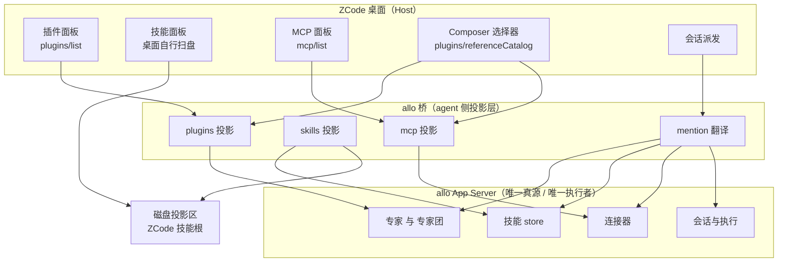
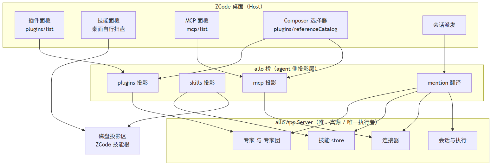
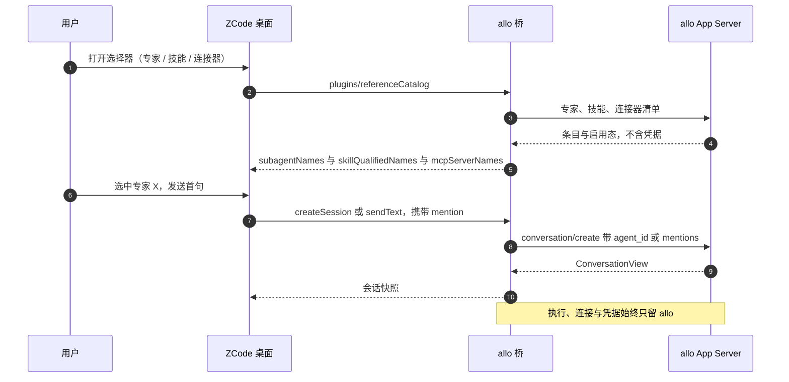
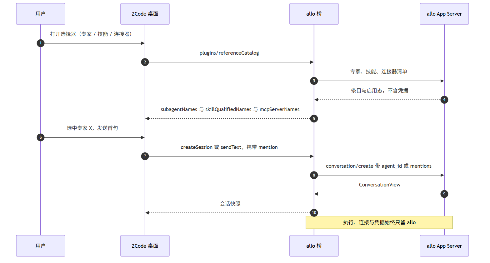

# 41 · allo Agent Store 向 ZCode 插件/技能/MCP 面的投影 · 技术方案

> **状态**：✅ 已实现（迭代 1 + 迭代 3 + 技能引用清单；专家的 mention 绑定待真机样本——本机 `agent/list` / `team/list` 都是 0 条）
> **实测记录**：见 §6。单测 73/73、schema 69/69、两个真机探针全绿。
> **核心原则**：allo 是唯一真源、唯一执行者；ZCode 侧拿到的是**只读投影**。凡 ZCode 里没有对应语义的东西，宁可少报，也不伪造。

---

## 1. 背景与核心痛点

### 1.1 业务背景

allo 的 Agent Store 里已经有专家（AgentDefinition）、专家团（Team）、技能、连接器四类资产。ZCode 桌面的「插件 / 技能 / MCP 服务器 / 子智能体」四个面板是用户唯一看得见它们的入口。目标：**让这四类资产在 ZCode 里看得见、选得中、用得上，且不存在第二份真源。**

### 1.2 现状与三大痛点

1. **三个面在 ZCode 里的供给通道不一样，不能一刀切。**
   插件面板与 MCP 面板的数据来自 **agent 协议**（`plugins/list`、`plugins/overview`、`mcp/list`，`packages/services/src/zcode-agent/zcodeAgentService.ts:4196/4255/4773`），agent 就是我们的桥 → **桥能凭空提供**。
   技能面板不经过 agent：**桌面自己扫盘**（`packages/services/src/skills/skillsService.ts:74/84/800-830`，扫 `<ws>/.zcode/skills`、`~/.zcode/skills`、`.agents/skills` 与插件 manifest 的 skills 根）→ **协议给不了，必须落盘**。
   真机旁证：当前面板里的"技能 2"（`executive-reporting`、`tech-docs-polish`）就是本机 `~/.agents/skills/` 下的两个目录，与 allo 无关。
2. **真源分裂风险。** 任何"物化到 ZCode 格式"的做法都会产生第二份真源：用户在 ZCode 里改了，allo 不知道；allo 更新了，ZCode 是旧的。必须有明确单向与归属标记。
3. **专家团在 ZCode 里没有对应物。** ZCode 的插件组件只有 `agent / command / skill / hook / mcp / lsp`（`packages/shared/src/zcode-protocol/index.ts:2900`），没有"团"。硬套会把「lead + DAG + 事件」降级成一个静态插件，语义是假的。
4. **现状证据（本机）**：桥目前没有实现 `plugins/*` 与 `mcp/list`，所以面板显示"已安装 0 / 尚无"；这属于"没供给"，不是"没有资产"。

### 1.3 能力对比矩阵

| 面 | 现状行为 | 本方案目标 |
| --- | --- | --- |
| 专家 | ZCode 面板看不到 allo 专家 | 作为插件 + `agent` 组件出现在插件面板与 `@` 选择器；选中后由 allo 按 `agent_id` 派发 |
| 专家团 | 无入口 | v1 只做展示（团=插件、成员=agent 组件）；**不承诺**在 ZCode 里按 Team Runtime 调度 |
| 技能 | 面板显示的是磁盘上无关技能 | 面板显示 allo 技能（源 `<data_dir>/skills`，即 allo 自己加载的那个根），启用态与 allo 一致 |
| 连接器 | 无入口 | 作为 MCP server 出现在 MCP 面板与 `@` 选择器；执行与凭据全部留在 allo |

---

## 2. 方案全景与架构设计

### 2.1 端到端拓扑

### 2.2 目标与非目标

**本阶段目标**

- 桥实现 `plugins/list`、`plugins/overview`、`plugins/referenceCatalog`、`mcp/list` 四个只读面，把 allo 的专家/专家团/连接器投影出去。
- 技能：以 `<data_dir>/skills`（allo 加载用户技能的同一个根，本机即 `%LOCALAPPDATA%\Flowy\Nomi\skills`）为**扫描源**，单向投影到 ZCode 技能根，使面板显示 allo 技能。
- `@` 选择器的选择结果翻译成 allo 的 `agent_id` / mentions，**真的落到会话上**。

**明确的非目标**

- 不做双向同步（ZCode 侧对投影物的编辑不回流 allo）。
- 不把 allo 连接器凭据写进任何 ZCode 配置文件。
- 不在 ZCode 侧实现 allo 的 Team Runtime（专家团只展示）。
- 不实现 ZCode 插件市场安装链（`plugins/install|uninstall|update`）。

### 2.3 架构不变量

1. **凭据不出 allo**：投影面里只出现名称、描述、传输类型；连接器的鉴权头/密钥一律不进入 ZCode 的任何文件与协议帧。
2. **执行只在 allo**：ZCode 侧只做展示与选择；一轮对话里的工具执行、MCP 连接由 allo 完成。
3. **单一真源**：投影物必须可识别（带归属标记）、可整体重建（删掉重投不回丢信息）。
4. **不伪造**：ZCode 里没有等价语义的（专家团的调度），只报展示态并标注；不把"无审批/未实现"包装成"已支持"。

---

## 3. 核心设计与模块规范

### 3.1 插件面：专家 / 专家团 → 插件与 agent 组件

**桥要实现的方法**

| 方法 | 桥返回什么 | 备注 |
| --- | --- | --- |
| `plugins/list` | `{ plugins: ZCodePluginInfo[], diagnostics: [] }`，每个 allo 专家/团 = 一条 | `components` 里放 `kind: "agent"` 的组件组 |
| `plugins/overview` | 面板计数与分组 | 与 `plugins/list` 同源，避免两处算法 |
| `plugins/referenceCatalog` | `subagentNames` / `skillQualifiedNames` / `mcpServerNames` | `@` 选择器的数据面；`subagentNames` 旧 Host 按空数组兼容 |

**投影规则**

| allo 资产 | ZCode 呈现 | 可派发 |
| --- | --- | --- |
| 专家（AgentDefinition） | 一条插件（`id = "allo:" + agent 名`），组件 `agent/<名>`，描述取 persona 摘要 | 是（映射 `agent_id`） |
| 专家团（Team） | 一条插件，成员各作为 `agent` 组件，描述里注明"团（展示）" | **否**（v1） |
| 团队/专家下的技能、连接器 | 归入同一插件的 `skill` / `mcp` 组件组 | 技能是；连接器是 |

**关键边界**：ZCode 的 subagent 是**由 agent runtime spawn** 的（`agents/*.md` 定义 + `subagents/readRuntimeConfig`）。我们的 runtime 是 allo，allo 自己有委派机制 → **ZCode 侧只承担"显示 + 选择"**，spawn 语义完全归 allo，避免两套并行。

### 3.2 技能面：allo 技能 → ZCode 技能

**事实基础**

- allo 侧技能根：`<data_dir>/skills/<slug>/SKILL.md`；导入的插件技能在 `<user_skills_dir>/agent-store/<snapshot_id>/<slug>/SKILL.md`（`crates/backend/nomifun-extension/src/skill_service.rs:113-115/219`）。
- **`<data_dir>` 的解析规则（与 allo 一致）**：`--data-dir` 参数 → `FLOWY_HOME` / `NOMIFUN_HOME` → 默认 `%LOCALAPPDATA%\Flowy\Nomi`（stable 通道；非 stable 追加 `-<channel>` 后缀，`storage_paths.rs:7-11/146-156`）。
- 本机现状：`%LOCALAPPDATA%\Flowy\Nomi\skills` **尚不存在**（0 条，因为还没装过用户技能）；`builtin-skills/` 是 allo 内置技能集，**不在本次投影范围**（ZCode 自带 bundled skills 已覆盖同类能力）。
- 两侧格式一致（都是 `SKILL.md` + YAML frontmatter），所以投影是"复制目录"而不是"翻译格式"。

**设计**

- **源**：**`<data_dir>/skills`**（扫描 `<slug>/SKILL.md` 与导入子树的 `agent-store/<snapshot_id>/<slug>/SKILL.md`），`--source` 可覆盖。选它而不是另指目录的理由：**扫描源与 allo 实际加载的技能根必须是同一个目录**，否则"面板显示的"和"会话里生效的"会分叉。
- **落点（二选一，D2 决策）**
  - **A（默认）**：物化到用户的 ZCode 技能根 `~/.zcode/skills/<slug>/`。理由：桌面技能面板一定扫得到，改动面最小。
  - **B**：作为插件 `skills/` 根，由插件启用态控制。多一层插件语义，仅在需要"按插件整包启停"时才用。
- **归属标记**：物化时在 frontmatter 写入 `metadata.projectedFrom: allo` + 源快照指纹；同步工具只清理"有标记且源已消失"的目录，**绝不删无标记的技能**（这是防误删的红线）。
- **单向**：ZCode 侧改投影物不回流；allo 侧改名/删除由下次同步收敛。
- **启用态**：`[skills]` 的启用态以 allo 为准；ZCode 面板的开关（若有）映射到 allo 的启用动词，映射不了就只读。

### 3.3 MCP 面：连接器 → MCP 服务器

- 桥实现 `mcp/list`，把 allo 连接器报成 MCP server：协议形状是 `stdio(command/args/env)` ∪ `http/sse(url/headers/oauth)`（`packages/shared/src/zcode-protocol/index.ts:741`），与 allo 连接器同构。
- **不写凭据**：不生成 `.mcp.json` / `~/.zcode/cli/config.json` 里的 `mcp.servers`。这些文件的凭据由 ZCode 自己管理，写进去等于跨系统搬凭据。
- **会话级 `mcpServers` 默认不用**：`createSession`/`conversation/send` 支持随会话下发 MCP server（`:1920/1943`），但我们的连接已由 allo 自管，双份会导致同一连接被建两次。

### 3.4 交互时序：选专家 → 派发一轮

### 3.5 契约对照（关键字段）

| ZCode 侧字段 | 来源方法 | 映射自 allo |
| --- | --- | --- |
| `ZCodePluginInfo.id / name / version / enabled / source` | `plugins/list` | 专家或团的 id/名字/版本/启用态；`source` 固定 `allo` |
| `components[].kind = "agent"` | `plugins/list` | 专家（或团成员）名单 + 描述 |
| `components[].kind = "skill"` | `plugins/list` | 该专家挂载/该团使用的技能名 |
| `components[].kind = "mcp"` | `plugins/list` | 该专家/团可用的连接器名 |
| `subagentNames` / `skillQualifiedNames` / `mcpServerNames` | `plugins/referenceCatalog` | 同上，供 `@` 选择器 |
| MCP server 条目（名称/传输/状态） | `mcp/list` | 连接器（**无鉴权材料**） |
| 会话的 `agent_id` / mentions | `conversation/create`、`conversation/send` | 由桥翻译 `@` 选择结果 |

### 3.6 状态与启用态

- 专家/团：`enabled` 单向取自 allo（投影只读）。
- 技能：allo 启用 → 投影目录存在；allo 停用/删除 → 下次同步移除带标记的投影目录。
- 连接器：只报"已安装/可用"，不报连接中的凭据状态。

---

## 4. 关键决策与权衡矩阵

| 编号 | 决策点 | 选定方案 | 放弃的替代方案与理由 |
| --- | --- | --- | --- |
| **D1** | 技能扫描源路径 | **`<data_dir>/skills`（与 allo 加载技能的同一根，参数化）** | ❌ 另指一个固定目录（如 `~/.agent-store/skills`）：会让"面板显示的"与"会话里生效的"成为两个目录，正是要消除的分叉。`<data_dir>` 默认 `%LOCALAPPDATA%\Flowy\Nomi`，见 §3.2 |
| **D2** | 技能进 ZCode 的通道 | **物化到 ZCode 技能根（只读投影）** | ❌ 只走协议：技能面板是桌面扫盘，协议给不了；❌ 只靠插件 skills 根：多一层启停语义，v1 不需要 |
| **D3** | 专家的执行语义 | **ZCode 侧只显示与选择，派发经 allo `agent_id`** | ❌ 在 ZCode 侧按 `agents/*.md` spawn：会有两套 subagent 机制并存，行为不可预测 |
| **D4** | 专家团 | **只做展示，不承诺调度（用户已确认）** | ❌ 映射到「自动化/工作流」：那是 ZCode 的调度器，不是 allo Team Runtime，会把语义做成假的 |
| **D5** | 连接器凭据 | **不写任何 ZCode 配置文件** | ❌ 生成 `.mcp.json`：等于跨系统复制连接器凭据，触碰安全红线 |
| **D6** | 同步方向 | **单向（allo → ZCode）+ 归属标记 + 只清理带标记者** | ❌ 双向同步：两侧模型不同（allo 技能带版本/来源），冲突消解成本远高于收益，且易误删 |

---

## 5. 验收标准与验证矩阵

### 5.1 验收用例

| 编号 | 操作路径 | 可断言结果 |
| --- | --- | --- |
| `TC-SP-001` | 桥启动后调用 `plugins/list` | 返回条目数 = allo 专家数 + 团队数；`components` 含 `agent` 组 |
| `TC-SP-002` | ZCode 插件面板打开 | 列表与 `TC-SP-001` 一致；无 allo 资产时显示空而不是报错 |
| `TC-SP-003` | `plugins/referenceCatalog` | `subagentNames` 与专家名集合一致（顺序稳定） |
| `TC-SP-004` | 跑技能同步（在 `<data_dir>/skills` 放一个测试技能） | `~/.zcode/skills/<slug>/SKILL.md` 出现且带投影标记；ZCode 技能面板可见 |
| `TC-SP-005` | 删除源技能后重跑同步 | 投影目录被移除；**无标记的技能目录不受影响** |
| `TC-SP-006` | `mcp/list` | 条目名与 allo 连接器一致；响应中**不含任何鉴权材料** |
| `TC-SP-007` | 选择器里选一个专家并发送首句 | allo 侧该会话的 `agent_id` = 所选专家（读回确认） |
| `TC-SP-008` | 选择器里选一个连接器并发送 | allo 侧该轮 mentions 含该连接器，工具可用 |
| `TC-SP-009` | 用不存在的专家名调用 | 如实报错，不静默降级成"默认专家" |

### 5.2 验证梯子

1. 桥单测（mock allo）：四个方法的形状 + 投影规则 + 标记清理逻辑。
2. schema 机器校验：所有回报帧必须过 ZCode 官方严格 schema（沿用 40 号已有的 `test:schema` 通道）。
3. 真机只读核对：面板条目数 vs `agent/list`、`skill` 目录、`connector/list` 三方对账。
4. 真机写路径：选专家/连接器 → 发一轮 → 从 allo 读回 `agent_id` / mentions。

### 5.3 迭代拆分（2 周为一档；按实测校准，非承诺）

| 迭代 | 范围 | 出口标准 |
| --- | --- | --- |
| 1（2 周） | 桥实现 `plugins/list` + `plugins/overview` + `mcp/list`；专家/连接器只读投影 | `TC-SP-001/002/006` 通过，面板条目与 allo 对账一致 |
| 2（2 周） | `plugins/referenceCatalog` + mention → allo `agent_id`/mentions 的翻译 | `TC-SP-003/007/008/009` 通过 |
| 3（2 周） | 技能落盘投影（源 `<data_dir>/skills`）+ 启用态单向 | `TC-SP-004/005` 通过，且无第二真源歧义 |
| 备用 | 专家团展示层（3–5 天，**用户已确认只做展示**） | 面板可见，标注明"展示态" |

### 5.4 未验证项（写方案时未能证实的）

- **技能必须落盘**这一判定来自 `skillsService.ts` 源码阅读，**未真机验证**"桥只在协议里报插件技能根时桌面会不会显示"；这也是为什么 D2 选了物化而不是协议。
- 桥回报的 `rootPath` 指向生成目录时，桌面「打开目录 / 插件详情」这类路径动作能否正常工作，未实测（组件清单走协议是确定的）。
- `plugins/install|uninstall|update`（插件市场安装链）的能力边界只粗看，未实测；当前桥不实现时面板显示"已安装 0"且不报错，说明非必需。
- 专家团映射到「自动化 / 已保存工作流」（`automation/create`、`workflows/*`）只做了粗看，未深挖能力边界——这也是 v1 不做它的原因之一。
- ~~allo 侧技能根与用户指定目录不一致~~ **已定口径（用户决定）**：扫描源就是 `<data_dir>/skills`，与 allo 加载用户技能的根同一个，不再另指目录（D1）。
- 专家团只做展示 **已定口径（用户决定）**，不映射到 ZCode 的自动化/工作流（D4）。

### 5.5 风险

- 技能物化会产生"ZCode 里改了不回流"的错觉；必须靠标记 + 单一写向 + 文档口径压住，否则半年后两侧必然对不上。
- ZCode 侧协议面（`plugins/*`）属于**新的 agent 能力面**，桥是唯一的实现者；一旦上游调整 shape，需要跟着改（沿用 40 号的 schema 机器校验可以早发现）。

---

## 6. 实现与实测记录

### 6.1 落点（探针目录 `C:\workspace\zcode-bridge-probe`，未并入 allo 仓）

| 文件 | 作用 |
| --- | --- |
| `lib/store-projection.mjs` | 纯投影函数：专家/团 → 插件、连接器 → `mcp/list` 状态、技能 → 引用清单、mention 解析、数据目录解析 |
| `lib/store-handlers.mjs` | 六个方法处理器（`plugins/list` · `plugins/overview` · `plugins/listUiSurfaces` · `plugins/referenceCatalog` · `skills/referenceCatalog` · `mcp/list`），allo 调用失败按错误帧上抛 |
| `bin/allo-zcode-bridge.mjs` | 挂载上述处理器；`createSession`/`sendText`/首发路径把 mention 翻成 allo 的 `agent_id` / `team_id` / `mentions` |
| `tools/sync-allo-skills.mjs` | 技能落盘投影（默认预演，`--apply` 写盘；带归属标记，只清理带标记者） |
| `tools/dump-allo-store.mjs` | 只读对账工具：打印 allo 四类目录（连接器字段自动脱敏） |
| `tools/probe-store-projection.mjs` | 真机探针：协议面 vs allo 目录三轮对账 + 凭据不过线 + fail closed |
| `tools/probe-skill-projection.mjs` | 真机探针：TC-SP-004/005（投影落盘、源删则撤、无标记不动） |
| `test/store-projection.test.mjs` | 11 条单测（映射、缺字段省略、凭据不落结果、mention 解析、歧义不猜） |
| `tools/schema-conformance.mjs` | 追加 7 条商店面 payload 的官方 schema 校验 |

### 6.2 实测结果（真机 2026-10-13）

| 检查 | 命令 | 结果 |
| --- | --- | --- |
| 单测 | `node --test test/` | **73/73**（商店面新增 11 条） |
| official schema | `npm run test:schema` | **69/69**（新增 7 条：plugins/list 有数据与全空两种、overview、两个 referenceCatalog、mcp/list、listUiSurfaces） |
| 真机协议面 | `node tools/probe-store-projection.mjs` | **全绿**：allo 目录 专家 0 / 团 0 / 技能 18 / 连接器 2；`plugins/list` 条目数 = 0+0；`skills/referenceCatalog` 18/18 且 path 非空；`mcp/list` 覆盖 2 个连接器（`github` → `failed` 带 `connection_failed` 与 allo 的 `last_error`；`weisheng-scrm` → `disabled`）；**投影响应不含 `credential` / `SCRM_APP_KEY` 痕迹**；未知 `sessionId` → 报错（fail closed，不回退 workspace） |
| 真机技能投影 | `node tools/probe-skill-projection.mjs` | **全绿**：造源 → 投影带标记 → 源改动触发更新 → 源删除撤投影 → **无标记的技能目录全程未动** |

### 6.3 实现中的两处修（探针抓出来的）

1. **插件 `name` 用清单名，不用中文显示名**：初版把 `display_name.zh` 填进 `name`，与 ZCode 的语义不符（`name` 是 manifest 名，用于冲突判定）。改为 `name` = allo 的 `name`，中文名走 `plugins/referenceCatalog` 的 `displayName` / `displayNameI18n`（快照 `plugins/list` 的 strict schema 里没有这两个字段，塞进去会被拒）。
2. **技能同步摘要必须按内容算**：初版用"路径 + 文件字节数"做摘要，同字节数的改动（如 `v1` → `v2`）会被判成"已是最新"而漏更新。改为逐文件 sha256。

### 6.4 面板接线核实（2026-10-13 真机，`ALLO_BRIDGE_TRACE` 全帧轨迹 + 桌面日志）

| 面板 | 数据源（源码位置） | 本机结果 |
| --- | --- | --- |
| 设置 → 插件（计数 插件/MCP/技能） | 插件列表**走 agent**：`packages/ui/src/store/pluginManagementStore.ts` "设置页「插件管理」的数据源经 IPluginManagementService 薄服务由 zcode-cli 提供" → `plugins/list` + `plugins/overview` | 桌面各调用 **8 次**，桌面日志 `plugin-management.listPlugins OK (4.8ms)` / `getPluginsOverview OK (6.1ms)`，**无 FAIL**；门面回 `{plugins: [], diagnostics: []}` → 面板显示 0，因为 allo 的 `agent/list` + `team/list` 直读都是 0 条（**接线正确，数据为空**） |
| 设置 → 插件 → **MCP 页签** | `McpSettingsSection` → `useMcpStore`：聚合**宿主自己的 MCP 配置**（ZCode CLI 配置 / 各 CLI 配置 / 工作区 `.mcp.json` / 插件 `declaredMcpServerNames`），**不读** agent 的 `mcp/list` | 轨迹里**没有任何 `mcp/list` 调用** → 该页签为 0 是设计结果（D5：不把 allo 连接器写进 ZCode 配置） |
| 设置 → 插件 → **技能页签** | 桌面自己扫盘：自有根（`~/.zcode/skills`、`~/.agents/skills`、`<ws>/.zcode|.agents/skills`）+ 插件技能根（官方缓存 `~/.zcode/cli/plugins/cache/...`）+ **外部 agent CLI 的技能根**（`packages/services/src/settings-sync/settingsSyncService.ts:137-160`：claudeCode / codexCli `~/.codex/skills` / openCode `~/.config/opencode/skills` / openClaw / augment / continue / goose / qwenCode / qoder / trae / kiro / roo …）；与 agent 无关 | **2026-10-13 复核（数字逐一吻合）**：面板 40 = `~/.codex/skills` **38** + `~/.agents/skills` **2**（`executive-reporting` / `tech-docs-polish`，排序也吻合：executive-reporting 正好落在 domain-modeling 与 find-skills 之间）。allo 的 18 个内置技能（art-motion/cron/officecli-*）**不在**这个列表里 |
| Composer 的 `@` / `$` 选择器 | agent 协议 `plugins/referenceCatalog` / `skills/referenceCatalog` | 已实现（真机探针验过）；allo 连接器出现在 `@` 的 `mcpServerNames` 里 |

**结论**：三个页签里只有「插件」走 agent；MCP 页签是宿主配置管理面，技能页签是磁盘扫描。

### 6.5 未验证 / 未实现（如实登记）

- **专家的 mention → `agent_id` / `team_id` 没有真机样本**：本机 `agent/list` / `team/list` 都是 0 条，整条绑定链只过了单测（解析 + 映射 + 歧义不猜），未在真机上验证过 allo 接受该 `agent_id`。
- **「有数据时」的面板渲染未验收**：接线已核实（§6.4：插件页确实走 agent 且调用成功），但本机 allo 里 0 专家/0 专家团，因此"插件列表里出现 allo 专家"的渲染、以及 `rootPath` 指向 allo 数据目录时"打开目录"这类动作，都没走一遍 UI（安装往返探针已证明装完 `agent/list` 会多一条，见 §7.2）。
- **会话级冻结 catalog 未实现**：`plugins/referenceCatalog` / `skills/referenceCatalog` 带 `sessionId` 时按 workspace 权威回报并在 stderr 记账；未知会话按协议报错（fail closed）。会话内冻结语义（新技能不进旧对话）留给后续。
- **`plugins/install` 已实现**（ZCode 插件市场 → allo `store/install-entry`，见 §7）；**`plugins/uninstall|update|setEnabled` 仍未实现**。
- **技能的"启用/停用"未双向打通**：投影按 allo 的启用态过滤（停用的不报、不投影），但 ZCode 面板上的开关不回流 allo（D6 单向）。

## 7. 插件市场（`插件市场` 页）映射 · 已实现

### 7.1 结论：可以，而且不用模拟"市场源"

ZCode 的**插件市场页数据面同样是 agent 提供的**（`plugins/overview` 的 `marketplaces` + `availablePlugins`，
`packages/ui/src/settings/PluginStoreListView.tsx` 用这两个字段渲染公开/个人分段），
所以不需要伪造一个 git/zip 市场源，直接把 allo 的市场与商店条目投影过去即可。

| ZCode 面 | allo 方法 | 映射 |
| --- | --- | --- |
| `marketplaces[]` | `market/list` | `id/name` ← `marketplace_id`/`name`；`pluginCount` ← `entry_count`；`source` 只报 `{kind: source_kind}`（allo 不公布 URL，**不编**）；`isOfficial: false` |
| `availablePlugins[]` | `store/list` | `id` = `<entry_name>@<marketplace_id>`（ZCode 的 id 约定）；`installed` 取 allo 真值；`description`/`listing.displayNameI18n`/`listing.icon` ← 条目的中文描述与头像；`componentTypes` ← `kind`（agent/team/skill/connector） |
| `plugins/install` | `store/install-entry` | `{marketplace, pluginName}` → `{marketplace_id, entry_name}`（1:1）；allo 自带"已装即 no-op"，不偷偷升级 |
| `plugins/describe` | `store/list` + `agent/list`/`team/list` | 详情抽屉：先按商店条目回答（未安装也能看），再按已安装的专家/团回答；都查不到 → 报 `not_found`（不编空详情） |
| `plugins/marketplace/add|remove|update` | `market/add|refresh|remove` | **本轮不做**（改 allo 市场配置，且 add 需要推断 `source_kind`）→ 不注册，宿主收 `-32601` 显式失败 |

**组件种类要过词表**：ZCode 的组件 kind 只有 `agent|command|skill|hook|mcp`（`index.ts:2900`）。
allo 的 `connector` 必须映射成 **`mcp`**、`team` 映射成 `agent`；认不出的 kind **不报**（空组件组），
否则宿主整包拒（真机踩过：`ZodError invalid_value ["agent","command","skill","hook","mcp"]`）。

**「公开 / 个人」分段**：ZCode 用固定白名单 `PUBLIC_STORE_MARKETPLACE_IDS`
（`packages/shared/src/plugin-marketplaces.ts:65` 的 `isPublicStoreMarketplaceId`）判"公开"。
allo 的市场 id（`experts` / `connectors` / `workbuddy-skills`）不在白名单里 → 落在**「个人」分段**。
要进「公开」得改上游白名单，不是投影层能伪造的。

### 7.2 实测（真机 2026-10-13）

| 检查 | 命令 | 结果 |
| --- | --- | --- |
| 只读投影对账 | `node tools/probe-store-projection.mjs` | **全绿**：`plugins/overview` 回报市场 **3**（= allo `market/list`）、可安装 **871**（= allo `store/list`），逐个市场的 `pluginCount` = allo 的 `entry_count`，871 条的 `installed` 标记与 allo **逐一一致**，投影里没有凭据字段 |
| 安装往返（写面） | `node tools/probe-store-install.mjs [market] [entry]` | **全绿**：经门面 `plugins/install`（默认条目 `experts/senior-developer`）→ 回读 `store/list.installed=true`、`agent/list` **0 → 1**（这就是插件页会多出来的条目）→ 收尾 `install/uninstall` → 回读 `installed=false`、`agent/list` **回到 0**（不留残留） |
| 单测 / schema | `node --test test/` · `npm run test:schema` | **79/79** · **73/73**（新增市场源、商店条目、安装参数映射、install 结果、describe 两种来源、**连接器 → `mcp` 词表**共 6 条） |
| 桌面端接线（真机日志） | `~/.zcode/v2/logs/<date>.log` | `plugin-management.listPlugins OK` / `getPluginsOverview OK`（市场 3 / 可安装 871，耗时 ~400–500ms）/ `describePlugin OK`；修复后 **0 FAIL** |

### 7.3 头像为什么显示不出来（已核实，非缺陷）

ZCode 只渲染 **`https://` 开头**的图片：`packages/ui/src/lib/trustedImageUrl.ts` 的
`isTrustedImageUrl` 就是 `url.startsWith("https://")`，`PluginIcon` 拿到不可信 URL 一律回退成占位图标
（`PluginStoreAvatar` → `PluginIcon` → `resolvePluginIconSource`）。而 allo 的头像是本地 App Server 的
**http 相对路径**（`/api/app-server/store/<market>/entries/<entry>/assets/avatars/...`）——相对路径不是
https，`http://127.0.0.1:8787` 也不是，两条都过不了；`data:` 同样过不了（不是 https）。

因此本轮的处理是：**默认不输出 `listing.icon`**，不塞一个永远渲染不出来的值冒充"有头像"。
想真的显示，把 allo 的资产端点放到一个**受信 https 源**上，再设
`ALLO_ASSET_BASE=https://<host>`（或 `--allo-asset-base`），门面才开始拼绝对 URL 传给宿主。三条路：

| 路径 | 代价 |
| --- | --- |
| 受信 https 域名/隧道反代到 allo 的资产端点 | 需要一个 https 域名 + 从该主机能访问本机 allo（隧道/反代）；本机离线就没了 |
| 自签 https 直连 | 桌面网络策略是 `insecureCerts=rejected`（真机日志），自签会被拒 → 不划算 |
| 推动上游放宽（允许 loopback http / `app://` 资源） | 不是本项目能决定 |

**文字部分不受影响**：条目的中文显示名与描述（`display_description`）会正常展示，
截图里能看到"Agent Earth / 专业金融股票行情…"这类中文就是从 allo 的条目描述来的。

### 7.4 已知边界

- **全量返回**：`availablePlugins` 每次都带全部 871 条（ZCode 的 overview 接口没有分页/过滤参数）。
  本机本地 IPC 尚可（面板每次打开拉一遍），条目规模再上一个量级时需要上游给分页或按市场查询。
- **市场源管理未做**：ZCode 的「添加 / 刷新 / 移除市场」按钮目前会收到 `-32601`（显式失败，不假装成功）。
  要做的话 `market/refresh`、`market/remove` 是 1:1（`{marketplace_id}`），`market/add` 需要在 `source`
  字符串上推断 `source_kind`（directory/github/git/url/zip）——一个产品决定。
- **卸载 / 升级 / 启停未做**：`plugins/uninstall|update|setEnabled` 未映射到 allo 的
  `install/uninstall|run|disable|enable`。
- **「公开」分段**：allo 市场按上游规则属「个人」，已说明。
