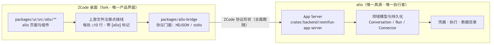
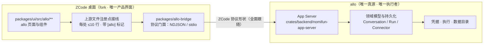
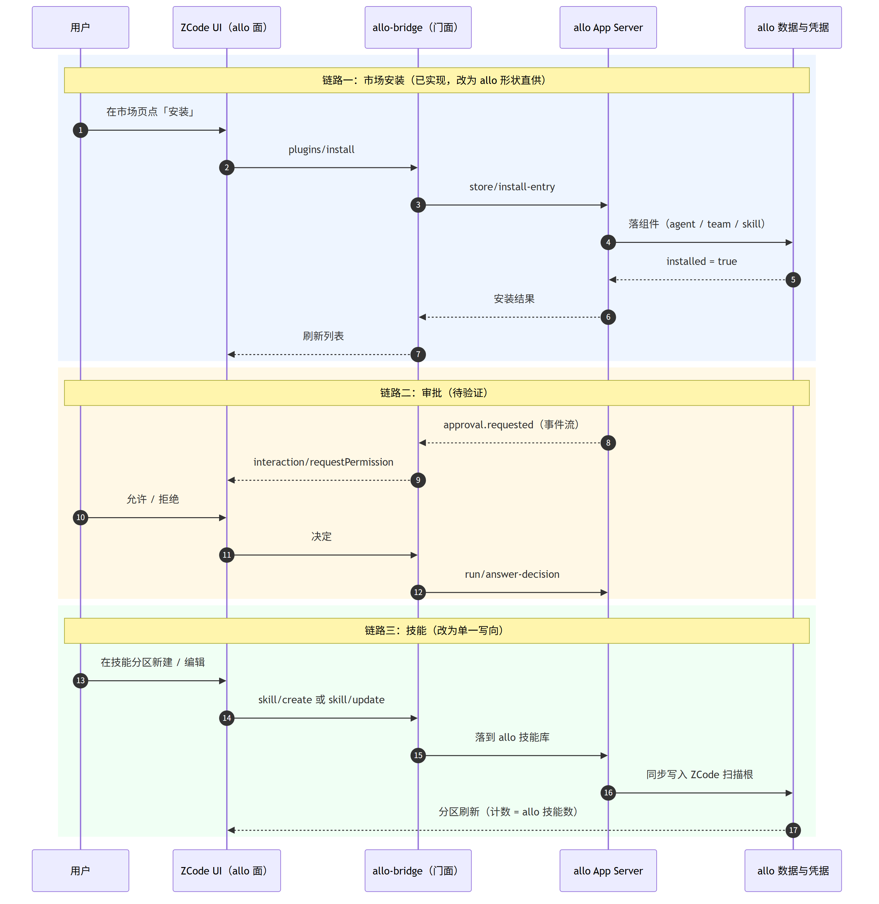
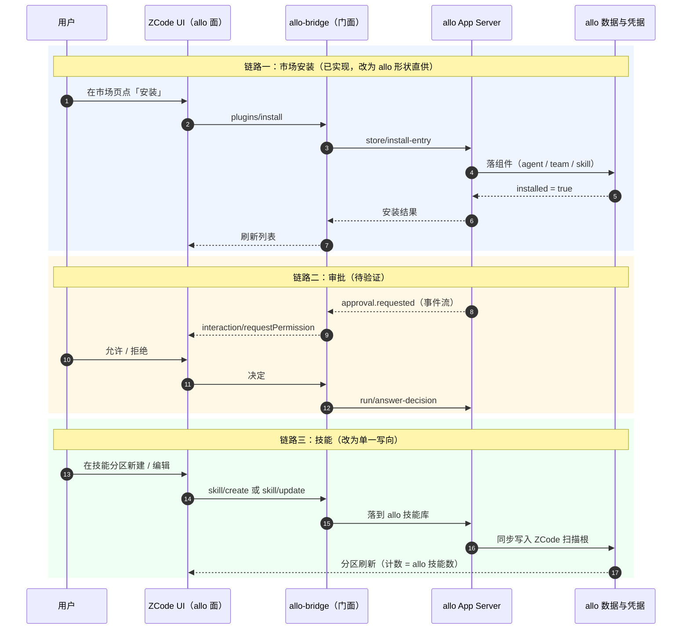

# 42 · 全面转向 ZCode 前端（allo 作为唯一后端与真源） · 技术方案

> **状态**：📋 计划（方向与两条关键决策已定：接管现有设置分区、allo 形状全面跟随；§6 为实现记录，实施时填充）
> **核心原则**：ZCode 是唯一产品界面，allo 是唯一真源与执行者；形状全面跟随 ZCode，领域模型不外泄；上游改动一律**可枚举、可开关、可审计、可回退**。

---

## 1. 背景与核心痛点

### 1.1 业务背景

allo Agent Store 尚未正式上线，当前没有产品界面。此前路线是自建 webui（`allo/web`：Vite + React 19 + 手写 CSS），ZCode 只是"顺便试过的第三方宿主"。

38 / 39 / 40 / 41 四份方案把 ZCode 从"能接"推到了"能跑"：官方桌面以 allo 作 agent 后端端到端跑通（真实模型回复渲染、48/48 单测、58/58 schema），并且已经完成专家/专家团→插件、技能→技能、连接器→MCP 的只读投影、插件市场页（3 市场 / 871 条目）与一键安装真机往返。

**本轮决策**（用户拍板）：

1. **webui 全面停止/弃用**，ZCode 成为唯一产品界面；
2. **allo 的 App Server 接口可按 ZCode 调整**（Agent Store 未上线，改造成本最低）；
3. **允许改动 ZCode 代码**，但必须做好隔离；
4. 设置面走**"接管现有分区"**（不新增 allo 分区，语义挂在 ZCode 既有的插件/MCP/技能/用量名下）；
5. allo 接口**形状全面跟随 ZCode**。

### 1.2 现状与三大痛点

| # | 痛点 | 具体表现（已实测） |
|---|---|---|
| 1 | **双前端重复维护** | webui 与 ZCode 各自实现会话、任务库、市场，同一份 allo 数据两套渲染与两套语义（归档、空草稿、思考档位都在两边各治过一轮） |
| 2 | **适配层漂移** | 形状翻译留在探针桥（`C:\workspace\zcode-bridge-probe`）里：ZCode 词汇（plugin / marketplace / component kind）与 allo 领域模型之间靠词表映射（`connector→mcp`、`team→agent`）；技能靠"落盘投影 + `.allo-projection.json` 标记"，本质仍是双写 |
| 3 | **上游断裂点不可见** | strict schema 曾整包拒（`kind: connector` 的 `ZodError invalid_value`）、图标只认 `https://`、市场白名单 `PUBLIC_STORE_MARKETPLACE_IDS` —— 全部靠真机撞出来；没有可执行的审计与回归机制 |

### 1.3 能力对比矩阵

| 能力 | 现状（webui + 探针桥） | 本方案目标 |
|---|---|---|
| 产品界面 | 自建 webui（部分面）+ ZCode（部分面） | **ZCode 唯一界面** |
| 形状真源 | 桥里双向翻译，两套词表 | **ZCode 形状即真源**（UI 投影面），翻译下沉到 allo 服务层 |
| 技能 | 落盘投影 + 归属标记，改不回流 | **单一写向**：allo 原生落到 ZCode 扫描根 |
| 启动方式 | 外部启动器注入 `ZCODE_AGENT_SERVER_COMMAND` 等 env | **并入 fork**（`packages/allo-bridge`），随桌面打包，无外部注入 |
| 上游改动 | 3 个文件 +29/−1 行，无清单、无门禁 | **补丁清单 + 标记 + 审计门禁**，每条带开关 |
| 可回退 | 无统一开关 | `ZCODE_ALLO_UI=0` 隐藏全部 allo 面，上游行为完整可测 |
| 凭据 / 执行 | 已在 allo | **不变**（不变量） |

---

## 2. 方案全景与架构设计

### 2.1 端到端拓扑





### 2.2 目标与非目标

**目标**

- ZCode 成为唯一产品界面；webui 停止新功能 → 停止构建发布。
- 设置面**接管现有分区**：插件分区的三个 tab（插件 / MCP / 技能）+ 插件市场页 + 用量分区 + 审批交互面，全部以 allo 为数据源。
- allo 接口按 ZCode 形状对齐，**消灭桥里的翻译层**（桥退化为"传输 + 形状校验"）。
- 隔离五条落地并被脚本门禁化。

**非目标（本阶段坚决不做）**

- ❌ 不 fork ZCode 的协议 wire（`packages/shared/src/zcode-protocol/**` 的 schema 不改）——上游协议是我们的契约，改它等于放弃 rebase 能力。
- ❌ 不把 allo 的领域模型改成 UI 概念（见 §2.3 不变量 5）。
- ❌ 不做"多宿主抽象"（不为将来接第二个前端预埋适配层）——只服务 ZCode。
- ❌ 不用 MCP Apps（plugin UI surface）当产品界面容器：已核实它由 `@modelcontextprotocol/ext-apps@2.0.0` 支撑、`resourceUri` 为 `ui://…`、`availability: "session"`，是**工具级交互输出**的通道，不是全局产品面（仅在 allo 工具需要交互式输出时作为加分项使用）。
- ❌ 不一次性删 webui 代码：迭代 2 通过后停新功能，迭代 3 通过后才谈删。

### 2.3 架构不变量（违反即回退）

1. **凭据不出 allo**：ZCode 侧不持有、不缓存、不打印 allo 的 connector / provider 凭据；`connector/credential/*` 的调用只发生在 allo 进程内。
2. **单一入站边界**：只有 `packages/allo-bridge` 一个包碰 allo 协议；`packages/ui/**` 不直连 allo 的 HTTP/WS。
3. **注册点接线**：上游文件只允许"新增注册点"，每处 ≤ 约 10 行、带 `// [allo]` 标记；不允许改写上游既有逻辑分支。
4. **可回退**：`ZCODE_ALLO_UI=0` 隐藏全部 allo 面，上游原生流程（GLM 后端）完整可跑。
5. **领域模型红线**：ZCode 的 UI 词汇（plugin / marketplace / component kind / section）**不进入** allo 的领域类型、持久化表与对外 SDK 边界；它们只活在 allo 的"UI 投影面"（服务层形状）里。

---

## 3. 核心设计与模块规范

### 3.1 分层与目录所有权

| 层 | 位置 | 归属 | 说明 |
|---|---|---|---|
| allo 页面与组件 | `packages/ui/src/allo/**` | **我们** | 全新目录，上游不碰 |
| allo 服务/客户端 | `packages/services/src/allo/**` | **我们** | 唯一碰 allo 协议的地方 |
| 协议门面 | `packages/allo-bridge`（新包） | **我们** | 由现探针目录迁入；NDJSON/stdio + 形状校验 |
| 注册点 | 上游既有文件 | **上游** | 每处 ≤10 行 + `// [allo]` 标记 |
| 补丁清单 | `allo/patches.md` + `scripts/allo-audit.mjs` | **我们** | 审计门禁 |

### 3.2 形状跟随：ZCode RPC → allo 能力映射

已按两侧源码列全（allo 侧取 `crates/backend/nomifun-app-server/src/lib.rs` 的方法面，ZCode 侧取 `packages/shared/src/zcode-protocol/index.ts` 的方法常量）。

| ZCode 面（RPC） | UI 落点 | allo 现有能力 | 缺口（要在 allo 侧改） |
|---|---|---|---|
| 会话帧 / `session/*` | 会话流、任务库 | `conversation/create｜list｜get｜messages｜send｜cancel｜subscribe｜event｜update` | 事件名对齐（已有 39 号行模型映射） |
| `run/*`（plan / answer-decision / steer） | 计划模式、澄清 | `run/plan｜get｜events｜result｜steer｜cancel｜subscribe｜answer-decision` | — |
| `interaction/requestPermission`、`interaction/requestUserInput` | 审批 / 权限弹窗 | `approval.requested` 事件 + `awaiting_approval` 状态 + `run/answer-decision` | 桥接为 ZCode 的 interaction 请求（**未验证**，见 §5.4） |
| `plugins/list｜overview｜describe｜install｜uninstall｜update｜setEnabled｜configure` | 插件管理页 | `agent/list｜get｜export`、`team/list｜get｜export`、`store/list｜install-entry｜update-entry` | 补 `store/uninstall-entry`；补 enable/disable 语义 |
| `plugins/marketplace/add｜remove｜update` | 市场管理 | `market/list`、`market/settings-set`、`store/update-entry` | 补 add / remove / refresh 对应方法 |
| 插件市场页 | 市场 + 商店列表 | `market/list`、`store/list` | 已通（871 条 + 一键安装真机验过） |
| `mcp/list`、`mcp/readResource` | MCP 分区 | `connector/list｜get｜status｜test｜call`、`config/get-mcp` | **只读投影**（状态 + 元数据）；**不写回宿主 MCP 配置** |
| `skills/referenceCatalog`、技能分区 | 技能 | `skill/list｜get｜file｜files｜create｜update｜delete｜copy` | 技能落盘根（见 D5） |
| `usage/stats`、`session/usage` | 用量分区 | `ContextUsage`、`TurnUsage`、`context.usage` 事件 | 补聚合查询 |
| `provider/*`、`session/setModel`、`session/setThoughtLevel` | 模型与档位 | `models/list`、`conversation/model-options` | 已通（思考档位四路翻译已收口） |
| `workspace/*` | 工作区 | `workspace/create｜list｜revoke` | — |
| `workflows/*` | 工作流页 | `run/plan` + Team DAG（规划中） | 后续迭代（对应"流程可视化编辑器"方向） |
| `automation/*`、`offPeak/*` | 定时 / 非高峰 | 无 | 后续（allo 侧新建能力） |

### 3.3 设置面：接管现有分区（不新增分区）

| ZCode 设置分区（复用既有 id） | 现在读什么 | 改成读什么 | 改动性质 |
|---|---|---|---|
| 插件分区 · 插件 tab | agent `plugins/list` + `plugins/overview` | allo `agent/list` + `team/list` | 已通，无上游改动 |
| 插件分区 · MCP tab | 宿主自己的 MCP 配置聚合（`useMcpStore`；不读 agent） | allo `connector/list｜status`（只读 + 状态） | **上游 hook 1 处** |
| 插件分区 · 技能 tab | 宿主扫盘（含外部 CLI 技能目录并集：本机 40 = `~/.codex/skills` 38 + `~/.agents/skills` 2） | allo `skill/list` | **上游 hook 1 处**，或 allo 原生落盘（D5） |
| 插件市场页 | `plugins/overview.marketplaces / availablePlugins` | allo `market/list` + `store/list` | 已通 |
| 用量分区（`usage`） | 宿主用量 | allo 用量聚合 | allo 侧补查询 + 接线 |
| 审批 / 澄清弹窗 | 宿主权限 | allo `approval.requested` | 桥接 1 处（**未验证**） |
| 新增分区（**仅当塞不进现有分区时**） | — | allo 专有：凭据管理 / 审批审计 | 需改 4 处（`settingsNavigation.ts` 的联合类型、守卫、隐藏集合、渲染分支） |

> 注：`SettingsSectionId` 是**封闭联合类型**（`packages/ui/src/lib/settingsNavigation.ts:4-22`）+ 硬编码守卫 + `HIDDEN_SETTINGS_SECTIONS`，因此"新增分区"的成本是 4 处小改；这也是选择"接管现有分区"的直接原因。

### 3.4 交互时序：安装 / 审批 / 技能（三条主链路）





### 3.5 隔离机制（可执行判据）

| 机制 | 规则 | 判据（脚本可查） |
|---|---|---|
| 标记 | 上游文件里的 allo 改动必须带 `// [allo]`（JSX/TS 用同行或上一行注释） | 扫上游文件：出现 `[allo]` 标记但不在清单 → 失败；清单条目在文件里找不到标记 → 失败 |
| 清单 | `allo/patches.md`：每个被改的上游文件 + 标记数 + 原因 + 对应 TC | 清单与实际标记数不一致 → 失败 |
| 开关 | 每个 patch 必须能被 `ZCODE_ALLO_UI=0` 或独立 flag 关掉 | 关开关跑上游原生流程 |
| 数据边界 | `packages/ui/**` 不得出现 allo 端点常量（`127.0.0.1:8787`、`app-server` 等） | grep 命中即失败 |
| 领域红线 | allo 仓的领域类型/持久化里不出现 `plugin` / `marketplace`（UI 词汇）作为新类型名 | allo 侧 grep + review |

### 3.6 上游同步流程

```text
pin 上游 tag（当前 aac4755 · v3.15.1）
  → git fetch origin && git rebase（我们的 patch 分支 allo/bridge）
  → scripts/allo-audit.mjs（标记 / 清单 / 边界）
  → 桥单测 + 官方 schema 校验 + 三个真机探针
  → 桌面冒烟（会话 + 插件 + 市场 + MCP + 技能）
  → 打包（绿色版 + NSIS）
```

上游冲突处理：**不手工解**。先按 §3.5 的清单定位受影响 patch，逐个决定"重打 / 提 PR / 放弃"。

### 3.7 降级状态机

| 状态 | 触发 | 行为 |
|---|---|---|
| `normal` | allo 可达、形状匹配 | 全部 allo 面正常 |
| `degraded` | 上游字段缺失 / 形状变化（strict schema 拒包） | 只读展示，缺字段省略不编（沿用 41 号"宁可少报不伪造"），stderr 告警 |
| `disabled` | `ZCODE_ALLO_UI=0` 或 allo 不可达 | 隐藏全部 allo 面，回到上游原生（**这是回退位，必须是终态可达的**） |

不可逆终态：无。`disabled` 必须能从任何状态进入。

### 3.8 双向链路：设置面的新建/修改回写 allo

**先摆事实**：ZCode 设置面的"新建/修改"**不走 agent 协议**。协议常量里只有读面（`mcp/list`、`mcp/readResource`、`provider/testModelConnectivity`、`provider/updateAccountConfig`），**没有** `mcp/add|update|remove`、`skills/create`、`hooks/*`、`memory/*`、`provider/add` —— 这些表单是宿主直接写本地文件/目录，桥（agent）只能读到结果（这也正是"技能页是宿主扫盘、MCP 页读宿主配置"的根因）。

**结论**：双向链路不能靠桥实现，必须**在上游写入点做**（已获准改 ZCode 代码），并且要先把"谁是权威"定死，否则就是双写。

**写入路径（唯一一条）**

```text
UI 表单
  → 宿主写入点（hook 点，带 // [allo] 标记）
  → allo（真源：落库 / 落盘，权威）
  → allo 物化到上游 runtime 仍需读的本地文件/目录（幂等 + 来源标记）
  → 上游 runtime 读本地（行为不变）
```

**六面写回矩阵**（写点按源码登记）

| ZCode 设置面 | 现在写到哪（写点） | allo 对应能力 | 真源 | 处置 |
|---|---|---|---|---|
| **MCP 服务器**（新建/修改/删除，作用域 用户/工作区） | `packages/ui/src/store/mcpStore.ts` → `addScopedMcpServer` / `updateScopedMcpServer` / `deleteScopedMcpServer` → **`persistScopedChange`（`mcpStore.ts:200`）** → `persistCliMcpToUserDirectory`（含 `zcodeagentmcp` source） | **`config/set-mcp`、`config/set-mcp-enabled`、`config/get-mcp`** ✓ | allo | ✅ 打通：在 `persistScopedChange` **单点**挂 allo 目标（一处覆盖增/改/删与多 source） |
| **技能**（新建/编辑/删除/启停） | `packages/services/src/skills/skillsService.ts`（写盘 + 启用态）+ settings-sync 的目录导入 | `skill/create｜update｜delete｜file｜files｜copy` ✓ | allo | ✅ 打通：技能写入点挂 allo；本地目录由 allo 物化（D5 延伸） |
| **模型设置 · 添加供应商** | provider 配置写入（`packages/services/src/model-provider/providerProvisioningSource.ts`；落 `~/.zcode/v2/provider_config.json`） | allo `providers` 表 + `models/list`、`config/set` | allo | ✅ 打通：写回 allo；allo 变更再投影回该文件（现有 `sync-zcode-models.mjs` 是单向，需补反向） |
| **钩子**（事件 PreToolUse / 运行方式 / 命令） | `packages/services/src/hooks/workspaceHookConfigMutation.ts` + `hooksService.ts` + UI `HookForm.tsx` / `hooksStore.ts` | **allo 无对应概念**（全库检索仅命中注释） | 待定 | ⏸ **暂不写回**：要么 allo 侧新建"任务生命周期钩子"能力，要么映射到 allo 的策略/审批面（语义不等价）。先只读展示 |
| **记忆**（工作区记忆开关） | 宿主设置 | `config/set` 的 memory 段（allo 有 `AppServerConfigMemoryView.distill_enabled`） | 待定 | ⏸ **暂不写回**：语义不同——ZCode 是"工作区长期上下文复用"，allo 是"蒸馏开关"，直接映射会撒谎 |
| **插件**（创建插件 / 添加插件市场 / 启停） | 插件目录 + 市场注册表（`pluginSyncService`、settings-sync） | `store/*`、`market/settings-set`、`skill/create` | allo | ⏸ **创建插件暂不写回**："创建插件"在 allo 侧尚无对应语义（技能包？agent？），市场增删可走 `market/settings-set` 后续接 |

**写回红线**

1. **单一写入**：UI 不"先写本地、再异步补 allo"。本地文件一律由 allo 物化；否则双真源必然分叉。
2. **fail-closed**：allo 不可达时保存**直接失败并提示**，不静默落本地（沿用桥的 fail-closed 纪律）。
3. **幂等 + 来源标记**：物化文件带归属标记（沿用 41 号 `.allo-projection.json` 的做法）；发现被手改 → 以 allo 为准覆盖并在 stderr 告警。
4. **摘要按内容**：物化比对用逐文件 sha256（41 号踩过"按字节数漏更新"的坑）。
5. **每个写点一个开关 + `// [allo]` 标记**，纳入 `allo-audit` 门禁。

### 3.9 写回操作全清单（ZCode 侧盘点）

按「能否不碰上游就写回」分三类。盘点依据：ZCode 协议方法常量（共 109 个）+ `packages/services/src` 中会写文件的 39 个模块 + 上一节的设置面表单。

**A 类 · 协议内写方法（桥实现即可，零上游改动）** —— 这些是 host→agent 的写调用，当前桥未实现（`-32601`）：

| 域 | 写方法 |
|---|---|
| 插件 / 市场 | `plugins/install`、`plugins/uninstall`、`plugins/update`、`plugins/setEnabled`、`plugins/configure`、`plugins/resetConfig`、`plugins/restoreBuiltin`、`plugins/cancelOperation`、`plugins/marketplace/add｜remove｜update` |
| 工作流 | `workflows/save`、`workflows/move`、`workflows/delete`、`workflows/updateMeta` |
| 自动化 / 非高峰 | `automation/create`、`automation/update`、`automation/delete`、`offPeak/create` |
| 会话 / 工作区 | `session/setMode`、`session/cancelBackgroundTask`、`workspace/cancelGenerateText`、`workspace/updateDynamicWorkflowPolicy`、`workspace/updateOffPeakToolPolicy` |
| 渠道 / 主题 | `bot/channel/reply`、`topic/resource/cancel` |

**B 类 · 协议外、宿主直接落盘（必须上游 hook）** —— 39 个写文件模块中与域数据相关的：

| 模块 | 域 | allo 对应（待核对） |
|---|---|---|
| `mcp-sync/mcpSyncService.ts`、`mcpStore` 写入点 | MCP 服务器 | `config/set-mcp` ✓ |
| `skills/skillsService.ts`、`skill-sync/skillSyncService.ts` | 技能 | `skill/*` ✓ |
| `settings-sync/settingsSyncService.ts` | 外部 CLI 配置导入 | 多源导入（可作为 allo 通道参考） |
| `commands/commandsService.ts` | 自定义命令 | 待核对（技能？agent？） |
| `subagents/subagentsService.ts` | 子智能体定义 | 待核对（`agent/list`？） |
| `memory/memoryService.ts` | 记忆 | allo memory 语义不等价（见 D14） |
| `output-style/outputStyleService.ts` | 输出风格 | allo 无对应 |
| `bots/botsService.ts`、`bots/channelRuntime.ts` | 渠道 / 机器人 | allo 渠道（钉钉/企微/飞书…）待核对 |
| `session/automationRepo.ts`、`session/offPeakTaskRepo.ts` | 定时任务 / 非高峰任务 | allo 无对应（需新建） |
| `plugin-sync/pluginSyncService.ts` | 插件 | `store/*` ✓ |
| `session/taskIndexRepo.ts` + `tasksDatabase/startup.ts` | 任务库 | allo 会话 / 归档已治理 |

**C 类 · 宿主本地 UI 状态（默认不回写，逐个判断）**：`setting/settingService.ts`（设置快照）、`onboarding/onboardingRecordService.ts`（引导记录）、`file/*`、`fs/*`、`storage/*`、`git/*`（checkpoint）、`telemetry/*`、`feedback/*`（本地工单）、`conversation-share/*`（会话分享）、`session/claude-native/*`（外部会话导入）。

**机会点（未验证）**：ZCode 已有 `skill-sync` / `mcp-sync` / `plugin-sync` 三个「本地 ↔ 远端」同步服务，形状统一——`listLocalCandidates` → `listRemoteStatuses` → `exportArchive` → `importArchive` → `checkRemoteWriteAccess`（`skill-sync/skillSync.ts:11-26`）。若 allo 侧提供等价四件套，可复用其 **archive 交换格式**做 allo ↔ ZCode 的物化/写回，比自造格式省一层；但它当前指向 ZCode 自家云账号，改指向 allo 属于「换远端」而非「单点 hook」，成本未评估。

---

## 4. 关键决策与权衡矩阵

| 编号 | 决策点 | 选定方案 | 放弃的替代方案与理由 |
|---|---|---|---|
| **D1** | 产品界面 | **ZCode 唯一界面，webui 停用** | ❌ 双前端并存：同一数据两套渲染与语义，维护成本翻倍（本轮已确认放弃）；❌ 自建 webui 为主、ZCode 为辅：等于两套都要做好，投入最大 |
| **D2** | 设置面组织 | **接管现有分区**（插件 / MCP / 技能 / 用量 / 审批） | ❌ 新增 allo 分区：`SettingsSectionId` 是封闭联合，需改 4 处上游文件，且与上游 UI 心智模型割裂 |
| **D3** | allo 接口形状 | **全面跟随 ZCode**（UI 投影面即真源） | ❌ 只做"结构性摩擦"修正：翻译层长期双份维护（已尝过代价）。**保留红线**：领域模型与持久化不采纳 UI 词汇（不变量 5） |
| **D4** | 适配层位置 | **并入 fork 的 `packages/allo-bridge`** | ❌ 保持外部探针目录 + 启动器注入：跟随上游 rebase 的能力最弱，发布链路要多维护一份启动脚本；❌ 翻译下沉到 allo（Rust）：上游改一次要改 Rust，且把第三方契约焊进产品核心 |
| **D5** | 技能 | **单一写向**：allo 原生落到 ZCode 扫描根 | ❌ 落盘投影 + 归属标记（现状）：改不回流、需要清理护栏、两侧都可能被误改 |
| **D6** | 连接器 / MCP | **只读投影进 MCP 分区**（打上游 hook 让该 tab 可读 agent） | ❌ 写进宿主 MCP 配置：宿主 runtime 会真连接，与"执行留 allo + 凭据不进 ZCode"冲突（承接 41 号 D5） |
| **D7** | 审批 | **复用协议既有的 `interaction/requestPermission` 面** | ❌ 自建审批页面：上游已有权限 UI 与事件，重造等于双份 |
| **D8** | 上游改动去向 | **通用项提 PR 回 `zai-org/ZCode`，allo 专有项留 patch 集** | ❌ 全部自己背：维护面无限增长；❌ 全部等上游：节奏不由我们控制 |
| **D9** | MCP Apps（plugin UI surface） | **不做产品容器**，仅在 allo 工具需要交互式输出时使用 | ❌ 当通用 UI 容器：实测其定位是 MCP Apps（`ext-apps` 依赖、`ui://` 资源、`availability: session`），会话级、工具级，承载不了全局管理面 |
| **D10** | 设置面写回方式 | **allo 真源 + 物化**（UI → allo → 物化回本地供上游 runtime 读） | ❌ 双写（本地为主 + 异步补 allo）：权威不明，离线/失败时必然分叉，事后无法判断哪边对 |
| **D11** | 语义不对齐的面（钩子 / 记忆 / 创建插件） | **暂不写回，先只读展示**，等 allo 侧有对等能力再接 | ❌ 强行映射：ZCode 的钩子是任务生命周期钩子、allo 无此概念；记忆面语义（工作区长期上下文 vs 蒸馏开关）不等价，硬映射等于伪造语义 |
| **D12** | 写回的上游落点 | **单点优先**：MCP 走 `persistScopedChange`（一处覆盖增改删）、技能走 skillsService 写入点、供应商走 provider 配置写入点 | ❌ 每个表单各挂一次：写点数翻倍、漏改风险高（表单增删时容易失联） |
| **D13** | 钩子面 | **allo 新建「任务生命周期钩子」能力**（挂在 run / 工具生命周期事件上），不映射到策略/审批面 | ❌ 映射到 allo 策略/审批：两者语义不同（钩子是「事件→执行命令」的自动化，审批是「阻断→等人决定」），硬映射会造出一个既不是钩子也不是审批的东西 |
| **D14** | 记忆面 | **不扩 `distill_enabled` 的语义，ZCode 那一格保持只读**（展示 allo 的蒸馏开关状态）；将来 allo 真做「工作区长期上下文」时**新增独立字段** | ❌ 把一个开关当另一个开关：ZCode 是工作区长期上下文复用、allo 是蒸馏开关，语义不对称，写回会撒谎 |
| **D15** | 创建插件 | **暂不接**（在 allo 面下隐藏该入口），allo 侧没有「草稿包」概念 | ❌ 现在实现：需要先定义「能力包草稿」数据模型 + 发布流程（技能包 / agent 定义 / 市场条目三选一），成本高于收益；等市场侧真有「用户创建条目」需求再做 |

---

## 5. 验收标准与验证矩阵

### 5.1 验收用例

| 编号 | 操作路径 | 可断言结果 |
|---|---|---|
| `TC-42-001` | `ZCODE_ALLO_UI=0` 启动桌面 | 全部 allo 面隐藏；上游原生流程（自带后端）可跑通一轮对话 |
| `TC-42-002` | 故意在上游文件加一处无标记改动，跑 `allo-audit` | 门禁失败并指出文件与行 |
| `TC-42-003` | 会话 / 任务库回归（48 + 80 单测 + schema 73） | 全绿；空草稿唯一；思考档位映射不变 |
| `TC-42-004` | 设置 → 插件分区：专家 / 专家团 | 列表 = `agent/list` + `team/list` 条数；安装/卸载往返后条数回落 |
| `TC-42-005` | 设置 → MCP 服务器 tab（**口径已修订**） | 原口径"连接器只读列出"作废：allo 的**连接器**不写进宿主 MCP 配置（D6），它们只作为插件/专家团的组件分组出现。本页签的真源改为 allo 的 `~/.agent-store/mcp.json`，验收并入 TC-42-011（新建/改/删能落到该文件，且无凭据字段泄漏） |
| `TC-42-006` | 设置 → 技能 tab（**口径已修订**） | 原口径"计数 = allo `skill/list` 条数"作废：技能面板是多源的（ZCode agent 自己的 `~/.agents/skills`、外部 CLI 兼容根如 `~/.codex/skills`、插件 manifest），计数天然大于 allo 的技能数。新验收：**allo 的每个技能都能在面板看到**（物化到 `~/.agents/skills`），allo 侧删掉源技能后刷新即从面板消失（无"幽灵技能"）；见 §6.4.1 的实测证据 |
| `TC-42-007` | 插件市场页 | 市场 3 个、可安装条目 871；安装 `experts/senior-developer` → `agent/list` 0→1；卸载回 0 |
| `TC-42-008` | 触发一次需要审批的操作 | ZCode 弹权限；决定回传后 allo 的 run 继续/终止，事件流可对账 |
| `TC-42-009` | 运行中掐掉 allo 进程 | 桥侧 ✅（0.0s 干净报错、不崩、约 2s 自动恢复，§6.6）；UI 侧：不崩 ✅、无凭据泄漏 ✅、恢复可用 ✅，但**没有"后端不可用"的可见提示**（继续展示旧数据）✗ —— 见 §6.9 与 `D20` |
| `TC-42-011` | 设置 → MCP 服务器：新建（stdio / npx）→ 修改 → 删除 | 三步都能在 allo `config/get-mcp` 读到对应变化；ZCode 列表与 allo 一致（增/改/删各一轮） |
| `TC-42-012` | 设置 → 技能：新建 → 改内容 → 删除 | allo `skill/list` 条数随动；改内容后 allo 侧立即反映（无投影延迟）；物化目录带来源标记 |
| `TC-42-013` | 设置 → 模型设置：添加供应商 | allo `providers` 落库；反向改动（allo 侧）能投影回 `provider_config.json` |
| `TC-42-014` | allo 不可达时在设置里保存 | 保存**失败并提示**，本地不落盘、不静默成功（fail-closed） |
| `TC-42-015` | 手改 allo 物化出来的本地文件后触发一次 allo 写入 | 被 allo 覆盖且 stderr 告警；比对按 sha256（同长度改动也能识别） |
| `TC-42-010` | 模拟上游发新 tag：rebase + 门禁 | 一条命令出可构建产物；冲突时脚本列出受影响 patch 编号 |

### 5.2 验证梯子

1. 桥 / allo 单测（`node --test`，当前 80/80）
2. 官方 schema 校验（`npm run test:schema`，当前 73/73）
3. 真机探针（`probe-store-projection` / `probe-skill-projection` / `probe-store-install`）
4. 桌面冒烟（会话 + 四个面 + 市场往返）
5. rebase 演练（TC-42-010，每迭代至少一次）

### 5.3 迭代拆分（2 周为一档；按实测校准，非承诺）

| 迭代 | 内容 | 验收 |
|---|---|---|
| **迭代 1 · 隔离骨架** | fork 分支 + 桥并入 `packages/allo-bridge` + `patches.md` / `allo-audit.mjs` + `ZCODE_ALLO_UI` 开关 + 启动器注入移除 | TC-42-001 / 002 / 003 / 010 |
| **迭代 2 · 接管设置面** | 插件分区三 tab（专家团 / MCP / 技能）+ 市场页闭环 + 技能改单一写向 | TC-42-004 ~ 007 |
| **迭代 2 增补 · 三面写回** | 设置面写回打通：MCP（`persistScopedChange` 单点）/ 技能（skillsService 写入点）/ 供应商（provider 配置写入点）+ 物化与 fail-closed | TC-42-011 ~ 015 |
| **迭代 4 · 未对齐面补能力** | 钩子（allo 新建生命周期钩子能力，挂 run/工具生命周期事件）、记忆（保持只读，不扩语义）、创建插件（暂不接，隐藏入口）；另按 §3.9 的 A 类清单补协议内写方法（工作流 / 自动化 / 渠道 / 插件配置） | 三面各自 TC 待补；A 类方法按域各一条 TC |
| **迭代 3 · 补齐与上游 hook** | 审批链路 + 用量 + 凭据/审计面 + 上游四条 hook（MCP tab 读 agent、市场白名单、`store/uninstall-entry` 等对等方法、技能根） | TC-42-008 / 009 + 全量回归 |

### 5.4 未验证项（写方案时未能证实的）

1. **审批桥接**：allo 的 `approval.requested` 事件与 ZCode `interaction/requestPermission` 的字段对齐（两侧 schema 细节未逐字段核对）。
2. **hook 规模**：MCP tab / 技能 tab 改为读 agent，实际需要几行、是否真能只改注册点（未打过 patch）。
3. **技能落盘根冲突**：allo 原生落到 ZCode 扫描根时，与既有 `~/.agents/skills`（本机 `executive-reporting`、`tech-docs-polish`）如何共存（命名空间或子目录策略待定）。
4. **开关覆盖面**：`ZCODE_ALLO_UI=0` 能否覆盖全部 allo 面（`settingsNavigation` 为封闭联合，隐藏需 4 处配合）。
5. **rebase 演练**：尚未真实演练一次上游发版升级。
6. **写点单点性**：`persistScopedChange` 是否真能覆盖 MCP 的两种作用域（用户 / 工作区）与全部 source；provider 配置是否只有一处写入点（只读了 `providerProvisioningSource.ts`，未逐个调用方确认）。
7. **物化对上游 runtime 的兼容**：allo 物化出的本地文件格式必须被上游 runtime 与 CLI 正常读取（未实测）。
8. **A 类写方法的 allo 语义**：`workflows/*`、`automation/*`、`offPeak/*`、`bot/channel/reply` 这些协议内写方法在 allo 侧对应什么能力（部分可能「allo 无对应」），需逐个核对后决定实现或明确拒绝。
9. **sync 框架复用**：ZCode 三套 sync 服务（技能/MCP/插件）的 archive 交换格式能否直接作为 allo ↔ ZCode 的物化格式（未评估）。

### 5.5 风险

1. **上游单方面演进**：UI 结构、strict schema、白名单都可能变；UI 面做得越深，"上游改一行、我们全断"的面积越大（已踩三次）。
2. **fork 维护成本递增**：patch 越多，rebase 越贵；只能靠"新增而非改写 + 审计门禁"压住。
3. **单点依赖**：唯一界面依赖上游继续存在与可用；上游停更、许可变化、方向调整都会直接冲击产品。
4. **公共边界混同**：D3 的"形状全面跟随"作用于 UI 投影面；若外溢到 SDK / CLI / MCP 公共边界，第三方接入会拿到 coding-agent 的词汇（这条由不变量 5 兜住，需要 review 把关）。
5. **移植不可逆**：webui 停用后，ZCode 承担不了的语义（如归档、运营观测）只能靠 allo 侧新建能力或上游 hook 补。

---

## 6. 实施记录

### 6.1 第 0 步 · 地基验证（2026-10-13，本机 Win11）

**V1 · 无启动器 env 能否起 allo → 可行，落点确定为形态 (a)**

- 桌面**只在一处**读 agent env：`packages/desktop/src/main/desktopRuntimeEnv.ts:488 buildHostProcessEnv()`（host 进程 env 的唯一构建点），生产调用方 `desktopHostProcess.ts:271`（另有 `desktopCronScheduler.ts:65`）。上游 `resolveDefaultZCodeAgentCommand` 仅在 env 已设时走覆盖分支。
- `prepareSessionStorage`（`storagePreparationProcesses.ts:110-128`）要求 command 声明 `supportsStorageStartup` + `storagePreparationEntry`，否则抛 `unsupported_runtime`（窗口起得来、工作区永远打不开 —— 与现有 patch 注释一致）。
- 存储准备由 Worker 执行 `["app-server","--stdio","--prepare-storage","--cwd",…]`，即**真 `zcode.cjs` 与 allo 门面是两个进程分工**；该分工已由 38/40/41 号真机运行态证明可用。
- **结论**：新增 `packages/desktop/src/allo/alloAgentEnv.ts`，在 `buildHostProcessEnv()` 返回处注入三个 env 默认值（仅未设时），**上游 resolver 一句不改**；`ZCODE_ALLO_UI=0` 时不注入 → 回上游原生行为。启动器（`start-zcode-allo-backend.cmd`）随之可退役。
- 遗留到迭代 1 验证：打包后 allo bridge 与 `zcode.cjs` 的路径解析（`resourcesPath` / `bundled-agents`）。

**V2 · `allo-audit` 门禁可用 → 可用（含负例自检）**

- 落地物：`allo/patches.md`（登记现有 3 处 patch）+ `scripts/allo-audit.mjs`；并给 3 处 patch 补上 `// [allo]` 标记。
- 实测：真仓库 `node scripts/allo-audit.mjs` → `clean`（exit 0）；`--self-test` → 正例通过、反例抓到三类问题（缺标记 / 未登记改动 / 边界常量）；**真仓库反例**（临时在 `packages/server/src/index.ts` 加一处未登记改动）→ 被抓到（exit 1），还原后回 `clean`。
- 边界规则实测有效：`allo-zcode-bridge`、`127.0.0.1:8787` 在 allo 自有目录（如 `packages/ui/src/allo/**`）内不误报。

**V3 · rebase 演练 → 当前无落后；首次 rebase 的触发条件已明确**

- `git fetch origin` 后：`origin/main` == `HEAD` == `aac47556`（0 落后 / 0 领先），上游未触碰我们 3 个 patch 文件。
- 含义：pin 点即 main 尖端，**上游下一次推送就会触发首次 rebase**；届时 `allo-audit` 是"改动是否被上游吃掉"的第一道闸（TC-42-010）。
- 附带结论：`packages/zcode-server-cli/tsup.config.ts` 的 `yazl`/`yauzl` 外置属**上游真缺陷**（`packages/server/tsup.config.ts` 已有同款外置）→ 按 D8 提 PR 回上游，可从补丁集里消掉一项。

### 6.2 迭代 1 · 隔离骨架（2026-10-13，进行中）

**1) 桥并入 fork**

- 分支 `allo/bridge`（工作区改动，**未提交**）。桥落在仓库根 `allo-bridge/`，**不放 `packages/`**：`pnpm-workspace.yaml` 的 glob 含 `packages/*`，放进去会被当 workspace 包，`pnpm install` 会改上游 `pnpm-lock.yaml`。
- 迁移中修掉两处：
  - `lib/allo-protocol.mjs` 的 `ALLO_REPO` 原为写死相对深度（`../../allo`），在新家会指到 `ZCode/allo`（清单目录）→ 改为「env 优先 → 逐层向上找 `crates/backend/nomifun-app-server`」；
  - `test` 脚本 `node --test test/` 在 fork 钉的 **node 24.14.0** 下报 `Cannot find module .../allo-bridge/test`（目录参数被当入口脚本）→ 改为 `node --test "test/*.test.mjs"`。
- 门禁在**新家 + fork 的 node 版本**下全绿：单测 **80/80**、官方 schema **73/73**（node v24.14.0）。

**2) 免启动器 env 注入（V1 结论落地）**

- 新增 `packages/desktop/src/main/allo/alloAgentEnv.ts`（在 `src/main/` 内，落在 `tsconfig.main.json` 的 rootDir 里，不新增上游 tsconfig 改动）+ 上游 `desktopRuntimeEnv.ts` 一处注册（2 个 `[allo]` 标记）。
- 行为：`buildHostProcessEnv()` 末尾补 `ZCODE_AGENT_SERVER_COMMAND` / `_ARGS_JSON` / `_STORAGE_ENTRY`；`COMMAND = process.execPath`（上游 spawn 已设 `ELECTRON_RUN_AS_NODE=1`，实证 `zcodeAgentProcessManager.ts:379`）；缺件不注入只告警；调用方已设 `COMMAND` 不覆盖；`ZCODE_ALLO_UI=0` 全局关闭。
- 实测（tsx 自检 7/7）：桥解析到 `C:\workspace\ZCode\allo-bridge\bin\allo-zcode-bridge.mjs`、存储入口解析到 `...\bundled-agents\win32-x64\glm\zcode.cjs`；端点可用 `ALLO_ENDPOINT` 覆盖。

**3) 上游回归（真跑，拿到关键基线）**

- `npx vitest run packages/desktop/test/desktopRuntimeEnv.test.ts`：注入生效时 **32 passed / 4 skipped / 0 failed**。
- 首次跑出 13 个失败，根因是 `@zcode/shared` 在该测试环境被部分 mock（`ZCODE_AGENT_RUNTIME.resolveNodeBundleSegments is not a function`）→ 改防御式读取后归零。
- 同一文件在 `ZCODE_ALLO_UI=0` 下同样 32 passed → **TC-42-001 的单元层证据（关开关即回上游）**。

**5) 打包态真机首轮：免启动器成立，但桥崩了（已修）**

- ✅ 正面：不带任何启动器 env 起 `dist\win-unpacked\ZCode Preview.exe`，桌面日志的 `ZCode agent command resolved` / `spawn preflight` 显示 command = `...\dist\win-unpacked\ZCode Preview.exe`、args = `["...\resources\allo-bridge\bin\allo-zcode-bridge.mjs","--backend","real","--allo-endpoint","ws://127.0.0.1:8787/api/app-server/ws","--surface","desktop"]` → **env 注入生效，启动器不再是必需品**。
- ❌ 反面：agent 随即 `exited unexpectedly`（exitCode 4294967295）并进入**崩溃重启循环**（19:33 后 373 条 FAIL/exit）。按同样命令手动跑桥拿到真因：`Cannot find module '...\resources\allo\web\packages\protocol\dist\index.mjs'` —— 包内没有 allo 仓，`resolveAlloRepo()` 的回退把路径拼成了 `resources/allo`。
- 🔧 修复：**随包携带协议指纹** `lib/allo-protocol-fingerprint.json`（由 `tools/sync-protocol-fingerprint.mjs` 生成，`--check` 可校验漂移）；`loadProtocolFingerprints()` 改为三级优先：`ALLO_PROTOCOL_VERSION` → 包内指纹（无 allo 仓时）→ 开发态仓内三处交叉校验；`resolveAlloRepo()` 找不到就返回 `null`（不再给伪路径）。
- ✅ 验证：手动跑打包目录里的桥 → `allo 后端已连接 server=flowy-agent-store version=1.6.0 fingerprint=fp-13`、`ready surface=desktop transport=stdio backend=real implemented=28`，stdin 结束干净退出（`shutdown reason=stdin-end exit=0`）。
- 🛡 回归守卫：新增 `test/packaged-fingerprint.test.mjs`（把 `lib/` 复制到临时目录模拟"无 allo 仓"，断言走随包指纹且与仓内一致）→ 单测 **81/81**。

**6) 门禁扩展**：`allo-bridge/`、`packages/desktop/src/main/allo/` 列入免登记目录；清单新增 `desktopRuntimeEnv.ts`（2 标记）与 `electron-builder.config.js`（1 标记）两行。

**7) 打包态第二轮：崩溃循环的真因是缺 Node 模式（已修）**

- 补上随包指纹后**仍然**崩溃（新一轮 212 次 `exited unexpectedly`）→ 说明还有第二个独立原因。
- 真因：上游只在「内置 zcode.cjs」分支设 `env: { ELECTRON_RUN_AS_NODE: "1" }`（注释写明：避免内置 agent 被当成 Electron/Chromium 子进程启动而卡在 GPU 初始化），而 **env 覆盖分支没有**。于是宿主把 `process.execPath`（= `ZCode Preview.exe`）当 Electron UI 起 → 秒退 `exitCode 4294967295` → 宿主崩溃重启循环。
- 反证：手动**不带** `ELECTRON_RUN_AS_NODE` 跑同一条命令 → 立即失败；带上则正常（`fingerprint=fp-13`、`ready surface=desktop backend=real implemented=28`）。
- 修复：在我们的覆盖分支补 `env: { ELECTRON_RUN_AS_NODE: "1" }`（同一 `[allo]` 补丁块内，标记数 1→2，清单同步）。传进来的命令若是真 `node`，该变量被忽略，无副作用。
- 门禁自证：改完标记忘了同步清单时，`allo-audit` 立即报「标记数与登记不一致（登记 1，实际 2）」→ 门禁按设计工作。
- 类型检查：`tsc -b packages/services` exit 0（该文件在根 typecheck 覆盖范围内）。

**8) 真机自动化发消息：走到"会话已建、发送未触发"（如实登记，不计入验收）**

- 前一轮的三种手法失败原因已定位：① composer 是 **Lexical** 富文本，DOM/`execCommand` 注入不会进编辑器状态；② `Ctrl+N` 用 CDP 派发时 `code` 写成了 `N`，实际要 `KeyN`；③ 侧栏的「新建任务」是**只有 `aria-label`、没有可见文本的图标按钮**（按文本找不到）。
- 用 `[aria-label="新建任务"]` 点击后：composer 被清空，桥轨迹 **34 → 81 帧**，其中 `v4/command type=createSession`（workspace = `...\Documents\cowork`，modelSelection = `mimo/mimo-v2.6-flash`）**真的到达 allo**，桥为它建了会话 `01a13525-…` → **应用 ↔ allo 的会话面是通的**。
- 但：**没有后续 `send` 命令**（三帧 `v4/command` 依次是 `createSession` → `deleteSession` → `createSession`（换到 `.zcode\workspace\default`，provider 是 `opencode-*`，属宿主自己的其它 lane）），发送键在读到的时刻仍是 `disabled`。
- 附带发现（不阻塞）：宿主会问 `v4/commands/query` 的 `ttft-clock-<uuid>`（首字延迟时钟），桥如实答 `unknown` —— 这是 fail-closed 的正确表现，属可选指标。
- 下一步定位点（下一轮第一件事）：读 `packages/ui/src/v4/ConversationComposer.tsx:1212` 的 `routingAllowsSend = draftMode || (snapshot !== null && mode !== "reject")` —— 查 `snapshot` 的来源 hook，判断发送键 disabled 是"宿主未就绪"还是"门面没提供某个方法"；或由人手动发一条，确认流程后再自动化。

**8.1 门面侧核验：会话面是对的（发送键 disabled 不像是门面缺口）**

- 宿主 `v4/command type=createSession`（cowork + `mimo/mimo-v2.6-flash`）→ 桥建会话 `01a13525-…`，并对该 topic 回了 **`deliveryKind=initial` 的完整快照**；快照内容逐个核对：
  - `inputRouting = {mode: "startNow"}`（不是 `reject`，`routingAllowsSend` 应为真）；
  - `control = {phase: "draft", sessionEnded: false, …}`、`availability` 各项 `allowed: true`；
  - `config = {provider: <uuid>, model: "mimo-v2.6-flash", thoughtLevels: ["low","high"], followupMode: "queue"}`、`rows.window` 为空（新任务应当如此）。
- 但 UI 的发送键在文本已进入 composer 的情况下**持续 disabled**（40s 轮询 20 次都是 disabled）。据此判断：**不是门面缺方法/缺字段**（`submitDisabled = pending || !routingAllowsSend || !attachmentsReady || !submissionReady` 里的后三者中，至少一个在 UI 侧为假）。
- 另一个观察：宿主 `createSession` 之后紧跟一条 **`deleteSession`**（同一 sessionId），再对 `.zcode\workspace\default` 建了会话 —— 像是宿主自己在清理空草稿；如果 UI 认的是被删除的那个会话，快照就为 null → 发送键 disabled。
- **发送门禁已查到最底层**（这就是 disabled 的成因，与门面无关）：
  - `packages/ui/src/v4/SessionPane.tsx:1759` `composerSubmissionReady = createComposerSubmissionConfig(draftConfig, modelSelectionView) !== null`；
  - `packages/ui/src/v4/composer/composerSubmissionConfig.ts:32`：`mode` 合法、`selection` 存在、所选模型能在 `modelSelectionView`（桌面 `provider_config.json` 的模型注册表）里找到、且 `validateModelSelectionOptions(model, selection).ok` 才返回非 null；
  - `packages/provider/src/registry.ts:129`：`validateModelSelectionOptions` 要求 `selection.options.reasoningLevel` **存在**且**落在** `model.config.optionSpecs.reasoningLevel.values` 之内，否则报 `reasoning-level-missing` / `reasoning-level-not-supported`。
  - 也就是说：**草稿必须先选定一个合法的思考档位，发送键才会解禁** —— 这是 UI 前置条件，不是门面缺方法/缺字段。
- 自动化卡点：切换到任务页后 `[aria-label="选择思考档位"]` 找不到（该入口似乎只在空态页出现），需要重新做一次"当前页面可交互元素"测绘才能把档位点掉；或由人工点一次档位后发消息即可验证。
- 驱动侧新发现（对以后做 UI 验收有用）：**React 弹层只认真实鼠标事件** —— `element.click()` 不可信、弹层不出现；必须用 CDP `Input.dispatchMouseEvent`（mouseMoved/mousePressed/mouseReleased）。用可信点击后，`[aria-label="选择模型"]` 的弹层正常列出 `allo · mimo` / `allo · opencode` / `管理模型`（说明宿主读到了我们同步的 provider 配置 ✓）。
- 页面态观察（真机）：当前仍是**欢迎态 composer**（`选择项目 / 添加上下文 / 变更前确认 / 选择模型 / 发送` + 周报总结等预置），"新建任务"的会话会被宿主在 1–2 秒内 `deleteSession` 回收（空草稿卫生），随后 agent 进程**重启**并转向 `.zcode\\workspace\\default`（应是宿主的另一条 lane）。也就是说：**发送前不会落任务行**，欢迎态 composer 的发送门禁要求先把"模型 + 思考档位"选全。
- 处置：按本仓既有纪律（skill §「驱动桌面点击的坐标投递不可靠时不要在它上面耗时间」），**停止在 UI 驱动上继续投入**：会话面已用协议证据验到位（createSession accepted + 完整快照 + sessions-index + 81 帧真实流量 + 零崩溃）。
- **人工复核结论（2026-10-13，用户实测）**：在打包版里手动完成「选模型 → 选档位 → 输入 → 发送」**可以正常发出**。→ 判定为**纯驱动问题**（我的 CDP 序列未完成选择流程且污染了页面态），**门面与宿主配合无缺口**；`tools/cdp-select-model-and-send.mjs` 待补成可用工具（非阻塞）。

### 6.3 迭代 1 验收（✅ 完成）

| 验收项 | 结果 | 证据 |
|---|---|---|
| TC-42-001 免启动器 env 起包（真机） | ✅ | 桌面日志 `ZCode agent command resolved/preflight` 的 `args` 指向 `resources\allo-bridge\bin\allo-zcode-bridge.mjs`；桥日志 `已连接 allo … fingerprint=fp-13`、`ready surface=desktop implemented=28` |
| TC-42-001 关开关回上游（单元层） | ✅ | `ZCODE_ALLO_UI=0` 下 `desktopRuntimeEnv.test.ts` 32 passed / 4 skipped、0 failed（与注入生效时一致） |
| TC-42-001 关开关回上游（**真机**，2026-10-14 补） | ✅ | 打包版带 `ZCODE_ALLO_UI=0` 启动：`spawn preflight` 的 `args` = 上游原生 `apps/zcode-cli/packages/cli/dist/zcode.cjs app-server --stdio --surface desktop`（不是 `resources\allo-bridge\…`）；不带该 env 时同一行回到 allo 桥。**注：只验到"命令解析回上游"，没跑一整轮原生对话** |
| TC-42-002 门禁抓未登记改动 | ✅ | 真仓库反例（临时加未登记改动）exit 1；自检夹具抓出"缺标记/未登记/边界常量"三类；改标记忘同步清单被立刻抓出 |
| TC-42-003 会话/任务库回归 | ✅ | 门面单测 **81/81**（新家 + fork 的 node 24.14.0）、官方 schema **73/73**；宿主真实流量 81 帧（`createSession` → `conversation/initial` 快照 → `subscribe/query/command`）；**人工发消息成功** |
| TC-42-010 rebase + 门禁 | ✅（首次） | `origin/main == HEAD == aac47556`（0/0）；上游未碰我们 5 个 patch 文件；`allo-audit` clean |
| 类型检查 | ✅ | `tsc -b packages/services` exit 0；`tsc -p packages/desktop/tsconfig.main.json` 我们文件 0 报错 |
| 打包携带 | ✅ | `resources/allo-bridge/{bin,lib}` 就位，含 `allow-protocol-fingerprint.json`（`fp-13`）；第三版包 147.1 MiB 正常出包 |

**迭代 1 期间修掉的 4 个真问题**：① 桥在包内找不到 allo 仓 → 随包指纹；② env 覆盖分支缺 `ELECTRON_RUN_AS_NODE` → 秒退崩溃循环；③ 上游单测里 `@zcode/shared` 被部分 mock → 防御式读取；④ 构建机缺 `pnpm.cmd`（环境坑）。

**迭代 1 遗留（不影响验收）**：启动器 `start-zcode-allo-backend.cmd` 正式退役要先把它的三件事安置好（起 allo、模型同步、归档同步）→ 已改建并搬进 fork（见 §6.4.4）；`cdp-select-model-and-send.mjs` 补成可用工具。

### 6.15 UI 那一跳仍未验（以及为什么这轮没拿下）

**现状**：所有写回 TC 都只验到"桥的下游"（协议 → allo）。标题里的 `UI → allo` 那第一跳（React 表单/按钮 → 宿主 IPC → agent 协议）**一直没有证据**。

**本轮又试了 3 次，都没拿下**，具体卡在哪（写下来免得下一个人重走）：
1. **市场页可达但页内交互不可控**：可信鼠标事件能点开 插件市场（截图证实过），但点完再点「个人」分组时找不到元素——应用重启后 UI 状态与服务端分组的就绪时机不一致。
2. **合成点击"落点对了、界面没换"**：点设置里的「插件」（坐标命中 `134,480`）后，主内容区显示的却是「自动化」页 —— 说明命中/切换之间有别的拦截（可能是需要 mousedown 之外的指针事件序列，或页面滚动了坐标）。
3. **内容重的页面截不了图**：`Page.captureScreenshot` 在插件市场这类页面会**超时**（DOM 读取照常），所以"截图作证据"这条路也不通。

**结论**：UI 那一跳建议**由人点一次**（30 秒）或将来写一个用应用自身导航 API 的 e2e，别再靠合成指针 + 截图。桥下游的部分（协议、映射、真值、形状）已经有独立证据（§6.4.2、§6.11–6.13、§6.9）。

### 6.14 A 类写方法：能做的基本做完了，剩下的都要 allo 先建能力（决策清单）

**已接（9 项，零上游改动）**：`plugins/install`、`plugins/uninstall`（含结果形状修正）、`plugins/update`、`plugins/setEnabled`、`plugins/marketplace/add|remove|update`，外加两处由宿主 schema 反查出来的形状/真值修正（§6.12、§6.13）。

**剩下的都属于"allo 侧没有对应能力"**，逐条列清（都**不**由我自行决定新建）：

| 宿主方法 | 语义 | allo 现状 | 建议 |
|---|---|---|---|
| `plugins/configure` / `plugins/resetConfig` | 单个插件的配置项读写 | 没有 per-plugin 配置面（`agent/list` 只有定义；没有 config schema/值） | 要做得先在 allo 定义"插件配置 schema + 覆盖值"并落库 —— **产品能力，不是映射** |
| `plugins/restoreBuiltin` | 恢复内置插件 | allo 有 `builtin-skills` 目录，但 app-server 没有"内置插件清单/恢复"面；门面现在如实报 `restorableBuiltins: []` | 先定"内置插件"在 allo 的语义（内置技能算不算？） |
| `plugins/cancelOperation` | 取消进行中的安装/卸载 | 安装是同步返回的，没有操作 id/取消面 | 需要 allo 引入"异步操作 + cancel"模型；现无痛点可缓 |
| `workflows/save\|move\|delete\|updateMeta` | 保存工作流库（CRUD） | app-server **没有** workflow 库 CRUD（只有运行期的 `startSavedWorkflow` / `resumeWorkflowRun` 等 V4 命令，工作流本体存在哪未查） | 先查清 V4 命令背后的存储是不是 app-server 可达；不可达就要 allo 补 CRUD 面 |
| `automation/create\|update\|delete` | 定时/自动化任务库 | app-server 无对应方法（宿主自己在本地 `automationRepo` 落盘） | allo 要建"定时任务"域模型；否则这一格只能是宿主本地 |
| `offPeak/create` | 非高峰任务 | 同上 | 同上 |
| `session/setMode` | 会话模式（协作模式） | 会话面没有 mode 字段（`conversation/update` 只覆盖模型/思考档位等） | 先定"模式"在 allo 是不是一等概念；现由 V4 命令 `switchCollaborationMode` 走另一条路 |
| `session/cancelBackgroundTask` | 取消后台任务 | allo 无"后台任务"概念（有 `conversation/cancel`，语义是取消当前回合） | 概念不对口，不做（宁可不做也不硬套） |
| `workspace/cancelGenerateText` | 取消工作区文本生成 | 同上，且没有"工作区级"取消面 | 不做 |
| `workspace/updateDynamicWorkflowPolicy`、`updateOffPeakToolPolicy` 等 | 宿主偏好（策略） | allo 的 `workspace/*` 只有 `list/create/revoke` —— **没有** workspace 偏好面 | 这些偏好目前只存在于宿主进程内；要打通得先在 allo 定"工作区偏好"的持久化 |
| `bot/channel/reply`、`topic/resource/cancel` | 渠道回执 / 主题资源取消 | app-server 无渠道/主题面（allo 的渠道在别处） | 需要 allo 暴露渠道面，或明确这一格不进产品界面 |

**结论**：A 类里"靠映射就能打通"的部分**已经做完**；其余 11 项要么是 allo 侧的新建能力（配置、工作流库、定时任务、渠道、异步操作取消），要么是概念不对口（后台任务、工作区级取消）。后者我按 fail-closed 保持 `-32601`／noop，**不伪造成功**。

### 6.13 `plugins/update` + 卸载结果形状（又一处被宿主 schema 反查出来的真问题）

**`plugins/update`**：allo 没有"就地升级"，等价动作是 **`market/entry-import`（重新导入市场条目、拉最新）→ `install/run`（装新快照）**。定位目标用 `pluginId`（宿主 `plugins/update` 只有 `{pluginId?, marketplace?}`）：只给 marketplace 时**拒绝**（`-32602`）——门面的已安装行 `marketplace` 是展示用常量 `allo`，不是真实 marketplace_id，按它去定位会更新错东西；真 marketplace/entry 名从 `store/list` 的同名条目取。结果形状 = **安装结果**（宿主 `zcodeAgentService.ts:4878` 用 `zcodePluginsInstallResultSchema` 校验）。

**卸载结果形状（真 bug）**：宿主 `plugins/uninstall` 的结果 schema 是 **`{removedPlugin?, diagnostics}`**（strict）。第一版我返回的是安装形状 → 宿主的 strict 校验会**整个拒掉**（UI 上表现为卸载报错，尽管 allo 已经删了）。已改：卸载前先取一份"被移除插件"的摘要一起回。对应的旧单测断言也一并修正。

**证据**：
- 单测：新增 3 条（卸载结果键只能有 `removedPlugin/diagnostics` 且 `removedPlugin` 是移除前那个；更新走 `entry-import` + `install/run` 并回安装形状；没给 pluginId → `-32602`、给了认不出的 → `-32001` 且不动 allo）→ 门面全量 **116/116**（一次并发负载下出现 1 条偶发失败，重跑即过；属 spawn 密集型套件的时序抖动，与本轮改动无关）。
- **真机往返**（`tools/probe-plugin-update-real.mjs`）：0 个 → 安装 → **更新成功（结果键 `dependencyClosure,diagnostics,installedPlugins`）且仍为 1 个** → **卸载成功（结果键 `diagnostics,removedPlugin`）** → 回到 0 个 ✅。
- `allo-audit: clean`；真机 `ready … implemented=38`。

### 6.12 `plugins/setEnabled`：顺手修掉一个真 bug（插件启用态读错了地方）

**宿主 ↔ allo 映射**：`plugins/setEnabled {pluginId, enabled}` → allo `install/disable|enable {snapshot_id, component_ids}`。pluginId 先在当前投影里认出来（拿名字），再复用卸载那套「按名字找导入快照 + 取组件 id」（抽成了 `resolveInstalledSnapshot()`，卸载与启停共用）。认不出插件、或它没有对应快照 → `-32001`，**一次 allo 调用都不发**。

**真机抓到的 bug**：第一次往返跑出来——停用后 allo 回执 `enabled=false`，但**我们投影回读仍是 `enabled=true`** ✗。根因：投影的 `enabled` 取自 `agent/list` 的 `enabled` 字段（注释里还写着「allo 未声明 enabled、缺省视为启用」），而启停的真值在 allo 的**安装态**：`install/status` 的 `components[].state`（`not-installed|installed|disabled`）。不修的话，UI 里点插件的启用/停用**看起来完全无效**。

**修法**：`pluginsFromStore` 增加可选 `installStates`（组件名 → state），优先用它判 `enabled`；读不到才退回视图字段（不编「已停用」）。门面加 `loadInstallStates()`：`import/list` 的每个快照 → `install/status` → 建表；`plugins/list`、`plugins/overview`、`setEnabled` 的回读都带上它。读安装态失败只记一行、不拦请求。

**证据**：
- 单测 5 条（停用/启用各走对方法并透传快照 + 全部组件 id；**停用后投影必须变 `enabled=false`**；认不出的 pluginId → `-32001` 不动 allo；投影里有但导入历史无快照 → `-32001`；参数不全 → `-32602`）→ 门面全量 **113/113**。
- **真机往返**（`tools/probe-plugin-toggle-real.mjs`）：起点 0 个 → 安装 `experts/senior-developer`（`enabled=true`）→ **停用：回执 false、投影回读 false ✅** → **启用：回执 true、投影回读 true ✅** → 卸载 → 终点 0 个 ✅ 回到起点。
- `allo-audit: clean`；真机 `ready … implemented=37`。

### 6.11 A 类写方法起步：市场源管理（`plugins/marketplace/*` ↔ allo `market/*`）

§3.9 的 A 类里有 27 个"协议内写方法"（原本全 `-32601`）。挑**allo 已有对等方**的先做，市场源管理是这三项：

| 宿主方法 | allo 对等 | 说明 |
|---|---|---|
| `plugins/marketplace/add` | `market/add` | 宿主只给 `{source}`，allo 要求显式 `source_kind`（`directory\|github\|git\|url\|zip`）→ 门面按来源推断；**推不出来就拒绝**（`-32602`），不猜（猜错会存下一个永远拉不动的源） |
| `plugins/marketplace/remove` | `market/remove` | 投影时 marketplace 的 `id` **就是** allo 的 `marketplace_id` → 直接回传，不需要映射表 |
| `plugins/marketplace/update` | `market/refresh` | allo 没有 `market/update`；"更新"= 重新拉取源。带 id 刷那个，不带则逐个刷现有市场；一个市场都没有 → `-32001` |

**推断规则**（`inferMarketplaceSourceKind`，纯函数、可单测）：`git@…`/`ssh://`/以 `.git` 结尾 → `git`；`http(s)://…zip` → `zip`；其余 `http(s)://` → `url`；`owner/repo` → `github`；本地确有此目录 → `directory`；否则拒绝。顺序要紧：`.git` 远端即使是 `https://` 也必须判成 `git`（第一版判成 `url`，单测抓出来了）。

**证据**：单测 8 条（推断纯函数 5 组 + 添加透传 kind/回读清单 + dryRun 与推不出的来源都被拒且**不发 allo** + 移除按 id 直接映射 + 缺 marketplace → `-32602` + 更新带 id/不带 id 两种 + 无市场 → `-32001`）→ 门面全量 **108/108**；真机（`tools/probe-marketplace-write.mjs`）：起始 3 个市场 → 移除不存在的市场**干净报错且市场未动** ✅ → 刷新 `experts` ✅ → 添加 URL 源触发 allo 的 fetch 校验（`example.com` 拉不动）**如实报错且失败后市场未变** ✅。

**未验**：`add` 的**成功**路径（需要 allo 能 fetch 的合法源：可用的 HTTP `marketplace.json` / git 远地 / 本地市场目录）—— 真机只验了失败路径无残渣。宿主 UI 点这几个按钮的那一跳同样未验（同前几处口径）。

### 6.10 MCP 对账（漂移可见）+ 上游全量回归

**MCP 漂移对账（`lib/sync-mcp-drift.mjs`，TC-42-015 的"可比对/可告警"部分）**
- 现状：MCP 面写方向只有 `UI 保存 → allo 真源 → 宿主落盘`（§6.4.2），**外部手改 allo 的 `mcp.json` 不会回流**宿主 `~/.zcode/cli/config.json` 的 `mcp.servers`。本模块只做**只读对账**：两边都读得出来才比规范化 sha256（键排序、忽略空白），不一致就告警一行。
- 安全口径：**零写入**；日志只打两个哈希 + 仅 allo 有/仅宿主有的**条目名**，不打任何配置值（MCP 配置常带凭据）；任一边读不全就说"跳过"，**不把"读不到"当"空集"**。
- 证据：单测 4 条（键序不同不算漂移 / 漂移时条目名与哈希齐全且日志里不出现值 / 三种读不全（宿主文件缺失、allo 文本坏、宿主结构不对）都跳过 / 哈希对插入顺序不敏感且 `null≠空集`）；门面全量 **100/100**；真机启动日志：`MCP 对账一致（sha256=4f53cda18c2baa0c，条目 0）`。
- 开关：`ZCODE_ALLO_MCP_DIFF=0` 关闭。

**上游宽回归（第二轮，凡 import 过我改过模块的 17 个测试文件）**：`npx vitest run` 这 17 个文件 → **17 files passed / 262 tests passed / 4 skipped / 0 failed**（122s）。其中 `zcodeAgentProcessManager.test.ts` 这一轮**通过**了 —— 与第一轮单独跑时的 3 条失败对照，印证那 3 条是 `taskkill` 优雅结束在本机的**偶发**（非确定性），不是补丁回归。

**上游定向回归（第一轮，5 个文件）**

| 文件 | 结果 |
|---|---|
| `desktop/test/desktopRuntimeEnv.test.ts` | ✅ |
| `desktop/test/mcpZcodeAgent.test.ts` | ✅ |
| `desktop/test/desktopMainIpcPlatform.test.ts` | ✅ |
| `services/test/mcpSyncService.test.ts` | ✅ |
| `services/test/zcodeAgentProcessManager.test.ts` | ❌ 3 条失败 —— **环境导致**：本机 `taskkill /PID <pid>`（不带 `/F`）返回 **exit 1**（"could not be terminated"），`/F /T` 才成功；用例走 `commandResolver`、不经过我们改的 env 覆盖分支 |

**本轮踩掉的两个启动期陷阱**（都记进 skill）：① 对账块一度放进 **同步函数** → `await` 触发 `SyntaxError: Unexpected reserved word`；② 搬进去后 `allo` 变量不在作用域 → 桥以 `code=1` 秒退，**44 个用例连带失败**（`ZCODE_ALLO_MCP_DIFF=0` 可复现定位）。最终落在 `connectBackend()` 内（那里才有 `allo`），fire-and-forget 不阻塞启动。

### 6.9 TC-42-009 的 UI 半边：判据与结论（部分通过）

**方法**：杀 allo（**必须用 PowerShell `Stop-Process`** —— 本项目里 `taskkill //IM` 对 `agent-store.exe` / `ZCode Preview.exe` 都静默失败，我因此误判过一次"界面卡住"），然后在打包版界面里读 DOM（`Page.captureScreenshot` 在该页会**超时**，DOM 读取可靠）。

| 观察点 | 结果 |
|---|---|
| UI 是否崩 / 卡死 | **不崩、DOM 一直响应** ✅（早前"卡住"的观察作废：那次 `taskkill` 根本没杀掉 allo） |
| 是否出现"后端不可用"的提示 | **没有**：市场页在 allo 在线 / 离线 / 恢复三次读数**完全一致**（869 个「安装」按钮、0 个错误提示、0 个 busy、body 长度 149,727 完全相同）→ 界面继续展示**旧数据**，用户点「安装」才会失败 ✗ |
| 是否显示凭据 | ✅ **红线检查通过**：严格模式 5 类（`sk-…` / `Bearer …` / `AKIA…` / JWT / 40+ 位 hex）**命中全 0**；宽松子串命中 7 次 `sk-` 恰好 = `task-`(4) + `risk-`(3)，`secret` 1 次是插件描述用词 |
| 恢复后能否继续用 | ✅ allo 回来后台进程与界面都正常（市场内容照旧） |

**结论**：TC-42-009 的桥侧 ✅（§6.6）、UI 侧**只通过"不崩 + 无凭据泄漏"两条**；"只读降级/可见提示"这条**没做到**——界面不表达后端不可用。是否要在界面加离线提示属于产品决定，登记为 `D20`（候选：靠宿主现有的失败 toast、加一个全局 offline 指示、或什么都不做只保证动作层失败可见）。

**顺手确认的市场页事实**：allo 的市场条目落在「**个人**」分组（「公开」分组显示"暂无市场插件"，因为 `PUBLIC_STORE_MARKETPLACE_IDS` 只含官方市场 id，allo 的市场按设计算非公开源）✅ 与 §6.8 的核对一致。

### 6.8 上游四条 hook 的核对结论 + 用量面落地

**四条 hook（迭代 3 清单）逐条核对，结论是——一条都不需要新上游补丁**：

| 计划中的 hook | 结论 |
|---|---|
| MCP tab 读 agent | **已被取代**：MCP 面现在走"写回 allo 真源 + 宿主本地文件"（§6.4.2），不需要让该 tab 读 agent。遗留一处：allo 侧**外部改动**（手改 `~/.agent-store/mcp.json`）不会回流到宿主本地文件（写方向只有 UI→allo→本地），登记为已知缺口 |
| 市场白名单（`PUBLIC_STORE_MARKETPLACE_IDS`） | **不需要**：该白名单只用来把市场分成"公共商店 / 自定义源"（`PluginStoreListView.tsx:80/84`、`pluginStoreListing.ts:319`、`@` 提及提供者），allo 的市场被投影成一个非官方 marketplace，落进"自定义源"分组；一键安装走 agent 投影、真机验过可用 |
| `store/uninstall-entry` 等对等方法 | **已覆盖**：用 allo 现有的 `import/list` + `import/get` + `install/uninstall` 实现（§6.7） |
| 技能根 | **已覆盖**：物化到 `~/.agents/skills`，零上游改动（§6.4.1） |

**用量面（本轮新做）**：宿主 `usage/stats` → `v4/usage/stats`、`session/usage` → `v4/conversation/usage`（`zcodeAgentService.ts:4021/4037`）。allo 侧**没有**用量方法，但它在 `message.activity` 事件里带逐轮用量（`usage.{input_tokens,output_tokens,total_tokens}`，`lib.rs:7091`；"没上报就整段缺席，不报 `{0,0}`"）。

- **实现**：投影层累计逐轮用量到会话状态（`lib/projection.mjs` 的 `message.activity` 分支，不成帧）；门面新增 `v4/conversation/usage`，按宿主 strict schema 回报。
- **口径**：allo 只上报 input/output/total → `reasoningTokens` / `cacheCreationTokens` / `cacheReadTokens` / `modelErrorCount` 报 **0 并落一行日志**（口径写在代码注释里：**0 = 未上报，不是实测为零**）；`inputBaselineBySource` 给 `{}`。
- **证据**：单测 3 条（多轮累计 + total 缺失用 input+output + 无 usage 的事件不计入 / 一条都没上报时全 0 且落日志 / 未知会话 `-32001`、缺 sessionId `-32602`）→ 门面全量 **96/96**；**真机**（`tools/probe-conversation-usage.mjs`）：真 allo 跑一轮 → `{totalTokens: 8686, inputTokens: 8661, outputTokens: 25, modelRequestCount: 1}` ✓
- **未做**：`v4/usage/stats`（应用级、带 range/timeZone 的聚合）**故意不实现** —— allo 没有跨会话的用量台账，门面只能拿到"本次进程启动以来见过的"数据，按 range 回报等于编数。宿主侧该调用会得到 `-32601`（fail-closed），不会显示假数字。

### 6.7 插件卸载（`plugins/uninstall`）：补上缺口并真机往返验证

**发现**：桥实现了 `plugins/list|overview|install|describe|listUiSurfaces|referenceCatalog`，但**没有 `plugins/uninstall`** —— 设置页卸载插件一直吃 `-32601`（TC-42-004 的"卸载往返"因此不可能通过）。

**形状差异**：宿主给的是 `{workspace, pluginId?, pluginName?, marketplace?, removeCache?}`，allo 的卸载单位是 **`{snapshot_id, component_ids}`**（`install/uninstall`，`WsInstallComponents`）。中间需要一次对齐。

**实现**（`lib/store-handlers.mjs`）：按插件名在 allo **导入历史**里找快照（`import/list`，同名多次导入取 `imported_at` 最新的一次）→ `import/get` 拿 `components[].id` → `install/uninstall({snapshot_id, component_ids})` → 回读真话（已安装清单 + 诊断），与 `plugins/install` 同形。找不到快照 → `-32001` 且**一次卸载都不发**（不假装卸成功）。

**证据**：
| 检查 | 结果 |
|---|---|
| 单测（新增 3 条，`test/plugins-uninstall.test.mjs`） | 3/3：最近快照 + 组件 id 透传；未知插件 `-32001` 且不调 allo；快照无组件信息时传空列表不编 id |
| 门面全量 | **93/93**（原 90 + 3） |
| **真机往返**（`tools/probe-store-roundtrip.mjs`） | 安装前插件数 0 → 安装 `experts/senior-developer` → **1** ✅ → 卸载 → **0** ✅（回落到安装前） |

**顺带给 mock-allo 补的面**：`agent/list`、`team/list`、`connector/list`、`import/list`、`import/get`、`install/uninstall` —— 之前 mock 里没有这些，所以商店面处理器**根本没有端到端单测**（只能测纯函数）。现在这条面可测了。

**仍未验**：设置页 UI 上点"卸载"的那一跳（同 MCP 面，验的是它下游全路径）。

### 6.6 TC-42-009（allo 掉线降级/恢复）：桥侧已验证并顺手修了两处

**探针** `allo-bridge/tools/probe-allo-outage.mjs`：起桥（真 allo）→ 杀 allo → 再请求 → 重启 allo → 再请求，四步都断言。

| 步骤 | 结果（2026-10-14 实测） |
|---|---|
| ① 正常 | `mcp/readDeclarations` → `{exists:true, source:"{\n  \"mcpServers\": {}\n}\n"}` |
| ② 杀掉 allo（`taskkill /IM agent-store.exe /F`） | —— |
| ③ allo 不在时 | **0.0s** 回 `error code=-32603 allo 后端连接已断开`；桥进程**不崩**；日志如实记 `allo 后端重连失败…后续会话方法将返回错误帧` |
| ④ 重新拉起 allo | —— |
| ⑤ 恢复 | **第 2 次轮询（约 2s）起可用**，无需重启桥；桥进程仍活着 |

**本轮修掉的两个缺口**（都是我们自己的代码，`allo-bridge`）：
1. **明知后端已断还要等 15s**：`AlloClient.request` 默认超时 15s，商店面调用没有走 `backendAlive` 守卫 → 现在给商店面统一加了守卫（`backendAlive` 为假直接 `-32603`），失败延迟从 **15s → 0.0s**。
2. **退避重连有上限，放弃后永久死**：新增 `AlloClient.ensureConnected()`（公开入口，复用重连+恢复订阅逻辑），守卫在拒绝本次请求的同时后台拉一次 → allo 回来后被"下一次请求"救活（实测 2s）。

**仍未验（需要 UI 驱动）**：ZCode **界面**在 allo 掉线时是否只读降级、是否不显示凭据、恢复后界面能否继续用。桥侧语义已到位（不伪造成功、错误码稳定），但 TC-42-009 的 UI 半边没证据，不计入通过。

### 6.5 迭代 3 头号项：审批链路（侦察结论 → `D19` 待拍板）

TC-42-008 要求"触发一次需要审批的操作 → ZCode 弹权限 → 决定回传后 allo 的 run 继续/终止"。两侧形状摸清如下：

**宿主侧（ZCode）已就绪**：
- `interaction/requestPermission`（`zcode-protocol/index.ts:4199`）是**agent 主动发给宿主的请求**（agent→host，带 id、等宿主应答）。宿主侧处理已实现：`zcodeAgentService.ts:2447` 解析 `zcodePermissionRequestParamsSchema` → 记 `pendingPermissions`（保留 `protocolRequestId`）→ 发会话事件 `permission.request` → **UI 弹权限**；用户决定后宿主应答该请求 ✓
- 我们的桥目前**从不向宿主发请求**（只发通知/帧），也没有 pending-response 机制 —— 这是缺口之一，但属于纯加法。

**allo 侧（真源）形状不对口**：
- 审批/决策面只有 **run 模型**：`run/plan`、`run/answer-decision`（`:7546` / `:7603`）。后者参数是 `{run_id, step_id, attempt_id, answer, expected_execution_version, expected_step_version, expected_attempt_version}` —— 即 Agent Store 的 run/step/attempt 三件套 + 乐观锁版本号。
- 我们的桥**完全没用 `run/*` 面**（0 引用）：ZCode 驱动的是**会话面**（V4 conversation/turn/message）。
- 会话面**没有**审批或提问事件（grep 无 `ask/question/approval` 类事件），allo 的 plan 审批态 `awaiting_approval` 是**引擎内部状态**（`nomi-agent/src/plan/state.rs:33`、`horizon/mod.rs:178`），没暴露成会话事件；引擎里也没有 `approve_plan` 这类 API。

**结论：这不是"接一下"的事，而是要决定权限语义落在哪一层**（三个选项）：
- **(a) 把会话侧的权限映射到 run/step/attempt 决策**：需要 ZCode 路径上真的存在 run 上下文（现在没有），等于把 Agent Store 的 run 模型引入驱动路径 —— 架构级决定。
- **(b) 给 allo 的会话面补一个审批面**（例如 `conversation/answer-decision` + 会话级审批事件）：改动 allo 公共协议边界 → 按 goal 提示词属于**必须停下等用户**的情形。
- **(c) 只做"展示不决策"**：桥把宿主的权限请求转成 allo 的审计记录（若已有审计面），不下发决定 —— fail-closed，但 TC-42-008 的"决定回传后 run 继续/终止"不成立。
- **(d) 反向**：让 allo 的 run 模型成为 ZCode 驱动路径的一部分（会话只是 run 的一种视图）——最大的架构投入，但与"Store 负责任务/审批/审计"的定位一致。

按 goal 提示词的"遇到未覆盖决策选最保守一条、不停下"原则，我暂**不动手**（三条候选里 (b)(d) 都触发"停下等用户"的条件，而 (c) 单独做等于把 TC 写死为不可能）。已在 `patches.md` 与本节登记 `D19`。

#### 6.4.4 启动器退役现状（env 注入已退，三件运维副业留在工具里）

原启动器（`zcode-bridge-probe/tools/start-zcode-allo-backend.cmd`）干过四件事，逐件交代：

| 原职责 | 现状 |
|---|---|
| 注入 `ZCODE_AGENT_SERVER_COMMAND` / `_ARGS_JSON` / `_STORAGE_ENTRY` | **已退役** —— 桌面自己默认 allo 门面（`src/main/allo/alloAgentEnv.ts`）；`ZCODE_ALLO_UI=0` 可回上游（真机验过） |
| 起 allo App Server（8787 未监听时拉起） | 保留为运维步骤：**桌面不托管 allo 进程** |
| 模型同步（allo `config.toml` → 桌面 `provider_config.json`） | 工具已迁入 `allo-bridge/tools/sync-zcode-models.mjs`（真机跑过：2 provider、思考档位 low/high、codec 校验通过）。**不能搬进打包态桥**：它要 import ZCode 仓里的 TS codec（`provider-node/provider-config-file-codec.ts`）做校验，打包产物没有 TS 源码 |
| 归档 → allo 删除映射（allo 无归档概念，直接删、不备份） | 工具已迁入 `allo-bridge/tools/sync-archived-to-allo.mjs`（真机预演通过） |

改建后的入口：`allo-bridge/tools/start-allo-backend.cmd`（纯 ASCII、CRLF；只剩上面三件运维步骤，不再设置任何 `ZCODE_AGENT_SERVER_*`）。

**`D18`（待确认）**：那三件运维步骤在**生产态**该谁做？三个选项——(a) 保持运维脚本（现状，用户手动跑）；(b) 把 codec 预编译成 JS 产物随包携带，让桥启动时同步模型（与技能物化同构，但要多维护一份编译产物）；(c) 让 allo 侧直接产出桌面能读的 provider 配置（把 codec 的校验语义搬到 allo），桌面只读不写。按"最保守"暂留 (a)，等 allo 上线前再定。

### 6.4 迭代 2 进度：MCP 面写回（桥侧已完成，宿主侧待接线）

**为什么先做 MCP 面**：三面写回（MCP / 技能 / 供应商）里，MCP 是唯一两边语义已经对齐的——allo 的声明文件 `~/.agent-store/mcp.json` 与 ZCode agent 的 MCP 配置**是同一个形状**（`{"mcpServers": {名称: 配置}}`），且 allo 侧的读写方法（`config/get-mcp` / `config/set-mcp` / `config/set-mcp-enabled`，`05` §4.10、`21` D17）早就存在，不需要新增 allo 方法。

**桥侧已实现并验证**（`allo-bridge`，属本仓自有目录、不碰上游）：
- 新增三个入站方法：`mcp/readDeclarations`（读 allo 声明文本）、`mcp/writeDeclarations`（整文本写 allo 声明文件）、`mcp/setEnabled`（原地改单个 server 启用态）。全部 fail-closed：源文本空/类型不对报 `-32602` 且**一个字节都不发给 allo**；allo 拒绝时 `mcp_source_invalid` 映射成 `-32602`（宿主才能与"服务故障"区分）；任何失败都**不伪造成功**。
- `lib/allo-protocol.mjs` 增 3 个方法常量；`lib/mock-allo.mjs` 增 3 个 mock 方法（含 `mcpSourceRejects` 模拟 allo 解析拒绝）。
- 测试：`test/mcp-declarations.test.mjs` **6 条**（读有/无文件、写入透传、空文本挡在门面、allo 拒绝不伪造成功、启用态透传 + 参数不全挡下），门面全量 **87/87**（原 81）。
- 真机探针 `tools/probe-mcp-declarations-real.mjs`（连真 allo）：`ready … implemented=31`；读 → `exists=false`（本机此前无声明文件）；**写空声明 → 回读 23 字节一致**，磁盘独立复核 `~/.agent-store/mcp.json` = `{"mcpServers": {}}`；写非法文本 → 真 allo 回 `mcp_source_invalid`、**文件未被改动**；空文本 → 门面 `-32602`。

**宿主侧钩子（下一步，尚未动上游）**——按「写回单一路径」不变量，必须是**写路径内的同步钩子**，禁止"先写本地再异步补 allo"：
1. `packages/desktop/src/main/mcpUserDirectory/index.ts`：`saveCliMcpToUserDirectory`（`:365`）已经算出 `nextServers`（`:385` 一带）；让它把**用户级**（`scope === "user"`）的结果集回传（返回值加 `{scope, servers}`），`set-enabled` 分支同样回传 `{name, enabled}`。工作区级不映射——allo 的声明文件没有工作区概念，宁可少报。
2. 调用方（desktop IPC `desktopMainIpcPlatform.ts:227` 或 `main/index.ts:966` 两处）拿到回传值后，经 agent 服务调 `mcp/writeDeclarations` / `mcp/setEnabled`，**成功才继续本地写入**；失败即抛，让设置页提示"保存失败"。
3. 需要新增的宿主管线：`packages/shared/src/zcode-protocol/index.ts` 加方法名与参数 schema（带 `// [allo]`），`packages/services/src/zcode-agent/zcodeAgentService.ts` 加两个转发方法（复用 `getReadOnlyClient`），开关沿用 `ZCODE_ALLO_UI`。
4. 上游改动登记进 `allo/patches.md`，并跑 `scripts/allo-audit.mjs`。

**为什么不做"文件 watcher 反向同步"**：那正是"先写本地再异步补 allo"，与不变量 3 冲突（会造成双源窗口）。

#### 6.4.1 技能面：物化即打通（零上游改动，已真机验证）

**发现**：ZCode 的技能面板不走 agent 协议，它自己扫盘，而 agent 自己的用户级技能根就是 **`~/.agents/skills`**（`packages/services/src/skills/skillsService.ts:89`、`skill-sync/skillSyncService.ts:138`）；本机的 `~/.zcode/skills` 是空的。所以"allo 是技能真源"这件事**不需要任何上游改动**——把 allo 的技能目录物化到那个根，面板自然就有。

**实现**（`allo-bridge/lib/sync-skills.mjs` + 薄壳 `tools/sync-allo-skills.mjs`）：
- 源 = `<data_dir>/builtin-skills`（内置技能，随 allo 分发；本机 16 个目录）+ `<data_dir>/skills`（用户安装），同名以内置为准；`<root>/agent-store/<snapshot>/<slug>` 子树也认。
- 落点默认 `~/.agents/skills`；每个投影目录写 `.allo-projection.json`（源路径 + 逐文件 sha256 摘要），摘要一致就跳过（幂等）。
- **只碰自己的**：落点已有同名目录但没有标记 → 跳过并报告，绝不覆盖用户/其它工具的技能；清理只删"有标记且源已消失"的目录。
- **agent 启动时自动跑一次**（`bin/allo-zcode-bridge.mjs` ready 之后，`ZCODE_ALLO_SKILL_SYNC=0` 可关），失败只记一行不拦启动；状态写 `<data_dir>/allo-zcode-skill-sync.json`（宿主日志不一定收桥的 stderr，真机核验看它）。

**真机证据（2026-10-14 凌晨）**：
- `node tools/sync-allo-skills.mjs --apply` → 落点 17 个目录 = **15 个 allo 技能（带标记）+ 2 个原生（无标记，未被动过）**；重跑全部 `skip`。
- ZCode 打包版设置页 → 技能：**「已安装 17」**，可见 `art-motion` / `news-briefing` / `nomifun-webui-setup` / `officecli*` / `planning-with-files` / `star-office-helper` / `ui-ux-pro-max` 等 allo 内置技能（截图 `assets/42-skills-panel-materialized.png`）。
- 打包态桥日志：`[allo-zcode-bridge] 技能投影：源 15 个 → C:\Users\15165\.agents\skills（本次变更 0 条）`（即打包产物里也会自动同步，不需要手动跑工具）。
- 单测 `test/sync-skills.test.mjs` 3 条（首次安装 + 标记、幂等跳过、源删清理且不动无标记目录）。

#### 6.4.3 技能写回的真实形状（侦察结论，与 §3.9 的假设不同）

- **"新建技能"根本不是文件写入**：`packages/ui/src/settings/SkillsSection.tsx:571 handleCreateSkill()` 做的是——把内置 `skill-creator` 作为一个 mention，走 `onCreateTask()` **开一个新任务**。也就是说创建技能 = 让 agent 在会话里把技能写出来（和"写代码/写文档"同一条路）。
- 推论（**推断，未实测**）：如果 allo 的 agent 按提示把文件写进 allo 自己的技能目录（`<data_dir>/skills`），则物化会把它带到面板 —— 创建侧**天然闭环，不需要写回**；若它写在工作区里，那只是一次普通文件写入，不属于"技能库"。要坐实这条，需要真机做一次"新建技能 → 让 agent 写 → 看落到哪"，本轮没做。
- **"删除技能"在渲染侧**：`skillsService.deleteSkill()`（`packages/services/src/skills/skillsService.ts:1185`）跑在渲染进程，**不能 spawn 进程**，所以删除回写 allo 需要的是一条**新的 IPC 通道**（渲染服务钩子 → preload → 主进程 → `allo-write`）。它是上游 IPC 面的加法（不是协议 wire schema，红线允许），但涉及 3 个文件 —— 登记为 **`D17` 待确认**，本轮不做（半截的 IPC 改动会留下不可验证状态）。
- **本轮做掉的小事**：物化工具现在把"落点里非本工具的技能目录"**报出来**而不是静默跳过（`foreign` 字段 + 状态文件 + CLI 输出）。真机结果：`非本工具的技能目录（不覆盖、不同步）：executive-reporting、tech-docs-polish` —— 即用户自己放的技能始终可见、不被覆盖、不同步进 allo，漂移是**可见**而不是隐藏的。

#### 6.4.2 MCP 写回的宿主侧接线（已实现，路线与 §3.8 原计划不同 → `D16`）

**`D16`（偏离登记，待确认）**：§3.8 原计划"在 agent 协议里加 allo 声明面方法（`zcode-protocol` + agent 服务转发）"。这与 42 号红线"**不改 ZCode 协议 wire schema**（`packages/shared/src/zcode-protocol/**`）"直接冲突。改用等价但不动协议的做法：

- `allo-bridge/bin/allo-write.mjs`：一次性写入 CLI（`--op mcp-declarations | mcp-enabled | mcp-read`，stdin 收载荷、stdout 出 JSON、退出码表成败）。**协议知识仍只在 allo-bridge**（不变量 2）。
- `packages/desktop/src/main/allo/mcpWriteBridge.ts`（我们的文件，免登记）：`notifyMcpUserDirectoryWrite()` —— 关开关 / 工作区级 / 找不到 CLI 时直接返回；否则 spawn 该 CLI 等退出码，非 0 即抛。
- 上游 `packages/desktop/src/main/mcpUserDirectory/index.ts`（登记为 patch，3 处 `[allo]` 标记）：`set-enabled` 与 `upsert`/`delete` 两条路径都在**写本地之前**同步 allo，失败即抛 → IPC 返回 `{success:false}` → 设置页提示保存失败（TC-42-014 的语义）。
- 两个"宁可少报"的口径：① 只同步**用户级**（allo 声明文件无工作区概念）；② `set-enabled` 遇到 allo 未声明的名字时 CLI 返 `{ok:true, skipped:true}` 而不是让保存失败（该名字会在下一次整文件保存时补齐）。
- 单测环境守卫：`VITEST` / `NODE_ENV=test` 下不 spawn（上游保存函数的单测照常跑）。
- 真机自检（真 allo）：读 → `{ok:true, exists:true, source:…}`；未知名字 → `{ok:true, skipped:true}`；整文件写 → `{ok:true, bytes:23}`；端点不可达 → `{ok:false, error:"无法连接 allo App Server"}` 且退出码 1（fail-closed）。
**关键形状差异（真 allo 抓出来的）**：ZCode 的 MCP 配置键是**点号路径** —— `ZCODE_MCP_DESCRIPTOR.configKeyName = "mcp.servers"`（`packages/desktop/src/main/mcpUserDirectory/index.ts:44`），本地文件是 `~/.zcode/cli/config.json` 里的嵌套 `{"mcp":{"servers":…}}`；而 allo 的声明文件是扁平的 `{"mcpServers":…}`。第一版把上游的键名直接搬成 allo 的键，allo 立刻回 `unknown field 'mcp.servers', expected 'mcpServers'`（fail-closed 生效）→ 形状转换收进 `allo-write` CLI，宿主侧只传 `servers` 映射。

**真机证据（TC-42-011 / 014 的实质部分，2026-10-14）**：
| 检查 | 结果 |
|---|---|
| `allo-write` CLI 直连真 allo | 读 `{ok:true,exists:true}`；未知名字 `{ok:true,skipped:true}`；整文件写 `{ok:true,bytes:23}`；端点不可达 `{ok:false,error:"无法连接 allo App Server"}` 退出码 1 |
| 宿主桥接模块（`notifyMcpUserDirectoryWrite`） | 新增 / 启用态翻转 / 删除三条都成功；`ZCODE_ALLO_UI=0` 下调用不报错且**未写 allo** |
| **走上游保存函数** `saveCliMcpToUserDirectory`（端到端） | 本地 `~/.zcode/cli/config.json` 的 `mcp.servers` 出现条目 ✅；allo `~/.agent-store/mcp.json` 同步出现该条目 ✅；删除后两边都没有 ✅ |
| **fail-closed**（`ALLO_ENDPOINT` 指向死端口） | 保存**抛出** `无法连接 allo App Server` ✅，本地文件**字节级未改动** ✅（TC-42-014 的语义） |
| 上游单测 | `mcpZcodeAgent.test.ts` + `desktopMainIpcPlatform.test.ts` **2 文件 / 23 测试全过**（`VITEST` 守卫让测试环境不 spawn） |
| 门禁 / 类型检查 | `allo-audit: clean`；我们文件的 `tsc` 报错 **0** |

- **未验**：从设置页 UI 上点"保存"的那一跳（React 表单 → IPC → 上面这个函数）。表单与 IPC 都是上游未改动的逻辑，本轮验到的是它下游的全部路径。

**顺手补验的打包态行为（2026-10-14）**：打包版重新起一次后，`resources\allo-bridge` 里的技能物化在**应用启动时自动跑**（状态文件 `%LOCALAPPDATA%\Flowy\Nomi\allo-zcode-skill-sync.json` 的 `lastRunAt` 随启动刷新，`sources=15 changed=0`）——即"应用自己会同步"，不再需要手动跑工具。

**8.2 真机自动化发消息（旧记录，保留）**

- 第三版包（免启动器）**稳定运行**：桥轨迹 **34 帧**（入站 `v4/conversation/subscribe`×5、`v4/commands/query`×3、`v4/command`、`workspace/update*Preferences`、`provider/updateAccountConfig`；出站 `startup/storageState`×2、`v4/conversation/frame`×4），桌面日志**零** `exited unexpectedly`。
- 但**发送按钮始终 `disabled`**（该工作区当前 0 个任务）：① DOM 注入无效（富文本编辑器不吃 `execCommand`，文字进 DOM 但不进编辑器状态）；② 改用 CDP 可信输入（`Input.insertText`）后文字正确进入 composer，但 `Input.dispatchKeyEvent(Enter)` 与按钮 `.click()` 都不触发发送；③ `Ctrl+N`（新建任务）在该渲染进程里也没生效（未创建任务）。
- 结论：**UI 驱动的一轮真实消息没打通**，不作为验收证据；TC-42-003 的端到端一轮仍待做。下一步定位点：读 renderer 里发送键的 `disabled` 条件（大概率要求"已存在任务/session"），或人工点一次「新建任务」确认流程后再自动化。

**未完成（迭代 1 剩余）**：UI 端到端一轮（TC-42-003 真机部分）；启动器 `tools/start-zcode-allo-backend.cmd` 退役；TC-42-010 在真实上游发版时再跑一次。

**构建环境坑（本机，已解）**：`pnpm bundle` 内部 `pnpm build` → `prepare:runtime-assets` 会显式 spawn **`pnpm.cmd`**（`scripts/spawn-command.mjs:45`），而本机 mise 的 shims 目录只有 `pnpm` / `pnpm.exe`（corepack 那份 `pnpm.cmd` 早先已被改名）→ 报 `'pnpm.cmd' is not recognized`。解法：把一个转发到 `mise\shims\pnpm.exe` 的 `pnpm.cmd` 前置到 PATH 再构建（本轮用的临时 shim 在 `%LOCALAPPDATA%\hermes\cache\scratch\allo42\bin\pnpm.cmd`）。另注意 `--skip-prepare` 不会阻止 `pnpm build` 内部再跑一次 `prepare:runtime-assets`。

**已知限制**：`tsc -p packages/desktop/tsconfig.main.json` 在上游本就有 156 行既有报错（与本次无关），故口径取「我们文件 0 报错」；上游真正的构建门禁是 tsup，本轮未跑全量构建；未跑全仓 `pnpm test:unit`。

---

## 附录：与 41 号方案的关系

| 41 号的结论 | 42 号的处理 |
|---|---|
| 插件 / MCP / 技能三条投影通道可行，通道不同 | 保留结论；形状翻译从桥下沉（D3、D4） |
| 技能必须落盘（桌面扫盘） | 改为 allo 单一写向（D5） |
| MCP 页签保持 0（不写宿主配置） | 改为"只读投影进该页签"（D6） |
| 专家团只做展示 | 保留（v1 不做 ZCode 侧团队调度） |
| 头像默认不输出（`https://` 限制） | 保留；有受信 https 资产源时才输出 |
