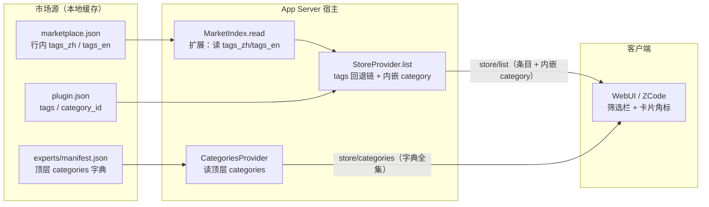
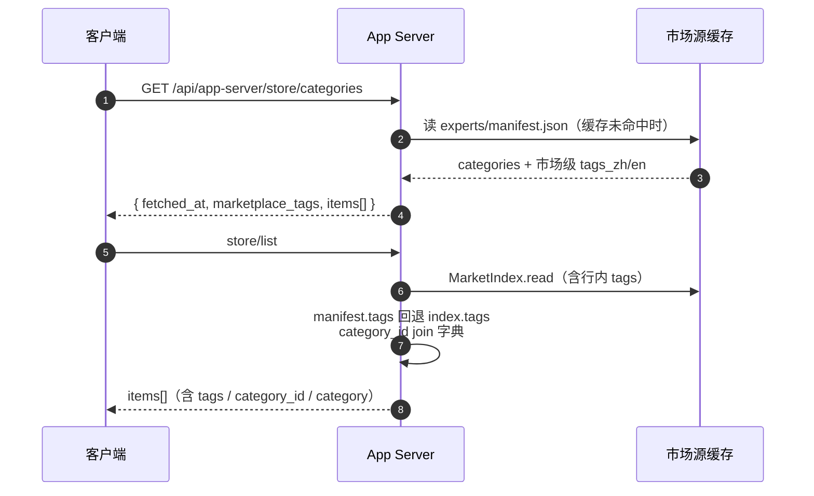

# 市场分类与标签透出（tags / categories over SDK）· 技术方案

> **状态**：📋 计划（编号 `43`，当前基线 `fp-14` / `55 / 82`；本方案目标指纹 **`fp-15`**）
> **核心原则**：市场源（WorkBuddy/CodeBuddy）声明的分类与标签是事实层——SDK 只做无损透传与本地化配对，不发明分类、不静默丢弃 `legacy_tags_*`；字典端点供筛选全集，条目内嵌解析结果供直接渲染。

---

## §1 背景与核心痛点

### 1.1 业务背景

WorkBuddy / CodeBuddy 两大市场源已为条目（专家 / 团队 / 技能 / 连接器）携带了分类与标签元数据，客户端（WebUI、ZCode 桌面前端）需要这些信息做筛选栏与卡片角标。SDK（`store/list`、Agent/Team catalog）是唯一的透出口。

两类源文件：

| 源 | 位置 | 分类信息形态 |
|---|---|---|
| 专家市场索引 | `~/.workbuddy/app/cache/experts/manifest.json` | 顶层 `categories` 数组：`{id, name{en,zh}, description{en,zh}}`；专家 `plugin.json` 用 `category_id` 引用 |
| 技能市场索引 | `~/.workbuddy/skills-marketplace/.codebuddy-skill/marketplace.json` | 市场级 `tags_zh/tags_en`（全集）+ 每个 skill 行内 `tags_zh/tags_en`（含 `legacy_tags_zh/legacy_tags_en`） |

### 1.2 现状与三大痛点

1. **技能市场的行内 tags 在索引读取层被丢弃**：`MarketIndexInfo`（`crates/backend/nomifun-app/src/app_server_store.rs` §`read_index`）只读 `name_zh/name_en/version/description_zh`，不读 `tags_zh/tags_en`。而 skill / connector 条目通常没有自己的 `plugin.json`，所以 `AppServerStoreItem.tags` 只能从 manifest 填——marketplace.json 里声明的行内 tags 完全到不了 SDK。
2. **专家分类字典没有出口**：importer 已把 `category_id` 透传到 `AppServerAgentDetail`（`nomifun-api-types/src/app_server.rs`），但没有任何端点把 experts manifest 顶层的 `categories` 字典吐出去。客户端拿到 `category_id: "04-DataAI"` 后无法解析成"数据智能"，也拿不到筛选栏需要的全集。
3. **`category_id` 不在 store 条目上**：`AppServerStoreItem` 无此字段；`AppServerAgentSummary`（列表页消费的形状）也没有 `tags`/`category_id`，只有 detail 才有。

### 1.3 能力对比矩阵

| 能力 | 现状 | 本方案目标 |
|---|---|---|
| skill 市场行内 tags → `store/list` | ❌ 读取层丢弃 | ✅ 经 `MarketIndexInfo` 透传，manifest 优先回退 index |
| `category_id` → `AppServerStoreItem` | ❌ 无字段 | ✅ 增量字段，`skip_serializing_if` 保证 wire 兼容 |
| 专家分类字典 | ❌ 无出口 | ✅ 新端点 `store/categories`，双语全量 |
| 条目 → 分类解析结果 | ❌ 客户端无法 join | ✅ 条目内嵌 `category: {id, name{en,zh}}` |
| `legacy_tags_*` | ❌ 丢弃 | ✅ 并入 tags 输出，不重复 |
| AgentSummary 的 tags | ❌ 仅 detail 有 | ✅ 上移到 summary |

---

## §2 方案全景与架构设计

### 2.1 端到端拓扑



### 2.2 目标与非目标

**目标**

1. skill 市场行内 tags 通到 `store/list`；
2. `category_id` 增量透出到 `AppServerStoreItem` / `AppServerAgentSummary`；
3. 新增分类字典端点，专家分类可解析、可筛选；
4. `legacy_tags_*` 按既有约定（`nomifun-common/src/localized_variant.rs`）并入 tags。

**非目标**

- 不发明新的分类体系，不做跨市场分类归一（不同市场的 `category_id` 命名空间互不相干）；
- 不做服务端按 tag/category 过滤（客户端在 `store/list` 全集上自行筛选；`SkillHubMarketQueryRequest.category` 是 SkillHub 上游的既有能力，不在本方案范围）；
- 不改 importer 快照 payload 结构（`tags`/`category_id` 已入库，无需迁移）。

### 2.3 架构不变量

- **无损透传**：市场源声明的分类/标签是事实层，SDK 不做语义改写；`zh`/`en` 按位配对，缺一侧就缺一侧。
- **wire 兼容**：所有新增字段 `#[serde(default, skip_serializing_if = ...)]`，旧客户端读到旧形状。
- **凭据不出宿主**：分类字典是纯展示元数据，不携带路径与凭据；字典端点走 store 资产的既有鉴权面。

---

## §3 核心设计与模块规范

### 3.1 数据结构与契约（Rust DTO）

```rust
/// 分类字典条目（源自 experts/manifest.json 顶层 categories）。
#[derive(Debug, Clone, Serialize, Deserialize, PartialEq, Eq)]
pub struct AppServerStoreCategoryItem {
    pub id: String,
    pub name: AppServerLocalizedText,
    #[serde(default, skip_serializing_if = "Option::is_none")]
    pub description: Option<AppServerLocalizedText>,
}

/// `GET /api/app-server/store/categories` 响应。
#[derive(Debug, Clone, Serialize, Deserialize, PartialEq, Eq)]
pub struct AppServerStoreCategoriesResponse {
    pub fetched_at: i64,
    /// 市场级 tags 全集（marketplace.json 顶层 tags_zh/tags_en），
    /// 双语按位配对；无对应源时省略。
    #[serde(default, skip_serializing_if = "Vec::is_empty")]
    pub marketplace_tags: Vec<AppServerLocalizedText>,
    /// 专家分类字典（experts manifest categories）。
    pub items: Vec<AppServerStoreCategoryItem>,
}
```

条目侧增量字段（均 `skip_serializing_if` 兼容旧客户端）：

```rust
// AppServerStoreItem 增量：
#[serde(default, skip_serializing_if = "Option::is_none")]
pub category_id: Option<String>,
/// 已解析的分类（dictionary join 在宿主侧完成）；字典缺失该 id 时省略。
#[serde(default, skip_serializing_if = "Option::is_none")]
pub category: Option<AppServerStoreCategoryItem>,

// AppServerAgentSummary 增量（detail 经 flatten 自动继承）：
#[serde(default, skip_serializing_if = "Vec::is_empty")]
pub tags: Vec<AppServerLocalizedText>,
#[serde(default, skip_serializing_if = "Option::is_none")]
pub category_id: Option<String>,
```

> 注意：`AppServerAgentDetail` 已有 `tags`/`category_id` 字段（§现状）。字段上移到 summary 后，detail 里原字段必须**删除**，否则 `#[serde(flatten)]` 会产生重复键。

### 3.2 模块职责与改动点

| # | 模块 | 文件 | 改动 |
|---|---|---|---|
| M1 | 索引读取 | `crates/backend/nomifun-app/src/app_server_store.rs` | `MarketIndexInfo` 增 `tags: Vec<LocalizedText>`；`read_index()` 读行内 `tags_zh`/`tags_en`（及 `legacy_tags_*`）按位配对 |
| M2 | store 投影 | 同上 `list()` | tags 回退链：manifest tags → index tags；填 `category_id` 与内嵌 `category`（从字典 join） |
| M3 | DTO | `crates/backend/nomifun-api-types/src/app_server.rs` | 新增 `AppServerStoreCategoryItem` / `AppServerStoreCategoriesResponse`；`AppServerStoreItem` / `AppServerAgentSummary` 增量字段；detail 去重 |
| M4 | 字典读取 | `crates/backend/nomifun-app/src/app_server_categories.rs`（新） | 按 marketplace_id 定位市场根，读根上的 `manifest.json` 顶层 `categories`（兼容上移一级的本地布局）；按文件戳 memoize；无市场声明时回落内置词表（§6） |
| M5 | 路由 | `crates/backend/nomifun-app-server/src/lib.rs` | `GET /api/app-server/store/categories` → `store_categories_route`，走既有 store 鉴权面 |
| M6 | TS SDK | `web/`（SDK 包）+ `ui/src/common/`（api client） | 类型重新生成/手补，`store.list()` / 新增 `store.categories()` |
| M7 | 文档 | `docs/agent-store/18-marketplace-spec.zh.md`（§4 tags 约定处）、`02-codebuddy-workbuddy-import-spec.zh.md`（plugin.json 子集） | 补"分类与标签透出"小节 + 字典端点契约 |

### 3.3 关键数据流

**tags 配对规则**（M1）：`tags_zh: ["办公协同"]` + `tags_en: ["Collaboration"]` → `[{zh: "办公协同", en: "Collaboration"}]`，按下标配对；仅一侧存在时另一侧为 `None`（与 `LocalizedText` 语义一致）。`legacy_tags_*` 追加在主 tags 之后，若与主 tags 重复（按 zh 值比对）则去重。

**tags 回退链**（M2，与 `name`/`description` 现有回退顺序一致）：

```text
plugin.json manifest.tags（专家链路，权威）
  → marketplace.json 行内 tags（skill/connector 链路，唯一来源）
  → 空数组（wire 上照常保留空数组，与 AppServerStoreItem.tags 既有约定一致）
```

**category join 规则**（M2）：条目 `category_id` 在**同 marketplace** 的字典中命中 → 内嵌完整 `category`；未命中（字典缺失/源未升级）→ 只给 `category_id`，不给 `category`——宁可少给，不猜。

**字典缓存**（M4）：按**文件身份**（路径 + mtime + 长度）memoize 解析结果，不是只按 marketplace_id——市场扫掠是**原地**替换 live 根里的文件，只按路径做键会永久供应过期字典；文件一变换了戳就重新解析。**市场根集合用 `set_roots` 整体替换**（不累加：市场被停用或移除后必须停止贡献字典），且 `store/list` 与 `store/categories` 都先走同一个 `remember_market_roots`——只让 `list()` 教它认路会让 `store/categories` 冷启动答错（真机探针抓到，见 `44` §6.4.1）。文件缺失或解析失败返回空 `items`（不 500，分类缺失不是错误）；无任何市场声明字典时回落到宿主内置词表（见 §6）。

### 3.4 交互时序



---

## §4 关键决策与权衡矩阵

| 编号 | 决策点 | 选定方案 | 放弃的替代方案与理由 |
|---|---|---|---|
| **D1** | 分类解析在哪一侧做 | 宿主侧 join，条目内嵌 `category`；字典端点仍保留全集 | ❌ 仅给 `category_id` 让客户端 join：多一次 round-trip，且每个客户端要重复实现字典缓存；❌ 仅内嵌不给字典：筛选栏需要全集，无字典则无法渲染 |
| **D2** | `legacy_tags_*` 处理 | 按 zh 值去重后追加进 tags 输出 | ❌ 丢弃：丢的是市场源声明的事实；❌ 单独字段：客户端要多处理一个字段，而其语义就是"旧名"，合并即可 |
| **D3** | 字典数据源位置 | 读 experts 根目录 `paths.experts` 同级的 `manifest.json`（`$schema` 顶层 categories），按 marketplace_id 缓存 | ❌ 把 categories 烧进 DB 迁移：引入数据同步问题且市场刷新就要写库；❌ 每请求重读盘：experts manifest 31k+ 行，冷路径可接受但热路径浪费 |
| **D4** | `AppServerAgentDetail` 字段去重方式 | 上移到 summary，detail 删除原字段 | ❌ 保留两处：`#[serde(flatten)]` 会产生重复 JSON 键，不同序列化器行为不一致，属于协议脏点 |
| **D5** | 是否在 store/list 加 tag/category 过滤参数 | 不加，客户端全量自筛 | ❌ 服务端过滤：`store/list` 是本地目录语义（全量 + 安装态），引入分页/过滤复杂度与 SkillHub 线（已有 `category` 查询参数）重复 |
| **D6** | 字典端点归属 | `store/categories`（单数资源、无 marketplace_id 必填参数，响应聚合所有已启用市场的字典，条目带来源 market） | ❌ `market/{id}/categories`：筛选栏要跨市场聚合，逐市场请求放大调用数 |
| **D7** | 指纹 | **`fp-14` → `fp-15`**：新增方法 `store/categories`（有 HTTP 路由）+ `AppServerStoreItem` 增 `category_id`/`category` + `AppServerAgentSummary` 增 `tags`/`category_id`（detail 字段上移，wire 形状有变），全部命中 `05` 触发条件 | ❌ 不 bump：既有消费者虽对未知字段宽容，但方法计数 `55 / 82 → 56 / 83`，按 `web/AGENTS.md` §5「增量也算」从严处理 |
| **D8** | TS 侧是否做 `tags_zh/tags_en` 配对 | 不做——配对完全在 Rust 宿主完成（M1），SDK 只消费已配对的 `LocalizedText[]` | ❌ SDK 配对：WebUI 与 ZCode 两个客户端要各自实现同一逻辑，且 `legacy_tags` 去重规则会跟着分叉 |

---

## §3.5 SDK 侧改动明细（M6 展开）

TS 侧不引入新抽象，逐包增量（以 `web/` 三个包为界）：

**`protocol` 包（`web/packages/protocol/src/protocol.ts`）**

```ts
// Store 段（StoreList 附近）新增：
export interface StoreCategory {
  id: string;
  name: LocalizedText;
  description?: LocalizedText | null;
}

/** `store/categories` response: dictionary union + market-level tag vocabulary. */
export interface StoreCategories {
  fetched_at: number;
  marketplace_tags?: LocalizedText[];
  items: StoreCategory[];
}

// StoreItem 增量（均可选，旧宿主读作 undefined）：
category_id?: string | null;
/** Resolved by the host from the same market's dictionary; absent when the id misses. */
category?: StoreCategory | null;

// AgentSummary 增量（AgentDetail extends AgentSummary，detail 原字段删除）：
tags?: LocalizedText[];
category_id?: string | null;
```

**`client` 包**

- `client.ts`：`listStoreCategories(): Promise<StoreCategories>` → `transport.request("store/categories", {})`，与 `listStore` 并排；
- `http-transport.ts`：`HTTP_METHOD_TABLE` 增 `"store/categories": { verb: "GET", path: "/store/categories" }`——**静态段**，不挂在 `/store/:marketplace_id/...` 之下（与 `market/settings` 不做 `/markets/settings` 同一理由：静态段不能被参数段遮蔽）；axum 路由同样注册静态路径；
- `store.ts`：`StoreClient.categories(): Promise<StoreCategories>` 透传 `host.listStoreCategories()`。**`search()` 不加 tag/category 过滤参数**：`haystack()` 已扫 `item.tags`（本方案顺手把 `item.category?.name` 也加进去，让"数据智能"可搜——这是本改动的直接后果，不算搭车）；按 `category_id` 精确筛是 UI 层一行 `filter`，不值得扩 `search` 签名（杜绝空想可配置）。

**指纹落点**：`fp-15` 需同步 7 文件 10 处（服务端真源 + `protocol.ts` / `http-transport.ts` / `mock-server.ts` / `smoke.ts`×2 / `readiness.test.ts`×2 / `probe-agent-store-runtime.mjs`）+ 站点 2 处，方法计数 `55 / 82 → 56 / 83`（`DOCUMENTED_ROUTE_SPLIT` 55/27 → 56/28，`store/categories` 为 mapped HTTP 方法；`DOCUMENTED_UNMAPPED` 不变）。

---

## §5 验收标准与验证矩阵

### 5.1 验收用例

| 编号 | 操作路径 | 断言 |
|---|---|---|
| TC-CAT-001 | 对含 `tags_zh/tags_en` 行的 skill 市场执行 `store/list` | 对应条目 `tags` 为按位配对的双语数组，值与 marketplace.json 逐字一致 |
| TC-CAT-002 | 带 `legacy_tags_zh` 与主 tags 重复的条目（如"腾讯会议"） | legacy 值不重复出现在 `tags` 中 |
| TC-CAT-003 | 专家条目（`plugin.json` 带 `tags`） | tags 来自 manifest，不被 index 覆盖（manifest 优先） |
| TC-CAT-004 | `category_id: "04-DataAI"` 的专家条目 + 字典存在 | `store/list` 条目含 `category: {id, name{zh:"数据智能", en:"Data & AI"}}` |
| TC-CAT-005 | `category_id` 指向字典中不存在的 id | 条目只有 `category_id`，无 `category` 字段；不报错 |
| TC-CAT-006 | `GET /api/app-server/store/categories` | 返回全部已启用市场的分类字典并集 + 市场级 tags 全集；experts 缓存缺失时 `items` 为空数组而非 500 |
| TC-CAT-007 | 旧客户端读取新 `store/list` 响应 | 无新增字段时字节形状不变（`skip_serializing_if` 生效）；`AgentDetail` 无重复 JSON 键 |
| TC-CAT-008 | TS SDK `store.categories()` | 类型齐备，`name.en/zh` 可选性与 Rust 侧一致 |

### 5.2 验证梯子

1. `cargo test -p nomifun-app`（store / marketplace 投影测试，新增 M1/M2 用例）；
2. `cargo test -p nomifun-app-server`（路由 + 鉴权面 + WebSocket dispatch 面）；
3. `cargo test -p nomifun-importer`（确认 payload 透传未回归）；
4. `cd web && bun run typecheck && bun run test`（SDK 类型与单测）；
5. `bun run check:fingerprint`（`fp-15` 全落点）+ `bun run check:release-sync`（方法计数 `56 / 83` 两仓一致）；
6. 手工冒烟：`bun run dev:web` 后对真实 `~/.workbuddy` 缓存目录执行 store/list，核对腾讯文档（tags `办公协同/Collaboration`）与专家分类渲染。

---

## §6 事后核实与两处修正（2026-10-14）

同批的 `44` 落地后，用**真实归档**（ModelScope 上的 `experts.zip` / `skills.zip`，只下中央目录 + 需要的条目，共约 2.4 MB）核对「字典到底在哪」，推翻了本方案的两处假设：

### 6.1 专家分类字典**不随市场分发**（原假设错）

| 事实 | 证据 |
|---|---|
| `experts.zip` 根只有 `.codebuddy-plugin/` 与 `plugins/` | 14,713 条中央目录，根级文件数 **0** |
| 市场清单没有分类 | `.codebuddy-plugin/marketplace.json` 顶层键仅 `name`/`description`/`plugins`；381 行每行仅 `name`/`source`/`description` |
| 字典在**另一个子系统** | `~/.workbuddy/app/cache/experts/manifest.json`（应用侧目录索引，1.2 MB，含 `categories[15]` 与 `experts[448]`） |
| 条目引用确实存在 | 真实 `plugins/stock-partner-team/.codebuddy-plugin/plugin.json` 带 `categoryId: "08-FinanceInvestment"` 与 `tags[]` |
| 词表是闭集 | 索引 448 行**无一**引用未声明的 id；其中 377 行能按名字对上归档里的 381 个插件 |

因此原 §3.3「experts manifest 是固定位置的本地缓存文件」对**生产**不成立：宿主读 `<市场根>/manifest.json`，而归档根上没有这个文件 → `store/categories.items` 与 `item.category` 在真实数据下恒空（`category_id` 与 `tags` 是好的，它们来自 plugin.json）。

**两处修正**：
1. **宿主内置兜底词表**（`app_server_categories_builtin.json`，15 行逐字取自上游索引，带 `_source_sha256` 溯源）：**只有在一个市场都没声明字典时**才启用，市场声明优先且不做合并（避免两套词表混出同名不同义的 id）。这使分类名**今天就可用**，且新 id 出现时的退化方式诚实——查不到就显示裸 id。**这是本项的最终机制**（`44` §6.3 ③ 记录了「不重发归档」的决定：兜底已覆盖该需求，而重发 289.6 MiB 归档、全量客户端重下、给市场仓永久加一个非上游文件，收益不抵成本）。
2. **站点侧「随归档发布字典」：决定不做**。做法做过并验证通过（生成物机制 + 重打包 `files=14714` + 摘要确定性），但已按上述理由撤回；站点仓只保留市场数据的日常同步。

### 6.2 技能市场那一半原样成立

`skills.zip`（4,633 项）根上有 `.codebuddy-skill/marketplace.json`：顶层 `tags_zh`/`tags_en` 各 11 项，268 行**全部**带行内 `tags_zh/tags_en`、154 行带 `legacy_tags_zh/en`。所以 `store/categories.marketplace_tags` 与技能条目的 `tags`（含 legacy 合并去重）在真实数据下都能跑通——`43` 的这部分无需修正。

> 顺带发现（`44` D5 据此修正）：268 行里有 **1 行**（`Excalidraw Diagram`）带扁平的 `category_zh/category_en`。技能市场没有分类**字典**，但个别行可能有扁平分类标签；当前不读该字段，理由见 `44` §6.3。

### 6.3 缓存措辞修正

原 §3.3 写「进程内缓存」，实现当时只缓存了**市场根路径**、字典每次重读。现已按 §3.3 现行措辞实现：按**文件身份**（路径 + mtime + 长度）memoize 解析结果——市场扫掠原地替换文件，只看路径会永久供应过期字典。

---

## 附录：现状调查底稿（2026-10-13 调查记录）

> **归档说明**：以下为方案编写时的逐点调查记录（文件、行号、结论），供实现时对照，不作规范依据。

1. **WorkBuddy 专家 manifest**（`C:\Users\15165\.workbuddy\app\cache\experts\manifest.json`，31201 行）：顶层 `categories` 数组，条目形如 `{id: "04-DataAI", name: {en: "Data & AI", zh: "数据智能"}, description: {en, zh}}`；`paths.experts` 指向专家目录。专家 `plugin.json` 通过 `category_id` 引用。
2. **技能市场索引**（`C:\Users\15165\.workbuddy\skills-marketplace\.codebuddy-skill\marketplace.json`，7817 行）：市场级 `tags_zh`（11 项）/`tags_en`；每 skill 行内 `tags_zh/tags_en`；"腾讯会议"行带 `legacy_tags_zh: ["办公效率"]` / `legacy_tags_en: ["Productivity"]`。
3. **importer 已支持**：`nomifun-importer/src/manifest.rs` `PluginManifest.tags: Vec<LocalizedText>`（L171-174）与 `category_id`（L182）；`import.rs` `attach_plugin_display` L553-564 把两者写入组件 payload。
4. **AgentDetail 已透出**：`nomifun-api-types/src/app_server.rs` `AppServerAgentDetail.tags: Vec<AppServerLocalizedText>`（L646）、`category_id`（L652）；summary（L573-606）无。
5. **StoreItem 现状**：`AppServerStoreItem.tags` 仅从 `plugin.json` manifest 填（`app_server_store.rs` list() L374-377）；`MarketIndexInfo`（L81-91）与 `read_index`（L124-163）不读 tags。
6. **可抄的先例**：SkillHub 分类端点 `SkillHubMarketCategoriesResponse` / `SkillHubMarketCategoryItem`（`nomifun-api-types/src/skill.rs` L595-609，`nomifun-extension/src/market/skillhub.rs` `list_skillhub_market_categories`）；`legacy_tags` 合并约定见 `nomifun-common/src/localized_variant.rs`（文档锚点 `18-marketplace-spec` §4）。
7. **文档红线**：本方案遵循 `docs/contributing/technical-solution-standard.zh.md`；补充文档时 `18-marketplace-spec.zh.md` 与 `02-codebuddy-workbuddy-import-spec` 走"增量小节"而非重写，`git diff` 保持零删除。
