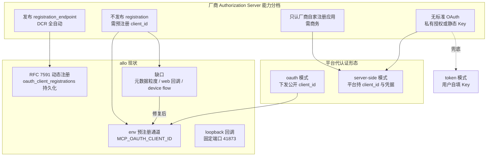
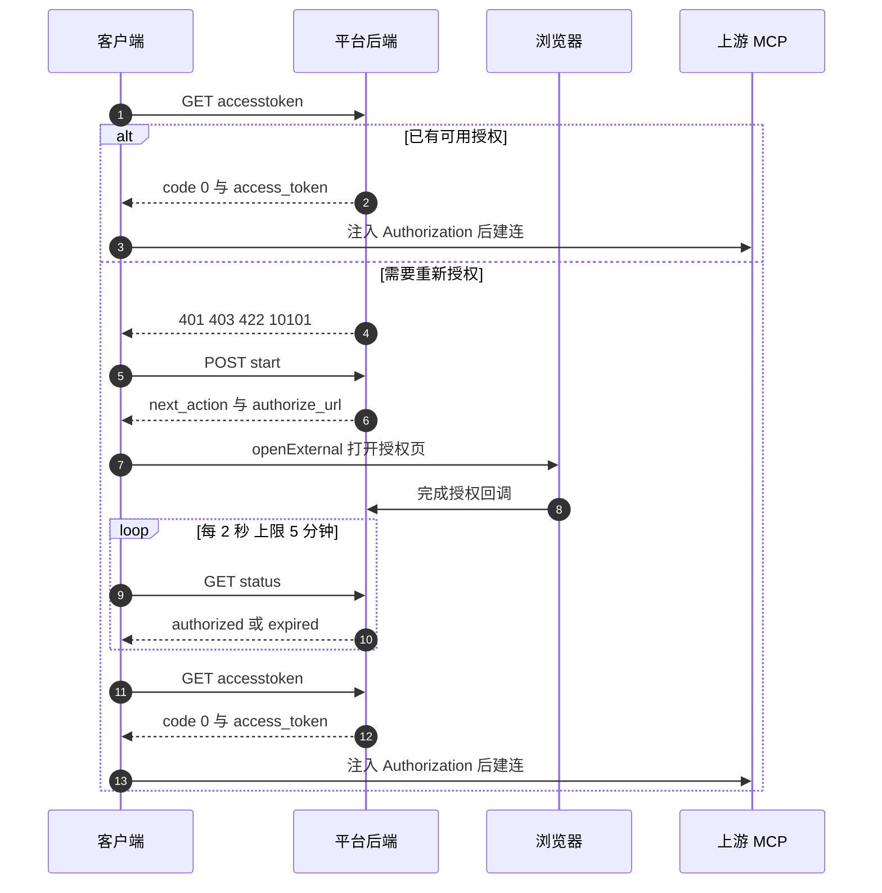

# MCP 授权形态与静态 client_id 现状 · 技术方案

> **状态**：📋 现状梳理与缺口决策（2026-10-15；发版前可改）
> **核心原则**：**「谁能注册 client_id」决定接入方式，「凭据归属方」决定信任边界**；不借用他方注册，不把平台代理当通用能力。
> **适用范围**：连接器出站授权（`remote-mcp` / `stdio-mcp`）、连接器市场条目 `auth_mode` 语义与 `MCP_OAUTH_*` 预注册通道。
> **前置**：[`06-connector-oauth-security.md`](file:///c:/workspace/allo/docs/agent-store/06-connector-oauth-security.md)、[`34-connector-user-credentials.zh.md`](file:///c:/workspace/allo/docs/agent-store/34-connector-user-credentials.zh.md)、[`26-connector-schema-and-grant-policy.zh.md`](file:///c:/workspace/allo/docs/agent-store/26-connector-schema-and-grant-policy.zh.md)
> ⚠️ **保密等级**：内部。含第三方闭源产品的逆向结论与本方评审记录，不对外披露（含客户/合作方场合）。

---

## 1. 背景与核心痛点

### 1.1 业务背景

连接器市场的接入对象是第三方 MCP 服务，其授权能力由厂商自己的 Authorization Server（AS）决定，不由接入方决定。用户侧的直观问题是：「为什么同类产品点一下就能连上，我们要不要让用户自己去申请 client id？」——这个问题只有按厂商的 AS 能力分类才能回答，不能按产品抄。

### 1.2 三个痛点

1. **P1 协议碎片化**：同一个「连接器」类别下至少存在四种授权形态——发布 `registration_endpoint` 可动态注册（DCR）、不发布但允许你预注册、只认厂商自家注册的应用、以及**完全不实现标准 OAuth**。用一条流水线强行覆盖，必然出现「UI 有授权按钮但流程死在 discovery」这类假保护。
2. **P2 概念混淆导致排期两极化**：「平台代配 client_id」与「静态预注册 client_id」被当成两种能力。实测表明它们是同一根轴上的两个点（谁注册、谁持 secret），按「全自动」或「每家一次商务」估工作量都会偏。
3. **P3 本方实现的结构性缺口**：`MCP_OAUTH_CLIENT_ID` 是**进程级**环境变量（全局一份），而 GitHub 与百度网盘不可能共用一个 client；回调 host 被强校验为 loopback，web 宿主 + 远程用户时不成立。
4. **P4 假保护（`auth_mode` 同名两义）**：市场条目的 `auth_mode`（谁持凭据，导入层默认读并映射）与协议对外 `Connector.auth_mode`（由 transport 推导）**同名字段、两套语义**，后者还驱动状态投影，导致 `server-side` 条目在 UI 里长出必然失败的「授权」入口。详见 §3.7。

### 1.3 能力对比矩阵

| 维度 | 现状行为 | 本方案目标 |
|---|---|---|
| 预注册 client | 仅进程级 env，全局一份 | 按连接器元数据声明，identity key 复用现有行 |
| 静态 client_id 判定 | 靠人工试错 / 借用他方注册 | 探针可判定，接入前即产出结论 |
| 回调形态 | 仅 loopback，web 宿主不可用 | loopback 优先；web 宿主补齐服务端回调或设备码 |
| 平台代理（代持凭据） | 未实现，也未评估边界 | 明确为「按连接器 feature gate」，不进 V1 |
| UI 认证方式来源 | 由 transport 推导（必然失败） | 以 `auth_mode` 为唯一事实源 |

---

## 2. 方案全景与架构设计

### 2.1 端到端拓扑



### 2.2 核心目标 vs 非目标

**目标**

- 把「静态 client_id 是否必需」变成接入前可自动判定的结论（而非人工试错）。
- 预注册 client 从进程级 env 提升到**连接器元数据**粒度，一个连接器一行。
- web 宿主的连接器授权链路可用（服务端回调或设备码二选一）。

**非目标（本阶段坚决不做）**

- 不做通用平台代理（不替所有用户持凭据），仅在确有厂商要求时按连接器开。
- 不实现 CIMD（实测十家端点无一声明 `client_id_metadata_document_supported`）。
- 不借用他方注册的 client_id 进产品方案（仅允许一次性验证，且不入库、不进配置）。

### 2.3 架构不变量

1. 凭据不出宿主：真实 token 不进 Prompt、日志、前端状态（沿用 `06` 的 `[REDACTED]` 原则）。
2. 入站与出站认证物理隔离，入站 token 严禁转发上游。
3. 认证方式以连接器元数据 `auth_mode` 为唯一事实源，不由 transport 推导。
4. 客户端身份（client_id / secret）与用户凭据（access / refresh token）分层存储，前者按连接器一份，后者按主体一份。

---

## 3. 核心设计与现状细节

### 3.1 WorkBuddy 的 `auth_mode` 全谱（实测，283 条）

| 值 | 条数 | 客户端行为 | 典型条目 |
|---|---|---|---|
| `token` | 61 | 读同目录 `token-schema.json` 渲染表单，凭据仅存本机；替换 `mcp.json` 里的 `${API_KEY}`；缺必填字段则拒绝连接 | 质数幻方、tushare |
| `server-side` | 12 | 前端只发 `POST /connectors/oauth/{id}/start`，凭据与刷新全在平台侧；`mcp.json` 零凭据 | 百度网盘、GitHub、金山文档 |
| `oauth` | 4 | 走通用 MCP 客户端 OAuth（401 → PRM → AS → DCR / loopback）；平台可另行下发 `oauth_client_id` | flova、sugon、qisemierp、novai |
| `mcp` | 1 | 同 `oauth` 默认路径（写法差异） | 腾讯企点客服 |
| `oneid-token` | 1 | 运行期被折叠为 `server-side`；注入头 `X-Oneid-Access-Token`，需 `oneid_app_type` | 腾讯文档企业版 |
| 未声明 | 204 | 直接连接；其中 198 条 `mcp.json` 连 header 占位都没有 | — |

字段一致性：`token` ⇔ 存在 `token-schema.json`（61/61 完全吻合）；其余值均无该文件。

运行时真实分支（源码判定点穷举）：`auth_mode === 'token'` 8 处、`resolveActiveAuthMode(...) === 'server-side'` 5 处、`=== 'gateway'` 1 处（本地 283 条无人使用）、`authMode === 'oauth'` 1 处（仅用于标注 `authType`）。**其余值全部落入默认路径**。另有从 `mcp.json` 反推的兜底：`urlTemplatedMcpServers` 存在或 server 含 `auth.type === 'token'` ⇒ `token`；含 `injectOneIdAuth` ⇒ `oneid-token`。

三个正交维度（**不是** `auth_mode` 取值）：`preAuth: 'cli'`（要求先登录本地 CLI）、`enterprise_variants`（可整体覆盖 `auth_mode` + URL + 注入头）、`auth_injection_rules`（跨连接器借 token 注入）。

### 3.2 `server-side` 的客户端交互时序



实测常量与接口契约（客户端侧）：

| 项 | 值 / 语义 |
|---|---|
| 授权起手 | `POST /v2/as/connector/oauth/{name}/start` → `{code, data:{next_action, authorize_url}}` |
| 授权状态 | `GET .../status` → `{code, data:{status}}`，取值含 `authorized` / `connected` / `expired` |
| 取 token | `GET .../accesstoken[?force_refresh=1]` → `{code, data:{access_token, expires_in}}` |
| 撤销 | `POST .../revoke` |
| 轮询节奏 | 间隔 2s，总预算 5min |
| 刷新提前量 | 300s；`expires_in` 缺失兜底 20min；瞬时错误 60s 重试；计时器上限 `i32::MAX` |
| 错误分层 | `401/403/422/10101` ⇒ 需重新授权并提示用户；其他 ⇒ 瞬时失败，重试或回退普通连接 |
| 注入 | 默认 `Authorization: Bearer <token>`；企业变体按 `token_header.name` + `value_template` 替换 |

**关键事实**：token 最终仍落在客户端（写入 `headerOverrides`，按账号身份分槽、加密存储）。`server-side` 省掉的是 **client_id/secret 不下发**，不是凭据不接触客户端。相应地，allo 作为代理形态反而更干净——token 可留在后端，无需复制这套本地凭据分发。

### 3.3 `server-side` 连接器清单与成因分类（实测）

| id | 名称 | MCP URL | 成因 |
|---|---|---|---|
| `github` | GitHub | `api.githubcopilot.com/mcp/` | **厂商约束**：AS 无 `registration_endpoint` |
| `baidu-netdisk` | 百度网盘 | `mcp-pan.baidu.com/sse` | **厂商约束**：无标准 OAuth（`.well-known` 全 403、从不 401） |
| `kdocs` | 金山文档 | `mcp-center.wps.cn/skill_hub/mcp` | **厂商约束**：`initialize` 匿名 200、无 PRM / AS 元数据 |
| `xrxs` | 薪人薪事 | `mcp-xrxs.xinrenxinshi.com/mcp` | 平台选择：厂商有 `registration_endpoint` |
| `ezr-crm` | EZR 全域CRM | `skillsgateway-tp.ezrpro.com/ezr/mcp` | 平台选择：厂商有 `registration_endpoint` |
| `tdx-connector` | 通达信 | `txmcp.tdx.com.cn:3001/txmcp` | 未探测 |
| `jinshuju` | 金数据 | `jinshuju.net/mcp` | 未探测 |
| `kuaicha-search` | 同花顺快查企业数据 | `bizveris.kuaicha365.com/open/mcp?source=workbuddy` | 未探测 |
| `fazhi-law` | 同花顺法律AI助手 | `api.fazhi.law/mcp?source=workbuddy` | 未探测 |
| `ifind-mcp` | 同花顺iFinD | `api-mcp.51ifind.com:8643/ds-mcp-servers/hexin-ifind-financial-mcp` | 未探测 |
| `haier-assistant` | 海尔智能体 | `web-hdsuec-agent.haier.net/mcp` | 未探测 |
| `dnb-longyicha-workbuddy` | 龙易查 | `mcp.dnbservice.com.cn/v1/company` | 未探测 |

共同特征：12 条 `mcp.json` **全是纯 URL、零凭据字段**；唯一非凭据头是 kdocs 的 `staticHeaders: {"X-Request-Source": "workbuddy", "X-Skill-Version": "1.4.12"}`。`kuaicha-search` / `fazhi-law` 的 URL 挂 `?source=workbuddy`，属双方对接形态。另：`oneid-token` 的 `tencent-docs-oa` 运行期折叠为 `server-side`，故运行期口径为 13 条。

**结论**：`server-side` 是「平台持凭据」这个产品语义，不等价于「厂商不允许客户端自己做」——12 条里只有 3 条是厂商约束，2 条是平台选择。**接入规划必须按探针结果划，不能按对方的 `auth_mode` 声明划。**

### 3.4 外部端点授权能力实测矩阵

2026-10-15，未认证只读探针（GitHub 经本机代理）：

| MCP 端点 | authorization server | `registration_endpoint` | device flow | CIMD | 静态 client_id |
|---|---|---|---|---|---|
| `api.githubcopilot.com/mcp/` | `github.com/login/oauth` | **无** | 有 | 未声明 | **必需** |
| `service.flova.tv/api/mcp/` | `service.flova.tv/api/mcp/oauth` | 有 | 无 | 未声明 | 否 |
| `sci.ksai.scnet.cn:58043/mcp` | `www.scnet.cn` | 有 | 无 | 未声明 | 否 |
| `mcp-internal.qisemiyun.com/mcp` | 同域 | 有 | 无 | 未声明 | 否 |
| `xinxingshuke.com/api/v1/mcp` | 同域 | 有 | 无 | 未声明 | 否 |
| `mcp-xrxs.xinrenxinshi.com/mcp` | `api.xinrenxinshi.com` | 有 | 无 | 未声明 | 否 |
| `skillsgateway-tp.ezrpro.com/ezr/mcp` | 同域 | 有 | 无 | 未声明 | 否 |
| `market-api.fenbi.com/workbuddy/mcp` | `login.fenbi.com` | 有 | 无 | 未声明 | 否 |
| `mcp-center.wps.cn/skill_hub/mcp` | — | 无 401 挑战 | — | — | 否（200 空表 ≠ 免认证） |
| `mcp-pan.baidu.com/sse` | — | POST 405、无 PRM | — | — | 非标准 OAuth，不适用 |

附加事实：GitHub AS 元数据的 `service_documentation` 直接指向 `registering-a-github-app`；`grant_types_supported` 含 `urn:ietf:params:oauth:grant-type:device_code`；`scopes_supported` 仅 `['offline_access']`；`code_challenge_methods_supported` 为 `['S256']`。

**判定方法（应固化为检查脚本）**：`initialize` → `WWW-Authenticate` 的 `resource_metadata`（可能是相对路径）→ PRM → RFC 8414 AS 元数据（well-known 段插在 host 与 path 之间）→ 读 `registration_endpoint`；无则读 `service_documentation`，厂商一般在那里写注册路径。

### 3.5 静态 client_id 可获得性

| 类别 | 能否拿到 | 路径 | 代价 |
|---|---|---|---|
| DCR 家（7 家） | 不需要「拿」 | 运行时 `POST /register` 自动获得；也可自行预置 | 预置收益仅「固定 `client_name` + 预置 redirect 白名单」 |
| GitHub 型 | 能 | 自行注册 App / OAuth App | 组织可能要求审批；App 名唯一；device flow 可省回调域名但仍需 client_id |
| 厂商自持注册型 | 不能 | 只能商务申请 | 逐家谈，属商务工作 |
| 百度型（无标准 OAuth） | 只有厂商公开的固定 client id | 厂商私有 implicit / oob 流程 | 通常无 `refresh_token`，无法静默续期 |

**合规红线**：借用他方注册的 client_id（其值本身是公开值）技术上可行、实测亦可通过，但会导致本方全部用户的授权记在对方应用名下、回调域名不在本方手里、随时可能被厂商封停。**仅允许作为一次性验证手段，不得入库、不得进配置、不得进产品方案。**

### 3.6 allo 现状与接口契约

已有能力（`crates/backend/nomifun-mcp/src/oauth_service.rs`）：

- RFC 7591 动态注册 + 持久化（表 `oauth_client_registrations`，migration `058`），identity key = `server_url + resource_identifier + issuer + redirect_uri`，跨登录与重启复用同一注册。
- 预注册通道 `env_registered_client()`（`MCP_OAUTH_CLIENT_ID` / `MCP_OAUTH_CLIENT_SECRET`），命中则不触发 DCR，落库 `registration_mode = "pre_registered"`。
- 机密客户端支持：`client_secret` 有值时 `set_client_secret(...)`。
- 无 `registration_endpoint` 且无预注册时**显式失败**：返回 `pre_registered_client_required`，不发 token 请求、不打开浏览器（`oauth_service.rs:1011`、`:1289`）。
- 回环回调 + CSRF state + 单监听门 `login_gate` + 冷却 + 401 互斥刷新；默认回调 `http://127.0.0.1:41873/callback`（固定端口，避免每次登录变成新注册）。
- 后端路由：`/api/mcp/oauth/{login,logout,check-status,authenticated}`。

关键数据结构（现状）：

```rust
struct ClientIdentity {          // 来自连接器凭据或持久化的 RFC 7591 注册
    client_id: String,
    client_secret: Option<String>,
    registration_id: Option<i64>,
}
```

缺口：

| # | 缺口 | 影响 | 证据 |
|---|---|---|---|
| 1 | 预注册 client 仅进程级 env（全局一份） | GitHub 与百度网盘不可能共用一个 client，多连接器无法各自预置 | `oauth_service.rs:1137`；`README.md:371` 已定性 |
| 2 | 回调 host 强校验 loopback，否则 `UnsupportedAuth` | web 宿主 + 远程用户时回调打不到服务器，OAuth 链路结构性不可用 | `oauth_service.rs:835`（代码推断，未实跑） |
| 3 | 无 device code 流程 | GitHub 广播 `device_authorization_endpoint` 却用不上 | `grep device_authorization` 在 `crates/` 下 0 命中 |
| 4 | UI 认证方式由 transport 推导（`auth_mode` 同名两义） | `server-side` 条目长出必然失败的授权入口 | `README.md:371`；详见 §3.7 |

---

### 3.7 `auth_mode` 在 allo 的两层语义（现状实测）

市场声明的 `auth_mode` 与协议对外暴露的 `Connector.auth_mode` **同名不同义**，必须分开讨论——这是 P4 假保护的根因。

| 层 | 值域 | 来源 | 消费方 | 代码位置 |
|---|---|---|---|---|
| 市场索引声明 | 空 / `token` / `server-side` / `oauth` / `mcp` / `oneid-token` | 市场 `connectors/<id>` 同级的 `.codebuddy-connector/connectors.json` 条目行 | 导入器 | 外部市场提供 |
| 导入产物 `ConnectorDefinition.auth_mode` | `token` / `oauth` / `none` / `cli-auth` | 映射自市场声明；手搓目录（无索引）退回 `mcp.json` 的 `preAuth` | 宿主的 `credential.mode` | `crates/backend/nomifun-importer/src/import.rs:1810-1844`（`market_credential_mode` / `market_auth_mode`） |
| 协议对外 `Connector.auth_mode` | `none` / `oauth` | **由 transport 推导**，与上述声明无关 | 目录投影与状态判定 | `crates/backend/nomifun-app/src/app_server_catalog.rs:212-217`（`auth_mode_for`） |

映射规则（`34` §6.1）：

```text
token → token
oauth → oauth
空 / server-side / mcp / oneid-token → none
```

关键事实：

1. **市场名确实被读、被映射**，且凭据入口的事实源是 `credential.mode` 而非 `auth_mode`：`web/src/components/catalog/shared.tsx:182` 注释写死该口径；原始 `auth_mode` 枚举已从连接器抽屉撤下（`CatalogView.tsx:1258`、`:1689` 有注释），`ConnectorDrawer.render.test.tsx` 有渲染断言；后端侧由 `importer_e2e.rs:2742`（14 条 `server-side` / `mcp` / `oneid-token` 报 `none`）与 `importer_tests.rs:776-790` 钉住。
2. **协议层完全不看市场声明**：`Stdio → none`、`Sse/Http → oauth`。更关键的是这个推导值还在驱动状态投影——`app_server_catalog.rs:226`（列表投影）与 `:269`（单条投影）的判定 `_ if auth_mode == "oauth" && !authenticated => AuthorizationRequired`。
3. **因此任何 URL 型连接器都被算作「需要授权」**，包括市场声明为 `server-side` 的 `github` / `baidu-netdisk`——它们长出必然失败的「授权」按钮（github 连 RFC 8414 元数据都不发布，流程死在 discovery，浏览器都打不开）。
4. **第三种语义**：`cli-auth`（`preAuth: cli` 场景，`importer_tests.rs:973` 断言）。同一个字段名当前承载三套含义。

改造波及面（D4 落地前必须评估）：

- 状态投影改动会同时改变约 224 条 URL 型条目的 `status`（由 `AuthorizationRequired` 掉回正常），前端展示与状态断言需同步回归。
- `ConnectorDrawer.render.test.tsx` 已显式构造「`auth_mode: "oauth"` 的 token 连接器」用例——即**现有测试在补偿这一错位行为**，改动必须连测试一起改。
- 全量波及面尚未跑测试确认（见附录 C）。

落地分两阶段：**行为修复**（`status` / `auth_status` 不再猜）见 [`46-connector-auth-affordance-fix.zh.md`](file:///c:/workspace/allo/docs/agent-store/46-connector-auth-affordance-fix.zh.md)；**字段改名**（`auth_mode` → `auth_transport`，`fp-16` → `fp-17`）见 [`47-connector-auth-mode-field-semantics.zh.md`](file:///c:/workspace/allo/docs/agent-store/47-connector-auth-mode-field-semantics.zh.md)。

---

## 4. 关键决策与权衡矩阵

| 编号 | 决策点 | 选定方案 | 放弃的替代方案与理由 |
|---|---|---|---|
| **D1** | 静态 client_id 的配置粒度 | **连接器元数据一格一 client，复用现有 `pre_registered` 行与 identity key** | ❌ 继续用进程级 env：GitHub 与百度网盘不可能共用，且改配置要重启进程；❌ 借用他方注册：凭据归属错位，随时被封 |
| **D2** | web 宿主的回调形态 | **loopback 优先；web 宿主补服务端回调（state 带 origin 校验）或实现 device code** | ❌ 全域放开公网回调：扩大攻击面且并非所有 AS 允许；❌ 只做 device code：需 AS 声明支持，覆盖不了 S256-only 的厂商 |
| **D3** | 是否自建平台 OAuth 代理（代持凭据） | **不进 V1，仅按连接器 feature gate 开** | ❌ 全量代理：等于把「替所有用户持凭据」变成默认形态，合规与泄露面同步放大；❌ 完全不做：覆盖不了厂商约束型（百度、GitHub）场景 |
| **D4** | UI 认证方式的来源 | **以市场声明为唯一事实源**：协议层 `Connector.auth_mode` 改为读存储的声明（或更名为传输形状字段），状态投影改看 `credential.mode`（详见 §3.7；第一阶段落地见 [`46-connector-auth-affordance-fix.zh.md`](file:///c:/workspace/allo/docs/agent-store/46-connector-auth-affordance-fix.zh.md)） | ❌ 由 transport 推导：`server-side` 条目会显示必然失败的授权按钮，形成假保护；❌ 保留同名两义：同一字段承载「谁持凭据」与「传输形状」两套含义，后续任何人都会踩 |
| **D5** | CIMD 支持 | **暂不实现，持续观察** | ❌ 立即实现：实测十家端点无一声明 `client_id_metadata_document_supported`，投入无收益 |

---

## 5. 验收标准与验证矩阵

| 编号 | 操作路径 | 可断言结果 |
|---|---|---|
| **TC-AS-MCP-001** | 对 DCR 家连接器（如粉笔 `market-api.fenbi.com/workbuddy/mcp`）执行登录 | 完成动态注册 + PKCE + loopback 回调，`tools/list` 返回非空工具集 |
| **TC-AS-MCP-002** | 对静态 client_id（无 secret）连接器执行登录 | 零注册请求，直接授权码 + PKCE 成功 |
| **TC-AS-MCP-003** | 对机密客户端（带 secret）连接器执行登录 | `token_endpoint_auth_method` 走 `client_secret_*`，授权成功 |
| **TC-AS-MCP-004** | 未配预注册 client 且服务方无 `registration_endpoint` | 打开浏览器前即返回 `pre_registered_client_required` 结构化错误 |
| **TC-AS-MCP-005** | web 宿主下执行完整 `login → callback → token → 工具调用` | 全链路成功（D2 落地后） |
| **TC-AS-MCP-006** | `logout` / `revoke` 后再次调用工具 | 旧 token 不可用，状态回到未授权 |
| **TC-AS-MCP-007** | 同一 AS 连续登录两次（进程重启后） | identity key 相同，复用同一 registration 行，无重复注册 |
| **TC-AS-MCP-008** | 目录页查看 `server-side` 连接器 | 不出现「授权」入口（D4 落地后） |
| **TC-AS-MCP-009** | 协议层 `auth_mode` 改读市场声明后，遍历目录 | 声明 `server-side` 的条目不再投影为 `AuthorizationRequired`；`token` 条目的凭据入口与 `oauth` 条目的授权入口均不受影响；前端渲染断言全绿 |

验证梯子：`cargo test -p nomifun-mcp`（含 `dynamic_registration_integration` / `oauth_transport_integration` / `mcp_oauth_e2e`）→ 真实端点手测（TC-001/002/003）→ web 宿主端到端（TC-005）。

---

## 附录 A：本轮实测原始数据

**A.1 注册表分布（`~/.workbuddy/connectors-marketplace/.codebuddy-connector/connectors.json`，283 条）**

```text
auth_mode 计数：未声明 204 / token 61 / server-side 12 / oauth 4 / oneid-token 1 / mcp 1
字段一致性：token ⇔ token-schema.json（61/61）；server-side 12 条均无 token-schema.json
12 条 server-side 的 mcp.json 均为纯 URL，零凭据字段
```

**A.2 探针命令**

```bash
# 1. 未认证 initialize，记录状态码与 WWW-Authenticate
curl -si -X POST "$MCP_URL" \
  -H 'Content-Type: application/json' \
  -H 'Accept: application/json, text/event-stream' \
  -d '{"jsonrpc":"2.0","id":1,"method":"initialize","params":{"protocolVersion":"2025-06-18","capabilities":{},"clientInfo":{"name":"probe","version":"0"}}}'

# 2. 取 resource_metadata（可能是相对路径，需按 MCP URL 解析）
# 3. RFC 8414 的 well-known 段插在 host 与 path 之间
#    https://<host>/.well-known/oauth-authorization-server/<as-path>
# 4. 读 registration_endpoint / device_authorization_endpoint / client_id_metadata_document_supported
```

**A.3 探针脚本**：本轮使用 `mcp_static_client_probe.py`（临时目录，24 小时后清理）。建议固化到 `scripts/check-mcp-auth-capability.mjs`，纳入接入前检查。

## 附录 B：证据出处

| 结论 | 证据位置 |
|---|---|
| 283 条 `auth_mode` 分布与字段 | `~/.workbuddy/connectors-marketplace/.codebuddy-connector/connectors.json` |
| 各连接器 `mcp.json` 零凭据 | `~/.workbuddy/connectors-marketplace/connectors/<id>/mcp.json` |
| server-side 四件套与常量 | WorkBuddy `app.asar`：`ConnectorServerSideOauthRefresher`、`requestServerSideAccessToken`、`pollPublicServerSideAuth`、`resolveTokenHeaders` |
| `oneid-token → server-side` 折叠 | WorkBuddy `app.asar`：`normalizeAuthMode` |
| token 落 `headerOverrides` | `~/.workbuddy/connectors/<account>/connector-states.json`（仅读结构，未解密） |
| allo 能力与缺口 | `crates/backend/nomifun-mcp/src/oauth_service.rs`、`docs/agent-store/06-connector-oauth-security.md`、`docs/agent-store/README.md` |

## 附录 C：未验证清单

1. web 宿主下 OAuth 登录的实际断点（缺口 2 为代码推断，未实跑）。
2. 6 家未探测连接器（tdx / jinshuju / kuaicha-search / fazhi-law / ifind-mcp / haier / dnb-longyi）的厂商侧授权能力。
3. `novai-studio` / `ezr-crm` 的 register 端点 GET 返回 404 的原因（路由差异或未开放）。
4. 对端平台云端持凭据的真实形态（自注册 App / 长期 token / 其他）——仅能看到其客户端声明与零凭据 `mcp.json`。
5. `kdocs` 匿名 `initialize` 200 是否等同免认证（仅证明握手匿名，工具可能被 gate）。
6. allo 是否已支持从连接器元数据注入静态 client_id（缺口 1 是否部分落地）。
7. 协议层 `auth_mode` 改造的完整波及面（约 224 条 URL 型条目的状态投影、前端其余读取点、既有测试断言）未跑测试确认。

> **风险登记**：本文含第三方闭源产品的逆向结论，仅限内部使用；任何对外材料引用本文结论时，只能引用「协议能力矩阵」与「本方缺口」，不得引用对端产品内部机制（含接口路径、`auth_mode` 语义与凭据存储形态）。
