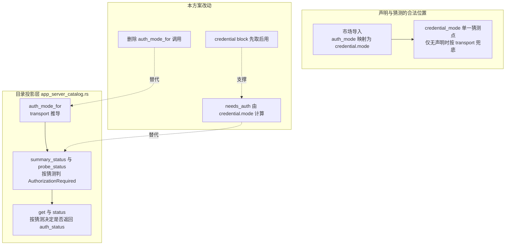

# 连接器授权入口假保护修复 · 技术方案

> **状态**：✅ PR-1 已实施（2026-10-15；第二阶段字段归位见 [`47-connector-auth-mode-field-semantics.zh.md`](file:///c:/workspace/allo/docs/agent-store/47-connector-auth-mode-field-semantics.zh.md)）
> **核心原则**：**授权入口只由声明回答，transport 猜测全仓只允许存在一处**（`credential_mode()`）；修行为不动 wire，字段语义归位另立 PR。
> **影响面**：`crates/backend/nomifun-app`（投影层）、`web/`（mock 保真度 + 测试）；**不改** App Server wire 协议，**不升** `fp-N`。
> **关联**：[`06-connector-oauth-security.md`](file:///c:/workspace/allo/docs/agent-store/06-connector-oauth-security.md)、[`34-connector-user-credentials.zh.md`](file:///c:/workspace/allo/docs/agent-store/34-connector-user-credentials.zh.md)、[`26-connector-schema-and-grant-policy.zh.md`](file:///c:/workspace/allo/docs/agent-store/26-connector-schema-and-grant-policy.zh.md)、[`45-mcp-oauth-client-id-landscape.zh.md`](file:///c:/workspace/allo/docs/agent-store/45-mcp-oauth-client-id-landscape.zh.md)（问题定性 §3.7）

## 0. 实施记录（2026-10-15）

| 改动 | 落点 |
|---|---|
| `auth_mode_for` → `transport_auth_shape`（仅剩展示职责，加注释说明不参与判定） | `crates/backend/nomifun-app/src/app_server_catalog.rs` |
| 新增 `needs_auth_for(credential, transport)`：声明优先，无声明走 `credential_mode(None, transport)` 同一兜底 | 同上 |
| `summary_status` / `probe_status` 第三参 `auth_mode: &str` → `needs_auth: bool` | 同上 |
| `connector_summary` 增 `credential` 入参并内联赋值（消除「先算 status 后挂 credential」的顺序 bug） | 同上 |
| `list()` / `get()` / `status()` 全部改为**先取 credential block 再建 summary**，`auth_status` 门控改 `needs_auth` | 同上 |
| `auth_mode` 字段补语义注释（display-only，权威在 `credential.mode`） | `crates/backend/nomifun-api-types/src/app_server.rs` |
| mock 增 `credential_mode` 与 `credential` block，`status` / `auth_status` / `auth/start` 门控全部改看 `credential_mode`；新增 `baidu-netdisk` 夹具（url 型 + 声明 none）钉住「形状不得推翻声明」 | `web/scripts/mock-server.ts` |
| 新增单测 `needs_auth_follows_the_declaration_not_the_transport_shape`（覆盖 TC-FIX-001/003/004 的四种组合） | `app_server_catalog.rs` 测试模块 |
| 新增投影层测试 `a_host_without_a_declaration_reader_keeps_the_transport_fallback`（无声明读取器的宿主：remote 仍 `authorization_required`、stdio 不生成入口） | 同上 |
| 新增 **TC-FIX-001 集成测试** `a_declared_none_connector_gets_no_authorization_entry_point`：真实 `plugin_snapshot` + `connector` 组件（`auth_mode: none`）经 `mark_components_installed` 绑定到 `mcp_servers` 行，url 型条目 `status = configured`、`credential.mode = none`、`auth_status` 缺席；对照组声明 `oauth` 仍为 `authorization_required` | 同上 |

实测结果：`cargo test -p nomifun-app --lib` 418 passed / 1 failed（失败为**既有**问题，见下）；`cargo test -p nomifun-app-server` 191 passed / 0 failed；`cargo test -p nomifun-api-types` 通过；`cd web && bun run typecheck && bun run test` 564 passed / 1 skipped；`bun scripts/smoke.ts` 通过；`bun run check:fingerprint` 通过且指纹仍为 `fp-16`（TC-FIX-007 达成）。

**TC 覆盖对照**：001 ✅（本条集成测试）/ 002 ✅（smoke OAuth 往返 + 对照组断言）/ 003 ✅（`needs_auth_for` 单测 + `a_host_without_a_declaration_reader…`）/ 004 ✅（既有 `a_template_with_nothing_to_fill_changes_nothing`）/ 005 ✅ / 006 ✅ / 007 ✅。**仍未做真机验证**：以上均为进程内集成测试，未在装过市场的真实宿主上跑过 `connectors.list()`。

> ⚠️ **既有失败，非本方案引入**：`router::state::tests::every_production_conversation_service_uses_shared_private_event_and_execution_boundaries` 在本分支上失败。根因是提交 `834d20d91` 在 `state.rs:824` 提前插入了一个 `#[cfg(test)] mod build_info_tests`，而该审计测试用 `split("#[cfg(test)]").next()` 截取生产段，于是只数到 0 个 `ConversationService::new(`（期望 5）。与本次改动无关（本方案未触碰 `state.rs`），修复需另开任务（例如改为按最后一个 `#[cfg(test)] mod tests` 切分）。

---

## 1. 背景与核心痛点

### 1.1 业务背景

App Server 的 `connectors.list` / `connectors.get` / `connectors/status` 要回答一个问题：这个连接器现在需要用户做什么。市场导入层已经用 `credential.mode`（`token` / `oauth` / `none`）正确回答了它——`server-side` / `mcp` / `oneid-token` / 空声明一律归 `none`（`app_server_credentials.rs:324-342`）。但目录投影层**又猜了一次 transport**，并拿这个猜测驱动状态与授权入口，于是「平台侧持凭据、客户端无事可做」的连接器在 UI 上长出必然失败的「授权」按钮。

### 1.2 三个痛点

1. **P1 假保护（用户可见）**：市场声明 `auth_mode: server-side` 的 `github` / `baidu-netdisk` 等 URL 型连接器，`status` 恒为 `authorization_required`、`auth_status` 恒为 `not_authenticated`。用户点授权，流程死在 discovery（github 连 RFC 8414 元数据都不发布），浏览器都打不开。
2. **P2 双份猜测（代码腐化）**：transport → auth 的推断在两个地方各写一遍——`app_server_catalog.rs:212-217`（`auth_mode_for`）与 `app_server_credentials.rs:337-340`（`credential_mode` 的 `None` 分支）。两处会各自漂移，且后者才是权威。
3. **P3 同名两义（认知债）**：协议字段 `Connector.auth_mode` 名为「认证方式」实为「传输形状」，与市场声明的 `auth_mode` 同名不同义（详见 `45` §3.7）。本方案只修行为，字段语义归位留待第二阶段。

### 1.3 能力对比矩阵

| 维度 | 现状 | 本方案目标 |
|---|---|---|
| `status` 判定 | transport 猜测 `auth_mode == "oauth"` | `credential.mode == oauth`（声明） |
| `auth_status` 是否返回 | transport 猜测 | 仅声明为 `oauth` 时返回 |
| 手注册 url 型 server（无声明） | 猜 `oauth` | 仍给 `oauth`（走同一个 `credential_mode`，不新增第二处猜测） |
| 声明读取器未装配的宿主 | 猜 `oauth` | 仍给 `oauth`（同上） |
| wire 协议 | — | 零变化，不升指纹 |

---

## 2. 方案全景与架构设计

### 2.1 端到端拓扑



### 2.2 核心目标 vs 非目标

**目标**

- 授权入口（`status` 的 `AuthorizationRequired` 与 `auth_status` 的存在）只由 `credential.mode` 决定。
- transport 猜测收敛到 `credential_mode()` 一处，投影层不再自行推导。
- 行为修复与 wire 协议零变化，SDK / 前端无需类型改动。

**非目标**

- 不改 `Connector.auth_mode` 字段的取值语义与命名（第二阶段，见 [`47-connector-auth-mode-field-semantics.zh.md`](file:///c:/workspace/allo/docs/agent-store/47-connector-auth-mode-field-semantics.zh.md)，需 `fp-17`）。
- 不动 `ConnectorAuthProvider::auth_status` / `auth_start`（`connectors.authStatus()` / `authStart()`）的行为——它们本就不读投影层。
- 不改 `McpOAuthService`、导入映射、市场格式。

### 2.3 架构不变量

1. **单一猜测点**：任何「传输形状 → 认证方式」的推断只能出现在 `credential_mode()`；投影层只消费其结果。
2. **声明优先**：有声明时绝不用 transport 覆盖；无声明时才允许兜底，且兜底必须走同一个函数。
3. **入口与状态同源**：`status` 是否 `AuthorizationRequired`、`auth_status` 是否返回，二者必须由同一个 `needs_auth` 决定，不允许一个看声明、一个看 transport。
4. **wire 不变式**：本阶段 `AppServerConnectorSummary` / `AppServerConnectorDetail` / `AppServerConnectorStatusView` 的字段名与类型不变。

---

## 3. 核心设计

### 3.1 改点总览（4 处，全部在 `app_server_catalog.rs`）

| # | 位置 | 现状 | 改为 |
|---|---|---|---|
| 1 | `auth_mode_for` :212-217 | transport → `none`/`oauth` | **删除**（含 `McpTransport` 匹配）；`AppServerConnectorSummary.auth_mode` 的取值改由调用方传入的既有逻辑保留——见 3.3 的字段保留策略 |
| 2 | `summary_status` :219-229 / `probe_status` :258-273 | 第三参 `auth_mode: &str`，判 `auth_mode == "oauth"` | 第三参改 `needs_auth: bool`，判 `needs_auth` |
| 3 | `list()` :372-394 / `get()` :396-444 | 先建 summary 算 status，**之后**才挂 credential；`auth_status` 门控用 transport | 先取 `credential_block()`，再建 summary 并把 `Option<&AppServerConnectorCredential>` 传进去；`auth_status` 门控改 `needs_auth` |
| 4 | `status()` :446-487 | `let auth_mode = auth_mode_for(&transport)`；两处 `if auth_mode == "oauth"` | 同样先取 credential block（注意 `server.transport` 在此处被 move，需按 `get()` 的先 clone 模式），再算 `needs_auth` |

### 3.2 单一猜测点的调用形状

`credential_mode()` 已是 `pub fn`（`app_server_credentials.rs:324`），投影层直接复用，**不新增第二处判断**：

```rust
// 有声明 → 用声明算出的 credential.mode；
// 读取器未装配（测试 / 无导入历史的宿主）→ 用同一个函数的 None 分支兜底，
// 与 describe() 未装配时的行为保持一致。
fn needs_auth_for(
    credential: Option<&AppServerConnectorCredential>,
    transport: &McpTransport,
) -> bool {
    match credential {
        Some(c) => c.mode == AppServerCredentialMode::Oauth,
        None => app_server_credentials::credential_mode(None, transport)
            == AppServerCredentialMode::Oauth,
    }
}
```

判定函数签名变更（保持纯函数、便于单测）：

```rust
fn summary_status(enabled: bool, last_test: McpServerStatus, needs_auth: bool) -> AppServerConnectorStatus
fn probe_status(enabled: bool, authenticated: bool, needs_auth: bool, last_test: McpServerStatus) -> AppServerConnectorStatus
```

### 3.3 `Connector.auth_mode` 字段的保留策略

字段**保留且取值不变**（transport 推导），理由：SDK / web 仍在读它做展示（`web/src/components/CatalogView.tsx:810` 拼进搜索文本），改动即 wire 变化。只在类型定义处补一行注释说明其语义边界：

`crates/backend/nomifun-api-types/src/app_server.rs:320`：

```rust
/// `none` | `oauth` — **transport 形状的推测值**，仅用于展示。
/// 连接器实际需要什么认证，以 `credential.mode` 为准（`34` §6.1）。
pub auth_mode: String,
```

第二阶段再处理字段语义归位（`45` §D4），本阶段不碰。

### 3.4 行为矩阵（修复前后对照）

| 连接器形态 | 声明 | 修复前 | 修复后 |
|---|---|---|---|
| 粉笔 / flova 类 | `oauth` | `authorization_required` + `auth_status: not_authenticated` | **不变** |
| github / 百度网盘 类 | `server-side` | `authorization_required` + `auth_status: not_authenticated` → 点授权死在 discovery | `configured` + `auth_status: null`（无入口） |
| token 类 61 条 | `token` | `configured`（入口走 `credential.status = requires_input`） | **不变** |
| 无声明条目 | 空 | url 型被误判为 `authorization_required` | `configured` + 无 `auth_status` |
| 手注册 url 型 server | 无声明 | `authorization_required` | `authorization_required`（`credential_mode(None, url)` 仍给 `oauth`，兜底不丢） |
| stdio 连接器 | 任意 | `none` | **不变** |

### 3.5 wire 与 SDK 影响（已核实）

| SDK 面 | 影响 | 依据 |
|---|---|---|
| 类型 / 指纹 | 无变化，**不升 `fp-N`** | `auth_mode: string`（`protocol.ts:984`）、`auth_status?: OAuthStatusView \| null`（:1090/:1098）原样；按 `web/AGENTS.md` §5 只改值不改形不触发指纹 |
| `connectors.authStatus()` / `waitForAuth` | **无影响** | 走 `ConnectorAuthProvider::auth_status`（`app_server_catalog.rs:641-667`），只解析 URL + pending + 查 token 库（`oauth_service.rs:442-464`），不读投影层 |
| `connectors.list()` / `connectors.get()` | 值变化（见 3.4） | `auth_status` 缺席已被类型容忍；消费者需接住 `undefined` |
| `ui/`（桌面 SPA） | **无影响** | 全目录 grep `auth_mode` / `auth_status` / `authorization_required` 零命中 |

**必须同步的 web 仓改动**：`web/scripts/mock-server.ts:275/285/297/934/952` 仍按 `auth_mode === "oauth"` 推导状态与 `auth_status`。修完后 mock 与真实宿主分叉——`smoke.ts:413-444` 用的是 mock 自带的 github fixture，测试不会红，但验的是旧语义。需把 mock 改为按 `credential.mode` 推导，并在 mock 夹具里补一个 `server-side` 条目以覆盖新行为。

---

## 4. 关键决策与权衡矩阵

| 编号 | 决策点 | 选定方案 | 放弃的替代方案与理由 |
|---|---|---|---|
| **D1** | 授权入口的判定来源 | **`credential.mode`，无声明时复用 `credential_mode(None, transport)` 兜底** | ❌ 无声明时直接判 `false`：读取器未装配的宿主会静默丢掉手注册 url 型 server 的授权入口；❌ 在投影层重写 transport 判断：即当前 bug 的成因，双份猜测必然漂移 |
| **D2** | `Connector.auth_mode` 字段 | **保留取值，仅补注释**，语义归位移到第二阶段 | ❌ 本次一并改名/删除：wire 变化触发 `fp-N` + 跨仓站点同步，把行为修复的验证成本混进协议变更 |
| **D3** | `auth_status` 缺席的语义 | **缺席 = 无需授权**（与 `credential.mode: none` 一致），SDK 文档补一句「仅对 `credential.mode == "oauth"` 有意义」 | ❌ 返回 `state: "not_applicable"` 之类新枚举：新增 wire 枚举值，同样是协议变更 |
| **D4** | 改动拆分 | **两个 PR**：PR-1 行为修复（本方案）；PR-2 字段语义归位（`45` §D4） | ❌ 合成一个 PR：指纹、站点同步、行为回归三者混在一起，出问题无法二分定位 |

---

## 5. 验收标准与验证矩阵

| 编号 | 操作路径 | 可断言结果 |
|---|---|---|
| **TC-FIX-001** | `connectors.list()` 在导入过市场的宿主上执行 | 声明 `server-side` / `mcp` / `oneid-token` / 空的条目 `status != "authorization_required"`，且 `auth_status` 缺席（detail 视图） |
| **TC-FIX-002** | 对声明 `oauth` 的连接器（如粉笔 fixture）走 `list` → `get` → `authStatus` | `status == "authorization_required"`，`auth_status.state == "not_authenticated"`，授权成功后翻 `authenticated` |
| **TC-FIX-003** | `connector/register` 注册一个无声明、url 型、模板不含 secret 的 MCP server | 仍得到 `credential.mode == "oauth"` 与 `authorization_required`（兜底未丢） |
| **TC-FIX-004** | `connector/register` 注册一个模板含 `${secret:...}` 的 url 型 server | `credential.mode == "token"`，`status != "authorization_required"`，入口是凭据表单 |
| **TC-FIX-005** | `cargo test -p nomifun-app`、`-p nomifun-app-server`、`-p nomifun-api-types` | 全绿；原按 transport 猜测断言的用例已改为按 `credential.mode` 断言 |
| **TC-FIX-006** | `cd web && bun run typecheck && bun run test && bun scripts/smoke.ts` | 全绿；mock 的 `server-side` 夹具覆盖新行为 |
| **TC-FIX-007** | `bun run check:fingerprint` | 通过且**指纹未变**（证明本阶段无 wire 变更） |

验证梯子：`cargo test -p nomifun-app`（投影层单测）→ `cargo test -p nomifun-app-server`（路由/契约）→ `cd web && bun run test`（mock + 渲染）→ `bun scripts/smoke.ts` → 真实宿主手测（TC-001/003/004）。

---

## 附录 A：现状代码摘录（改动前基线）

**`crates/backend/nomifun-app/src/app_server_catalog.rs`**

```rust
:212  fn auth_mode_for(transport: &McpTransport) -> &'static str {
:213      match transport {
:214          McpTransport::Stdio { .. } => "none",
:215          McpTransport::Sse { .. } | McpTransport::Http { .. } => "oauth",
:216      }
:217  }
:219  fn summary_status(enabled: bool, last_test: McpServerStatus, auth_mode: &str) -> ... {
:226      _ if auth_mode == "oauth" => AppServerConnectorStatus::AuthorizationRequired,
:227      _ => AppServerConnectorStatus::Configured,
:258  fn probe_status(enabled: bool, authenticated: bool, auth_mode: &str, last_test: ...) -> ... {
:269      _ if auth_mode == "oauth" && !authenticated => ...AuthorizationRequired,
:381      let mut summary = connector_summary(...);          // list()：status 在此算定
:390      summary.credential = self.credential_block(...);   // credential 之后才挂上
:406      let auth_mode = auth_mode_for(&transport);         // get()
:421      let auth_status = if auth_mode == "oauth" { ... } else { None };
:454      let auth_mode = auth_mode_for(&transport);         // status()
:455      let authenticated = if auth_mode == "oauth" { ... } else { false };
:460      let status = probe_status(server.enabled, authenticated, auth_mode, ...);
:464      auth_status: if auth_mode == "oauth" { ... } else { None },
```

**`crates/backend/nomifun-app/src/app_server_credentials.rs`（权威单一猜测点，不改）**

```rust
:324  pub fn credential_mode(source: Option<&ConnectorCredentialSource>, transport: &McpTransport)
        -> AppServerCredentialMode {
:329      Some(source) => match source.auth_mode.as_str() {
:330          "token" => Token, "oauth" => Oauth, _ => None,   // server-side/mcp/oneid-token/空 → None
:334      None if template_references(transport).iter().any(|r| r.secret) => Token,
:337      None => match transport { Sse/Http => Oauth, Stdio => None },
```

## 附录 B：未验证与风险登记

1. `CatalogView.tsx:379/401/512/537` 对 `auth_status` 缺席的运行时分支未实跑（只读赋值点），需 `cd web && bun run test` 覆盖。
2. 声明读取器未装配的宿主（测试夹具 / 无导入历史）行为依赖 `credential_mode(None, transport)` 兜底，需 TC-FIX-003 固定住，否则未来若有人改该分支，会静默丢掉授权入口。
3. `connectors.authStatus()` 对无标准 OAuth 的 server（如百度）仍返回 `not_authenticated`（`check_oauth_status` 只查 token 库）。修复后 UI 无入口，故无害；但 SDK 用户直接调用会拿到误导性答案——需在 SDK 文档写明「仅对 `credential.mode == "oauth"` 有意义」（D3）。
4. 第二阶段（字段语义归位）尚未评估对 `agent-store-site` 文档站的方法计数/示例影响，PR-2 开工前需按 `web/AGENTS.md` §5 五步走完整重估。
