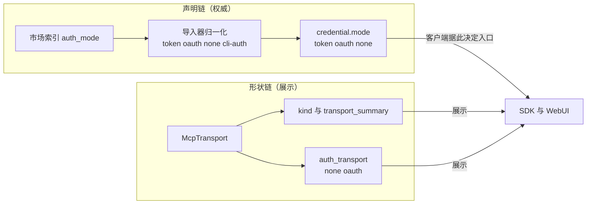

# 协议 `auth_mode` 字段语义归位 · 技术方案（第二阶段）

> **状态**：✅ 已实施（2026-10-15；前置 [`46-connector-auth-affordance-fix.zh.md`](file:///c:/workspace/allo/docs/agent-store/46-connector-auth-affordance-fix.zh.md) 已先行落地）
> **核心原则**：**字段名说的是认证方式，就只能装认证方式**；装不下的东西改名，不靠注释圆场。
> **影响面**：App Server wire DTO → 指纹 `fp-16` → `fp-17`；SDK、WebUI、mock、文档站跨仓同步。**两端必须同步发版**（指纹严格相等校验，无灰度窗口）。
> **关联**：[`01-domain-model.md`](file:///c:/workspace/allo/docs/agent-store/01-domain-model.md)、[`34-connector-user-credentials.zh.md`](file:///c:/workspace/allo/docs/agent-store/34-connector-user-credentials.zh.md)、[`44-store-category-parity-plan.zh.md`](file:///c:/workspace/allo/docs/agent-store/44-store-category-parity-plan.zh.md)（wire 变更样板）、[`45-mcp-oauth-client-id-landscape.zh.md`](file:///c:/workspace/allo/docs/agent-store/45-mcp-oauth-client-id-landscape.zh.md)（问题定性 §3.7）

## 0. 实施记录（2026-10-15）

| 层 | 落点 | 改动 |
|---|---|---|
| 协议类型 | `crates/backend/nomifun-api-types/src/app_server.rs` | 删 `auth_mode`，加 `auth_transport`（取值仍 `none` / `oauth`）+ 语义注释 |
| 投影 | `crates/backend/nomifun-app/src/app_server_catalog.rs` | 字段赋值改名（`transport_auth_shape` 仅剩展示职责） |
| 指纹（服务端） | `crates/backend/nomifun-app-server/src/lib.rs` | `PROTOCOL_VERSION = "fp-17"` + 变更说明段 |
| 指纹（SDK / 客户端） | `web/packages/protocol/src/protocol.ts`、`web/packages/client/src/http-transport.ts` | `APP_SERVER_PROTOCOL_VERSION` / `PROTOCOL_VERSION` = `fp-17` + 注释段；`ConnectorSummary.auth_mode` → `auth_transport` |
| 夹具 | `web/scripts/mock-server.ts`、`web/scripts/smoke.ts`、`web/packages/sdk/src/readiness.test.ts`、`scripts/probe-agent-store-runtime.mjs` | 指纹全部推到 `fp-17`；`MockConnector.auth_mode` → `auth_transport` |
| 前端 | `web/src/components/CatalogView.tsx`、`web/src/components/ConnectorDrawer.render.test.tsx` | 搜索文本 / fixture 改用 `auth_transport` |
| 门禁 | `bun run check:fingerprint` | ✅ `fp-17` 一致（本仓 7 文件 10 处 + 站点 2 处） |
| 跨仓站点 | `agent-store-site/content/docs/{zh-CN,en-US}/typescript-sdk.md` | 指纹表行同步 `fp-17` |
| 文档 | `05`（头部 + 变更段）、`07`（fp-17 条目）、`19`（目录形状断言）、`CHANGELOG.md`、README 索引 | 同步字段名与指纹 |
| 序列化断言 | `crates/backend/nomifun-app-server/src/lib.rs` | 新增 `connector_summary_serializes_auth_transport_and_not_auth_mode`：wire 上有 `auth_transport`、**没有** `auth_mode` 键（TC-S2-001） |

实测结果：`cargo test -p nomifun-app --lib` 418 passed / 1 failed（既有失败，见 `46` §0 登记）；`cargo test -p nomifun-app-server` 192 passed / 0 failed（含本条序列化断言）；`cd web && bun run typecheck && bun run test` 564 passed / 1 skipped；`bun scripts/smoke.ts` 通过；`bun run check:fingerprint` ✅ `fp-17` 一致（本仓 7 文件 10 处 + 站点 2 处）；`bun run check:release-sync` OK（方法计数仍 `56 / 83`）。

**TC 覆盖**：001 ✅（序列化断言）/ 002 ✅（门禁）/ 003 ✅（typecheck + 564 测试）/ 004 ✅（smoke）/ 005 ✅（release-sync + 站点指纹行）/ 006 ✅（老 `fp-16` 客户端握手即失败，指纹严格相等，见 `web/packages/client/src/client.ts:147`）/ 007 ✅（`web/src` 零 `auth_mode` 残留，协议面仅存市场声明与 credential 源的合法用法）/ 008 ⏳ 待 SDK npm 发版后验证。

---

## 1. 背景与核心痛点

### 1.1 业务背景

`AppServerConnectorSummary.auth_mode`（`nomifun-api-types/src/app_server.rs:321`）在协议上向所有客户端承诺「这个连接器的认证方式」，实际取值却是由 transport 推导的形状（`app_server_catalog.rs:212-217`：`Stdio → none`、`Sse/Http → oauth`）。`01-domain-model.md:420` 的原设计是 `none | apikey | env | oauth | cli-login`——**设计写了声明值，实现落成了传输形状**，中间没有任何人纠正，于是市场声明的 `auth_mode`（谁持凭据）与协议暴露的 `auth_mode`（传输形状）同名两义。

### 1.2 三个痛点

1. **P1 语义撒谎**：客户端读 `auth_mode === "oauth"` 会得到「需要 OAuth」的结论，而真实答案在 `credential.mode`。任何新接手的客户端都会重新踩一遍 `46` 修掉的假保护。
2. **P2 信息冗余且误导**：传输形状已经由 `kind`（`remote-mcp` / `stdio-mcp`）与 `transport_summary`（URL 或启动命令）完整表达；`auth_mode` 作为「形状的第二份拷贝」只提供误导，不提供信息。
3. **P3 权威源分裂**：同一问题的答案分布在三个字段——`auth_mode`（形状猜测）、`credential.mode`（声明，权威）、`status`（投影）。客户端无法从字段名判断该信谁。

### 1.3 三个选项对比矩阵

| 维度 | A. 改名 `auth_transport` | B. 改为声明值 | C. 删除字段 |
|---|---|---|---|
| 字段名与含义是否一致 | ✅ 一致（形状） | ✅ 一致（认证方式） | ✅ 无字段可误读 |
| 新增信息量 | 无（与 `kind` 冗余） | 有（但 `credential.mode` 已有） | 无 |
| 未装配声明读取器的宿主 | 无歧义 | ⚠️ 无声明值，要么缺席要么又猜一次 | 无歧义 |
| 客户端改动量 | 中（改名，机械） | 中（改语义 + 缺席处理） | 小（删读取点） |
| 对老客户端 | 破坏性（字段消失） | 破坏性（取值变化） | 破坏性（字段消失） |
| 推荐度 | **✅ 推荐** | ❌ 见 D2 | ⚠️ 备选，见 D3 |

---

## 2. 方案全景与架构设计

### 2.1 端到端取值链路（改造后）



### 2.2 核心目标 vs 非目标

**目标**：协议面上「认证方式」只有一个权威字段（`credential.mode`）；形状字段改名后只承担展示；`46` 的 `needs_auth` 判定逻辑不变。

**非目标**：不改 `credential.mode` 的取值与语义（`34` §6.1 已定）；不改导入映射；不给 `auth_transport` 增加任何新取值（继续只有 `none` / `oauth`）。

### 2.3 架构不变量

1. **一名一义**：字段名与取值域必须自洽；形状归形状、声明归声明。
2. **权威单一**：客户端判断「需要用户做什么」只能读 `credential.mode` + `status`，不得读形状字段。
3. **指纹同步**：DTO 字段增删即 `fp-17`，服务端常量、SDK 常量、`check:fingerprint` 落点、文档、站点同步到位（`web/AGENTS.md` §5）。

---

## 3. 核心设计

### 3.1 wire 变更（`fp-16` → `fp-17`）

| 变更 | 内容 |
|---|---|
| 删除 | `AppServerConnectorSummary.auth_mode: String`（`app_server.rs:321`） |
| 新增 | `AppServerConnectorSummary.auth_transport: String`，取值仍为 `none` / `oauth`，由 `McpTransport` 推导（沿用现 `auth_mode_for` 逻辑，仅改名） |
| 不变 | `kind`、`transport_summary`、`credential`、`status`、`AppServerConnectorDetail` / `AppServerConnectorStatusView` 其余字段 |
| 方法计数 | 不变（无方法增删改名），`56 / 83` 保持 |

兼容策略：**不做同字段双写过渡**。指纹在握手时严格相等（`web/packages/client/src/client.ts:147`），老客户端连不上新宿主会立刻报错而非静默误读——这正是仓库选择的「严格指纹约束而非虚幻多版本」。因此成本是**两端必须同步发版**：SDK 走 npm 发版（`25-release-runbook.zh.md`），站点文档同步。

### 3.2 落点矩阵（改动清单）

| 层 | 文件 | 改动 |
|---|---|---|
| 协议类型 | `crates/backend/nomifun-api-types/src/app_server.rs:315-321` | 删 `auth_mode`，加 `auth_transport` + 注释「传输形状推测值，认证方式看 `credential.mode`」 |
| 投影 | `crates/backend/nomifun-app/src/app_server_catalog.rs` | `auth_mode_for` → `transport_auth_shape`；`connector_summary` 字段赋值改名（`46` 落地后此处已无判定职责） |
| 指纹（服务端） | `crates/backend/nomifun-app-server/src/lib.rs:237` | `PROTOCOL_VERSION = "fp-17"` + 变更说明段（照 `fp-16` 段格式） |
| 指纹（SDK） | `web/packages/protocol/src/protocol.ts:91` | `APP_SERVER_PROTOCOL_VERSION = "fp-17"` + 注释段 |
| SDK 类型 | `web/packages/protocol/src/protocol.ts:984` | `auth_mode: string` → `auth_transport: string` |
| 前端 | `web/src/components/CatalogView.tsx:810` | 搜索文本改拼 `auth_transport`（或直接去掉该片段） |
| 前端测试 | `web/src/components/ConnectorDrawer.render.test.tsx:57` | fixture 字段改名 |
| mock | `web/scripts/mock-server.ts:153/215-297/934/952` | 类型与派生逻辑改名，并按 `credential.mode` 推导（`46` 已改，此处仅剩改名） |
| 脚本 | `web/scripts/smoke.ts`、`sdk-live-oauth.ts` 等 | 若有 `auth_mode` 引用则改名（当前仅 mock 侧） |
| 门禁 | `bun run check:fingerprint` | 全落点一致（脚本 `scripts/check-protocol-fingerprint.mjs` 为权威清单） |
| 跨仓 | `C:\workspace\agent-store-site` | `content/docs/{zh-CN,en-US}/typescript-sdk.md` 指纹与方法计数；`bun run check:release-sync` |
| 文档 | `05-...protocol.md`（头部指纹 + 变更段）、`07-typescript-sdk.md`、`19-webui-codex-alignment.zh.md:484`、`34` §6.1、`01-domain-model.md:420`、`README.md` | 同步字段名与指纹 |
| 变更日志 | `CHANGELOG.md` | 记 `fp-16` → `fp-17` 与字段改名（照 `fp-16` 条目格式） |

### 3.3 为什么不用 B（改为声明值）

`credential.mode` 已经是声明值的权威出口，且由 `credential` block 与 `status` 共同表达「用户要做什么」。若让 `auth_mode` 也装声明值：
- 未装配声明读取器的宿主（测试夹具、无导入历史）没有声明值可言，字段要么缺席（变成 `Option`，客户端要多处理一种形态）要么退回 transport 猜测——**又造出第二处猜测**，正是 `45`/`46` 全力消除的东西；
- 同一信息两个出口，未来必然再次分裂。

### 3.4 为什么 C（删除）只是备选

删除最干净，但外部 SDK 用户里「读 `auth_mode` 做展示」的用法会**编译期/运行期直接报错**，而改名至少给出明确迁移信号（`auth_mode` → `auth_transport`）。若团队更倾向删除，需在 `CHANGELOG` 与站点文档给一版迁移说明；本方案默认 A。

---

## 4. 关键决策与权衡矩阵

| 编号 | 决策点 | 选定方案 | 放弃的替代方案与理由 |
|---|---|---|---|
| **D1** | 字段去向 | **改名 `auth_transport`，取值 `none` / `oauth` 不变** | ❌ 保留 `auth_mode` 名字只加注释：名不副实，新客户端继续误读；❌ 改为声明值：见 §3.3 |
| **D2** | 是否同字段双写过渡 | **不双写**，靠指纹严格相等强制两端同步 | ❌ 双写一版：多一版「有时新有时旧」的状态，`check:fingerprint` 与文档要同时描述两种形态 |
| **D3** | 是否直接删字段 | **不删（备选）** | ❌ 删除：迁移信号弱于改名，且站点/SDK 文档要额外写迁移指南 |
| **D4** | 与 `46` 的关系 | **`46` 先合，本方案后动**；本方案不再承担任何行为职责 | ❌ 合并为一个 PR：行为回归与 wire 变更混在一起，出问题无法二分 |
| **D5** | `credential.mode` 是否扩展 `apikey` / `env` / `cli-login` | **不扩展**（`34` §6.1 三值已覆盖全部市场条目） | ❌ 按 `01` 原枚举补齐：无人声明这些值，纯粹增加分支 |

---

## 5. 验收标准与验证矩阵

| 编号 | 操作路径 | 可断言结果 |
|---|---|---|
| **TC-S2-001** | `cargo test -p nomifun-api-types`、`-p nomifun-app`、`-p nomifun-app-server` | 全绿；序列化快照中不存在 `auth_mode` 键，存在 `auth_transport` 且取值与 `kind` 自洽 |
| **TC-S2-002** | `bun run check:fingerprint` | 通过，且报告指纹为 `fp-17`（证明全部落点已改） |
| **TC-S2-003** | `cd web && bun run typecheck && bun run test` | 全绿；`ConnectorDrawer.render.test.tsx` 等 fixture 已改名 |
| **TC-S2-004** | `bun scripts/smoke.ts` | 全绿（mock 与真实宿主行为一致） |
| **TC-S2-005** | `bun run check:release-sync` | 通过；`agent-store-site` 双语文档指纹与方法计数一致 |
| **TC-S2-006** | 老指纹客户端（`fp-16`）连接新宿主 | 握手即失败并报出版本不匹配（证明无静默误读） |
| **TC-S2-007** | 全仓 grep `auth_mode` | 仅剩「市场索引 / 导入映射 / 本文档」三类合法出现，协议面零残留 |
| **TC-S2-008** | SDK npm 发版后安装试用 | `connectors.list()` 返回 `auth_transport`；`credential.mode` 行为与 `fp-16` 一致 |

验证梯子：`cargo test -p nomifun-api-types` → `-p nomifun-app` → `-p nomifun-app-server` → `cd web && bun run typecheck && bun run test` → `bun scripts/smoke.ts` → `bun run check:fingerprint` → `bun run check:release-sync` → 跨仓站点核对 → SDK 发版（`25-release-runbook.zh.md`）。

---

## 附录 A：现状摘录（改动前基线）

```rust
// crates/backend/nomifun-api-types/src/app_server.rs:315-321
/// `none` | `apikey` | `env` | `oauth` | `cli-login` (derived).   ← 注释承诺的是声明枚举
pub kind: String,
pub transport_summary: String,
pub auth_mode: String,                                          ← 实际装的是传输形状
```

```rust
// crates/backend/nomifun-app/src/app_server_catalog.rs:212-217（46 落地后仅剩展示职责）
fn auth_mode_for(transport: &McpTransport) -> &'static str {
    match transport { Stdio => "none", Sse | Http => "oauth" }
}
```

指纹落点：服务端 `nomifun-app-server/src/lib.rs:237`（`fp-16`）、SDK `web/packages/protocol/src/protocol.ts:91`（`fp-16`）；权威清单由 `scripts/check-protocol-fingerprint.mjs` 枚举，不手抄。

## 附录 B：未验证与风险登记

1. `ConnectorCredentialSource.auth_mode` 的实际取值集合文档注释写 `none | oauth | token`，而 `importer_tests.rs:973` 断言存在 `cli-auth`——本方案不消费该字段，但 D5 若未来要动 `credential.mode`，必须先枚举确认。
2. 未全量 grep 外部消费方（`agent-store-site`、其他宿主仓库）对 `auth_mode` 的引用；TC-S2-007 只覆盖本仓。
3. SDK 发版节奏未定：若站点文档先行、npm 包后行，会出现「文档说 `fp-17`、包里还是 `fp-16`」的窗口，需按 `25-release-runbook.zh.md` 排序。
4. 改名对「按字段名做反射/映射」的第三方代码是静默破坏（字段消失而非类型错误），`CHANGELOG` 必须给出显式迁移行。
