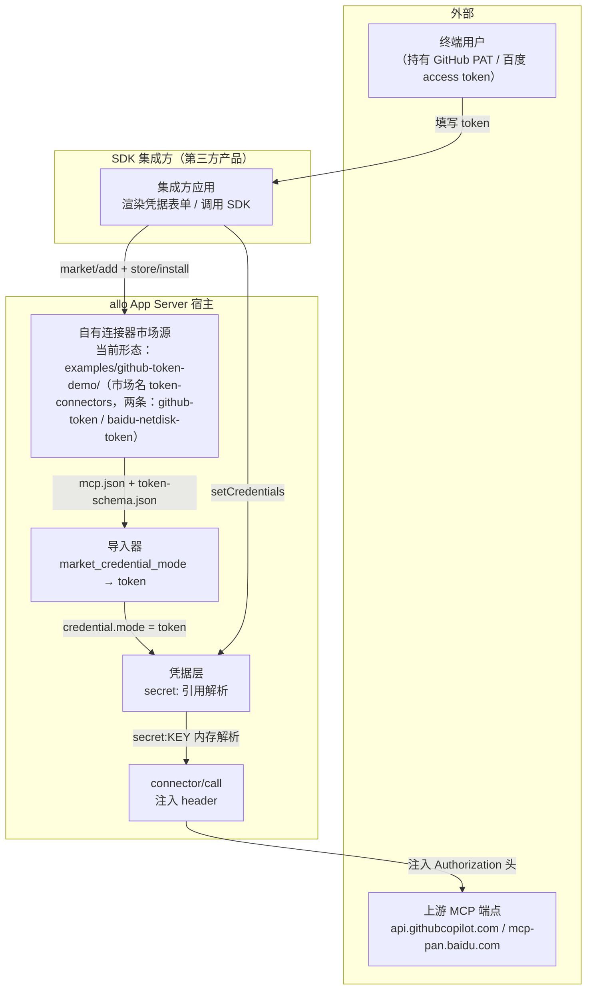
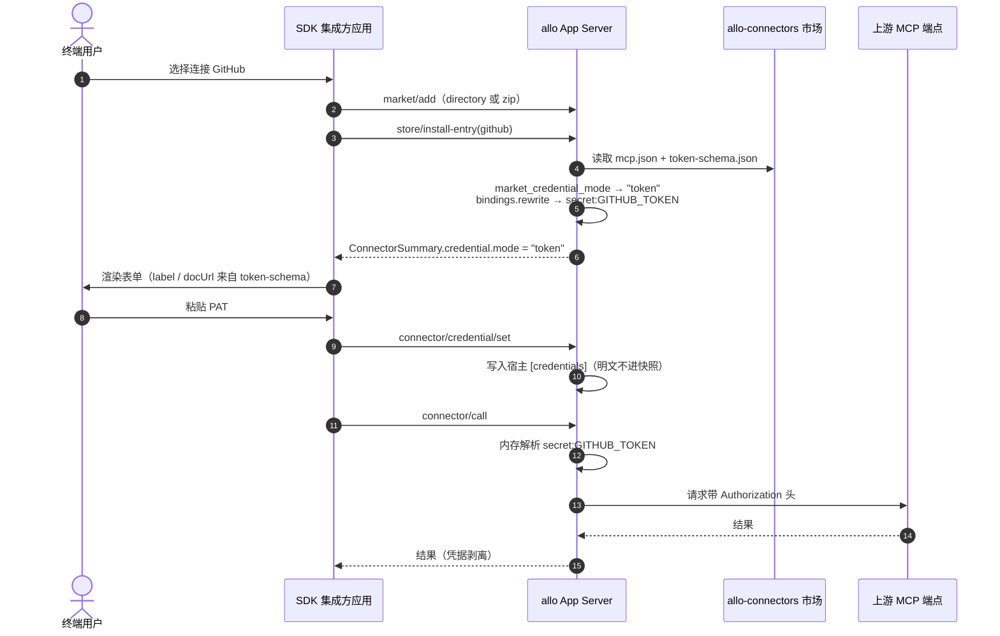
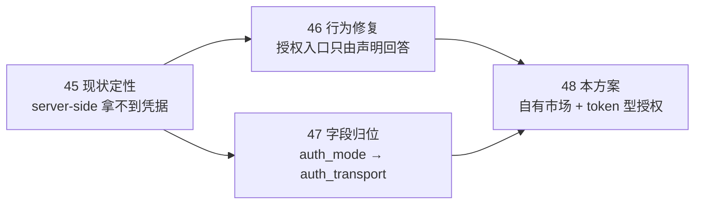

# allo 自有连接器市场（token 型授权）· 技术方案

> **状态**：🔧 部分实现（2026-10-16；两条条目已落地并从 zip 源实测安装，真实端点接受性仍待凭据）
> **核心原则**：**header 契约必须收在一个由 allo 维护的地方**；共享市场树一根头发都不动。
> **影响面**：新增一个 allo 自有的连接器市场源（数据 + 托管），**不改** App Server wire 协议、**不升**指纹；宿主侧凭据链路零代码改动。
> **关联**：[`45-mcp-oauth-client-id-landscape.zh.md`](file:///c:/workspace/allo/docs/agent-store/45-mcp-oauth-client-id-landscape.zh.md)（问题定性）、[`46-connector-auth-affordance-fix.zh.md`](file:///c:/workspace/allo/docs/agent-store/46-connector-auth-affordance-fix.zh.md)（授权入口行为）、[`47-connector-auth-mode-field-semantics.zh.md`](file:///c:/workspace/allo/docs/agent-store/47-connector-auth-mode-field-semantics.zh.md)（字段归位）、[`34-connector-user-credentials.zh.md`](file:///c:/workspace/allo/docs/agent-store/34-connector-user-credentials.zh.md)（凭据模型 §6.1/§6.5）

## 0. 实施记录（2026-10-16）

**结论先行：GitHub 半边不需要新写任何条目——`docs/agent-store/examples/github-token-demo/` 已经是本方案要的东西**（提交 `da3b259c5`，先于本文档存在）：一个可直接当 `directory` 市场用的最小树，`.codebuddy-connector/connectors.json` 声明 `auth_mode: "token"`，`mcp.json` 用 `Authorization: Bearer ${GITHUB_PAT}` 指向 `https://api.githubcopilot.com/mcp/`，`token-schema.json` 带双语文案与 `docUrl`。因此本次实施不做重复建设，只做**验证 + 登记缺口**。

| TC | 状态 | 证据 |
| --- | --- | --- |
| TC-C1 市场可识别可安装 | ✅ | `bun scripts/check-agent-store-market.mjs --market token-connectors=docs/agent-store/examples/github-token-demo` → `✓ (connector-market)`、0 error（1 条 info：无 `_files.txt`，对本地目录源是预期的）；真机两种源各跑通一次：`directory` 与 **`zip`（公网 release 地址）** → `store/search` 命中 1 条 → `store/install` ok |
| TC-C2 register 路径即 token | ✅ | `bun scripts/verify-connector-credentials-live.ts`（真机 + mock MCP）：`connector/register` 接受手工 server，**其自有模板成为凭据表单** |
| TC-C3 市场条目 → `mode: token` | ✅ | 真机安装示例条目后 `credential` = `{mode: "token", status: "requires_input", missing: ["GITHUB_PAT"], fields[0].kind: "secret", 双语 label + doc_url}`；连接器 `status: "configured"`（**非** `authorization_required`），`auth_transport` 在位 |
| TC-C4 值真的发出去 | ⚠️ 半开 | 注入机制已证：mock 收到的 header 是**模板解析后的真值**（前缀齐全），未填时 mock **一个请求都收不到**（fail-closed），`clear` 后流量停止、回到 `requires_input`；**未证**：`api.githubcopilot.com` 真实端点接受该 header——需真实 PAT（R1） |
| TC-C5 无明文/无字面引用 | ✅ | live 验收断言「没有任何请求携带字面 `${secret:KEY}`」；快照侧由既有 importer 测试覆盖 |
| TC-C6 百度网盘 | ✅ 条目已发，端点未验 | 口径来自官方仓库（SSE + `?access_token=`，**不是 header**）；`credential.mode: token`、`missing: ["BAIDU_NETDISK_ACCESS_TOKEN"]`、transport 为 `https://mcp-pan.baidu.com/sse?access_token=${secret:…}`；`connector/test` 30ms 内 fail-closed（`MCP_MISSING_CREDENTIAL`）。**未验**：真实端点接受性（需 token） |
| TC-C7 同名条目歧义 | ✅ 已规避 | 两条条目 id 与显示名都避开官方同名条目：`github-token` / `GitHub（自备 Token）`、`baidu-netdisk-token` / `百度网盘（自备 Access Token）`。官方市场（含 WorkBuddy 283 条）里是 `github` / `baidu-netdisk`，同名会让商店出现两条「百度网盘」且按名字 upsert 互相覆盖 |
| TC-C8 市场门禁 | ✅ | 仓库侧 `check-agent-store-market.mjs` 通过；未触碰站点 `market-source/`，站点门禁不涉及 |
| **托管形态（D2 后半）** | ✅ | `scripts/pack-connector-market.py` 确定性打包（8 文件 / 9961 字节，两次构建同 sha256）→ 两条条目均从 **`zip` 源** `market/add` → 安装 → `credential.mode: token` 全绿；已上传 ModelScope 并回验（`X-Linked-Etag` = 本地 sha256），**并从该公网地址实测装出两条** |

**仍待办**：
1. **真实端点验证**（R1）：需要验证者自己的 GitHub PAT，跑一次 `connector/test` + `connector/call`；通过后才算「GitHub 真正连上」。
2. **百度网盘条目**：已按官方文档口径发布（R2 关闭）；剩余的是同一件真凭据验证——用真 token 跑一次 `connector/test` + `connector/call`。注意官方文档另有一个 stdio 模式（`uv` + `netdisk.py`，用于上传本地文件），本条目只覆盖远端 SSE 形态。
3. ~~**面向所有人的托管形态**~~（D2 后半，2026-10-16 已完成）：`directory` 源保留作内测；对外形态是 **zip 归档 + ModelScope**（`me9rez/flowy-marketplace` 模型库，与官方市场同库，地址见 §3.6），任何 SDK 集成方一行 `addMarketplace` 即可接入，无需本仓库检出路径。**已发布并回验**：远端 `X-Linked-Etag` 等于本地 sha256，且从该公网地址真机装出两条条目。曾短暂用过 GitHub Release，因国内访问稳定性差已删除。
4. **条目版本与内容变更纪律**：示例 README 已登记「改了内容不抬索引版本会被不可变快照拒绝」（`18` §11 D9），示例阶段改内容请连同条目名一起换。

## 1. 背景与核心痛点

### 1.1 业务背景

Agent Store v1 的核心闭环是「第三方通过 SDK 集成，给自己产品的终端用户提供连接器」。github 与百度网盘是终端用户最先尝试的两个连接器，**连不上就等于闭环的第一个演示就崩了**。

这两个条目在市场注册表里声明的是 `auth_mode: server-side`（导入归一化成 `credential.mode: none`）。PR #340 之后它们不再显示授权按钮——那是**正确的行为**：allo 没有平台代持能力，那个按钮必然失败。但"没有假按钮"不等于"能连上"。

### 1.2 三个痛点

1. **能力缺口（根因）**：`server-side` 的本质是平台代持凭据——`client_id` + `client_secret` 存在服务商云端，客户端四步走（探 token → `start` → 轮询 `status` → 注入 + 过期前 300s 刷新）。WorkBuddy 有这套（12 条连接器的凭据在它云端），**allo 没有**。补齐它是服务端工程，不在 v1 闭环内。
2. **契约未验证（技术未知）**：这两个端点到底收什么 header、什么 token 格式，**没有一处在 allo 里验证过**。GitHub remote MCP 用 `Authorization` 头携带 PAT 只是官方文档口径；百度 `mcp-pan.baidu.com/sse` 的私有 OAuth 连标准 discovery 都没有，header 口径完全未知。契约写错，用户填了 token 照样 401，而且是看起来"配好了"的 401。**2026-10-16 更新**：注入机制已在真机 + mock MCP 上验证（模板解析后的真值确认真到 header/url，未填时一个请求都不发出）；百度网盘的落点形态已由[官方仓库](https://github.com/baidu-netdisk/mcp)确定——**SSE + `access_token` 查询参数**（不是 header），所以两条条目都已落地。剩余未知只剩"真实端点是否接受我们发出的值"。
3. **共享市场的副作用（流程陷阱）**：站点仓库的 `market-source/connectors/` 只是 `~/.workbuddy/connectors-marketplace` 的镜像（`sync-market-tree.mjs` 的 `DEFAULT_SOURCES`），`bun run sync` 会覆盖一切手工改动。改同步源又会同时改变 WorkBuddy 客户端行为——它的 server-side 刷新器按 `auth_mode === 'server-side'` 分支走。

### 1.3 能力对比矩阵

| 维度 | 现状（server-side） | 本方案目标（token，自有市场） |
| --- | --- | --- |
| 授权入口 | 无（`mode: none`，PR #340 后） | 有：`credential.mode: token` + 凭据表单 |
| 凭据归属 | 平台云端（allo 无此能力） | 终端用户自带（宿主 `[credentials]`） |
| header 契约维护者 | 无（没人维护） | allo（市场条目，单一事实源） |
| 对共享市场的影响 | — | **零**（物理隔离的独立市场源） |
| 终端用户成本 | 一键授权（假象） | 自己去厂商申请 PAT / access token（真实） |
| SDK 集成方成本 | 无从集成 | 导入市场 → 渲染表单 → `credential/set` |

## 2. 方案全景与架构设计

### 2.1 端到端拓扑



### 2.2 目标与非目标

**目标**
- 让 github / 百度网盘在 allo 里以 `token` 型真正连上，header 契约由 allo 单点维护、可版本化。
- 对 SDK 集成方零协议改动：导入、表单元数据、`credential/set`、`call` 全部走既有面。
- 与共享市场树物理隔离，WorkBuddy 行为零变化。

**非目标（坚决不做）**
- ❌ 不做平台代持（server-side）：服务端四接口 + `client_secret` 托管 + 刷新，属 v1 之后独立工程（§4 D6）。
- ❌ 不改 `~/.workbuddy/connectors-marketplace`，不改站点既有 `market-source/connectors/` 的任何既有条目。
- ❌ 不动 App Server wire 协议，不升指纹（市场数据不是协议面，`web/AGENTS.md` §5 不触发）。
- ❌ 不做 OAuth / DCR 兜底路径：这两个端点一个无 `registration_endpoint`、一个无标准 discovery，走不通。

### 2.3 架构不变量

1. **凭据不出宿主**：token 只落宿主 `~/.agent-store/config.toml [credentials]`，快照与市场条目永不留明文（沿用 `17` §6 / `21` D5=C 的 `secret:` 引用机制）。
2. **header 契约单一事实源**：同一份 `mcp.json` 模板同时服务导入、表单绑定与调用注入；不允许 SDK 集成方各自复制一份。
3. **市场隔离**：自有市场是独立根目录，不与共享树共根、不进 `bun run sync` 的源列表。
4. **先验证后发布**：未在真机跑通的 header 口径不得进入市场条目（§3.4 闸门）。

## 3. 核心设计与模块规范

### 3.1 市场源形态与接入

市场种类由根目录标记文件决定：`.codebuddy-connector/connectors.json` 即连接器市场（`nomifun-importer/src/models.rs:66-67`）。布局：

```text
allo-connectors/
├── _files.txt                              # 静态托管时由 pack/清单生成
├── .codebuddy-connector/
│   └── connectors.json                     # 条目注册表（auth_mode: "token"）
├── connectors/
│   ├── github/
│   │   ├── mcp.json                        # 传输 + header 模板
│   │   └── token-schema.json               # 凭据表单声明（新建）
│   └── baidu-netdisk-token/
│       ├── mcp.json
│       └── token-schema.json
└── icons/                                  # 可选
```

**当前形态就是 `docs/agent-store/examples/github-token-demo/`**：上面这个布局已经作为一棵完整的树存在于仓库中（提交 `da3b259c5`）。目录名是历史沿用，市场身份取索引里的 `name`（`token-connectors`），条目 id 是 `github-token` / `baidu-netdisk-token`。宿主侧接入走既有 `market/add`（`web/packages/protocol/src/protocol.ts` `MarketplaceAddRequest`），两种形态：

| 形态 | `source_kind` | `source` | 适用 |
| --- | --- | --- | --- |
| 本地目录 | `directory` | 本机绝对路径 | 内测、单机、CI 验证 |
| 归档 / HTTP | `zip` 或 `url` | 制品或静态托管地址 | 面向所有 SDK 集成方 |

> `zip` 自 `fp-7` 起支持，且归档根即市场根——官方 bundle 正是为了避开 `url` 形态首次抓取即镜像全量文件（协议 `fp-7` 变更说明）才迁到 `zip`。

### 3.2 条目数据契约

以下三份契约**已按此形状落地**于 `examples/github-token-demo/`，此处列出的字段与实物一一对应（新增条目时照抄结构、换 `url`/header/取 key 入口即可；id 与显示名须避开官方同名条目，见 TC-C7）。

**`connectors.json` 条目**（仅列关键字段，其余照既有条目）：

```jsonc
{
  "id": "github",
  "name": "GitHub",
  "source": "github",
  "auth_mode": "token",
  "description_zh": "用自然语言在 GitHub 上克隆、推送代码，查看和管理仓库与 Pull Request。",
  "description_en": "Clone, push, and manage repositories and pull requests on GitHub with natural language."
}
```

**`mcp.json`**（草案 A，header 口径待 §3.4 验证后定稿）：

```jsonc
{
  "mcpServers": {
    "github": {
      "type": "streamableHttp",
      "url": "https://api.githubcopilot.com/mcp/",
      "headers": { "Authorization": "Bearer ${GITHUB_TOKEN}" }
    }
  }
}
```

**`token-schema.json`**（照站点市场 `agent-earth` 的形状，`docUrl` 指向各自申请页）：

```jsonc
{
  "title": "GitHub 连接配置",
  "title_en": "GitHub Connection Configuration",
  "description": "填写 GitHub Personal Access Token 以连接。",
  "description_en": "Enter your GitHub Personal Access Token to connect.",
  "docUrl": "https://github.com/settings/tokens",
  "docLabel": "点击此处创建 Personal Access Token",
  "docLabel_en": "Click here to create a Personal Access Token",
  "fields": [
    {
      "key": "GITHUB_TOKEN",
      "label": "GitHub Personal Access Token",
      "label_en": "GitHub Personal Access Token",
      "placeholder": "粘贴 ghp_ 开头的 Token",
      "placeholder_en": "Paste your ghp_ token",
      "type": "password",
      "required": true
    }
  ]
}
```

百度网盘条目**落点在 URL 查询参数而不是 header**：官方文档的 SSE 用法是
`https://mcp-pan.baidu.com/sse?access_token=<Access Token>`，令牌在[网盘开放平台](https://pan.baidu.com/union/doc/Wm9sl0i0j)
完成用户鉴权后获取。`credential_mode()` 的模板扫描同时看 url 与 header，所以查询参数里的引用同样判 `token`；
导入期 `bindings.rewrite()` 也改写真 URL，落成 `secret:` 引用。官方仓库另有一个 stdio 模式
（`uv` + `netdisk.py`，为上传本地文件准备），本条目只覆盖远端 SSE 形态。

### 3.3 凭据链路时序



三条既有机制承担全部工作，**无需新代码**：

| 环节 | 位置 | 作用 |
| --- | --- | --- |
| 声明 → mode | `nomifun-importer/src/import.rs:1818` `market_credential_mode()` | `auth_mode: "token"` → `credential.mode: token` |
| 无声明兜底 | `nomifun-app/src/app_server_credentials.rs:334` `credential_mode()` | transport 模板含 secret 引用时也判 `token`（手工 register 路径依赖它） |
| 表单字段 | `import.rs:1509` `read_credential_declaration()` | 读 `token-schema.json`，缺字段只告警不阻断 |
| 值注入 | 导入期 `bindings.rewrite()` → `secret:<KEY>` | 调用时从宿主 `[credentials]` 内存解析，快照不留明文 |

### 3.4 前置验证闸门（本方案的关键流程控制）

市场条目是"allo 替所有集成方担保 header 正确"，因此**必须先验证、后发布**。验证用最便宜的形式——宿主内手工注册，不碰市场：

1. `connector/register`，transport 为同一 URL，`headers` 写 `{"Authorization": "Bearer ${GITHUB_TOKEN}"}`；
2. 无市场声明 → `credential_mode` 走 `template_references` 分支 → `token` → 表单出现（这条路径本身也是 §5 TC-C2 的断言）；
3. 填真实 PAT → `connector/test` → `connectors.call` 取一次真实数据；
4. 通过：把 header 模板定稿进市场条目；失败：换 header 形态（如 `X-Github-Token`、query 参数）重试，直到 §5 TC-C4 全绿。

**验证需要真实 token，任何人不得代填或借用凭据。** GitHub 用验证者自己的 PAT；百度用验证者自己的开放平台 access token。

### 3.5 发布与同步边界

- **不进同步源**：`~/.workbuddy/connectors-marketplace` 与站点既有 `market-source/connectors/` 一律不动；自有市场放在独立根（站点仓库新目录或独立静态托管），`sync-market-tree.mjs` 的 `DEFAULT_SOURCES` 不包含它。
- **门禁**：改过市场树必跑站点侧 `bun run check:market`（清单 / 条目集合 / 头像一致性）与 `bun run test:market`；打包走 `bun run pack:market`。
- **可发现性**：`store/categories` 与目录 UI 会把自有市场作为一个独立市场展示，条目 id 与共享树的 `github` / `baidu-netdisk` **同名不同源**——导入哪一个由用户在市场层选择，UI 必须显示来源市场名，避免"两个 GitHub"的歧义（§5 TC-C7）。

### 3.6 面向所有人的托管形态（zip + Release）

`zip` 源只收 http(s) 地址（`nomifun-app/src/market_source.rs` 的 `normalize_zip_requires_http`：本地路径是 `directory` 的活，由 kind 决定而非后缀），所以对外形态必须是一个可下载的归档。

**打包**（确定性：固定时间戳与权限，同一棵树两次构建字节相同，sha256 因此可当版本标识）：

```bash
python scripts/pack-connector-market.py           # → dist-market/token-connectors.zip
python scripts/pack-connector-market.py --check   # 只校验确定性（重打包比对摘要）
```

**发布**：上传到 ModelScope 模型库 `me9rez/flowy-marketplace`（与官方市场 `experts`/`skills`/`connectors` **同一个库**，文件名 `token-connectors.zip`），客户端地址即
`https://www.modelscope.cn/models/me9rez/flowy-marketplace/resolve/master/token-connectors.zip`。
选它而非 GitHub Release 的理由：**国内网络访问 GitHub Release 稳定性很差**，而这条链路客户端已有成熟回验
（`HEAD` 的 `X-Linked-Etag` 就是内容 sha256）。曾用 GitHub Release 落地过一版，因该原因已删除。

```bash
python scripts/pack-connector-market.py                    # → dist-market/token-connectors.zip
ms upload me9rez/flowy-marketplace dist-market/token-connectors.zip   --repo-type model --commit-message "Publish token-connectors market"
# 回验：远端 X-Linked-Etag 必须等于本地 sha256，否则客户端要么永不更新要么每次重下
```

> **已发布**（2026-10-16）：12 文件 / 14370 字节 / `sha256=b0c74e8da0f44ac8170116ebec228e997eaf895a7ccf6f330941205f83ca3434`，远端 etag 已核对一致。
> 本轮（条目改名 + 补头像）：id 改为 `github-token` / `baidu-netdisk-token`，显示名带「自备 Token」后缀，
> 以避开官方市场的 `github` / `baidu-netdisk`（同名会让商店出现两条「百度网盘」）；头像按约定路径
> `icons/<条目id>.svg` 放置并实测被 `store/list` 拾取（`avatar_url` 指向资产端点，200 + `image/svg+xml`）。
> **踩过的坑**：先传过一次旧树（传完又改了树里的 README），etag 对不上才发现——顺序必须是
> 「改完树 → 打包 → 上传 → 回验」，回验不过就重传。注意**树里的 `README.md` 也进归档**，
> 改它和改 `mcp.json` 一样需要重传；所以归档的字节数/摘要只登记在本文件（树外），树内文档一律不写自己的数字。

**集成方接入**（一行，无需本仓库检出路径）：

```ts
await client.addMarketplace({
  name: "token-connectors",
  source_kind: "zip",
  source: "https://www.modelscope.cn/models/me9rez/flowy-marketplace/resolve/master/token-connectors.zip",
});
// 然后 store/search("github-token") → store/install → 用户填 PAT → connector/call
```

**升级路径**：改树 → 重打包 → 覆盖上传同一文件名 → 集成方重新 `market/add` 或等自动刷新。注意 `18` §11 D9 的不可变快照约束——**改了内容必须换条目名或换市场**，原地改会被拒。

**已实测**（2026-10-16，两条条目、`zip` 源、真机）：

| 条目 | install | credential | connector/test |
| --- | --- | --- | --- |
| `github-token` | `ok: true`，1 组件 | `mode: token` / `requires_input` / `missing: ["GITHUB_PAT"]` / secret | 未填即 fail-closed |
| `baidu-netdisk-token` | `ok: true`，1 组件 | `mode: token` / `requires_input` / `missing: ["BAIDU_NETDISK_ACCESS_TOKEN"]` / secret | 30ms 内 `MCP_MISSING_CREDENTIAL` |

两条的连接器 `status` 都是 `configured`（非 `authorization_required`）；百度的 transport 摘要为
`https://mcp-pan.baidu.com/sse?access_token=${secret:BAIDU_NETDISK_ACCESS_TOKEN}`——**查询参数里的引用被正确识别为 secret 并改写**。

## 4. 关键决策与权衡矩阵

| 编号 | 决策点 | 选定方案 | 放弃的替代方案与理由 |
| --- | --- | --- | --- |
| **D1** | 授权形态落地方式 | **C：allo 自有市场源（token 型条目）** | ❌ **B 改共享市场树**：`auth_mode` 一改，WorkBuddy 客户端行为同时变（其 server-side 刷新器按该字段分支），且不可逆；❌ **A 仅手工 register**：header 契约被每个集成方复制一份，厂商改 header 时 N 个集成一起 401 且无法中心修复 |
| **D2** | 市场托管形态 | **先 `directory`/`zip` 内测，后静态托管** | ❌ 直接公网 `url`：首次抓取即镜像全量文件，`05` §4.6 已有前车之鉴；❌ 只做本地目录：无法面向所有 SDK 集成方 |
| **D3** | header 契约发布时机 | **先 §3.4 真机验证通过，再写进条目** | ❌ 先发布后验证：让所有集成方一起承担 401，且"看起来配好了"极难排查 |
| **D4** | `token-schema.json` 完整度 | **`title`/`description` 双语 + `docUrl`/`docLabel` 必填** | ❌ 只写 `fields`：终端用户不知道该去哪申请 token，转化率损失最大的一环 |
| **D5** | 是否动 wire 协议 | **不动，不升指纹** | ❌ 为新能力加协议面：市场数据与凭据链路都已存在，加面即无谓的跨仓同步成本（`web/AGENTS.md` §5） |
| **D6** | 平台代持（server-side） | **明确不做，登记为 v1 之后缺口** | ❌ v1 内顺带做：服务端四接口 + `client_secret` 托管 + 刷新 + 撤销，量级远超本方案，会撑爆 v1 闭环边界 |

## 5. 验收标准与验证矩阵

| 编号 | 操作路径 | 验收断言 |
| --- | --- | --- |
| **TC-C1** | `market/add` 指向自有市场根（`directory` 与 `zip` 各一次） | 市场被识别为**连接器市场**（依据 `.codebuddy-connector/connectors.json`），条目数正确 |
| **TC-C2** | 不接市场，`connector/register` 同一 URL 且 `Authorization` 头填 PAT | `credential.mode === "token"`，凭据表单出现（验证 `credential_mode` 的模板兜底分支） |
| **TC-C3** | 从自有市场导入 github 条目 | `ConnectorSummary.credential.mode === "token"`；`auth_status` 缺席；`status !== "authorization_required"`（不再出现假 OAuth 入口） |
| **TC-C4** | 填真实 PAT → `connector/test` → `connector/call` | `test` 连接成功；`call` 返回真实数据——**不得**以 `status: configured` 代替，必须见到真实返回 |
| **TC-C5** | 快照 / 市场产物全文检索 | 无明文 token；仅有 `secret:GITHUB_TOKEN` 引用 |
| **TC-C6** | 安装百度网盘条目 → `credential` → 未填时 `connector/test` | `mode: token`、`missing` 点名 `BAIDU_NETDISK_ACCESS_TOKEN`、transport 的查询参数是 `secret:` 引用；未填时 `MCP_MISSING_CREDENTIAL` 且不发请求 |
| **TC-C7** | 同时启用共享市场与自有市场 | 目录中两个同名条目均显示**来源市场名**，可区分、可分别导入/卸载 |
| **TC-C8** | 站点侧市场门禁 | `bun run check:market` 与 `bun run test:market` 通过；`git diff` 确认共享树零改动 |

**验证梯子**（从快到慢）：

1. `cargo test -p nomifun-importer` + `cargo test -p nomifun-app`（导入映射与凭据投影，覆盖 TC-C2/C3）
2. 本地 `market/add`（directory）→ 导入 → 填值 → test/call（TC-C1/C4，需真实 token）
3. `zip` 形态打包 → 二次接入（TC-C1）
4. 站点 `check:market` / `test:market` / `pack:market`（TC-C8）
5. 真机端到端：SDK 集成方视角跑一遍 §3.3 时序（TC-C4/C5/C7）

## 6. 风险与未验证项登记

| 编号 | 内容 | 处置 |
| --- | --- | --- |
| R1 | GitHub remote MCP 的 header 形态（`Authorization` 头 + PAT）来自官方文档口径，**未经真实端点验证** | 需验证者自己的 PAT 跑一次 `connector/test` + `connector/call`；失败则改形态重试 |
| R2 | 百度网盘 MCP 的落点形态已由官方文档确定（SSE + `access_token` 查询参数），但**真实端点接受性未验证**；官方另有一个 stdio 模式（`uv` + `netdisk.py`，本条目未覆盖） | 需真 token 验证；stdio 形态要另立条目（依赖 `uv`，市场条目形态待评估） |
| R3 | 终端用户必须自行申请 token，connect 转化率相比"一键授权"必然下降 | 属产品取舍，非技术缺陷；`token-schema` 的 `docUrl` 是唯一缓解手段 |
| R4 | 同名条目（共享树 `server-side` vs 自有市场 `token`）造成选择歧义 | TC-C7 强制显示来源市场名；必要时在自有市场用不同 id（如 `github-token`） |
| R5 | 自有市场若被误加入 `bun run sync` 源列表，会被共享树覆盖 | §3.5 明确不进 `DEFAULT_SOURCES`；在站点维护文档登记 |
| R7 | `store/install` 在未填 token 时会等 `ready` 到超时（两条条目均实测约 3 分钟）才返回 `ok: true` + `ready: false` / `ready_timeout` | 安装其实已完成；集成方传小 `timeoutMs`（20s 足够）或忽略 `ready`。根因是 ready 判定要求一次成功探测，属宿主既有行为，非本方案引入 |
| R6 | 平台代持能力缺席，`server-side` 类 12 条连接器在 allo 内仍不可用 | D6：登记为 v1 之后独立工程，不在本方案范围 |

---

## 附录：与相邻方案的关系



- `45` 回答"为什么连不上"：server-side 的凭据在厂商云端，allo 拿不到。
- `46`/`47` 回答"界面为什么不再假装能连"：入口只由 `credential.mode` 决定，字段名归位。
- **本方案回答"那怎么才能真正连上"**：把授权形态从"平台代持"降级为"用户自带 token"，并用一个 allo 自有的市场源把 header 契约收在单一事实源里。
