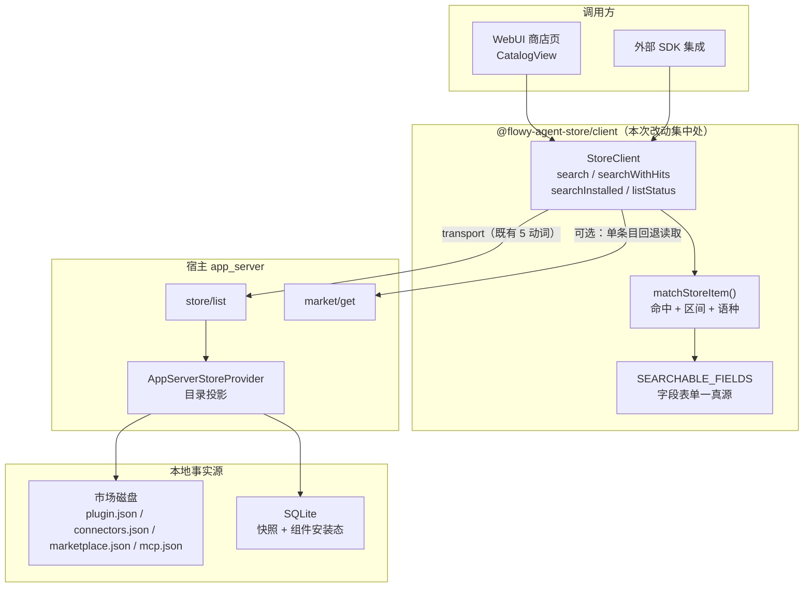
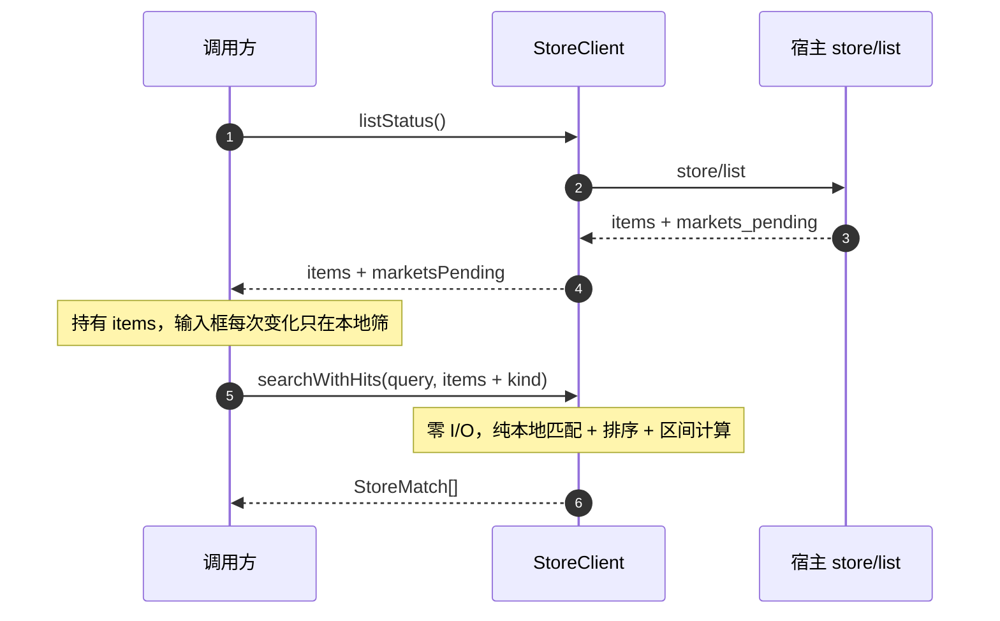

# Agent Store 目录检索与使用提示 · 技术方案

> **状态**：🔧 P1 已实施（2026-10-21；P2 详情面未做，见 D11）
> **核心原则**：检索是**客户端组合**，不新增 wire 方法；匹配、排序与高亮共享**同一份字段表**，命中位置以**原文字符区间**表达，绝不返回带标记的 HTML。提示词示例（`examples_*` / `quickPrompts`）是**市场已声明的事实**，宿主只负责透传，不发明、不补写。

对应工单（`0.1.0-beta.11`，均为 open）：② 市场资源查找的 `keyword` 匹配口径；③ 已安装资源是否支持查找；⑤ 市场资源是否提供推荐的使用提示（专家 / 专家团 / 技能 / 连接器，列表与详情两面）。工单 ① 连接器认证、④ 工具数量不在本方案范围（① 见 [34-connector-user-credentials.zh.md](34-connector-user-credentials.zh.md) §6.1 的 `auth_mode` 映射；④ 是探针派生量，见 §2.2 非目标）。

---

## 1. 背景与核心痛点

### 1.1 业务背景

`harness.store`（即 `@flowy-agent-store/client` 的 `StoreClient`）是 Agent Store 目录的唯一读入口，两个消费面：WebUI 商店页（`web/src/components/CatalogView.tsx`）与外部 SDK 集成方。围绕它有三类真实诉求：

- **找条目**：按关键字在目录里筛（工单 ②）；
- **只找已装的**：在已安装范围内筛（工单 ③）；
- **告诉用户能问什么**：把市场声明的提示词示例展示在列表与详情上（工单 ⑤）。

现状只覆盖第一类的第一层，且把三个必要信息丢在函数内部：**命中了哪个字段、命中在哪个位置、这份目录是否已经完整**；第三类则是**数据早就存在、宿主只接了一半**。

### 1.2 三个痛点

**P1 · 匹配口径未文档化，且跨词、跨字段都搜不到。**
`haystack()`（`web/packages/client/src/store.ts:202-218`）把十个字段的取值用 `"\n"` 拼成一条串再 `toLowerCase()`，随后 `includes()`。后果有三个：

1. **多词 query 必然失败**——`"百度 网盘"` 在任一字段内都不连续，`"数据 智能"` 也无法跨越 `\n` 分隔符；
2. **字段表是模块私有函数**，没有导出，外部要复现同一套规则只能抄写，规则一旦分叉就会出现「命中了但高亮不出来」或「高亮了但不在结果里」；
3. 拼接串上的 `indexOf` 偏移**没有任何字段语义**，高亮无法据此切分。

**P2 · 没有「已安装」检索入口，也没有目录完整性信号。**
`search()` 与 `installed()` 是两个独立调用，交集只能调用方自己拼，且每次 `search()` 都会重新走一次全量 `list()`。更关键的是 `StoreList.markets_pending`（`web/packages/protocol/src/protocol.ts:1477`，语义见 [05](05-flowy-agent-store-app-server-protocol.md)）在 SDK 层被丢弃：`StoreClient.list()` 只 `return store.items`（`store.ts:261-264`），全仓**零消费者**。应用启动瞬间搜索会静默返回不完整目录，调用方无法区分「没有这个条目」与「目录还没加载完」。

**P3 · 使用提示四类只通了一半，两类数据装完就丢。**
市场侧的数据是齐的（实测覆盖见附录 A.3），宿主的接入度按 kind 与面分裂：

| 数据来源 | 覆盖它的 kind | 已进入的 wire 面 |
|---|---|---|
| `plugin.json` 的 `quickPrompts` / `defaultInitPrompt` | 专家、专家团 | `AgentDetail.quick_prompts` / `default_init_prompt`（仅 agent）；`StoreItem.quick_prompts` |
| 市场索引行的 `examples_zh` / `examples_en` | 技能、连接器 | **仅** `market/get` 的 `localized`；`StoreItem.quick_prompts` 为空，`skill/get` / `connector/get` 没有该字段 |

即：**专家有（列表 + 详情），专家团只有列表，技能与连接器两面都没有**，且技能/连接器安装之后连 `market/get` 这条路也不再被 UI 使用。[18](18-marketplace-spec.zh.md) §4.1 的现状栏对此的记法只有一句「⏳ 已透传、UI 未展示」。

### 1.3 能力对比矩阵

| 能力 | 现状行为 | 本方案目标 |
|---|---|---|
| 多词查询 | 任一字段内必须连续，跨词必为 0 命中 | 按空白切 term，**全部 term 均命中**即保留（AND） |
| 命中语义可见性 | 只有 `StoreItem[]` | 另给 `StoreFieldHit[]`：字段 + 语种 + 原文区间 |
| 高亮 | 调用方自行复制规则 | `matchStoreItem()` 导出，区间直接喂 `<mark>` |
| 已安装筛选 | `search()` 后再 `.filter(i => i.installed)` | `searchInstalled()` 薄封装（内部一次取数） |
| 目录完整性 | `markets_pending` 被丢弃 | `listStatus()` 透出，`search` 结果携带同标志 |
| 目录取数次数 | 每次 `search()` 全量投影一次 | 支持传入预取数组，N 次查询只取 1 次 |
| 结果顺序 | 市场原始顺序 | name/entry_name 命中 > tag/category > 其余 |
| 使用提示 · 列表 | 专家 ✅ / 团 ✅ / 技能 ❌ / 连接器 ❌ | 四类齐全（`StoreItem.quick_prompts` 索引行回落） |
| 使用提示 · 详情 | 仅专家 ❌其余（`agent/get` 独有） | 商店抽屉四类齐全；已安装抽屉见 D11 |

---

## 2. 方案全景与架构设计

### 2.1 端到端拓扑



### 2.2 目标与非目标

**目标**

- `search()` 的匹配口径成为**文档化契约**，并支持多词 AND；
- 导出 `matchStoreItem()`，让命中字段/位置/语种可被高亮直接消费；
- 提供 `searchInstalled()` 与 `listStatus()`，闭合 P2 的三个缺口；
- **P1（零 wire）**：`StoreItem.quick_prompts` 对四类条目全部有值（技能/连接器回落索引行 `examples_*`），商店卡片与商店抽屉可直接渲染；
- **P2（可选，需升指纹）**：`TeamDetail` / `SkillDetail` / `ConnectorDetail` 补 `quick_prompts`，让「已安装」抽屉同样有提示（见 D11）。

**非目标**

- ❌ 不新增 wire 方法 `store/search`，P1 不新增任何 DTO 字段；
- ❌ 不引入分词器、拼音、模糊匹配、语义检索；
- ❌ 不返回 HTML 片段或富文本；
- ❌ 不改 `haystack` 的字段集合语义（新增字段必须走本方案的字段表修订）；
- ❌ 不为 `search` 增加 `categoryId` 过滤参数（[43](43-store-categories-and-tags-plan.zh.md) §`235` 已决定由 UI 一行 `filter` 承担）；
- ❌ 不生成、不改写、不翻译市场未声明的提示词（缺就是缺，空态即不渲染该行）；
- ❌ 不在本方案处理「工具数量 / 工具名标签」（工单 ④）：那是 `connector/test` 探针派生量，不来自市场声明。

### 2.3 架构不变量

| 编号 | 不变量 |
|---|---|
| **INV-1** | 匹配与高亮**只**从 `SEARCHABLE_FIELDS` 派生，任何新增可搜字段必须同时进入两者 |
| **INV-2** | P1 的 wire 面零改动：新增能力全部是客户端组合 + 既有字段取值变化，指纹保持 `fp-17`；P2 一旦实施必须升 `fp-18` 并两仓同步 |
| **INV-3** | 高亮区间永远指向**原文**（未 `toLowerCase` 的字符串），不得指向内部折叠串 |
| **INV-4** | 空 query（`trim()` 后为空）等价于「不筛文字」，只应用 `kind` / `installed` 过滤 |
| **INV-5** | `examples_*` 只作**展示**进入 `quick_prompts`，**不进** `haystack`，否则 283 条 × 每条约 5 条示例会把「合同/文件/查询」类词全部打中 |
| **INV-6** | 提示词只从市场声明读取：`plugin.json.quickPrompts` 优先，索引行 `examples_*` 仅作**回落**；两者都空则不显示该行 |

---

## 3. 核心设计与模块规范

### 3.1 字段表单一真源

`haystack()` 现在是一段手写字符串拼接；改为由数据驱动的字段表，匹配、排序、高亮三处共用同一个定义。

```ts
// web/packages/client/src/store-search.ts
import type { StoreItem } from "@flowy-agent-store/protocol";

/** 可搜字段的稳定枚举：新增字段必须同时被 haystack 与高亮感知（INV-1）。 */
export type StoreSearchField =
  | "entry_name"
  | "name"
  | "id"
  | "version"
  | "description"
  | "display_name"
  | "display_description"
  | "profession"
  | "tags"
  | "category";

/** 一个字段的取值展开方式；返回「值 + 语种」对，语种仅多语种字段有。 */
interface FieldSource {
  field: StoreSearchField;
  /** 排序权重：1 = 名称级，2 = 标签/分类级，3 = 描述级（见 §3.6）。 */
  weight: 1 | 2 | 3;
  values(item: StoreItem): Array<{ text: string; lang?: "zh" | "en" }>;
}

export const SEARCHABLE_FIELDS: readonly FieldSource[] = [
  { field: "entry_name", weight: 1, values: (i) => [{ text: i.entry_name }] },
  { field: "name", weight: 1, values: (i) => [{ text: i.name }] },
  { field: "id", weight: 1, values: (i) => [{ text: i.id }] },
  { field: "version", weight: 3, values: (i) => [{ text: i.version }] },
  { field: "description", weight: 3, values: (i) => (i.description ? [{ text: i.description }] : []) },
  { field: "display_name", weight: 1, values: (i) => localizedPairs(i.display_name) },
  { field: "display_description", weight: 3, values: (i) => localizedPairs(i.display_description) },
  { field: "profession", weight: 2, values: (i) => localizedPairs(i.profession) },
  { field: "tags", weight: 2, values: (i) => (i.tags ?? []).flatMap((t) => localizedPairs(t)) },
  { field: "category", weight: 2, values: (i) => localizedPairs(i.category?.name ?? null) },
];

function localizedPairs(text: { zh?: string | null; en?: string | null } | null): Array<{
  text: string;
  lang: "zh" | "en";
}> {
  if (!text) return [];
  const out: Array<{ text: string; lang: "zh" | "en" }> = [];
  if (text.zh) out.push({ text: text.zh, lang: "zh" });
  if (text.en) out.push({ text: text.en, lang: "en" });
  return out;
}
```

`haystack(item)` 退化为 `SEARCHABLE_FIELDS.flatMap((f) => f.values(item).map((v) => v.text)).join("\n").toLowerCase()`，字段集合与顺序保持现状，**行为兼容**。

### 3.2 切词与匹配语义

```ts
/** 空白切分，丢弃空 term；term 内部仍是大小写无关子串。 */
function terms(query: string): string[] {
  return query.trim().toLowerCase().split(/\s+/).filter(Boolean);
}
```

- 一个条目**被保留**当且仅当：每个 term 都能在任一可搜字段的取值中找到（AND，逐 term 独立匹配，不要求同字段）；
- 单 term 时与旧行为一致（除大小写折叠规则不变外无差异）；
- 空 query → 全部保留（INV-4）；
- `kind` 过滤在匹配之前执行，`kind: ""` 与前次讨论一致地等价于「不过滤」（`filter.kind &&` 判空所致，属既有行为，本方案不改变）。

### 3.3 命中区间与高亮

```ts
export interface StoreFieldHit {
  field: StoreSearchField;
  /** 仅多语种字段存在：命中的是哪一版文案。 */
  lang?: "zh" | "en";
  /** 原文（非折叠串）上的 [start, end)，已排序并合并重叠。 */
  ranges: Array<[number, number]>;
}

export interface StoreMatch {
  item: StoreItem;
  hits: StoreFieldHit[];
  /** true = 命中的是另一个语种的文案，当前渲染语言里找不到该词。 */
  offLanguage: boolean;
}

export function matchStoreItem(item: StoreItem, query: string): StoreMatch | null;
```

**折叠长度对齐（INV-3）**：`toLowerCase()` 会改变字符串长度（`"İ".toLowerCase()` 为 2 个 code unit），直接把折叠串上的偏移当原文偏移会错位。实现取以下两种之一，默认后者：

1. 构建折叠映射 `buildFold(raw) → { folded, map }`（`map[i]` = folded 第 `i` 位对应的原串下标），约 15 行；
2. **保守降级**：`raw.toLowerCase().length !== raw.length` 时该字段不产出 ranges（命中仍然成立，只是不高亮）。降级只影响美观，不影响结果集，且实现无额外状态。

**重叠合并**：多 term 命中同一区域时，把区间排序后合并为不重叠区间，避免生成嵌套 `<mark>`。

**语种回落**：搜索覆盖全部语种（既有行为，也是 D8=A 的必要条件），但卡片只渲染 `pickLocalized(...)`（`web/packages/protocol/src/localized.ts:36`）挑出的那一版。`offLanguage` 显式表达这种情形，调用方二选一：接受「该条在列表里但无高亮」，或按命中语种渲染。两者都合法，**接口不替调用方决定**。

### 3.4 公开 API 契约

```ts
// 既有，签名与返回类型不变
search(query: string, filter?: { kind?: StoreItemKind }): Promise<StoreItem[]>;

// 新增
searchWithHits(query: string, opts?: SearchOptions): Promise<StoreMatch[]>;
searchInstalled(query: string, opts?: Omit<SearchOptions, "installedOnly">): Promise<StoreItem[]>;
listStatus(): Promise<{ items: StoreItem[]; marketsPending: boolean }>;
```

```ts
interface SearchOptions {
  kind?: StoreItemKind;
  /** 预取数组：给出时不再调用 list()；用于「取一次、筛多次」。 */
  items?: StoreItem[];
  installedOnly?: boolean;
}
```

**契约要素**

| 要素 | 内容 |
|---|---|
| 前置条件 | `items` 若给出，必须是同一次会话内由 `listStatus()` / `search()` 取得的数组；跨会话复用的陈旧数组不违反接口但不保证新鲜 |
| 保证 | 返回顺序 = 权重升序（§3.6）后按 `list()` 原序稳定排序；`ranges` 已排序合并且落在原文上；`search()` 的结果集与 `searchWithHits()` 的 `item` 集合**逐一相同**（同一实现，非两条路径） |
| 副作用 | 无 `items` 时发起一次 `store/list`（网络 + 宿主侧投影）；给出 `items` 时**零 I/O** |
| 不变式 | 不写任何本地状态；不缓存（见 D6）；相同入参必返回相同结果 |
| 故障语义 | transport 失败原样上抛 `StoreError`，不做降级或空数组兜底；`marketsPending` 为 `true` 时返回正常结果，仅标志不完整 |
| 反模式 | ❌ 在 `input` 事件里调用**未传 `items`** 的 `search()`（每击键一次全量投影）——传 `items` 后为本地匹配、零 I/O，可直接在事件内调用；❌ 用返回值长度判断「目录为空」而不看 `marketsPending`；❌ 把 `ranges` 应用到 `item.name` 之外的字符串（区间属于具体字段值） |

### 3.5 预取而非缓存



不采用 TTL 缓存的理由见 D6：`installed` / `update_available` / `installed_version` 会因 `install` / `uninstall` / `setEnabled` / `update` 变化，任何时间窗缓存都会产生「卡片显示未安装但其实装了」的脏读。

### 3.6 结果排序

取条目命中字段中的**最小权重**升序排列；同权重保持 `list()` 原序（稳定排序）。当前目录规模约 900+ 条（附录 A.3），不做相关度打分（不引入 BM25 类模型），仅三档：

| 档 | 字段 | 理由 |
|---|---|---|
| 1 | `entry_name` / `name` / `id` / `display_name` | 名称命中就是用户要的那条 |
| 2 | `profession` / `tags` / `category` | 分类与标签是并列的语义键 |
| 3 | `description` / `display_description` / `version` | 长文本命中，噪声最多 |

### 3.7 使用提示：四类 × 两面

**数据有两种来源，覆盖的 kind 不重叠**（实测见附录 A.3）：

| 来源 | kind | 字段 | 实测覆盖 |
|---|---|---|---|
| 条目自己的 `plugin.json` | 专家、专家团 | `quickPrompts[]` + `defaultInitPrompt` | 专家 31/35；团 2/3 |
| 市场索引行 | 技能、连接器 | `examples_zh` / `examples_en` | 技能 268/268；连接器 283/283 |

**两面、四类的接入矩阵与本方案的落点**：

| 面 | 读的是哪个 DTO | 专家 | 专家团 | 技能 | 连接器 | 阶段 |
|---|---|---|---|---|---|---|
| 商店卡片（列表） | `StoreItem.quick_prompts` | ✅ 已有 | ✅ 已有 | ⛔→✅ | ⛔→✅ | **P1** |
| 商店抽屉（点卡片） | 同一个 `StoreItem` | ✅ | ✅ | ⛔→✅ | ⛔→✅ | **P1** |
| 已安装抽屉 | `agent/get` / `team/get` / `skill/get` / `connector/get` | ✅ 已有 | ⛔ | ⛔ | ⛔ | **P2**（D11） |

P1 的唯一服务端改动，是让 `store/list` 的条目投影在**没有 `plugin.json`** 时回落到索引行：

```rust
// crates/backend/nomifun-app/src/app_server_store.rs:542 现有实现：只读 plugin.json
quick_prompts: manifest
    .as_ref()
    .map(|m| m.quick_prompts.iter().filter_map(|p| localized_or_none(p)).collect())
    .filter(|prompts: &Vec<AppServerLocalizedText>| !prompts.is_empty())
    .unwrap_or_default(), // ← 连接器 / 技能没有 plugin.json，这里恒为空数组
```

改法：`MarketIndexInfo`（同文件 `:118`）增加 `examples: Vec<LocalizedText>`，在 `read_index` 里按 `examples_zh` / `examples_en` 位置配对读取（配对语义与 `tags_*` 一致，见 [43](43-store-categories-and-tags-plan.zh.md) §3.3），投影处改为 `manifest 优先 → 索引行回落 → 空`（INV-6）。

**为什么这不构成 wire 变更**：`AppServerStoreItem.quick_prompts` 字段早已存在（[05](05-flowy-agent-store-app-server-protocol.md) §4.1），本次只是让它在技能/连接器条目上从「空数组」变为「有值」。字段类型、可选性、序列化规则均不变 → 指纹（`fp-17`）与方法计数均不动（INV-2）。既有快照不需要迁移：投影是**每次 `store/list` 现算**的，不是落库产物。

**展示规则（D12）**：卡片只渲染**第一条**（与 WorkBuddy 专家卡的「提示词: …」一致，卡片高度固定，不做轮播）；抽屉最多列 3 条，`default_init_prompt` 非空时单列一行「默认开场」；两者都空则**整行不渲染**，不留占位、不写「暂无」。

### 3.8 实施顺序

1. ~~`store-search.ts`：字段表 + `terms()` + `matchStoreItem()`（含折叠降级与区间合并）~~ ✅
2. ~~`store.ts`：`search()` 改走 `matchStoreItem`，新增 `searchWithHits` / `searchInstalled` / `listStatus`~~ ✅
3. ~~`index.ts` 导出新符号；单测覆盖 §5 的 TC-1…TC-12~~ ✅
4. ~~Rust 侧 `examples → quick_prompts` 回落 + 投影单测（TC-13…TC-16）~~ ✅
5. ~~UI：商店卡片提示行 + 抽屉提示区（TC-17、TC-18）~~ ✅（类型检查通过；浏览器目视验收待宿主就绪，见 §5.2 第 5 层）
6. 版本递增（当前 `0.1.0-beta.11`，随发布窗口走 [25](25-release-runbook.zh.md)），站点文档同步（`examples-sdk.md` / `typescript-sdk.md` / `changelog.md` 中英各一份）—— ⏳ 待发布窗口

**实际落点（P1）**

| 文件 | 改动 |
|---|---|
| `web/packages/client/src/store-search.ts` | 新增：`SEARCHABLE_FIELDS`、`storeHaystack`、`splitStoreQuery`、`matchStoreItem`、`storeMatchRank`、`StoreMatch` / `StoreFieldHit` / `StoreSearchOptions` |
| `web/packages/client/src/store.ts` | `search()` 改走 `searchWithHits()`；新增 `searchWithHits` / `searchInstalled` / `listStatus`；删除私有 `haystack` / `localizedValues` |
| `web/packages/client/src/{index.ts, store-search.test.ts, store.test.ts}` | 导出新符号；新增 12 条匹配单测 + 8 条 store 级用例（含 `markets_pending` 与预取零 I/O） |
| `crates/backend/nomifun-app/src/app_server_store.rs` | `MarketIndexInfo.examples`、`localized_examples_from_index`、`store_quick_prompts`（manifest 优先 → 索引行回落）；新增 2 条单测 |
| `web/src/components/CatalogView.tsx` | 新增 `StorePromptHint`（卡片 1 条）；`StoreDrawer` 提示列表限 3 条、标签按 kind 区分 |
| `web/src/{style.css, i18n/zh-CN.ts, i18n/en-US.ts}` | `.market-card-hint` 样式；`catalog.storeQuickPrompts` / `catalog.storePromptHint` 双语键 |
| `web/scripts/verify-store-search-hints.ts` | 新增活体脚本：三份夹具市场（连接器 / 技能 / 专家）跑真宿主，断言 HSH-001…HSH-007（2026-10-21 全绿） |
| `docs/agent-store/07-typescript-sdk.md` | `.store` 子客户端方法表补三个新方法与检索口径说明 |

---

## 4. 关键决策与权衡矩阵

| 编号 | 决策点 | 选定方案 | 放弃的替代方案与理由 |
|---|---|---|---|
| **D1** | 是否新增 wire 方法 `store/search` | **不新增**，全部客户端组合 | ❌ 协议方法：数据本就全量下发，服务端搜索无收益；还要定义分页/游标/排序语义，并把「搜索」变成远端契约（要换指纹 + 两仓同步） |
| **D2** | 多词查询语义 | **切 term + AND + term 内子串** | ❌ 保持整串子串：多词必为 0 命中且无法解释；❌ 分词/模糊：900 条规模不需要，且让「为什么搜不到」不可解释 |
| **D3** | 高亮表达方式 | **字段级字符区间** | ❌ 返回 `<mark>` HTML：把安全属性内联进数据、绑定渲染方式；❌ 返回整条 haystack：跨字段偏移无意义且重复传输文本 |
| **D4** | 折叠长度变化时的处理 | **保守不产出 ranges**（命中仍成立） | ❌ 强行计算映射：增加状态与边缘用例，收益仅限极少数非拉丁字符；❌ 不做大小写折叠：破坏既有行为 |
| **D5** | 是否改 `search()` 返回类型 | **不改**，新增 `searchWithHits()` | ❌ 直接改返回 `StoreMatch[]`：破坏所有既有调用点，属无收益的破坏性变更 |
| **D6** | 取数策略：预取还是缓存 | **预取（`items` 入参）** | ❌ SDK 内部 TTL 缓存：`installed`/`update_available` 会漂移，必须被四个写动词强制失效，漏一处即脏读 |
| **D7** | `markets_pending` 的暴露方式 | **`listStatus()` + 结果携带标志** | ❌ 仅加日志/告警：调用方无法程序化处理；❌ 让 `list()` 改返回 `StoreList`：破坏既有签名（同 D5） |
| **D8** | 提示词在列表面的落点 | **`StoreItem.quick_prompts`**，`plugin.json` 优先、索引行回落 | ❌ 让 UI 直接读 `market/get.localized`：UI 要同时懂两个来源与两套键名，且安装后该路径不再可用；❌ 新增 `connector/examples` 方法：为纯展示数据开 wire 面 |
| **D9** | `examples_*` 是否参与检索 | **不参与** | ❌ 进入 `haystack`：示例是长尾自然语言，「合同/文件/查询」类词命中大量条目，真实名称命中被稀释 |
| **D10** | `searchInstalled` 的形态 | **薄封装**：内部一次取数 + `installed` 过滤 | ❌ 进 `search` 的 filter 参数：把「查找」与「范围」混成一个签名；❌ 两次调用：成倍放大宿主投影成本 |
| **D11** | 详情面（已安装抽屉）是否同步做 | **分两阶段**：P1 只做列表 + 商店抽屉（零 wire）；P2 视需求补 `TeamDetail` / `SkillDetail` / `ConnectorDetail.quick_prompts`（升 `fp-18`） | ❌ 一步做全：P2 是三个 DTO 的加字段，要换指纹 + 两仓同步 + 站点文档，而商店侧（用户真正看提示的地方）零 wire 就能到位；❌ 永久不做：已安装抽屉会长期缺提示，语义上不完整 |
| **D12** | 提示词的展示条数与空态 | **卡片 1 条 / 抽屉 ≤3 条 / 空即不渲染** | ❌ 卡片轮播多条：卡片高度固定，多一条就挤掉工具与标签；❌ 抽屉全量平铺：`examples_zh` 有 6 条的条目（如 `baidu-netdisk`），全列会淹没表单与操作 |

---

## 5. 验收标准与验证矩阵

### 5.1 验收用例

| 编号 | 操作 | 断言 |
|---|---|---|
| **TC-1** | `search("百度 网盘")` | 命中 `百度网盘` 条目（term 分属 `name` 两段也算命中；旧实现为 0 命中） |
| **TC-2** | `search("TEAM")`、`search("release")` | 与旧实现结果集逐条相同（大小写折叠与单 term 行为回归） |
| **TC-3** | `search("")`、`search("   ")` | 返回全部条目，与 `listStatus().items` 等长 |
| **TC-4** | `search("", { kind: "skill" })`、`search("", { kind: "" })` | 前者只回 skill；后者等价于不过滤 |
| **TC-5** | `searchInstalled("")` | 结果全部 `installed === true`，且只触发一次 `store/list` |
| **TC-6** | 宿主返回 `markets_pending: true` | `listStatus().marketsPending === true`，`items` 仍正常返回 |
| **TC-7** | `searchWithHits("网盘", { items })` | mock transport 调用计数为 0（零 I/O） |
| **TC-8** | `matchStoreItem(aihot, "资讯")` 对 `profession.zh` | `hits` 含 `{ field: "profession", lang: "zh", ranges }` 且区间落在原文 |
| **TC-9** | 中文界面下用英文词命中 `display_name.en` | `offLanguage === true`，`hits` 标注 `lang: "en"` |
| **TC-10** | query `"ai ai"` 命中同一位置 | `ranges` 已合并为单个区间，无重叠项 |
| **TC-11** | 字段值含 `İ`（`toLowerCase` 后变长） | 该字段不产出 ranges，但条目仍在结果集中 |
| **TC-12** | query 分别命中 `name` 与 `description` 的两条目 | 名称命中排在描述命中之前；同档保持原序 |
| **TC-13** | 连接器条目（无 `plugin.json`，索引行有 `examples_zh`） | `StoreItem.quick_prompts` 非空且文本等于 `examples_zh` 对应项 |
| **TC-14** | 技能条目（无 `plugin.json`，索引行有 `examples_zh`） | 同上，证明技能与连接器共用一条回落 |
| **TC-15** | 专家 / 专家团条目（有 `plugin.json` 且声明 `quickPrompts`） | `quick_prompts` 取自 `plugin.json`，**不被**索引行覆盖（INV-6） |
| **TC-16** | 既有 `plugin.json` 无 `quickPrompts`、索引行也无 `examples_*` 的条目 | `quick_prompts` 为 `[]`，wire 上该键缺席（`skip_serializing_if`） |
| **TC-17** | 商店卡片渲染（四类各一例） | 有提示的条目显示 1 条；无提示的条目不渲染该行，卡片高度不变 |
| **TC-18** | 商店抽屉渲染（`baidu-netdisk`，`examples_zh` 6 条） | 最多 3 条；`default_init_prompt` 非空的专家另起「默认开场」行 |
| **TC-19** | 对上述连接器 `search(<某条示例的片段>)` | **不命中**（INV-5），证明示例未进 haystack |

### 5.2 验证梯子

| 层级 | 命令 | 覆盖 |
|---|---|---|
| 1 · 客户端单测 | `cd web && bun run test` | TC-1…TC-12（`web/packages/client/src/store.test.ts` + 新增 `store-search.test.ts`） |
| 2 · 类型检查 | `cd web && bun run typecheck` | 新导出符号与调用点（`index.ts`、`CatalogView.tsx`） |
| 3 · 宿主投影单测 | `cargo test -p nomifun-app` | TC-13…TC-16（`app_server_store.rs` 的投影测试） |
| 4 · 协议面不变 | `cd web && bun run check:fingerprint` | INV-2：指纹仍为 `fp-17`，方法计数不变 |
| 5 · UI 验收 | 起宿主 + 浏览器（商店页两类视图） | TC-17、TC-18：卡片/抽屉提示行、空态不留占位、亮暗两主题 |
| 6 · 活体端到端 | `AGENT_STORE_BIN=…/agent-store.exe bun web/scripts/verify-store-search-hints.ts` | HSH-001…HSH-007：三份夹具市场（连接器 / 技能 / 专家）经**真宿主**走完导入期 → 投影 → wire → client，覆盖 TC-13…TC-15、TC-1、TC-8、TC-19 与 `markets_pending`。**2026-10-21 全绿** |
| 6 · 搜索端到端（可选） | 起宿主 + 浏览器 | 连续输入时 `store/list` 请求数恒为 1、高亮渲染、`markets_pending` 徽标 |

> `web/` 不在 `bun run check` 聚合链内，第 1、2 步须手动执行（见 `AGENTS.md` § Verification Ladder）。UI 改动另需过 `check:theme` / `check:i18n`（提示行文案需 zh-CN + en-US 双语键）。

---

## 附录：原始技术底稿与历史归档 (Historical & Technical Reference Archive)

> **归档说明**：以下为工单原文与本次现场勘查的原始记录（含计数方式、代码位置与数据覆盖实测），供后续审计与字段口径追溯。

### A.1 工单原文（`0.1.0-beta.11`）

| # | 分类 | 关联接口 | 原文 |
|---|---|---|---|
| ② | 市场资源 | `harness.store.search` | 市场资源查找中 keyword 是按什么匹配的呢，同时支持 name description tag 吗？ |
| ③ | 安装资源 | — | 安装资源是否支持查找？ |
| ⑤ | 市场资源 | — | 市场资源预定义描述中是否有推荐的使用 query？（用户补充：指**专家/专家团/技能/连接器在列表与详情给出使用提示**，WorkBuddy 已有这些信息） |

（另有 ① 连接器认证、④ 工具数量两条，不在本方案范围。）

参考物：WorkBuddy 专家卡片的形态——卡片内「提示词: …」一行提示语 + 底部工具名标签（`A2A` / `gallery_search` / `pro_generate` / `OCR` / `miot_control_device` / `device_chat`）。工具名标签属工单 ④，不由市场声明提供；提示语属本方案的 ⑤。

### A.2 既有实现位置（改动前基线）

| 关注点 | 位置 |
|---|---|
| `search()` 与 `haystack()` | `web/packages/client/src/store.ts:276` / `:202-218` |
| `list()` 丢弃 `markets_pending` | `web/packages/client/src/store.ts:261-264` |
| `StoreItem` / `StoreList` | `web/packages/protocol/src/protocol.ts:1427` / `:1473-1478` |
| `AgentSummary` / `AgentDetail` | `web/packages/protocol/src/protocol.ts:1622` / `:1646`（含 `quick_prompts`、`default_init_prompt`） |
| `TeamSummary` / `TeamDetail` | 同上 `:1660` / `:1675`（**无**提示字段） |
| `SkillSummary` / `SkillDetail` | 同上 `:663` / `:715`（**无**提示字段） |
| `ConnectorSummary` / `ConnectorDetail` | 同上 `:984` / `:1088`（**无**提示字段） |
| 本地化回退链 | `web/packages/protocol/src/localized.ts:36`（`pickLocalized`） |
| 宿主目录投影 | `crates/backend/nomifun-app/src/app_server_store.rs:392`（`list()`）、`:468`/`:476`（逐条目快照查询）、`:542-545`（`quick_prompts`）、`:961-990`（`derive_kind`） |
| 索引行读取 | 同上 `:118`（`MarketIndexInfo`）、`:150`（`MarketIndex::read`） |
| 市场探查（四类） | `crates/backend/nomifun-app/src/app_server_marketplace.rs:284`（连接器）、`:342`（技能）、`:414`（插件） |
| `examples_*` 现状 | [18-marketplace-spec.zh.md](18-marketplace-spec.zh.md) §4.1「⏳ 已透传、UI 未展示」 |
| 不加 tag/category 过滤的既决 | [43-store-categories-and-tags-plan.zh.md](43-store-categories-and-tags-plan.zh.md)（§235） |
| WebUI 现有本地筛范式 | `web/src/components/CatalogView.tsx:801-875` |

**`store/list` 的宿主成本**：`AppServerStoreProvider::list()` 对每个条目执行 `find_snapshot_by_provenance` + `get_components` 两次 DB 查询，并读取磁盘 manifest；900+ 条目无缓存。这是「每次 `search()` 都全量 `list()`」必须被预取取代的直接依据（D6）。

### A.3 数据覆盖实测（2026-10-21，本机 `~/.workbuddy`）

**目录规模与提示词覆盖**

| 来源 | 条目数 | 带提示词 | 提示字段 |
|---|---|---|---|
| `connectors-marketplace`（`.codebuddy-connector/connectors.json`） | 283 | **283** | `examples_zh` / `examples_en` |
| `skills-marketplace`（`.codebuddy-skill/marketplace.json`） | 268 | **268** | `examples_zh` / `examples_en` |
| `workbuddy-builtin/skills` | 19 | 0 | — |
| `plugins/marketplaces/experts` | 35 | **31** | `quickPrompts` + `defaultInitPrompt` |
| `plugins/marketplaces/cb_teams_marketplace` | 30 | 1 | `quickPrompts` |
| `plugins/marketplaces/codebuddy-plugins-official` | 206 | 0 | — |
| `plugins/marketplaces/workbuddy-connector-plugins-official` | 361 | 0 | — |
| `plugins/marketplaces/workbuddy-wecom-unified` | 1 | 0 | — |

**按 kind 归并（`derive_kind` 口径）**

| kind | 判据 | 提示词来源与实测覆盖 |
|---|---|---|
| agent | `plugin.json` 声明 `agents[]` 且无团队标记 | `plugin.json`；`expertType=agent` 的 32 条中 30 条带 `quickPrompts`（以 `agents[]` 归类的插件条目另计，均为 0） |
| team | `expertType=team` 或 `teamInfo` 存在 | `plugin.json`；共 3 条（`edgeone-makers-experts` 3 条提示、`stock-partner-team` 3 条、`software-company` 0 条）→ **2/3** |
| skill | 根目录 `SKILL.md`（无 agents） | 索引行 `examples_*`；`skills-marketplace` **268/268**，内置 19 条为 0 |
| connector | `cli.json` 或 `mcp.json` | 索引行 `examples_*`；`connectors-marketplace` **283/283** |

**条目键集合**（`connectors.json`，共 12 个）：`id, name, name_en, description, description_zh, description_en, source, auth_mode, type, examples_zh, examples_en, visible_in` —— **其中没有工具数量字段**（工单 ④ 的相关结论）。示例形态：

```json
{
  "id": "baidu-netdisk",
  "examples_zh": [
    "查看我百度网盘根目录下的文件，并告诉我还剩多少可用空间",
    "从文件名、文档内容和图片文字中搜索与「项目合同」相关的文件",
    "找出网盘里与海边日落相关的图片和视频"
  ]
}
```
