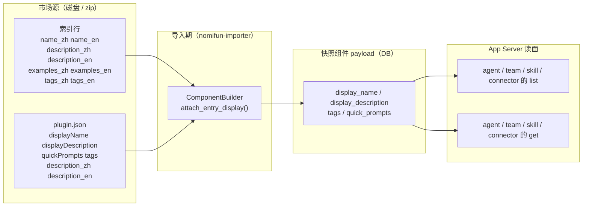

# 四类实体的多语言展示字段 · 技术方案

> **状态**：🔧 已实施（2026-10-22；指纹 `fp-18`，指纹门与 `web` 全量测试已过，站点仓同步见 §3.8 第 9 步）
> **核心原则**：展示文本是**市场/作者已声明的事实**，宿主只搬运、不发明、不翻译。四类实体（专家 / 专家团 / 技能 / 连接器）共享**同一组四个字段**，数据在**导入期**按固定优先级取一次并戳进快照组件 payload，读面**零额外 I/O** 回放。这不是新概念——它只是把专家今天已经有的字段推广到另外三类。

---

## 1. 背景与核心痛点

### 1.1 谁要读这些字段

两类消费者，需求不同：

- **WebUI**（`web/src/components/CatalogView.tsx`）：需要在 `zh-CN` / `en-US` 之间切换卡片标题、简介、标签、提示词示例。今天它只能对专家做到，其余三类要么显示技术标识符（`fenbi_mcp`）、要么只能显示单语文本。
- **外部 SDK 集成方**（`@flowy-agent-store/client`，文档见 [07-typescript-sdk.md](07-typescript-sdk.md)）：把 Agent Store 嵌进自己的产品，UI 语言与宿主无关。它们**不能在客户端拼装**——`name_zh` 只在市场索引文件里，安装在别的机器上就没有了。

一句话：**SDK 调用方拿到的是一个已安装实体，它必须自带双语文本，而不是要求调用方再去读一遍市场文件。**

### 1.2 现状：四类 × 两面 × 四个字段

`✅` 已返回且已填充，`🟡` 字段存在但恒为空，`❌` 字段不存在。

| 实体 | 面 | `display_name` | `display_description` | `tags` | `quick_prompts` |
|---|---|---|---|---|---|
| 专家 `agent` | list | ✅ | ❌（在 detail） | ✅ | ❌（在 detail） |
| 专家 `agent` | get | ✅ | ✅ | ✅ | ✅ |
| 专家团 `team` | list | ❌ | ❌ | 🟡 | ❌ |
| 专家团 `team` | get | ❌ | ❌ | 🟡 | ❌ |
| 技能 `skill` | list | ❌ | ❌ | ✅ | ❌ |
| 技能 `skill` | get | ❌ | ❌ | ✅ | ❌ |
| 连接器 `connector` | list | ❌ | ❌ | ❌ | ❌ |
| 连接器 `connector` | get | ❌ | ❌ | ❌ | ❌ |

唯一真正双语的字段是连接器的 `credential` 表单（`label` / `placeholder` / `description` / `title` / `doc_url` / `doc_label`，见 [34-connector-user-credentials.zh.md](34-connector-user-credentials.zh.md) §5.2）——那是**凭据填写**用的，不是条目本身的展示信息。

### 1.3 四个具体缺陷

**P1 · 技能与连接器装完就丢双语。**
市场索引行里 `description_zh` 覆盖 268/268（技能）、282/283（连接器），`examples_zh` 覆盖两边全量。这些值今天只出现在两条路上：`market/get` 的 `localized`（市场态，条目卸载后就查不到了）与 `store/list` 的 `quick_prompts`（商店态，已安装抽屉不用它）。**一旦安装完成、用户进入「已安装」页，双语信息就没有出口了。**

**P2 · 专家团的两个字段是空壳。**
`AppServerTeamSummary.tags` / `category_id` 由 `team_summary()` 从团队组件的 payload 读取（[app_server_importer.rs:483](crates/backend/nomifun-app/src/app_server_importer.rs#L483)），但导入器写团队 payload 时**只写了 `name` / `description` / 成员与策略**（[import.rs:898](crates/backend/nomifun-importer/src/import.rs#L898)），`attach_plugin_display()` 只对 agent 调用过（[import.rs:644](crates/backend/nomifun-importer/src/import.rs#L644)）。所以真实快照里这两个字段**永远是空的**；`app_server_importer.rs:546` 的测试能通过，是因为它手工构造了带 `tags` 的 payload。这是 [44](44-store-category-parity-plan.zh.md) 的一处覆盖缺口，本方案顺带修掉。

**P3 · 市场数据的两种写法，宿主只认一种。**
同一个「多语言展示文本」在真实市场里有两种写法，宿主只解析了第一种：

| 写法 | 样例 | 宿主是否解析 |
|---|---|---|
| 嵌套 locale 映射 | `"displayName": {"zh": "股价分析", "en": "Stock Analysis"}` | ✅ `PluginManifest.display_name` |
| 兄弟键 | `"description_zh": "...", "description_en": "..."` | ❌ **未解析** |

实测：专家市场 36 个包里 32 个用嵌套写法（`displayName`/`displayDescription`/`quickPrompts`），而专家团市场 30 个包里 **18 个用 `description_zh`、11 个用 `description_en`**，只有 1 个用嵌套写法。也就是说团队的中文简介**存在于包里但从未进入快照**。

**P4 · 单语 `description` 的语言不可依赖。**
连接器索引 283 条里，顶层 `description` 等于 `description_en` 的有 **210** 条、等于 `description_zh` 的 **30** 条、两者都不是的 **43** 条。`store/list` 的 `description` 恰好取这个顶层字段（[app_server_store.rs:576](crates/backend/nomifun-app/src/app_server_store.rs#L576)），结果是中文界面下四分之三的连接器卡片描述是英文。**任何「用单语字段兜底双语字段」的写法都会把这个混乱带进新字段**，所以本方案明令禁止兜底复制（INV-3）。

### 1.4 实测覆盖（2026-10-22，本机 `~/.workbuddy`）

| 市场 | 条目数 | 有 `name_zh` | 有 `description_zh` | 有 `examples_zh` | 有 `tags_zh` |
|---|---|---|---|---|---|
| 连接器 `connectors.json` | 283 | 111 | 282 | 283 | — |
| 技能 `marketplace.json` | 268 | 15 | 268 | 268 | 268 |
| 专家 `plugin.json` | 36 | 32（`displayName`） | 32（`displayDescription`） | 32（`quickPrompts`，最多 3 条） | 32 |
| 专家团 `plugin.json` | 30 | 1（`displayName`） | 1 + 18（`description_zh`） | 1（`quickPrompts`） | 1 |

两个结论直接决定设计：

1. **描述与示例覆盖极好**（技能 100%、连接器 99.6%），值得做成一等字段；
2. **名字覆盖很差**（技能 15/268、专家团 1/30），所以 `display_name` 必须允许**整体缺席**，客户端回落到现有的 `name`——不能给半条空串。

---

## 2. 方案全景与架构设计

### 2.1 端到端拓扑



关键点：**双语数据在导入时就被写进 payload，读面只是把 payload 里的四个键搬出来**。读面不认识市场、不读文件、不联网。

### 2.2 目标与非目标

**目标**

| # | 目标 | 验收方式 |
|---|---|---|
| G1 | 四类实体的 list 与 get 都返回 `display_name` / `display_description` / `tags` / `quick_prompts` | TC-1 ~ TC-8 |
| G2 | 数据来源按「作者声明 → 市场索引行 → 缺席」的固定优先级合并，逐语种回落 | TC-9 ~ TC-10 |
| G3 | 读面零额外 I/O：不新增市场索引读取、不新增 DB 查询 | §3.5 的调用链分析 + 现有测试计数不变 |
| G4 | 老快照（无新键）行为不变：字段缺席，不是空串 | TC-11 |
| G5 | 专家团的两个空壳字段（`tags` / `category_id`）被真正填充 | TC-12 |

**非目标**

- **不做服务端选语言**：没有 `lang` 参数，两种语言永远一起下发（[18](18-marketplace-spec.zh.md) §4 决策 D8=A：只有读者知道自己的 UI 语言）。
- **不做实时市场 join**：不在读面重新读市场索引。代价是市场只改文案时，已安装实体要重新安装/更新才看到新文案；接受（见 D3）。
- **不搬运 WorkBuddy 客户端字段**：`visible_in`（151/283）、`minWorkbuddyVersion` 是对方的灰度与版本策略，与宿主事实无关，继续丢弃。
- **不给连接器加 `name_zh` 式的改名能力**：`name` 是工具命名空间的一段（`connector__<name>__<tool>`），不可替换，只**追加** `display_name`。
- **不做机器翻译**：市场没声明就没有，宿主不编。

### 2.3 架构不变量

- **INV-1（同名同型）**：四个字段在四类实体上**名字与类型完全一致**。SDK 可以写一个泛型渲染函数，不必按 kind 分支。
- **INV-2（payload 即真源）**：展示字段只从快照组件 payload 读取。读面不得自行访问市场索引或磁盘。
- **INV-3（禁止兜底复制）**：绝不把单语 `name` / `description` 的值复制进 `display_*`。缺席就是缺席——客户端要单语文本时读 `name` / `description` 字段本身（P4 的混乱必须止步于此）。
- **INV-4（逐语种回落）**：`display_name.zh` 与 `display_name.en` 各自独立回落；一侧缺失时另一侧存在并不代表两侧都有值。
- **INV-5（只在写面归一化）**：`{zh, en}` 的合并、位置配对（`examples_zh[i]` ↔ `examples_en[i]`）都在导入期一次算完，读面只做反序列化。
- **INV-6（wire 不变）**：方法数量不变（48 / 23 计数守卫不动），只做 DTO 加字段；指纹 `fp-17` → `fp-18`。

---

## 3. 核心设计与模块规范

### 3.1 统一的四个字段

四类实体的 **summary** 上各加四个字段。专家已有 `display_name` 与 `tags`，另需把 `display_description` 与 `quick_prompts` 从 detail **上移**到 summary（实施时确认：`AgentSummary` 原本只有 `display_name` / `tags`，两个字段都在 detail 上）：

```rust
// nomifun-api-types/src/app_server.rs —— 四类 summary 共用同一段
/// 展示名，两种语言已由导入期归一化。`None` = 作者与市场都没声明
/// （技能 253/268、专家团 29/30 属于这种情况），客户端回落到 `name`。
#[serde(default, skip_serializing_if = "Option::is_none")]
pub display_name: Option<AppServerLocalizedText>,

/// 展示简介（长文本）。`None` 同上。
#[serde(default, skip_serializing_if = "Option::is_none")]
pub display_description: Option<AppServerLocalizedText>,

/// 展示标签，位置配对的多语言条目（`44` §3）。
#[serde(default, skip_serializing_if = "Vec::is_empty")]
pub tags: Vec<AppServerLocalizedText>,

/// 提示词示例（"你可以这样问"）。市场索引行给的 `examples_*`，
/// 专家/专家团的包给 `quickPrompts`。
#[serde(default, skip_serializing_if = "Vec::is_empty")]
pub quick_prompts: Vec<AppServerLocalizedText>,
```

为什么加在 **summary** 而不是 detail：detail 用 `#[serde.flatten]` 承载 summary，所以**加在 summary 等于两面都有**；反过来只加 detail 就只有一面。列表是主要的展示面（[43](43-store-categories-and-tags-plan.zh.md) §3 对 `tags` 用的是同一个论证），提示词示例在卡片上同样要显示（[49](49-store-search-and-suggestions.zh.md) §3.7）。

代价：`agent/list` / `team/list` / `skill/list` / `connector/list` 的每条记录多出 ≤3 个短字符串 + ≤5 个标签。实体数量是「已安装的几十个」，不是商店的 900 条，可忽略。

### 3.2 payload 键名与 DTO 字段同名

`attach_plugin_display()` 今天写进 agent payload 的键就是 `display_name` / `display_description` / `quick_prompts` / `tags`（[import.rs:579](crates/backend/nomifun-importer/src/import.rs#L579)）。**这已经是一份现成约定**，本方案不改名、不新增命名空间，只是让另外三类也写同样的键：

```
payload[display_name]        = {en?, zh?}
payload[display_description] = {en?, zh?}
payload[quick_prompts]       = [{en?, zh?}, ...]
payload[tags]                = [{en?, zh?}, ...]     # 技能/连接器已有（44）
```

于是读面可以共享同一组读取函数（`localized_or_none` / `localized_list`，[app_server_importer.rs:483](crates/backend/nomifun-app/src/app_server_importer.rs#L483) 与 [app_server_store.rs:580](crates/backend/nomifun-app/src/app_server_store.rs#L580) 已各有一份）。§3.8 第 6 步把它们合并到一个模块，避免第二份实现。

### 3.3 来源优先级

每个字段独立按 **作者声明 → 市场索引行 → 缺席** 合并，**按语种而不是按对象**回落：

```
display_description.zh = author.zh  ?? index.description_zh ?? (缺)
display_description.en = author.en  ?? index.description_en ?? (缺)
```

`author` 指的是：

| 实体 | 作者声明在哪 | 解析状态 |
|---|---|---|
| 专家 / 专家团 | `plugin.json`（`displayName` / `displayDescription` / `quickPrompts` / `tags`） | 专家 ✅ 已解析；团队 ✅ 已解析但**未写进 payload** |
| 技能 | `SKILL.md` frontmatter（只有单语 `name` / `description`） | 无双语可声明 |
| 连接器 | 无（连接器包没有 plugin.json 形态的展示声明） | 无 |

`index` 指的是市场索引行的 `*_zh` / `*_en` 兄弟键，**只在条目来自市场时存在**（手工导入、`connector/register`、内置项都没有）。

按语种回落而不是整对象回落，是因为真实数据经常只有一半：连接器 `name_zh` 111/283 而 `name_en` 283/283；技能 `name_zh` 15/268 而 `name_en` 2/268。整对象回落会让「有中文名 + 有英文简介」的组合退化成只剩一边。

### 3.4 两类作者写法的解析

P3 的兄弟键写法要进 `PluginManifest`：

```rust
// nomifun-importer/src/manifest.rs —— PluginManifest 增两个可选字段
#[serde(default)]
pub description_zh: Option<String>,
#[serde(default)]
pub description_en: Option<String>,
```

读面在构造作者的 `display_description` 时**逐语种**合并：`displayDescription.{zh,en}` 优先，缺的那一侧取 `description_{zh,en}`，两侧都缺才整体缺席。这样专家（0/36 用兄弟键）与专家团（18/30 用兄弟键）都拿到同一份结果。

同一个逻辑复用到 `name`：`displayName.{zh,en}`，缺则 `name_zh` / `name_en`（市场索引行，仅市场条目）。

### 3.5 读面：零额外 I/O 的三条路径

三条读面**今天就已经把组件 payload 拿到了**，所以这次改动不增加任何查询：

| 实体 | 现有取数 | 新增成本 |
|---|---|---|
| 技能 | `tags_for(&location)` → `provenance + get_components`（[app_server_entry_assets.rs:91](crates/backend/nomifun-app/src/app_server_entry_assets.rs#L91)） | **0**：把 `tags_for_skill` 泛化成 `display_for_skill`，同一个 `get_components` 里多读三个键 |
| 连接器 | `source_for(id)` → `find_snapshot_by_mcp_server_id + get_components`（[app_server_credentials.rs:474](crates/backend/nomifun-app/src/app_server_credentials.rs#L474)） | **0**：`ConnectorCredentialSource` 顺带返回四个展示字段，同一份 components |
| 专家团 | `team_summary(row)` 直接拿 `PluginSnapshotComponentRow` | **0**：多读几个 payload 键 |
| 专家 | 已在 payload 上读取 | **0** |

对 `connector/list` 尤其重要：它已经是 2N 次 DB 的 N+1（[app_server_catalog.rs:402](crates/backend/nomifun-app/src/app_server_catalog.rs#L402)），再加一次市场索引读会变成第三跳。本方案**明确拒绝**那条路（D3）。

### 3.6 为什么不用通用的 `localized: Map<String, Variant>`

`market/get` 用的是 `localized: BTreeMap<String, LocalizedVariant>`（[app_server.rs:1266](crates/backend/nomifun-api-types/src/app_server.rs#L1266)，键名如 `description_zh`、`legacy_tags_en`）。把它照搬到四类实体上是**看起来更省事、实际上更贵**的选择：

1. **键名会变成契约**：`legacy_tags_zh` 这种历史包袱一旦进 SDK 的类型面就再也删不掉；而 `display_name` 是语义，改内部来源不影响调用方。
2. **SDK 是类型化面**：`item.display_name?.zh` 比 `item.localized["name_zh"]` 早一步被 TypeScript 检查到，也早一步在编译期发现拼错。
3. **四类实体已经全部是类型化 DTO**，专家甚至已经用这四个字段跑了两个版本；引入 map 等于同一件事两套表达。
4. map 的唯一真优势是「加变体不换指纹」——本方案把它换成了**一次性把该有的都加上**，之后的新增属于新一轮需求，重估一次指纹是合理的。

### 3.7 指纹与迁移

- **指纹**：`fp-17` → `fp-18`。触发原因是三处 DTO 加字段（`TeamSummary` / `SkillSummary` / `ConnectorSummary`）与一处位置上移（`AgentSummary.quick_prompts`）。方法数量、WS 方法名、事件 payload 均不变。落点按 [protocol-fingerprint-sync.zh.md](../../web/docs/protocol-fingerprint-sync.zh.md) 的 5 步走执行：常量 → `bun run check:fingerprint` → [05](05-flowy-agent-store-app-server-protocol.md)/README → 站点仓 → 全量测试。
- **上移不破坏兼容**：`AgentDetail` 继续经 `flatten` 携带 `quick_prompts`，序列化后的 JSON 完全一致；TypeScript 侧只是把字段声明从 `AgentDetail` 挪到 `AgentSummary`（`AgentDetail extends AgentSummary`）。
- **迁移**：`payload` 的新键**只对新的导入生效**。已安装的快照没有这些键，字段读出来是 `None`——这与「市场没声明」不可区分，但两者对客户端的行为要求相同（回落到 `name`）。要拿到新字段的动作：`store/update-entry` 或卸载重装。方案不提供回填迁移脚本；真要批量回填，那是另一个决定（D8）。

### 3.8 实施顺序与落点

| # | 步骤 | 落点 | 验证 |
|---|---|---|---|
| 1 | 兄弟键进 `PluginManifest` | `crates/backend/nomifun-importer/src/manifest.rs` | `cargo test -p nomifun-importer` |
| 2 | `EntryDisplay` + `attach_entry_display()`；团队 payload 补 `display_*` / `tags` / `category_id` / `quick_prompts` | `crates/backend/nomifun-importer/src/import.rs` | 同上 |
| 3 | `ImportRequest.index_tags` 升级为 `index_display`（name/description/examples/tags 四件） | `import.rs` + `MarketIndexInfo`（`app_server_store.rs` 的 `entry_facts`）+ 唯一调用点 `app_server_marketplace.rs:1201` | TC-9 |
| 4 | 读面：`display_for_skill` / `ConnectorCredentialSource` 扩展 / `team_summary` 多读键 | `app_server_entry_assets.rs`、`app_server_credentials.rs`、`app_server_importer.rs` | TC-5 ~ TC-8 |
| 5 | DTO 加字段 + `quick_prompts` 上移 | `nomifun-api-types/src/app_server.rs` | `cargo check -p nomifun-api-types` |
| 6 | 合并两份 `localized_or_none` / `localized_list` 到一处 | 新 `app_server_display.rs` | 两处调用方测试全绿 |
| 7 | 指纹 `fp-18` + 05 文档 + README | `web/packages/protocol/src/protocol.ts`、`nomifun-app-server/src/lib.rs`、`docs/agent-store/` | `bun run check:fingerprint` |
| 8 | SDK 类型与便捷方法（`displayText(lang)` 之类的纯客户端 helper，可选） | `web/packages/client/src/` | `cd web && bun run typecheck && bun run test` |
| 9 | 站点仓同步 + 发布登记 | `C:\workspace\agent-store-site` `typescript-sdk.md` / `changelog.md` | `bun run check:release-sync` / `check:docs-sync` |
| 10 | 活体验证 | `web/scripts/verify-localized-display.ts`（新） | 见 §5.2 L4 |

第 3 步是唯一有扩散面的改动（`index_tags: Option<Vec<LocalizedText>>` 换成结构体），涉及三个调用点，但没有持久化格式变化——payload 里的键名不变。

#### 实际落点（2026-10-22 实施）

| 关注点 | 实际位置 |
|---|---|
| 合并类型与逐语种回落 | `nomifun-importer/src/manifest.rs`：`DisplayFields` + `DisplayFields::merge` + `merge_localized`；兄弟键由 `PluginManifest::localized_display_description` 合并 |
| 戳入 payload | `import.rs`：`author_display()` / `attach_display_fields()` / `ComponentBuilder::display_for()`；技能 2 处、连接器 4 处、团队 1 处接线 |
| 索引行入参 | `ImportRequest.index_display`（原 `index_tags`）；`MarketIndexInfo::display()`；`description` 字段改为 `LocalizedText`（顶层 `description` 不再参与） |
| 读面 | 新模块 `nomifun-app/src/app_server_display.rs`（`display_from_payload` / `localized_or_none`）；`AppServerEntryAssets::display_for_skill`（取代 `tags_for_skill`）；`ConnectorCredentialSource.display` + `describe_with_display()`；`team_summary` / `agent_summary` |
| DTO | `AppServerAgentSummary` 增 `display_description` / `quick_prompts`（detail 去掉两者）；`TeamSummary` / `SkillSummary` / `ConnectorSummary` 各增四字段（`tags` 技能/团队已有） |
| SDK 类型 | `web/packages/protocol/src/protocol.ts` 同步；`APP_SERVER_PROTOCOL_VERSION = "fp-18"`，7 个落地点全绿 |
| 测试 | importer `53 passed`（新增 4）、`importer_tests` 26 passed、`nomifun-app --lib app_server` **107 passed**（新增 2）、`web` **584 passed / 1 skipped** |

两处与计划的偏差，已按实际情况记录：

1. **第 6 步只做了一半**：`app_server_display.rs` 接管了四个展示字段的解析，但 `app_server_importer.rs` 里旧的 `localized_field` / `localized_list` 仍服务于 `profession` / `default_init_prompt` 这类非展示四字段的键——强行合并会把那两条读路径也改语义（旧的保留空串，新的丢弃空串），收益不抵风险。
2. **第 8 步未做**：没有新增客户端 helper（`display_name?.zh ?? name` 一行足够，加 helper 只是把回落规则藏起来）。
3. **第 10 步已完成**：`web/scripts/verify-localized-display.ts` 在真宿主上跑通 LDF-001～LDF-009（含团队兄弟键合并、连接器 `name` 仍是运行名、`credential` 块不受影响）：

```
✓ LDF-001 list: display_name={"en":"Demo Netdisk","zh":"演示网盘"} name="demo-netdisk"
✓ LDF-002 get:  display_description={"en":"A connector used by the live fixture","zh":"演示用连接器简介"}
✓ LDF-009 credential = {"mode":"none","status":"not_required","missing":[],"fields":[]}
✓ LDF-003 list: display_description={"en":"A demo skill that tidies weekly reports","zh":"用来整理周报的演示技能"}
✓ LDF-004 get:  display_name={"zh":"演示技能"}
✓ LDF-005 list: display_name={"en":"Demo Expert","zh":"演示专家"} quick_prompts=[{"zh":"帮我看下今天的动态",...}]
✓ LDF-006 get:  display_description={"en":"The demo expert's description","zh":"演示专家的简介"}
✓ LDF-007 list: display_description={"en":"The demo team's English description","zh":"演示专家团的中文简介"} tags=[{"zh":"协作",...}]
✓ LDF-008 get:  display_name={"en":"Demo Team","zh":"演示专家团"}
PASS doc-50 localized display fields
```

一处实施期发现并修掉的隐患：`read_index` 原先把索引行的 `name` 当作 `name_en` 的兜底（那是商店条目 `name` 的历史链条）。这条兜底若进入 `display_name`，技能会把技术 slug、连接器会把中文名塞进 `en` 槽，正好违反 D6——已改为只认真正的 `name_en`，商店条目的 `name` 链条以 `entry.name` 收尾，输出不变。

---

## 4. 关键决策与权衡矩阵

| ID | 决策 | 选择 | 拒绝的替代方案与原因 |
|---|---|---|---|
| **D1** | 字段形态 | 四个**具名字段**，四类同名同型 | ❌ `localized: Map<String, Variant>`（§3.6：键名入契约、丢类型检查、与既有 agent 面重复）；❌ 每类各设计一套（SDK 要写四条渲染分支） |
| **D2** | 放在 summary 还是 detail | **summary**（detail 靠 flatten 自动继承） | ❌ 只放 detail：列表面拿不到，而卡片是主要展示面；❌ 两处各放一份：违反 `43` 记录的 flatten 重复键约束 |
| **D3** | 数据载体 | **导入期戳进 payload** | ❌ 读面实时读市场索引：`connector/list` 已经是 2N 次 DB，再加就是第三跳（§3.5）；❌ 依赖 `market/get`：条目卸载后市场态就消失了，而「已安装」页恰恰是卸载前最后一个界面 |
| **D4** | 老快照 | 字段缺席，不做回填 | ❌ 写回填迁移：payload 在不可变快照里，改它等于伪造历史；❌ 读面兜底去读市场：见 D3 |
| **D5** | 缺失时的兜底 | **不兜底**，客户端回落 `name` / `description` | ❌ 把单语值复制进 `display_*`：P4 的实测（210/283 顶层描述是英文）会让「中文界面显示英文」被固化进新字段 |
| **D6** | 名字覆盖极低怎么办（技能 15/268、团队 1/30） | 照实给，允许整体缺席 | ❌ 用 `SKILL.md` 的 `name` 当英文名：那是技术标识符（`wecom-unified`），不是展示文案；❌ 拿目录名做「英文名」：同上，且会与 `name` 重复 |
| **D7** | 连接器 `name` 是否改成展示名 | **不改**，只追加 `display_name` | ❌ 改名：`tool_filter` 的 `connector__<name>__<tool>` 与 `connector/call` 的工具命名空间依赖它，改了工具就调不到 |
| **D8** | 市场只改文案时的新鲜度 | 重装/更新才生效 | ❌ 读面 join 市场（D3）；❌ TTL 缓存市场索引（[49](49-store-search-and-suggestions.zh.md) D6 已因漂移问题否决同类做法） |
| **D9** | 团队空壳字段 | 同一批修（`tags` / `category_id` 真正写入） | ❌ 只加新字段、留着空壳：SDK 会以为「这个团队没有标签」，而事实是宿主没写 |
| **D10** | `visible_in` / `minWorkbuddyVersion` | 继续丢弃 | ❌ 透传：前者是对方客户端的灰度范围，后者是对方版本门槛，对宿主与 SDK 都无行动含义 |
| **D11** | `store/list.description` 的英文问题 | **另开一批**（投影修正，不换指纹） | ❌ 塞进本方案：那是商店面的取值修正，与四类已安装实体的 wire 契约无关，混在一起会让指纹变更难以审计 |

---

## 5. 验收标准与验证矩阵

### 5.1 验收用例

| ID | 用例 | 期望 |
|---|---|---|
| TC-1 | 专家 `agent/list` | `display_name` / `display_description` / `tags` / `quick_prompts` 四个字段都在（`display_description` 与 `quick_prompts` 是本次上移） |
| TC-2 | 专家 `agent/get` | 与 TC-1 相同（经 flatten），序列化 JSON 与改动前逐字节一致 |
| TC-3 | 专家团 `team/list` + `get` | 四个字段在；`plugin.json` 用 `description_zh` 写的包，`display_description.zh` 有值 |
| TC-4 | 技能 `skill/list` + `get` | `display_description.zh` 来自索引 `description_zh`；`quick_prompts` 来自 `examples_*` |
| TC-5 | 连接器 `connector/list` + `get` | 四字段在；`display_name.zh` 来自 `name_zh`；`name` 仍是 MCP 运行名 |
| TC-6 | 连接器 `credential` 块 | 不受影响：`mode` / `status` / `fields` / `missing` 与改动前一致 |
| TC-7 | 内置技能 / 手写 `.mcp.json` 连接器 | 四个字段全部缺席（不是空串、不是空数组） |
| TC-8 | 只声明一侧语言（`name_en` 有、`name_zh` 无） | `display_name.en` 有值、`display_name.zh` 缺席（`null`），不互相复制 |
| TC-9 | 作者声明与索引行同时存在且值不同 | 作者声明胜出（逐语种比较） |
| TC-10 | 位置配对：`examples_zh` 5 条、`examples_en` 3 条 | 前 3 条两侧都有值，后 2 条只有 `zh` |
| TC-11 | 老快照（payload 无新键） | 四字段缺席，`name` / `description` 行为不变 |
| TC-12 | 团队 `tags` / `category_id` | 真实导入的团队快照里**不再为空**（修 P2） |
| TC-13 | 读面取数次数 | 技能 / 连接器 / 团队的 DB 查询次数与改动前相同（用现有测试的计数断言守住） |

### 5.2 验证梯子

| 级 | 动作 | 覆盖 |
|---|---|---|
| L1 | `cargo check -p nomifun-api-types -p nomifun-importer -p nomifun-app` | 编译面 |
| L2 | `cargo test -p nomifun-importer` + `cargo test -p nomifun-app --lib app_server_` | TC-9 ~ TC-12 |
| L3 | `cd web && bun run typecheck && bun run test` | SDK 类型 + 客户端用例 |
| L4 | `bun run check:fingerprint` + `bun run check:release-sync` | `fp-18` 全仓一致（10 处 / 7 文件 + 站点 2 处） |
| L5 | 活体：`web/scripts/verify-localized-display.ts`（真宿主 + 3 个市场夹具） | TC-1 ~ TC-5 端到端 |
| L6 | 站点仓 `check:docs-sync` / `release:check:site` | 两仓文档一致 |

---

## 附录：原始技术底稿与历史归档 (Historical & Technical Reference Archive)

### A.1 基线代码位置（改动前）

| 关注点 | 位置 |
|---|---|
| 专家 DTO（四个字段的既有样板） | `nomifun-api-types/src/app_server.rs:600-686` |
| 专家团 DTO（仅 `tags` / `category_id`） | 同上 `:690-710` |
| 技能 DTO（仅 `tags`） | 同上 `:35-76` |
| 连接器 DTO（无展示字段） | 同上 `:310-362` |
| 作者声明的戳入函数 | `nomifun-importer/src/import.rs:579`（`attach_plugin_display`，仅 agent 调用 `:644`） |
| 市场索引 tags 的戳入通道 | `import.rs:479`（`ComponentBuilder.index_tags`）、`:517`（`index_tags_payload`）、`:972`/`:1025`（技能写入）；唯一接线点 `app_server_marketplace.rs:1201` |
| 技能读面 | `nomifun-app/src/app_server_entry_assets.rs:91`（`tags_for_skill`） |
| 连接器读面 | `nomifun-app/src/app_server_credentials.rs:474`（`source_for`） |
| 团队读面 | `nomifun-app/src/app_server_importer.rs:468`（`team_summary`） |
| 市场条目原样变体 | `nomifun-common/src/localized_variant.rs:61`（`collect_localized_variants`）、`nomifun-api-types/src/app_server.rs:1266` |

### A.2 实测数据采集命令（可复现）

```powershell
# 连接器
$j=(Get-Content 'C:\Users\15165\.workbuddy\connectors-marketplace\.codebuddy-connector\connectors.json' -Raw|ConvertFrom-Json).connectors
"total=$($j.Count) name_zh=$(@($j|?{$_.name_zh}).Count) desc_zh=$(@($j|?{$_.description_zh}).Count)"

# 技能
$s=(Get-Content 'C:\Users\15165\.workbuddy\skills-marketplace\.codebuddy-skill\marketplace.json' -Raw|ConvertFrom-Json).skills
"total=$($s.Count) name_zh=$(@($s|?{$_.name_zh}).Count) desc_zh=$(@($s|?{$_.description_zh}).Count)"

# 专家 / 专家团
Get-ChildItem 'C:\Users\15165\.workbuddy\plugins\marketplaces\experts' -Recurse -Depth 5 -Filter plugin.json -File |
  %{ (Get-Content $_.FullName -Raw|ConvertFrom-Json).PSObject.Properties.Name -join ',' } | Group-Object
```

### A.3 反模式清单（本方案明令禁止）

| 反模式 | 为什么不行 |
|---|---|
| 读面重新读市场索引取双语 | `connector/list` 已是 2N 次 DB，再加第三跳；且离线/市场移除后失效 |
| 把 `name` 改成市场展示名 | 破坏 `connector__<name>__<tool>` 工具命名空间（D7） |
| 用单语 `description` 兜底 `display_description` | 顶层 `description` 语言不可靠（210/283 是英文），会把混乱固化（D5/P4） |
| 只加 detail、不加 list | 列表是主要展示面，SDK 渲染卡片时最需要 |
| 每类实体各设计不同字段名 | INV-1 破坏，SDK 要写四条分支 |
| 服务端按 `lang` 参数选一种语言 | 违背 D8=A；缓存与投影语义都会变复杂 |
| 回填老快照的 payload | 快照不可变，改它等于伪造历史（D4） |
