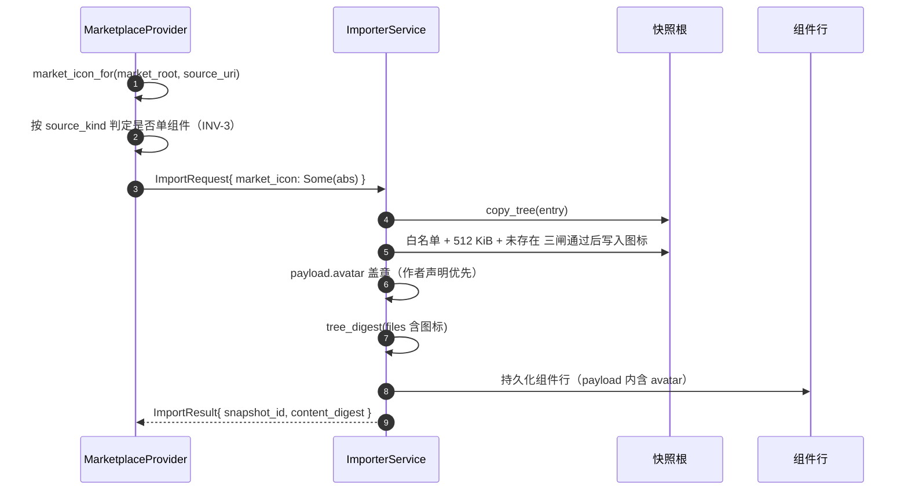

# 导出面图标补齐（专家 · 专家团 · 技能 · 连接器）· 技术方案

> **状态**：🔧 已实施（2026-10-26；`pack_format 3 → 4`、指纹 `fp-18 → fp-19`，指纹门 10 落点 / 7 文件 + 站点 2 文件全绿；`nomifun-importer` 64 + 31、`nomifun-app` 111、`nomifun-app-server` 192、`web` 586 全过；真机 EXI-001~005 见 §5.3。连接器图标存在一条**可达性边界**，见 §3.3.5）
> **核心原则**：图标是**市场/作者已声明的事实**，宿主只搬运、不发明、不合成。每类实体在自己**原生的地址空间**里携带图标（专家 / 专家团 / 连接器 → 快照 `avatars/`；技能 → 技能目录 `assets/icon.*`），**字节永不过包**，导出面只增加**路径引用**。唯一的真缺口是「市场级 `icons/` 目录从不进快照」——补上它，四类实体一次到位。

---

## 1. 背景与核心痛点

### 1.1 谁要读这些图标

三类消费者，诉求不同：

- **外部 SDK 集成方**（`@flowy-agent-store/sdk` 的 `exportAgent()` / `exportTeam()`）：`materializePack()` 产出的目录要能被自己的 UI 直接渲染成"专家卡片 / 技能卡片 / 连接器卡片"。今天这个目录里，专家有一张头像（`pack.avatar` + `avatars/…`），**技能和连接器一张都没有**，连"哪个文件是图标"都没人告诉他们。
- **第三方运行时**（Codex / Kimi Code 形态的宿主）：把导出的目录当成插件根加载，需要在不读市场、不联网的前提下画出条目列表。
- **WebUI 的已安装面板**：今天靠 `AppServerEntryAssets` 现读市场实时树拿到 `avatar_url`（[app_server_entry_assets.rs:118](crates/backend/nomifun-app/src/app_server_entry_assets.rs#L118)），一条可变路径。它**不是**本方案的目标读者（见 §2.2 N4），但它证明了同一个事实：图标真源在市场侧，且市场侧只有一个 `icons/` 目录。

一句话：**导出物要自足——它必须自带图标字节与归属，而不是要求消费方再去猜命名约定或回读市场。**

### 1.2 现状：四类 × 图标真源 × 能否导出

`✅` 今天能拿到，`🟡` 能拿到字节但没有归属信息，`❌` 完全拿不到。

| 实体 | 图标真源 | 在导出目录里 | 在 pack 里 |
|---|---|---|---|
| 专家 `agent` | ① `plugin.json.avatar`（作者声明，如 `avatars/expert.png`） | ✅ `avatars/expert.png` | ✅ `pack.avatar` + `pack.assets[]` |
| 专家 `agent` | ② 市场 `icons/<base>.<ext>`（作者没声明时的回落） | ❌ | ❌ |
| 专家团 `team` | 同专家（包级一份，不分成员） | ✅ | ✅ `pack.avatar` |
| 技能 `skill` | ① 技能目录内 `assets/icon.{png,webp,svg,jpg,jpeg}`（builtin 走的就是这个） | 🟡 字节在（`skill/files` 全目录遍历），**但没有任何字段说它是图标** | ❌ `ExpertSkillRef` 只有 `{name,id}` |
| 技能 `skill` | ② 市场 `icons/<base>.<ext>`（市场技能目录里没有 `assets/icon.*`） | ❌ | ❌ |
| 连接器 `connector` | 市场 `icons/<base>.<ext>`（唯一来源） | ❌ | ❌ `ExpertConnectorRef` 只有 `{id,name,enabled}` |

### 1.3 三个阻断点

**P1 · 市场 `icons/` 位于市场根，永远进不了快照。**
`run_import` 的第一件事是 `copy_tree(&source, &materialized)`（[import.rs:246](crates/backend/nomifun-importer/src/import.rs#L246)），`source` 是**entry 目录**。而市场图标在 `{work_dir}/agent-store-markets/<marketplace_id>/icons/<base>.<ext>`——entry 目录的**兄弟目录**，拷 entry 时物理上带不到。于是"市场声明了一张图标"与"宿主持有这张图标的字节"是两件事：前者进了 DB（`store/list.avatar_url`），后者只在市场实时树里。

**P2 · 技能与连接器没有 `plugin.json`，payload 里连 `avatar` 键都没有。**
全仓唯一写 `payload["avatar"]` 的地方是 `attach_plugin_display()`（[import.rs:600](crates/backend/nomifun-importer/src/import.rs#L600)），而它只在 `ParsedManifest::Plugin` 分支被调用（[import.rs:681](crates/backend/nomifun-importer/src/import.rs#L681)）。技能走 `build_skill_market_components` / `build_single_skill_components`，连接器走 `build_connector_market_components` / `build_cli_connector_components`——四条路径都不经过它。所以即便 P1 被解决，技能/连接器的 payload 里也**没有字段可以承载图标路径**。

**P3 · 导出面只有 `plugin.json.avatar` 一条通路。**
`declared_avatar()`（[app_server_expert_export.rs:177](crates/backend/nomifun-app/src/app_server_expert_export.rs#L177)）只读 payload 的 `avatar` 键并校验"必须在本 pack 的 `assets` 清单内"。对 `ExpertSkillRef` / `ExpertConnectorRef`，构建函数（`team_skills` [:407](crates/backend/nomifun-app/src/app_server_expert_export.rs#L407)、`team_connectors` [:344](crates/backend/nomifun-app/src/app_server_expert_export.rs#L344)）**只填身份字段**，DTO 上根本没有图标位置。

实测规模（doc [38](38-expert-pack-assets.zh.md) §1 的市场普查，2026-10 数据）：

| 项 | 数量 | 影响 |
|---|---|---|
| 带插件级 `avatars/` 的插件 | 361 / 381 | 已覆盖（`pack.assets`） |
| `plugin.json` **未声明** `avatar` 的插件 | 24 | 只剩市场 `icons/` 一条路 → 今天无图标 |
| 技能条目 | 268 | 除 builtin 自带图标外，全部无图标 |
| 连接器条目 | 283 | 全部无图标 |

### 1.4 一个必须先说清的前提：四类实体没有统一的 export 方法

wire 上只有 **`agent/export`** 与 **`team/export`** 两个导出方法（[protocol.ts:1835](web/packages/protocol/src/protocol.ts#L1835) 起的 `ExpertPack` 家族）。**技能与连接器没有独立的 `skill/export` / `connector/export`**，它们出现在 pack 里是**引用**：

```jsonc
{ "skills":     [ { "name": "md-to-html", "id": "md-to-html" } ],
  "connectors": [ { "id": "mcp_xxx", "name": "fenbi_mcp", "enabled": true } ],
  "assets":     [ { "path": "avatars/team.png", "kind": "avatar", "size": 1024, "digest": "9f2c…" } ] }
```

因此本方案说的"为技能 / 连接器增加导出图标能力"，落地为两件事，而不是两条新方法：

1. **补字节**：让技能 / 连接器的图标有机会进入一个可导出的位置（§3.2）；
2. **补归属**：让 pack 说明"这个图标属于哪个技能 / 哪个连接器"（§3.3）。

> 「技能、连接器各自有独立导出接口」是另一个议题，`connector` 侧还缺 `transport` 读面（`ConnectorDetail` 只有 `transport_summary`），不在本方案范围（§2.2 N3）。

---

## 2. 方案全景与架构设计

### 2.1 端到端拓扑

```mermaid
flowchart TD
  subgraph Market["市场实时树 agent-store-markets/&lt;marketplace_id&gt;/"]
    ICONS["icons/&lt;base&gt;.&lt;ext&gt;<br/>市场级图标，扩展名探测 6 种"]
    ENTRY["skills 或 connectors 或 plugins 下的 entry 目录<br/>随快照整目录拷贝"]
  end

  subgraph Install["安装期 · S1（新增）"]
    RESOLVE["installer：market_icon_for()<br/>解析出图标绝对路径"]
    IMPORT["importer.run_import()<br/>按 kind 落位 + 写 payload.avatar"]
  end

  subgraph Snap["不可变快照 agent-store-imports/&lt;snapshot_id&gt;/"]
    AV["avatars/&lt;basename&gt;<br/>avatars/connectors/&lt;basename&gt;"]
    SK["assets/icon.&lt;ext&gt;<br/>与 SKILL.md 同级"]
  end

  subgraph Export["导出期 · S2（新增两个 ref 字段）"]
    PACK["ExpertPack<br/>avatar · assets 列表 · skills 的 icon · connectors 的 icon"]
  end

  subgraph Client["SDK 调用方进程 · S3（零改动）"]
    DIR["&lt;dir&gt;/<br/>avatars/… · skills/&lt;name&gt;/assets/icon.*"]
  end

  ICONS --> RESOLVE
  RESOLVE --> IMPORT
  ENTRY --> IMPORT
  IMPORT --> AV
  IMPORT --> SK
  AV --> PACK
  SK --> PACK
  PACK --> DIR
```



三条要点：

- **图标只从市场流向快照一次**（安装期），此后导出读的是不可变快照 ⇒ 同一快照两次导出字节完全一致，`provenance.content_digest` 仍可当缓存键（doc [32](32-expert-pack-export.zh.md) 的既有性质）。
- **两个地址空间**：专家 / 专家团 / 连接器的图标在快照 `avatars/` 下（字节面 `import/asset`）；技能的图标在技能目录里（字节面 `skill/file`，和 `SKILL.md` 走同一条链）。
- **SDK 不需要新逻辑**：`materializePack` 的两个既有循环已经把两个地址空间都覆盖了（§3.4）。

### 2.2 目标与非目标

**目标（本轮）**

| # | 目标 |
|---|---|
| G1 | 市场级 `icons/<base>.<ext>` 在安装期固化进不可变快照，落位符合各实体原生约定 |
| G2 | `ExpertSkillRef` / `ExpertConnectorRef` 各增一个 `icon` 字段（纯路径字符串），且"绝不指向取不到的文件" |
| G3 | 技能图标随 `skill/files` + `skill/file` 自然进入导出目录；连接器图标随 `pack.assets` + `import/asset` 自然进入 |
| G4 | 专家 / 专家团在"作者没声明 `plugin.json.avatar`"时也能拿到市场图标（`pack.avatar` 不再缺席） |
| G5 | `pack_format` 3 → 4、指纹 `fp-18` → `fp-19`，跨仓同步一次做完 |

**非目标（明确不做）**

| # | 不做 | 理由 |
|---|---|---|
| N1 | 内联 base64 进 pack | `MAX_EXPERT_PACK_BYTES = 1 MiB`（[catalog.rs:564](crates/backend/nomifun-app-server/src/catalog.rs#L564)）；实测团队头像 1075 KB、某市场包 2139 KB 直接超限，且在包里造第二份字节真源（doc 38 D2） |
| N2 | 导出时动态读市场实时树 | 市场刷新即变 ⇒ 两次导出不同字节，`content_digest` 失去缓存键语义；且这正是 doc [32](32-expert-pack-export.zh.md) §2 拒绝 `avatar_url` 的同一条理由 |
| N3 | 新增 `skill/export` / `connector/export` 方法 | 连接器还缺 `transport` 读面才能往返，属另一个大件；技能侧已有 `skill/get` + `skill/files` + `skill/file` 三面，缺的只是 SDK helper |
| N4 | 改 `skill/list` / `connector/list` 的 `avatar_url` 取值 | 那是商店面的展示行为（今天读市场实时树），换源会改变已安装面板的图标新鲜度语义；另开一批 |
| N5 | 逐成员头像归属（`plugin.json.members[].avatar`） | doc [38](38-expert-pack-assets.zh.md) F2 已登记为开放项；41 个市场包里只有 3 个团需要，且映射由团自带技能承载（`md-to-html/avatar-mapping.md`）。本轮保持"成员 pack `assets=[]`、`avatar` 恒无" |
| N6 | 图标内容校验（解码 / 尺寸 / 内容嗅探） | 扩展名白名单 + 大小上限足够；SVG 是社区图标的常见格式，解码只会引入新依赖与误杀 |

### 2.3 架构不变量

| ID | 不变量 | 落地手段 |
|---|---|---|
| **INV-1** | **字节不过包**：pack 只携带路径与 `{path,kind,size,digest}` 元数据 | `icon` 是 `string`，不是 `ExpertAssetRef`（D3） |
| **INV-2** | **引用必须可解析**：`icon` / `avatar` 指向的文件必须在该消费方能拉取的清单里 | 连接器 / 包级：必须在 `pack.assets[]` 内（复用 `declared_avatar` 的形状）；技能：必须是技能目录相对路径，由导入器写入 |
| **INV-3** | **一个图标只归属一个主体**：绝不把一张图标复制到 N 个组件 | 多技能 bundle / 多连接器 bundle 不落位（§3.2.2） |
| **INV-4** | **作者声明优先，市场图标只补空缺**；永不覆盖快照内既有文件 | 目标已存在则跳过并 `warn`（§3.2.2 冲突规则） |
| **INV-5** | **快照不可变**：安装期写入后，导出期不再写盘 | 导出只读 `payload` 与资产清单 |
| **INV-6** | **诚实缺席**：没有图标就省略字段（不写 `null`、不写空串、不指死链） | DTO 用 `Option<String>` + `skip_serializing_if` 语义，与 doc 38 D8 一致 |
| **INV-7** | **确定性**：同一快照两次导出逐字节相同 | 图标路径来自 payload（DB 有序读出），不来自 `read_dir` 顺序 |

---

## 3. 核心设计与模块规范

### 3.1 三个地址空间与落位表

| 实体 | 落位（快照相对路径） | payload 键 | 字节面 | 导出字段 | 消费方动作 |
|---|---|---|---|---|---|
| 专家 `agent` | `avatars/<icon-basename>`（仅当 `plugin.json.avatar` 缺席） | `avatar` | `import/asset` | `pack.avatar`（**已有**） | 已在 `pack.assets` 里，`materializePack` 自动落盘 |
| 专家团 `team` | 同上（包级一份） | `avatar` | `import/asset` | `pack.avatar`（**已有**） | 同上 |
| 技能 `skill` | `assets/icon.<ext>`（**与 `SKILL.md` 同级**） | `avatar` | `skill/file` | `skills[].icon`（**新**） | `skill/file(id, "assets/icon.png")` |
| 连接器 `connector` | `avatars/connectors/<icon-basename>` | `avatar` | `import/asset` | `connectors[].icon`（**新**） | `import/asset(snapshot_id, "avatars/connectors/x.svg")` |

为什么技能不统一放 `avatars/`：

- `SKILL_ICON_CANDIDATES`（[skill_service.rs:831](crates/backend/nomifun-extension/src/skill_service.rs#L831)）已经定了技能图标的唯一合法位置——`assets/icon.{png,webp,svg,jpg,jpeg}`，`find_skill_icon()` [:860](crates/backend/nomifun-extension/src/skill_service.rs#L860) 与 `/api/skills/{id}/icon` 都按它工作。
- 技能目录是**自足单元**：它被 `materialize_skills()` 整目录拷进 `<skills_root>/agent-store/<snapshot_id>/<slug>/`（[install.rs:63](crates/backend/nomifun-importer/src/install.rs#L63)），`skill/files` 从那里枚举。图标放进去，`skill/files` 天然列出，`skill/file` 天然可读，导出天然落盘——**零新面**。
- 反过来放 `avatars/skills/*` 就要给技能图标另开一条 `import/asset` 读法，且 `ExpertSkillRef.icon` 变成快照相对路径，与"技能文件是技能目录相对路径"的直觉相反。

### 3.2 S1 · 安装期固化

#### 3.2.1 `ImportRequest` 增一个新入参

市场布局知识留在 marketplace 层，importer 只拿到一个文件——与 doc [50](50-localized-display-fields.zh.md) §3.3 的 `index_display` 完全同构：

```rust
// crates/backend/nomifun-importer/src/import.rs:41 起
pub struct ImportRequest {
    // …既有字段…
    /// 市场为这个 entry 声明的图标（`icons/<base>.<ext>`）的**绝对路径**。
    ///
    /// 只有 marketplace 层知道市场根与 entry 的 basename，importer 不做市场
    /// 布局推断：它只负责"把这个文件放到正确的地方并按 kind 盖 payload 键"，
    /// 与 `index_display` 同一条原则（doc `50` §3.3）。
    /// `None` = 这个 entry 没有图标，或它是多组件 bundle（INV-3）。
    pub market_icon: Option<PathBuf>,
}

impl ImportRequest {
    pub fn with_market_icon(mut self, icon: Option<PathBuf>) -> Self { … }
}
```

唯一接线点：`app_server_marketplace.rs:1201` 的链式构造，在 `.with_index_display(…)` 之后追加 `.with_market_icon(icon)`。

解析复用既有实现（**不要新写第三份**）：

- `app_server_store::market_icon_for(root, source_uri)`（[app_server_store.rs:463](crates/backend/nomifun-app/src/app_server_store.rs#L463)）：按 `source_uri` 的 basename 探测 `icons/<base>.<ext>`，扩展名顺序 `png, svg, jpg, jpeg, webp, gif`。
- 市场根由 `app_server_store::market_root_dir(&market, &self.market_root)`（[:447](crates/backend/nomifun-app/src/app_server_store.rs#L447)）给出——与 `store/list` 用的是同一个函数。

> 现存的**两处**市场图标解析（`app_server_store.rs:463` 按 source basename、`app_server_entry_assets.rs:133` 按 slug → entry name → derived slug）本轮不合并：两者的候选链服务不同场景（列表卡片 vs 已安装产品回指），强行合并会让其中一侧退化。**新增的调用点复用 store 侧那一版**，并在 PR 里记一条"两处重复"的待收敛事实。

#### 3.2.2 importer 的落位规则

按 `source_kind` 分派，四条规则 + 三条闸门：

| `source_kind` | entry 形态 | 落位 | 同时写 payload |
|---|---|---|---|
| `CodeBuddyPlugin` | 插件（可能含多个 agent / 一个团） | `<snapshot>/avatars/<icon-basename>` | `avatar`（**仅当 `manifest.avatar` 为 `None`**） |
| `WorkBuddySkillMarket` + `ParsedManifest::SingleSkill` | entry 就是一个技能目录（`SKILL.md` 在根） | `<snapshot>/assets/icon.<ext>` | `avatar = "assets/icon.<ext>"` |
| `WorkBuddySkillMarket` + `ParsedManifest::Market` | entry 下 `skills/*/` 有 **N 个**技能 | **不落位**（INV-3） | 不写 |
| `WorkBuddyMcpConnector` / `WorkBuddyCliConnector` | entry 就是一个连接器 | `<snapshot>/avatars/connectors/<icon-basename>` | `avatar = "avatars/connectors/<icon-basename>"` |
| `WorkBuddyConnectorMarket` | 一个 `connectors.json` 声明 **N 个**连接器 | **不落位**（INV-3） | 不写 |

三条闸门：

1. **扩展名白名单**：只接受 `png / svg / jpg / jpeg / webp / gif`（`ICON_EXTS`）。其它扩展名 → 不落位 + `warn`，导入本身**不失败**（图标是显示资产，缺它不是导入失败的理由）。
2. **大小上限**：单文件 `> 512 KiB` → 不落位 + `warn`。取值说明：真图标实测多在 10–100 KB；上限只需挡住"拿错文件"（比如把整个 zip 当图标），不必对齐 `MAX_SNAPSHOT_ASSET_BYTES = 2 MiB`。
3. **冲突即让位**（INV-4）：目标路径已存在（无论字节是否相同）→ 跳过 + `warn`，**永不覆盖**。技能侧因此天然满足"作者自带 `assets/icon.png` 优先，市场图标只补空缺"；插件侧则不会踩掉插件自己的 `avatars/`。

第 5 条规则（**实施期补充**，原方案漏了它）：**技能目录里自带的图标也要盖章**。上面四条只管"市场给的那张图落在哪里"，而一个**包级声明**的技能（`plugin.skills = ["./skills/x"]`）的图标可能压根不来自市场——它就在技能目录里，按 `SKILL_ICON_CANDIDATES` 的 `assets/icon.<ext>` 约定放着（builtin 技能一直如此）。文件本身随 `skill/files` 走的，但**没有任何字段说明它是图标**，这正是 §1.3 P2 的另一半。所以导入期再走一遍：

```rust
// import.rs：组件构建之后
builder.stamp_skill_directory_icons(&materialized);
// → icon.rs::skill_icon_in_snapshot(snapshot_dir, skill_dir)
//   探 `assets/icon.{png,webp,svg,jpg,jpeg}`（顺序与 SKILL_ICON_CANDIDATES 一致），
//   命中就把 **技能目录相对路径**（`assets/icon.png`）写进该组件的 `avatar`。
```

两个必须写清的边界：

- **只在技能自己的目录里探**。若组件声明的目录在快照里不存在，说明这是**单技能 entry**、快照根就是技能目录，于是改探根；但根的 `assets/` **绝不**作为"包级技能"的回落——一个插件的根 `assets/` 不属于任何单个技能，发给每个技能就是造归属（INV-3 的反面）。
- 已经写过 `avatar` 的组件不覆盖（INV-4），所以市场落位与作者自带图标不会互相踩。

> **为什么不给技能写 `avatars/skills/<slug>.<ext>`**：见 §3.1。**为什么多组件 bundle 不落位**：一个市场图标无法诚实归属到 N 个组件，发明映射就是造假（INV-3）。

#### 3.2.3 `content_digest` 语义（D4）

图标文件**计入** `tree_digest`：`copy_tree` 之后、算 digest 之前写入图标，或写入后把它追加进 `files` 列表再算。

理由与后果：

- **理由**：市场发布的包里图标是内容的一部分（"这个版本换了图标"是真实的内容变化）。
- **后果**：同版本重装会因 digest 不同而新建快照。这是**安全的**——`install` 侧用 `find_snapshot_by_provenance` 取最新导入（[app_server_installer.rs:869](crates/backend/nomifun-app/src/app_server_installer.rs#L869) 附近的注释即"answers with the newest import"），所以 store 会自然采用新快照；而 `update_available` 仍按**版本号**判定（[app_server_store.rs:594](crates/backend/nomifun-app/src/app_server_store.rs#L594)），不会被图标变更误触发。

一件必须写进不变量的事：技能图标写进快照后，**快照内的技能目录 ≠ 市场原始技能目录**（多了一个 `assets/icon.*`）。这是归一化而非污染——builtin 技能的图标本来就在这个位置。

#### 3.2.4 安装期时序



### 3.3 S2 · 导出面标注

#### 3.3.1 DTO 增量（两处：Rust 与 TypeScript 必须同形）

```rust
// crates/backend/nomifun-api-types/src/app_server.rs:954 / :1005
pub struct AppServerExpertSkillRef {
    pub name: String,
    pub id: String,
    /// 技能**目录相对**路径（如 `assets/icon.png`）。字节面是 `skill/file`。
    /// 无图标时整个键缺席（INV-6）。
    #[serde(skip_serializing_if = "Option::is_none")]
    pub icon: Option<String>,
}

pub struct AppServerExpertConnectorRef {
    pub id: String,
    pub name: String,
    pub enabled: bool,
    /// 快照相对路径（如 `avatars/connectors/github.svg`），
    /// 且**必须**出现在本 pack 的 `assets` 里（与 `avatar` 同一条不变量）。
    #[serde(skip_serializing_if = "Option::is_none")]
    pub icon: Option<String>,
}
```

```ts
// web/packages/protocol/src/protocol.ts:1835 / :1848
export interface ExpertSkillRef {
  name: string;
  id: string;
  /** 技能目录相对路径；字节走 `skill/file`。无图标则缺席。 */
  icon?: string | null;
}
export interface ExpertConnectorRef {
  id: string;
  name: string;
  enabled: boolean;
  /** 快照相对路径，必须在 `ExpertPack.assets` 内；字节走 `import/asset`。 */
  icon?: string | null;
}
```

#### 3.3.2 取法：零新查询（这是本方案最省的地方）

`team_skills` / `team_connectors` 已经在遍历 `list_installation_state(Some(snapshot_id))` 返回的 `PluginSnapshotComponentRow`（[plugin_snapshot.rs:101](crates/backend/nomifun-db/src/models/plugin_snapshot.rs#L101)）。那一行上手就有 `payload_json`：

```rust
// team_skills：在 push 之前补一行
let payload = payload(&row);                 // 现成的 helper，与 agent_summary 同源
icon: string_field(&payload, "avatar"),      // S1 已盖章；None 时 serde 直接省略键
```

```rust
// team_connectors：同样补一行，但必须过 assets 清单校验（INV-2）
let declared = string_field(&payload, "avatar");
icon: Self::declared_asset_path(&declared, &assets),   // 见 3.3.3
```

- **技能**：`payload.avatar` 存的是**技能目录相对**路径（`assets/icon.png`），直接透出，不需要任何快照路径换算。
- **连接器**：`payload.avatar` 存的是**快照相对**路径（`avatars/connectors/x.svg`），必须校验它在本 pack 的 `assets` 里——否则消费方拿到一个拉不到字节的引用，违反 INV-2。

#### 3.3.3 复用 `declared_avatar` 的校验形状

`declared_avatar(value, assets)`（[app_server_expert_export.rs:177](crates/backend/nomifun-app/src/app_server_expert_export.rs#L177)）现在的实现就是"读 payload 的 `avatar` + 必须出现在 `assets` 里，否则整键缺席"。把它拆成两个函数：

```rust
/// "声明的路径必须在清单里"的单一实现（原本内联在 declared_avatar 里）。
fn declared_asset_path(declared: &Option<String>, assets: &[AppServerExpertAssetRef]) -> Option<String> {
    let path = declared.as_deref()?.trim();
    (!path.is_empty() && assets.iter().any(|asset| asset.path == path)).then(|| path.to_owned())
}

/// 包级头像：语义不变（顶层 pack 才读 —— doc 38 D7/D8）。
fn declared_avatar(value: &serde_json::Value, assets: &[AppServerExpertAssetRef]) -> Option<String> {
    Self::declared_asset_path(&string_field(value, "avatar"), assets)
}
```

一行重构，两个调用方（包级 `avatar`、连接器 `icon`）共享同一条不变量。这是本方案里唯一触碰既有逻辑的地方，且是**行为保持**的纯提取。

#### 3.3.4 技能图标的一个诚实边界

服务端**不**校验"`skills[].icon` 指向的文件真的在 `skill/files` 清单里"——那需要调用另一个 provider（skill file face），会跨 provider 拉一次 IO，收益不抵成本。结构上已经有保证：`payload.avatar` 只可能由导入器在落位成功后写入，而落位位置就在技能目录内。

但**消费方仍应容错**：`skill/files` 有 `MAX_SKILL_FILE_ENTRIES = 2000` 上限与 `truncated` 标志（[app_server_skill_files.rs:44](crates/backend/nomifun-app/src/app_server_skill_files.rs#L44)），极端情况下图标可能落在截断之外。这条写进 §5 的用例（TC-SDK-403）。

#### 3.3.5 连接器图标的可达性边界（实施期发现的诚实结论）

`connectors[].icon` 的**字段与校验已经就位**，但它今天在真实链路上几乎恒缺席，原因不是 bug，而是市场数据的形状：

| 连接器从哪来 | 谁给它盖章 | `connectors[].icon` |
|---|---|---|
| 单连接器 market entry（`mcp.json` / `cli.json` 一个目录一个连接器） | S1 的连接器落位 → `payload.avatar` | ✅ 可达 |
| 插件包里 `plugin.json` 的 `mcpServers`（团包常见形态） | 市场 `icons/` 是**包级**的一张图，已归 `pack.avatar` | ❌ 缺席 |

而 `connectors[]` 只出现在 **team pack** 里（agent pack 的连接器列表恒空，doc 32 / `02` §5.1），team pack 的连接器又都来自**包级 `mcpServers`** —— 也就是表格第二行。所以：

- **不要**把包级图标顺手复制给包里的连接器：那张图的市场语义是"这个包长这样"，把它同时记作某个连接器的图标就是给同一张图造两个主体（INV-3 的直接违反），而且一个包可以有 N 个 `mcpServers`，谁该拿到它完全无法判定。
- 因此本方案的连接器图标能力**为"连接器自己有声明的场合"准备**（今天只有单连接器 entry 会产生，将来若 `plugin.json` 出现逐连接器图标声明，这条通路立即生效），而不是假装今天就能给团包里的连接器画图。
- 消费方拿到的诚实答案是：**包级用 `pack.avatar`；连接器没有自己的图标就不画图标**（用首字母/默认图），而不是去猜包图标是不是它。

这条边界由真机脚本 EXI-004 钉住：一旦有人把包图标广播给连接器，或把连接器图标改成别的来源，该用例立刻变红。

**如果产品上确实需要"团包内每个连接器有自己的图标"**，最小增量是给 `plugin.json` 的 `mcpServers` 条目加一个图标声明（或允许 `icons/<包名>/<连接器名>.<ext>` 的二级布局），那是一次新的市场规范变更，不在本方案范围。

### 3.4 S3 · SDK 落盘：零改动

`materializePack`（[export.ts:121](web/packages/sdk/src/export.ts#L121)）的两个既有循环已经覆盖两个地址空间：

| 图标种类 | 走哪个循环 | 落盘结果 |
|---|---|---|
| 技能 | 技能循环（`skill/files` → `skill/file`） | `<dir>/skills/<name>/assets/icon.png` |
| 连接器 | 资产循环（`pack.assets` → `import/asset`） | `<dir>/avatars/connectors/x.svg`，并出现在 `writtenAssets` |
| 专家 / 专家团 | 资产循环（同上） | `<dir>/avatars/team.png`（今天就有） |

因此 **`export.ts` 不需要任何新代码**。可选（本方案**不做**）：给 `ExportResult` 加 `writtenIcons`——它能由 `pack` + `writtenAssets` 完整推导，属于投机性 API。

### 3.5 S4 · 版本与指纹

| 项 | 从 → 到 | 落点 |
|---|---|---|
| `APP_SERVER_EXPERT_PACK_FORMAT` | `3` → `4` | [protocol.ts:1767](web/packages/protocol/src/protocol.ts#L1767)；新增字段即 bump（doc 32 §4.4"包形状变化即 bump"） |
| `APP_SERVER_PROTOCOL_VERSION` / `PROTOCOL_VERSION` | `fp-18` → `fp-19` | `web/packages/protocol/src/protocol.ts` + `crates/backend/nomifun-app-server/src/lib.rs` |
| 指纹门禁 | 全绿 | `bun run check:fingerprint`（7 文件 10 落点 + 站点 2 处，含 `mock-server.ts` / `smoke.ts` / `readiness.test.ts` 夹具残留） |
| 文档 | doc 05 头部与资产面章节、doc 07 导出章节、doc 38 的 F2 状态、doc 32 的 `pack_format` 历史 | 主仓 |
| 跨仓 | `content/docs/{zh-CN,en-US}/typescript-sdk.md` 的指纹示例与方法数、`changelog.md`、`upgrade.md` | `bun run check:release-sync` |

`pack_format` 的历史将变成：`1` = doc 32 形状；`2` = doc 38 插件级资产；`3` = doc 44 展示元数据；**`4` = 技能 / 连接器图标引用**。

### 3.6 实施顺序与落点

| # | 步骤 | 落点 | 验证 |
|---|---|---|---|
| 1 | `ImportRequest.market_icon` + `with_market_icon()` | `nomifun-importer/src/import.rs:41-94` | `cargo check -p nomifun-importer` |
| 2 | installer/marketplace 解析并传入 | `nomifun-app/src/app_server_marketplace.rs:1175-1202`（复用 `app_server_store::market_icon_for` / `market_root_dir`） | 单测 TC-IM-306 |
| 3 | 落位（四类规则 + 三闸门） | `import.rs`：`run_import` 在 `copy_tree` 之后、`tree_digest` 之前 | TC-IM-301~305 |
| 4 | `payload.avatar` 盖章（技能 / 连接器） | `import.rs` 的 `build_single_skill_components`（:1057 起）、`build_cli_connector_components` / `build_connector_market_components` | 同上 |
| 5 | DTO 增 `icon` | `nomifun-api-types/src/app_server.rs:954 / :1005` | `cargo check -p nomifun-api-types` |
| 6 | `declared_asset_path` 提取 + 两个 ref 填 `icon` | `nomifun-app/src/app_server_expert_export.rs:177 / :344 / :407` | TC-EX-301~304 |
| 7 | `pack_format` 4 + 指纹 `fp-19` + 全仓扫尾 | `protocol.ts`、`nomifun-app-server/src/lib.rs`、夹具 | `bun run check:fingerprint` |
| 8 | 活体验证脚本 | `web/scripts/verify-export-icons.ts`（新） | L5 |
| 9 | 文档与跨仓 | doc 05/07/32/38/README + 站点仓 | `check:release-sync` / `check:docs-sync` |

第 3、4 步是唯一有扩散面的改动（`run_import` 内新增一次条件写盘），但**不改变任何既有落位**：没有 `market_icon` 时行为与今天逐字节相同。

### 3.7 迁移与旧快照

- **不回填、不迁移**。已安装的快照里没有 `<snapshot>/assets/icon.*` / `<snapshot>/avatars/connectors/*`，所以 `icon` 缺席、`pack.avatar` 可能仍缺席。这与"市场没声明图标"不可区分——但两者对客户端的要求相同（回落到文字首字母/默认图）。
- **要拿到新图标**：`store/update-entry` 或卸载重装（与 doc 50 D4/D8 同一处置）。
- **`pack_format` 4 的消费方**：读到 `pack_format >= 4` 才可假设 `icon` 字段存在（哪怕缺席）；`< 4` 的 pack 不会有该键。SDK 侧不新增分支——`icon?: string` 天然可选。

### 3.8 反模式清单（本方案明令禁止）

| 反模式 | 为什么禁止 |
|---|---|
| 把市场图标内联成 base64 放进 pack | `MAX_EXPERT_PACK_BYTES = 1 MiB` 直接超限；第二份字节真源（N1） |
| 导出时现读市场实时树解析图标路径 | 两次导出不同字节，`content_digest` 失去缓存键语义（N2） |
| 把一张市场图标复制给同包里的 N 个技能 / N 个连接器 | 发明归属 = 造假（INV-3） |
| 覆盖快照里已有的 `assets/icon.png` | 作者声明优先；快照不可变（INV-4） |
| 用 `read_dir` 顺序决定 `icon` 取值 | 破坏"两次导出逐字节相同"（INV-7） |
| `icon` 写成 `null` 表示"没有" | 与"这个格式没有该字段"不可区分（INV-6、doc 38 D8） |
| 技能图标另起 `avatars/skills/*` 地址空间 | 与 `SKILL_ICON_CANDIDATES` 打架，且要新开一条字节面（§3.1） |
| 顺手改 `skill/list` / `connector/list` 的 `avatar_url` 取值 | 改变商店面展示语义，与 wire 契约变更混在一起难以审计（N4、doc 50 D11 同一原则） |

---

## 4. 关键决策与权衡矩阵

| ID | 决策点 | 选定方案 | 拒绝的替代方案与原因 |
|---|---|---|---|
| **D1** | 技能图标落位 | **技能目录 `assets/icon.<ext>`**（与 `SKILL.md` 同级），复用 `SKILL_ICON_CANDIDATES` | ❌ 统一放 `avatars/skills/<slug>.<ext>`：四类图标都在 `avatars/` 下更"整齐"，但要给技能另开一条 `import/asset` 读法，且 `ExpertSkillRef.icon` 从"技能目录相对"变成"快照相对"，与"技能文件都是技能目录相对路径"的直觉相反；❌ 塞进 `SKILL.md` frontmatter：改名一个新键、且图标是字节不是文本 |
| **D2** | 连接器图标落位 | **`avatars/connectors/<icon-basename>`**（快照相对） | ❌ `avatars/<basename>` 与插件级头像混在同一层：消费方无法区分"包级头像"与"某个连接器的图标"，而 `pack.avatar` 只能有一个；❌ 新增顶层目录 `connectors/`：`import/assets` 的白名单只有三个前缀，扩白名单要重开安全评审（I5） |
| **D3** | `icon` 的形态 | **纯路径字符串**（技能 = 技能目录相对；连接器 = 快照相对） | ❌ 统一 `ExpertAssetRef{path,kind,size,digest}`：技能侧的字节面是 `skill/file`，通篇没有 per-file digest 可比（`skill/files` 的 `digest` 属于另一个面），硬凑会造出不对称；❌ 嵌套对象 `{path, source:"snapshot"\|"skill"}`：把一个字段的两种地址空间写成两个变体，SDK 要写判分支 |
| **D4** | 宿主补写的图标是否计入 `content_digest` | **计入** | ❌ 排除（把显示资产与内容分开）：`content_digest` 就不再覆盖目录全部文件，得作为新不变量写进 doc 32，且 digest 与目录内容不一致本身就是隐患。计入的后果（同版本换图标 → 新快照）是安全的：`find_snapshot_by_provenance` 取最新，`update_available` 仍按版本号判定 |
| **D5** | 市场图标由谁解析 | **marketplace 层解析、importer 盖章**（`ImportRequest.market_icon` 绝对路径） | ❌ importer 自己按 `source_path` 反推市场根：importer 会因此知道市场目录布局（`icons/` 与 entry 的相对位置），而它是通用导入器（也服务手动导入）；与 doc 50 `index_display` 的既有分工冲突 |
| **D6** | 成员头像（doc 38 F2） | **本轮不做**，成员 pack 保持 `assets=[]` 且 `avatar` 恒无 | ❌ 本轮顺手做：要放宽"资产是快照作用域"的既有不变量（成员 pack 引用顶层清单），属语义扩张；市场侧只有 3 个团需要，且现由团自带技能承载映射 |
| **D7** | 是否扩 `import/assets` 白名单 | **不扩**（`avatars/ bin/ scripts/` 三前缀不动） | ❌ 加 `icons/`：本方案的图标全部落在 `avatars/` 或技能目录内，扩白名单只会让"市场目录"这个可变真源进入只读面，与 INV-5 冲突；且 `collect_assets` 递归 + `asset_kind` 只看首段，`avatars/connectors/*` 今天就已可列可读 |
| **D8** | 老快照 | 字段缺席、不回填 | ❌ 写回填迁移：payload 在不可变快照里，改它等于伪造历史（doc 50 D4 同一结论） |
| **D9** | 图标闸门 | 扩展名 6 种白名单 + 单文件 512 KiB + 永不覆盖 | ❌ 对齐 `MAX_SNAPSHOT_ASSET_BYTES = 2 MiB`：图标不需要 2 MiB 预算，"挡错文件"才是目的；❌ 图像解码校验（尺寸/格式嗅探）：引入新依赖、SVG 校验尤其麻烦，且收益只是更早失败（N6） |
| **D10** | 多组件 bundle（多技能 / 多连接器 entry） | **不落位**，只在单组件 entry 落位 | ❌ 复制给每个组件：违反 INV-3；❌ 只给"第一个"：任意选一个等于编造归属 |
| **D11** | 是否给 SDK 加 `writtenIcons` | **不加** | ❌ 加：能由 `pack` + `writtenAssets` 完整推导，属投机性 API（web/AGENTS.md §2"不做投机性代码"） |
| **D12** | 是否本轮一并改商店面 `avatar_url` 取值 | **不改**（N4） | ❌ 一并改：那是展示面投影修正，与 wire 契约变更混在一起会让指纹审计失焦（doc 50 D11 同一原则） |

---

## 5. 验收标准与验证矩阵

### 5.1 验收用例

**安装期（importer / marketplace）**

| ID | 用例 | 期望 |
|---|---|---|
| TC-IM-301 | 插件 entry 无 `plugin.json.avatar`，市场有 `icons/x.png` | 快照有 `avatars/x.png`，payload `avatar == "avatars/x.png"` |
| TC-IM-302 | 插件 entry **有** `plugin.json.avatar`，市场也有图标 | payload 保持作者声明；市场图标**不**落位（INV-4） |
| TC-IM-303 | 单技能 entry（`SKILL.md` 在根） | 快照有 `assets/icon.<ext>`（与 `SKILL.md` 同级），payload `avatar == "assets/icon.<ext>"`；`skill/files` 清单含该路径，`materialize_skills` 后位于 `<skills_root>/agent-store/<id>/<slug>/assets/icon.<ext>` |
| TC-IM-304 | 多技能 bundle / 多连接器 bundle | **不落位**，payload 无 `avatar`，导入成功 |
| TC-IM-305 | 非白名单扩展（`icon.bmp`）、超限（> 512 KiB）、目标已存在 | 三种情形都不落位、导入**不失败**、payload 无 `avatar`、有一条 `warn` |
| TC-IM-306 | 候选链 | `icons/` 同时存在 `x.png` 与 `x.svg` → 选 `png`（探测顺序固定）；只有 `x.webp` → 选它 |
| TC-IM-307 | `content_digest`（D4） | 同版本、仅图标不同 → 新快照的 `content_digest` 与旧的不同；同版本同图标重复导入 → digest 相同 |
| TC-IM-308 | 手动导入（`ImportRequest::manual`） | `market_icon` 为 `None`，行为与改动前逐字节一致 |

**导出期（expert export 适配器）**

| ID | 用例 | 期望 |
|---|---|---|
| TC-EX-301 | 专家的技能有图标（payload 有 `avatar`） | `skills[].icon == "assets/icon.png"` |
| TC-EX-302 | 技能无图标 | `icon` 键**缺席**（序列化 JSON 里没有该键，不是 `null`） |
| TC-EX-303 | 连接器图标在 `assets` 内 | `connectors[].icon` 有值且能在 `pack.assets[].path` 里找到 |
| TC-EX-304 | 连接器 payload 的 `avatar` 指向清单外路径（伪造快照） | `icon` 键整个缺席（INV-2） |
| TC-EX-305 | `[expert_export] scripts = false` | 连接器图标（`kind:"avatar"`）**不受影响**；`kind:"script"` 条目才被过滤 |
| TC-EX-306 | 未接 `snapshot_assets` seam 的宿主 | `assets: []` ⇒ 连接器 `icon` 缺席；技能 `icon` 仍可在（技能图标走 `skill/file`，与 asset seam 无关）。此差异**必须**写进 doc 07 |
| TC-EX-307 | 确定性（INV-7） | 同一快照导出两次，JSON 逐字节相同（含 `icon` 字段） |
| TC-EX-308 | 包大小 | 新增两个路径字段后仍 `≤ MAX_EXPERT_PACK_BYTES`（每条约 30–60 字节，381 条市场普查下最坏 < 25 KB） |

**SDK**

| ID | 用例 | 期望 |
|---|---|---|
| TC-SDK-401 | fake deps 下 materialize | `<dir>/skills/x/assets/icon.png` 与 `<dir>/avatars/connectors/c.svg` 的字节与 deps 返回一致；`writtenAssets` 含后者、**不含**前者（技能文件不进 assets 列表） |
| TC-SDK-402 | `icon` 缺席的包 | 导出目录与改动前完全一致（无多余文件、无报错） |
| TC-SDK-403 | `skill/files` 的 `truncated == true` | `ExportResult.danglingSkills` 语义不变；SDK 不因"图标不在清单里"报错（容错，§3.3.4） |

**真机（活体）**

| ID | 场景 | 期望 |
|---|---|---|
| EX-014 | 市场实测四个 entry：① 有 `plugin.json.avatar` 的插件 ② 只有市场 `icons/` 的插件 ③ 单技能 ④ 单连接器 | 导出目录里四张图标逐字节相等（`Get-FileHash` / `sha256` 对比），且 `pack.avatar` / `skills[].icon` / `connectors[].icon` 各自指向落盘的那个文件 |
| EX-015 | 卸载后重装同一 entry | 图标仍一致（重装走同一落位路径，digest 相同则不新建快照） |

### 5.2 验证梯子

| 级 | 动作 | 覆盖 |
|---|---|---|
| L1 | `cargo check -p nomifun-importer -p nomifun-api-types -p nomifun-app` | 编译面 |
| L2 | `cargo test -p nomifun-importer`（含 `install.rs` 既有用例） | TC-IM-301~308 |
| L3 | `cargo test -p nomifun-app --lib app_server_expert_export` + `app_server_snapshot_assets` | TC-EX-301~308 |
| L4 | `cd web && bun run typecheck && bun run test` | SDK 类型 + `export.test.ts`（TC-SDK-401~403） |
| L5 | `bun run check:fingerprint` + 活体 `web/scripts/verify-export-icons.ts`（新） | `fp-19` 全仓一致；EX-014 / EX-015 |
| L6 | 站点仓 `check:release-sync` / `check:docs-sync` | 两仓文档与版本一致 |
| L7 | 抽查：`bun run check:script-registry` + `bun run smoke` | 新增脚本登记、端到端不回归 |

### 5.3 实际落点与回归（2026-10-26 实施）

| 关注点 | 实际位置 |
|---|---|
| 落位与三闸门 | 新模块 `nomifun-importer/src/icon.rs`（`place_market_icon` / `icon_placement` / `skill_icon_in_snapshot` / `IconOutcome` / `MAX_MARKET_ICON_BYTES = 512 KiB`） |
| 入参 | `ImportRequest.market_icon: Option<PathBuf>` + `with_market_icon()`；唯一接线点 `app_server_marketplace.rs:1176`（`.with_market_icon(...)`，解析复用 `app_server_store::market_icon_for`（改为 `pub(crate)`）与 `market_root_dir`） |
| 盖章 | `ComponentBuilder::stamp_avatar`（市场图标）+ `stamp_skill_directory_icons`（技能目录自带图标）；团队 payload 补写 `avatar`（见下"两处实施期发现"） |
| DTO | `AppServerExpertSkillRef.icon` / `AppServerExpertConnectorRef.icon`（api-types:960 / :1021）+ `protocol.ts` 同形 |
| 导出面 | `AppServerExpertExport::declared_asset_path`（提取）+ `team_connectors(snapshot_id, assets)` + `team_skills` 读 payload |
| 版本 | `APP_SERVER_EXPERT_PACK_FORMAT = 4`；`PROTOCOL_VERSION` / `APP_SERVER_PROTOCOL_VERSION` = `fp-19`；指纹门 **10 落点 / 7 文件 + 站点 2 文件**全绿 |
| 真机脚本 | `web/scripts/verify-export-icons.ts`（新） |

回归读数（本机 2026-10-26）：

| 门 | 结果 |
|---|---|
| `cargo test -p nomifun-importer` | lib **64** passed（新增 10：落位/闸门/技能目录探针）、integration **32** passed（新增 5：TC-IM-302/303×2/304/305/307） |
| `cargo test -p nomifun-app --lib app_server` | **111** passed（新增 4：TC-EX-301/302/304/305） |
| `cargo test -p nomifun-app-server` | **192** passed |
| `cd web && bun run typecheck && bun run test` | exit 0；**586** passed / 1 skipped（新增 2：TC-SDK-401/402） |
| `bun run check:fingerprint` | ✓ `fp-19` 一致（10 + 2） |
| `bun run help --check` | ✓（`web/scripts/` 不入根脚本注册表，无需登记） |
| 真机 `bun scripts/verify-export-icons.ts` | **PASS** —— EXI-001 市场图标落位并与 `import/asset` 逐字节相等；EXI-002 作者声明胜出且市场图标**不落位**；EXI-003 包级技能的 `assets/icon.png` 被指名、`skill/file` 读回同一份字节、落进 `skills/<name>/assets/icon.png`；EXI-004 连接器 `icon` 缺席（§3.3.5 边界钉住）；EXI-005 包 JSON 逐字、无宿主 URL |

**两处实施期发现（原方案没写到的）**：

1. **包级技能的图标原本没人盖章**（§3.2.2 第 5 条已补）——`plugin.skills` 声明的技能，图标就在自己目录里，文件随 `skill/files` 走但**没有任何字段说明它是图标**，等于 §1.3 P2 的另一半。不补这一条，`skills[].icon` 在真实团包上恒缺席。
2. **团队 payload 从来没写过 `avatar`**——`attach_plugin_display` 只在 agent 分支调用，所以 `plugin.json.avatar` 进不了团队行；doc `38` D8 的"团队行声明的那张"因此在真实导入里恒缺席（`pack.avatar` 恒空）。本轮补了一行（`import.rs` 团队 payload 构造处），**行为变化是"团队包终于带上它声明的头像"**，属修既有缺口而非新语义。

另有一处**刻意不修**的现存问题：`README.md` 里 `APP_SERVER_EXPERT_PACK_FORMAT = 3` 的历史记录保留原样（那是当时的读数），新读数记在本文与 README 的本轮台账里。

---

## 附录：原始技术底稿与历史归档 (Historical & Technical Reference Archive)

> **归档说明**：以下完整保留本方案编写前的基线代码位置、本轮查证命令与原始输出、四类实体图标真源的逐条证据、以及三轮讨论中被否决的备选方案原文，供后续审计与追溯。

### A.1 基线代码位置（改动前）

| 关注点 | 位置 |
|---|---|
| `ImportRequest` 定义与三个构造器 | `crates/backend/nomifun-importer/src/import.rs:41-140` |
| 唯一市场入口的 `ImportRequest` 组装 | `crates/backend/nomifun-app/src/app_server_marketplace.rs:1175-1202`（`.with_declared_version()` + `.with_index_display()`） |
| `copy_tree` / `tree_digest` | `import.rs:246` / `:257` |
| `payload["avatar"]` 的唯一写入点（仅插件） | `import.rs:581`（`attach_plugin_display`）+ `:600-602`（avatar）+ 唯一调用 `:681` |
| 技能 payload 构造（市场多技能 / 单技能目录） | `import.rs:1004` / `:1057` |
| 连接器 payload 构造 | `import.rs:1148` / `:1224` / `:1399` / `:1533` |
| 技能落位约定 | `crates/backend/nomifun-extension/src/skill_service.rs:831`（`SKILL_ICON_CANDIDATES`）、`:860`（`find_skill_icon`）、`:840`（`skill_icon_api_path`） |
| 技能物化（快照 → 运行时技能根） | `crates/backend/nomifun-importer/src/install.rs:63-125`（`materialize_skills`）；单技能分支（快照根有 `SKILL.md`）`:74-104` |
| 快照资产白名单与递归遍历 | `crates/backend/nomifun-app/src/app_server_snapshot_assets.rs:50`（`ASSET_ROOTS`）、`:106`（`asset_kind`，只看首段）、`:121`（`collect_assets`，栈式递归） |
| 资产上限 | `nomifun-app-server/src/catalog.rs:139`（`MAX_SNAPSHOT_ASSET_BYTES = 2 MiB`）、`:142`（`MAX_SNAPSHOT_ASSET_ENTRIES = 512`）、`:564`（`MAX_EXPERT_PACK_BYTES = 1 MiB`） |
| 技能文件面上限 | `nomifun-app/src/app_server_skill_files.rs:44`（`MAX_SKILL_FILE_ENTRIES = 2000`） |
| 导出适配器：包级头像不变量 | `nomifun-app/src/app_server_expert_export.rs:177`（`declared_avatar`）、`:313`、`:546` |
| 导出适配器：两个 ref 的构建 | `:344`（`team_connectors`）、`:407`（`team_skills`） |
| 导出适配器：资产注入与大小闸 | `:136`（`with_assets`）、`:437-446`（`enforce_size`） |
| 市场图标解析（两处） | `nomifun-app/src/app_server_store.rs:455-475`（按 `source_uri` basename）、`nomifun-app/src/app_server_entry_assets.rs:118-151`（按 slug → entry name → derived slug） |
| 市场根解析 | `nomifun-app/src/app_server_store.rs:447`（`market_root_dir`） |
| 组件行（含 `payload_json` / `relative_path` / `runtime_ref`） | `crates/backend/nomifun-db/src/models/plugin_snapshot.rs:101-126` |
| `list_installation_state` 返回类型 | `crates/backend/nomifun-db/src/repository/plugin_snapshot.rs:157-160` → `Vec<PluginSnapshotComponentRow>` |
| 商店列表的图标取值（不改动） | `nomifun-app/src/app_server_store.rs:561-571`（avatar 解析）、`:655`（`avatar_url` 拼接） |
| 公开资产路由（匿名 `` 用，不参与导出） | `nomifun-app-server/src/lib.rs:3246`（snapshot）、`:3321`（store entry） |
| TypeScript 侧现状 | `web/packages/protocol/src/protocol.ts:1767`（`pack_format`）、`:1791`（`ExpertAssetRef`）、`:1835`（`ExpertSkillRef`）、`:1848`（`ExpertConnectorRef`）、`:1904`（`ExpertPack`）、`:1949`（`assets`）、`:1958`（`avatar`） |
| SDK 物化 | `web/packages/sdk/src/export.ts:89`（`rejectUnsafeRelative`）、`:121`（`materializePack`）、`:141-164`（技能循环）、`:170-177`（资产循环） |

### A.2 本轮查证命令与原始结论

```powershell
# 1) 市场图标解析的两处实现（扩展名探测顺序 = png, svg, jpg, jpeg, webp, gif）
rg -n "market_icon_for|ICON_EXTS" crates/backend/nomifun-app/src/app_server_store.rs `
                                        crates/backend/nomifun-app/src/app_server_entry_assets.rs

# 2) payload["avatar"] 的唯一写入点 + 唯一调用者（证明技能/连接器从未写过 avatar）
rg -n "attach_plugin_display\(|payload\[\"avatar\"\]" crates/backend/nomifun-importer/src/import.rs

# 3) 快照资产白名单与递归遍历（证明 avatars/connectors/* 无需扩白名单）
rg -n "ASSET_ROOTS|fn asset_kind|fn collect_assets" crates/backend/nomifun-app/src/app_server_snapshot_assets.rs

# 4) 技能目录如何被物化（证明图标放进技能目录即可同时进入 skill/files 与导出）
Get-Content crates/backend/nomifun-importer/src/install.rs | Select-Object -First 130

# 5) 导出 ref 的构建是否已持有 payload（证明零新查询）
rg -n "async fn team_skills" -A 45 crates/backend/nomifun-app/src/app_server_expert_export.rs
rg -n "async fn team_connectors" -A 45 crates/backend/nomifun-app/src/app_server_expert_export.rs

# 6) 组件行字段（payload_json 在行上）
Get-Content crates/backend/nomifun-db/src/models/plugin_snapshot.rs | Select-Object -Skip 100 -First 27
```

原始结论（逐条，均已在上文引用）：

1. `copy_tree(&source, &materialized)` 只拷 entry 目录 ⇒ 市场根 `icons/` 物理上带不到（P1 的硬证据）。
2. `payload["avatar"]` 全仓唯一写入点是 `attach_plugin_display`，且唯一调用在 `ParsedManifest::Plugin` 分支 ⇒ 技能 / 连接器 payload 从来没有 `avatar` 键（P2 的硬证据）。
3. `collect_assets` 是**栈式递归**、`asset_kind` 只看路径首段 ⇒ `avatars/connectors/x.svg` 今天就能被 `import/assets` 列出、被 `import/asset` 读取，**白名单无需改动**（D7）。
4. `materialize_skills` 把快照里的技能目录**整目录**拷到 `<skills_root>/agent-store/<snapshot_id>/<slug>/`；单技能 entry 的 `SKILL.md` 在快照根 ⇒ 图标必须落在"与 `SKILL.md` 同级"的位置才能同时被 `skill/files` 与导出看到（D1 的硬证据）。
5. `team_skills` / `team_connectors` 遍历的 `PluginSnapshotComponentRow` 带 `payload_json` ⇒ 填 `icon` **零新查询**（§3.3.2）。
6. `declared_avatar` 现成的判据就是"payload 的 `avatar` 必须在 `assets` 清单内" ⇒ 提取成 `declared_asset_path` 即可被连接器 `icon` 复用（§3.3.3）。

### A.3 四类实体图标真源全景（逐条证据）

| 实体 | 真源 | 物理位置 | 今天谁在读 | 引证 |
|---|---|---|---|---|
| 专家 / 专家团 | `plugin.json.avatar` | entry 目录内（随 `copy_tree` 进快照 `avatars/`） | `declared_avatar` → `pack.avatar` | `import.rs:600`、`export.rs:177` |
| 专家 / 专家团（回落） | 市场 `icons/<base>.<ext>` | 市场根 `icons/` | 只有 `store/list.avatar_url`（宿主 URL） | `app_server_store.rs:463/561-571/655` |
| 技能（builtin / 作者自带） | 技能目录 `assets/icon.<ext>` | 技能目录内 | `/api/skills/{id}/icon`；`skill/files` 会列出但**无归属字段** | `skill_service.rs:831/860` |
| 技能（市场图标） | 市场 `icons/<base>.<ext>` | 市场根 `icons/` | `AppServerEntryAssets`（宿主 URL） | `app_server_entry_assets.rs:118-151` |
| 连接器 | 市场 `icons/<base>.<ext>` | 市场根 `icons/` | `AppServerEntryAssets::avatar_for_mcp_server`（宿主 URL） | `app_server_entry_assets.rs:75-83` |

**没有任何一类实体，其图标字节今天能沿导出面到达消费方**——除了专家 / 专家团的 `plugin.json.avatar`（doc 38 那一批补的）。这就是本方案要补的全部缺口。

### A.4 备选方案否决记录（原文）

> 以下为方案讨论中明确否决的三条路线，保留原文以便日后重议时有据可查。

1. **「导出时动态读市场 `icons/`」**：市场刷新即变 → 两次导出不同字节，`content_digest` 不再可当缓存键（doc 32 要求"两次导出一致"）；且消费方拿到的是宿主可变路径的等价物，正是 doc 32 §2 拒绝 `avatar_url` 的同一条理由。
2. **「图标内联 base64 进 pack」**：`MAX_EXPERT_PACK_BYTES = 1 MiB`。实测团队头像 1075 KB、`edgeone-makers-experts` 2139 KB，直接超限；且在包里造第二个字节真源。
3. **「新增 `store/entry/asset` WS 字节面」**：多一个资产真源（快照 vs 市场实时树），导出的可复现性又被打回读侧；而图标落位后 `import/asset` 已能覆盖 `avatars/` 下的全部内容，技能图标则由 `skill/file` 覆盖——不存在需要第四条字节面的落位。

另有一条**范围外**的发现，记录备查：`ConnectorDetail` 只有 `transport_summary`（人类可读串），**没有** `ConnectorTransport` 模板（`url` / `headers` / `env` / `${secret:NAME}`）；`ConnectorRegistration.transport` 是写入形状，读侧无对称字段 ⇒ 连接器定义今天无法往返。要让"连接器独立导出"成立需动 wire（`connector/get` 增 `transport?`，占位符原样保留、绝不回填明文；或新增 `connector/export`）。该变更同样触发指纹 bump，**建议与本方案合并到同一次 `fp-19`**，但设计归另一份文档。

### A.5 术语

| 术语 | 含义 |
|---|---|
| **entry** | 市场里的一条可安装条目（专家、专家团、技能或连接器），对应磁盘上的一个 entry 目录 |
| **entry 目录** | `{market_root}/<skills\|connectors\|plugins>/<entry_name>/…`，`copy_tree` 拷贝的对象 |
| **市场根** | `{work_dir}/agent-store-markets/<marketplace_id>/`，`icons/` 与 entry 目录是兄弟关系 |
| **快照** | `{work_dir}/agent-store-imports/<snapshot_id>/`，不可变；导出与资产面的唯一真源 |
| **技能目录** | 快照里持有 `SKILL.md` 的那层（单技能 entry 时就是快照根），物化后为 `<skills_root>/agent-store/<snapshot_id>/<slug>/` |
| **快照相对路径** | 相对快照根的 POSIX 路径，如 `avatars/connectors/github.svg` |
| **技能目录相对路径** | 相对技能目录的 POSIX 路径，如 `assets/icon.png`（`skill/files` 的 `path` 就是这个坐标系） |
| **`pack_format`** | `ExpertPack` 的形状版本，与 wire 指纹**独立**：它版本化"给第三方运行时看的产物契约" |
| **指纹 `fp-N`** | `APP_SERVER_PROTOCOL_VERSION`，版本化"你的客户端能不能跟这个宿主说话" |
