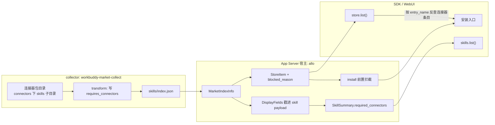

# 技能与连接器依赖关系 · 技术方案

> **状态**：✅ 已实施主体（2026-10-30；collector + 宿主 + SDK 已落地；已随 `0.1.0-beta.14` 发布 2026-11-09）
> **核心原则**：**能看见不等于能单装**——一个市场条目的可安装性，由它真正依赖的运行时能力决定；跨条目依赖必须结构化发布，禁止靠名字猜。
> **实现优先级**：**SDK 面 > WebUI 面**。SDK 是第三方接入的稳定契约，WebUI 只是它的消费者；本方案先把类型、helper、错误语义落到 SDK，WebUI 再消费，不允许反过来在 UI 里私接 wire 或特判。
> **影响面**：collector 索引（`requires_connectors`）→ App Server wire（`StoreItem.required_connectors`，`fp-20` → `fp-21`）→ SDK / WebUI → 文档站同步。`SkillSummary.required_connectors` 是**已有字段**，填充它不改变 wire 形状，不需要额外的指纹变更。
> **关联**：[`18-marketplace-spec.zh.md`](18-marketplace-spec.zh.md)、[`30-market-zip-hosting.zh.md`](30-market-zip-hosting.zh.md)、[`36-store-update-entry.zh.md`](36-store-update-entry.zh.md)、[`50-localized-display-fields.zh.md`](50-localized-display-fields.zh.md)（导入期戳字段的样板）、[`51-export-icons.zh.md`](51-export-icons.zh.md)、[`web/AGENTS.md`](../../web/AGENTS.md) §5（指纹同步）

## 0. 实施记录（2026-10-30）

| 层 | 落点 | 改动 |
|---|---|---|
| collector | `pipeline/transform.py`、`pipeline/package.py`、`schemas/index.schema.json`、`pipeline/verify.py`、`tests/test_pipeline_units.py` | 技能条目按来源连接器写 `requires_connectors`；打包阶段继承依赖连接器的 `available=false`；verify 校验引用可达与可用性一致；新增 2 个单测（12 passed） |
| 协议 DTO | `nomifun-api-types/src/app_server.rs` | `AppServerStoreItem.required_connectors`（`Vec<String>`，空省略） |
| 索引解析 | `nomifun-app/src/app_server_store.rs` | `MarketIndexInfo.requires_connectors` + `entry_requires_connectors()`；`store/list` 透出字段并派生 `blocked_reason` |
| 安装面 | `app_server_store.rs::install_entry` | 依赖非空且未安装 → 直接返回 `errors`，**不下载 payload、不建快照**；已安装的历史条目保持 no-op |
| 导入戳字段 | `nomifun-importer/src/{manifest,import}.rs` | `DisplayFields` 增 `required_connectors` / `entry_kind`；新增 `stamp_skill_requirements()` 在 payload 序列化前写入 skill 组件；单测覆盖「市场声明优先 / 连接器条目回退 / 其他 kind 不写」 |
| 读面 | `app_server_display.rs`、`app_server_entry_assets.rs`、`app_server_catalog.rs` | payload 的 `required_connectors` → `DisplayFields` → `SkillSummary.required_connectors` |
| SDK | `protocol.ts`、`client/src/store.ts`、`client/src/store.test.ts` | `StoreItem.required_connectors` 类型 + `StoreClient.dependencies()`（纯本地 join）；4 个新测试 |
| 指纹 | 服务端常量、SDK 常量、mock/smoke/readiness/probe 夹具、站点 2 文件 | `fp-20` → `fp-21`；`check:fingerprint` 10 落点 + 站点 2 文件全绿 |
| 文档 | 本文件、`05` 头部与变更段、README 索引、站点 `typescript-sdk.md`（zh/en） | 同步 |

实测：collector `unittest` 12 passed；`cargo test -p nomifun-importer` 65 lib + 32 integration passed；`cd web && bun run typecheck && bun run test` 591 passed / 3 skipped；`check:fingerprint`、`check:release-sync`（56 / 83）通过；`cargo check -p nomifun-app` 通过。**已知环境限制**：`cargo test -p nomifun-app --lib` 在本机无法链接（vendored sherpa-onnx 预编译包是 MT 静态库、ort 是 MD 动态库，`/failifmismatch` 冲突），与本次改动无关。

## 0.1 现状实测（2026-10-30，本机）

| 指标 | 数值 | 来源 |
|---|---|---|
| skills 市场条目 | 1543 | `dist-market/skills/index.json` |
| 其中来自连接器包（`embedded_in` 非空） | 1024 | 同上 |
| 独立技能 | 519 | 同上 |
| 采集阶段的行数 / 连接器内嵌行 | 1661 / 1132 | `dist/skills/_index.json` |
| 内嵌行的 `plugin` 命中 connectors 索引 | **1132 / 1132（100%）** | `dist/connectors/_index.json`（522 行） |
| 技能名与连接器名同名 | 166 / 1024 | 两份 index 的 `name` 交集 |
| 连接器条目 `available=false` | 80 | `dist-market/connectors/index.json` |

代码侧现状：

| 事实 | 位置 |
|---|---|
| 协议早就有 `SkillSummary.required_connectors: string[]` | `web/packages/protocol/src/protocol.ts:688` |
| 宿主**永远**投影成空数组 | `crates/backend/nomifun-app/src/app_server_catalog.rs:119`（`required_connectors: Vec::new()`） |
| skills 索引只发布 `embedded_in`（市场名），不发布具体连接器 | `workbuddy-market-collect/src/wbcollect/pipeline/transform.py:297-300` |
| 采集阶段其实已经解析出连接器 id（`plugin`） | `workbuddy-market-collect/src/wbcollect/skills.py:38-44`、`:173-179` |
| 连接器包安装会连包内 `skills/` 一起装 | `crates/backend/nomifun-importer/src/import.rs:2218-2246`（`component_dirs` 默认扫 `./skills`） |
| skill 的公开 id 就是 name | `crates/backend/nomifun-app/src/app_server_catalog.rs:107` |
| 连接器组件 payload 的 `name` 是 MCP server 名，与市场条目名可能不同（如 `fenbi-baokao-decision` → `fenbi_mcp`） | `crates/backend/nomifun-importer/src/import.rs:1649-1658`；`web/packages/client/src/store.ts:344-361` |

## 1. 背景与核心痛点

### 1.1 业务背景

SDK 调用方从 **skills 列表**安装了一个技能，运行时却调不到它需要的 MCP 工具——因为连接器没有装。安装接口返回成功，错误被推迟到用户第一次使用该技能时，表现为「技能在、工具全无」的静默失败。

这类技能不是独立产品：它们来自连接器包的 `connectors/<连接器>/skills/<技能>/`，`SKILL.md` 正文写的就是「先调 `search_templates`，再调 `get_template`」。连接器包安装本来就会把它们一起装上；从 skills 市场单装只搬走了一份 `SKILL.md`。

### 1.2 三大痛点

1. **P1 依赖不可见**：协议字段 `required_connectors` 存在却恒为空；索引里只有市场名 `embedded_in`，具体是哪个连接器在发布时丢掉了。
2. **P2 半套装必然失败**：脱离连接器，这类技能没有任何可执行能力；安装成功只是把失败推后。
3. **P3 重复与同名**：连接器安装会带同名技能，而 skill id = name。一旦「先单装技能、后装连接器」，两个 snapshot 会各产出一份同名技能，`skills.list()` 直接重名，用户也分不清该装哪条。

### 1.3 现状 vs 目标

| 维度 | 现状 | 本方案目标 |
|---|---|---|
| 技能条目能否单装 | 全部可装（1024 条装完不可用） | 独立技能可装；附属技能不可单装 |
| 依赖信息 | 无（`required_connectors` 恒空） | 索引发布 + `StoreItem` 透出 + `SkillSummary` 填充 |
| 安装失败时机 | 首次调用工具时 | 安装时即拒绝并指向连接器 |
| 依赖连接器不可用 | 无感知 | 技能标 `available=false` + 原因 |
| 同名双份 | 可能发生 | 单装入口被关闭，不存在该路径 |

## 2. 方案全景与架构设计

### 2.1 端到端拓扑



### 2.2 核心目标

1. 附属技能在目录里**可见、可搜、可归类**，但不能单独安装；卡片与安装入口指向它所属的连接器。
2. 依赖以结构化字段发布（`requires_connectors`），宿主与 SDK 不需要猜。
3. 已装技能读面能回答「这个技能依赖哪个连接器」。
4. 依赖的连接器在市场层面不可用时，技能同样标记不可用并给出原因。
5. **SDK 面先行**：协议类型、`StoreClient` 的依赖解析与拦截语义先落地并可独立测试；WebUI 的行为只是消费这些能力，不引入第二套判定。

### 2.3 明确的非目标

1. **不按本机安装状态过滤目录**：`store/list` 是市场目录，不是可用性视图；过滤会让 66% 条目随安装状态抖动。
2. **不自动安装依赖**：跨市场的隐式副作用、以及几十 MB 的连接器包，都不该由一次技能点击触发。
3. **不扫描 `SKILL.md` 正文里的工具名来推依赖**：工具命名格式不统一，误判率高；依赖只认来源路径。
4. **不改 payload 组织方式**，不动 experts 市场，不引入「技能带连接器」的组合包。

### 2.4 架构不变量

1. **归属单一**：连接器包内嵌技能的唯一安装入口是它所属的连接器包。
2. **目录稳定**：市场的条目集合只由市场内容决定，不随本机安装状态变化。
3. **依赖显式**：任何跨条目依赖都必须以结构化字段发布；名称只用于展示，不作为外键。
4. **指纹同步**：DTO 字段增删即 `fp-21`，服务端常量、SDK 常量、`check:fingerprint` 落点、文档站同步到位。

## 3. 核心设计

### 3.1 索引数据契约（collector）

`skills/index.json` 的条目新增**可选**字段：

```json
{
  "name": "adc-sandbox-usage",
  "kind": "skill",
  "requires_connectors": ["adc-sandbox"]
}
```

约束：

| 编号 | 规则 |
|---|---|
| **R1** | 只在 `kind="skill"` 的条目出现；其他市场忽略该键。 |
| **R2** | 缺省 = 独立技能（**不写空数组**，与现有 `null` 省略风格一致）。 |
| **R3** | 非空时每一项必须等于 **connectors 索引**中某个 `entries[].name`；collector `verify` 阶段强制校验，引用不到即失败。 |
| **R4** | 判定依据是采集阶段的 `plugin`（连接器包目录名），实测 1132/1132 命中 connectors 索引，可靠。 |
| **R5** | 本期一个技能只允许一个连接器来源；数组形态留给未来（多连接器组合技能）。 |

体积影响：1024 条 × 平均约 30 字节 ≈ **+30 KB**，当前 skills 索引 1.96 MB、上限见 `config.INDEX_MAX_BYTES`，可忽略。

### 3.2 collector 发布规则

1. `_transform_skills` 已有 `row["plugin"]`；当该 `plugin` 出现在 connectors 索引里时写入 `requires_connectors: [plugin]`，否则省略。
2. **可用性继承**放在 `package` 阶段（此时两个市场的 entries 都在盘上）：被依赖连接器 `available=false` 时，技能写 `available=false`、`unavailable_reason="依赖连接器不可用：<name>"`。
3. `schemas/index.schema.json` 增加该字段（数组、`items: string`、`minItems: 1`），`verify.py` 增加引用可达性与 R2/R3 断言。
4. 单元测试锁定口径：内嵌条目数 = 有 `requires_connectors` 的条目数；独立技能不出现该键；引用全部可达。

### 3.3 宿主读取与投影（wire）

| 层 | 改动 |
|---|---|
| `AppServerStoreItem`（`nomifun-api-types/src/app_server.rs:1540`） | 新增 `required_connectors: Vec<String>`，`skip_serializing_if = "Vec::is_empty"` |
| `MarketIndexInfo`（`nomifun-app/src/app_server_store.rs:118`） | 新增 `requires_connectors: Vec<String>`，从索引行解析 |
| `store/list`（`app_server_store.rs:884`） | 透出该字段；同时为附属技能设置 `blocked_reason` |
| `StoreItem`（`web/packages/protocol/src/protocol.ts:1465`） | 新增 `required_connectors?: string[]` |
| 指纹 | `fp-20` → `fp-21`（服务端 + SDK 常量 + mock/smoke 夹具 + 站点两处） |

`blocked_reason` 复用现有语义（「条目仍列出以便读到原因，但不提供安装」），文案形如：

```
requires connector "adc-sandbox"; install it from the connectors market
```

这样 WebUI/SDK 不需要新逻辑即可禁用安装按钮；结构化字段只用于展示依赖与反查连接器条目。

### 3.4 安装面：硬拦 + 引导

`install_entry` 在两个位置设闸，宁可重复也不能漏：

1. **列表侧**：`blocked_reason` 非空时前端不提供安装入口（既有约定）。
2. **安装侧**：`install_entry` 在做过 `entry_facts` 之后、下载 payload 之前判断 `required_connectors` 非空，直接返回：

```json
{
  "marketplace_id": "...",
  "entry_name": "adc-sandbox-usage",
  "installed_count": 0,
  "reused": false,
  "warnings": [],
  "errors": ["requires connector \"adc-sandbox\"; install it from the connectors market"],
  "outcomes": []
}
```

不产生 snapshot、不写 provenance、不下载 payload。**即使依赖连接器已经安装也照样拒绝**——此时该技能已随连接器进入 `skills.list()`，再单装只会制造同名双份。

客户端引导规则（SDK/WebUI，零 wire 成本）：

- 用 `required_connectors[0]` 在 `store.list()` 里按 `entry_name` 匹配 `kind="connector"` 的条目（连接器市场与技能市场不同，跨市场按条目名解析）；
- 该连接器 `installed=true` → 卡片显示「已随连接器提供」，不再给按钮；
- `installed=false` → 按钮变成「安装连接器 `X`」，点击走该连接器条目的 `store/install`。

### 3.5 已安装读面（`skills.list()` / `skills.get()` 的 `required_connectors`）

`SkillSummary.required_connectors` 就是「这个技能依赖哪些连接器」的字段，`skills.list()` 每条都带它。现在恒为空，填实即可——**字段类型不变，不触发指纹变更**。

**数据来源有两条，互不冲突：**

| 技能来源 | 依赖从哪来 | 谁写 |
|---|---|---|
| 从技能市场单装（含历史单装） | 市场索引行的 `requires_connectors` | 导入时经 `MarketIndexInfo::display()` → `DisplayFields` 戳进 skill payload |
| 随连接器包安装 | 该快照的**来源条目名**（`ImportRequest.entry_name`） | 导入的后置 pass：`ImportRequest` 增加 `entry_kind`，当条目 kind 为 `connector` 时，把所有 skill 组件的 `required_connectors` 置为 `[entry_name]` |

**取值域统一为「市场条目名」**（不是 MCP server 名）：依赖要回答的是「该装哪个条目」，而安装状态只存在于条目维度；`connectors.list()` 的 id 是 MCP server 名，两者可能不同（真实案例：条目 `fenbi-baokao-decision` 装出来叫 `fenbi_mcp`），所以不用 server 名。判断是否已满足时，用 `store.list()` 里 `kind="connector"` 条目的 `entry_name` + `installed` 比对即可。

后置 pass（`stamp_skill_requirements()`）放在 payload 序列化之前（`nomifun-importer/src/import.rs` 的 `payload_jsons` 构造处），快照依旧不可变；`entry_kind` 与 `requires_connectors` 一起随 `DisplayFields`（即 `ImportRequest.index_display`）从市场层传入，`entry_name` 用已有的 `ImportRequest.entry_name`。手工导入（无市场来源）不写该字段——没有条目名可依赖，也不该猜。

**为什么不无条件按「快照里有 connector 组件」推导**：普通插件包可能同时带 MCP 与和它无关的技能，那样会误标依赖。限定条目来自连接器市场（`entry_kind="connector"`）才推导。

读面：

```
skill 组件 payload.required_connectors
  → app_server_display::display_from_payload
  → app_server_entry_assets::display_for_skill（已按 snapshot + slug 取组件，零额外 I/O）
  → skill_summary：填 required_connectors
```

样例（`skills.list()` 单项，其余字段略）：

```json
{ "id": "adc-sandbox-usage", "name": "adc-sandbox-usage", "required_connectors": ["adc-sandbox"] }
```

**语义边界**：该字段只回答「需要哪个条目」，不回答「是否已满足」。判断满足与否用 `store.list()` 的连接器条目比对（`entry_name` + `installed`，客户端 join 即可）；不要在这里塞 `satisfied` 这类随安装状态变化、还要额外读连接器状态的字段。

### 3.6 条目状态矩阵

| 条目类型 | 依赖连接器条目状态 | `available` | `blocked_reason` | 安装行为 |
|---|---|---|---|---|
| 独立技能 | 无 | `true` | 空 | 正常安装 |
| 附属技能 | `available=true`、未安装 | `true` | 「请安装连接器 X」 | 拒绝，客户端引导装 X |
| 附属技能 | `available=true`、已安装 | `true` | 同上 | 拒绝（技能已随 X 提供） |
| 附属技能 | `available=false` | `false` | 依赖不可用原因 | 拒绝 |

### 3.7 同名兜底

本期的兜底就是 3.4 的安装硬拦：附属技能根本不会被单独安装，因此**不会新增**同名双份。跨快照的历史同名检测（扫描已安装技能名后跳过物化）**未实现**——它只在「历史数据已经存在双份」时才有意义，留给后续数据清理，不在本期范围。

### 3.8 兼容与发版顺序

1. **collector 先发**：新增可选字段，老宿主解析索引时忽略未知键（`MarketIndexInfo` 按 `serde_json::Value` 手工取值，天然容忍），不会报错。
2. **宿主 + SDK 同批发 `fp-21`**：指纹在握手时严格相等，没有灰度窗口；`StoreItem.required_connectors` 与拦截逻辑必须同批。
3. **与本轮仍待发布的 `fp-20` 合并成一趟发版**：正式 lockstep 发版（npm `protocol/client/sdk/runtime` 四包 + 站点）尚未执行，把 `fp-21` 折进同一趟，避免连发两次。
4. 站点 `typescript-sdk.md` 同步指纹表，并增补 `StoreItem.required_connectors` 与 `dependencies()`；两者都不新增 wire 方法，`check:release-sync` 的 mapped/unmapped 拆分（HTTP 路由表）不变。

### 3.9 SDK 面设计（优先级最高）

消费顺序是 **SDK → WebUI**：WebUI 是 SDK 的一个消费者，凡是 WebUI 要展示或操作的能力，必须先在 SDK 上有稳定表达。本方案的 SDK 变更如下。

**① 类型面（`@flowy-agent-store/protocol`）**

```ts
export interface StoreItem {
  // ...
  /** 该条目依赖的连接器条目名（市场内 `entry_name`）；缺省 = 无依赖。 */
  required_connectors?: string[];
}
```

- `SkillSummary.required_connectors` 类型不变，只是从空数组变成有值（3.5）。
- 字段可选：旧宿主不返回时按「无依赖」处理，不新增必填字段，不做双写。

**② 行为面（`@flowy-agent-store/client` 的 `StoreClient`）**

- **拦截不用新写**：`install()` / `update()` 的 `assertUsable()`（`web/packages/client/src/store.ts:498-507`）已经对 `blocked_reason` 抛 `StoreError("item_blocked", reason)` 且**不发请求**。附属技能的 `blocked_reason` 由宿主填，客户端天然 fail-fast，**不新增错误码**。
- **新增一个纯本地 helper**（不增加 wire 调用）：

```ts
/**
 * 解析条目声明的依赖连接器条目。
 *
 * 按 `entry_name` 精确匹配所有已加载市场的 `kind === "connector"` 条目；
 * 传入 `items` 可复用一次 `list()` 的结果。解析不到返回空数组（市场未同步），不抛错。
 */
async dependencies(item: StoreItem, items?: StoreItem[]): Promise<StoreItem[]>
```

**③ 明确不做**

- 不提供 `installWithDependencies`：D4 已定「安装不由技能条目触发依赖」，SDK 也不给隐式副作用。
- 不把依赖塞进 `StoreError`：`item_blocked` 的 message 已含连接器名，结构化信息在 `required_connectors` 上。

**④ 发布面**

- `protocol`（类型）与 `client`（helper）各一个 minor；`sdk` / `runtime` 无 API 变化但按 lockstep 同批发布。
- 文档站 `typescript-sdk.md` 增补 `StoreItem.required_connectors` 与 `dependencies()`；两者都不新增 wire 方法，`check:release-sync` 守的是 HTTP 路由拆分，计数不变。
- SDK e2e 覆盖 SCD-008/009/010；WebUI 侧不新增任何直连 wire 的调用。

## 4. 关键决策与权衡

| 编号 | 决策点 | 选定方案 | 放弃的替代方案与理由 |
|---|---|---|---|
| **D1** | 附属技能的归属 | **可见不可单装，安装入口指向连接器** | ❌ 从 skills 市场直接删除：丢掉 1024 条可检索性，且技能卡是发现连接器的入口之一。❌ 保持可单装只加告警：半套状态与同名双份仍在，失败只是被推迟。 |
| **D2** | 依赖如何表达 | **索引发布 `requires_connectors`（来源路径推导）** | ❌ 按技能名匹配连接器：实测仅 166/1024 同名。❌ 扫描 `SKILL.md` 工具名：格式不统一、误判高。 |
| **D3** | 是否按安装状态过滤目录 | **不过滤**；仅依赖连接器 `available=false` 时继承不可用 | ❌ 未装即隐藏：66% 条目消失且列表随安装抖动；目录语义被安装状态污染。 |
| **D4** | 安装策略 | **硬拦**（依赖非空即拒绝） | ❌ 告警放行：制造重复技能。❌ 自动装依赖：跨市场副作用与体积不可控。 |
| **D5** | wire 形态 | **`StoreItem` 新增结构化字段 + 填充已有 `SkillSummary` 字段** | ❌ 只填已有字段：安装前看不到依赖，等于没解决调用方问题。❌ 只塞进 `blocked_reason` 文本：失去结构化反查，客户端无法一键定位连接器条目。 |
| **D6** | 发版节奏 | **并入尚未发布的 `fp-20` lockstep，一次发 `fp-21`** | ❌ 分两次发：四包 + 站点同步成本翻倍，且 `fp-20` 本就未正式发。 |
| **D7** | 同名技能 | **靠 D4 的安装硬拦从源头封住（附属技能不可单装）** | ❌ 另做跨快照同名扫描：只在历史数据已双份时有意义，属数据清理，不在本期；❌ 允许并存：`skills.list()` 会出现两个同 id。 |
| **D8** | SDK 与 WebUI 的落地顺序 | **SDK 先行：类型 + `dependencies()` + 复用 `item_blocked`；WebUI 只做消费** | ❌ WebUI 先行特判：同一规则会在 SDK 与 UI 各写一遍，第三方接入拿不到，且 UI 私接 wire 会破坏协议面唯一性。 |

## 5. 验收标准与验证矩阵

### 5.1 用例

| 编号 | 场景 | 断言 |
|---|---|---|
| **SCD-001** | collector 打包 | 1024 条内嵌技能带非空 `requires_connectors`；519 条独立技能**不含**该键；引用全部命中 connectors 索引 |
| **SCD-002** | 依赖不可用继承 | 连接器 `available=false` 时，其技能 `available=false` 且原因为依赖不可用 |
| **SCD-003** | `store/list` | 附属技能 `required_connectors=["adc-sandbox"]`、`blocked_reason` 非空、`available=true`；独立技能两者皆空 |
| **SCD-004** | 单装拦截 | `store/install-entry(skills, adc-sandbox-usage)` 返回 `installed_count=0`、`errors` 含连接器名，且**未新增 snapshot / 未下载 payload** |
| **SCD-005** | 连接器安装 | 安装 `connectors/adc-sandbox` 后，`skills.list()` 出现 `adc-sandbox-usage`；再次尝试单装该技能仍被拒绝 |
| **SCD-006** | 已装读面 | 通过市场单装的技能（历史数据）`skills.get().required_connectors` 非空 |
| **SCD-007** | 指纹门 | `bun run check:fingerprint` 全绿（本仓 7 文件 10 处 + 站点 2 处 = `fp-21`）；`fp-20` 客户端握手即失败 |
| **SCD-008** | SDK e2e | `index-market.e2e.test.ts` 扩展：附属技能被拒 → 装连接器 → 技能就绪且不重复 |
| **SCD-009** | `dependencies()` 单元 | 附属技能解析到连接器条目；无依赖返回 `[]`；跨市场按 `entry_name` 精确匹配；传入 `items` 不触发额外请求 |
| **SCD-010** | `install()` fail-fast | 对带 `blocked_reason` 的条目抛 `StoreError("item_blocked")`，fake host 断言**零 wire 请求** |
| **SCD-011** | WebUI 消费一致性 | WebUI 不新增直连 wire 调用；按钮状态只由 `required_connectors` + `dependencies()` 驱动 |
| **SCD-012** | 连接器带来的技能（`skills.list()`） | 安装 `connectors/adc-sandbox` 后，该包技能 `required_connectors=["adc-sandbox"]`；独立技能仍为 `[]`；普通插件包的技能不被误标；条目名与 server 名不一致时（如 `fenbi-baokao-decision`）取条目名 |

### 5.2 验证梯子

```bash
# collector
uv run pytest tests/test_pipeline_units.py -q
uv run wbcollect pipeline package --markets skills,connectors
uv run wbcollect pipeline verify

# 宿主
cargo test -p nomifun-importer
cargo test -p nomifun-app
cargo test -p nomifun-app-server

# 前端 / SDK（web 不在 bun run check 链内，需单独跑）
cd web && bun run typecheck && bun run test
cd web && bun run test -- store     # SCD-009/010：dependencies() 与 item_blocked
bun run check:fingerprint
bun run check:release-sync          # 无 wire 方法变化，HTTP 路由拆分计数不变

# 真实宿主 e2e（SDK 驱动，用户明确要求 e2e 由 SDK 承担）
cd web && AGENT_STORE_E2E_BIN=<cargo build -p agent-store 产物> bun run test -- index-market
```

## 6. 风险与回滚

| 风险 | 影响 | 处理 |
|---|---|---|
| collector 先发、宿主未升级 | 新字段被忽略，行为与现状一致 | 兼容，无回滚需求 |
| 宿主已拦、collector 未发字段 | 1024 条仍可单装（现状） | 发版顺序固定为 collector → 宿主 |
| 依赖连接器后续从市场下架 | 技能仍列出但装不了 | `available=false` 继承；下架后重新打包自然同步 |
| 客户端未升级（旧 SDK 读 `store/list`） | `blocked_reason` 已足以禁用按钮；结构化字段被忽略 | 旧 SDK 仍能正常浏览，只是拿不到一键引导 |
| 历史同名双份已存在 | `skills.list()` 重名 | SCD-005 的兜底只防新增；存量数据由「卸载后重装连接器」清理，不在本期自动迁移 |
