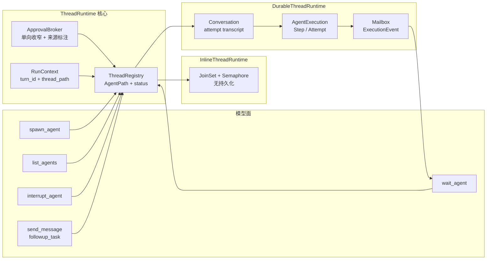
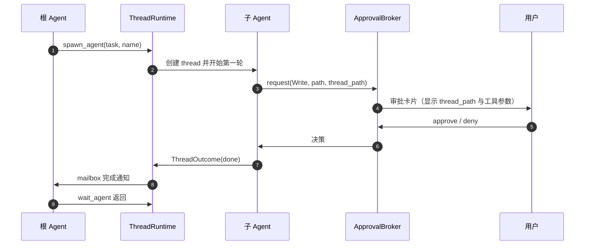

# Agent Thread Runtime（子 Agent 统一运行底座）· 技术方案

> **状态**：📋 计划（设计阶段，尚未实现）
> **核心原则**：Thread 不是新的执行聚合——**Thread 就是 Conversation**。`AgentExecution` 只负责确定性调度，Thread 负责身份、消息、生命周期、审批与成本归属。

---

## 1. 背景与核心痛点

### 1.1 业务背景

Flowy 的子 Agent 能力同时服务三类宿主：

- **桌面端 / Web 端**：Team 协作、Agent Store、DAG 编排、可视化执行画布；
- **CLI / 嵌入式宿主**：`nomi_delegate(strategy=parallel)` 的一次性 fan-out；
- **技能与检索**：`explore_code` / `research` / `verify_change` 的隔离 fork。

三类宿主今天各自实现了一套委派语义。随着模型池、Team 模板、后台任务和成本归因的引入，三套语义开始互相污染：同一个「子 Agent」在模型眼里、在 UI 里、在计费系统里指的不是同一个东西。

### 1.2 三大痛点

**P1：三套委派形态、三套身份，模型无法寻址。**

| 形态 | 入口 | 身份 | 持久化 | 可继续 |
|---|---|---|---|---|
| 嵌入式 fan-out | `LocalDelegateTool` | 一次性 `execution_id` | ❌ `NullSink` | ❌ |
| 宿主持久化 | `HostDelegateTool` | Step / Attempt / Conversation | ✅ 执行域表 + events | ◐ 仅运行中可 append |
| 隔离 fork | `IsolatedSubagentTool` | 无 | ❌ | ❌ |

模型没有 `list_agents`、`send_message`、`wait_agent`、`interrupt_agent`。宿主的 `steer_conversation` / `stop_attempt_turn` 只存在于 HTTP/UI，模型看不见。

**P2：审批与计费在子代理路径上失联（P0）。**

- 子引擎构造时 `approval_manager: None`（`crates/agent/nomi-agent/src/engine/mod.rs`），工具调用回落到 `ToolConfirmer`；
- `ToolConfirmer` 在 stdin EOF 时读到空串，而空串曾被判为 `Approved`（`confirm.rs`），Web/无头宿主因此**静默批准**；
- `x-flowy-turn-id` 由 `tokio::task_local!` 承载（`crates/agent/nomi-providers/src/billing_turn.rs`），不跨 `tokio::spawn`，子代理请求因此丢失本轮成本归属。

**P3：终态即墓碑，没有可恢复的 thread。**

Attempt Conversation 被定义为 immutable audit record；`delegate_from_attempt` 要求 active Attempt。子 Agent 一旦结束，父 Agent 无法追问、无法 resume、无法把「再做一点」变成同一 thread 的下一轮。

### 1.3 能力对比矩阵

| 能力 | 现状 | 本方案目标 |
|---|---|---|
| 模型可见身份 | 无 | `thread_id` + `AgentPath` + `nickname` |
| 父子通信 | 一次性 write-back | `send_message` / `followup_task` |
| 异步完成 | 宿主隐式回写 | mailbox + `wait_agent` |
| 中断 | 仅宿主 UI | `interrupt_agent`（复用 `stop_attempt_turn`） |
| 恢复 | 终态不可继续 | `resume` 同一 thread |
| 子 transcript | 仅 planned 有 | 所有形态统一投影 |
| 审批 | 子引擎 stdin（fail-open） | root `ApprovalBroker`（fail-closed） |
| 成本归属 | 子代理漏记 | 显式 `RunContext` 贯穿 |
| 容量 | 固定信号量 / 64 直接拒绝 | 上限 + 排队；暂不做 LRU |
| 扩展定义 | DB preset / Team 模板 | 复用 preset，增加导入/导出 |

---

## 2. 方案全景与架构设计

### 2.1 端到端拓扑



### 2.2 目标与非目标

**目标**

1. 用一套 `ThreadRuntime` 接缝收敛三种委派形态；
2. 让模型能看见、寻址、等待、中断、恢复子 Agent；
3. 审批与成本归属在所有形态下成立；
4. 复用现有 `Conversation` / `AgentExecution` / `ExecutionEvent`，不新建并行聚合。

**非目标（本阶段坚决不做）**

- ❌ 不实现 `multi-agent-v2.zh.md` 的 `AgentTreeRuntime` 新持久化树；
- ❌ 不做常驻 LRU 淘汰 / 懒加载复活；
- ❌ 不做 Agent Teams 的 shared task list、team lead 选举、跨会话邮箱文件；
- ❌ 不把 `AgentExecution` 改造成父子树；
- ❌ 不重写 Scheduler / AttemptRunner。

### 2.3 架构不变量

| 编号 | 不变量 | 说明 |
|---|---|---|
| **I1** | **Thread 身份即 Conversation 身份** | 不引入第二套 thread 表；`thread_id` 由 Conversation id 派生 |
| **I2** | **Execution 保持扁平** | 父子关系只存在于 Conversation 域；`AgentExecution` 不出现 `parent_execution_id` |
| **I3** | **权限单向收窄** | `child.policy = parent.policy ∩ child.definition`，只能减不能增 |
| **I4** | **审批 fail-closed** | 没有 broker / 没有 writer / EOF / 空输入，一律 Denied |
| **I5** | **成本归属显式传递** | `RunContext` 作为参数贯穿，禁止依赖 `task_local!` |
| **I6** | **不新增第四套委派面** | 任一旧入口迁移完成后必须删除其独立实现 |

### 2.4 与现行领域契约的关系

`docs/architecture/agent-execution.zh.md` 明确：

- 「Execution 不形成父子树」；
- 「不得复制 `host`、`child_agent`、`parent_execution` 或另一组来源实体」；
- 「Attempt 内再次委派时，Engine 把新 Step 原子追加到当前 Execution」。

本方案**不修改**这些契约：

- 树（`parent_thread_id` / `agent_path`）落在 **Conversation 域**；
- `AgentExecution` 仍然只认 Participant / Step / Dependency / Attempt / Link / Event；
- 子 Agent 的「再委派」仍然复用同一个 Execution 聚合，只是调用方从「Attempt 会话」变成「Thread」。

---

## 3. 核心设计与模块规范

### 3.1 Thread 数据模型

```rust
// crates/agent/nomi-types/src/thread.rs（新增）
pub struct ThreadId(pub String);          // 等于 Conversation id
pub struct AgentPath(pub String);         // "/root/reviewer"，根为 "/root"

#[derive(Clone, Debug)]
pub struct ThreadSpec {
    pub parent: Option<ThreadId>,
    pub path: AgentPath,
    pub nickname: String,
    pub definition: ThreadDefinition,
    pub policy: ThreadPolicy,
    pub budget: Option<ThreadBudget>,
}

#[derive(Clone, Debug)]
pub struct ThreadDefinition {
    pub preset_id: Option<String>,
    pub instructions: Option<String>,
    pub model: Option<String>,
    pub reasoning_effort: Option<String>,
    pub enabled_skills: Vec<String>,
    pub exact_tools: Vec<String>,
}

#[derive(Clone, Debug)]
pub struct ThreadPolicy {
    pub sandbox: SandboxPolicy,           // 继承父级，不可放宽
    pub approval: ApprovalPolicy,         // inherit | auto | deny
    pub tool_scope: ToolScope,            // 只能取交集
}

pub enum ThreadStatus {
    Pending,
    Running,
    WaitingApproval,
    Idle,
    Done,
    Failed,
    Interrupted,
    Unloaded,                             // 预留给后续 LRU，本阶段不产生
}

pub struct ThreadOutcome {
    pub status: ThreadStatus,
    pub summary: String,
    pub artifacts: Vec<ArtifactRef>,
    pub usage: TokenUsage,
    pub partial: bool,                    // 达到 maxTurns 时为 true，可 resume
}
```

**字段约束**

- `AgentPath` 只允许 `[a-z0-9_-]`，父路径必须已存在；
- 兄弟重名直接拒绝，不隐式覆盖；
- `nickname` 仅展示，不参与寻址；
- `ThreadStatus::Unloaded` 在本阶段**不产生**，只是为后续容量策略预留枚举值。

### 3.2 两个 Runtime 实现

```rust
#[async_trait]
pub trait ThreadRuntime: Send + Sync {
    async fn spawn(&self, spec: ThreadSpec, input: TurnInput) -> Result<ThreadHandle>;
    async fn send(&self, to: &ThreadRef, msg: ThreadMessage, trigger: bool) -> Result<()>;
    async fn wait(&self, to: &[ThreadRef], timeout: Duration) -> Result<Vec<ThreadOutcome>>;
    async fn interrupt(&self, to: &ThreadRef) -> Result<()>;
    async fn list(&self, prefix: &AgentPath) -> Result<Vec<ThreadSnapshot>>;
    async fn resume(&self, to: &ThreadRef) -> Result<ThreadHandle>;
}
```

| 实现 | 宿主 | 身份 | 持久化 | `wait` | `resume` |
|---|---|---|---|---|---|
| `InlineThreadRuntime` | CLI / 嵌入式 | 进程内 registry | ❌ | JoinSet + Notify | 仅进程存活期间 |
| `DurableThreadRuntime` | App Server / 桌面 | Conversation id | ✅ | ExecutionEvent + mailbox | 终态 Conversation 重新打开 |

**迁移映射**

| 今天 | Thread-first |
|---|---|
| `LocalDelegateTool` fan-out | `spawn` N 个 inline thread |
| `HostDelegateTool` planned | `spawn` durable root thread + Execution |
| `explore_code` / `verify_change` / `research` | `spawn` inline read-only thread |
| Attempt Conversation | durable child thread（同一行，补元数据） |
| `steer_conversation` | `send(trigger = true)` |
| `stop_attempt_turn` | `interrupt` |
| 宿主 write-back | thread 完成事件 → 父 mailbox |
| `delegate_from_attempt` | child thread 自己 `spawn` 子 thread |

### 3.3 模型面工具

**第一批（只读 / 低风险）**

| 工具 | 输入 | 输出 | 复用 |
|---|---|---|---|
| `spawn_agent` | `task`、可选 `name`、`model`、`background` | `{ thread_id, path, status }` | `LocalDelegateTool` / `HostDelegateTool` |
| `list_agents` | 可选 `prefix` | `[{ path, status, model, usage }]` | `ConversationExecutionLink` |
| `interrupt_agent` | `to` | `{ status }` | `stop_attempt_turn` |

**第二批（需要 mailbox）**

| 工具 | 语义 |
|---|---|
| `wait_agent` | 挂起当前轮次，直到任一目标完成、用户介入或超时 |
| `send_message` | 单向投递，不触发对方思考轮次 |
| `followup_task` | 投递并立即触发对方新一轮推理 |

> 设计取舍：Claude Code 用单个 `SendMessage` 同时承担「消息」与「resume」，Codex 用 steer + follow-up。Flowy 保留两个名字，因为「是否触发一轮」是模型必须显式选择的语义，不应藏在参数默认值里。

### 3.4 审批代理



**规则**

1. `ApprovalBroker` 只挂在根 thread；所有子 thread 的请求都带 `thread_path` 上报；
2. 没有 broker（CLI/无头）时，只有 `auto_approve` 或 `allow_list` 能通过，其余 Denied；
3. 子 thread 的 `permissionMode` 只能比父级更严格；
4. 审批通过的作用域默认是「单次调用」；「本会话」级授权必须由用户显式选择，并作用于整棵树。

### 3.5 完成、邮箱与等待

- 子 thread 结束（完成 / 失败 / 中断 / 达到 `maxTurns`）时，Runtime 向父邮箱投递一条 `ThreadCompleted` 事件；
- `wait_agent` 只消费「未读且与目标匹配」的事件，超时返回当前快照；
- 父 Agent 在下一轮开始前把未读事件并入上下文；
- `partial = true` 的 outcome 可以 `resume`，不算失败。

### 3.6 恢复

```text
Done / Failed / Interrupted
        │
        └─ resume(thread_id)
              │
              ├─ Durable: 重新打开 Conversation，追加一轮，保留全部历史
              └─ Inline : 仅当进程内 registry 仍有该 thread 时可用
```

**关键约束**

- `resume` 不创建新的 Execution，也不复制 Participant 快照；
- 恢复后的 Attempt 仍然挂在原 Step 下；
- `resume` 必须重新校验父级 policy，防止权限在终态期间被放宽。

### 3.7 成本与可观测性

```rust
#[derive(Clone)]
pub struct RunContext {
    pub turn_id: String,
    pub session_id: Option<String>,
    pub root_thread_id: ThreadId,
    pub thread_path: AgentPath,
}
```

- provider 从 `RunContext` 取 `x-flowy-turn-id` / `x-flowy-session-id`，不再读 `task_local!`；
- `nomi-agent-trace` 的 session id 直接使用 `thread_id`；
- 每个 thread 的 `usage` 单独累计，父级汇总时按 `thread_path` 去重；
- UI 画布节点展示：模型、`assignment_rationale`、token、成本、待审批徽标。

### 3.8 状态机

| 当前 | 事件 | 下一状态 | 前置条件 |
|---|---|---|---|
| `Pending` | runtime 接受 spawn | `Running` | 父 policy 校验通过 |
| `Running` | 需要审批 | `WaitingApproval` | broker 可用 |
| `WaitingApproval` | approve | `Running` | 决策未过期 |
| `WaitingApproval` | deny | `Running` | 工具返回拒绝结果 |
| `Running` | 正常结束 | `Done` | 有终态输出 |
| `Running` | 错误 | `Failed` | 错误已落事件 |
| `Running` | interrupt | `Interrupted` | 无未提交的写操作 |
| `Done` / `Failed` / `Interrupted` | resume | `Running` | policy 复核通过 |
| 任意 | 父级关闭 | `Interrupted` | 级联取消 |

不可逆终态：无。`Done` 可 resume 是本方案与现状最大的行为差异。

---

## 4. 关键决策与权衡矩阵

| 编号 | 决策点 | 选定方案 | 放弃的替代方案与理由 |
|---|---|---|---|
| **D1** | Thread 的载体 | **Conversation** | ❌ 新建 `AgentThread` 表：会与 `ConversationExecutionLink` 形成双身份；❌ 新建 `ChildThreadStore`：复制现有 transcript/runtime/stream 能力 |
| **D2** | 父子树放在哪 | **Conversation 域** | ❌ Execution 域：违反 `agent-execution.zh.md` 的「Execution 不形成父子树」契约，且会让调度器承担寻址职责 |
| **D3** | 模型面工具数量 | **先 3 个，再 3 个** | ❌ 一次上六件套：`send` / `followup` 在没有 durable thread 时无处落地，只会产生假实现 |
| **D4** | 容量策略 | **上限 + 排队，暂不做 LRU** | ❌ LRU 淘汰：Claude/Codex 都没有；在没有 mailbox 与成本归属前做淘汰必然做错；❌ 无限并发：成本与文件冲突不可控 |
| **D5** | 审批通道 | **root `ApprovalBroker` + fail-closed** | ❌ 子引擎读 stdin：EOF 等于批准，是已确认的 P0；❌ 直接透传父 `approval_manager`：子引擎没有 protocol writer，会全部失败 |
| **D6** | 成本上下文 | **显式 `RunContext` 参数** | ❌ `task_local!`：不跨 `tokio::spawn`，是 P0 漏记的根因；❌ 全局单例：无法区分并行 thread |
| **D7** | 委派结果 | **摘要 + artifact 句柄** | ❌ 50k 内联 JSON：16 个子代理必然截断，且截断后不可找回 |
| **D8** | Team / mailbox | **本阶段不做** | ❌ 先做 Team lead / shared task list：Claude 的 agent teams 仍是实验特性且无 resume；Flowy 连单层 thread 的 resume 都还没有 |
| **D9** | 自定义 Agent 定义 | **复用 preset，增加导入/导出** | ❌ 只做 markdown 文件：丢失 skills/constraints/model pool；❌ 只做 DB：不可 review、不可分享 |

---

## 5. 验收标准与验证矩阵

### 5.1 验收用例

| 编号 | 场景 | 操作 | 断言 |
|---|---|---|---|
| **TC-TH-001** | 审批 fail-closed | 无 broker 的子 thread 调用 Write | 返回 Denied；文件不存在；不读 stdin |
| **TC-TH-002** | 审批来源 | 子 thread 调用 Bash | 审批卡片含 `thread_path` 与完整参数 |
| **TC-TH-003** | 成本归属 | 一次 Run 内 spawn 3 个 thread | 所有 provider 请求携带同一 `turn_id`；父级 usage = 自身 + 子级之和 |
| **TC-TH-004** | 寻址 | `spawn_agent(name="reviewer")` 后 `list_agents` | 返回 `/root/reviewer`，状态正确 |
| **TC-TH-005** | 中断 | `interrupt_agent` | thread 进入 `Interrupted`，无半截写文件 |
| **TC-TH-006** | 完成通知 | 子 thread 正常结束 | 父邮箱恰好收到一次 `ThreadCompleted` |
| **TC-TH-007** | 等待 | `wait_agent(timeout=1s)` | 超时返回快照；子完成后立即唤醒 |
| **TC-TH-008** | 恢复 | 对 `Done` thread 调用 `resume` | 同一 thread 追加一轮；历史完整；policy 复核生效 |
| **TC-TH-009** | 权限收窄 | 父为 read-only，子定义请求写 | spawn 被拒绝，或子的写工具不可见 |
| **TC-TH-010** | 旧入口收敛 | 迁移完成后 grep | `LocalDelegateTool` 不再有独立执行实现 |

### 5.2 验证梯子

| 阶段 | 最小验证 |
|---|---|
| 类型与 trait | `cargo check -p nomi-agent -p nomi-types` |
| 审批 / 成本单测 | `cargo test -p nomi-agent --lib` |
| 持久化 thread | `cargo test -p nomifun-db` + 迁移测试 |
| 执行域集成 | `cargo test -p nomifun-agent-execution` |
| 前端画布 | `bun run typecheck && bun run check:i18n` |
| 全量 | `cargo check --workspace && bun run check` |

### 5.3 分阶段交付

| 阶段 | 内容 | 完成标志 |
|---|---|---|
| **Phase 0** | 审批 fail-closed + 成本上下文 | TC-TH-001 / 003 通过 |
| **Phase 1** | Thread 身份投影 + `list_agents` | TC-TH-004 通过 |
| **Phase 2** | completion event + `wait_agent` | TC-TH-006 / 007 通过 |
| **Phase 3** | `interrupt_agent` + `resume` | TC-TH-005 / 008 通过 |
| **Phase 4** | `send_message` / `followup_task` | 同一 thread 可多轮对话 |
| **Phase 5** | 删除旧入口的独立实现 | TC-TH-010 通过 |

---

## 附录：原始技术底稿与历史归档

> **归档说明**：本文为新建技术方案，没有需要逐字保留的旧版正文。以下完整保留本方案的调研依据、外部事实来源与仓库内证据，供后续审计与重定位使用。

### A.1 仓库内证据

| 主题 | 位置 |
|---|---|
| 三套委派入口 | `crates/agent/nomi-agent/src/local_delegate_tool.rs`、`host_delegate_tool.rs`、`isolated_subagent.rs` |
| 执行域契约 | `docs/architecture/agent-execution.zh.md` |
| 现有审计 | `docs/architecture/agent-harness-modes-review.zh.md` §5 / §6 / §7 |
| V2 设计（未实现） | `docs/architecture/multi-agent-v2.zh.md` |
| Attempt Conversation | `crates/backend/nomifun-agent-execution/src/engine.rs` `execution_for_attempt_conversation` |
| Steer / Stop | `crates/backend/nomifun-agent-execution/src/scheduler.rs` `steer_conversation` / `stop_attempt_turn` |
| 审批回落 | `crates/agent/nomi-agent/src/confirm.rs`、`engine/mod.rs` |
| 计费上下文 | `crates/agent/nomi-providers/src/billing_turn.rs` |
| 子线程 UI | `ui/src/renderer/pages/conversation/execution/ReadOnlyConversationView.tsx`、`ProjectedAttemptView.tsx` |

### A.2 外部一手资料

| 来源 | 用途 |
|---|---|
| Claude Code Subagents 文档 | 身份、后台运行、审批上浮、resume、fork、嵌套深度 |
| Claude Code Agent Teams 文档 | 明确「实验特性、无 session resume、任务状态可能滞后」 |
| Codex Subagents 文档 | thread、`/subagents`、steer/stop/close、继承父 sandbox/approval、并发配置 |

> 外部行为以官方文档为准；本文不引用未经证实的逆向结论。仓库内审计文档中标注「未验证」的条目，本方案同样不作为既定事实。

### A.3 与既有方案的关系

- 本文**替代** `multi-agent-v2.zh.md` 作为近期实施路线；
- `multi-agent-v2.zh.md` 保留为北向设计（AgentPath / mailbox / LRU 的完整形态），但不作为本轮重构的交付范围；
- 本文不重复 `agent-harness-modes-review.zh.md` 中 plan / goal / compact 的结论，只在其 P0/P1 缺陷之上给出统一底座。