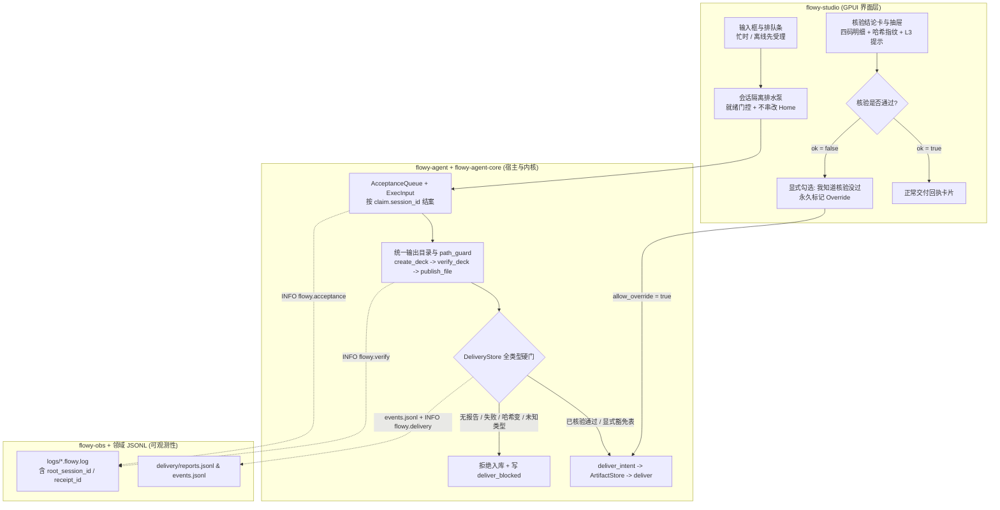

# Flowy 最终方案（`flowy18_wip`）· 现役执行计划

> **状态**：✅ Phase 1–Phase 4 已于 2026-11-25 全部落地验收（提交 `5e96fb681`、`599b82c35`，详见 [`证据.md` §11.27](证据.md)）；当前按 [`BLOCKED.md` §5](BLOCKED.md) 停在 V6 外部发送通道前等待需求方拍板  
> **核心原则**：**只改 `flowy18_wip/`，不碰根工作区；开发阶段集中修改与最小定向验证，收口后统一跑一次全量门禁 + `clippy --all-targets` + 真机日志终验；V6 外发硬止损停等拍板。**

---

## 1. 背景与真机巡检痛点

`feat-flowy-local-receipt`（基线 `03a69348f`）已在单测层面完成 V0–V5、S3b 与 `.pptx` 交付检查门（287 条单测 + `accept.sh` 3/3），但经 2026-11-25 真机启动 `flowy-app.exe` 配合 `agent-desktop` 与 `FLOWY_LOG_LEVEL=debug` 联合巡检（详见 [`证据.md` §11.26](证据.md)），暴露出 **3 个单测漏网的 P0 运行态/集成缺陷**、**1 个日志追查盲区** 以及 **最终方案剩余未落切片**：

1. **P0-1 启动竞态吞队列**：已登录账号启动时，`AgentHandle::boot` 早于云端模型目录 `refresh_models` 返回，`StudioPanel` 在 `cloud_ready=false`（`echo=true, model="mock"`）下立即把 `acceptance/journal.jsonl` 里的持久化回执全部抽干喂给假回显模型并标为 `completed`；且云端目录未就绪/离线时手动发送直接报 `notice.agent_failed` 而未走本地受理。
2. **P0-2 会话状态串台**：`AcceptedClaim` 未绑定 `session_id`，`StudioPanel` 用当前视图会话的 `self.status` 判断后台领取回执是否结案；且首页启动排空会偷偷修改 `state.active`，导致用户在首页发新消息串入旧会话。
3. **P0-3 工具路径错位与沙箱缺口**：`create_deck` / `verify_deck` 按 `context.cwd`（`<workspace>`）解析相对路径，`publish_file` 按 `context.output_root`（`<workspace>/outputs/submission-...`）解析，且 `delivery.rs` 用未归一化路径字符串匹配、`path_guard` 漏拦 `create_deck` / `verify_deck`，导致真实模型串调三工具必断链。
4. **P1 观测盲区与门禁未收口**：默认 `INFO` 日志下受理/领取/核验 **0 留痕**；`publish_file` 仅拦 `.pptx` 且只调只读 `gate.check()`（未写 `delivery/events.jsonl`，无崩溃前 `deliver_intent`）；核验结论卡（§8.3）、Override 二次确认 UI 与永久标记、L3 语义提示层（§6.7）尚未实装；`verify.rs:296` 残留 1 处 `--all-targets` clippy 报错。

| 能力维度 | 当前现状（`03a69348f`） | 本计划目标终态 |
| --- | --- | --- |
| 启动排水与离线受理 | 启动竞态误跑 `mock` 回显吞回执；离线拒收 | 云端就绪前挂起排水；未就绪/忙时均可靠落盘 `journal.jsonl` |
| 队列归属与首页隔离 | `AcceptedClaim` 无 `session_id`，篡改首页 `active` | 按领取所属 `session_id` 独立判终态；后台排水不污染 `Home` 新任务 |
| 产物生成→核验→发布主链 | `cwd` 与 `output_root` 错位，漏 `path_guard` | 三工具路径基准与归一化键完全统一，纳入 `path_guard` + 系统提示词 |
| 交付硬门与崩溃恢复 | 仅 `.pptx` 只读 `check()`，普通入口不写 `events.jsonl` | 全类型过门 + 方案 A 显式豁免表 + `deliver_intent → deliver / blocked / exempt` 留痕 |
| 核验结论卡与 Override UI | 无核验卡，Override 仅数据层 | 展示四码逐项结果与哈希指纹；`ok=false` 隐藏默认交付，勾选确认才放行并永久打标 |
| L3 语义层与日志可追查 | `INFO` 零业务日志，无 L3 探针 | `flowy.acceptance / verify / delivery` 全程 `INFO` 结构化留痕（含 `root_session_id`）；L3 只提示不阻断 |

---

## 2. 方案全景与边界



- **已拍板范围（写白名单）**：仅限 `flowy18_wip/crates/{flowy-agent-core,flowy-agent,flowy-studio,flowy-i18n,flowy-app,flowy-obs}/` 与 `docs/architecture/flowy-v0/`。
- **明确非目标（本轮不做）**：
  1. **不碰根工作区**（`crates/`、`ui/`、`apps/`）；
  2. **不做 V6 外部通道发送**（SMTP / Webhook / IM 硬止损，见 [`BLOCKED.md` §5](BLOCKED.md)）；
  3. **不引 `nomi-agent-trace` 或新建 span 树**（在 `flowy18_wip` 现有 `flowy-obs` JSON 日志 + 领域 JSONL 上落 `root_session_id` 与业务关联 id）；
  4. **不强塞多进程/多 loop LLM Judge 全局分派与三层跨 work 实体库**（保持当前「会话内独立 loop + 本地受理队列」稳定架构，多-work Router 留后续大版本）。

---

## 3. 分阶段实施计划（Phase 1 → Phase 4）

### Phase 1（任务 14A）：堵住真机三大 P0 断层 ＋ 补齐 `INFO` 业务 Trace 底座
- **改动落点**：
  - `flowy-agent/src/verify.rs`：先清零第 296 行 `clippy::assert_is_empty` 历史债；`verify_deck` 优先基于 `context.output_root`（回退 `context.cwd`）解析相对路径，输出 `INFO target="flowy.verify"`（含 `session_id / submission_id / artifact_hash / ok / issue_count`）。
  - `flowy-agent/src/pptx.rs` & `handle.rs`：`create_deck` 同样优先对齐 `context.output_root`；把 `"create_deck" | "verify_deck"` 纳入 `path_guard`（允许当前会话 `cwd` 与 `output_root`，严禁 `..` 越界）；`handle.rs` Home 系统提示词补明 `.pptx` 须走 `create_deck → verify_deck → publish_file`。
  - `flowy-agent/src/delivery.rs`：报告查询键值做路径规范化（消除 Windows `/` 与 `\` 差异导致假 `DELIVERY_NOT_VERIFIED`）。
  - `flowy-agent/src/handle.rs` & `flowy-studio/src/panel.rs`：
    1. `AcceptedClaim` 记录 `session_id`，`AgentHandle` 提供按被领会话查询终态接口，`StudioPanel` 不再用当前激活视图 `self.status` 误判后台会话；
    2. 登录态下云端模型目录尚未就绪（`catalog_loading` / `!cloud_ready` 且非测试离线构造）时挂起 `refresh_pending_receipts` 排水，严禁把真实回执排进 `echo` 假模型；云端未就绪时用户手动点发送改为走 `accept_deferred` 入队而非丢错；
    3. `StudioSurface::Home` 下后台排空不把首页当前上下文串改到旧会话；
    4. `accept_deferred` / `run_accepted_once` / `finish_accepted` 补齐 `INFO target="flowy.acceptance"` 结构化日志（含 `root_session_id`、`session_id`、`receipt_id`、`attempt_id`、`outcome`，绝不打印 `token` 或密钥）。
- **阶段验收**：新增「已登录但模型目录未到达时不误排 echo」「切换会话不提前结案后台回执」「同一轮 `create_deck → verify_deck → publish_file` 真实贯通」「`..` 越界路径被 `path_guard` 拦截」4 组回归测试并全部先红后绿。

### Phase 2（任务 14B + 任务 17）：全类型交付硬门 ＋ 显式豁免表 ＋ 崩溃意图留痕
- **改动落点**：
  - `flowy-agent/src/delivery.rs`：
    1. 新增显式豁免判定（方案 A：`csv / pdf / md / txt / json / html` 映射 `EXEMPT_NO_VERIFIER_V0`），未知扩展名一律走核验报告检查；
    2. 收口崩溃窗口：审计事件扩充为 `verify` / `deliver_blocked` / `deliver_exempt` / `deliver_override` / `deliver_intent` / `deliver`；执行入库/发送闭包前先写 `deliver_intent`，成功后写 `deliver`，支持重放查询 `in_doubt` 状态。
  - `flowy-agent/src/publish_tool.rs`：去掉 `.pptx` 后缀特判，所有 `publish_file` 统一走 `DeliveryStore` 门函数包裹 `ArtifactStore::prepare` —— 被拒时 `prepare` 调用次数为 0，且**普通入口真实写入 `delivery/events.jsonl` 的 `deliver_blocked`** 与 `INFO target="flowy.delivery"`。
- **阶段验收**：普通入口单测覆盖「未知类型无报告被拒且 `events.jsonl` 有 `deliver_blocked`」「`.pptx` 改字节后报 `DELIVERY_ARTIFACT_CHANGED`」「`csv/pdf` 走显式豁免留 `deliver_exempt` 且 `artifact_integration_tests` 原断言一字不改全绿」「发送闭包中途失败留下 `deliver_intent` 无 `deliver`」。

### Phase 3（任务 15 + 任务 16）：Studio 核验结论卡（§8.3）＋ Override 二次确认与永久标记 UI
- **改动落点**：
  - `flowy-agent`：向 UI 暴露产物关联的最新核验摘要（`ok`、`issues`、`artifact_hash` 短指纹、`exemption_code`、`override_used`）及显式强制交付入口 `publish_override` / 交付确认动作。
  - `flowy-studio`（`feed.rs` / `deliverables.rs` / `panel.rs`）+ `flowy-i18n`（23 个 `locales/*.json` 对称更新）：
    1. 在对话流与交付物抽屉渲染**核验结论卡**：展示核验状态、逐项四码本地化文案与字段名、产物 sha256 前 8 位指纹；
    2. 严格执行 §8.3 硬规则：核验未过（`ok=false`）时隐藏常规保存/导出主按钮，展示默认**未勾选**的「我知道核验没过，仍要交付」复选框，勾选后才解锁强制放行按钮；
    3. 触发强制放行后，写入 `deliver_blocked → deliver_override → deliver` 事件链，并在产物卡片与资料库列表项上**永久展示「未过核验强制放行」徽标**，重启客户端仍在。
- **阶段验收**：`flowy-i18n` 23 语言键对齐测试通过；`flowy-studio` 新增 `#[gpui::test]` 覆盖四码文案渲染、未勾选禁点、勾选后永久打标及重开面板保持；`bun flowy18_wip/scripts/check-ui-contracts.mjs` 通过。

### Phase 4（任务 18 ＋ 全链路真机与日志终验）：L3 语义提示层 ＋ `agent-desktop` 实测闭环
- **改动落点**：
  - `flowy-agent/src/semantic_verify.rs`（或 `verify.rs` 子模块）：实现独立于硬门的轻量 L3 语义复核器 —— 固定约束「只依据简报字面要求，缺未要求项不算错」，严格校验 JSON 布尔类型（防 `"false"` 误判通过），超时/异常 fail-closed 记诊断但**绝不阻断硬门交付**；复核提示附在核验结论卡底部，结果与耗时写入 `INFO target="flowy.verify"` 供灰度统计。
  - **真机端到端验收（必做）**：重编 `flowy-app.exe`，用备份隔离/测试会话通过 `agent-desktop` 实测：① 启动不再误排 `echo`；② 界面可见核验状态/卡片与队列条；③ 检查落盘的 `*.flowy.log`、`acceptance/journal.jsonl`、`delivery/reports.jsonl`、`delivery/events.jsonl` 四份文件字段完整、无凭据泄漏；同步更新 `PROGRESS.md`、`证据.md`、`最终方案.md`、`交接给下一个agent.md`。

---

## 4. 关键决策与权衡矩阵

| 编号 | 决策点 | 选定方案 | 放弃的替代方案与理由 |
| --- | --- | --- | --- |
| **D1** | 代码落地工作区 | **只改 `flowy18_wip/`**（需求方 2026-11-25 拍板） | ❌ 改根工作区 Tauri/React：架构模型与 `pi-rust + GPUI` 完全不同，混改会破坏两条产品线 |
| **D2** | 无核验器文件类型的硬门策略 | **方案 A：显式豁免表（`EXEMPT_NO_VERIFIER_V0`）+ 审计留痕，未知类型阻断** | ❌ 静默放行非 `.pptx`：违背唯一出入口原则；❌ 除 `.pptx` 全拒：在 docx/xlsx 核验器迁入前会阻断正常 CSV/MD/PDF 交付 |
| **D3** | `flowy18_wip` 观测与追查落地方式 | **复用 `flowy-obs` JSON 日志（`INFO` 固定 target + `root_session_id` 等关联字段）+ 领域 JSONL** | ❌ 引入根仓 `nomi-agent-trace` 或新建 OpenTelemetry span 树：跨工作区耦合重，且违反方案 §13.4「不加新 trace crate、不建 span 树」 |
| **D4** | 原任务 14 与任务 17 的实施编排 | **在 Phase 2 合并收口 `DeliveryStore` 全类型门禁与 `deliver_intent` 崩溃窗口** | ❌ 分两次反复改同一套 `AuditEvent` 枚举与 `publish_tool.rs`：会产生中间态 schema 折腾 |

---

## 5. 统一验证梯子（每阶段冻结后串行执行）

```powershell
# 1. 在 flowy18_wip/ 下串行跑全量单测矩阵（基线只升不降：73 / 124 / 82 / 8）
cargo test -p flowy-agent-core
cargo test -p flowy-agent -- --test-threads=1
cargo test -p flowy-studio
cargo test -p flowy-i18n

# 2. 跑纵线验收脚本（PowerShell 下必须显式调用 Git Bash）
& "D:\Git\bin\bash.exe" ..\docs\architecture\flowy-v0\accept.sh

# 3. 跑 CI 全目标 Pedantic Clippy、格式与 UI 契约门禁
cargo clippy -p flowy-ui -p flowy-studio -p flowy-app -p flowy-i18n -p flowy-agent --all-targets -- -D warnings
rustfmt --edition 2024 --check <改动 .rs 文件>
bun scripts/check-ui-contracts.mjs

# 4. 构建桌面端并用 agent-desktop + 日志检查完成真机闭环
cargo build -p flowy-desktop --bin flowy-app
```

---

## 附录：原始技术底稿与历史归档 (Historical & Technical Reference Archive)

> **归档说明**：以下 100% 逐字完整保留 2026-11-23 首轮 `V0-执行计划.md` 原始底稿（当时误指根工作区 Tauri/SQLite/React，详见 `BLOCKED.md` §1），供历史追溯与技术审计，请勿按以下旧路径执行代码修改。

---

你是执行者，这份文档是你唯一的任务来源；中途没人可问，拿不准的写进 `BLOCKED.md` 跳过继续做别的，最后随交付提交。

断了、换新会话：先读 `PROGRESS.md` 接着做，别重做；每做完一项立刻更新。

这活为什么干：用户不在电脑前，没法点界面。要证明「会话正忙时我照样能提交、能拿到编号、重开客户端还找得到」，这样「受理」和「回答」才算两件事。

两个要求打架时：**落盘可靠 > 改得少 > 快**。

死规矩与参考的分界：「只允许」「不许」违反算失败；「建议」有更好的路就走，在 `PROGRESS.md` 记一句为什么。

---

## 我替领导拍的板

- 范围只到「落盘＋编号＋重开能找到」→ 默认不接 steering 内存通道，不测模型首答时点｜猜错代价：要再来一单
- 文档迁到 `docs/architecture/flowy-v0/` → 默认新建该目录｜猜错代价：挪一次目录
- 允许改输入框禁用逻辑 → 默认去掉「忙时禁用」｜猜错代价：别人不习惯
- 只 commit 不推送 → 默认不碰远端｜猜错代价：无

---

## 界限

**只允许改**：`crates/backend/nomifun-ai-agent/`、`crates/backend/` 下与提交受理相关的 service/repo、`crates/backend/nomifun-db/migrations/`（**只能新增 072_ 开头的文件**）、`ui/src/renderer/components/chat/`、`docs/architecture/flowy-v0/`。

其余路径只读。**不许**修改任何已有的 migration 文件、`package.json`、CI 配置、lint 配置、以及任何 `*.test.ts(x)` / `*_tests.rs` 里既有的断言。

判卷标准文件（测试、验收脚本、CI）碰都不许碰。测试数只许 ≥ 基线。

最诱人的顺手活（那个一行就能修的 bug、顺手重构、顺手装依赖）→ 写 `BLOCKED.md` 待裁决。收不回的操作（删数据、改权限、跑迁移 down）→ 停下写 `BLOCKED.md` 做别的。

---

## 现状与任务 0

已核实（2026-11-23，本机，base `ba5ace40a`）：

- 工具链：bun `1.3.14`、cargo `1.100.0`
- `target/debug/flowy-app.exe` **不存在**（从未构建）；`ui/dist/index.html` 存在
- `messages.status` 已有 `pending`（`001_v3_baseline.sql:94`）
- `conversation_delivery_receipts` 已有 `status IN ('accepted','completed')`、`kind IN ('turn','steer','projection')`（同文件 1275 行）
- `steering_inbox` **已接线**：`crates/backend/nomifun-ai-agent/src/manager/nomi/agent.rs:1918` `set_steering_inbox(Some(...))`
- migrations 最新为 `071_learning_delete_finalize_backfill.sql`
- `ComposerSubmitCluster.tsx:117` `sendDisabled = disabled || isUploading || !hasDraft` —— **禁用来自外部传入的 `disabled`，不是自身状态**
- 启动只用 bash：`(./target/debug/flowy-app.exe >/dev/null 2>&1 &)`。**禁止** PowerShell `Start-Process`、禁止任何弹窗要人点确认的方式

**任务 0**：跑 `bun run typecheck` 与 `cargo check -p nomifun-ai-agent` 记下真实基线（耗时、是否已有错、错几条）。再定位「谁给 ComposerSurface 传 disabled=true」——把文件:行号写进 `PROGRESS.md`。命令不存在或基线与我上面写的不符 → 停，证据写 `BLOCKED.md` 最上面，只做不受影响的部分。

核对无误后，把「理解的目标／顺序／最大风险」≤10 行写进 `PROGRESS.md` 再动工。

---

## 任务 1 · 文档先落地

把 `C:\Users\38788\.codex\visualizations\2026\11\19\01a1f441-8c2a-7260-b21a-7cc4983e4d24\Flowy-首版架构交接\` 下的 `最终方案.md`、`实现对照.md`、`证据.md`、`一页纸.md`、`参照.md`、`先记.md`、`审查交接.md` 复制进 `docs/architecture/flowy-v0/`，新建 `README.md` 做索引（每个文件一行：读它做什么），新建 `PROGRESS.md`、`BLOCKED.md`。

验收：`ls docs/architecture/flowy-v0/` 列出 9 个文件；README 里每行有对应文件名。

---

## 任务 2 · 受理入口（后端）

提交消息时**先落盘再返回**：写入 `messages`（`status='pending'`）并插入 `conversation_delivery_receipts`（`status='accepted'`、`kind='turn'`），返回 `message_id`。落盘与回执必须在**同一个事务**里。

死规矩：**不许**在落盘前等待模型、等待云端就绪、或等待 agent 空闲。做 A 否则 B：先写库再回包，否则测试判失败。

验收：`cargo test -p <改动的 crate>` 全绿；新增一条测试断言「提交后立刻按 message_id 查得到 messages 行且 status='pending'」，并断言 receipts 里同一 operation 有 `accepted` 行。

---

## 任务 3 · 输入框去掉忙时禁用

让 `ComposerSubmitCluster` 的发送按钮在「会话执行中」仍可点（`isUploading`、`!hasDraft` 照旧禁用）。

死规矩：只改「因执行中而禁用」这一条，**不许**顺手改其它禁用条件。

验收：`bun run typecheck` 无新增错误（与任务 0 基线逐条对比）；`bun run --filter=./ui test` 里既有的 composer 测试全绿、**跳过数 0**。

---

## 任务 4 · 重开可查

客户端重开后能读到 `status='pending'` 且未被处理的消息。

验收：一条脚本或测试证明——造一条 pending 消息，重建会话/进程后仍能按 conversation 查到它。

---

## 任务 5 · 一条端到端验收脚本

写 `docs/architecture/flowy-v0/accept.sh`（只新增，不改既有脚本）：启动一个「忙」状态、提交一条消息、断言拿到 message_id、断言库里有 pending 行、模拟重开后仍可查。全程无人工点击。

---

## 规矩

- 禁止：跳过测试（skip/todo）、放宽断言、mock 掉被测对象、删测试、改阈值、改验收脚本、`|| true`
- 不新增流程、权限、依赖；必须加的写 `BLOCKED.md`
- 同一条验收连败 3 次换下一项；结果比开工差就回滚如实报告
- 项目纪律：不得直接改 `main`；只在本分支 `feat-flowy-local-receipt` 上 commit，不推送；commit message 用 Conventional Commits，**不得出现任何 AI 署名或 Co-authored-by**
- 构建/测试**串行跑**，不要并行开多个 cargo

---

## 完成条件

1. **硬指标一**：`cargo test` 与 `bun run --filter=./ui test` 全绿，测试数 ≥ 基线、跳过 0；`bun run typecheck` 无新增错误（与任务 0 基线逐条对得上）。
2. **硬指标二**：`git diff --stat ba5ace40a..HEAD` 里没有任何既有 migration、`package.json`、CI 配置、既有测试文件的改动；`docs/architecture/flowy-v0/` 下 9 个文件齐。
3. 每条都要在对话里贴实际命令输出（含反向验证的红→绿证据），只说做完了不算。
4. `BLOCKED.md` 随交付提交，空的也写「无」。
5. 止损：或已跑满 40 轮——满轮即停，如实汇报卡在哪、还差什么。
