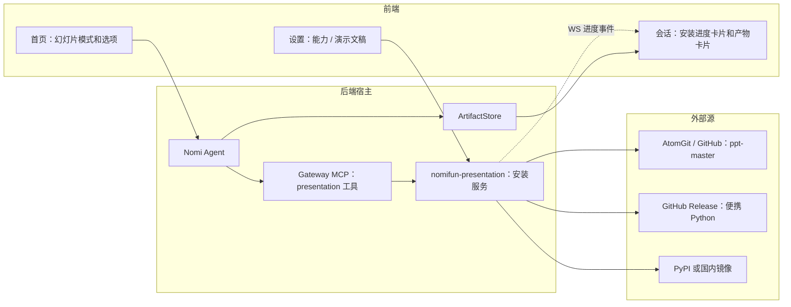
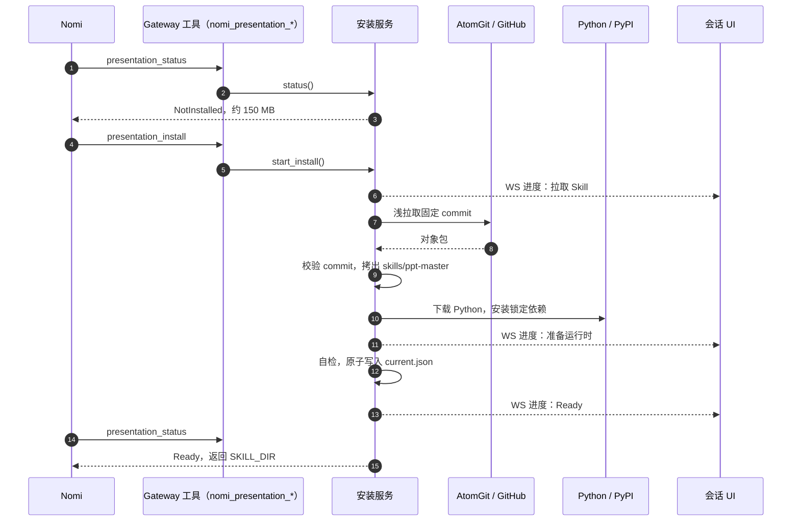
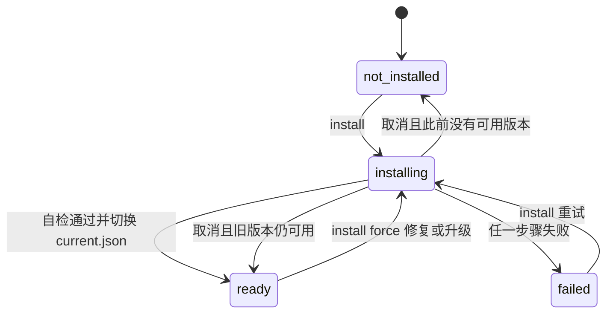

# PPT Master 演示文稿能力集成 · 技术方案

> **状态**：🚧 实施中（P0、P2b、P3 已完成；P1、P2a 代码完成，真实下载和运行 Python 的端到端测试待执行）
> **核心原则**：下载、安装和脚本执行只由后端完成；ppt-master 按固定 commit 从源仓库拉取，原样保留；Python 只用 Flowy 私有的便携运行时，不碰用户系统环境。

---

## 1. 背景与核心痛点

### 1.1 业务背景

用户在 Nomi 会话里生成可编辑的 PPTX。ppt-master（[hugohe3/ppt-master](https://github.com/hugohe3/ppt-master)，MIT）是一套成熟的 Skill：模型先写 SVG，再由 `svg_to_pptx` 转成原生 DrawingML 形状。它包含约 340 个 Python 脚本，依赖 `python-pptx`、`skia-pathops`、`uharfbuzz` 等包。Flowy 只使用 Nomi Agent，用户无法切换到其他 Agent。

### 1.2 现状与痛点

现状是 `crates/backend/nomifun-app/src/presentation.rs`（未提交的 WIP）：

1. **依赖系统 Python。** `resolve_python()` 只在 PATH 里找 `python`，在 Windows 上会找到应用商店的空壳 `WindowsApps\python.exe`。用户的 Python 版本不可控，`skia-pathops` 和 `uharfbuzz` 没有对应的预编译包时，pip 会尝试在本地编译。
2. **安装流程不可靠。**
   - `status()` 查找解释器时少了一级 `venv/`，所以状态永远到不了 Ready，每次请求都会重装。
   - 没有并发锁。
   - 先删掉正在使用的快照，再复制新的。
   - 失败状态不落盘。
   - 下载在 HTTP 请求里同步执行，没有进度和代理。
   - codeload zip 的字节不保证稳定，固定的 SHA-256 早晚会失配。
   - 依赖列表缺 `flask`。
   - 自检导入的是 `skia_pathops`，实际模块名是 `pathops`。
3. **Agent 用不上。** Skill 目录不扫描 `capabilities/`，Agent 找不到 ppt-master。也没有限定"用私有解释器运行快照里的脚本"的执行通道。

### 1.3 能力对比

| 维度 | 现状 | 本方案目标 |
|---|---|---|
| Python | 用户系统 Python | Flowy 私有便携 Python 3.12，固定 SHA-256 |
| ppt-master 获取 | codeload zip + SHA-256 | git 浅拉取固定 commit：先 AtomGit，后 GitHub；校验 commit |
| 依赖 | `>=` 版本范围，不校验哈希 | 按平台生成的锁定文件，`--require-hashes --only-binary=:all:` |
| 安装可靠性 | 无锁，不能回滚，无进度 | 互斥锁、版本化目录、原子切换、进度推送、可取消 |
| Agent 接入 | 无 | Skill 目录新增 `capability` 来源，Gateway 提供 `presentation_*` 工具 |
| 安装包体积 | 不变 | 不变，所有内容在首次使用时下载 |

---

## 2. 方案全景与架构设计

### 2.1 端到端拓扑



### 2.2 目标与非目标

**目标**

- 后端安装器：拉取固定 commit 的 ppt-master，下载便携 Python，用锁定文件安装依赖，自检后进入 Ready。
- Nomi 发现能力未安装时，自己调用安装工具，会话里显示进度。
- Nomi 只能通过后端工具，用私有解释器运行快照里的脚本。
- 首页提供幻灯片模式和选项，预先回答 ppt-master 第一轮确认要问的问题。

**非目标**

- 不支持 Nomi 以外的 Agent（产品上本来就只有 Nomi）。
- 不把 ppt-master 或 Python 打进安装包。
- 第一版不自建镜像或 OSS 托管。
- 不集成 ppt-rs（POC 结论：只能覆盖基础生成，见 `poc/ppt-rs/RESULTS.md`）。
- 第一版不做旁白、视频导出和动画音效。
- 不实现 Windows 上的命令级沙箱。

### 2.3 架构不变量

1. **下载地址、commit、哈希都由后端固定。** Agent 调用的工具不接收 URL、包名或解释器路径。
2. **不修改快照里的任何文件。** ppt-master 每次运行都会先跑 `attribution_guard.py` 做完整性检查。
3. **`current.json` 只在自检通过后原子切换。** 状态切到 Ready 之前，旧版本快照一直可用。
4. **同一时间只允许一个安装任务，** 进程内用互斥锁，跨进程用目录锁。
5. **所有子进程都通过 `ProcessSupervisor` 启动**，遵守 process runtime boundary 检查。

---

## 3. 核心设计与模块规范

### 3.1 模块划分

| 模块 | 职责 |
|---|---|
| `crates/backend/nomifun-presentation`（新） | 安装服务、状态计算、git 拉取、运行时准备、自检、HTTP 路由 |
| `nomifun-api-types::presentation`（新） | HTTP DTO：状态视图、安装请求、进度事件 |
| `nomifun-app` | 只负责组装：创建服务，挂载路由，套上实例所有者鉴权 |
| `nomifun-gateway`（P2） | 注册 `presentation_status`、`presentation_install`、`presentation_run_script` |
| `nomifun-extension`（P2） | Skill 目录新增 `capability` 来源 |

拆出独立 crate 的原因：`nomifun-app` 依赖 `nomifun-gateway`、`nomifun-extension` 和 `nomifun-ai-agent`（`nomifun-app/Cargo.toml:269, 272, 297`），反向依赖会形成循环。P2 中 gateway 和 extension 都要调用安装服务，所以服务不能放在 `nomifun-app` 里。

### 3.2 安装来源与校验

| 组件 | 来源（按顺序尝试） | 校验 | 实测或估算大小 |
|---|---|---|---|
| ppt-master 6.8.0 | `https://atomgit.com/hugohe3/ppt-master.git`，然后 `https://github.com/hugohe3/ppt-master.git` | 浅拉取 commit `4a68cddaf40dc87891e6b64c6a69ef46adc1110c`，拉取后再比对 commit | 下载约 53 MB；保留的 `skills/ppt-master` 约 40 MB |
| Python 3.12.16 | python-build-standalone `20261026` 的 `install_only_stripped` 包：先 GitHub Release，后 npmmirror 镜像（`FLOWY_PYTHON_DIST_BASE_URLS` 可覆盖） | 每个平台固定大小和 SHA-256（`manifest::PYTHON_BUILDS`） | 22–35 MB（Windows x64 22.0 MB，Linux x64 34.5 MB）；解压后 63–98 MB |
| 依赖包 | 先用用户自己的 pip 配置（默认官方 PyPI），失败后改用阿里云镜像 | `locks/requirements-core.lock.txt`：16 个包，固定版本和哈希，`--require-hashes` | 约 30 MB |

说明：

- AtomGit 的压缩包下载地址返回的是网页，不是文件，所以只能用 git 协议拉取。
- 已验证在 git protocol v0 下也能按 commit 拉取，libgit2 只支持 v0/v1，因此这一点很关键。
- 固定的 `4a68cdd` 是 `v6.8.0` 标签（`5e8856b`）之后 main 分支上的 commit，SKILL.md 里的版本号仍是 6.8.0。
- AtomGit 是镜像，同步比 GitHub 慢。升级 ppt-master 时，要等 AtomGit 同步到目标 commit。

### 3.3 磁盘布局

```text
<data_dir>/capabilities/presentation/ppt-master/
├── current.json                         # 当前生效版本，原子写入（含 python_id）
├── install-state.json                   # 最近一次安装的结果：失败原因，或 cancelled
├── .install.lock                        # 跨进程目录锁
├── .trash-*/                            # 卸载时改名待删的目录，下次安装前清掉
├── python/
│   └── 3.12.16-20261026-<sha12>/        # 便携 Python，带 .flowy-python-ready 标记
└── snapshots/<ver>-<commit12>-<nonce>/
    ├── skill/                           # skills/ppt-master 原样拷贝
    ├── venv/                            # 由上面的 Python 创建的私有依赖
    └── runtime-ready                    # 自检通过标记
```

便携 Python 放在能力目录下，而不是全局的 `runtime/`：现在只有这一个能力用它，卸载时可以一起删掉。清理旧快照时，当前和上一个快照引用的 Python 都会保留。

### 3.4 安装时序



### 3.5 状态机

`status` 只有四个取值，安装进行到哪一步由 `stage` 字段表示。现在还没有前端调用这个接口，所以可以直接调整枚举。

| `status` | 含义 | 由什么决定 |
|---|---|---|
| `not_installed` | 没有 `current.json` | 磁盘状态 |
| `installing` | 有一个安装任务正在运行 | 内存中的任务句柄 |
| `ready` | `current.json` 指向的快照有 SKILL.md，解释器存在，并且有 `runtime-ready` 标记 | 磁盘状态 |
| `failed` | 最近一次安装失败，或已安装的快照损坏 | `install-state.json` 或磁盘检查 |

`stage` 只在 `installing` 时出现，依次是 `fetching_skill`、`preparing_python`、`installing_dependencies`、`self_test`、`committing`。



### 3.6 接口

| 接口 | 作用 | 阶段 |
|---|---|---|
| `GET /api/presentation/capability/status` | 返回状态、阶段、版本、来源、预计下载量和失败原因 | P0 ✅ |
| `POST /api/presentation/capability/install` | 参数 `{ force }`。立即返回 `accepted`，安装在后台进行 | P0 ✅ |
| `POST /api/presentation/capability/cancel` | 请求取消，立即返回 `cancelled`。当前步骤（git 拉取、下载、pip 进程）在下次检查时停止，半成品快照被删除；结果回到 `not_installed` 或原来的 `ready`，不记为失败 | P1 ✅ |
| `DELETE /api/presentation/capability` | 卸载 Skill、venv 和便携 Python。安装进行中返回 409 `PRESENTATION_CAPABILITY_BUSY` | P1 ✅ |
| WS 事件 `presentationCapability.status` | 载荷就是 `status` 接口的 view。开始、结束、取消、卸载时各推送一次；安装中每 500 ms 检查一次，有变化才推送。实例级事件，发给实例所有者 | P1 ✅ |

`progress` 只描述当前阶段，切换阶段时清零：拉取 Skill 时填对象数，下载 Python 时填 `received_bytes`/`total_bytes`。

错误码：

- 请求格式错误返回 400。
- 已经有安装任务在运行时，返回 200 和 `accepted: false`。
- 后台安装失败不影响 HTTP 返回值，失败信息记录在 `status.failure` 里。

### 3.7 Agent 接入（P2）

P2 分两步：P2a 是 Gateway 工具和脚本运行，P2b 是 Skill 目录接入。两步都已完成。

1. **Gateway 工具**（`nomifun-gateway/src/caps_presentation.rs`，域 `presentation`，只对实例所有者开放）。名字按 Gateway 的 `nomi_<域>_<动作>` 约定：

   | 工具 | 参数 | 行为 | IM / Remote |
   |---|---|---|---|
   | `nomi_presentation_status` | 无 | 返回状态和下一步提示；就绪时附带 `usage`（见第 3 条） | 允许 |
   | `nomi_presentation_install` | 无 | Nomi 发现未安装时自行调用，后端从固定来源后台安装，立即返回 | 拒绝 |
   | `nomi_presentation_run_script` | `script`、`args`、`cwd`（可选） | 见第 2 条 | 拒绝 |

   `presentation` 加进了 `work` 档（Nomi 主会话默认用这一档），没有加进 IM 用的 `lite` 档。Gateway 和 HTTP 接口共用同一个 `PresentationCapabilityService`（放在 `ModuleStates.presentation`），所以 Nomi 触发的安装和设置页看到的是同一个安装任务。

   **安装完成后自动继续：** `nomi_presentation_status` 新增可选参数 `wait_seconds`（上限 60 秒，低于 MCP 默认 90 秒请求超时）。安装进行中带上它时，工具会在后端等待安装结束或超时再返回（`PresentationCapabilityService::wait_until_settled`，每 500 ms 检查一次）。`next` 提示要求 Nomi 不结束本轮回复，重复带 `wait_seconds=60` 调用直到状态变化，就绪后在同一轮里继续制作；失败时说明原因并只重试一次。这样首次安装（约 120 MB，可能要几分钟）不需要用户再发一条消息。

   **设置页只在开发者模式显示：** 正常使用由 Nomi 自动安装，`presentation` 加入 `DEVELOPER_GATED_TAB_IDS`，设置导航只在开发者模式下列出它；会话里安装失败提示的"详情"按钮也只在开发者模式下显示。路由 `/settings/presentation` 保留，和 `cloud-login` 的做法一致。

2. **`nomi_presentation_run_script`：**
   - `script` 是 `SKILL_DIR/scripts/` 下的相对路径，接受 `scripts/`、`${SKILL_DIR}/scripts/` 前缀；必须以 `.py` 结尾，不能含 `..`，解析后必须仍在 `scripts/` 里。ppt-master 文档里引用了 48 个脚本，固定清单很难维护，所以按目录限制，而不是按清单。
   - 拒绝 `confirm_ui/`、`svg_editor/`、`spec_review/`：它们会启动本地网页等待浏览器操作，Flowy 里改为在对话中确认。
   - 解释器固定用快照的 venv；工作目录是会话工作区，或工作区内的 `cwd`；超时 30 分钟；输出保留最新的 64 KB。返回 `exit_code`、`timed_out`、`output`、`truncated_bytes`。
   - 重新安装进行中也可以运行：当前快照只会被原子替换，上一个快照会保留。
3. **使用约定（`usage`）：** 状态为 `ready` 时，`nomi_presentation_status` 返回一段说明，代替原计划的"会话预设指令"，因为它在 Nomi 真正需要时才出现，不依赖首页入口：
   - `SKILL_DIR` 的绝对路径；先读 `SKILL.md`，按它的加载顺序读文档。
   - 只能通过 `nomi_presentation_run_script` 运行脚本，不要在 shell 里直接调用 python。
   - 项目建在工作区的 `projects/<名称>/`（ppt-master 的 `project_manager.py init` 在工作区外运行时的默认位置），成品在 `projects/<名称>/exports/*.pptx`。原计划的 `presentations/<名称>/` 改为沿用 ppt-master 自己的约定。
   - 所有 ⛔ BLOCKING 确认在对话里完成。
4. **Skill 目录（P2b）：**
   - 新增来源 `capability`，Skill ID 为 `capability:presentation:ppt-master`。`nomifun-extension` 调用 `nomifun_presentation::ready_skill(data_dir)`（只读磁盘，不启动安装）判断是否就绪，只在 `ready` 时列出。
   - Nomi 加载它时，在 SKILL.md 的 frontmatter 后插入一段 Flowy 说明：`SKILL_DIR` 路径、文中的 `python3 "${SKILL_DIR}/scripts/x.py"` 一律改用 `nomi_presentation_run_script`、确认在对话里完成。frontmatter 仍在最前面，解析不受影响。
   - 重名：托管版就绪后，目录列表（Nomi 的 Skill 排序和前端选择器都用它）隐藏其他同名的 `ppt-master`。被隐藏的那份仍在磁盘上，设置页的 Skill 列表（另一个接口）照常显示、可删除，已经绑定它的会话按原 ID 照常加载。快照损坏时托管版消失，原来那份重新出现。
   - 前端：来源类型加 `capability`，选择器显示它，来源标签为"Flowy 托管 / Managed by Flowy"。
5. **创建会话时不要设置 `allowed_tools`。** 只有它为空，Gateway 工具才会注入会话（`factory/nomi.rs:397-403`）。
6. **交付：** 生成的 PPTX 经 `ArtifactStore.verify_existing_path` 校验后，由 `useAutoPreviewOfficeFiles` 自动打开预览（P3 验证）。
7. **已知限制：** Windows 上没有沙箱，Flowy 也不检查 shell 命令的参数（`nomi-process-runtime/src/capability.rs:88-104`）。脚本以用户权限运行；如果 Nomi 绕开工具直接在 shell 里运行 Python，Flowy 拦不住。上面的路径限制是为了让调用可预期，不是安全边界。

### 3.8 前端（P3）

P3 先交付最小可用的三块，下面写的是已经实现的样子。

- **接口层：**
  - `ipcBridge.presentation`：`status`、`install({ force })`、`cancel`、`uninstall`，以及 WS 事件 `presentationCapability.status`。
  - `usePresentationCapability()`：先 GET 一次状态，之后跟随 WS 推送更新，同时提供 install / repair / cancel / uninstall 四个操作。设置页、会话提示、首页三处共用。
- **设置页**（`/settings/presentation`，挂在"能力"分组，图标 `Ppt`）：
  - 显示状态、当前阶段进度、最近一次失败原因、版本、固定 commit、下载来源、安装时间和 Skill 目录。
  - 操作：安装 / 重试；安装中可取消；就绪后可修复（`force` 重装）和卸载（`Popconfirm` 二次确认）。
  - 进度条是 2px 细线，只用 `transform: scaleX` 做动画，跟随 `prefers-reduced-motion` 关闭动画。
- **会话里**（`PresentationInstallNotice`，放在 Nomi 会话的 `GoalStatusNotice` 下面）：
  - 安装是实例级的，所以任何 Nomi 会话里都会显示：圆点、一行状态、阶段和进度，以及取消按钮。
  - 安装成功或取消后，提示保留 6 秒再消失；失败时一直显示，提供重试和"查看详情"（跳到设置页）。
  - 产物卡片（预览、打开、在文件夹中显示）没有单独做，沿用现有的 Office 文件自动预览。
- **首页入口**（只对 Nomi 显示）：
  - 底部工具栏的工作模式下拉里新增"幻灯片"，和"日常办公""代码开发"并列。它只是首页的本地状态，不写进全局保存的 `TaskProfile`（仍然只有 `office | coding`）；选"幻灯片"时工作模式按 `office` 处理。`/ppt` 斜杠命令也能切到这个模式。
  - 只有在幻灯片模式下，工作模式右侧才出现三个下拉：画布（ppt169 / ppt43 / xiaohongshu / moments / story / a4，都是 ppt-master 注册过的 ID）、页数（自动 / 5–8 / 10–15 / 20+）、出稿方式（快速出稿 = Quick 加 AI 自行确认，逐步确认 = Default 加对话确认）。输入框提示改为"描述你的演示文稿主题"。
  - 输入框里只放用户自己写的内容。发送时才在消息开头加一行 `[ppt-master] canvas=…; pages=…; route=…. Make this deck with the ppt-master Skill; call nomi_presentation_status first.`；托管版 ppt-master 已就绪时，同时带上它的 Skill ID。输入为空时不加，发送按钮保持禁用。
  - 托管版未就绪时不带 Skill，由开头那行提示 Nomi 先查状态，必要时自己安装。
- **暂不做（P4 以后）：** 首页展示卡片（需要配图素材）、风格 / 模板 / 配图 / 受众等高级选项、`extra.presentation_options` 落库、生成完成的产物卡片。
- **规范：** 新增文案放在 `presentation` 命名空间，`zh-CN` 和 `en-US` 两份都有；`check:i18n`、`check:theme` 通过；结构测试为 `PresentationSettings.structure.test.ts`，选项文本有单元测试 `slideOptions.test.ts`。

#### 3.8.1 首页"创建演示文稿"面板（P4a）

在上面的最小版基础上，补上"首页展示卡片"和"模板"两项。"新建空白演示文稿"不做：ppt-master 没有编辑器，它的 `svg_editor` 已被禁用。

- **入口：** 首页"创建"卡片改为按钮，点击后切到幻灯片模式，并在输入框上方展开面板。用下拉或 `/ppt` 进入幻灯片模式时也会展开。面板右上角的 × 只收起面板，不退出幻灯片模式；底部工具栏新增一个模板按钮，显示当前模板，点击可重新展开。
- **推荐主题：** 共 9 个，每次显示 3 个，"换一批"轮换。点击后把完整的提示写进输入框；如果风格还是"自由设计"，同时选上这个主题对应的风格（例如周报对应"极简"）。用户已经选了风格时不覆盖。
- **风格：** "自由设计"加上 20 个视觉风格（`slideThemes.ts`）。每个风格 = ppt-master 的一个 visual style（`references/visual-styles/_index.md`，共 18 个，全部用到）+ 一套固定配色 + 一种字体气质。ppt-master 的 visual style 只管形状、留白、装饰和字体气质，规定里不带任何颜色，所以配色由 Flowy 给；同一个 visual style 可以配不同颜色，例如"极简"和"深海"都是 `swiss-minimal`。名字是我们自己起的。缩略图是预先渲染的封面图（`presentation/covers/<id>.webp`，640×360）：每个主题一页 HTML 封面（`scripts/slide-theme-covers/themes/<id>.html`），按该主题的配色和 visual style 文件的规定设计，各配一个贴合风格的英文示例标题（中英文界面共用）；`bun scripts/slide-theme-covers/render.mjs [id…]` 用本机 Edge/Chrome 无头渲染。封面用的 Google Fonts（OFL）只在渲染时联网加载，不打包进应用；ppt-master 实际生成时字体由它自己按投放环境选择，所以封面表现的是风格方向，不是逐像素的生成结果。没有用 `templates/styles/`：那里是叙事方法（咨询决策、经营复盘等），不是外观，由 ppt-master 自己根据内容选择。
- **传给 Nomi：** 选了风格时，开头那行加上 `look=<id>: visual_style=<style> (references/visual-styles/<style>.md); colors background …, text …, primary …, accent …; typography …(user-chosen look, keep it)`。Quick 和 Default 都会优先采用用户给的颜色锚点，visual style 用目录里的 id，ppt-master 会读对应文件。自由设计时不加这个字段。
- **导入模板：** 选一个 PPTX、PDF 或图片，作为附件加入输入框（遵守附件的图片数量限制），开头那行写 `template=import "<文件名>" (attached; first run Create Template with project scope on it, then generate this deck from that workspace root)`。快照只读，不能写进 ppt-master 的模板库，所以用 project 范围，模板只在这个会话里有效，下次不会出现在模板列表里。移除附件或换选其他模板时，导入的选择和附件一起撤销。
- **代码位置：** `ui/src/renderer/pages/guid/presentation/` 下的 `SlideCreatePanel.tsx`、`SlideThemeThumbnail.tsx`、`slideThemes.ts`、`slideGallery.ts`；选择存在 `SlideOptions.template`。文案在 `presentation.create.*`。
- **配色：** 整个首页（参考 Manus）是浅灰底（`--bg-1` 与 `--bg-base` 按 7:3 混合），输入框、首页三张入口卡片、创建面板和推荐主题卡片用"浮起"表面色 `--flowy-raised`（亮色为白，暗色比底色浅一档）；卡片墙上的卡片是半透明的浮起色，被照亮时更白。只用主题变量，所以各个主题预设都跟着变。
- **卡片墙背景：** 面板展开时，首页内容隐藏，整页换成一面幻灯片线框卡片墙（`SlideCardWall.tsx`），只装饰，`aria-hidden`。卡片从底部中心向外依次淡入。约三成卡片静止时是空框，其余线框图几乎看不见；空框也各自藏着一张线框图，被照亮（悬停或环境闪烁）时才显出来，暗下去又变回空框，每次环境闪烁都会给空框换一张随机线框图。框线是 1px 浅色细线（10% 文字色）；照亮时框线最多加深到 14%，悬停卡片 16%。悬停：指针下的卡片放大 1.12 倍、换浅色底和轻阴影；周围约 2.6 格内的卡片按距离渐亮（框线略深、淡淡的底色、线框图显出来）。点击：卡片做翻转样式的切换，转到侧面时换成另一张线框图再转回（空框会换成有图的）；同时一道翻转波浪按距离扩散到整面墙（每格约 55ms）：附近约三圈（3.2 格内）的卡片完整翻转一次，有图的换一张图、空框保持空框，并随波峰短暂变亮；更远的卡片只轻轻横向收窄再展开（收窄幅度从约 12% 随距离衰减到 3%），不换图。翻转全部用 2D 的 `scale` 做（先压成一条线、换图、再展开），不用 `rotateY` / `perspective` / `backface-visibility`：整面墙同时做 3D 翻转、且连续点击让多道波浪叠加时，Chromium/WebView2 会因为同时存在的 3D 合成层太多而闪出黑块。环境闪烁：每 2.2 秒在墙上随机挑一处（避开面板正下方），约 1.8 格内的几张卡片缓慢亮起再淡出，持续约 4 秒。性能做法：线框是 24 个横版 SVG（卡片统一为横版，不再混入竖版），以 data URI 写成墙上的 CSS 变量，卡片用 `mask` 引用，每张卡只有两个 div、没有 SVG 节点，颜色跟随主题；悬停只在墙上写 `--px/--py` 两个变量（rAF 节流，不触发 React 渲染），每张卡用注册过的 `--wall-glow` 和 `hypot()` 在 CSS 里算亮度；波浪的翻转和收窄只动 transform，波峰亮度和环境闪烁用 Web Animations 只在附近卡片上动画注册属性 `--wall-ripple` / `--wall-ambient`，与悬停亮度用 `max()` 合成；翻转只动 transform，换图直接改 DOM 上的 `--pat`；墙用 `contain: strict`；页面隐藏时闪烁暂停。触屏不做悬停，`prefers-reduced-motion` 时去掉入场、翻转、波浪和闪烁，点击直接换图。
- **还没做：** 导入的模板跨会话保留（需要 Flowy 自己记录模板目录并在列表里展示）。

### 3.9 依赖维护

| 文件 | 生成方式 | 何时更新 |
|---|---|---|
| `requirements.in` | 手写。核心组：`python-pptx`、`lxml`、`XlsxWriter`、`Pillow`、`numpy`、`skia-pathops`、`uharfbuzz`、`PyYAML`、`flask` | 升级 ppt-master 或调整依赖分组时 |
| `lock-<platform>.txt` | `uv pip compile requirements.in --generate-hashes --python-version 3.12 --python-platform <triple>` | 同上 |
| 平台清单 | 写明 Python 下载地址和 SHA-256，以及 ppt-master 的 commit 和拉取地址 | 升级 Python 或 ppt-master 时 |
| CI 安装测试 | 每个平台从零安装一遍，然后跑自检 | 每次改动以上文件时 |

**不装的依赖：** `PyMuPDF`（AGPL 协议）、`google-genai`、OCR 相关的包。

---

## 4. 关键决策与权衡矩阵

| 编号 | 决策点 | 选定方案 | 放弃的替代方案与理由 |
|---|---|---|---|
| **D1** | 下载由谁执行 | **后端** | ❌ Agent 在 shell 里下载：有提示词注入风险；没有进度，不能取消，失败后容易留下装了一半的环境；还要占着会话等待 |
| **D2** | Python 从哪里来 | **私有便携 Python（python-build-standalone）** | ❌ 用户系统 Python：版本不可控，Windows 上有应用商店空壳，可能需要在本地编译。❌ 打进安装包：安装包会多出一两百 MB |
| **D3** | ppt-master 的获取方式 | **git 浅拉取固定 commit：先 AtomGit，后 GitHub** | ❌ codeload zip：字节不稳定，哈希会失配。❌ AtomGit 压缩包：地址返回的是网页。❌ 打进安装包：安装包增加约 22 MB，还要自己承担再分发的许可证义务 |
| **D4** | git 的实现方式 | **git2 加上 `https` + `vendored-openssl` feature** | ❌ 调用系统 `git` 命令：很多 Windows 用户没装 git。❌ gix + rustls：会引入大量新依赖。`https` 让 Windows 走 WinHTTP、macOS 走 SecureTransport；`vendored-openssl` 让 Linux 静态链接 OpenSSL，CI 不必再装 `libssl-dev` |
| **D5** | Python 依赖的托管 | **官方 PyPI 加锁定哈希，可切换国内镜像** | ❌ 自建 OSS：要维护，而且自己转发属于再分发 |
| **D6** | Python 的下载来源 | **先 GitHub Release，失败后用 npmmirror 镜像** | 两处的文件完全相同，都用固定的 SHA-256 校验。如果两处都经常失败，再考虑放到自己的 OSS 上 |
| **D7** | 何时触发安装 | **Nomi 发现能力未安装时，自己调用 `presentation_install`** | ❌ 首页弹出安装卡片，让用户确认：多一步操作。安装工具不接收任何参数，Nomi 自己触发也是安全的 |
| **D8** | 代码放在哪里 | **新建 crate `nomifun-presentation`** | ❌ 留在 `nomifun-app`：gateway 和 extension 引用不到，反向依赖会形成循环 |
| **D9** | 支持哪些 Agent | **只支持 Nomi** | 产品上只有 Nomi |
| **D10** | 品牌模板和 logo | **原样保留** | 快照不修改；删掉文件会让完整性检查失败 |
| **D11** | ppt-rs | **不在本次范围内** | POC 只覆盖了文本、形状和表格，不能替代 ppt-master 的 SVG 转换流程 |
| **D12** | 确认方式 | **在对话里确认，或交给 AI 决定** | ❌ confirm_ui 浏览器确认页：会话外多出一个窗口。`flask` 仍然要装，因为 SVG 编辑器等脚本也依赖它 |

---

## 5. 验收标准与验证矩阵

### 5.1 验收用例

| 编号 | 操作 | 预期结果 |
|---|---|---|
| **TC-PM-001** | 全新环境下调用 install | 状态依次为 `installing` → `ready`；`current.json` 指向 `snapshots/6.8.0-4a68cddaf40d/` |
| **TC-PM-002** | `ready` 之后再次调用 install（不带 force） | 直接返回 `ready`，不重新下载 |
| **TC-PM-003** | 同时发出两个 install 请求 | 只有一个返回 `accepted: true` |
| **TC-PM-004** | AtomGit 不可用 | 自动改用 GitHub，安装成功 |
| **TC-PM-005** | 拉到的 commit 和固定值不一致 | 安装失败，`current.json` 不变 |
| **TC-PM-006** | 安装中途失败 | 原来可用的版本仍然可用；没有残留的 `.staging-*`；失败原因写进 `install-state.json` |
| **TC-PM-007** | Windows 上只有应用商店空壳 python.exe | 不查找系统 Python，只用私有 Python，不受影响 |
| **TC-PM-008** | 运行自检 | 能导入 `pptx, lxml, xlsxwriter, PIL, numpy, pathops, uharfbuzz, yaml, flask`；`attribution_guard.py` 返回 0；`Presentation()` 成功；`svg_to_pptx.py --help` 返回 0 |
| **TC-PM-009** | 在没装 Python 的干净 Windows 上，用中文用户名安装 | 安装成功（P1） |
| **TC-PM-010** | Nomi 会话中，能力未安装 | Nomi 调用 `nomi_presentation_install`，轮询 `nomi_presentation_status`，安装完成后按 `usage` 继续生成（P2a；会话进度卡片在 P3） |

### 5.2 验证顺序

1. `cargo test -p nomifun-presentation`
2. `cargo test -p nomifun-api-types`
3. `node scripts/check-process-runtime-boundary.mjs`
4. `cargo check --workspace`
5. P3 阶段：`bun run typecheck && bun run check`
6. 手动端到端测试：Windows、macOS 两种芯片、Linux；开代理和走国内镜像各测一次；中途断网后重试

---

## 6. 实施阶段与进度

| 阶段 | 内容 | 状态 |
|---|---|---|
| **P0-1** | 新建 `nomifun-presentation` crate，把 DTO 移到 `nomifun-api-types` | ✅ 完成 |
| **P0-2** | git2 加上 `https` feature；Linux 用 `vendored-openssl` 静态链接，CI 不装 `libssl-dev` | ✅ 完成 |
| **P0-3** | 改为用 git 按 commit 拉取，先 AtomGit 后 GitHub；修复第 1.2 节列出的问题；安装改为后台任务并加锁；版本化目录，原子切换 | ✅ 完成 |
| **P0-4** | 补测试；清理 `nomifun-app` 中的 BOM（实测是 CRLF 与尾部空行，不是 BOM） | ✅ 完成 |
| **P1** | 便携 Python、锁定文件、镜像回退、WS 进度推送、取消和卸载、完整自检 | ✅ 代码和离线测试完成；真实下载并运行 Python 的端到端测试待执行 |
| **P1-CI** | CI 里跑一次真实安装（三平台） | 待定：每次约 120 MB 下载，需要决定触发条件 |
| **P2a** | Gateway 工具（status / install / run_script）、使用约定、加入 `work` 档、与 HTTP 接口共用服务 | ✅ 代码和测试完成；真实脚本运行测试待执行 |
| **P2b** | Skill 目录接入 `capability` 来源、重名处理、加载时插入 Flowy 说明、前端来源类型和文案 | ✅ 完成 |
| **P3** | 设置页、会话安装提示、首页"幻灯片"工作模式和三项选项 | ✅ 完成（最小可用版，见 §3.8 的"暂不做"） |
| **P4** | 应用内确认卡片、旁白和视频导出、创建模板、资料导入组 | 以后再做 |
| **P4a** | 首页"创建演示文稿"面板：推荐主题、视觉风格、导入模板（会话内有效），见 §3.8.1 | ✅ 前端完成；导入模板的端到端测试待执行 |

---

## 附录：调研记录 (Research Notes)

> 以下是方案讨论期间实际测得的数据，供后续核对。

- **AtomGit 可用性（2026-11-05）：**
  - `git ls-remote https://atomgit.com/hugohe3/ppt-master.git` 的 HEAD 为 `4a68cdd`。
  - `git clone --depth 1` 用时 27 秒，`.git` 目录 53 MB，加上展开的文件共 152 MB。
  - `git -c protocol.version=0 fetch --depth 1 origin <commit>` 成功。
  - 同一时间 GitHub 的 HEAD 为 `f363377`，比 AtomGit 新。
  - 标签 `v6.8.0` 指向 `5e8856b`。
- **AtomGit 压缩包地址：** `/archive/<sha>.zip` 和 `/-/archive/...` 都返回 `text/html`；`/api/v5/.../zipball` 返回 404。
- **ppt-master 大小**（`skills/ppt-master`，不含 `__pycache__`）：
  - 原始 40 MB，约 1.3 万个文件，zip 压缩后 21.8 MB。
  - 图标 10.3 MB，共 12,027 个 SVG，其中 `simple-icons` 品牌 logo 3,675 个。
  - 音效 12.5 MB，共 186 个 WAV，CC0 协议。
- **git2 现状：**
  - 原先根目录 `Cargo.toml:218` 为 `default-features = false`；`Cargo.lock` 中 `libgit2-sys 0.18.7+1.9.6` 只依赖 `libz-sys`，不支持 https 传输。
  - P0-2 已改为 `features = ["https", "vendored-openssl"]`，`Cargo.lock` 中随之出现 `openssl-src`，Linux 静态链接。
  - `market_source.rs:645` 的 `clone_git` 用的是同一个 git2，测试只覆盖本地仓库（`:1060`）。市场源的 https 克隆应该随这次 feature 变更一并修好，需要单独回归确认。
- **CI：** `.github/workflows/ci.yml` 中 Linux 构建安装的 apt 包没有 `libssl-dev`；因为改用 `vendored-openssl`，不需要补这个包，但 Linux/CI 构建需要实际验证一次编译时间和成功率。
- **P0 实测（Windows 11，2026-11-05）：**
  - `cargo test -p nomifun-presentation -p nomifun-api-types` 全绿：单元 11 个，集成 12 个通过、2 个 `#[ignore]` 网络用例。
  - 真实 AtomGit 浅拉取：`git2` + `https` 按 commit `4a68cdd` 成功，`53,120,715` 字节，耗时 `36.44s`，树 `031a2b811b191308f6d002c090154670f0b0a474`。
  - 真实完整安装（P0 版本，用系统 Python 3.11.14）到达 `Ready`，耗时 `122.83s`。
- **P1 调研（2026-11-05）：**
  - python-build-standalone 最新 release `20261026`，CPython 3.12.16。GitHub API 匿名请求会被限流，哈希取自 release 里的 `SHA256SUMS`。
  - 下载 Windows x64（22,014,416 字节）和 Linux x64（34,505,639 字节）两个包，SHA-256 与 `SHA256SUMS` 一致。npmmirror 返回的大小相同。
  - Windows 包只有 3,348 个普通文件；Linux 包有 3,487 个文件和 1,049 个符号链接，没有硬链接，链接目标都是 `name` 或 `../x/y` 形式。两个包都通过了解压规则检查（`real_archive_layout_passes_the_rules`）。
  - `uv pip compile --universal` 锁定 16 个包。Windows x64、macOS 两种芯片、Linux 两种架构都能只用 wheel 安装；Windows ARM64 不行，因为 `skia-pathops` 0.9.2 没有 `win_arm64` wheel，所以 Windows ARM 改用 x64 Python 在模拟层下运行。
  - `https://mirrors.aliyun.com/pypi/simple/` 可以访问。
  - `cargo check -p nomifun-app` 退出码 0，仅有其他 crate 的既有警告；`node scripts/check-process-runtime-boundary.mjs` 通过。
- **confirm_ui：** `scripts/confirm_ui/server.py:50` 需要导入 `flask`。
