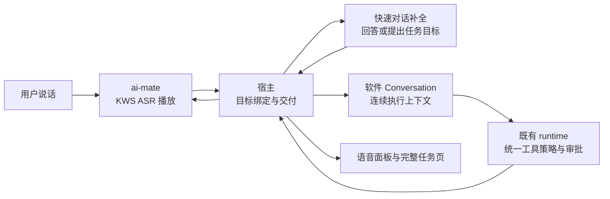
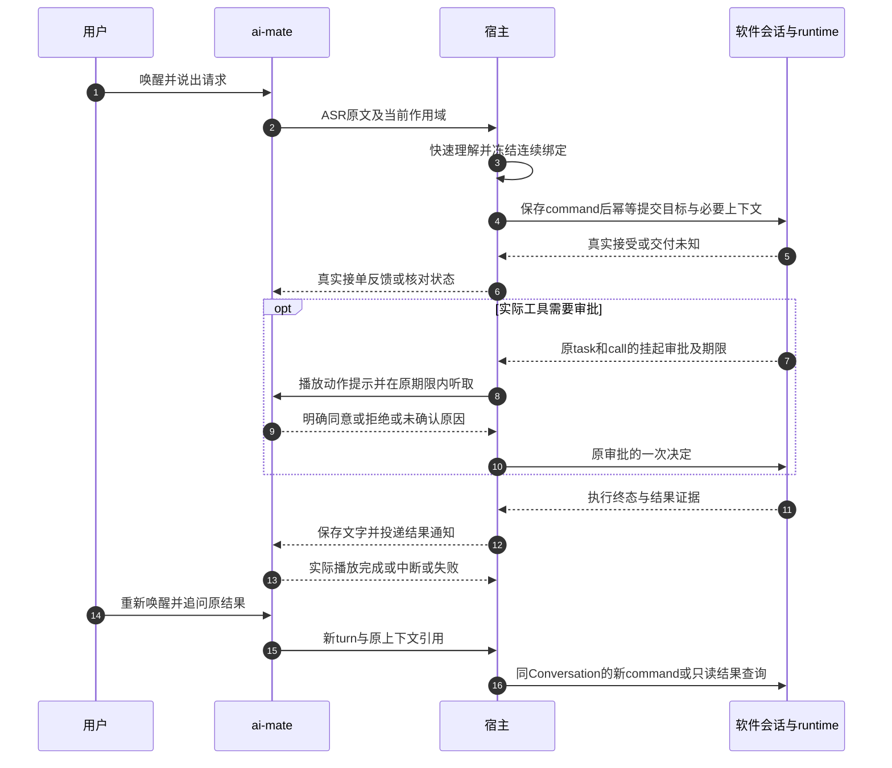

# 语音伴侣 v0.3 · 连续任务、低打断授权与可靠播报 PRD

> **实施状态补记（2026-10-20）**：部分需求已在 `10a1628ab` 落地；当前行为、验证结果和未达边界见[代码事实快照](execution/current-implementation-status.zh.md)。下方“待实施 / 本轮仅文档 / ecfd82b dirty”为撰写初稿时的历史信息，不表示现时全部未实施，也不表示本 PRD 已全量验收。权限规范仍以 §7.2 修订为准。

> **2026-10-20 权限决策修订**：经进一步核对普通会话的模式保存/新建链路，本版权限以§7.2开头的修订规则为准：语音复用软件现有模式解析，允许用户偏好或明确当前上下文解析为 `yolo`，不固定 `default`，也不无条件指定 `yolo`。下文初稿中“default加白名单作为固定默认”等表述保留为决策历史，已由本修订取代；无需新增权限模式字段。

> **状态**：📋 待实施产品方案；本轮仅核对日志、代码和外部经验并形成文档，不修改业务代码或实际权限。
> **日期**：2026-10-20。
> **核心原则**：语音负责快速交互；软件现有 Conversation/runtime 执行任务；公开查询流畅完成，实际副作用有明确授权；每项状态与声音均有事实依据。
> **版本关系**：继承 [v0.1](PRD-voice-companion.zh.md) 的产品范围、VC/AC 与 [v0.2](PRD-voice-companion-v0.2.zh.md) 的声音规则、AF/AF-AC；本版只修订本文列出的冲突决策，未提及的门禁继续有效，不能借新版降低旧指标。
> **实施基准**：`feat/xiaozhi-voice`，HEAD `ecfd82b23016b31a1b080c4a1e0f3164c9d06fdd`，有未提交改动。日志来自 Windows debug 1.6.1、同 SHA 且 dirty 的实际运行产物；dirty 标记不能证明运行产物包含当前全部未提交内容。
> **交付边界**：代码、自动验证、真实设备和 Owner 验收分别记录。本文件不表示功能已经完成或已获实施/发布授权。

## 1. 摘要

语音伴侣已获得用户对 KWS→ASR→LLM→TTS 及 runtime 任务链路的定性试用反馈。下一阶段重点是让用户连续办完一件事：搜索不反复授权、跨唤醒追问不断上下文、确认没听清可恢复、长任务和播报失败都有准确反馈。

**权限结论：不新增 `voice_permission_mode` 等第四种权限模式，不将语音任务统一设为 `yolo`。** 保留软件已有 `default / auto_edit / yolo`，通过现有工具级自动批准接缝，对可信、已验证的公开搜索与页面提取免逐次确认；实际写入、删除等仍遵守语音强制审批和软件权限边界。该工具白名单属于宿主执行策略，不由快模型、ASR 或前端决定。

**连续性结论：执行会话不再按每条任务新建。** 以合法当前上下文或默认语音入口关联可复用的软件任务 Conversation；已经打开该语音执行会话时，追问直接沿用它。每次新目标仍创建新的 command、message 和 runtime turn，不能复用旧任务身份重新执行。

## 2. 决策与验收职责

- 产品方向、真人麦克风/扬声器体验及最终验收由用户决定。
- 实施者按本 PRD 串行执行，维护证据和差异；不得自动修改用户权限、推送、发布或合并。
- 本轮决策为建议基线，供用户交给其他实施者；当前既有实现和文档正文完整保留。

## 3. 背景与事实基线

### 3.1 本机日志核对

日志根目录为 `D:/tmp/flowy-dev`，不是默认安装目录。本轮只读取宿主日志、daemon 日志、三个执行会话的观测事件及现有语音交付/对话记录；未读取密钥、未改数据库、未启动应用或发起付费模型请求。时间表统一为 Asia/Hong_Kong（UTC+8）；JSONL 原始时间为 UTC。

| 证据 | 实际记录 | 结论与局限 |
| --- | --- | --- |
| L1 模式 | 宿主 `2026-10-20.nomicore.log` 行285、458、704：三个任务初始化均为 `session_mode=default` | 不是当前任务已经全自动；尚不能据此推断用户打开的其他会话是什么模式 |
| L2 天气任务 | `01a15704-bbc3-7d11-ab33-5b32604013ad`：09:54:50–09:56:22，约91.7秒；两个搜索分别约24.2秒、23.1秒后报 `User denied`；`web_extract` 被报 `voice_tool_unsupported`；命令路径被报不支持 | 四次工具调用全失败。拒绝记录没有足够信息区分明确拒绝、ASR不清及其他撤销，不能把它们全部归因于用户主动拒绝 |
| L3 新闻任务 | `01a15706-f519-79b2-a55b-666e1ff2eeec`：09:57:16–09:59:03，约106.8秒；前两次搜索工具主体约2358ms、700ms，所在批次墙钟约45543ms；第三次搜索约29143ms后拒绝 | 短工具耗时不代表端到端快；审批/排队等非工具主体等待明显。现有字段不能把全部差额精确归为审批等待 |
| L4 详情追问 | 10:01:19有效ASR“刚刚的新闻再详细播报一下”，10:01:23新会话 `01a1570a-b836-7272-aca8-cb3fb3fd0d8b` 启动；前台记录仍属同一个默认语音Conversation | 距上一请求约4分钟已换执行会话。交付只带当前原文、理解、目标和时间，未附原新闻结果/来源；目标被改写为“检索最近一条新闻” |
| L5 详情运行 | 新会话尝试在文件/记忆路径寻找上下文，遇到不支持命令及越界，随后转为新一轮搜索；约42.9秒后 cancelled；宿主有对应 `/cancel` POST 200 | 可证明收到取消及运行取消终态；不能进一步推断谁点击或为何取消，也不能把失去上下文简单归结为权限不足 |
| L6 播报 | daemon日志 `ai-mate-1792461181882.log` 行251、260，10:01:24和10:01:40：`edge_tts_handshake_rejected status=429` | 该次确有上游限流；不说明所有声音故障都是429。不能通过放开runtime权限修复TTS |
| L7 结果语义 | 天气任务持久记录 `completed/result_ok=true`，文本却说明没有拿到实时天气；新闻也有部分搜索失败 | runtime正常结束不等于用户目标完成，播报不能只按runtime终态说成功 |

本地可复核摘要与七个来源文件指纹：`target/voice-review/prd-2026-10-20/evidence-summary.json`。该文件不作为跨机器唯一依据；关键事件定位已写入上表和附录A。日志是实测运行证据，不能替代本版修复后的回归。

### 3.2 当前调用链及具体断点

| 层次 | 已核对代码 | 当前行为与本版调整 |
| --- | --- | --- |
| 会话创建 | `voice_task_runtime.rs:99–110` | 每命令创建键对应新Conversation，固定 `session_mode=default`；调整为连续绑定和独立发送幂等 |
| 语音策略 | `voice_tool_policy.rs:92–115` | 允许 `web_search/web_fetch` 等，但漏掉实际注册的 `web_extract`；按真实注册能力对齐 |
| 通用审批 | `nomi-agent/src/tool_execution.rs:118–141` | `InvocationDecision::Allow` 不等于免通用审批；继续核对工具白名单和共享审批管理器 |
| 现成接缝 | `nomi-agent/src/engine/mod.rs:901–910` | `allow_named_tools` 同步引擎白名单和confirmer，可供宿主在可信工具装配完成后使用 |
| 模式 | `nomi-protocol/src/lib.rs:246–266` | default不自动批准分类；auto_edit批准info/edit；yolo批准全部分类。auto_edit也不是单纯的只读模式 |
| 强制审批 | `tool_execution.rs:128–129` | `RequireApproval` 先于auto_approve/白名单处理；保留这一顺序，不能为了搜索顺带取消写操作审批 |
| 口头确认 | `ai-mate/src/voice/confirmation.rs:60–81` | 一次ASR、少数完全匹配词，其余false；三态修复及原期限内澄清 |
| 工具可用性 | `nomi-agent/src/bootstrap.rs:869–877` | 生产注册 `web_search` 和 `web_extract`；模型可见能力必须与允许执行的能力相符 |

### 3.3 本版取代的历史决策

1. 取代 [2026-10-19方案](execution/runtime-dispatch-closure-plan-2026-10-19.zh.md) 中“每个接受的任务独立新建执行会话”的默认规则，改为每个连续上下文复用一个软件执行会话。
2. 补齐“前台语音记录复用”与“执行上下文复用”的区别；前者已经复用不能证明后者连续。
3. 新增30分钟**用户交互空闲后轮换默认连续会话**的产品规则；原有30分钟**单任务执行预算**继续独立生效。
4. 保留高风险操作单次审批，不把它扩大成“所有只读工具都必须逐次批准”；受信公开查询经宿主策略核验后免打断。
5. 旧文件的未接通、已修复、测试通过等均保留为当时记录，本版事实以本轮日志和对应证据为准。

## 4. 目标与成功标准

| 目标 | 本版验收口径 |
| --- | --- |
| 查询不中断 | 同一明确公开查询任务连续搜索3次并提取网页，应用级搜索审批请求为0；失败按原因反馈，不转向shell绕过 |
| 连续追问正确 | 固定“查新闻→第二条详情→重播”场景中，详情使用原来源；同一连续上下文conversation_id不变；重播不增加runtime执行 |
| 授权可恢复且不误放行 | 中文确认语料包含明确同意、否定、错识、静默、提示回声和旧审批；负样本实际副作用0；错识可在原预算内澄清 |
| 状态可信 | 目标未完成、审批待定、取消中、TTS限流、扬声器异常分别显示；不得靠completed推断目标完成，不靠生成完成推断播报完成 |
| 回归覆盖真实时序 | 生产worker/API/Conversation/runtime联合测试，加具有播放节奏与背压的输出；最后交Owner验证实际声学和跨唤醒流程 |

原先首音、准确率、窗口启动与72小时规程沿用各自门禁，本版不宣称通过。外部LLM和网络工具不能保证8秒内完成事实回答；8秒内的等待反馈必须诚实，不以固定套话冒充查询结果。日志将模型耗时、审批等待、工具执行及播放分别量化，优化前后使用同样样本、设备、模型和计时口径比较。

## 5. 用户与场景

| 用户群 | 要完成的事 | 本期约束 |
| --- | --- | --- |
| 在电脑附近但不看屏幕的人 | 查信息、听结果、继续问详情、必要时授权 | 麦克风有效距离内；声音要稀疏、准确；关窗不取消后台任务 |
| 正在软件会话里工作的人 | 用语音继续当前主题，查看完整任务和历史 | 不把焦点丢失当成切换目标，不向忙碌聊天并发插入执行消息 |

宠物是可选的人格/上下文入口，零宠物仍可使用语音。多宠物必须显式绑定，不自动挑选最近活跃宠物。Windows优先验收；Linux/macOS保留结构兼容、分别验证，不能用Windows证据代替。

## 6. 价值主张

| JTBD | 离屏使用者 | 会话中的语音使用者 |
| --- | --- | --- |
| Who | 在电脑旁做其他事的人 | 已使用软件Conversation安排工作的用户 |
| Why | 需要无需看屏幕就能判断是否听懂、是否在执行 | 需要语音沿用主题和权限，而不是再开一个无上下文聊天 |
| What before | 重复唤醒、重复确认，安静时不知道是否卡住 | 在多个同名“语音任务”之间寻找结果，重讲背景 |
| How | 低风险查询自动执行、真正副作用才确认、真实阶段反馈 | 固定连续绑定、必要上下文交付、同一软件会话的新执行轮次 |
| What after | 少被打断，可恢复错识；失败时知道下一步 | 详情指向原结果，历史可查，任务与输入通道解耦 |
| Alternatives | 看窗口、手动查询、改用键盘 | 在普通聊天中重新输入指令 |

价值主张：让语音成为现有软件会话的自然入口，用户可以连续办事；工具执行、权限和结果历史仍由软件负责。

## 7. 产品与接口方案

### 7.1 完整旅程与模块边界

1. 唤醒后选择并冻结合法上下文，显示“继续某会话”或“开始新语音会话”；保留现有6秒开口、30秒单句、播完4秒追问规则。
2. ASR原文立即显示，同一次快模型调用呈现理解和短回答/任务目标。快模型不执行工具，不决定权限或真实目标ID；不对每次状态提示增加模型请求。
3. 需要工具时，宿主将目标交给软件Conversation/runtime，真实接受后才播接单。交付不明核对原command，不换身份重发。
4. 任务运行时可休眠收音或继续聊天。查询/取消指向原任务；关窗和停止语音不自动取消任务。
5. 真正需要审批才提示具体操作，明确同意后一次执行；普通公开查询不来回确认。
6. 结果先保留完整文字，再播简短结论及可用下一步。详情、重播与新查询采用不同处理，继续沿用该上下文。

daemon拥有声学和播放；宿主拥有配置、绑定、交付、快照及通知去重；软件Conversation拥有持久历史；runtime拥有实际工具和唯一审批权威。后端到agent继续经过 `nomifun-ai-agent`；daemon不读取provider key或选择工具权限。文本补全与任务执行维持独立接口，本地模型替换不改变交付协议。

### 7.2 权限：复用模式，减少不必要确认

#### 当前决策：沿用软件模式解析，不固定某种模式

进一步核对发现：`AgentModeSelector.tsx:231–234` 在当前会话切换成功后调用 `savePreferredMode`；`agentSelectionUtils.ts:12–20` 将Nomi模式存为既有 `nomi.config.preferredMode`，其他引擎按各自配置保存；`useGuidAgentSelection.ts:432–495` 在新建入口优先读取有效偏好，无偏好时优先选择引擎支持的全自动模式，兼容旧配置及自然默认。这证明普通会话模式选择可以影响下一个同引擎会话，不是只能保留在当前聊天。

当前语音未复用这条规则：`voice_task_runtime.rs:108` 提供default，`nomifun-conversation/src/service.rs:5690` 又在可信语音创建分支强制覆盖为default。实施必须同时处理两处，不能只改请求中的字符串。

本版最终模式规则：

1. 继续已有执行Conversation时沿用其真实模式，不因每次唤醒重新按全局偏好覆盖。用户在该会话切换模式，依软件原机制生效。
2. 从明确、合法的当前会话创建关联语音执行子会话时，采用当前上下文明确的有效模式并显示来源；不能猜测最近任意会话。会话身份、工作区和模式来源共同校验。
3. 默认语音入口需要新建会话时，复用同引擎普通新建会话的模式解析：有效preferredMode、软件已有兼容与默认规则。已有偏好为yolo则允许创建yolo，为default则保留default，不另设voice权限模式或擅自覆盖用户选择。
4. 偏好保存失败不能承诺下次已经继承；无效值或跨引擎模式按软件已有校验与回退处理。不是直接把“值为空”手写成yolo。后端无renderer时也要能读同一份既有配置，不复制成第二份语音默认值。
5. 全局偏好改变影响下一次创建，不自动改变所有旧任务/会话。30分钟轮换后同样重新解析；新建和发送的幂等重放仍使用原已冻结配置，不借重试改变权限。
6. default/auto_edit中用经过验证的具体搜索/提取免确认改善体验；yolo中按软件统一自动批准规则执行。保留软件已有硬拒绝、工作区、网络和工具能力边界，yolo不等于提供原本不存在的工具。
7. 当前语音的 `RequireApproval` 优先于yolo，会导致即使模式继承成功也仍逐次审批。若目标是与普通软件yolo一致，实施时须同步对齐这一语音额外门禁：可由软件模式批准的调用不再另加同义语音弹窗；软件本身明确强制的确认/硬拒绝继续生效。不得只在UI显示yolo而实际始终采用default审批。该模式一致性要求取代本文初稿“语音所有写入/删除无论yolo均强制逐次确认”的默认决定。
8. 已经挂起或过期的审批不因切换模式自动复活；按既有运行时模式切换及挂起调用处理契约核对。模式变更事件、有效模式和审批原因可观察，不由LLM决定权限。统一审批仍只有ToolApprovalManager。

验收补充：当前会话改yolo→保存成功→同引擎普通新建与语音新建均解析yolo；用户降为default后，新建同步降级；旧会话不被全局偏好静默改动；两处default覆盖均移除或归入软件统一解析；无renderer、模式保存失败、无效/跨引擎值、轮换及幂等恢复均覆盖。实际工具验证default仍能按需审批，yolo不重复触发语音独有同义审批，硬拒绝和过期调用仍不执行。V3-AC-02/10的yolo断言以这些规则为准，不再断言全部语音写操作必须绕过用户模式强制弹窗。

以下模式表和“强制审批优先”的初稿段落保留为历史依据；如与上述模式一致性修订冲突，以上述修订为准。

#### 模式选择

| 选项 | 本版决策 | 原因 |
| --- | --- | --- |
| 新增语音专属权限模式/持久化字段 | 不采用 | 既有模式与工具级白名单足够，不增加第二套模式解释和配置迁移 |
| 所有语音任务统一yolo | 不采用 | 搜索免确认不需要批准所有分类；且仍不能解决语音前置硬拒绝、上下文和TTS限流 |
| 使用auto_edit减少搜索审批 | 不采用作为默认补丁 | 它还批准edit分类，范围超出只读查询诉求 |
| default加宿主核验的具体工具白名单 | 首版默认 | 复用现有 `allow_named_tools` 或等价既有装配接缝，保持统一审批 |
| 用户显式选择软件已有模式 | 保留已有入口 | 不由语音偷偷改为yolo；不得把其他会话的模式自动复制进新子会话。语音前置强制审批/硬拒绝仍生效 |

模式是软件已有配置；本版没有新的权限等级。连续绑定、审批判定原因、播放尝试等必要元数据不属于权限模式，不应混为一个字段。面板展示有效模式、免确认的已知查询能力以及语音仍要求确认的范围。

#### 决策顺序与操作范围

执行顺序保持：输入与作用域验证／硬拒绝 → 语音强制审批 → 可信具体工具免确认 → 软件现有模式与审批规则。不能将通用 `InvocationDecision::Allow` 全局改成自动授权，影响非语音调用方。

| 操作 | 默认行为 | 边界 |
| --- | --- | --- |
| 产品内置 `web_search`、`web_extract`，及实际装配的受信等价读取工具 | 参数和既有网络策略通过后免逐次确认 | 允许任务内关键词改写及交叉核对；不放开全部info/MCP分类，不允许同名未知工具冒充 |
| 工作区内既有允许的Read/Glob/Grep | 复用经过验证的工具级读取规则 | 路径、符号链接和工作区变化仍校验；不把整个磁盘作为默认范围 |
| ToolSearch等工具发现 | 沿软件已有规则允许发现 | 发现工具不代表授权调用所有发现的工具 |
| Write/Edit/ApplyPatch及受支持删除 | 提示具体路径与影响，单次审批 | 原根目录边界不因yolo、模型自报安全或口头“都同意”消失 |
| 任意shell、未知MCP、越界、登录后提交或外发 | 按软件现有能力及语音支持范围拒绝或明确审批 | 本期不扩大语音支持的通用命令范围，不为绕过网页读取失败改走shell |

免确认声明必须来自可信工具注册信息和实际参数检查，模型的工具名称/描述不能提供授权。按现有注册冲突、别名和provider路由规则解析，工具被替换/禁用时重新装配；不能凭字符串相同批准未知实现。公开页面工具的网络地址、重定向、响应限制继续由既有实现执行。

用户主动说出的公开搜索词可用于搜索；不能自动把工作区文件正文、凭据或会话隐私拼入外部查询。工具白名单不新增隐私内容外发权限，快模型和runtime交付只传任务必需上下文。

不新增“始终允许全部语音任务”。如将来确需批准一个有限批次的写操作，应另定义操作、路径、期限及撤销规则；本版仍为实际调用一次批准。普通会话已有“始终允许”行为不因本PRD修改，语音scoped审批继续禁止永久允许。

### 7.3 连续绑定与30分钟规则

必须区分前台归属、执行Conversation、单任务command和一次声学turn：

| 对象 | 生命周期 |
| --- | --- |
| 声学turn/session | 唤醒、录音、回答、追问、休眠；结束不清除软件连续绑定 |
| 前台归属 | 合法当前项目/显式宠物/默认语音入口；记录用户在哪里提出请求 |
| 执行Conversation | 相同连续上下文复用的软件子会话；持有先前消息、结果及工具历史 |
| command/runtime turn | 每次新目标独立，单次执行预算30分钟；重试原交付保持身份不变 |
| approval | 绑定实际任务、消息和call，有独立期限及一次授权 |

目标选择规则：

1. 用户明确追问某个先前结果，优先解析其已绑定执行Conversation；若与当前项目冲突或引用不清，说明目标并澄清。
2. 当前打开的就是本用户已绑定语音执行Conversation时，继续该ID，不再嵌套创建“语音任务”。
3. 当前打开普通项目/聊天时，将它作为上下文归属，复用与之关联的语音执行子Conversation。首版不直接向任意普通聊天注入执行消息；不添加永久voice标记或白名单改变该聊天之后的键盘权限。面板明确显示“在当前会话关联的语音任务中执行”，并提供双方链接。
4. 无明确当前目标时，复用默认语音入口的未过期连续执行Conversation；不存在才幂等创建。用户无需先创建宠物。
5. 候选当前会话必须由有效前台上下文给出并经宿主验证；不能枚举最近若干聊天猜工作区、模型、预设或权限。owner、workspace与scope无效即拒绝或澄清，不静默换到任意项目。

**空闲轮换**：默认语音连续绑定最后一次有效用户交互后满30分钟，下一条普通新请求创建新连续会话，旧历史保留。音量、心跳、等待提示及结果轮询不刷新用户空闲。有效审批回答也属于用户交互，但不能延长审批/任务自身deadline。

活动任务、待审批或取消未核实时固定原绑定；时间到不能把它切走。用户显式重新打开旧会话或明确追问旧任务，等于选择历史目标，不强制新建。自动恢复只核对已有映射，不自动发送；时钟回拨不能无限延长窗口，采用既有时间异常处理并留证。

**忙碌准入**：继续同一执行会话前检查普通发送准入，避免键盘与语音竞态。忙碌时可查询、取消、读取已存结果或重播；需要新执行的请求明确提示任务未结束，首版不隐式排队、不静默另建会话。一个活动语音任务约束继续保留。

工作区、owner或实际执行配置变化不能把旧绑定移植为新权限；保持原任务配置并核对，新的目标重新解析配置。云账号变化影响实际provider凭据和授权，不将本地文件环境解释为云电脑，也不默认取消已接受本地任务。

### 7.4 上下文交付与结果语义

新请求的 `command_id` 与发送幂等键独立；Conversation首次创建键属于连续绑定，不能继续与每条command一一绑定。同ID改目标冲突，历史交付记录不得被后续任务覆盖。发送响应丢失返回unknown并核对原回执，不换新键执行。

交付至少包括：ASR原文、理解的需求、真实目标、用户请求时间及明确时区、合法上下文归属、相关先前任务/消息引用、必要原结果或来源。已有Conversation可读取的历史不必整段重复；缺少可引用记录时附有界必要摘要，注明省略。外部网页和用户原文是数据，不能覆盖宿主策略或凭据规则。

- “再播一次”：读取已存结果，创建新的播放尝试；不调用runtime重做任务。事件去重不能吞掉用户主动重播。
- “刚刚新闻详细些／第二条详情”：解析原结果条目和来源；信息已足够可直接呈现/播报，需新检索则在同一执行Conversation建立新turn。不能把它改写成“随机搜索最新一条新闻”。多条指代不明时先问是哪条。
- 查询时间、星期等可从宿主已知请求时间直接回答；需要实时外部事实则派发runtime，不说“让我查一下”后停留在chat。
- runtime `completed` 只表示该轮结束。需分别表达目标已完成、部分完成、需要补充、被权限阻塞或尚未核实。依据实际工具和结果证据，不用LLM一句“成功”覆盖工具失败；已有可靠证据足够回答时也不因某个可选工具失败就一概判失败。
- 对“工具全失败且结果明确说未取得天气”的场景，呈现“本次查询未完成”，不能播Done或“已完成任务”。底层公开completed语义保持兼容，产品结果判定另作只读投影。

### 7.5 口头确认与恢复

| 结果 | 用户反馈 | 行为 |
| --- | --- | --- |
| 明确同意 | 已提交本次确认，等待执行侧校验 | 唯一审批管理器核对scope后一次执行 |
| 明确否定／暂缓 | 本次操作未获允许 | 拒绝该调用；不换工具重做同一被拒副作用 |
| 错识／无关句／歧义 | 没听清，请说“可以执行”或“不要执行” | 原窗口内有余量时澄清，不直接解释为拒绝或同意 |
| 静默／过期／停止／设备错误 | 未收到明确授权，操作未执行；可在任务页处理 | 保留不同原因，未授权不执行；不伪称用户主动拒绝 |

支持经过真实语料验证的自然肯定句；否定优先，“不同意”不能命中“同意”。“确aren”等混合错识先澄清，不能无界模糊匹配。ASR没有校准confidence时不得编造置信度；快LLM不能以自报confidence替代授权判定。

实际动作提示播完后开始听，累计最多8秒且受原执行侧授权剩余时间限制；澄清提示、ASR及重试消耗原预算，不重置deadline。提示未能播放则不默认批准；保留任务页一次允许/拒绝入口。旧窗口、旧轮次、错task、错msg、错call、重复或迟到批准均不执行。提示内容过长或影响无法口头准确描述时，引导任务页确认。

### 7.6 声音、等待与故障降级

沿用v0.2轻量声音反馈。唤醒、识别成功、追问开启、休眠和错误分别对应真实事件；不增加持续背景音。快模型等待沿用原有有界次数；后台长任务接单、待审批、完成按事实通知，用户询问时读真实进度，不定时编造“快好了”。

声学可以进入Idle而任务继续Running；等待音播完不能覆写task状态或误触发后台取消。任务进行期间的“本轮听取结束”与“任务结束”必须分开表述。音量快照不得清掉任务、审批或结果投影。

播报分为生成、排队、sink开始、实际完成、中断和失败；追问计时锚定实际完成。输入控制不能等待包含该工具自己的整个语音turn完成，避免循环等待；不要持有driver/播放锁等待需要该锁的回调。

Edge返回429时沿用现有共享限流/冷却和Retry-After处理，补齐通知路径是否实际使用；不递归调用失败TTS播错误、不无界重试、不让每个状态提示新建网络连接。冷却内保留文字和一次本地错误提示；冷却结束不补播已经取消或过期的提示。该故障不取消原任务，也不显示麦克风/模型不可用。

完整结果、显示文本、已播放/中断状态分别保留；不知道逐词播放位置时明确未知，不假造用户听过多少。显式重播在有效冷却和设备条件下新建attempt；旧completion不能标记新attempt已播放。声学停止与任务取消继续使用不同入口。

### 7.7 面板与诊断

- 面板显示ASR原文、理解、回答及完整可展开输出；默认重点是用户可读正文，不要求读JSON。
- 显示实际目标会话、关联来源、复用/新建原因、模式及免确认能力，不把“语音任务”同名标题当作身份。
- 任务阶段显示真实待审批、执行中、取消中、已结束；另显示目标结果和播报状态。详情链接始终指向当前绑定task，不能跟随页面切换误指向其他任务。
- 审批显示具体操作和原因；“没听清”与“拒绝”有不同文案及事件。
- 可观测事件覆盖 `turn_id/command_id/conversation_id/runtime_turn_id/approval_id/notification_id/attempt_id` 中适用身份；记录审批来源、等待起止、决定原因、工具主体耗时、TTS错误码及实际播放时点。缺字段就显示未采集，不能用总差额冒充精确审批时间。
- 用户原文和来源只在既有对话/观测保留规则下使用，不默认录原始音频，不把provider key、临时控制凭据写入前端或日志。采集音频语料需专门的诊断操作和清理说明。
- 双语、双主题和无障碍状态提示继承原门禁。

### 7.8 API与持久化边界

沿用 `/api/voice/companion` 及既有Conversation接口，不为本版另建runtime、权限服务、数据库表或通用调度框架。所有公开DTO仍归 `nomifun-api-types`。

| 契约 | 必需语义与变更边界 |
| --- | --- |
| 补全 | 只产生可见理解、回答/目标；不产生权限、owner或真实会话ID |
| 绑定 | 宿主保存前台归属与连续执行Conversation、活动任务、最后有效交互；复用既有存储，旧记录没有绑定时只读核对后在下次明确请求建立 |
| tasks提交/读取/取消 | 沿用稳定command和真实回执；任务预算、会话轮换独立；不改变历史command参数 |
| confirmations | 复用唯一ToolApprovalManager；原因区分需在适用DTO/事件中以兼容方式表达，口头明确同意才提交原call的一次批准；不新增永久允许 |
| 产品快照/事件 | 宿主单写，`instance_id/seq`维持顺序；分别合并声学、任务、授权与播放投影，首帧完整快照 |
| 播放通知 | 逻辑notification与用户重播attempt独立；重复交付去重不吞掉新attempt |

新增元数据采用兼容、最小的可选字段；旧公开字段保留原义，旧journal不能被静默重解释成授权。恢复只读、不自动创建任务或重播接单。文档中的“同意/不明/超时”是产品结果要求，具体DTO命名在实施片中集中定义并同步调用者测试，不把不稳定字段散落各模块。

以下为数据需求的类型约束，不是要求另造一组公开端点；优先映射既有字段，仅缺失项做兼容扩展：

| 数据 | 类型与可选性 | 来源与约束 |
| --- | --- | --- |
| owner、binding、conversation、command身份 | `string`；提交执行时必需，未建立绑定前可空 | 宿主解析；模型不得提供授权身份 |
| acoustic turn、runtime turn、message | 各自独立的 `string`；runtime接受前后按实际可选 | 未取得回执不伪造值；保留旧值便于恢复 |
| 上下文来源引用 | 既有ID构成的有界列表，可选 | 只引用同owner合法内容；无引用时明确上下文缺失 |
| 用户请求时间、最后有效交互、各期限 | 现有毫秒时间或带时区时间类型；适用阶段必需 | 请求时点冻结；期限各自独立，不能靠重试刷新 |
| 审批判定原因 | 受限枚举，可选扩展 | 区分明确允许、明确拒绝、不明、超时、停止和设备故障；不是权限模式 |
| 目标结果与播报结果 | 分开的只读受限状态 | 不改变底层turn终态语义；无法核实标未知 |

产品状态迁移按以下表约束；这是跨模块投影语义，实施时映射既有枚举，不要求用新枚举替换全部代码：

| 生命周期 | 合法阶段及出口 | 禁止的推断 |
| --- | --- | --- |
| 交付 | 提交中→接受/拒绝/未知；未知→核对原回执 | 未知→换command自动重发 |
| 任务 | 接受→执行/待审批→完成/失败/取消；取消中持续核对直到实际终态 | 声学Idle→任务完成；cancel请求成功→已取消 |
| 审批 | 待提示→听取→原窗口内澄清/明确决定/未确认终态；期限到不可再批准 | 错识→同意；过期重发提示→刷新期限 |
| 播报 | 排队→开始→完成/中断/失败；显式重播另开attempt | 合成结束→已听完；旧attempt完成→新attempt成功 |
| 连续绑定 | 未建立→有效→有条件到期；活动任务固定原绑定，下一明确请求再解析 | 窗口关闭或一次唤醒结束→新Conversation |

### 7.9 外部经验如何改变本版决策

| 来源与证据等级 | 吸收点 | 本版约束 |
| --- | --- | --- |
| [LiveKit #6937，已合并](https://github.com/livekit/agents/pull/6937) | 长工具与filler会干扰用户离开状态 | 声学Idle不代表任务结束，提示不改变task生命周期 |
| [Pipecat #4996，开放故障报告及复现](https://github.com/pipecat-ai/pipecat/issues/4996) | 打断和有节奏输出竞争，普通文字mock漏测 | 生产worker加有节奏输出；文字和播放状态分别保存，不宣称该问题已经修复 |
| [Home Assistant设备契约](https://github.com/home-assistant/developers.home-assistant/blob/master/docs/core/entity/assist-satellite.md) | 明确实际播放完成通知 | 追问与确认从物理输出完成起算 |
| [LiveKit SpeechHandle源码](https://github.com/livekit/agents/blob/main/livekit-agents/livekit/agents/voice/speech_handle.py) | 工具等待自身所属完整语音turn可能循环等待 | 确认仅等该提示，避免锁和回调相互等待 |
| [小智 #3290，开放报告](https://github.com/xinnan-tech/xiaozhi-esp32-server/issues/3290) | 短同步工具超时不适合长任务；维护者提出异步方向 | 快回复与后台交付分开，unknown核对，不宣称其异步方案已发布 |
| [cc-connect会话规则](https://github.com/chenhg5/cc-connect/blob/main/docs/usage.md) | 用户空闲轮换减少陈旧上下文干扰 | 采用独立连续窗口，旧历史保留；30分钟是我们选择的产品值，不是行业标准 |
| [Rasa 3.6 FallbackClassifier](https://github.com/RasaHQ/rasa/blob/3.6.x/docs/docs/components.mdx) | 低置信度/意图相近进入澄清 | 授权三态；它不是工具授权安全证明，不引入Rasa运行时 |
| [OHF Speech-to-Phrase](https://github.com/OHF-Voice/speech-to-phrase) | 有限短语识别不同于通用转写；开发已迁移 | 借鉴确认语义集合，先用现有ASR，不引入第二套模型或强行最近短语批准 |

截至调研日期逐页核对；这些项目的Issue报告不能直接证明Flowy有相同根因。完整调研底稿见附录B，避免只保留结论丢失来源。

### 7.10 假设与未证实项

- 日志缺少实际审批决定来源与细分时间，无法精确计算人工等待占比；实施必须补字段后同样本复测。
- “确aren”来自用户截图；本次daemon日志只记录ASR产出文本事件，没有足够内容把该错识关联到具体call，不能伪造审批链证据。
- 工具白名单接缝可复用；实际provider别名、注册身份和重载需要实施时逐项验证，不凭工具名称推断可信。
- 30分钟连续窗口及本版子会话绑定是建议决策，尚未实现；普通会话直接执行不是本期默认，避免为了复用丢失语音策略边界。
- TTS429已发生；日志尚不足以证明新请求频率、出口IP或供应端具体限流原因，须用现有流控记录复核，不再次猜测握手失效。
- 当前阅读只能证明真实日志和代码断点，不能签核新PRD的性能、语音准确率、多平台和安装包。

## 8. 发布切片与验收

### 8.1 串行切片

| 顺序 | 最小纵向交付 | 出口 |
| --- | --- | --- |
| P0 日志与能力对齐 | 固定本轮失败样本；审批原因/等待计时；校验模型可见与实际允许的工具集合 | 重现重复搜索审批、web_extract拒绝、四分钟换会话与429；基线单独记录 |
| P1 查询免打断 | 已有模式加可信搜索/提取白名单，接入生产Conversation/runtime | 搜索3次加读取零审批；写入/删除仍挂起，越界仍拒绝 |
| P2 连续会话与交付 | 连续创建身份、独立command发送、原结果引用、忙碌准入 | 新闻→详情同Conversation，内容对应原来源；30分钟、换项目、重启及响应丢失测试通过 |
| P3 确认修复 | 三态、原窗口澄清、实际call绑定和原因反馈 | 正样本一次执行；负样本/旧审批/静默0副作用 |
| P4 结果与播报 | 目标结果区别于runtime结束；429冷却、播放回执、重播attempt、离屏提示 | 未完成不报成功；迟到/停止不串轮；TTS失败留文且不重做任务 |
| P5 联合验收交接 | 宿主/daemon/UI联合构建，产物身份、接口与Owner脚本 | 自动门禁与实际设备签核分别记录；不自动发布 |

不以时间估算代替出口。上一片自动验证未通过，不进入下一片；真实设备由用户验收，记录待验不阻造假完成。

### 8.2 本版验收矩阵（全部待执行）

| ID | 操作/故障 | 必须断言 |
| --- | --- | --- |
| V3-AC-01 | 固定音频进入生产worker，真实runtime搜索3词并提取公开网页 | 真实工具执行与结果返回；搜索/提取审批0；不是仅枚举测试 |
| V3-AC-02 | 同任务出现写/删、未知MCP、越界；包含yolo模式对照 | 强制审批不被白名单/yolo绕过；未知或越界不执行 |
| V3-AC-03 | 模型可见工具实际调用；禁用/重载provider及别名 | web_extract不再因名单遗漏失败；禁用能力不误报可用；同名未知实现不自动批准 |
| V3-AC-04 | 查新闻后4分钟内重新唤醒问第二条详情 | 相同执行conversation_id，不再次create；新command/turn；目标有原条目来源，不盲目新搜 |
| V3-AC-05 | 30分钟边界、显式打开旧会话、活动任务/审批、时钟回拨 | 自动轮换只在符合条件的下一请求；历史保留，原任务不中断，不能无限延长 |
| V3-AC-06 | 当前项目/无前台/零多宠物/用户切换/配置变化 | 目标明确且合法；不猜最近会话；无旧投影或权限泄漏 |
| V3-AC-07 | 键盘语音同时发送、原Conversation忙碌 | 普通准入不被绕过；不并发注入、不静默另建、不暗排队 |
| V3-AC-08 | 重复command、同ID改目标、创建或发送响应丢失、持久化失败 | 至多执行一次；改目标冲突；unknown核对；保存失败不显示接单 |
| V3-AC-09 | 确认、可以执行、不同意、先别、确aren、噪声、提示回声、静默 | 同意/拒绝/不明分开；否定优先；原总预算内澄清；负样本0实际副作用 |
| V3-AC-10 | 迟到/重复/错task-msg-call-approval、旧窗口、TTS无法播审批 | 0副作用；不刷新授权；界面允许一次仍按原scope |
| V3-AC-11 | 已有样本：所有天气工具失败但runtime正常结束 | 显示查询未完成及原因，不显示成功或播成功音；部分可用结果明确标注 |
| V3-AC-12 | 长任务期间等待提示、收音休眠、聊天、结果到达、停止语音 | task/声学/播放投影互不覆盖；停止语音不取消任务；取消中直至真实终态 |
| V3-AC-13 | Edge429、Retry-After、冷却、多提示并发、设备失联 | 不重试风暴；真实错误码；文字保留；无过期补播/假已播放 |
| V3-AC-14 | 具有节奏/背压的sink上首块后打断、迟到文本和音频 | 无串轮/死锁；完整结果保留，中断状态正确；显式重播新attempt实际可执行 |
| V3-AC-15 | 提示/回复延迟播放、静默及开始讲话接近deadline | 实际播完才启动追问/审批；讲话开始后不被4秒启动期限截断；不延长执行授权 |
| V3-AC-16 | 高频音量与任务事件交错、Lagged、重连/daemon实例变化 | 宿主单写，实例/序号生效，快照可恢复；不清任务/审批/结果 |
| V3-AC-17 | 展示目标会话、模式、澄清、失败及播报状态 | 中英文同语义，明暗主题可读，详情链接正确；不要求查看JSON才知道进展 |
| V3-AC-18 | 完整安装产物运行、父子进程退出、多轮真实音频 | 宿主/daemon/UI身份一致；Owner验收另留设备与步骤；Windows通过不冒充三平台通过 |

### 8.3 验证梯子与证据格式

先跑实际失败场景的定向测试，再对受影响crate跑 `cargo test -p <crate>`、`cargo check -p <crate>`；UI跑行为、双语、主题及类型门禁；集成节点跑格式、`cargo check --workspace`、`bun run check`、`bun run build:ui`及受影响桌面联合构建。存量失败分别记录，不降低断言或增加生产替身。

只对文档的本轮做链接、结构、历史保留与diff核对，不声称运行了上述实施测试。未来每项保留：源码/产物SHA、命令、时间、样本、预期/实际、代码状态、自动测试状态、真机状态、Owner状态。回放替身仅在测试范围；真实runtime读取随机内容或真实工具结果，不能用枚举迁移和源码字符串匹配充当端到端证据。

### 8.4 非目标与后续范围

本版不新增依赖、数据库迁移、通用队列/调度框架、第二套审批服务、新runtime、另一个本地ASR模型、远程客户端音频、全双工AEC、自定义唤醒词、自动发布。流式与性能专项在本版核心纵向流程稳定后单独评估；不借优化引入新的业务专用语音工具。

---

## 附录A：原始证据索引

| 本地来源 | 可定位内容 |
| --- | --- |
| `D:/tmp/flowy-dev/logs/2026-10-20.nomicore.log` | 行285/458/704会话模式；行743对应详情任务cancel请求。行号针对本轮只读样本 |
| `D:/tmp/flowy-dev/logs/voice/ai-mate-1792461181882.log` | 行251/260为429；ASR产出事件缺少原文与call关联，不能补造 |
| `D:/tmp/flowy-dev/diagnostics/observation/01a15704-bbc3-7d11-ab33-5b32604013ad/events.jsonl` | seq5/6第一次搜索及拒绝；10/11提取与拒绝；15/16第二次搜索与拒绝；21/22命令与拒绝；26正常turn结束 |
| `D:/tmp/flowy-dev/diagnostics/observation/01a15706-f519-79b2-a55b-666e1ff2eeec/events.jsonl` | seq5/6搜索开始，7/8结果，12/13第三次搜索及拒绝，17turn结束 |
| `D:/tmp/flowy-dev/diagnostics/observation/01a1570a-b836-7272-aca8-cb3fb3fd0d8b/events.jsonl` | seq1缺上下文的交付，5–15寻找文件及失败，19重新搜索，20取消 |
| `D:/tmp/flowy-dev/voice/tasks-01a13014-570e-7cf0-adf2-8fd12cb94942.json` | 三个command分别创建执行会话、冻结handoff与结果/通知投影 |
| `D:/tmp/flowy-dev/voice/dialogue-01a13014-570e-7cf0-adf2-8fd12cb94942.json` | 本轮ASR原文、快模型决策、请求时点及共同前台Conversation |

原始本机日志包含用户内容，不复制全文到仓库；本轮未修改它们。本PRD只列必要诊断元数据，不把日志中模型回答视为已核实的外部新闻或天气事实。

## 附录B：原始技术底稿与历史归档

以下在本PRD创建时逐字归档本轮之前的三份诊断/调研底稿，供追溯；它们不是已经实现的功能声明。正文§7.3进一步明确：普通会话作为归属并关联可复用执行子会话，当前已关联执行会话则直接复用；这优先于底稿中没有区分归属/执行的表述。旧v0.1/v0.2及历史执行文档未重写，继续在原路径完整保留。

---

### 原始文件：target/voice-review/continuity-approval-2026-10-20.zh.md

# 语音确认与会话连续性：逻辑梳理及实施交接

日期：2026-10-20。仅诊断与待实施建议；未修改业务代码，未经 Owner 签核。

## 现状与证据

1. apps/ai-mate/src/voice/confirmation.rs:60–81 仅等待一条 ASR 答案，经去尾部标点后完全匹配“确认、同意、确认执行、confirm、yes、approve”；其他内容均返回 false。截图中的“确aren.”因此不可能通过。当前 false 同时覆盖误识别、明确拒绝和超时，用户反馈不能表达原因。
2. crates/backend/nomifun-app/src/voice_tasks.rs:465 使用 voice-create:{command_id}；每次新任务 command 不同，voice_task_runtime.rs:98–110 创建名为“语音任务”的新 Conversation。因此追问会重新建会话，并非 30 分钟规则失效。
3. voice_tasks.rs:43 定义 30 分钟任务预算。voice-background-runtime-research.zh.md:165 区分 cc-connect 的空闲轮换与任务预算，并未采用其空闲轮换。
4. voice-fast-front-runtime-execution-plan.zh.md:83 要求连续唤醒复用默认前台 Conversation；runtime-dispatch-closure-plan-2026-10-19.zh.md:53 又规定每任务独立执行 Conversation。前台记录与执行上下文不是一回事，后者的隔离决策造成连续追问断裂，需要修订契约。

## 建议锁定的产品规则

### 确认

- 识别结果分为明确同意、明确拒绝、识别不清；不再用一个布尔值解释所有产品结果。
- 同意支持经过语料测试的自然表达，例如“可以执行、允许、执行吧”。否定优先，“不同意、不要执行、先别执行”不得被子串命中同意。
- “确aren”之类错识先反馈“没听清，请说可以执行或不要执行”，允许在原听取窗口内重试；不能把所有非拒绝文本、噪声、空文本或错误默认批准。
- 提示实际播完后听取，累计最多 8 秒，并受原审批期限限制；重试提示和识别耗时都不延长授权。预算不足时停止追问，说明“未收到明确授权，操作未执行”。
- 明确拒绝、超时、识别错误、用户停止分别记录；只有明确否定才显示“用户拒绝”。保留界面允许一次/拒绝入口。
- 复用唯一审批管理器，绑定实际 task/message/call/approval，单次有效，禁止永久允许。迟到、旧任务或重复答案不执行。
- 读操作是否免确认由软件现有结构化工具策略决定，不能一概把所有 read/web 操作视为安全，也不能由快模型或语音容错绕过审批。

### 连续会话与执行

- 声学会话结束只停止本轮收音；关闭面板、4 秒追问结束和再次 KWS 不清除软件会话的连续绑定。
- 新增独立的 30 分钟交互空闲窗口：从最后有效用户交互计时，音量、心跳和重复状态事件不刷新。窗口到期后，下一条普通新请求才创建新默认语音会话，不定时删除历史或中断任务。
- 用户主动选择的合法当前软件 Conversation 优先；用户明确追问先前语音结果时绑定其原 Conversation。两者冲突、指代不明或工作区变化时说明目标并澄清，不猜测。
- 没有显式当前目标时，复用未过期的语音连续会话；没有可复用目标才创建默认语音执行会话，不要求安装或创建宠物。
- 活动任务和实际审批保持原 Conversation 绑定，不因交互空闲到期切走。用户显式重新打开历史 Conversation 等于明确选定目标，不能强制因 30 分钟自动换新。
- 复用前验证 owner、存在性、工作区/权限、runtime 能力、忙碌状态及既有普通消息准入。不得直接删除语音安全检查而向任意聊天注入执行消息。
- 原 Conversation 空闲时，追问以新 command_id、发送幂等键和 runtime turn 发送到同一 conversation_id；同命令重放继续使用原身份。会话创建身份与单次任务发送身份分离，不复用旧 command 执行新目标。
- 原 Conversation 忙碌时不并发插入普通消息、不静默新建会话；状态查询和取消走原任务接口，重播已有结果可直接执行；必须新增执行的追问明确提示等待完成后重试。本阶段不增加通用排队系统。
- 原有单任务 30 分钟预算仍独立生效，审批等待计入；心跳、聊天和会话复用不重置。任务到期取消原任务，不关闭共享 Conversation/runtime，也不自动重发。
- “再播一遍”重播已存结果；“详细讲一下”先查原任务完整结果与来源，必要时在同一软件 Conversation 新建执行轮次。指代多条新闻时询问是哪一条，不能改写为无上下文的“搜索最近新闻”。
- 快模型仅快速回应、澄清与派发；工具执行仍走软件现有 Conversation/runtime。交付上下文保留必要的原文、先前相关结果/引用及请求时间，模型不选择身份或权限。
- 恢复仅核对原任务和连续绑定，不自动发送。切换本机用户隔离投影；云账号变更按实际凭据与会话授权验证，不假设文件或工作区变成云环境。

## 串行实施与出口门禁

1. 先修确认三态、原因反馈及原期限内重试：覆盖自然同意、否定包含同意字样、混合错识、静默、迟到、重复和错审批；以实际工具副作用验证，不能只测提示文案。
2. 再分离连续会话绑定与单任务交付：覆盖同一 Conversation 两次有效任务、新 command 不重复创建、同 command 不重复执行、忙碌不插入、30 分钟边界、活动审批不轮换、显式当前目标、跨项目/owner/配置变化和重启只读恢复。
3. 接通追问上下文及面板：显示当前目标、复用或新建原因、审批实际阶段；“查新闻→详情→再播一次”自动贯穿生产入口，详情必须对应首轮来源，再播不能新增 runtime 执行。
4. 自动验证通过后交给 Owner 做真实 ASR 确认和跨唤醒追问验收。记录代码/自动测试/真实设备/Owner 四种证据，分别签核。

这是一份待实施的契约调整，不表示上述行为已经实现。原始文档保留，正式实施时追加决策变更与验收映射，消除“每任务新会话”与“连续追问复用”的冲突。

---

### 原始文件：target/voice-review/github-voice-lessons-2026-10-20.zh.md

# GitHub 语音项目经验与当前语音伴侣的落地建议

调研日期：2026-10-20。范围为项目官方仓库、源码、文档、Issue 与 PR；未运行这些项目，未证明当前 Flowy 存在下列每一种缺陷。main 分支及 Issue 状态会变化。本文只调研，不实施业务修改。

## 1. 长任务不要绑在短语音请求的等待期里

证据：[小智后端 Issue #3290](https://github.com/xinnan-tech/xiaozhi-esp32-server/issues/3290)，用户报告 MCP 长工具超过 10 秒超时；维护者回复后续异步协议可避免阻塞对话。该页仍为 Open，不能据此宣称异步修复已发布。

建议：保留现有快回复与软件 Conversation/runtime 的分工。交付明确 accepted 才播接单；前台请求超时但交付不明时显示 unknown，查询原 command，不创建第二个任务。声学结束不撤销后台任务。不能通过无限放大语音 LLM/TTS 超时解决长任务。

验收：runtime 模拟长时间无结果，用户仍能继续聊天；丢失提交响应后只读核对，真实执行一次；完成后准确播报结果。

## 2. 等待提示本身会破坏状态

证据：[LiveKit #6904](https://github.com/livekit/agents/issues/6904) 报告长工具期间 filler 播完后错误回到 listening，触发用户离开提示；[PR #6937](https://github.com/livekit/agents/pull/6937) 已合并，区分工具运行状态并在工具运行时抑制 away 计时。

建议：音频状态和任务状态分别维护。我们允许声学休眠而后台继续工作，不照搬 LiveKit 的整个会话状态；关键是不能因音频恢复 Idle 就把任务判为无响应、取消或完成。等待提示结束要重新核对实际任务状态。等待提醒应有次数上限、只在空闲播放、不声称没有证据的进度。

验收：后台执行→等待提示→收音休眠→用户再次唤醒→原任务完成，各状态互不覆盖；任务完成和提示排队竞争时不播过期提示。

## 3. 生成完成、提交输出和播放完成是不同事件

证据：[Home Assistant Assist satellite 契约](https://github.com/home-assistant/developers.home-assistant/blob/master/docs/core/entity/assist-satellite.md) 要求设备实际播完后调用 tts_response_finished；announce 也需等待设备播放结束。

建议：追问和审批听取必须锚定实际播放完成。分别记录 TTS 生成、sink 开始、sink 完成/中断、输出设备错误。收到音频字节不能标记“用户已听到”。设备断连或停止要明确结束本次播放等待，不能永久保持 Speaking。

验收：延迟输出、没有输出设备、中途断设备、停止后迟到音频、长播放超过模型返回时间；4 秒追问不得提前开始。

## 4. 常规 mock 会漏掉真实音频队列竞态

证据：[Pipecat #4996](https://github.com/pipecat-ai/pipecat/issues/4996)，仍为 Open。报告及后续复现指出，打断事件与有节奏的输出队列竞争时，已输出内容对应的文字可能未进入上下文，导致再次完整回答；直接喂文字到聚合器的测试会漏掉中间队列。

建议：分别保存完整生成结果与已播放/中断状态。无法获知逐词播放位置时，记录“中断、播放位置未知”，不要编造用户已听到的字数。显式重播产生新的播放尝试，任务结果事件去重不能吞掉用户重播。

验收：生产 worker 加具有真实节奏/背压的输出替身，控制“首块已写入、后块待播”的时间点再触发停止；覆盖连续多轮、后续再唤醒和迟到结果。最后另做真实扬声器验收。

## 5. 播放与任务相互 await 会形成循环等待

证据：[LiveKit SpeechHandle 源码](https://github.com/livekit/agents/blob/main/livekit-agents/livekit/agents/voice/speech_handle.py) 显式拒绝工具等待其所属整个 SpeechHandle 完成，提示改等工具前那一段语音；[相关 Issue #4661](https://github.com/livekit/agents/issues/4661) 报告工具内 await AgentTask 时的死锁问题。

建议：确认提示只等待该提示播放，不等待整个带工具调用的轮次。runtime 结果处理不能持有播放/driver 锁等待另一个需取得同锁的回调。保持既有模块边界，不为此增加调度框架。

验收：提示播完后才接收确认，同时实际工具挂起；工具完成的结果能入队，停止/取消都能退出等待，无循环依赖。

## 6. 会话空闲轮换与执行超时必须分别定义

证据：[cc-connect usage](https://github.com/chenhg5/cc-connect/blob/main/docs/usage.md) 将 reset_on_idle_mins=30 定义为长时间用户无交互后下一条普通消息换新会话，旧会话保留；[配置](https://github.com/chenhg5/cc-connect/blob/main/config.example.toml) 另列事件空闲 timeout 和绝对单轮预算。它不是语音项目，本次只借鉴其任务及会话管理。

建议：延续上一份连续会话建议。30 分钟作为我们自己的产品决策写入，而非行业标准。KWS/声学休眠不等于换 Conversation；活动任务或审批保持原绑定，显式打开旧会话可以继续；工作区、owner 与忙碌准入仍校验。长期不断续聊也需防止失败日志和原始工具输出无限灌入快模型。

验收：同任务追问不新建 Conversation；轮换保留历史；音量和心跳不刷新用户空闲；新任务 command 独立，原任务幂等身份不变。

## 7. 低置信度应进入澄清，不默认批准或声称拒绝

证据：[Rasa 3.6 FallbackClassifier](https://github.com/RasaHQ/rasa/blob/3.6.x/docs/docs/components.mdx) 将低置信度和意图分数接近的输入单独归为 fallback；[默认动作](https://github.com/RasaHQ/rasa/blob/3.6.x/docs/docs/default-actions.mdx) 支持询问确认和重新表述。这里只借鉴对话修复模式，不能视为 Rasa 为工具授权提供的安全证明。

建议：同意/拒绝/不明确三态，否定优先。不能使用 LLM 自报置信度冒充校准的 ASR 置信度。当前引擎若没有可靠 confidence，则依据可验证的词句规则与实际音频语料评估。重试不得延长原 8 秒/执行授权期限。

验收：确认错识、自然同意、不同意、暂缓、无关讲话、提示回声、静默、旧审批、迟到审批，断言实际副作用。

## 8. 有限命令识别值得借鉴，但不能强行替换通用 ASR

证据：[OHF-Voice speech-to-phrase](https://github.com/OHF-Voice/speech-to-phrase) 明确它识别已知短语而非通用转写，开发已迁往 OHF-Voice/apps。

建议：只在审批/取消状态采用有限语义集合的思想；先用现有识别结果做受限决策，不直接引入另一套模型。若后续采用词表约束，先确认当前 ASR 支持能力及中文效果，并保留未知拒识；强行把任意音频映射成最近的“同意”同样危险。

验收：中文同意/拒绝与噪声、外语、无关句子的负样本，分别报告误批准与漏批准，不能只报告总体准确率。

## 补充：提示音与唤醒也需要闭环

[Wyoming satellite #173](https://github.com/rhasspy/wyoming-satellite/issues/173) 有重复唤醒提示后卡住、改变麦克风设置才恢复的用户报告。其原因不能从 Issue 直接确定为回声，但值得纳入我们“提示音→误唤醒→重复状态”回放测试。播放提示音不得无限重入 wake 或覆盖活动审批；明确半双工时的门控与恢复，暂不扩大到全双工 AEC。

## 推荐实施顺序

1. 确认三态与原期限内澄清、连续 Conversation 绑定，解决当前实测问题。
2. 将状态与播放回执约束加到现有路径，覆盖等待提示、审批、结果与追问，避免提示优化引入状态回退。
3. 生产 worker 的有节奏输出、故障注入与多轮回放，再交给 Owner 实机验收。

最小联合验收脚本：查新闻→真实接单→等待期间继续聊天→遇到工具审批→错识后澄清并明确同意→结果播报→打断→重新唤醒追问第二条详情→同一 Conversation 新执行轮次→重播→停止语音。额外覆盖超时、TTS/设备故障与重启核对。

本次不建议引入 LiveKit/Pipecat/Rasa 替换 Rust 桌面实现，也不新增依赖、模型或审批系统。吸收其状态契约和故障测试；所有“我们应当”均为待实施建议，不表示当前已完成。

---

### 原始文件：target/voice-review/voice-approval-friction-2026-10-20.zh.md

# 减少语音任务审批打断：诊断与实施入口

仅分析，不修改权限或业务代码。2026-10-20。

## 已核对

- voice_task_runtime.rs:108 创建语音执行 Conversation 时固定 session_mode=default，未直接继承当前页面会话模式。
- voice_tool_policy.rs:113 对已知搜索与抓取工具返回 InvocationDecision::Allow。
- tool_execution.rs:118–141 的 Allow 不代表绕过一般审批：仅 RequireApproval 特判后，仍检查 auto_approve、工具级自动批准、allow_list 和共享审批管理器。默认模式不自动批准任何工具分类（nomi-protocol/src/lib.rs:246–266）。
- 软件支持 auto_edit 和 yolo。auto_edit 自动批准 info/edit；yolo 自动批准所有分类。前置硬拒绝仍生效，语音 RequireApproval 也优先于 auto_approve。因此不能把 yolo 理解为清除所有安全边界。
- 语音 once 审批明确禁止 always_allow。普通会话的“始终允许”不能直接移植成语音永久授权。

## 推荐决策（待实施）

1. 默认不把语音任务统一设为 yolo，也不用 auto_edit 作为只读免弹窗的替代，因为 auto_edit 同时批准 edit 类。
2. 复用软件现有审批与工具策略，仅对已知、经过参数检查的公开搜索/公开页面读取配置自动批准；不要默认批准整个 info、mcp 或任意同名工具。
3. 自动批准必须关联可信工具来源/注册身份和实际操作，覆盖现有搜索工具别名；未知 MCP、浏览器登录/外发/写操作不因此获得权限。页面访问继续遵守已有网络边界。
4. 当前明确提出的查询任务里，正常改写关键词、多次搜索与读取结果不反复要求用户确认；它们仍记录工具进度。敏感文件或用户隐私内容发往外部服务、付费操作以及提交表单等应走现有对应规则。
5. 写入、删除、执行命令按现有结构化策略处理，越界与未知操作维持拒绝/引导。需要用户确认的是实际副作用及其作用域，不是 LLM 自报的风险布尔值。
6. 用户若显式选择全自动，应作为软件已有会话权限的明确选择，显示实际范围。语音不能偷偷改当前会话为全自动，也不能暗中复制权限到新 Conversation；是否扩大语音可执行范围是独立产品决策。
7. 本次最小实现优先使用已有工具 allow_list/工具级自动批准接缝，保留统一审批管理器和语音强制审批；不增加第二套授权缓存。普通 InvocationDecision::Allow 的全局语义不要顺手改为免审批，以免影响其他调用方。

## 串行验收

1. 生产语音任务通过真实软件 Conversation/runtime 连续搜索三个不同关键词，断言工具执行三次、审批请求零次、最终结果可播报。
2. 同任务发生实际写入/删除时仍产生绑定审批，拒绝/静默/过期不执行；yolo 不绕过语音 RequireApproval，越界仍拒绝。
3. 未知或假冒名称的 MCP 工具不能借搜索白名单自动批准；参数或操作改变需要重新评估。
4. 当前会话/新会话的权限来源清楚可见，会话复用、换工作区、重启和用户变更不泄漏授权；任务事件和音量事件不覆盖审批状态。

如需将多个写操作合并为“批准本任务的有限操作范围”，另行定义路径、操作、目标与期限，再在统一审批入口校验；本次不要用全类别永久允许代替。
