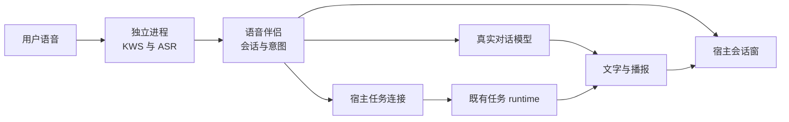

# 语音伴侣 · 详细 PRD

> **2026-10-14 新版入口**：[v0.2 离屏交互与完整声音反馈 PRD](PRD-voice-companion-v0.2.zh.md)。当前产品演进以新版及本文件原 VC/AC 继承关系为准；以下 v0.1 文档阶段状态与历史正文完整保留，不代表当前实现仍完全未开始。

> **状态**：📋 产品规划草案，业务代码尚未实施。  
> **版本**：v0.1，2026-10-14。  
> **产品原则**：让用户通过一次唤醒进入可见、可继续、可停止的语音会话；语音伴侣拥有交互体验，任务 runtime 拥有执行权。  
> **范围确认**：用户已明确“本轮只完成详细 PRD 和技术方案”。  
> **配套方案**：[产品整合与 runtime 对接技术方案](voice-companion-integration.zh.md)。  
> **检查依据**：分支 `feat/xiaozhi-voice`，HEAD `50f8ecb86070a9807ed57704ace070cc6748422e`。现状判断来自本地代码与文档；以下目标值和产品行为属于提案，不代表已实现或已通过验收。

## 1. 摘要

语音伴侣是 Flowy 内一个独立的产品功能。用户启用后，可以在任意页面或主窗口隐藏到托盘时，使用唤醒词打开语音会话，继续说出问题或任务，看到识别文本和回复，听取播报，并直接追问。

功能的独立性体现在自己的启用流程、会话体验、状态、故障恢复和验收体系。当前交付形态随 Flowy 桌面应用提供；底层 `voice-companion`（前身 `ai-mate`）仍作为独立进程运行。任务通过既有 runtime 对接完成，语音聊天不要求先启动一个任务 runtime，也不要求先创建桌宠。

本期优先打通桌面真实聊天，再接通真实任务与确认。保留已有无屏部署形态，桌面窗口只属于桌面宿主。

## 3. 背景与探索结果

### 3.1 用户已经确认的问题

当前分支已投入本地模型依赖、独立进程和 runtime 解耦，这些方向继续保留。用户指出 KWS 激活之后缺少消费场景：唤醒词触发后，没有窗口承接 ASR 与 LLM。新需求是按推荐修复方向整合，并以独立产品功能的视角规划完整行为。

### 3.2 当前能力与缺口

| 层次 | 已有实现证据 | 产品缺口 | 处置 |
|---|---|---|---|
| 本地模型 | `nomifun-voice-models` 提供安装、校验、状态与进度 | 已验证目录没有在父子进程间明确统一；首次 Ready 后加载衔接不完整 | 复用模型管理，补装配与就绪链 |
| 声学 | `nomifun-audio` 已有 MicSource、采集队列、KWS、SenseVoice 与 VAD | 设置页和 daemon 都录音；正常语音的 VAD 参数需真实校准 | 唯一采集来源，按样本校准已有实现 |
| 语音会话 | `VoiceSessionDriver` 已有声学 FSM、追问与确认状态 | 外部 wake 没有初始化 worker 计时；确认态没有音频消费；完整轮次工作内联阻塞采集消费 | 统一命令入口、轮次与取消 |
| 聊天 | Router 已有真实 HTTP 调用和短历史方法 | TOML cloud 没进入装配；短历史未更新；默认 skeleton 可产生固定回复 | 真实配置生效、维护上下文、隔离桩逻辑 |
| 任务 | Conversation 服务已有真实创建、幂等发送、取消、确认与回执观察 | 语音任务分支没有调用这些服务，却发出 TaskAccepted | 通过宿主适配既有服务 |
| 桌面承载 | 现有会议字幕和记忆面板提供浮窗模式 | 语音事件仅在设置页消费，缺少会话窗口 | 常驻宿主协调器与单例会话窗 |
| 音频输出 | Edge-TTS、ChannelAudioSink 和物理扬声器已有实现 | flush 未穿透；入队结束被当成播放结束 | 物理播放回执决定追问计时 |
| 运行状态 | supervisor 提供 running/pid/models_ready 等 | PID 存活不能证明声学和模型可用；断线被投影成 Idle | 分层就绪与显式错误 |
| 安装交付 | 已有伴侣服务安装脚本和开发二进制搜索 | 桌面 bundle 资源目录目前只有 `.gitignore`/`.gitkeep`，未看到 voice-companion 显式纳入桌面构建的脚本 | 发布前验证安装包中的二进制、native 库和启动定位 |

详细 E1–E10 证据保留于[原始检查 Handoff](execution/2026-10-14-desktop-voice-session-handoff.zh.md#11-已核实的代码证据)。本表区分“代码存在”和“运行闭环”，不把文档中的波次计划或验证剧本视为测试报告。

### 3.3 与既有产品的关系

- **语音设置页**：负责配置、启用和诊断，成为控制入口。
- **语音会话窗**：负责当前交互，是本期新增的核心用户承载面。
- **完整任务会话页**：继续承担长文本、工具细节、执行证据和任务历史。
- **桌宠**：已有另一种交互形态；语音伴侣复用会话服务能力，不绑定桌宠生命周期。
- **无屏 AI Mate**：继续纯语音运行，不因新增桌面窗而要求 Tauri 或显示设备。

## 4. 产品目标与成功标准

### 4.1 目标

用户在已经启用语音伴侣的电脑上，能无需进入设置页完成一次真实语音交互，并知道系统听到了什么、正在做什么、结果是什么以及如何停止。

目标与 [PRODUCT.md](../../../PRODUCT.md) 的“把预期结果变成可见、可控制的工作”一致。独立进程和模型资产是支撑能力，产品完成度按完整用户旅程判断。

### 4.2 关键结果

| KR | 衡量方式 | 发布要求 |
|---|---|---|
| KR-1 唤醒有承载 | 普通页面、设置离页、最小化、隐藏托盘、窗口首次加载、事件重连六类场景 | 固定端到端用例全部通过；每次有效唤醒至多一个窗口和一次输入交付 |
| KR-2 会话真实闭合 | ASR → 真实模型回复 → 实际播放结束 → 免唤醒追问；再覆盖超时和停止 | 通过本文 AC-01–AC-10；没有生产固定回复、无限 Listening 或取消后迟到结果污染 |
| KR-3 任务真实可控 | 提交、接受、拒绝、运行、查询、取消、完成、确认 | 第二个发布切片通过 AC-11–AC-17；真实回执决定 ACK，高危操作硬拦截通过 |

本期新增窗口体验目标建议：从 daemon 接受 WakeHit 到窗口首个可见 Listening 状态，已加载窗口 P95 ≤ 500ms、首次创建 P95 ≤ 1500ms；分别采样，排除模型下载时间，不排除 renderer 初始化时间。数值待首轮真机测量校准，未测前不对外承诺。

沿用既有语音基线的性能门禁：有效测试集四分类准确率 ≥ 95%，JSON 解析成功率 ≥ 99.5%；VAD 切分点到闲聊首音 P50 ≤ 850ms、P95 ≤ 1250ms。这些是既有目标，当前没有实测证明。若端到端结构不能达到指标，须以数据裁决基线，不能悄悄删去指标。

## 5. 目标用户与使用场景

以下两类是由用户反馈和 Flowy 产品定位推导的首期用户假设，尚未做市场或用户规模调查。

| 用户群 | 要完成的事 | 关键约束 | 本期覆盖 |
|---|---|---|---|
| 手上正在做其他操作的桌面用户 | 不切换页面，口头提问、追问，快速得到可见和可听回复 | 不能抢正在使用的应用焦点；能看见识别结果；能立即结束交互 | 首期核心 |
| 用自然语言安排电脑任务的用户 | 说出任务，确认被接收，查询进度、取消并查看结果 | 执行结果要真实；权限不能因语音入口而扩大；任务不能阻塞下一次聊天 | 第二切片核心 |

无屏专用硬件用户是现有架构支持的部署对象，本次保留兼容性并另做设备验收。移动端、浏览器远程麦克风、多人共享环境和跨设备同步不纳入本期新增功能。

## 6. 价值主张

### 6.1 桌面连续对话

| 项目 | 定义 |
|---|---|
| Who | 正在其他页面或应用中工作的桌面用户 |
| Why | 想临时问一句或连续追问，切到聊天页面、按录音按钮会打断当前操作 |
| What before | 手动打开聊天页或使用输入框录音；当前语音设置页只能观察日志 |
| How | 一次唤醒打开轻量会话窗，持续呈现听取、识别、思考、回复和追问 |
| What after | 保持当前工作位置，知道系统听到了什么，能自然接着问并随时停止 |
| Alternatives | 手动聊天、普通听写、语音设备；语音伴侣的价值是与桌面工作内容及可查看任务结果相连 |

价值主张：让临时提问和短时追问成为桌面上的连续操作，减少切换成本，同时保留文字结果和明确控制。

### 6.2 可控的语音任务入口

| 项目 | 定义 |
|---|---|
| Who | 已经使用 Flowy 执行文件、浏览器或其他电脑任务的用户 |
| Why | 想口头安排任务，也需要知道是否真的开始、是否有风险、能否停止 |
| What before | 在任务会话中输入要求并查看执行状态；当前语音路径会播报没有真实执行依据的接单文本 |
| How | 将确认过的语音目标提交给现有 runtime，使用真实回执、状态、权限确认和结果 |
| What after | 语音和文字入口共享执行事实；长任务在后台运行，用户能继续聊天、查询或取消 |
| Alternatives | 文字任务入口、手工操作、只会口头回答的助手；语音伴侣提供已有执行能力的另一种完整入口 |

价值主张：让用户用语音发起和控制实际任务，每一句“已接单”“已取消”“已完成”都有后台事实支撑。

## 7. 产品方案

### 7.1 产品组成与职责

| 产品组成 | 产品责任 | 依赖 |
|---|---|---|
| 启用与就绪 | 显示模型、设备、对话、任务分别是否可用；保存用户启用意愿 | ModelManager、设备状态、现有模型配置、宿主监督 |
| 唤醒与会话 | 唤醒、听取、句末识别、短上下文、追问、结束 | 独立声学进程与会话控制 |
| 会话窗口 | 当前状态、识别文本、回复、任务摘要、控制和恢复 | 宿主快照与事件 |
| 对话与播报 | 真实意图判定、简短回复、播放反馈、文字降级 | 已配置模型和现有 TTS |
| 任务连接 | 任务接收、状态查询、取消、工具确认、结果链接 | 现有 Conversation/Agent runtime |
| 诊断与恢复 | 可解释故障、显式试用、重试/重新启用 | 各层真实错误与就绪状态 |

产品边界：语音伴侣可以在任务 runtime 不可用、但声学与对话模型可用时继续聊天。runtime 不接管麦克风和窗口；语音伴侣不创建自己的工具执行器、权限规则或后台任务队列。

### 7.2 完整用户旅程

#### 旅程 A：首次启用

1. 在“设置 → 语音伴侣”阅读功能说明和数据使用说明。
2. 下载或验证已有本地声学模型，显示真实进度。模型安装不会自动代表用户同意常驻录音。
3. 检查输入设备；没有麦克风、系统权限被拒绝或设备被独占时，显示具体原因。
4. 确认已配置的对话模型来源；缺少模型时提供前往现有模型配置的入口，禁止以固定回复完成试用。
5. 用户明确打开“启用语音伴侣”。启动进程、加载引擎并完成就绪检查后显示“等待唤醒”。
6. 点击“试用语音”打开同一个会话窗并触发同一个 wake 入口，完成一次真实提问。任务未接通时显示“对话可用，任务不可用”。

再次启动时尊重持久化启用意愿；`enabled`、`starting`、`ready`、`failed` 分开显示。启动失败不能把用户原先的启用意愿悄悄改成关闭。

#### 旅程 B：唤醒、回答与追问

1. 用户在任意页面或应用说出既有唤醒词。
2. 声学层接受唤醒，桌面会话窗显示“我在听”，短提示音完成后收集指令。
3. 用户停顿，状态显示“正在识别”；ASR 完成后显示用户文本，再显示“正在思考”。
4. 真实模型回复显示在助手区域并播报。识别与路由本期按句末处理，不展示伪造的实时字幕或模型 token 流。
5. 物理播放结束后开启 4 秒追问窗口。用户开始讲话后可以把这句话说完，4 秒不是整句发言上限。
6. 追问沿用当前短上下文；无人讲话则结束本次听取并回到待机。界面保留结果供阅读，之后可收起。

唤醒词和指令连说也属于支持路径，例如“Hey Flowy，解释一下这两个方案的区别”；去除唤醒词后保留指令，禁止要求用户因为内部路径拆分而重说一次。

#### 旅程 C：安排任务

1. 用户唤醒后说出任务要求，窗口显示识别原文与待执行目标摘要。
2. 任务连接检查模型、runtime、工作区及权限。缺少必要信息时先追问；不能默认拿任意聊天页或桌宠的工作区。
3. 提交真实 Conversation turn，显示“正在提交”；后台接受后才显示/播报“已开始”。
4. 任务运行时，语音交互回到待机。窗口显示任务摘要及“查看完整任务”，用户能再次唤醒提问。
5. 完成后展示真实摘要。若当前正在其他语音轮次中，结果等待当前交互结束后提示，不能截断用户发言。

首版同一用户的语音任务入口只维护一个活动任务。已有任务时，新任务要求会提示先完成或取消当前任务，不能静默覆盖、自动取消或建立新的并发调度体系。

#### 旅程 D：确认、查询与取消

- 查询“刚才的任务进展”：读取绑定任务的真实状态，缺少任务时说明没有活动任务；不把 LLM 的猜测当进度。
- 取消“刚才的任务”：请求 runtime 取消，先显示“正在取消”，得到终态才说“已取消”；无法确认终态时说明取消结果待确认。
- 高危工具：runtime 在派发前挂起，窗口展示动作和影响。确认提示的物理播放结束后，用户拥有最多 8 秒的确认时间，仍受 runtime 授权有效期约束。
- 确认只对应当前用户、任务、轮次和工具调用，一次有效；拒绝、超时、离线或重复确认都不能放行。语音确认不设置“始终允许”。

### 7.3 功能需求与优先级

优先级：P0 是第一个可发布聊天切片的必要需求；P1 是随后的任务切片必要需求；P2 是后续候选，本轮不实施。P1 不是低重要性，只是存在 runtime 对接依赖。

| ID | 功能 | 要求 | 优先级 |
|---|---|---|---|
| VC-01 | 明确启用 | 首次默认关闭；模型下载与常驻监听开关分开；保留用户意愿与实际运行状态 | P0 |
| VC-02 | 分层就绪 | 分别显示声学、对话、播报、任务连接状态，不能只展示 PID | P0 |
| VC-03 | 唯一采集来源 | daemon 负责伴侣录音；设置页不在后台另开常驻浏览器录音；显式诊断不得形成第二个 wake 来源 | P0 |
| VC-04 | 常驻唤醒 | 离开设置页、主窗口最小化或隐藏后继续；完全退出应用后按监督链退出 | P0 |
| VC-05 | 手动试用 | 与 KWS 共用同一会话入口、超时和窗口，不创建诊断专用聊天路径 | P0 |
| VC-06 | 连说支持 | 唤醒词与命令连说、分开说都保留完整指令且只消费一次 | P0 |
| VC-07 | 单例会话窗 | 自适应当前屏幕工作区，重复唤醒不创建多个窗口；自动显示不抢键盘焦点 | P0 |
| VC-08 | 明确阶段 | 我在听、识别中、思考中、回复中、可追问、错误均可辨认；有文本和语义，不能只靠颜色 | P0 |
| VC-09 | 真实 ASR | 本地句末识别，展示原文；保留有界短预滚和发言缓冲；错误与空结果分开 | P0 |
| VC-10 | 真实对话 | 使用实际配置模型，默认构建不启用 skeleton；无可用模型时明确报错 | P0 |
| VC-11 | 追问与上下文 | 播放结束后 4 秒内开始说话无需再次唤醒；保持最多三轮短历史，结束会话时清空推理上下文 | P0 |
| VC-12 | 静默与超时 | 唤醒后 6 秒没有语音回到待机；单句缓冲有上限；无 PCM、连续噪声也不会无限录音 | P0 |
| VC-13 | 播报与降级 | 声音播放与文字结果对应；TTS/扬声器失败仍能读到真实文本，并明确显示播报不可用 | P0 |
| VC-14 | 停止本轮 | 按停止或关闭当前会话窗时取消本轮 ASR/模型/播报，清空播放队列，禁止迟到结果覆盖 | P0 |
| VC-15 | 状态恢复 | 窗口初次挂载、事件重连、daemon 重启后获取真实快照；不重放有副作用操作 | P0 |
| VC-16 | 用户数据说明 | 告知本地音频、发送给已选模型的指令文本、发送给 TTS 的播报文本；日志不默认保存音频/全文 | P0 |
| VC-17 | 可访问性 | zh-CN/en-US 对称；明暗主题、减少动态效果、键盘操作与读屏状态可用 | P0 |
| VC-18 | 任务配置 | 绑定既有执行模型/预设及可确认的工作区；缺配置不提交；不要求关联桌宠 | P1 |
| VC-19 | 真正接单 | 真实幂等创建与提交，明确区分新接受、进行中回放、已完成回放和拒绝 | P1 |
| VC-20 | 真实查询与取消 | 仅控制语音功能当前绑定任务；取消请求和取消终态分开 | P1 |
| VC-21 | 任务摘要与详情 | 摘要由实际结果产生；打开现有完整会话页，不重复建设工具日志页面 | P1 |
| VC-22 | 高危确认 | 实际工具拦截、单次调用身份、8 秒听取窗、有效期、拒绝和超时均贯通 | P1 |
| VC-23 | 聊天与任务并行 | 一个活动任务运行时可再次唤醒聊天；完成通知不会打断正在听取或播报的轮次 | P1 |
| VC-24 | 任务映射恢复 | 服务/进程重启后只读核对既有接受回执，不能自动重建并重发一个新任务 | P1 |
| VC-25 | 真语音打断 | 评估 AEC/模型输入与播放回声后再提供播放期免手动打断 | P2 |
| VC-26 | 更多形态 | 可自定义唤醒词、更多音色、远程客户端音频和多设备同步 | P2 |

### 7.4 三个承载面的交互规范

#### 设置页

沿用 `Page Header → Section → List → Row`。分区为：启用与状态、本地声学模型、对话与任务连接、设备检查与显式试用、故障诊断。只有模型缺失时出现下载进度；不要把 7 态模型安装进度当作会话状态。

对话模型引用现有 provider/model 配置，使用已有选择控件；任务执行继续引用 runtime 的模型/预设和工作区。用户不在语音设置重新维护另一份 API key。原有独立进程 cloud TOML 与环境覆盖仍可用于无屏部署，凭据装配归宿主处理。

#### 会话窗口

从上到下为功能名称和状态、最近用户发言与助手回复、任务摘要（有任务才出现）、控制区。回复可滚动和选择复制，长任务只显示简要进展和详情入口。

窗口在有效 wake 后显示，不把模型下载、诊断日志或内部 instance_id 放进用户对话区域。自动显示不抢焦点，用户点击窗口后可以正常操作；窗口位置落在当前可用屏幕内，不把多显示器之外的历史坐标当有效位置。

Idle 不自动删除文字结果：停止监听后保留最后结果；建议在无人操作且无待确认/任务结果注意项时 8 秒后收起。用户鼠标停留、正在复制文本或窗口有焦点时保留；新唤醒开始新的短会话。隐藏倒计时只是界面行为，不能改变后台任务状态。

#### 完整任务会话页

使用既有会话路由与真实 conversation_id 展示工具过程、确认和结果。打开详情不会改变任务运行；关闭详情也不会取消任务。正文、附件、重试等能力以现有会话公共契约为准。

### 7.5 控制语义

| 用户动作 | 当前语音轮次 | KWS 待机 | 已接受任务 |
|---|---|---|---|
| 停止本轮/关闭会话窗 | 取消推理和播报，释放本轮缓冲 | 继续，直到用户关闭功能 | 继续；待确认的危险调用拒绝/到期，不自动放行 |
| 收起已结束的结果窗 | 不存在活动轮次，不发生取消 | 继续 | 继续 |
| 关闭语音伴侣开关 | 结束当前语音会话并关闭采集 | 停止 | 已接受任务继续，可在完整任务页查看/取消 |
| 取消当前任务 | 根据实际任务回执反馈 | 继续 | 请求取消，终态确认后结束 |
| 完全退出 Flowy | 随宿主监督关闭 | 停止 | 服从现有 runtime 退出语义，本功能不承诺退出后继续运行 |

本期保持半双工：播放期间持续消费并丢弃不适用的麦克风音频，用户用按钮停止播放；不承诺在播放期说一句“停”就稳定打断。明确的结束/取消表达在可听取阶段处理，含糊的“停一下”不能自动取消具有副作用的后台任务。

### 7.6 可用性和降级

| 条件 | 可提供体验 | 明确反馈 |
|---|---|---|
| 声学、对话、播报、任务均正常 | 聊天、播报与任务 | 等待唤醒/实际会话状态 |
| runtime 未连接，声学和对话正常 | 聊天、追问、播报 | 任务功能暂不可用；任务请求不假接单 |
| TTS 网络或扬声器失败 | 真实文字回复；ASR 正常时可继续下一轮 | 播报不可用，不以播放耳标伪装成回复播报完成 |
| 对话模型不可用 | 唤醒、识别文本和恢复入口 | 对话服务不可用；不生成固定成功回复 |
| 外网断开 | 本地声学可运行，是否能回答取决于已选模型是否可达 | 显示模型/TTS 网络故障；不声称完整离线助手 |
| 本地模型缺失或加载失败 | 配置与修复入口 | 声学未就绪；常驻唤醒不开启 |
| 设备失联 | 错误状态与恢复检查 | 停止当轮，设备恢复后重新就绪，不能假展示 Listening |
| 流暂时断线 | 保留已有文本但暂停显示实时更新 | 正在重新连接；恢复后读取快照 |
| 当前用户退出/身份变化 | 停止旧会话、清空旧用户投影 | 不将旧任务或旧文本交给新用户；按新用户配置重新检查 |

### 7.7 数据、权限与费用

- **音频**：KWS、VAD、ASR 的 PCM 在本地使用，不默认上传或落盘；预滚和单次录音缓冲有明确上限。
- **指令文本**：通过预筛的指令会发送给用户已选模型。去除唤醒词和本地保存原文不等于脱敏，不能承诺指令内容永不离机。
- **回复文本**：使用现有在线 TTS 时，需发送待播报文本给 TTS 服务；用户启用前可读到该说明。
- **短聊天记录**：本期用于上下文和窗口的最近三轮保存在当前会话内存，终止会话清空推理历史；本期不新增长期语音聊天历史库。
- **任务记录**：使用现有 Conversation 持久化用户指令、执行过程和结果，遵守现有账户与工作区访问控制，不新增“永久原始 ASR 审计表”。
- **诊断**：默认只记录错误码、阶段、耗时和丢弃/失败计数；录音或全文采样必须作为显式诊断动作，不进入通用遥测。
- **凭据**：窗口只得到模型名称和可用性，不接收密钥或 token；用户退出或凭据失效后不能继续借用旧身份调用。
- **授权**：语音只增加输入方式，不能扩大工具权限，不能把口头确认变成 always_allow。声纹身份验证和多人安全认证不在本期范围。
- **费用**：聊天/路由模型和任务 runtime 可能分别消耗资源，沿用既有 provider/云端费用机制；没有真实费率和回执时不展示估算余额或虚构费用。ASR 预筛丢弃不请求模型；任务分支只做一次路由再执行所需任务推理，不再额外请求一份聊天回复。

### 7.8 质量要求与验收矩阵

以下是可执行的产品验收，不是当前通过状态。人工使用需基于已验证真实模型与设备；回放和替身只证明测试环境中的接线和状态行为。

| AC | 场景与操作 | 验收结果 | 对应需求 |
|---|---|---|---|
| AC-01 | 首次下载模型，不打开启用开关 | 没有常驻采集；模型完成不自动启动监听 | VC-01 |
| AC-02 | 启用后离开设置、最小化、隐藏到托盘分别说唤醒词 | 一个窗口可见，Listening 状态正确，不抢焦点 | VC-04/07 |
| AC-03 | 点击试用，再用真实 KWS，分别静默 | 同入口；6 秒静默退出；不无限 Listening | VC-05/12 |
| AC-04 | 连说唤醒词和指令，另一次分开说 | 完整指令不丢首字，每轮一次真实路由 | VC-06/09 |
| AC-05 | 说完整问题并停顿 | 识别中 → 可读原文 → 思考中 → 真实回复；不展示假 partial | VC-08/09/10 |
| AC-06 | 回复物理播放结束后在 4 秒内开始追问 | 无需再次唤醒，可说完完整句子；短历史进入模型请求 | VC-11/13 |
| AC-07 | 在 ASR、模型请求和 TTS 分别按停止/关窗 | 取消当轮，实际声音停止，迟到结果丢弃，下次唤醒正常 | VC-14 |
| AC-08 | 延迟创建窗口，断开事件流、重启 daemon | 快照恢复，不重复路由/执行，无旧实例污染 | VC-15 |
| AC-09 | runtime 断开后提问；TTS 失败后提问；无 endpoint 后提问 | 分层降级与真实错误；聊天不被任务连接阻断；无 skeleton 成功反馈 | VC-02/10/13 |
| AC-10 | 断开麦克风/无 PCM/连续噪声 | 故障可见，缓冲受限，超时工作；设备恢复后可再次就绪 | VC-03/12 |
| AC-11 | 提交任务成功与拒绝分别执行 | Accepted 后才 ACK；拒绝不显示运行中；身份、工作区正确 | VC-18/19 |
| AC-12 | 接单响应丢失后用同一命令恢复；已有回执 completed | 复用既有创建/发送身份；任务执行至多一次；已完成回放不再次播报新接单 | VC-19/24 |
| AC-13 | 任务运行期间再次唤醒聊天，再查询和取消 | 声学正常；查询真实状态；取消终态才显示已取消 | VC-20/23 |
| AC-14 | 实际危险工具派发，分别确认/拒绝/静默/重复确认 | 硬拦截在工具前；确认单次有效；拒绝/超时不执行；不设置始终允许 | VC-22 |
| AC-15 | 确认提示较长，播报完再计时；runtime 授权提前失效 | 可听取时限正确；过期只能拒绝或重新询问，不能延长 runtime 权限 | VC-22 |
| AC-16 | 用户正说话时任务完成；打开完整任务；关闭语音开关 | 完成提示按序呈现；真实结果可读；关闭语音不假取消任务 | VC-21/23 |
| AC-17 | daemon/宿主重启后恢复任务映射；切换用户 | 只读核对旧回执；不创建重复任务；不泄露旧用户记录 | VC-24/16 |
| AC-18 | 两种语言、明暗主题、减少动态效果、键盘/读屏 | 文案对称，状态可辨、文字可读，控制可访问 | VC-17 |
| AC-19 | 自定义模型目录、首次 Ready、禁用/删除模型 | 实际加载目录一致；Ready 自动初始化；释放前停止声学消费者 | VC-02/03 |
| AC-20 | 在干净机器安装桌面产物并启用，退出后检查进程 | 有可运行的 voice-companion/native 库，无需手工编译；父子生命周期按监督链结束 | VC-04 |

计时由单调时钟驱动，GUI 倒计时只是投影；用户停留结果窗与后台计时互不改变。验证输入须包括正常音量、噪声和不同停顿的样本，不能只用静音或正弦波替代有效语音。

### 7.9 技术概要

详细契约和文件分工见[整合技术方案](voice-companion-integration.zh.md)。主要数据流：

状态分为模型安装、服务就绪、声学交互、任务执行和窗口展示五种。没有为用户增加五套设置；这些状态用于保证故障、取消和结果一致。

### 7.10 假设与待决问题

已确认的是用户问题、保留独立进程/本地声学方向及本轮只交付文档。以下是规划建议，不能当作已批准商业策略：

| 项目 | 当前建议 | 验证或决策方式 |
|---|---|---|
| 首发平台 | Windows 桌面先完成真机验收，Mac/Linux 保留结构并各自验收后宣称支持 | 根据设备和维护容量决定支持清单 |
| 对话长度 | 最近三轮，短口语回复；长结果进完整任务页 | 真实追问样本验证上下文长度 |
| Idle 收窗 | 无操作且无注意项时 8 秒后收起 | 观察阅读、复制及打断行为后校准 |
| 发言上限 | 建议单句最多 30 秒；超过后明确提示并结束当轮 | 测试正常表达长度和缓冲占用，不无上限累积 |
| 任务工作区 | 使用语音配置中明确选择的既有工作区/预设；缺失先询问 | 确认现有服务能安全解析该引用，不复用任意活动页 |
| 语音体验目标值 | 新窗口延迟先按本 PRD 采样，保留已有基线的语音指标 | 首轮真实样本决定可承诺值 |
| 专用硬件产品 | 继续保持已有无屏能力，本轮不做商业化/品牌定价规划 | 若 Owner 单独启动硬件产品规划，再补用户调研和独立交付规格 |

不影响首个切片开工的产品建议按上述值实现为可审查方案；新增商业范围和跨设备能力不由工程自行扩大。

## 8. 发布规划

### 8.1 发布切片与门禁

| 切片 | 交付内容 | 出口门禁 | 用户可用范围 |
|---|---|---|---|
| R0 真实会话底座 | 收拢唤醒、目录/配置装配、关闭生产桩、ASR 复用、轮次取消、真实播放完成、状态快照 | 对应回放/接口测试通过，生产依赖图无 skeleton，错误与超时用例通过 | 内部验证；不宣称完整产品 |
| R1 桌面语音对话 | 单例窗口、常驻消费、设置页整合、真实回复与追问、降级与设备恢复 | P0 需求及 AC-01–10/18–20 通过；真实聊天性能门禁有报告 | 可发布“语音对话”；任务连接明确不可用，禁止假接单 |
| R2 runtime 任务连接 | 真实幂等任务、查询/取消、摘要、工具确认、身份和任务映射恢复 | P1 需求及 AC-11–17 通过；实际工具拦截证明与 runtime 集成报告 | 可发布“语音任务控制” |
| R3 后续候选 | 真语音打断、更多音色或设备形态 | 独立需求、样本和验收计划 | 由 Owner 决定是否启动 |

这是按依赖排序的相对阶段，不是承诺的日历排期；没有人员容量与实测成本，暂不估算完成周数。R1 不得保留当前可误导用户的任务接单逻辑。

### 8.2 风险与处理

| 风险 | 影响 | 处理和阻断条件 |
|---|---|---|
| VAD 普通音量识别不足 | 唤醒后用户说话仍静默退出 | 校准现有 backend 与阈值；无正常语音样本报告不验收 |
| TTS 网络和队列完成语义 | 追问窗口过早打开或取消不停声 | 实际 sink 完成/flush 测试与硬件检查 |
| 自定义模型目录分叉 | 设置已就绪但 daemon 未加载真实模型 | 父子显式同目录，Ready 后初始化验证 |
| 窗口冷启动和托盘状态 | 唤醒事件漏接、窗口不显示 | 原生协调器常驻、snapshot 握手、延迟/断线测试 |
| 任务发送重试或新用户接管 | 重复副作用或跨用户结果 | 复用既有幂等创建/发送/只读观察，任务标识与身份绑定 |
| 口头确认和工具授权不一致 | 提示播放占用确认时限，或旧确认误放行 | 本地听取窗与 runtime 授权分别校验；高危路径未贯通禁止发布 |
| 桌面产物缺二进制/native 依赖 | 开发有效、安装后无法启用 | 完整安装包干净机器验收；发布改动遵守项目高风险规则 |

### 8.3 交付与验证说明

实施必须交付业务代码、用户说明、双语资源、真实运行验证记录和剩余平台限制。执行检查梯子见配套技术方案；测试、daemon 健康、真机闭环及 Owner 验收分别报告。

本轮只新增产品与技术文档，并为既有文档增加导航。未修改业务代码、数据库、auth、构建、签名或 updater，未提交或推送。上轮设置结构/双语测试的 25 pass 是有限证据，带 Bun 文件访问告警；本轮不把它升级为新功能验证。完整语音闭环和安装交付仍待实施及真机验收。

---

## 附录：需求来源与历史资料

本文件首次新增，没有重构任何历史全文。文档中的用户群、首发平台和建议体验参数是明确标注的规划假设，未添加虚构联系人、市场规模或商业收益。

- 用户原始问题：KWS 激活后没有承接 ASR 和 LLM 的窗口。
- 用户本轮要求：按推荐方案整合，将语音伴侣作为独立产品功能规划，给出探索结果、详细 PRD 和技术方案。
- 用户范围确认：本轮只完成详细 PRD 和技术方案。
- [原始检查与修复建议](execution/2026-10-14-desktop-voice-session-handoff.zh.md)：保留上轮证据与方案原文。
- [既有无屏架构基线](interaction.zh.md)、[历史底稿](interaction.archive.zh.md)、[模型管理规范](model-management.zh.md)、[既有界面规范](ui-motion.zh.md)：保持原文，不将未执行的门禁写成已通过。

## 2026-10-14 追加需求：单次模型调用的需求理解展示

用户确认采用直接回答模式：语音会话和设置活动面板依次展示 ASR 原文、模型理解的需求、助手回答。模型在同一次路由调用中返回 understood_request 与 reply_tts，不增加二次模型请求或用户确认门禁。需求理解必须忠实保留输入中的对象与约束，不补造地点、时间等未提供的事实；它不是工具授权或用户确认。

兼容旧模型响应：缺少理解字段时不伪造“模型理解”，已有原文与回答仍可显示。完整原始模型输出保留供调试。验收包括生产快照字段、单次调用次数、双语三段显示顺序、播报失败后文字保留及 Owner 对真实模型效果的核对；实施证据见 execution/vertical-execution-plan.zh.md 的 N。
