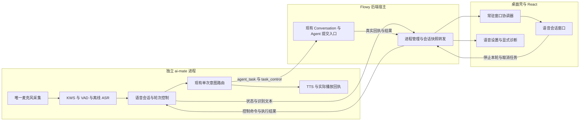
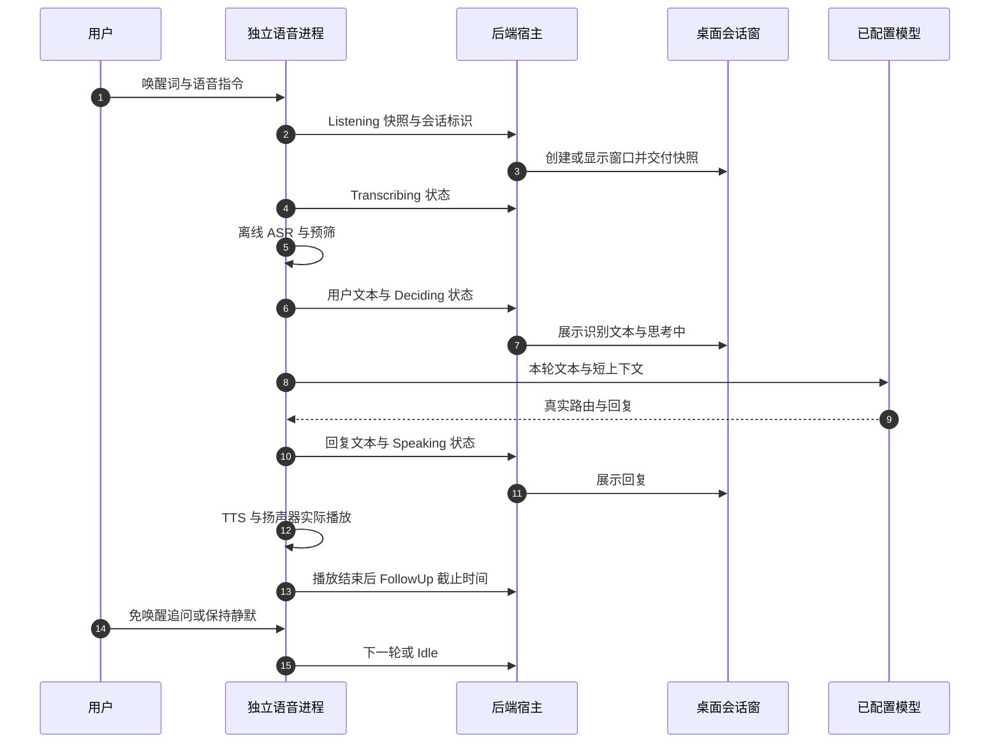

# 唤醒后的桌面语音会话闭环 · 技术方案与 Handoff

> **状态**：📋 计划，尚未实施业务代码。  
> **核心原则**：保留独立 `ai-mate` 进程、离线声学能力和无头语音中枢；桌面宿主消费真实会话状态并承载窗口，窗口不拥有麦克风或任务执行权。  
> **检查快照**：2026-10-14；`feat/xiaozhi-voice`；HEAD `50f8ecb86070a9807ed57704ace070cc6748422e`；本地 `origin/main` `3b32a4c73010064bf0e3abdbf94eb1569db9b642`。未 fetch，远端最新状态未验证。检查范围为 `git diff origin/main...HEAD` 的语音路径及其调用方、测试、相关架构文档，不是 132 个变更文件的完整审查。

本轮固定目标：A、梳理当前分支的 KWS、ASR、LLM 与窗口调用链；B、确认唤醒后缺少承载场景的断点；C、提出有代码证据和验收标准的修复优化方案。

## 1. 背景与核心痛点

用户需要：启用 KWS 后，在任意页面或主窗口隐藏到托盘时说出唤醒词，出现一个持续承载 ASR、模型回复、追问及实际任务结果的桌面会话窗口。

当前分支已增加模型安装校验、CPAL 采集管线、神经 KWS 与 ASR 级联识别、声学 FSM、真实 HTTP 意图路由客户端、TTS/物理扬声器、独立进程监督以及设置页诊断。已有实现值得保留，但文件和模块存在不代表生产调用链已闭合。

三个核心断点：

1. **会话消费者缺失**：事件订阅和显示只在 `VoiceSettings.tsx` 内，离开设置页就销毁；唤醒仅改状态、写日志，没有触发窗口。独立进程继续工作也无法保证用户看见交互。
2. **输入和状态不统一**：设置页 `getUserMedia` 与 `ai-mate` 的 `MicSource` 同时录音。前端把包含唤醒词的一句话转为外部 wake 请求，只发送 `keyword`，没有把同句指令交给后续轮次。外部 wake 只修改 driver，监听缓冲和计时器仍是 worker 局部变量。
3. **下游完成信号不真实**：聊天路径有 HTTP 路由，但未维护实际轮次历史；任务路径没有提交队列却发出 `TaskAccepted`；确认状态没有消费音频的分支；错误通常退回 Idle 或被代理伪装成 Idle。

| 能力 | 现状 | 本方案目标 |
|---|---|---|
| 离线模型与独立进程 | 已有管理和监督模块 | 继续复用，启动时显式传递已验证模型目录 |
| 唤醒消费 | 设置页日志 | 桌面宿主常驻消费，唤醒即打开单个会话窗 |
| 录音来源 | 浏览器与 daemon 两套路径 | daemon 为桌面伴侣唯一录音来源 |
| ASR 与思考反馈 | ASR 完成后日志才变 deciding | SpeechEnd 即显示识别中，文本出来后显示思考中 |
| 追问 | 有 4 秒状态，但实际 history 没有更新 | 同会话保留上下文、明确轮次与追问截止时间 |
| 任务接单 | 播报后直接切 Accepted | 真实提交回执决定接单、取消及完成状态 |
| 故障 | 多处吞错或 Idle | 展示可解释错误，区别待机、离线和失败 |

### 1.1 已核实的代码证据

以下行号固定于上面的 HEAD；实施时重新定位，不把该表当作运行证明。

| 编号 | 证据 | 触发与影响 | 修复方向 |
|---|---|---|---|
| E1 | `ui/src/renderer/pages/settings/VoiceSettings.tsx:655`，订阅位于页面 effect，cleanup abort；`ui/src/renderer/components/layout/Router.tsx:372` 注册设置页 | 导航离开后没有常驻消费者；WakeHit 分支只写日志 | 将会话消费移入宿主，设置页只订阅状态投影 |
| E2 | `VoiceSettings.tsx:400` 的浏览器采集与 `apps/ai-mate/src/voice.rs:62` 的 MicSource；`VoiceSettings.tsx:512` 只发送 keyword | 双麦克风来源；同句唤醒指令无法通过外部 wake 路径交付 | 删除设置页常驻录音与级联识别，保留显式 ASR 诊断；daemon 保留唤醒音频和后续指令 |
| E3 | `apps/ai-mate/src/voice.rs:158` 外部 wake；`:312` 局部 listen_start；`:394` 只有 worker 自检测 wake 初始化时间；`:406` 超时依赖 Some(start) | 外部 wake 后静默超时没有被正确初始化，可能一直 Listening | 外部和内部 wake 进入同一 worker 命令入口，统一缓冲、计时和状态迁移 |
| E4 | `apps/ai-mate/src/voice.rs:190` 使用诊断转录 helper；`crates/backend/nomifun-audio/src/stt/mod.rs:67` 每次 try_load；`stt/sherpa.rs:119` 重新构造 callback | 每轮可能重新加载识别器，且错误被 Option 丢失 | 就绪时复用真实 recognizer，生产调用保留错误类型；不添加第二套 ASR |
| E5 | `apps/ai-mate/src/voice.rs:200` 调用 route；`router.rs:284` 有 append_turn，但 daemon 无调用；`voice.rs:432` 内联 await 整个识别/路由/播报 | 追问没有真实历史；处理期间音频消费及 watchdog 检查暂停 | 每个成功轮次维护短上下文；采集与可取消的轮次处理分开，半双工期间丢弃旧音频 |
| E6 | `apps/ai-mate/src/voice.rs:241` 与 `:257`，TaskControl 未调用任务控制，AgentTask 未提交实际任务却在 `:282` 触发 TaskAccepted；`:494` 的默认分支跳过确认态 | 虚假接单/取消反馈，口头确认无法完成任务恢复 | 接入现有 Conversation/Agent 提交、取消、事件和确认路径；真实回执之前不播报已接单 |
| E7 | `crates/backend/nomifun-voice-terminal/Cargo.toml:7` 默认启用 voice-skeleton；`apps/ai-mate/Cargo.toml:18` 没有禁用默认 feature；`router.rs:408` 可执行 heuristic fallback | 无真实 endpoint 时默认构建仍可产生固定聊天/接单文本，掩盖配置缺失 | 生产默认关闭 skeleton，测试显式启用测试替身；缺模型/endpoint 显式失败 |
| E8 | `apps/ai-mate/src/server.rs:179` SSE 仅转发后续 broadcast，没有状态快照、会话/轮次标识；`voice_companion_manager.rs:309`、`:341` 代理把未运行/连接失败变成 Idle | 窗口迟挂载或重连丢失唤醒，离线被展示成待机 | 增加快照、序号及连接状态；broadcast Lagged 后恢复快照，不假报 Idle |
| E9 | `apps/ai-mate/src/main.rs:130` assemble 不传 cloud config，`:156` worker 在自动安装检查前启动；`voice_companion_manager.rs:204` 子进程启动未传 manager 的 models_dir | 自定义 TOML cloud 字段没有进入 router；自定义模型目录可能与实际加载目录分叉；首次安装后 KWS 不会因 Ready 自动重新加载 | 装配时使用解析后的 config 和验证目录，在 Ready 后初始化/重新装载声学引擎 |
| E10 | `voice-terminal/src/playback.rs:46` ChannelAudioSink flush 无动作；`audio/src/speaker.rs:164` write_frame 只是入队；`voice.rs:238` speak_text 后直接 PlaybackDone | 停止不能可靠清空扬声器，追问计时可能早于物理播报结束 | 接通真实 flush 和队列播放完成回执；据此打开追问窗 |

E1–E3 是用户描述的直接断点。E4–E10 是完成可用闭环必须处理的接线问题，不扩展成全仓重构。E6、E7 同时属于 Spec 缺失和 Standards 正确性问题；E7 也违反基线 Phase S 对生产桩逻辑的隔离要求。

## 2. 方案全景与架构设计



**目标**：先实现一次真实唤醒 → 看见 Listening → 说话 → 看见转录 → 得到真实模型回复 → 播放结束 → 免唤醒追问；随后在同一承载面接通真实 Agent 任务、取消和确认。

**非目标**：新增本地 LLM、改模型下载体系、重做桌宠、另造 Agent runtime、复杂全双工 AEC、调整 KWS 唤醒词集合、数据库迁移、发布签名或三端服务安装改造。本阶段不承诺增量 ASR 字幕；已有 SenseVoice 是句末转录，不能用假 partial 冒充流式识别。

**不变量**：

- `ai-mate` 和 `nomifun-voice-terminal` 保持无头，不引入 Tauri；桌面窗口归 `apps/desktop`。
- 窗口及设置页只消费状态；麦克风、ASR、录音时钟只有一个所有者。
- 后端到 Agent 保持经过 `nomifun-ai-agent`；复用 `nomifun-conversation` 的既有服务，不直接加 `nomi-*` 依赖。
- 关闭窗口发出“结束当前语音交互”，继续保持 KWS 待机；取消后台任务是单独明确动作，不能等同于关窗。
- 生产缺模型、缺 endpoint 或无真实任务回执时不能制造成功文本；凭据和 PCM 不进入窗口状态 DTO。
- 主窗口隐藏到托盘后消费者仍运行；退出整个桌面应用则沿现有监督路径结束子进程。

## 3. 核心设计与模块规范

### 3.1 常驻消费与窗口

在现有 `VoiceCompanionProcessManager` 内维护一个 daemon 上游事件连接、最近会话快照和广播订阅。桌面 Rust 协调器在应用启动时接入，完全独立于设置页生命周期。进程停止和连接失败作为服务状态输出；重启后更换进程实例标识，废弃旧轮次事件。

`apps/desktop` 新增 `voice_session_window.rs`，参考 `meeting_captions.rs` 和 `memory_panel_window.rs` 的主线程窗口创建、工作区定位、状态缓存方式。只复用模式，不重构已有窗口系统。窗口使用单个 label `voice-session` 和路由 `#/voice-session`；重复唤醒复用窗口。首次挂载通过 snapshot 拉取补齐状态，不依赖固定延迟重发事件。

窗口呈现简洁的会话内容：当前状态、用户识别文本、助手回复、追问倒计时；提供停止语音、任务取消、查看对应完整会话。自动唤醒显示时不抢键盘焦点；点击输入/控制按钮时正常交互。浏览器宿主使用应用根级消费者和同一会话面板，不要求原生窗口。

新增原生命令和 renderer 调用经过项目 `platform`/adapter 边界，并检查对应窗口权限声明。设置页保留模型安装/释放、伴侣开关、设备检查、显式录音诊断；删除常驻浏览器录音/级联唤醒和页面自建 SSE 状态机，改读共享状态。

### 3.2 同一唤醒入口与可取消轮次

外部 wake 和内部 KWS 命中都交给 worker 的同一个命令处理入口；在该处完成合法迁移、计时、VAD reset、缓冲整理及事件发布。HTTP 返回实际 accepted/rejected，不能无条件 `success: true`。

模型 Ready 后显式初始化 KWS/ASR 并复用识别器；传递 `ModelManager::models_dir()`，移除该路径对多目录猜测的依赖。独立进程的 TOML cloud 配置参与 router 装配，保留现有环境覆盖和 endpoint 选择约定。不能把特定云域名当唯一运行方式。生产默认关闭 skeleton。

唤醒前保留有上限的短 PCM 预滚；级联 ASR 得到“Hey Flowy，帮我……”时分离唤醒词与指令，保留指令并且只执行一次。神经 KWS 场景保留命中前后交界音频，避免首字损失；耳标播放期间采取半双工，不把自己的提示音当用户输入。

worker 持续处理音频、控制及超时，句末 ASR/LLM/TTS 作为有取消句柄的轮次工作；取消后通过 turn_id 屏蔽迟到结果。保留现有有界队列，不新增通用调度框架。 Listening 有 6 秒静默超时及有上限的单次录音长度；无数据/设备失败也能退出，不能只在取到下一块 PCM 后检查时间。

VAD 需要用真实/回放语音校准：当前 worker 使用默认 EnergyVad，RMS threshold 为 0.5，设置页阈值为 0.015，二者差距不能靠 UI 状态掩盖。先复用已有 VadBackend，依据录音证据选择已实现后端或参数，不在方案阶段盲改一个阈值。调用已有 HeuristicPreFilter；缺失置信度不伪造。

同一 session 内成功轮次调用现有 append_turn；追问使用真实历史，结束会话后清空短上下文。窗口先在 SpeechEnd 显示转录中，转录完成后显示思考中。ASR/路由失败产生带阶段和错误码的事件；正常 Ignore、静默超时、模型失败分别解释。

PlaybackDone 由实际扬声器队列消耗完成决定；flush 穿过 ChannelAudioSink 到物理 sink；追问 4 秒从实际播放结束开始。半双工播放期持续消费并丢弃不适用音频，不积压到下一轮。

### 3.3 最小状态契约

HTTP DTO 统一放在 `nomifun-api-types/src/voice.rs`，移出 `apps/ai-mate` 当前私有事件枚举；前端配套类型和契约测试同步更新。

```typescript
type VoiceSessionPhase =
  | 'idle' | 'listening' | 'transcribing' | 'deciding' | 'speaking'
  | 'follow_up' | 'awaiting_confirmation' | 'listening_confirm'
  | 'dispatching' | 'error';

interface VoiceSessionSnapshot {
  instance_id: string;           // 当前 daemon 实例，不是 PID
  seq: number;                   // 实例内单调序号
  session_id: string | null;     // 接受一次新唤醒建立；追问继续同一会话
  turn_id: string | null;        // 每个用户输入轮次唯一
  phase: VoiceSessionPhase;
  user_text: string | null;
  assistant_text: string | null;
  follow_up_deadline_ms: number | null;
  conversation_id: ConversationId | null; // 复用现有 UUIDv7 品牌类型
  task_status: 'idle' | 'submitting' | 'running' | 'completed' | 'failed' | 'cancelled';
  error: { stage: string; code: string } | null;
}
```

该接口是待实现提案，非现有契约。声学状态与 task_status 分开，长任务不会让语音窗口一直处于 Deciding。服务连接状态另行表达 `starting/ready/offline/failed`；PID 存活与模型/声学/路由就绪分开。同步后的状态再发布事件，SSE 首帧和窗口首次读取均返回快照；订阅与快照以 seq 处理竞态，重放旧状态不得重复调用 LLM 或提交任务。文本不记录到通用遥测，错误信息由双语字典渲染。

### 3.4 真实任务桥接

复用 `nomifun-conversation/src/routes.rs` 已有创建、发送 messages、cancel、confirm 路径背后的服务和 responseStream 事件。`ui/src/common/adapter/ipcBridge.ts:740` 与桌宠 `index.tsx:1475` 已演示幂等发送/回执处理；复用服务契约，不依赖桌宠组件或要求用户必须先创建一个桌宠。

语音任务建立/绑定一个真实 Conversation，按 session/turn 身份生成稳定 idempotency key；由宿主调用已有后台入口，窗口不负责发起任务。没有配置有效模型时返回可解释错误，不造默认账户或默认模型。真实接受后播报接单，完成后展示/播报摘要；QueryStatus/CancelTask 针对真实 conversation/task，不针对本地模拟 TaskManager。

口头确认进入 ListeningConfirm 后消费真实 ASR；确认 token、TTL 和执行恢复复用现有确认链。新 ToolPolicyEngine 目前仅有测试调用方，不能因为它有单测就宣称生产工具已受保护；必须证明它在实际工具派发前生效，或复用已有等效硬拦截。确认能力未接通前，高危任务保持拒绝，不允许仅凭 LLM 的 requires_confirmation 放行。

### 3.5 时序与状态迁移



| 当前状态 | 前置条件/事件 | 下一状态和动作 |
|---|---|---|
| Idle | 声学/模型就绪且 wake 被接受 | Listening；建立 session，显示窗口 |
| Listening | VAD 句末 | Transcribing；建立 turn，暂停接收新指令 |
| Listening | 6 秒无语音、录音上限、停止本轮 | Idle；释放本轮缓冲、继续 KWS |
| Transcribing | 有效 ASR 且预筛通过 | Deciding；展示 user_text |
| Transcribing | 预筛丢弃 | Idle；不请求模型 |
| Deciding | chat 回复 | Speaking；展示真实回复并播放 |
| Deciding | agent_task | Dispatching；等待真实任务接受回执 |
| Dispatching | 真实 Accepted | 声学回到 Idle；task_status 为 Running，窗口保留任务状态 |
| Deciding | task_control | 调用真实查询/取消入口；按结果 Speaking 或 Error |
| Speaking | 物理播放结束 | FollowUp；启动 4 秒追问计时 |
| FollowUp | 期限内检测到语音 | 同 session 新 turn，句末进入 Transcribing |
| FollowUp | 静默截止 | Idle；窗口可收起，不销毁后台消费者 |
| AwaitingConfirmation | 提示物理播放结束 | ListeningConfirm；开始确认时限 |
| ListeningConfirm | 有效单次确认/拒绝/超时 | 恢复挂起调用或拒绝，展示实际结果；不重复提交任务 |
| 非终止状态 | 当前 turn 被停止、设备断开或服务停止 | 取消相关工作并输出 Idle 或 Error；迟到结果不能覆盖新轮次 |
| Error | 用户结束/重试且依赖恢复 | Idle 或新的 Listening；不能自动重放有副作用任务 |

## 4. 关键决策与权衡

| 编号 | 决策点 | 选定方案 | 放弃的替代方案与理由 |
|---|---|---|---|
| D1 | 窗口所有者 | 桌面壳常驻协调器，语音进程保持无头 | 将 Tauri 加进 ai-mate：破坏已完成的进程与 runtime 解耦 |
| D2 | 消费入口 | 宿主一个上游连接，快照投影给窗口/设置页 | 继续在设置页监听：无法覆盖离页和托盘场景 |
| D3 | 音频来源 | 独立进程唯一采集，显式诊断单独运行 | 把浏览器级联搬到根组件：仍然保留双来源和页面生命周期问题 |
| D4 | LLM 接线 | 先接好已有真实 router/config 与短历史 | 同一轮再调用一个聊天 LLM：重复推理且扩大改动 |
| D5 | 任务执行 | 既有 Conversation/Agent 服务与幂等回执 | 新造语音任务 runtime：已有能力可复用，容易丢失权限与确认 |
| D6 | 会话恢复 | instance/session/turn/seq 和最新快照 | 只依赖 WakeHit 瞬时事件或延迟重发：无法解决迟挂载与断线 |
| D7 | ASR 呈现 | 句末真值与识别中状态 | 本轮新增流式 ASR 模型：不属于修复唤醒消费的最小实现 |

既有基线 §2.4 排除的是 AI Mate 主机本身的 GUI。新增桌面消费者作为本次用户要求的宿主扩展；实施时补充该边界说明和对应验收用例，完整保留既有历史文本，不把文档改写成所有部署都依赖窗口。

## 5. 验收与实施顺序

### 5.1 同一后续 Plan 的三个可独立验收步骤

1. **统一输入与真实会话契约**：收拢 wake 入口、显式模型目录与 cloud config、Ready 后加载、关闭生产 skeleton、持续音频消费/超时/取消、ASR 复用与错误投影、物理播放结束/flush。先补调用路径测试再改实现。
2. **桌面唤醒承载闭环**：宿主常驻事件转发及快照、单例会话窗口、platform adapter、设置页读状态；删除常驻浏览器录音。实现真实聊天、短上下文与免唤醒追问，完成主窗口隐藏和双主题双语验收。
3. **真实任务与确认闭环**：复用 Conversation 服务，真实 Accepted 后 ACK、完成摘要、查询和取消、工具硬拦截与口头确认。该步骤未通过前不把任务分支称为可用；不得保留当前虚假接单行为。

涉及目录：`apps/ai-mate`、`nomifun-audio`、`nomifun-voice-terminal`、`nomifun-api-types`、`nomifun-app` 的伴侣管理、`apps/desktop` 窗口宿主、`ui` 会话/设置/adapter/i18n；任务步骤仅按需要进入既有 `nomifun-conversation`/`nomifun-ai-agent` 桥接处。不新增依赖，不绕过 process-runtime allowlist，不触碰数据库或 auth crate。

### 5.2 验收矩阵

| 用例 | 操作路径 | 必须断言 |
|---|---|---|
| VS-01 | 从设置切到聊天页，再真实说唤醒词 | daemon 正常采集；出现一个会话窗；Listening 可见 |
| VS-02 | 主窗口最小化或隐藏到托盘，再唤醒 | 无需重新打开设置；原生窗可见；不抢当前应用键盘焦点 |
| VS-03 | 说“Hey Flowy”后再说一句话；再测试唤醒词和指令连说 | 指令首字保留、ASR 正确、每轮只有一次路由与执行 |
| VS-04 | 用外部 wake 激活后静默；再测试无 PCM/设备失败 | 静默 6 秒能结束；设备故障可见；不会无限 Listening |
| VS-05 | 提问得到真实 HTTP 模型回复，回复后 4 秒内说“那刚才那个呢” | 文本可见、上下文可追溯、追问无需再次唤醒；计时从实际播放结束开始 |
| VS-06 | 缺 endpoint、模型初始化失败、HTTP 超时、ASR 失败 | 分阶段真实错误；没有固定 fallback 成功回复或伪 Idle |
| VS-07 | ASR/LLM/TTS 期间按停止；迟到回复随后到达 | 本轮取消、扬声器停止、迟到消息丢弃；下次唤醒正常 |
| VS-08 | 打开窗口慢、断开/重连事件流、daemon 重启 | 快照恢复当前状态；旧实例/旧轮次结果不能覆盖；不重复提交 |
| VS-09 | 非破坏性任务提交、后端拒绝、查询、取消、完成 | Accepted 才 ACK；真实 task/conversation 状态一致；完整会话可打开 |
| VS-10 | 实际危险工具派发，口头确认/拒绝/8 秒超时/重复确认 | 工具层拦截真实生效；确认单次有效；拒绝和超时不执行 |
| VS-11 | 关闭会话窗，再唤醒；后台任务运行期间再次聊天 | 关窗结束语音但不意外杀后台任务；KWS 可重新唤醒；声学与任务状态互不阻塞 |
| VS-12 | Light/Dark、zh-CN/en-US、减少动态效果 | 可读、文案覆盖、键盘与 aria 操作可用；原生窗多显示器边界正确 |
| VS-13 | 使用非默认模型目录启动并首次安装完成 | 父子进程使用同一目录；Ready 后加载真实 KWS/ASR，无需靠搜索到另一套权重 |

### 5.3 验证梯子与当前证据

本轮已执行：`C:\Users\38788\.bun\bin\bun.exe test ui/src/renderer/pages/settings/VoiceSettings.structure.test.ts ui/src/renderer/services/i18n/voiceLocales.test.ts`，25 pass、0 fail、173 次断言；Bun 同时报告父目录/tsconfig 的 EPERM/EBADFD 读取告警，不能称为无告警通过。系统 PATH 中的 mise shim 无输出，已终止该调用，使用真实 Bun 二进制获得以上结果。

这些测试证明设置页结构和双语键集，不能证明唤醒窗口、真实路由、实际任务、口头确认或物理播放。当前没有运行 Rust 测试、全量类型检查、lint/格式门禁或构建；本轮仅新增方案文档，没有修改业务代码。未启动 daemon、录音、浏览器或桌面软件，也没有读取账户密钥。

实施后按顺序：

1. 使用现有 `MicSource::from_replay_chunks` 与 `VoiceCapturePipeline::from_replay` 入口，构造准确接入被测 worker 的管线；ASR/router/sink 只在测试注入，测试 VS-03/04/06/07/08 与计时、上下文、幂等性，不能仅测枚举迁移。
2. 运行受影响 crate 的 `cargo test -p <crate>`/`cargo check -p <crate>`，依赖变更后用 `cargo tree -p ai-mate -e features` 验证生产没有 skeleton。crate 内部单测可 cfg(test)，集成测试需显式测试 fixture 配置，不能依靠生产默认 feature。
3. 运行 UI 会话 reducer/adapter/事件恢复行为测试、双语断言、`bun run gen:i18n`、`bun run typecheck`、`bun run check`、`bun run build:ui`；Rust `cargo fmt --check`；受影响桌面构建和 `cargo check --workspace`。
4. 真机桌面验收 VS-01–VS-13，记录音频输入、会话/轮次标识、模型请求次数、任务回执和窗口录像。Windows 是本次运行环境；macOS/Linux 未实测须明示。流式/物理音频证据与结构单测分开报告。

原始需求 A/B/C 在本轮完成。该文件提出的实施属于下一轮 Plan，等待用户启动；没有提交、推送或改动生产行为。

---

## 附录：原始技术底稿与历史归档

本文为首次新增的方案与 handoff，没有重构或替换历史文档。现有原始底稿完整保留在 [interaction.archive.zh.md](../interaction.archive.zh.md)，当前基线保留在 [interaction.zh.md](../interaction.zh.md)，执行历史保留在 [README.zh.md](README.zh.md)。本文没有将任何历史全文压缩后删除；旧方案的 Gate 状态不能代替本次桌面闭环验收。

本轮需求依据为用户明确提出的“kws激活之后没有消费的场景，也就是激活触发唤醒词后，没有后续的窗口承载ASR和llm”，以及“探索分支功能并提出你的修复优化方案”。上述三步实施建议尚未得到启动指令。

## 后续产品整合记录（2026-10-14）

用户随后要求将语音伴侣作为独立产品功能，整合推荐方案并补充详细 PRD；范围确认是“本轮只完成详细 PRD 和技术方案”。本文件原始正文保持完整，不将该指令视为业务代码实施授权。

新增交付：[详细 PRD](../PRD-voice-companion.zh.md) 与 [产品整合和 runtime 对接方案](../voice-companion-integration.zh.md)。新方案进一步明确宿主产品快照的序号权威、普通聊天与任务能力分离、真实幂等创建/发送、任务映射恢复、执行侧确认权威、Web 主机状态与远程客户端音频的范围，以及桌面安装包门禁。后续实施以新 PRD/整合方案对照验收；本文件继续保留原始 E1–E10 证据。
