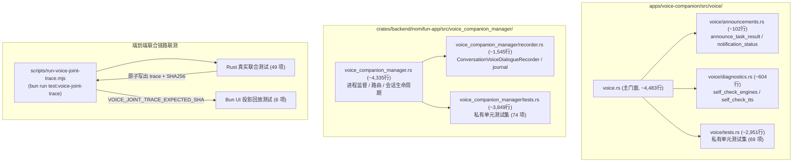

# 语音运行时物理解耦与真实联合链路验收规范 (2026-10-30)

> **状态**：已在 `feat/voice-runtime-improvements`（PR #395）中实施并全量验证通过。
> **基线**：`53fc103d499840354c028d3b2d400fd99191ceb2`
> **责任归属**：`hoye <hoyework@qq.com>`

---

## 一、模块拆分与结构全景

针对旧架构中 `voice.rs`（8,141 行）与 `voice_companion_manager.rs`（9,698 行）大单体，本轮实施了不改变拥有者语义与锁时序的**渐进式物理抽离**：



---

## 二、锁模型与身份归属约束

1. **进程隔离与锁归属**：
   - **Voice Companion 守护进程域**：
     - `driver: Mutex<VoiceSessionDriver>`：仅保护声学状态机流转（`Idle`、`Listening`、`FollowUp`、`DispatchingTask` 等）；
     - `active_turn: Mutex<Option<JoinHandle>>`：管理当前在途单话轮生命周期与取消句柄；
     - `pending_utterances: Mutex<VecDeque<PendingUtterance>>`：维护 FIFO 待识别 PCM 帧队列；
     - `announced_tasks: Mutex<VecDeque<AnnouncementRecord>>`：维护任务结果通知去重历史（容量 64）。
   - **宿主 后端进程域**：
     - `journal_lock: Mutex<()>`：严格归 `ConversationVoiceDialogueRecorder` 拥有，串行化磁盘 journal 读改写与持久化写入；
     - **严禁建立跨进程总锁序**：绝不在 Driver 锁临界区内等待宿主 Journal 写入，二者只通过 HTTP `/complete` 与异步事件通信。
2. **多代次与身份字段定义**：
   - `session_id` / `turn_id` / `command_id`：标识业务层会话与命令归属；
   - `instance_id` / `worker_epoch`：防进程重启后的旧句柄越权；
   - `preflight_epoch` / `reconciled_epoch`：记录预检代次并在合法交接时调和，杜绝历史已完成回执二次消耗。

---

## 三、端到端可移植联测命令

单命令完成 Rust $\rightarrow$ Trace 原子落盘 $\rightarrow$ SHA256 校验 $\rightarrow$ Bun UI 回放测试：

```bash
bun run test:voice-joint-trace
```

### 脚本质量与安全保障
- **环境自适应**：动态解析 `cargo` 与 `bun`（复用 `process.execPath`），杜绝开发者个人绝对路径硬编码；
- **原生挂起归属与有界执行 (CREATE_SUSPENDED)**：通过 Windows 原生 `CreateProcessW` 挂起创建进程，在执行第一条指令前已通过 `AssignProcessToJobObject` 纳入本次 Job，再调用 `ResumeThread` 恢复执行；Assign 失败则就地终止未运行的目标。彻底消除启动与加入 Job 之间的调度竞争窗口，超时（Rust 180s，Bun 45s）触发 `TerminateJobObject` 确保多级派生子树 100% 退出；
- **finally 可靠清理**：即便发生故障或断言失败，统一在 `finally` 中清理独占临时目录，绝不遗留垃圾；
- **密码学指纹验证**：Rust 导出后生产者计算 SHA256，通过环境变量传递给 Bun 消费者，解析前进行严格比对，防篡改与截断。

---

## 四、未测边界声明

1. **ASR 实验冻结**：保留休眠原型逻辑，但默认不启用休眠；
2. **测试替身**：测试采用内存 20ms SPSC PCM 分块与受控识别替身 `JointStt`，未接入真实物理麦克风、物理扬声器硬件或真云大模型端点；
3. **平台与云端**：仅在 Windows 1.6.9/1.7.0 本地环境进行完整构建与测试验收，未在实际生产云环境发起真实流量。
