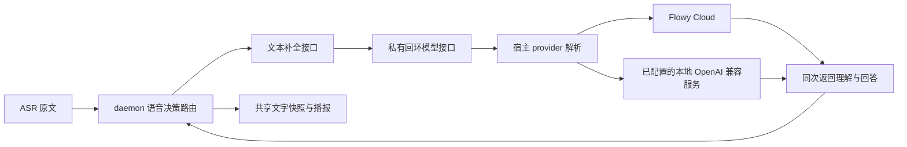

# 语音对话 provider 接入 · 实施方案与证据

> 状态：代码与定向回归通过，真实 Flowy 固定句探针通过；更新后麦克风/播报由 Owner 验收。2026-10-14。

## 1. 问题与接口位置

用户实测已经能唤醒并识别“今天天气怎么样？”，失败位于对话模型连接。本机目录确认 Flowy provider 地址为配置中的 `https://server.flowyaipc.com/claw/v1`，模型 ID 例如 `AIPC-qwen3.8-flash`。旧 daemon 自行读取登录文件、使用 `qwen3.8-flash` 默认值且 HTTP 超时固定 5 秒，没有复用主产品的 provider 解析。

这些是确认的接线差异，不把未记录的那次底层网络错误断言成某一个 DNS/TLS 原因。

| 现有实现 | 职责 |
| --- | --- |
| `nomifun-cloud/src/flowy/mod.rs` | 构造 `/api/v2/model/availableListClaw?category=1` 等目录请求 |
| `nomifun-cloud/src/provider_sync.rs` | 登录后将目录、地址和凭据同步到内置 Flowy provider 与 provider_models |
| `nomi-config/src/server.rs` | effective_llm_base_url / effective_default_llm_model，保持既有环境与服务器配置路由 |
| `nomifun-cloud/src/flowy/llm_chat.rs` | Flowy `/chat/completions` 请求与响应 |
| `nomifun-ai-agent/src/factory/provider_config.rs` | 解析 provider/model 引用、解密凭据、协议兼容与一次性模型调用 |
| `ui/src/renderer/hooks/agent/useModelsForTask.ts` | 使用 `/api/model-profiles/resolve` 的聊天能力目录，不另造模型列表 |

## 2. 接入全景

模型目录、选择和凭据归宿主；daemon 保留声学、提示与语音决策解析。短对话调用复用 `resolve_flowy_cloud_model`、`resolve_provider_config` 和 `one_shot_completion`，不创建任务 Conversation、不初始化任务 runtime、不派发工具。

## 3. 模块与协议

- `nomifun-voice-terminal/src/completion.rs` 的 `VoiceCompletionClient::complete(prompt)` 是可替换的文本模型接口。宿主实现通过 `HostDialogueClient` 接入；未来原生本地模型可实现同一接口，既有独立运行的 OpenAI 兼容配置继续使用原公开入口。
- `nomifun-app/src/voice_dialogue.rs` 的 `ProviderVoiceDialogue` 每次请求解析当前引用。默认从真实 Flowy 聊天目录选择启用的非 Auto 模型；明确选择时校验 provider、模型启用状态、chat 能力与 OpenAI 协议。失效引用报不可用，不悄悄换成另一个 provider。
- 设置页复用聊天目录与 provider 标签，增加语音对话模型选择；保存 `provider_id + model`，没有第二份 API key。公共 GET/POST `/api/voice/companion/config` 只返回模型引用、有效引用和配置可用性，沿用已有 owner 保护。
- 私有接口仅绑定 `127.0.0.1` 的动态端口，凭据由 supervisor 自动通过环境传给 daemon；不是 Flowy 用户登录 token。接口校验 `x-ai-mate-control-token`，限制请求体 64 KiB。客户端不走系统代理、不跟随重定向、拒绝非回环地址；临时凭据和云模型 key 不进入公开快照或命令行。
- 私有请求为 `{prompt}`，返回 `{content}`；Cloud provider 的 JWT/API key 只进入宿主已有客户端。宿主处理预算 28 秒、daemon 私有请求 30 秒；停止后的迟到结果仍由既有 generation 隔离。
- 选择更改在下一次请求生效，无需重启声学进程。配置原子更新保留 autostart 和其他字段，配置保存与开关写入串行化。

## 4. 关键决策

采用宿主解析与现有一次性补全客户端，避免 daemon 复制模型目录、刷新凭据和协议适配。先支持已有 OpenAI 兼容模型；不新增 provider 框架、依赖、数据库迁移或 runtime。

单次模型调用同时生成 understood_request 和 reply_tts，沿用 N 的文字投影。公共数据仍由宿主发布；新增内部模型接口不改变任务授权或工具确认。

## 5. 验证与交付

- [失败基线](O-model-config-red.log)：生产配置入口缺失，实际 404。
- [provider 回归](O-provider-final-tests.log)：真实 SQLite repository、现有 provider 配置解析及 SSE 协议；核对目录模型 ID、Bearer/token 复用、一次上游调用、未授权请求不调用模型、实时切换选择、停用/失效模型拒绝。2 项通过。
- [配置/宿主回归](O-manager-final-tests.log)：7 项通过，选择与启用意愿互不覆盖，公共结果无 token/key。
- [生产 worker](O-worker-tests.log)：9 项通过，同一回复测试分别跨独立 OpenAI 与宿主接口，验证一次调用、理解/正文保留和 TTS 失败。
- [语音库](O-terminal-tests.log) 31 项通过；[前端](O-ui-tests.log) 40 项通过，包含聊天目录过滤及六个请求的 same-origin 凭据契约。
- [真实 Flowy 探针](O-live-provider-probe.log)：当前目录 `AIPC-deepseek-v4-flash` 返回可解析 JSON，约 2259 ms。只读打开当前 DB，使用已有宿主凭据解析；一次固定连接测试，无用户录音、无麦克风/扬声器。不是完整语音延迟或物理播报证明。
- [Rust 检查](O-cargo-check.log) 通过；i18n、theme、CSS scope、按钮布局、进程边界、Windows 控制台门禁通过。最终类型检查仍为 60 个其他模块错误，无本次语音路径错误：[O-final-typecheck.log](O-final-typecheck.log)。
- 默认宿主/daemon 与最终 SPA 构建记录：[O-default-build.log](O-default-build.log)、[O-final-build-ui.log](O-final-build-ui.log)。原始失败及中间构建记录保留，最终状态以对应结束结果为准。

用户已确认退出应用。同步更新宿主和 daemon 后重新启动，设置页可使用自动 Flowy 模型或显式选择目录模型；唤醒后核对原文、需求理解、回答与声音。真实录音、播报、断线/登录变更、Mac/Linux 和安装包仍待验收，不能把固定句探针当作 V0–V8 全部完成。

## 6. 原始需求归档

> 效果不错，可以识别到激活，不过最后对话模型连接失败，检查这个llm是flowy自己的provider的模型列表，检查一下接口在哪里写的，并且接入到语音伴侣，注意要做好解耦准备，方便后续可能交给本地模型，做好接口抽象

范围沿用已授权完整纵向计划，新增 O 优先处理模型接入；既有 PRD、技术方案、执行原文与历史证据保留。

## 7. 语音默认模型偏好追加（2026-10-14）

> 为什么不改为qwen3.8-flash？或者v4.1flash？他们回复很快且消耗低

先前自动选择沿用目录中的第一个启用聊天模型，没有按语音体验偏好排序。现在仅在语音伴侣未明确选择模型时，依次检查真实目录引用 `AIPC-qwen3.8-flash`、`AIPC-deepseek-v4.1-flash`，再沿用原有 Flowy 聊天目录选择。每个优先引用都经过既有 provider 启用、模型启用、chat 能力及协议校验。明确保存的模型继续优先，失效引用仍报不可用。没有修改全局默认 resolver、其他聊天或任务模型，没有新增配置和依赖。网络请求失败不会触发另一个模型的隐式重试。

- [旧逻辑失败断言](O-default-preference-lib-red.log)：目录第一项覆盖语音偏好，实际返回 `AIPC-fixture-chat` 而非 Qwen。
- [回归通过](O-default-preference-green.log)：2 项通过，覆盖默认 Qwen、停用后 V4.1、两者停用后原目录、手动选择保留及失效手动引用拒绝。此前宽范围命令遇到集成测试 rlib 链接失败，记录保留在 [O-default-preference-red.log](O-default-preference-red.log)，不作为产品行为失败证据。
- [真实 Qwen 探针](O-default-qwen-probe.log)：只读当前 DB，使用已有 provider 配置发出一次固定句请求，自动解析为 `AIPC-qwen3.8-flash`，4018 ms 返回有效 JSON。没有麦克风或物理扬声器验证。前次 V4 Flash 的 2259 ms 是另一时刻单次样本，不能据此比较总体速度；本轮没有价格对照证据。
- [宿主检查](O-default-preference-check.log)、[默认宿主构建](O-default-preference-build.log)：以日志结束状态确认。仅更新宿主选择逻辑，daemon 接口保持现有协议。

重启宿主后，设置页保持“自动使用 Flowy Cloud 对话模型”即可应用新的优先级；显式选择其他模型时继续使用该选择。真实录音、回复质量与完整首音延迟仍由 Owner 验收。

最终定向格式检查、`cargo check --locked -p nomifun-app`、`cargo build --locked -p Flowy` 均退出 0。构建前确认无 Flowy/ai-mate 进程；默认 `target/debug/Flowy.exe` 已更新，构建耗时 1 分 16 秒。未启动应用进行录音或播音。
