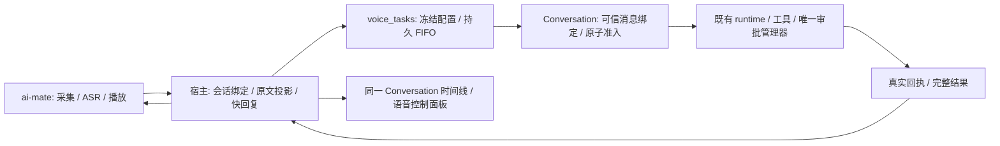

# 语音伴侣 R1–R5 · 进度核验与串行执行辅导

> **2026-10-21 推进方式调整建议**：用户希望连续推进到 R5，再集中补强。本轮建议将“每小片等待独立签核”改为“单执行者连续纵向开发、相关自动烟测随改随跑、功能贯通后集中独立复审”。详见 [§8](#8-连续推进-r1r5-与集中验收建议)。这是开发组织方式的建议，不撤销已确认缺陷，不代表 R1.2 签核或启动了本轮业务开发；原逐片审查记录保留。

> **状态**：📋 后续实施交接；2026-10-21。代码处于 `feat/xiaozhi-voice`，HEAD `5800811c7e3fb76e43b32afdda9916357f70d900`，另有未提交服务层与文档改动。
> **用途**：告诉后续执行者从哪里开始、怎样验证、何时停止推进。本文是实施辅导，不是功能完成声明或发布授权。
> **依据**：[v0.4 PRD](../PRD-voice-companion-v0.4.zh.md)、[rev2 方案](flowy-voice-qoder-alignment-plan-2026-10-20.zh.md)、[R1 实施记录](R1-voice-message-task-execution-plan-2026-10-20.zh.md)。产品冲突先写明，不用新指南覆盖历史决定。
> **执行原则**：串行；不派并行 Agent；不自动提交、推送、发布。只在前片自动出口通过后进入后片。真机、安装、Owner 验收分别留证。

> **同日最新 R1.2 复审**：已新增生产排队入口，C1 已修复；C2 的近期重启去重有测试，但持久失败边界未闭合。R1.2 为部分实现、未通过出口；最新问题与给执行 Agent 的修复顺序见 [§7](#7-r12-实现后复审及下一轮执行细则)。§1 是前一次快照，保留历史，不能据此认为完全没有 R1.2 代码。

## 1. 当前情况与首先要解决的问题

现有基础链路已有代码：KWS → ASR → 快模型 → TTS，复杂任务通过宿主交给已有 Conversation/runtime。此次 R1 改造要解决的是“原文、短回复、后台任务、结果在同一个工作区语音 Conversation 中连续推进”，不是重新实现工具执行器。

| 阶段 | 本次核验状态 | 可以怎样汇报 |
| --- | --- | --- |
| R1.0 契约验证 | 核查已有；公开/私有样例、队列状态表、冻结/代际语义尚缺完整出口证据 | 契约已开始落实，待补证 |
| R1.1 存储/可信绑定 | 已有 DTO、服务接缝、SQLite 身份/竞争测试；仍有策略与采集缺口 | 服务层部分实现，未签核 |
| R1.2 同 Conversation/FIFO | 新接缝尚无生产宿主调用，旧单活动任务逻辑仍拒绝第二项 | 未完成，不能演示为新版时间线/队列 |
| R1.3 有界上下文 | 旧 handoff 已有部分实现；未接入新版同 Conversation/FIFO 契约 | 新版集成待做，不能把旧能力计为新出口通过 |
| R1.4 回归/证据 | 历史局部测试存在；当前快照尚未完成纵向验收 | 未完成 |
| R2–R5 | 有旧能力可复用；新版阶段未通过 | 后续计划，不能按已有文件数量计算完成度 |

### 1.1 上轮 F1–F4 的复核

| 问题 | 当前事实 | 本轮判定 |
| --- | --- | --- |
| F1 消息/回执身份 | [service.rs](../../../../crates/backend/nomifun-conversation/src/service.rs#L10388) 从 bound message 取候选 ID；SQLite 测试检查首次、receipt、replay 都使用预投影 ID | 核心修复已落代码；查询、继续回答、取消/审批仍需补测 |
| F2 非原子抢绑 | 去掉消息中提前覆写 owner；以 receipt 的唯一 message ID 与事务裁决；DB 将另一 operation 占用映射为冲突 | 核心方向成立；双 pool 测试只断言恰一成功，没有断言失败方一定为 Conflict，也没有执行次数与中断恢复证明 |
| F3 scope/epoch | DTO 增加 command、expected workspace/epoch；发送检查原文/command/当前 epoch，准入事务消费 epoch | 部分修复；下述 C1 仍阻断 |
| F4 append 重试 | 同 ID/原文/command 可成功重试并重播用户事件，插入竞争后重读 | 存储重试已有；下述 C2 仍阻断“一次采集” |

### 1.2 当前必须处理的两个问题

**C1 [Required，Standards + Spec] 禁止用普通工作区代替语音策略标记。**

[service.rs:9007](../../../../crates/backend/nomifun-conversation/src/service.rs#L9007) 通过 `voice_task_workspace.or_else(workspace)` 取得策略根目录。只有普通 `workspace`、没有语音策略 stamp 的会话仍可能通过绑定。真实 Nomi 装配仅在 [factory/nomi.rs:225](../../../../crates/backend/nomifun-ai-agent/src/factory/nomi.rs#L225) 读取 `voice_task_workspace`，缺失时没有该语音工作区限制；确认/取消边界又要求该字段存在。这会形成发送与控制不一致。

最小修复：绑定执行必须要求可信创建路径写入的 `voice_task_workspace`；同时检查 canonical 工作区一致，不以普通 workspace 作 fallback。新增“voice=true + workspace 存在但无 voice_task_workspace”的拒绝测试；断言无 receipt、无 runtime 初始化/工具调用。不要改成全局 yolo，也不要放宽工具权限来让测试通过。

**C2 [Required，Standards + Spec] 用户事件重播需要采集去重。**

[service.rs:9181](../../../../crates/backend/nomifun-conversation/src/service.rs#L9181) 对相同 append 重试再次发 `message.userCreated`。当前 [collector.rs:638](../../../../crates/backend/nomifun-companion/src/collector.rs#L638) 只保留 conversation/content，不保留 msg_id；[collector.rs:749](../../../../crates/backend/nomifun-companion/src/collector.rs#L749) 每次生成新 event_id。因此采集开关开启时，同一原文重试可产生多条学习输入；UI 以消息 ID 合并不能解决此问题。

最小修复：保留稳定来源身份，在语音投影的持久恢复范围内实现消费者幂等；重启后也不能重复采集，采集关闭时不得偷偷记正文或启用采集。可以扩展现有事件记录/投影收据，不新增通用 outbox。只改语音来源，普通历史来源保持现状。用真实 collector + 真实事件存储测试“首次事件、重复事件、重启再投递”只生成一份用户原文；不要通过停止重播而重新打开落盘后丢事件的窗口。

当前广播尚无明确语音来源字段；补稳定 `msg_id` 的同时，按既有 DTO/事件契约显式标记 `input_source`/voice stream，不能让 consumer 靠内容猜测来源。R1 只补语音原文幂等所需字段与消费，R4 再扩展冻结 memory owner；不要为方便去重改变所有普通事件的采集语义。

**补测缺口不等同于发现了新的运行故障：** 旧回执读取/继续、同 key 改模型输入或 digest、查询/控制同消息 ID、用户/消息类型错误、真实模型输入与公开事件隔离、原子准入前后中断，以及 A 忙时 B append，仍需分别留证。

Standards：身份修复方向可接受，策略缺失容错和消费者重复采集未通过。Spec：R1.1 仍是部分符合，R1 端到端尚未通过。详细复跑结果写入 [R1 记录最新节](R1-voice-message-task-execution-plan-2026-10-20.zh.md)，不能直接沿用昨日测试数量。

## 2. 方案全景、权威和模块边界



### 2.1 不变量

- daemon 不拥有 Conversation、provider key 或工具权限；宿主是公开快照的单一写入者。
- 快模型只回复/澄清/委派；不新增语音专用天气/搜索/文件业务，不把委派 ACK 当作已接单。
- app → conversation → nomifun-ai-agent → 既有 runtime；不改 `crates/agent` harness，不新增第二套审批。
- 对象分别保留 session_id、turn_id、command_id、message_id、send_key、runtime_turn_id。运行前最后一项为空。
- ledger、消息 SQLite、通知/事件是多个持久化边界；靠稳定身份与恢复协议衔接，不伪装成同一事务。
- 停止播放、结束语音连接、取消排队项、取消执行项是不同控制；前两者不自动取消已接受任务。
- 每片“代码完成 / 自动测试通过 / 实际网络通过 / 真机通过 / Owner 验收”分栏记录。无证据的栏保持未验证。

### 2.2 旧文档冲突及实施口径

| 项目 | 当前指导 | 实施前要锁定什么 |
| --- | --- | --- |
| 30 分钟 | 队列等待、执行预算、Conversation 轮换是三个计时器 | v0.4 要按最后用户交互轮换，当前事实文档又记有“轮换暂缓”。R1 先保证工作区语音会话和任务身份连续；实现自动轮换前解决这一冲突，不能借查询回执续期，也不能每条语音重建会话 |
| 队列等待上限 | PRD 候选默认 30 分钟，容量为 8 个等待项 + 1 个活动项 | 尚非实测结论；作为实施默认时在产品记录中明确，不先扩展容量配置 UI |
| 单句时长 | 旧版本 30 秒；v0.4 建议 60 秒 | R3 前固定一个值及边界测试，不能把 180 秒无输入期限当成可无限录音 |
| 快模型 | R1–R4 复用现有 provider/local compatible 接缝 | 不因 R5 未选型而更换当前可用链路；不偷偷下载本地 LLM |
| 伙伴 | 一个名为 Flowy、形象为 Bolt 的默认伙伴 | 不是默认创建两个实体；不复用 companion_session 充当语音 Conversation |
| Piper | R5 独立资源/分发门禁 | 引擎、phonemizer、voice、版本及许可证整体审查；未通过时继续 Edge/文字能力 |

### 2.3 接缝契约检查表

以下区分现有接缝和下一片需要补齐的内容，不表示新增字段已上线。HTTP DTO 仍归 `nomifun-api-types`；可信 bound send 是宿主内部能力，不开放任意前端传消息 ID 领取执行权。

| 接缝 | 已有事实 / 后续要求 | 拒绝或重放规则 |
| --- | --- | --- |
| ASR → 宿主记录 | 原文及声学 session/turn/record；先确认本机 owner、工作区、语音 Conversation | 旧连接不覆盖当前连接；同 record 内容变化冲突 |
| append_voice_message | 已有 user/conversation/message/display_text/command 参数 | 相同稳定身份重试吸收；不同原文/来源冲突；事件恢复对 collector 幂等 |
| send_voice_bound_message | 已有 message/display_text/command/expected_admission_epoch/expected_workspace/content/digest；files/skills/origin 等沿用发送契约 | 缺真实策略 stamp 拒绝；完整输入变更冲突；既有 receipt 只核对，不重新执行 |
| app ledger → task runtime | 当前 send 仍只收 goal，R1.2 改为传递已冻结的可信绑定与配置 | 不读取 renderer 当前值；同 command 不同输入冲突；未接受不生成 runtime_turn_id |
| 任务控制 | command/send_key/conversation/message/runtime turn 与真实调用/审批身份 | 旧窗口、错任务、过期审批冲突；取消请求不是取消终态 |
| 结果/播放 | 完整结果身份与 notification/attempt/播放回执分别保留 | 任务终态不因 TTS 失败改变；播放重试不重新执行任务 |
| 事件/快照 | 宿主 instance_id/seq；只更新各自拥有的字段，公开事件不含私有 handoff | 旧实例/旧序号不覆盖新状态；全量快照用于重连校对 |

模型输入和上下文 digest 必须一起持久化，digest 不承担恢复正文或权限证明的职责。代际检查要写明“历史回执观察允许、首次副作用拒绝”的区别，避免旧任务核对被工作区变化阻塞后一直 unknown。

## 3. 分阶段详细执行

### 3.1 R1.0 / R1.1：关闭服务层缺口

**阅读入口：** `nomifun-api-types/src/conversation.rs`、`nomifun-conversation/src/service.rs`/`service_test.rs`、`nomifun-db/src/repository/sqlite_conversation.rs`、`nomifun-companion/src/collector.rs`，以及上文 C1/C2。

执行顺序：

1. 固定当前代码哈希与 diff；补公开 JSON 原文/私有 payload 的样例、FIFO 状态表及身份关系。区分消息产生时的会话有效代际、每次 turn 的 admission epoch；别把正常 A→B 执行误判为过期。
2. 给 C1/C2 写失败测试，做最小修复；保留已通过的候选 ID 和唯一约束修复。append 的正常分支和并发插入失败后重读分支必须检查相同的类型/position/hidden/正文/command 条件。
3. 扩大 SQLite 测试：首次/回执/重放/查询 ID 一致；两实例竞争失败方明确 Conflict；工具实际只执行一次；相同 key 改正文/digest 冲突；错误 owner/Conversation/command/epoch/workspace 拒绝且无写入。
4. 验证旧 payload 和继续回答；模型收到私有正文，公开历史/用户事件/collector 没有该正文。重试事件消费者幂等必须在本片解决，owner 归属扩展仍留 R4。
5. 增加 A 被测试 barrier 阻塞时 append B 的服务层测试：A 的运行身份不变，B 可落盘，不靠 sleep 猜时序。

**出口：** C1/C2 关闭；上述失败路径与受影响 crate 验证有日志；修复复审通过。当前不是“再把原来 5 个测试跑绿”就能退出。

### 3.2 R1.2：生产同 Conversation + 最小持久 FIFO

**阅读入口：** [voice_companion_manager](../../../../crates/backend/nomifun-app/src/voice_companion_manager.rs)、[voice_tasks](../../../../crates/backend/nomifun-app/src/voice_tasks.rs)、[voice_task_runtime](../../../../crates/backend/nomifun-app/src/voice_task_runtime.rs)、[useConversationCommandQueue](../../../../ui/src/renderer/pages/conversation/platforms/useConversationCommandQueue.ts)。

先写两个纵向失败测试：① A 运行中说 B，② B 的模型/预设在排队时被修改。再按下面顺序实现：

1. 宿主根据明确工作区创建/复用专属语音 Conversation；主窗口当前会话用于确定工作区，不借用任意正在聊天的 ID。桌宠/托盘/快捷键必须传递或由宿主确认工作区，无法确认时只走默认入口；已冻结任务失效不得改投默认。
2. 原文到达后预留稳定 message/command 身份并保存待交付记录，调用 append；快回复独立追加，不等 runtime 才让用户看到原文。不同消息不能复用 command 或回写运行中的 A。
3. 扩展现有 ledger 为有界 FIFO；先持久化排队收据，再发 queued。保持一条执行权威，不另建 renderer/localStorage 队列。锁只包住读取/转移/保存，不把完整模型/任务运行时间锁住，以免 B 无法入队。
4. 入队冻结实际 `VoiceModelRef`、`ResolvedPresetSnapshot`、session mode、canonical workspace、Conversation、上下文与 message ID；出队重验。初期不新增数据库表或通用调度框架。
5. 修改适配 send 接缝以携带完整可信绑定，不再只收 `goal: &str`。复用 R1.1 的 message ID 进入既有发送准入；不要临时普通 send 或新建“语音任务”Conversation。
6. 同步调整查询、取消、确认和结果投影，均绑定 command/send_key/message；新 Conversation 通过可信创建路径 stamp `voice_task_workspace`。终态结果与快回复留在同一时间线，避免现有结果通知再次追加重复答案。
7. 同语音 Conversation 的键盘输入也经过该宿主准入。R1 先确保不会绕过队列争抢；R2 继续完善键盘/语音并发恢复。键盘消息默认不播报。
8. 最小 UI 显示 waiting/active/unknown、排队位置及失败原因，复用现有会话组件；控制面板不再复制完整另一套会话状态权威。

**出口：** A 忙时 B 原文与队列收据可读、A turn 未变；A 终态后 B 使用原 message 执行；满 8 项明确拒绝；unknown 暂停派发；配置失效明确 blocked/rejected；普通 Conversation 无回归。

### 3.3 R1.3：有界上下文 handoff

1. 从同 owner/同工作区语音 Conversation 读取已确认历史：用户快聊原文、已完成快回复、真实任务结果；记录 source conversation/message/command、采样边界与截断标记。
2. B 进入队列时冻结 B 的输入上下文与正文/digest。默认不包含未来才完成的 A 结果；若产品要求 B 消费 A 输出，必须显式记录依赖并在第一次发送前形成新的最终冻结版本，不能悄悄改变同 key 的 payload。
3. A 的模型上下文不能包含尚未执行的 B/C；不能把 UI 时间线全量灌回 runtime，也不能用 steer 来实现队列。
4. handoff 内容包含用户原话、理解需求、实际任务目标、确定的地点/指代、必要环境和输出要求。上下文只是输入资料，不扩大工具授权；实际时间/时区来自宿主，不能写死日期或猜测城市。
5. 限制总字符/token/条数，复用现有摘要与上下文选择；截断保留否定、关键数字和来源。完整私有输入可恢复，但不得作为用户原文进入公开事件。
6. 先用“我在深圳”→重连→“天气怎样”的受控模型测试检查真实输入，再做实际 provider 的独立验证；不要让外部天气网络波动充当核心上下文门禁。

**出口：** 同工作区跨声学连接可引用；异工作区、未执行排队项及未验证成功均不混入；同 key 更改冻结输入明确冲突；重启不靠 digest 重建正文。

### 3.4 R1.4：R1 联合回归与交接

- 扩展现有真实 runtime 读取测试，运行时生成随机文件内容；受控模型只决定调用，文件由真实 runtime 工具读取。证明没有另外创建任务子 Conversation。
- 固定音频进入生产 worker → 宿主 API → 同一 Conversation → FIFO → 真实读取 → 结果文字/播放回执。分别记录“模型/TTS 是受控依赖”和“真实外部网络”，不能把前者称为真人播报通过。
- 先 API 注入 B 验证队列；R3 再验 A 识别/思考时真实连续 B/C 输入，避免把声学缓冲问题混成 R1 队列故障。
- 回归查询、显式取消、一次工具审批、停止声音/关连接不取消任务、TTS 失败保留文字；旧普通发送与旧回执继续可用。
- 新队列未发送项重启默认暂停；delivering/unknown 只核对旧回执，不能自动执行下一项。完整恢复 UI 留 R2，基本不重复执行不能后置。
- 按 §5 联合检查并记录产物路径/feature/hash；真人设备与安装仍交给 Owner。

**出口：** R1-T01–10 逐项有证据，重点 V4-AC-01–05；R1 才可标记自动验收通过。未通过部分写明，不通过“改断言/换 fallback”放行。

### 3.5 R2：队列故障、控制与恢复

**前置：** R1 自动门禁通过。复用既有 submit/status/cancel、持久 ledger 和回执观察，不增加第二调度服务。

1. 明确状态与事实：queued、delivering、accepted/running、cancelling、terminal、unknown/needs_review；queued 不代表 runtime 接受，unknown 不是终态。
2. 给每项保留不可变身份与冻结配置；队列等待从 queued 计，执行预算从真实接受计，准备/发送另外有界。到执行预算发取消并保持 cancelling，直到真实终态；不能因本地计时器走完就宣布已取消。
3. 排队取消只转移该项；运行取消定位准确 send/message/turn。replace 必须显式请求并等待旧项真实终态，不能 cancel API 返回就启动替代项。
4. 每个持久化边界注入中断：ledger 预留、用户投影、排队收据、发送开始、准入提交、结果提交、播放回执。重启先只读核对；已发送但无确定结果不得换 key 重发。过期未发送项不自动恢复；用户选择恢复时也只派发证明未发送的项。
5. 同一语音 Conversation 的键盘/语音 FIFO 顺序由宿主决定，UI 不再维护会执行的平行队列；两个标签页/重连/旧窗口请求必须冲突或吸收。
6. 账号 token 更新只改变 provider 可用性，本机文件环境不迁走；owner/scope 隔离按本机身份处理。不要把退出云账号解释成销毁本机后台任务。
7. 回执查询和取消/确认只读或控制当前绑定；旧审批不能跨任务复用，不给“永久允许”口头授权。保留用户已有合法 session mode 和语音工具策略的交集。

**必测：** 重复 submit、同 ID 改目标/上下文、文件写失败、create/send 响应丢失、两实例争抢、重启各状态、取消 A/B/C、replace 竞争、旧审批、期限到达、工作区/模型/预设变化、语音键盘并发。断言工具副作用计数与随机内容，不只看提示出现。

**出口：** TC-VOICE-05/12/13/14/15/20/21、V4-AC-04/05 全部有证据。未解决 unknown 的队列保持可见暂停，不能转成“完成”。

### 3.6 R3：连续倾听、180 秒与半双工

**入口：** `apps/ai-mate/src/voice.rs`、`nomifun-voice-terminal` 状态机、`nomifun-audio`、宿主快照与语音面板。任务队列和声学待处理缓冲是不同对象。

1. 将声学 idle/listening/recognizing/responding/playing/failed 与任务状态分开投影；音量事件只更新声学字段，不能清掉任务/审批/结果。
2. 就绪后及实际播放结束后计算 180 秒无有效输入；噪声不续期。任务、审批、结果待播期间延后连接空闲结束，但仍有各自执行/审批/播放期限。
3. 单句硬上限、识别超时、快模型首响应/总响应超时独立；先锁定 §2.2 的 30/60 秒冲突。ASR/模型变慢时不能无限挂起会话。
4. 非播放时继续收录 B/C 到有界待识别缓冲，保留每句身份并串行消费；满时明确反馈，不能默默丢音，也不能 abort A 的 active_turn 来接 B。
5. 无 AEC 时继续半双工：本机 TTS/提示音期间暂停普通语音识别，避免回声自触发；审批听取从提示播放真正结束开始，最多 8 秒并受执行侧期限限制，不能重新生成 60 秒展示期限。
6. 设备断线/流停止立即更新故障并结束采集，不等 180 秒，也不自行重开麦。停止/恢复需要新的有效作用域，丢弃旧播放/识别结果。
7. 播报失败、静音、中断、成功分别记回执；文字结果已保存时释放 result_pending，恢复空闲计时。提示音不重复排队、不盖过用户讲话。

**必测：** 假时钟覆盖 179.999/180 秒、讲话边界、识别卡住、播完后计时、播报失败释放、任务/审批延长、关闭连接任务继续；固定音频 A/B/C 延迟链、缓冲满、回声、断麦；最后真人验证设备和离屏阶段提示。

**出口：** TC-VOICE-01/02/11、V4-AC-08/09；自动时钟/回放与真人麦克风/扬声器分别签核，不承诺 Qoder 同等延迟。

### 3.7 R4：默认 Flowy/Bolt、入口和记忆归属

**入口：** `nomifun-companion/src/service.rs`/registry/store/collector/learner、宿主 services bootstrap、语音 recorder、桌宠 UI 与设置。

1. 首次空 roster 在宿主 bootstrap 创建一个 Flowy/bolt；已有伙伴不重复创建。创建和删除使用同一 roster 修改权威，锁内复查，至少保留一个。失败不留下配置和磁盘不一致；如可多宿主写同目录，进程内锁不足，先明确已有单实例约束。
2. 新装默认显示 Bolt；升级尊重已隐藏偏好，不自动开麦、启用语音或学习；后端拒删最后一个，UI 双语解释。
3. 语音伙伴全局选择，连接/消息/队列项冻结 memory owner。当前连接不随后续选择改归属，删除伙伴后仅未来输入回退，不重写历史事件。
4. 不复用 companion_session，不传播伙伴模型到工作区任务模型；仅注入经允许的人格/记忆与采集归属，避免知识挂载、XP 和模型传播副作用。
5. C2 的来源去重在 R1 已解决；本片扩展 input_source/message_stream/memory_owner 到 collector 与 learner，两个模块都按冻结 owner 筛选。保持 `origin` 非代理注入语义；不要设置 origin=voice 导致真实原文被过滤。
6. 采集开关关闭则不采集；控制操作不入历史；隐藏 handoff 不作为用户原话；既有非语音来源保留原规则。事件 schema 的兼容若涉及持久化文件格式要明确，不用反序列化默认值掩盖错误归属。

**必测：** 空库/已有库、两次 bootstrap、并发创建/删最后两个、写失败、隐藏偏好、选择切换/删除、learner 不跨 owner、关闭采集、重复事件/重启、普通伙伴 XP/知识/模型不回归。

**出口：** TC-VOICE-06/07/16/19、V4-AC-06。默认伙伴存在不等于用户已授权麦克风或记忆采集。

### 3.8 R5：本地模型/TTS 与三端资源

**前置门禁：** 不先开写模型/音素转换器。选择现有补全/TTS 接缝，再提交具体引擎、phonemizer、voice、版本、许可证、调用/分发方式、SHA256、体积、安装目录、CPU/RTF 报告；涉及新依赖、资源/打包按项目规则单独审查。

1. 本地 LLM 通过既有 OpenAI-compatible/provider 适配接入独立快模型槽位；保持任务模型独立、凭据不进入 daemon；不可用明确显示原因，聊天/任务状态不伪装成功，不自动下载。
2. TTS 沿用现有路由和播放回执：Edge 首选；本地能力就绪后才允许失败回退。引擎和音色都未准备好时只保留 Edge/文字，不显示离线就绪。
3. 区分连接/429/首音/解码错误，使用有界重试与冷却；首音前可以整句切本地，播过半句不能偷偷重播整句。下一句切本地，当前句记 interrupted，用户可显式重播。
4. 结果只执行一次，TTS 重试不能再派 runtime。完整文字保存，摘要保留否定/关键数字，长度上限与实际播放 20 秒目标分别测。
5. 本地音频默认 CPU，测目标机器的 RTF、内存与首音；不宣称候选 4 核/8 GB 已是最低配置，不把 Edge 网络测量当作本地性能。
6. 三端分别验证引擎、音素依赖、资源寻址/校验、安装/卸载、缺失/损坏和播放。Windows 通过后仍保留 Mac/Linux 未验证状态。

**出口：** TC-VOICE-08/09/17/18、V4-AC-07/08，加资源/许可证与各平台实际产物证据。Piper 门禁未过时 R5 保持部分完成，R1–R4 的已验能力可单独交付。

## 4. 关键取舍与阶段边界

| 取舍 | 采用方式 | 防止的问题 |
| --- | --- | --- |
| 会话目标 | 专属工作区语音 Conversation；runtime 复用已有能力 | 原文/结果分裂、每条任务新开对话、误夺当前普通聊天 |
| 消息投影 | 公开原文 + 私有冻结输入；可信绑定同一 ID | 隐藏 prompt 被当用户发言、重复气泡与控制身份分叉 |
| 排队 | app 既有 ledger 扩展，renderer 只显示/发控制 | 双队列抢 runtime、关 UI 后丢队列 |
| 声学缓冲 | R3 独立有界输入缓冲，仍不流式 ASR/AEC | 把后台排队误当作已经接住用户声音 |
| 审批 | 唯一管理器、实际 call 身份、明确同意 | 模糊 ASR 默认批准、旧审批延长或跨任务执行 |
| 记忆 | owner 冻结、原文采集幂等、遵守开关 | 重复学习、跨伙伴归属、模型/知识副作用 |
| 本地资源 | R5 独立门禁，前四片保持现有 provider | 未选型资源拖住主流程、许可证/三端能力误报 |

## 5. 验证命令与证据操作

### 5.1 执行前和日志

在仓库根目录先记录 `git status --short --branch`、`git rev-parse HEAD`、目标文件 diff/hash。保留所有其他 Agent 未提交工作；同一时间只安排一个 Cargo 构建权威。遇构建目录锁先核实进程，不删锁、不停止别人的构建，也不为绕锁引入新依赖。

下面是供后续执行的命令，不表示本轮已执行。原生工具失败保存退出码与日志；测试过滤须检查实际 running 数和名称，0 个测试不是验收。日志放忽略目录 `target/voice-review/`，交接正文只放结果与脱敏证据，不提交大日志、token 或用户完整私有输入。

### 5.2 R1.1 最小验证

```powershell
cargo check --locked -p nomifun-api-types -p nomifun-db -p nomifun-conversation -p nomifun-app --lib
cargo test --locked -p nomifun-conversation --lib voice
cargo test --locked -p nomifun-companion --lib collector
cargo test --locked -p nomifun-db
cargo test --locked -p nomifun-conversation
git diff --check
```

后两条可能命中既有失败，必须记录用例与基线证据；不能把 `--lib` 全绿写成完整 crate 全绿。昨日执行者报告 `acp_artifact_turn_history` 三项基线失败，本轮未独立重现前保留“他方报告”标记。需要复现时可用 `cargo test --locked -p nomifun-conversation --test acp_artifact_turn_history`；不要在当前脏工作区 reset 到 HEAD。

### 5.3 R1.2–R2 的入口/队列验证

```powershell
cargo test --locked -p nomifun-app --lib voice_tasks
cargo test --locked -p nomifun-app --lib voice_task_runtime
cargo test --locked -p nomifun-app --lib voice_companion_manager
cargo test --locked -p nomifun-app --lib a_captured_voice_task_reaches_the_host_real_read_and_spoken_result
cargo test --locked -p nomifun-conversation
bun test --cwd ui src/renderer/pages/voiceSession src/renderer/pages/conversation/platforms/useConversationCommandQueue.test.ts
bun run typecheck
```

新增 FIFO、崩溃恢复、同 Conversation 用例需要真正添加；旧用例默认仍可能通过旧任务 Conversation，不能只跑它们替代新版验证。配置了本地 KWS/VAD/ASR 资源后，再显式运行：

```powershell
cargo test --locked -p nomifun-app --lib installed_acoustics_reach_a_real_read_and_return_the_result -- --ignored
```

执行前可用 `cargo test --locked -p nomifun-app --lib installed_acoustics_reach_a_real_read_and_return_the_result -- --list` 确认只匹配该用例；若使用 `--exact`，必须使用含模块路径的完整名。此测试说明为真实声学资源回放、受控对话/合成、真实 runtime Read，**没有真人麦克风和扬声器**。

### 5.4 R3 / R4 / R5 的增量验证

```powershell
# R3：声学、状态机、宿主投影
cargo test --locked -p ai-mate
cargo test --locked -p nomifun-voice-terminal
cargo test --locked -p nomifun-audio
cargo test --locked -p nomifun-app --lib voice

# R4：伙伴创建删除、collector/learner，再验宿主接线
cargo test --locked -p nomifun-companion
cargo test --locked -p nomifun-app --lib companion

# R5：TTS 路由和模型资源；真实联网及本地 CPU 测量另列记录
cargo test --locked -p nomifun-voice-terminal
cargo test --locked -p nomifun-voice-models
cargo check --locked -p ai-mate --bin ai-mate
```

修改 UI 字典先 `bun run gen:i18n`，补中英文行为断言，再 `bun run check:i18n` / `bun run check:theme` / `bun run check`。真实 provider/Edge 的测试应显式选择已有联网用例并记录环境，不把正常断网替身测试当作真实服务证据。

### 5.5 集成节点和最终联合产物

```powershell
cargo fmt --all -- --check
cargo check --workspace --locked
bun run check
bun run build:ui
cargo tree --locked -p ai-mate --edges normal,build,features
cargo check --locked -p Flowy
bun run build:win
```

生产 feature 图只检查 normal/build，不让测试依赖启用的 skeleton 混为生产证据；打包沿用 [prepare-voice-companion.mjs](../../../../scripts/prepare-voice-companion.mjs) 与既有 Windows 构建流程。构建命令不是发布指令；不调用签名上传、更新源发布或 Git push。锁住旧 exe 时先做其余检查，在替换产物前由 Owner 确认应用已退出，不擅自终止实测实例。

联合产物须记录 Cargo 实际输出路径、宿主/daemon/UI 对应代码身份、feature、文件大小/hash、资源定位顺序。不能假定一定输出在 `target/debug`；不把旧安装包中的 daemon 与新宿主混用。

### 5.6 每片交接模板

```text
阶段/代码基准：
修改文件与行为：
本片契约和冻结字段：
失败复现/根因/最小修复：
命令、退出码、实际测试数、日志路径：
生产调用链证据（不能只有服务层测试）：
基线失败 / 本片回归 / 环境阻断：
真实网络 / 真机 / 安装 / Owner：分别填写
下一片入口与尚未解除的门禁：
```

## 6. 分片交付、Owner 路线和停止条件

| 交付节点 | 自动出口 | Owner 重点 |
| --- | --- | --- |
| R1 | 同时间线 + 真实任务 + 基本 FIFO + handoff | 同工作区连续发两项；原文/快回复/结果可见；任务不新开子对话 |
| R2 | 幂等、恢复、取消、replace、并发、期限 | A/B/C、取消 B、断网重启/恢复；无重复副作用；旧审批拒绝 |
| R3 | 连续倾听、缓冲、180 秒、半双工 | 离屏提示、连续说话、播完计时、拔麦克风、关连接后台继续 |
| R4 | 默认伙伴、原子 roster、owner 采集/学习 | 新装/升级隐藏偏好、切伙伴、采集开关、不能删到 0 |
| R5 | 资源/分发门禁 + TTS 路由 + 三端分别实测 | 断网/缺模型/半句失败，文字可见；各平台实际声音和安装 |

每片先走一条最小真实纵向路径再补边界；不做完五片才第一次联调。任何出现重复工具副作用、跨工作区/owner 执行、未知结果被标成功、旧审批执行或隐私开关被绕过，先停在当前片复现与修复，不进入后片。

本文新增的是执行指导，没有宣称已完成后续工作。原 PRD、rev2、R1 §7/§8 历史记录保留；后续按日期和代码指纹追加证据，不能删除失败历史换取“进度全绿”。

## 7. R1.2 实现后复审及下一轮执行细则

### 7.1 当前可以确认的进展

2026-10-21 同日后续快照，HEAD 仍为 `5800811c7e3fb76e43b32afdda9916357f70d900`，九个 Rust 文件有未提交修改。本轮未改业务代码；完整测试结果与指纹入口见 [R1 实施记录 §10](R1-voice-message-task-execution-plan-2026-10-20.zh.md)。

- C1：bound send 已删除普通 workspace fallback；有缺策略 stamp 的拒绝测试，可以关闭该项。
- C2：collector 保存 msg_id，重启读取最近事件重建最多 4096 个 ID；一条原文的重复/重启测试通过。不能推广为完整持久幂等，见 R12-G。
- 宿主任务入口改用 `submit_frozen_with_handoff_queued`；实际 runtime 实现 append/bound send；新任务 ledger 有 queued 标记，存在 A→B 顺序派发测试。不是“R1.2 完全没做”。
- 但 recorder、任务适配、公开排队状态和恢复协议没有形成一个闭环；下面问题在下一片前修复。

**Standards：未通过。** 状态/回执/持久恢复仍存在不一致，测试替身默认行为掩盖部分问题。**Spec：部分符合。** 已有服务层排队路径，但同一原文/时间线、公开 queued、冻结、容量/期限和恢复基本保护尚未达到 R1.2 出口。R1.3–R5 的未实施声明属实。

以下为静态调用链确认的问题；通过现有测试不等于新增失败路径被动态验证。本轮没有通过改业务源码插入失败测试。

### 7.2 需要执行者逐项关闭的问题

#### R12-A [Required] 原文/快回复和任务仍可能位于两个 Conversation

证据：[manager:236](../../../../crates/backend/nomifun-app/src/voice_companion_manager.rs#L236) 仍选择当前聊天/伙伴/默认语音会话；[448](../../../../crates/backend/nomifun-app/src/voice_companion_manager.rs#L448) 将 ASR 原文与快回复投影到该会话。新任务 [runtime:111](../../../../crates/backend/nomifun-app/src/voice_task_runtime.rs#L111) 另以 `voice-create:workspace:*` 创建/复用“语音任务”会话；[tasks:630](../../../../crates/backend/nomifun-app/src/voice_tasks.rs#L630) append 的正文又是 LLM 的 `command.goal`，不是 `raw_user_text`。

影响：任务间复用了一个工作区会话，不等于原文、快回复和任务已在同一时间线；原句“看下那个文件”可能另产生模型整理后的用户气泡，并重复进入采集。

最小修复：工作区语音 Conversation 在 recorder 的冻结绑定阶段确定；向任务 ledger 传递该 conversation_id、原文、已预留 message_id、command 和冻结配置。任务适配只验证/使用这一身份，不再独立猜目标或再生成原文消息。快回复仍可独立追加，任务 goal/完整 handoff 保持私有模型输入，不能冒充用户说的话。不要直接复用任意普通当前聊天来缩短改动。

必测：让 ASR 原句、understood_request、task_goal 三者刻意不同；经生产 recorder → tasks → runtime 后，binding/原文/短回复/任务/结果的 Conversation 相同，用户气泡 ID 只有一个，正文严格为 ASR 原文。A 忙时 B 同样成立。调整 [task_configuration:474](../../../../crates/backend/nomifun-app/src/voice_companion_manager.rs#L474) 的代际/active-operation 校验：不能把所有“有 A 活动”的 B 直接拒绝，也不能简单删除旧代际保护。

#### R12-B [Required] 已排队被 daemon 解释为发送失败

证据：[tasks:604](../../../../crates/backend/nomifun-app/src/voice_tasks.rs#L604) 对排队项仍返回 `VoiceTaskStatus::Delivering`；[voice.rs:1208](../../../../apps/ai-mate/src/voice.rs#L1208) 将 Delivering/Unknown 映射为 `task_delivery_unknown`，随后发错误/结束本轮。公开 DTO、UI 本轮都没有新增排队状态。

最小修复：用明确的公开 queued 投影区分“未发送排队”与“发送不确定”，集中更新 DTO、宿主、daemon、语音面板及双语文案；queued 只说已排队和位置，真实接受才说已接单。保持旧字段与旧历史可读，联合更新产物，避免只改枚举而漏消费者。

必测：真实 worker 发 B，显示/播报“已排队”，不发 Error/Failed、不伪报 Accepted，runtime_turn_id 为空。第九个等待项有可见拒绝，键盘消息默认不 TTS。

#### R12-C [Required] queued 生命周期被当作“已经发送”核对，可能卡队或重启自动执行

证据：[tasks:395](../../../../crates/backend/nomifun-app/src/voice_tasks.rs#L395) 的 reconcile 不识别 queued，对尚无发送回执的 B 查询并写 `task_receipt_missing/Unknown`；提交 C 时也遍历 reconcile B（562）。[read:303](../../../../crates/backend/nomifun-app/src/voice_tasks.rs#L303) 在没有活动项时回退到末尾记录，若 A 已由 status_for 核对为终态，则 status() 可能先读 B，得 Unknown 后不再调用 drain。反之，重启后首次 status() 若核对 A 为终态，会立即 drain B；没有恢复暂停门禁。drain 只检查 queued 和非终态，也会选 queued+unknown/cancel_requested。

最小修复：queued 是“持久未发送”的独立状态，只做本地显示/期限/取消，不查发送回执；明确本次运行允许继续的队列与重启待恢复队列。先观察真实活动项，再独立判断派发资格，不依赖“本次恰好看到 A 切终态”才 drain。unknown/发送中不确定/取消意图不能作为可派发项；重启默认只恢复和核对。可保留宿主现有轮询驱动，不需要为修复另建 worker。

必测：A/B/C；查询 B 不会 Unknown；status_for(A) 先终态再 status 仍派发 B；重启后连续调用 status 不发送；unknown A 阻塞 B；取消或过期 B 不发送；append/创建不确定后不被 drain 猜测执行。A 的准备/发送挂起时，B 原文与排队不应被整个 await 持有的 operation 锁长期堵住。

#### R12-D [Required] 出队没有复核冻结配置，绑定期望值取的是当前值

证据：[drain:495](../../../../crates/backend/nomifun-app/src/voice_tasks.rs#L495) 直接发送，无 prepare/冻结比较；[runtime:128](../../../../crates/backend/nomifun-app/src/voice_task_runtime.rs#L128) 从当前 Conversation 读取 workspace/epoch 填入 expected 字段，接口也未接收 ledger 的 model/preset/mode/有效代际。按 workspace 复用时 [Conversation create replay:6250](../../../../crates/backend/nomifun-conversation/src/service.rs#L6250) 返回旧行，不比较或应用新配置。

影响：ledger 虽保存 config，实际可能使用该工作区第一条任务留下的旧模型/预设/权限模式，或排队后被改动的当前配置；“比较当前值与当前值”不能证明原冻结未失效。正常前序任务推进又会改变 turn epoch，不能简单永远使用入队时 admission epoch。

最小修复：在同一可信出队边界传入冻结配置/来源/代际并重验实际 Conversation/model/provider/preset revision/session mode；明确当前会话配置变化时未发送项的 blocked/rejected 行为。只允许真实历史回执观察，不允许用刷新 expected 值为旧请求重新授权。复用 `ResolvedPresetSnapshot` 和现有配置准备接缝，不自行复制 provider 解析。

必测：排队时分别改 provider/model、同 ID 预设 revision、session mode、workspace；均不悄悄发送。证明实际 runtime 构建参数匹配冻结值，合法 A→B 不因 turn 序号变化被误拒绝。

#### R12-E [Required] create 与 find_created 使用不同创建身份

证据：[runtime:99](../../../../crates/backend/nomifun-app/src/voice_task_runtime.rs#L99) 忽略 ledger 传入的 creation_key，改用工作区 key；[find_created:116](../../../../crates/backend/nomifun-app/src/voice_task_runtime.rs#L116) 仍按传入 key 查。ledger 保存的仍是 `voice-create:{session}:{time}`（tasks:590）。

影响：创建已提交但响应丢失时，后续只读恢复查不到实际创建身份，原有恢复保证回归；任务单元测试中的 Runtime 仍记录传入 key，因此不会暴露真实适配差异。

最小修复：统一持久记录、可信创建和只读查找的同一个稳定身份；优先由 R12-A 在绑定阶段决定目标，任务侧只消费现有目标。旧记录保持只读可核对，不能按当前路径猜一个新 key 重建/重发。

必测：真实 Conversation 适配创建后注入响应丢失，再用保存的身份 find；只读找到原 ID，发送次数仍为 0，创建只有一次，重启行为一致。

#### R12-F [Required] 最小 FIFO 缺容量与分离期限

证据：[tasks:559](../../../../crates/backend/nomifun-app/src/voice_tasks.rs#L559) 只判断是否有活动任务，无 8 项容量检查；[573](../../../../crates/backend/nomifun-app/src/voice_tasks.rs#L573) 统一从提交时生成 deadline，排队和执行共用；drain 直接复用该期限，过期仍以 `.max(1)` 尝试 send。没有给同语音 Conversation 的键盘输入接入相同宿主准入。

最小修复：在入队原子边界限制 8 个等待项，满时先拒绝、不做 append/创建等额外副作用；区分等待期限、准备/发送期限、真实接受后的运行预算。出队前过期项明确终结，不发送；未发送配置失效不是 unknown。语音与键盘对该语音会话共用宿主准入，普通会话路径保持原状。

必测：8+1 容量、并发挤满、取消/到期释放槽位、排队接近期限后正常执行仍有独立预算、过期项 0 send、键盘/语音并发只产生一个活动 turn。高级 replace UI 可留 R2，容量、基本期限与共享准入不属于 R2 才做的增强。

#### R12-G [Required] collector 在持久化之前占用去重 ID，失败重试会丢原文

证据：[collector:675](../../../../crates/backend/nomifun-companion/src/collector.rs#L675) 先 claim，之后才判断具体采集类别/调用 append；[append:802](../../../../crates/backend/nomifun-companion/src/collector.rs#L802) 不返回成功/失败，写失败仅日志。第一次文件写失败后，后续同 ID 重播在内存被丢弃，事件仍未落盘。

最小修复：在正确采集开关/来源判定后，以成功持久提交作为“已采集”边界；失败释放预留或允许重试，不能靠一次 claim 永久吸收。4096 内存窗口只是缓存，重启又只读最近 16384 条混合事件；不能把这个窗口当作全部可重播历史的持久真相。明确恢复/重播保留范围，对仍可重播的旧来源有持久判重依据。仅修既有事件/语音投影，不新增通用 outbox，也不把所有普通采集源重写。

必测：首次文件写失败→恢复可写→同 ID 重播落盘一次；采集关闭不记正文、不误标提交；超过缓存窗口后重播；非用户事件挤出启动加载范围；重启/重复事件及旧来源兼容。当前单条 happy path 重启测试只证明近期成功写入的情形。

#### R12-H [Required，验证] 不得用替身覆写 receipt ID 证明真实绑定

证据：[VoiceTaskRuntime:37](../../../../crates/backend/nomifun-app/src/voice_tasks.rs#L37) 默认 append 是空成功，默认 send_bound 调用普通 send 后将 receipt.message_id 改成指定 ID。新 FIFO 用例（1265）使用这些默认方法，只检查 sent 次数，没有真实 append、每 key 回执或 B 后续状态。现有 11 个真实 runtime 用例主要覆盖单任务和工具流程，没有断言 recorder/快回复/任务同 ID，也没有生产 worker 的 A/B queued 场景。

最小修复：append/send_bound 成为必实现方法；测试适配显式保存 append 和每 send_key 的真实身份，不篡改返回值掩盖不一致。保留既有真实 Read/审批测试，再增加真实 Conversation + ledger + recorder + worker 的 A/B 场景；不需要新增测试 runtime。

### 7.3 下一轮只做 R1.2 收口的串行步骤

| 顺序 | 执行内容 | 出口断言 |
| --- | --- | --- |
| S0 | 固定本次九个源码 hash；将本节结论映射到失败测试；修 R12-H 的替身契约 | 测试身份真实，不再空 append/改写 receipt |
| S1 | R12-A/E：统一 recorder 的目标/原文/message 与 ledger 创建/恢复身份 | 相同工作区一条语音时间线，原文一次；丢创建响应只读找到原 ID |
| S2 | R12-B：公开 queued DTO→宿主→daemon→UI 与双语 | worker 收到 queued 不报错、不假接单，排队位置可见 |
| S3 | R12-C/F：queued 独立生命周期、容量、期限、重启默认暂停 | A/B/C 顺序；查询/重启不误发；unknown/取消/过期不启动 |
| S4 | R12-D：冻结配置/有效代际进入出队边界并复核 | 修改任一冻结维度明确阻塞；实际 runtime 参数可断言 |
| S5 | R12-G：collector 提交后确认、失败可重试、明确判重保留范围 | 写失败重放不丢；重启/窗口边界不重复；遵守采集开关 |
| S6 | 定向测试→生产纵向→普通回归→文档/指纹→复审 | R1.2 出口通过后才实施 R1.3 |

每步都只改当前闭环必要部分，不改 `crates/agent`、不新建 DB/调度框架/审批系统、不放宽权限。原子 append/ledger 中断窗口的安全暂停不能整体推给 R2；R2 再完善用户恢复、replace 和复杂故障体验。

### 7.4 新增验收用例与命令

| 编号 | 场景 | 必须核对 |
| --- | --- | --- |
| R12-T01 | ASR 原句≠任务 goal，完整生产 recorder/worker 链 | 原文/快回复/任务/结果同 Conversation；一个用户气泡；collector 收原句 |
| R12-T02 | A 运行，B/C 入队 | queued UI/TTS；无错误/假 accepted；A 未改；B/C runtime_turn_id 为空 |
| R12-T03 | status_for(A) 先终态，随后 status；查询 queued B | 按顺序派发，B 不因无发送回执变 unknown |
| R12-T04 | queued 重启/创建响应丢失/append 响应丢失 | 只读恢复，未显式恢复不 send；身份不改变 |
| R12-T05 | 8 项满队列、等待/运行预算、键盘并发 | 第九项拒绝；过期 0 send；只有一个活动执行 |
| R12-T06 | 排队期间改配置/代际 | blocked/rejected 与 unknown 区分；不刷新期望值强行发送 |
| R12-T07 | collector 写失败/重启/缓存边界 | 可重试、只采一次、关闭不采、普通源兼容 |
| R12-T08 | B 真正出队并完成，旧审批/取消/查询 B | 原 message/send_key 始终一致；副作用至多一次；文字及播放回执可核对 |

新增用例落到现有模块，确保过滤命令实际包含它们；0 tests 不算通过。建议按下面顺序运行，遇新增失败先停在本片：

```powershell
cargo test --locked -p nomifun-conversation --lib voice
cargo test --locked -p nomifun-companion --lib collector
cargo test --locked -p nomifun-app --lib voice_tasks
cargo test --locked -p nomifun-app --lib voice_companion_manager
cargo test --locked -p nomifun-app --lib voice_task_runtime
cargo test --locked -p ai-mate
bun run gen:i18n
bun test --cwd ui src/renderer/pages/voiceSession src/renderer/pages/conversation/platforms/useConversationCommandQueue.test.ts
bun run typecheck
bun run check:i18n
bun run check:theme
cargo test --locked -p nomifun-conversation
cargo check --workspace --locked
bun run check
git diff --check
```

UI 字典没有变化时不重复生成；有变化才更新生成文件并审查 diff。全 crate 既有失败单独留证，不能用 lib 全绿替代 integration 全绿。根 `rustfmt.toml` 当前 `disable_all_formatting=true`，格式命令成功的证明力有限；不要为本片开启全仓格式化造成无关改动。

### 7.5 收口后的入口

R1.2 自动出口通过后，按本文 §3.3 实施 R1.3：同一语音 Conversation 的有界上下文、来源/截断及冻结正文；不得把排队 B/C 注入 A，或为了依赖 A 的结果默改 B 的旧幂等 payload。之后 §3.4 做 R1.4 联合回归；R2–R5 继续遵循 §3.5–§3.8。没有签核时不因测试数量增加自动推进阶段。

## 8. 连续推进 R1–R5 与集中验收建议

> **状态**：建议；本轮仅刷新源码事实及整理执行方式，未修改业务代码，未提交或推送。
> **代码基准**：`2e7327b04` 加当前未提交测试清理。`voice_tasks.rs` 的在途差异在测试模块，包括补写替身 receipt 缓存；生产 recorder、队列和适配断点仍存在。上轮隔离反例属于固定提交证据，不能直接声称全部仍在当前测试改动下失败。
> **目标**：让执行 Agent 一次连续完成 R1–R5 的最小完整产品路径；正式验收集中进行。保留数据、权限、身份和资源分发边界。

### 8.1 从事实重新判断拖慢原因

已确认的事实：现有声学、快模型、Edge 播放、Conversation/runtime、可信 append/bound-send、任务 ledger、取消和审批可以复用。当前不是从零实现。生产快回复仍通过 busy-sensitive 的 pair 投影；任务另外创建 message_id；队列可能派发 queued+unknown；绑定发送采用当前 workspace/epoch，缺实际目标配置冻结复核。这些是后续连续倾听和记忆的真实依赖。

未经验证、不能继续当成前提的假设：每个小阶段都要等一次人工独立审查才能写下一段；测试数量越多越可靠；将所有审查项集中拖到最后不会返工；已有 TTS Rust 类型等于本地中文音色已可交付；开发推进到 R5 等于所有平台和资源验收通过。

实际目标是可持续使用的用户路径，不是逐个关闭文档标题。资源约束仍为一个串行执行者、保护当前工作区、复用已有模块、不新增通用队列/runtime/审批系统，真人设备与安装体验交 Owner。不要为赶进度自动开麦、启用学习、切换 yolo 或下载模型。

原方式只在表面补强的部分：将 trait 改成显式实现而替身仍只保存全局 receipt；补 queued 文案而没有真实 B 入队播报；只删除 preflight 的 busy 检查而未改后面的 pair 投影；给每轮补“通过数量”而未覆盖同一条生产路径。新的推进应围绕同一场景把这些接缝一次改通。

### 8.2 两种门禁分开

| 类别 | 开发期间处理 | 是否等待独立审查 |
| --- | --- | --- |
| 无法编译/启动、主路径不可运行 | 修复当前受影响代码；不能制造替身假成功继续 | 不等待；执行者直接修到相关自动检查通过 |
| 重复执行、wrong workspace/owner、旧审批生效、持久化失败仍执行 | 立即阻止受影响派发，修复并增加具体回归；不能留到发布后 | 不等待才能修；正式签核仍在最终复审 |
| 后续模块的必要依赖，如同一 Conversation/message 与 busy-safe append | 在贯通该批次时完成；自动主场景通过后继续下一批 | 不逐片等待人工准入 |
| 本批特有保护，如 memory owner、最后伙伴删除、TTS 半句失败 | 随对应批次实现；暴露能力或产生数据前验证 | 相关测试通过后自主继续 |
| 不影响正确性和可用性的布局、提示音风格、诊断展示、性能专项 | 记入唯一待办清单，功能贯通后集中优化 | 统一复审 |
| 资源许可、新依赖、迁移、发布及各平台签核 | 沿用项目既有边界；只阻断相关引入/分发，不拖住无关模块开发 | 必要规则照常适用；不伪报 R5/多平台完成 |

“不等每片审查”不等于取消测试或提前签核。建议采用后，§7.5 的逐片签核要求由本节的开发推进规则替代；历史缺陷和正式交付验收仍然有效。本轮只给出建议，不修改原审查结论。

### 8.3 一次连续开发的顺序与成果

| 批次 | 对应原阶段 | 最小完整成果和自动出口 |
| --- | --- | --- |
| 1. 贯通任务与上下文 | R1.2/R1.3 + R2 核心 | canonical workspace 的专用语音 Conversation；ASR 预留一次 message/command，快回复独立追加，任务复用该 message；有界 handoff 固定来源/正文/digest；A 活跃时 B/C 持久排队，键盘共用准入，真实终态后按序执行。未知不派发，变更配置不强行重授权，重启不重发。完成跨唤醒指代、查询/取消和实际审批主场景后继续 |
| 2. 接通连续语音 | R3 | 声学与任务状态独立，非播放期间有界收录后续句子并串行处理；180 秒有效空闲计时、播放后计时、断麦/超时/停止处理；保持无 AEC 半双工。此次建议保留现有单句 30 秒硬上限，避免再扩大变更；PRD 的 60 秒是待锁定的可选调整，不能把 180 秒空闲当单句录音期限。审批仍独立最多 8 秒。不能只把 6/4 秒常量改成 180 |
| 3. 完成默认入口与记忆 | R4 | 空 roster 幂等创建一个名为 Flowy、使用 Bolt 外观的伙伴；已有伙伴不重复建，后端阻止删到零，升级尊重隐藏偏好。宠物按钮和 KWS 接同一语音入口；按工作区选 Conversation。连接/消息/队列冻结 memory owner，collector/learner 同归属；在启用新采集前解决保留期内去重和 owner 隔离，不把语音会话改成 companion_session |
| 4. 接入本地能力 | R5 | 本地 LLM 复用已有 compatible/provider 槽位，任务模型独立；本地 TTS 接既有 TtsProvider/播放回执，Edge 失败与半句中断可处理，缺资源可解释。至少一个真实、许可明确的中文音色完成断网合成/解码/播放及安装资源验证；没有该证据不能标记本地 TTS 完成 |
| 5. 集中补强与交付 | R1–R5 联合验收 | 固定源码后补齐剩余边界/兼容、集中独立审查一次，修复发现后只回归受影响范围；跑全工作区和聚合门禁，联合构建宿主/daemon/UI，记录产物身份；提供 Owner 场景脚本。Windows、Mac/Linux、真人设备和安装各自留证，不自动发布 |

每批贯穿 UI → API → 实际业务 → 证据，不能先堆五套模块再最后第一次接线。执行者保留一个待办表，区分“未实现/已实现未测/自动通过/真实资源通过/Owner 通过”；不再用“代码完成”代替其他状态。

R2 的复杂恢复 UI 可在最后补强，但未发送项暂停、unknown 不重发、取消等待真实终态和配置冻结必须在批次 1 生效。伙伴删除/归属不能等真实采集产生错误记忆后再补。后置的是独立复审和可分离优化，不是这些数据保护。

### 8.4 R5 优先复用已经存在的接口

当前 [TtsProvider](../../../../crates/backend/nomifun-voice-terminal/src/tts.rs#L65) 已是播放端依赖；[vendored sherpa-onnx](../../../../crates/vendor/sherpa-onnx/src/lib.rs#L238) 已导出 OfflineTts，tts 模块包含离线模型配置；[audio crate](../../../../crates/backend/nomifun-audio/Cargo.toml) 已使用 sherpa 依赖。

先做已有原生库符号、目标平台构建、中文文本前端/音素依赖、音色许可证与实际波形的最小验证。能复用则只实现必要适配；不先引入独立 Piper 进程或新通用 TTS 框架。若已有绑定不适配目标中文资源，再独立评估 Piper。现有 Rust API 不能证明原生包有对应能力，更不能证明音色已经下载、许可可分发或运行性能达标。

模型生成 PCM 时，必须通过现有播放接口接受的编码/采样率路径，不能把裸 PCM 冒充 MP3。首音前允许有界切换；已播半句记 interrupted，不自动重播整句；TTS 重试不重新提交 runtime。保留完整文字。

若合法资源或必要审批未就绪，可继续完成其他代码接缝和 R1–R4 交付，但状态应是“R5 资源待验/部分完成”，不能用 Edge fallback 冒充离线 TTS 已完成。此处未选定具体音色或核验外部许可证，不作分发承诺。

### 8.5 验证节奏改为一个主场景贯穿

固定主场景：在临时工作区生成随机文件 → 启动语音 → 快聊给出城市/指代 → 说 A 读取文件并让真实 runtime 暂停 → 说 B/C 或输入键盘消息 → 同时间线原文各一次、收到真实 queued 反馈 → A 真实返回随机内容并播报 → B 使用原 message 执行 → 用户查询/取消 → 实际工具申请一次确认 → 停止语音而后台任务继续 → 重启只核对原身份 → 默认伙伴及记忆归属正确 → 断网走真实本地 TTS。

不要求批次 1 就有 R3 的连续收音：先通过正式宿主 API 注入 B/C 验证持久队列；批次 2 再让标准音频进入生产 worker 重跑同一场景。模型/TTS 可受控以测状态竞争，但真实 Conversation、SQLite、工具读写、持久 ledger 和播放回执不能空成功；本地声学和 TTS 资源最后有独立真实验证。

- 每次非平凡逻辑修改，运行覆盖它的定向测试与受影响 crate 编译；主场景沿同一生产入口演进。红灯定位后修当前原因，不把与本批无关、已有充分证据的历史失败无限扩大为阻断。
- 定时、期限、排队和迟到响应测试优先用可控时钟/通知同步，不反复依赖 Windows sleep 余量；不通过放宽语义断言获得绿灯。
- UI 改动随批次做 typecheck、双语/主题及行为检查；相关检查属于自动推进条件，不另等用户批准。
- 固定执行工作区、工具链和 feature 组合。根 `.cargo/config.toml` 的 build-dir 为 `{workspace-root}/build.noindex`，每轮另复制 workspace 会改变中间目录；不能仅设置 CARGO_TARGET_DIR 就认定复用了全部增量缓存。不要为加速随意清缓存/改 Cargo 配置。
- 一个执行者拥有写入；审查者读固定提交。稳定后集中复审；只有共享工作区无法冻结等必要情况才做隔离构建。不再一边清理测试、一边独立验另一份变化中的源码。
- 功能贯通后统一跑 `cargo check --workspace --locked`、`bun run check`、受影响完整 crate/集成用例及联合构建；测试数量不作为完成标准。外部服务和设备失败独立记录，不能混入 mock 通过计数。

### 8.6 新路径成立的前提与第一步

成立前提：一个执行 Agent 持续负责同一条路径；允许将 R1/R2 的共同根因一起修；保留上述数据/权限保护；现有接口和依赖优先；R5 资源真实验证与分发规则独立；开发推进与产品签核分开记录。

最先验证的三个假设：现有 append/bound-send 足以实现一个消息身份；现有 ledger 足以承载主场景而不新增调度系统；已有 TTS 接缝/绑定可接入所需本地资源。最影响当前开发路径的是第一个。

第一步只做一个有明确成败的纵向回归：使用生产 recorder 与真实 SQLite，让 A 持有实际 turn 时 B 的 ASR 原文落盘；A 结束后 B 绑定同一个 message_id 执行，用户消息各一条、工具执行各一次。外部模型可以受控；结果用真实随机文件验证。记录一次冷构建和一次增量测试耗时，不承诺未经测量的提速比例。

若该场景能在既有接缝跑通，就沿批次表连续推进，不再回到逐小片人工等待。若必须借普通 Conversation、改写 A、复制原文或跳过真实 runtime 才通过，停止扩展这条实现，先调整消息投影/绑定这个局部边界；不推倒声学、模型、任务引擎或整套伙伴系统。本轮没有执行该实验，也没有重跑上轮的 114 项 Rust 基线。
