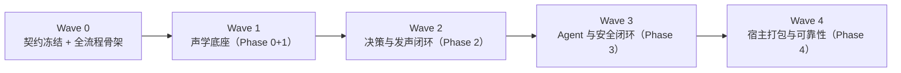

> **2026-10-22 页面/桌宠实施及联合验收**：[交互补充方案](voice-ui-pet-linkage-acceptance-plan-2026-10-22.zh.md) 与[执行辅导 §11](R1-R5-execution-coaching-2026-10-21.zh.md#voice-ui-pet-linkage)。补齐三视图职责、工作区/伙伴/任务身份、多宠单连接、24 个 VP 用例和串行 UI0–UI4。现有 96 项前端测试通过不代表桌宠语音联动已实现；TypeScript/桌面实测仍有明确门禁。下方历史记录保留。

> **2026-10-21 最新执行入口**：[统一方案 §10](R1-R5-execution-coaching-2026-10-21.zh.md#sensevoice-consolidated-execution) 固定保留 SenseVoice、暂不集成 Zipformer，并整合正确性修复与延迟闭环；[15f9a70fc 独立复审](R1-R5-15f9a70fc-independent-review-2026-10-21.zh.md) 确认定向测试通过，但仍有八项缺口，不能签核“九项全部清零”。以下历史全文保留。

> **2026-10-21 Eidolon 与流式语音补充**：[执行辅导 §9](R1-R5-execution-coaching-2026-10-21.zh.md#voice-streaming-supplement) 为轮次、事件、播放和 [外置 ASR 实验](R1-R5-execution-coaching-2026-10-21.zh.md#external-asr-lab) 的细则入口；实验可与当前业务实施分别推进，生产接入仍后置。状态见 [当前快照 §7](current-implementation-status.zh.md#implementation-snapshot-20261021)。以下历次入口按其原始日期/提交阅读，不代表在途修复已签核。

> **2026-10-21 R1 独立复核与后续执行**：[R1–R5 串行执行辅导](R1-R5-execution-coaching-2026-10-21.zh.md)。R1.1 核心修复已有代码与 SQLite 测试，仍有策略字段/采集幂等缺口；生产同 Conversation/FIFO 尚未接线。含各阶段代码入口、步骤、失败用例、门禁和命令，只更新文档，不提前签核或启动后续实施。

> **2026-10-20 rev2 复审与产品契约**：[源码核验、接缝缺口与 R1–R5 就绪矩阵](qoder-alignment-rev2-review-2026-10-20.zh.md)、[v0.4 PRD](../PRD-voice-companion-v0.4.zh.md)。复核本机 Qoder 客户端及固定远端源码；不代表获取完整 Qoder 源码或验证延迟。原 rev2 保留，不在本轮修改业务代码。

> **当前实施状态（2026-10-20）**：[代码事实与验证记录](current-implementation-status.zh.md)，代码基准 `10a1628ab`。以下旧阶段正文和待实施标记完整保留；当前已有实现与剩余差距以该快照核对，验收目标仍按对应 PRD。当前执行遵循串行原则；历史多 Agent 分工不是本轮授权。

> **2026-10-20 Qoder 对齐方案草案（待审查）**：[Flowy 语音会话 Qoder 对齐改造方案](flowy-voice-qoder-alignment-plan-2026-10-20.zh.md)。连续会话、工作区语音 Conversation、队列、默认 Flowy/Bolt 伙伴、memory owner、本地快模型与 Edge/Piper TTS；未实施，待其他 Agent 审查。

> **2026-10-20 rev2 复审与 R1 入口**：[rev2 源码核验与就绪审查](qoder-alignment-rev2-review-2026-10-20.zh.md) 与 [v0.4 PRD](../PRD-voice-companion-v0.4.zh.md)。结论：可进入 R1 契约验证与最小闭环；不直接全量实施 R1–R5。G1–G5 是 R1 前置，G7/G8 分别卡 R5/R3。

> **2026-10-20 R1 执行计划**：[R1 消息与任务闭环执行计划](R1-voice-message-task-execution-plan-2026-10-20.zh.md)。只做 R1，不进入 R2–R5；先契约验证，再存储/绑定、同 Conversation + 最小 FIFO、上下文 handoff。

> **2026-10-20 优化产品入口（待实施）**：[v0.3 PRD：连续任务、低打断授权与可靠播报](../PRD-voice-companion-v0.3.zh.md)。含日志证据、权限决策、GitHub经验及P0–P5串行切片；执行前以其新增决策更新旧计划，旧验收门禁继续继承。正文历史不删除，本轮未实施业务变更。

> **2026-10-19 用户澄清后的当前计划（待实施）**：[语音快速前台 → 软件会话 Subagent → 结果回传（D0–D5）](runtime-dispatch-closure-plan-2026-10-19.zh.md)。快速LLM用于及时回应与委派，软件自有会话/runtime承接复杂任务；复用其配置、能力和审批，结果回到语音更新状态并播报。下列旧O0–O6入口保留为历史，不再作为当前实施顺序。

> **2026-10-19 任务闭环优化（待实施）**：[配置、真实任务、路由与稳定性串行 Plan（O0–O6）](runtime-dispatch-closure-plan-2026-10-19.zh.md)。基于实测缺执行配置、格式错误及首响应超时；先验真实文件任务，再验天气搜索。本轮仅整理计划，自动、真实服务、设备与 Owner 分别签核。历史正文保留。

# AI Mate 语音方案执行计划总纲 (Execution Plan Overview)

> **2026-10-16 最新待实施交接**：[快速前台与后台 runtime 串行执行 Plan（S0–S9）](voice-fast-front-runtime-execution-plan.zh.md)。保留快速语音层，默认独立语音会话、宠物可选绑定，用户会话与专属执行会话关联；明确原文落盘、作用域/权限、超时、取消、通知回执与旧记录兼容。当前仅完成计划，未授权本轮实施；以下历史多 Agent/波次及旧 B/Q 方案不覆盖该串行计划。

> **2026-10-16 实战避坑经验**：[语音伴侣实战避坑与经验总结](voice-agent-pitfalls-and-lessons.zh.md)，详述 Sys Crate 依赖下载容灾、Edge TTS 429 退避降级、Windows GUI 进程独占锁与产物寻址倒挂等核心系统级陷阱与长效防御方案。

> **2026-10-16 实测交接入口**：[T0–T5 Owner 脚本与 AC 对照](T5-owner-handoff.zh.md)。代码/自动证据、联合产物及真人安装签核分开记录；没有 Owner 结果时不得标记产品验收通过。

> **2026-10-16 实施契约**：[语音伴侣与本机 runtime API](voice-runtime-api-contract.zh.md)，明确模块职责、身份、公开/私有接口及审批权威。具体完成状态仍以串行实施记录与 Owner 签核为准。

> **2026-10-15 已授权串行实施**：用户随后明确要求实施 T0–T5，当前从 T0 验证基线推进。[实施记录](T0-T5-implementation-progress.zh.md)分别保留失败/通过、环境阻断、生产产物及 Owner 状态；未通过当前片自动门禁前不进入下一片。下方“本轮仅整理文档”为先前阶段记录，不覆盖本次实施授权。

> **2026-10-15 后续方案入口**：[纵向闭环与 runtime 接口方案](runtime-vertical-contract-plan.zh.md)。用户要求先整理、不盲目实施；当前本轮仅整理文档。后续顺序为 T0 基线 → T1 真实只读任务全流程 → T2 控制与恢复 → T3 实际工具确认 → T4 离屏体验 → T5 安装交接；新增 API 为拟实施契约，原验收与历史正文保留。

> **2026-10-15实施接续**：[R1–R3生命周期与提醒](R1-R3-feedback-progress.zh.md)、[R4声音设置与诊断](R4-feedback-settings-progress.zh.md)。原“尚未实施”和多Agent方案为历史；当前按已授权完整目标串行推进，设备/runtime/安装及Owner出口未完成。

> 同日原VC-11接续：[V3真实请求三轮短上下文](V3-short-context-progress.zh.md)，含生产worker失败/通过证据与当前剩余声学门禁。

> **当前桌面产品入口（2026-10-14）**：[V0–V8串行计划](vertical-execution-plan.zh.md)与新增[v0.2声音反馈R计划](R-auditory-feedback-plan.zh.md)。用户明确串行验收，不派发并行Agent；以下多Agent波次正文保留作历史，不覆盖当前用户指令。R计划尚未实施。

> **状态**：🧭 执行层文档 · 面向多 Agent 并行执行
> **上游权威**：架构基线 [../interaction.zh.md](../interaction.zh.md)（定义 WHAT / WHY / 验收指标）+ 子规范 [../model-management.zh.md](../model-management.zh.md)、[../ui-motion.zh.md](../ui-motion.zh.md)。本文档只定义 HOW / 顺序 / 分工，**绝不重新定义或稀释任何验收指标**。
> **冲突裁决**：本文档与基线冲突时以基线为准；执行中发现基线缺陷，先回写基线再改本文档，禁止双头权威。

---

## 0. Phase S 裁决记录（2026-10-11 已裁决）

基线 §5.2 原规定“前一阶段验收门未通过，坚决不允许进入下一阶段编码”，与骨架先行策略字面冲突。**已于 2026-10-11 裁决通过：基线 §5.2 正式插入 Phase S（契约冻结与全流程骨架）与 Gate S**，Wave 0 全量开工合法化。约束不变：骨架代码一律挂 dev feature flag，桩逻辑严禁进入生产路径（P2）。

## 1. 执行策略：骨架先行，逐波健壮

- **Wave 0 交付“哑但完整”的端到端通路**：回放音频进、扬声器出声出、两块 UI 壳渲染、REST/SSE 通道通，但路由是桩、下载器未实现。目的不是功能，而是把 CPAL 线程模型、跨 crate 接线、SSE 生命周期、桌面/无屏两条 UI 通路的**集成风险在第一周内全部暴露**。
- **Wave 1-4 逐层填肉**：每个波次严格对齐基线 Phase 与 Gate，**先写纵向测试集（VT）再写实现**（TD = 测试先行），Gate 未绿不得交付下一波次的完整实现。

## 2. 波次地图与门禁对齐

| 波次 | 对应基线阶段 | 核心交付 | 出口门禁 | 详档 |
| :--- | :--- | :--- | :--- | :--- |
| Wave 0 | Phase S | 契约冻结 + 哑管线骨架 + UI 壳 | Gate S | [wave-0-skeleton.zh.md](wave-0-skeleton.zh.md) |
| Wave 1 | Phase 0 + Phase 1 | 无锁声学管线、KWS/VAD/ASR、ModelManager 真实下载校验 | Gate 0 + Gate 1 | [wave-1-acoustic.zh.md](wave-1-acoustic.zh.md) |
| Wave 2 | Phase 2 | 四路路由、Edge-TTS、追问窗、桌面设置页完整版 | Gate 2 | [wave-2-decision-tts.zh.md](wave-2-decision-tts.zh.md) |
| Wave 3 | Phase 3 | 双 FSM 解耦、task_control、Tool Policy Engine、确认回路 | Gate 3 | [wave-3-agent-safety.zh.md](wave-3-agent-safety.zh.md) |
| Wave 4 | Phase 4 | 三端宿主服务、OOBE 配对全流程、热插拔看门狗、72h 压测 | Gate 4 | [wave-4-hardening.zh.md](wave-4-hardening.zh.md) |

测试策略与 bsk 规程统一见 [test-strategy.zh.md](test-strategy.zh.md)。

## 3. 并行分工（多 Agent 工作流）

按基线 §2.2 五模块 ownership 切分，**一个工作流一个 Agent，互不越界写代码**：

| 工作流 | 负责 Agent | 代码领土 | 禁止触碰 |
| :--- | :--- | :--- | :--- |
| WS-A 声学 | 声学 Agent | `crates/backend/nomifun-audio` | LLM 调用、HTTP、业务逻辑 |
| WS-B 中枢 | 中枢 Agent | `crates/backend/nomifun-voice-terminal`（新建） | GUI API、Tauri 句柄 |
| WS-C 模型 | 模型 Agent | `crates/backend/nomifun-voice-models`（新建）、`nomifun-api-types` 中语音 DTO | 音频采集与推理运行时 |
| WS-D Agent | Agent 桥接 Agent | `crates/backend/nomifun-ai-agent`（Tool Policy Engine 侧） | 麦克风读取、扬声器驱动 |
| WS-E 宿主 | 宿主 Agent | `apps/ai-mate`（新建）、配对页静态资源 | 核心算法与状态机实现 |
| WS-F 桌面 UI | 前端 Agent | `ui/` 设置页“语音伴侣”详情页 | 配对页（属 WS-E）、后端 crate |

**边界规则**：跨工作流只许通过 §4 冻结契约交互；发现契约缺陷，提变更请求回写冻结物（连带快照测试一起改），禁止在各自领土内私改线格式。面向执行 Agent 的派发话术与回报格式见 [agent-briefing.zh.md](agent-briefing.zh.md)。

## 4. 契约冻结清单（里程碑 M0，Wave 0 前半）

| # | 冻结物 | 载体 | 冻结手段 |
| :- | :--- | :--- | :--- |
| C1 | `ModelInstallState` 七态线格式 | `nomifun-voice-models` + `nomifun-api-types` | serde snapshot 测试锁定 JSON |
| C2 | REST/SSE DTO（status / install / progress / delete） | `nomifun-api-types` | golden JSON 测试 |
| C3 | 路由 JSON Schema（`intent_type` 四分类等） | `nomifun-voice-terminal` 常量 | schema golden 测试 |
| C4 | Acoustic FSM 状态/事件枚举 + 合法迁移表 | `nomifun-voice-terminal` | 声明式表 + 迁移合法性单测 |
| C5 | Earcon 清单（guide/wake/alert/done/sleep/error 六件） | `nomifun-audio` 资产常量 | `include_bytes!` 编译期锚定 |
| C6 | i18n 键命名空间 `voice.*` | `ui/` 双字典 | `check:i18n` 对称校验 |
| C7 | 配置 schema（`[models]` 段 + `AI_MATE_MODEL_DIR`） | `apps/ai-mate` | 配置解析 golden 测试 |
| C8 | `CaptureReadResult` 枚举 | `nomifun-audio` | 编译期契约 |

## 5. 推荐做（Recommended）

- **R1 契约冻结先行**：M0 未冻结前任何工作流不动实现代码。理由：六个工作流并行时，契约是唯一耦合面；冻结后合并冲突收敛为零。
- **R2 骨架先行（Wave 0）**：第一周打通哑管线。理由：CPAL 回调线程、SSE 生命周期、双 UI 通路是本方案三大集成未知数，越早暴露越便宜。
- **R3 TD 纵向测试集**：每个波次先把 VT 套件写成失败测试，再实现到绿。理由：横向单测各层自绿但抓不到跨层缺陷（回调阻塞、FSM 迁移错序、SSE 断流）；VT 与基线 TC-AM/Gate 一一映射，Gate 评审 = 跑 VT 套件。
- **R4 回放语料驱动**：一次性建设发音语料库（三种口音唤醒样本、2 小时噪音、指令集），全部测试走 `MicSource::from_replay_chunks` 模式回放。理由：麦克风硬件不确定，CI 必须确定性。
- **R5 bsk 浏览器验证剧本化**：所有 Web 可见行为写成可重复执行的 bsk 剧本（配对页 360px、设置行 SSE 进度、锁定时倒计时、reduced-motion、明暗双主题）。理由：配对页服务寿命、SSE 投影这类缺陷只在真实浏览器层显现，手工点测不可回归。
- **R6 feature flag 默认可构建**：每波次代码挂 `voice-skeleton` / `voice-mate` 等 flag 持续合入分支，主干永远可构建可测试。理由：并行 Agent + 阻断门的唯一兼容方式就是 flag 隔离。

## 6. 不能做（Prohibited）

- **P1** 禁止提交 `main`、禁止 AI 署名（author/committer/co-author/trailer）、禁止 `--no-verify`（AGENTS.md 强制）。
- **P2** 禁止把 mock / 桩逻辑写进生产运行时路径：桩只能活在 `#[cfg(test)]`、独立测试 harness 或 dev-only feature flag 内（仓库红线：生产零 mock 污染）。
- **P3** 禁止越模块边界写代码；禁止后端 crate 直接新增 `nomi-*` 依赖（AGENTS.md 边界条款）。
- **P4** 禁止提前实现 Post-MVP 范围：本地 TTS、AEC 回声消除、声纹确认、AP 配网模式、拼音别名、OTA 升级。
- **P5** 禁止绕过阻断门：前一 Gate 未绿，不得交付下一波次完整实现（骨架期豁免以 Gate S 裁决为准）。
- **P6** 禁止改动基线验收指标（召回率 95%、误唤醒 0 次/2h、P50 ≤ 850ms 等）而不回写基线；指标变更只能发生在基线文档。
- **P7** 禁止 UI 一次性发明：卡片容器、Modal 优先、新动效曲线/时长、布局属性动画、破折号文案（遵循 ui-motion 子规范）。
- **P8** 禁止以“本地手测通过”宣称任务完成：每张任务卡的完成定义 = 对应 VT 条目绿 + 适用时 bsk 剧本通过 + `cargo test -p <crate>` / `bun run check` 相关门禁绿。
- **P9** 禁止在 `cargo fmt --all` 失败时跳过格式化：本机须用 `cargo fmt -p <crate>`（存量 os error 206 怪癖）；`cargo nextest` 当前未安装，统一用 `cargo test`。

## 7. 为什么这么做（Rationale）

1. **契约冻结**是因为并行 Agent 的碰撞面 = 接口面；线格式一旦漂移，下游所有 snapshot 测试连锁变红，成本远高于冻结期等待。
2. **骨架先行**是因为本方案最贵的三个未知数（实时音频回调线程行为、SSE 长连接在两种宿主的生命周期、无屏/桌面双 UI 同源状态投影）都不是算法问题而是接线问题，接线问题只有端到端跑起来才暴露。
3. **纵向测试优先**是因为基线 TC-AM-001~018 全部是黑盒端到端语义；如果测试体系是横向的，Gate 评审时就没有可执行的工程镜像，只能靠真机人肉，无法回归。
4. **bsk 剧本化**是因为两块 UI 的故障模式（锁定时倒计时漂移、SSE 断流后页面假死、reduced-motion 下语义丢失）在 API 层完全不可见。
5. **严格门禁继承**是因为基线的 Phase/Gate 已经承载了全部验收权威，执行层另起炉灶只会制造双头权威。

## 8. 对比方案（Alternatives Considered）

### A. 构建次序
| 方案 | 描述 | 集成风险暴露 | 并行度 | 结论 |
| :--- | :--- | :--- | :--- | :--- |
| 层优先（基线字面 Phase 0→4） | 每层完整实现后再开下一层 | 最晚（Phase 3 才首次端到端） | 低，层间串行 | ❌ 否决，但其门禁结构被本计划完整继承 |
| **骨架先行 + 逐波健壮** | Wave 0 哑管线端到端，之后逐层填肉 | 最早（第一周） | 高，冻结后六流并行 | ✅ **采纳** |
| 纯大爆炸 | 全部并行，末期一次性集成 | 不可控 | 虚高 | ❌ 否决 |

### B. 测试策略
| 方案 | 描述 | 结论 |
| :--- | :--- | :--- |
| 仅横向单元测试 | 各层自绿，跨层缺陷（回调阻塞、FSM 错序、SSE 断流）漏网 | ❌ 否决 |
| **纵向测试集优先 + 层内单测** | VT 竖切映射 TC/Gate，单测守层内逻辑 | ✅ **采纳** |
| 纯人工真机验收 | 不可重复、不可回归 | ❌ 否决（72h 压测与明暗主题人工核查按基线保留人工成分） |

### C. UI 验证方式
| 方案 | 描述 | 结论 |
| :--- | :--- | :--- |
| 纯手工点测 | 不可回归 | ❌ 否决 |
| **bsk 剧本化 + 人工保留项** | 机械断言自动化；reduced-motion 与明暗主题按 Gate 2 保留人工签核 | ✅ **采纳** |
| 只测 API 不测浏览器 | 配对页/设置行恰是集成缺陷高发区 | ❌ 否决 |

### D. 并行组织
| 方案 | 描述 | 结论 |
| :--- | :--- | :--- |
| 单 Agent 顺序执行 | 无碰撞但周期不可接受 | ❌ 否决 |
| **多 Agent + 契约冻结 + 模块 ownership** | 碰撞面收敛到冻结契约 | ✅ **采纳** |
| 多 Agent 自由并行无冻结 | 契约漂移、合并冲突 | ❌ 否决 |

## 9. 仓库既有约束继承（执行 Agent 必读）

- 格式化：本机 `cargo fmt --all` 报 os error 206，一律改用 `cargo fmt -p <crate>`。
- 测试运行器：`cargo nextest` 当前未安装，统一 `cargo test -p <crate>`。
- 构建目录：`build.noindex/`，稳态约 28G 属设计内；全量清理前先关 Cursor（EBUSY 锁）。
- 桌面 Web 验证入口：`bun run dev:web`（auth 关闭、仅 localhost），bsk 直接访问即可；全新 dev 数据目录需真实云端登录或 `seed:dev` 初始化。
- 前端门禁：用户可见文案必须 zh-CN / en-US 双字典对称，过 `bun run check:i18n` 与 `bun run check:theme`。

- [2026-10-16 审查修复与交接](review-repair-2026-10-16.zh.md)：9 项生产调用链、持久化、会话绑定、控制、进度和播放回执修复，以及独立的自动证据与 Owner 验收。

- [语音低延迟串行执行 Plan（2026-10-19）](low-latency-execution-plan-2026-10-19.zh.md)：关闭推理、阶段计时、受控流式分句、停止/追问边界及开发产物交接。

- [低延迟优化实测交接与后续签核（2026-10-19）](low-latency-owner-handoff-2026-10-19.zh.md)

- [2026-10-22 最终串行修复与桌宠联动交接](voice-repair-final-handoff-2026-10-22.zh.md)：当前最新执行入口；C01–C09、四步纵向实施、在途代码风险、验证命令和可复制任务书。历史并行安排不适用于本轮。
