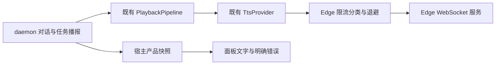
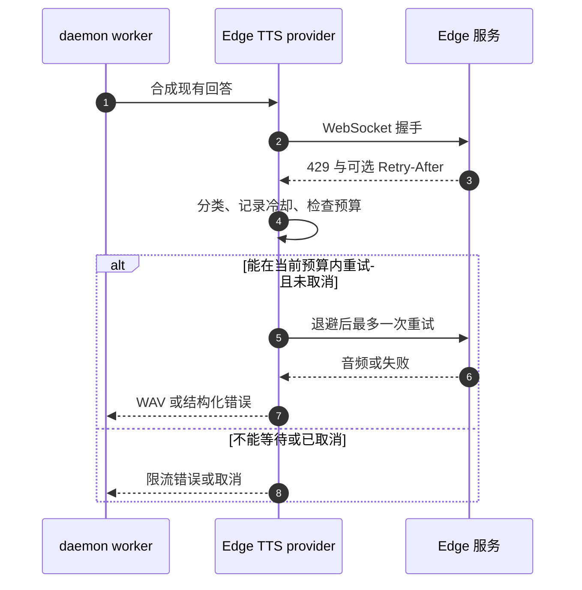

# 语音伴侣 Edge TTS 限流 · 修复交接方案

> **状态**：📋 计划，2026-10-16；仅完成只读诊断与方案整理，尚未实施修复。
> **核心原则**：保留文字与真实任务状态；在既有 TTS 适配内处理限流，不重新调用 ASR、LLM 或提交任务，不延长工具授权。

## 1. 背景与核心痛点

Owner 实测已获得需求理解和助手回复，但未听到声音，面板提示“语音合成失败或超时”。本轮读取本机现场日志，确认 2026-10-16 17:02:16（UTC+8）发生 Edge WebSocket 握手 HTTP 429；约 1654ms 后进入 `tts_failed`。因此这次失败发生在合成连接阶段，尚未进入该回答的音频解码和物理播放。

HTTP 429 表示限流，可携带 `Retry-After`；标准没有规定服务端如何识别和计数用户。不能从这一条日志断言是本机请求过多、共享出口、特定凭据或服务端其他策略。见 [RFC 6585 §4](https://www.rfc-editor.org/rfc/rfc6585#section-4)。本次没有捕获响应头，尚不知道服务端是否提供等待时间。

| 当前行为 | 修复目标 |
| --- | --- |
| HTTP 错误仅写状态，后续压成 `tts_failed` | 保留可诊断的错误分类，面板明确提示限流 |
| 每次合成立即新建连接，没有限流冷却或重试 | 单个 provider 内限制并发、遵守冷却，有限且可取消的重试 |
| 网络成功探针证明过一次成功 | 同时锁定 429、恢复、持续失败、停止与授权期限等失败路径 |

## 2. 方案全景与架构设计



不更换对话 provider，不引入 Windows 系统语音、离线 TTS 模型、新依赖、数据库或通用调度框架。继续保持跨平台 TTS 接口。替换上游/引入离线 TTS 属于后续独立产品决策，不是本次 429 的已验证修复。

## 3. 核心设计与模块规范

### 3.1 串行执行入口

1. **先写失败测试**：扩展 `tts.rs` 现有本地 WebSocket fixture，使握手可返回 429 与响应头；测试必须进入生产 `EdgeTtsProvider`，不能用 `FailingTts` 代替真实握手错误。
2. **结构化分类及可观察性**：在 `tts.rs` 保留 HTTP 状态、受控错误原因、可选等待时间；避免继续只转换为不可恢复分类的字符串。同步调整 playback 的错误传递，daemon 将限流映射成 `tts_rate_limited`。宿主保持已有快照接口，UI 通过错误码增加中英文提示。其他未知错误保留现有兜底兼容。
3. **有界退避**：在同一个 `EdgeTtsProvider` 实例内共享并发闸门与冷却时间，所有播报复用它；不在宿主或 UI 再实现第二套重试。
4. **生产链回归与产物交接**：完成下述验收后再联合构建、核对宿主/daemon/UI 身份，交 Owner 复测。不得因本轮诊断直接覆盖其他 agent 正在构建的产物。

### 3.2 重试与取消约束

- 仅对**尚未收到音频的握手 429**先实现自动重试；最多重试一次。401/403、解码错误、已经输出过音频的失败不自动重播。其他网络重试另有失败证据再扩大。
- `Retry-After` 同时支持秒数与 HTTP 日期，优先复用仓库已有解析能力及现有时间依赖。缺失或无效时建议短退避 2 秒加少量抖动；持续 429 后建议默认冷却 30 秒。这些是待测试的初始产品参数，不是服务端保证。
- 保持当前单次合成总预算 30 秒，排队、退避、握手与接收均计入预算。服务端要求等待超过剩余预算时，立即返回明确限流错误并保留冷却，不能缩短其等待时间强行重连。并发新请求不得形成无界队列。
- 使用进程内单调时间管理冷却；HTTP 日期转换到等待时长时处理过去时间及异常大值，不产生溢出。
- 停止、关闭功能、旧轮次失效应丢弃整个等待/重试 future；不遗留后台重试，不在新一轮突然播旧回答。任务结果去重和任务接受状态不因 TTS 失败被改写。
- 确认提示同样受实际审批截止时间约束。提示失败或等待耗尽必须拒绝/失败关闭，不能延长授权，也不能未播完就开始“确认”听取。



### 3.3 数据与日志约束

内部错误建议字段：`kind`（受控枚举）、`http_status: Option<u16>`、`retry_after: Option<Duration>`；公开层沿用 `stage/code`，先增加 `tts_rate_limited`，无需为了文案增加公开 DTO 字段。

日志记录 provider、阶段、状态码、尝试次数、耗时、冷却及与当前会话关联的标识。禁止输出带查询凭据的完整 URL、Cookie、完整响应体或用户文本；不能直接 `%error` 打印未经脱敏的上游错误。解析等待头失败也要有受控原因码。

本次检查时日志先为 0 字节，稍后出现记录；无法仅凭此证明是缓冲、实例变化或其他原因。仅在有证据复现日志不可读时补修 flush/输出链，避免将其冒充已确认根因。

状态约束：重试期间保持合成态，不提前发送 Speaking；音频实际交付 sink 后才进入 Speaking；失败保留原文、理解与回复，进入现有文字追问，结束后 Idle。冷却只影响 TTS，不使麦克风、ASR、LLM 或 runtime 显示全局不可用。

## 4. 关键决策与权衡

| 编号 | 决策 | 理由 |
| --- | --- | --- |
| D1 | 保留现有 Edge 适配，先补 429 闭环 | 现场已证明握手限流；换 ASR/LLM 无法解决 |
| D2 | 最多一次重试和实例内冷却 | 改善短暂失败，同时避免服务端持续拒绝时放大请求 |
| D3 | 不立即重做签名、TLS、代理 | 这次返回 HTTP 429，不是已经证实的 TLS/403 故障；缺少支持这些变更的证据 |
| D4 | 无自动后台重播 | 避免取消后播旧回答、重复任务播报和过期审批提示 |
| D5 | 不宣称保证免费服务可用 | 持续限流只能准确反馈与退避；稳定离线能力需要另行选型与模型交付 |

## 5. 验收标准与验证梯子

| 用例 | 生产入口与断言 |
| --- | --- |
| TC-01 | 本地握手 429：得到限流分类及受控诊断，不声称扬声器/ASR 故障 |
| TC-02 | 429 后成功：遵守等待，最多两次握手，只有一份音频、一次播放；ASR/LLM 各一次 |
| TC-03 | 持续 429：不超过次数和总预算；冷却内连续新调用不持续访问上游，文字可读 |
| TC-04 | 秒数、HTTP 日期、缺失、无效、过大 Retry-After：等待或快速失败符合预算，不溢出、不绕过冷却 |
| TC-05 | 等待/重试期间停止：后续握手与音频均不发生，新轮次不受旧结果覆盖 |
| TC-06 | 多个播报来源并发：复用同一 provider 状态，实际握手并发上限为一，无无限排队 |
| TC-07 | 401/403、坏 MP3、空音频、设备写入失败：准确区分且无错误重试/假播放 |
| TC-08 | 实际任务 ACK、结果和审批提示遭遇 429：任务不重复提交；审批不自动批准、不延长到期 |
| TC-09 | 双语明暗面板：明确“语音服务限流，回复文字已保留”；ASR、理解与回复不丢失 |
| TC-10 | 完整桌面 feature 图及实际交付 daemon：单次真实 Edge 探针和 Owner 播报复测；持续 429 应记录未通过，禁止用替身成功代替 |

顺序：定向 fixture 红→绿；`cargo test -p nomifun-voice-terminal`；`ai-mate` 的 `full_voice_flow` 和确认测试；受影响宿主测试；UI 行为及双语测试、typecheck/i18n/theme；生产 feature 图、联合构建和哈希；最后真人扬声器验证。测试使用独立 `target/voice-review`，生产使用 `target/voice-staging`，不把测试 skeleton 覆盖默认 daemon。既有全仓失败单独报告。

## 附录：现场原始证据与历史依据

现场日志：`D:/tmp/flowy-dev/logs/voice/ai-mate-1792141149193.log`，原始相关三行：

```text
2026-10-16T09:02:16.958908Z  WARN nomifun_voice_terminal::tts: edge_tts_handshake_rejected status=429
2026-10-16T09:02:16.960902Z  INFO ai_mate::voice: voice_playback_finished elapsed_ms=1654 ok=false
2026-10-16T09:02:16.961025Z  WARN ai_mate::voice: voice_playback_failed code="tts_failed"
```

代码入口：`crates/backend/nomifun-voice-terminal/src/tts.rs` 的 `EdgeTtsProvider::synthesize_stream/synthesize`；`playback.rs` 的 `speak_text_with_started`；`apps/ai-mate/src/voice.rs` 的播报错误处理；`ui/src/renderer/pages/voiceSession/VoiceErrorStatus.tsx`。

历史成功证据：`T5-real-acoustics-edge.log` 记录一次真实 Edge 合成 71424 samples / 24000Hz / 2653ms，以及真实声学流程探针成功。历史成功不代表此次限流已修复，也不代表长期可用性。

原 PRD、API 契约、T0–T5 记录及所有历史日志保持原文。本文件仅新增交接计划；本轮未新增业务代码、未运行网络合成、未改配置或替换可执行文件。
