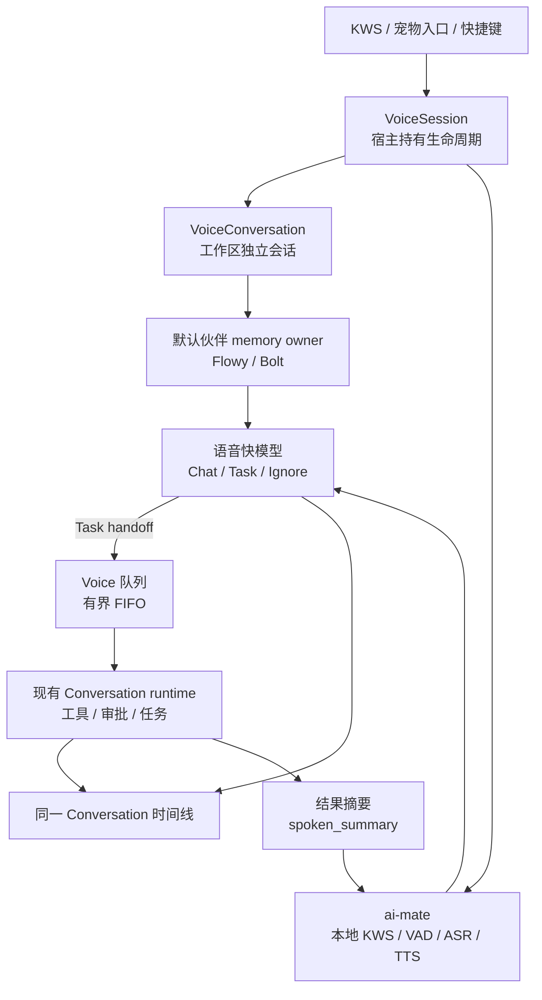
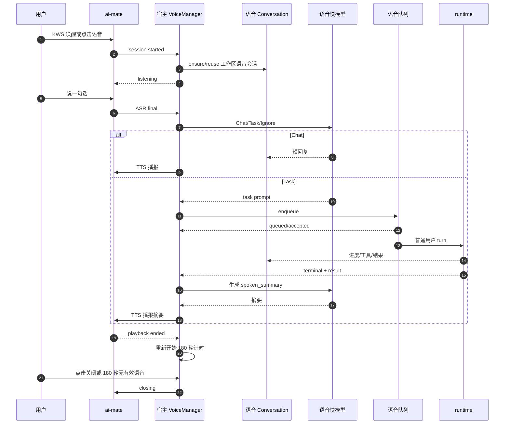

> **2026-10-21 最新执行入口**：[统一方案 §10](R1-R5-execution-coaching-2026-10-21.zh.md#sensevoice-consolidated-execution) 固定保留 SenseVoice、暂不集成 Zipformer，并整合正确性修复与延迟闭环；[15f9a70fc 独立复审](R1-R5-15f9a70fc-independent-review-2026-10-21.zh.md) 确认定向测试通过，但仍有八项缺口，不能签核“九项全部清零”。以下历史全文保留。

# Flowy 语音会话 Qoder 对齐改造方案

> **2026-10-21 实施补充**：新增 [§8](#alignment-streaming-supplement) 与 [执行辅导 §9](R1-R5-execution-coaching-2026-10-21.zh.md#voice-streaming-supplement)。保留 rev2 原文；“流式 ASR 后置”继续适用于生产接入，仓库外模型实验可提前开展，不干扰正在实施的 R1–R5，不表示已经完成测试或功能签核。

> **状态**：方案草案 rev2（已按 2026-10-20 Agent 审查补齐契约）；待其他 Agent 复审；未实施业务代码。
> **代码基准**：`feat/xiaozhi-voice`，调研时 HEAD `5800811c7`；本文只整理方案，不替代既有 PRD/研究文档。
> **主依据**：Qoder CN 0.4.8 客户端静态证据为主；Qwen-Live-Harness 固定提交只作为相同机制的佐证。证据边界见 [Qoder 调研](qoder-cn-live-voice-research-2026-10-20.zh.md) 与 [Qwen 调研](qwen-qoder-workspace-voice-deep-research-2026-10-20.zh.md)。
> **一句话原则**：语音是现有 Conversation/runtime 的新入口，不修改 agent harness/loop；先做本地连续会话、同一时间线、队列和伙伴记忆，实时音频后置。

---

## 1. 背景、现状与目标

### 1.1 现状与痛点

Flowy 当前是本地 `KWS + ASR + 文本 LLM + Edge TTS` 串联链路；语音窗口、会话归属和任务执行边界与 Qoder 有差距：

| 现状 | 代码事实 | 用户可见问题 |
| --- | --- | --- |
| 唤醒后短窗口退出 | `apps/desktop/src/main.rs` 的语音窗口；`apps/ai-mate/src/voice.rs` 的 6 秒/4 秒窗口 | 说完一句或稍停顿就退出，不能连续多轮 |
| 语音会话不是工作区独立会话 | `voice_companion_manager.rs:236` 的候选/默认语音助手路径 | 在当前工作区唤起语音时，归属不清晰 |
| 任务另建“语音任务”会话 | `voice_task_runtime.rs:99-113` | 语音、任务结果不在同一时间线 |
| 忙碌时直接拒绝 | `voice_tasks.rs:474` 的 `task_already_active` | 连说 A/B/C 时没有排队反馈 |
| 结果可能伪造成功 | `voice_tasks.rs:222` 无正文时生成“任务已完成” | 没有结果也播报成功 |
| 上下文只有少量轮次 | `nomifun-voice-terminal/src/router.rs:145` 只带最近 3 轮 | 追问“第二条”容易丢失来源 |
| 没有默认伙伴 | `nomifun-companion` 空列表；删除允许到 0 | 没有稳定桌宠入口，也没有伙伴记忆可复用 |
| 语音窗口独立 | `ui/src/renderer/pages/voiceSession/index.tsx` | 主输入框没有“空输入麦克风、有文字发送”的语音态 |

### 1.2 目标

1. KWS 唤醒或点击后进入连续语音会话；180 秒无有效语音或播报结束后才退出，按钮/快捷键可主动关闭。
2. 每个工作区有一个独立的语音 Conversation，出现在会话列表，和普通会话、伙伴独立聊天区分。
3. 语音原文、助手短回复、任务进度和结果在同一 Conversation 时间线展示；用户可键盘输入，输入框在有文字时变发送。
4. 语音任务复用现有 Conversation 队列，有界排队、明确 accepted/queued、取消排队项不影响运行项。
5. 默认创建伙伴 `Flowy`（形象 `bolt`），禁止删到 0；语音设置可选择语音伙伴。
6. 语音会话通过 `memory_owner_companion_id` 复用伙伴人格/记忆/学习，但不复用 `companion_session`，不进入伙伴独立聊天。
7. ASR 后的语音快模型保留；任务执行沿用当前语音 Conversation 的模型；Edge TTS 在线优先、失败回退本地 Piper。
8. 不修改 agent harness、工具循环、Agent Store；语音相关能力只在语音入口/Conversation 边界实现。

### 1.3 非目标

- 不在本期接入流式 Zipformer/Paraformer；先用 SenseVoice 分段。
- 不在本期实现 Qoder 同款 AOQ/云端 realtime 音频；实时音频作为后续独立切片。
- 不在本期支持“说退下自动关闭”；首版只做按钮/快捷键关闭。
- 不修改 Agent Store/harness 的 loop、工具策略或审批 loop。
- 不把普通 Conversation 全部改成语音模式；只有语音 Conversation 启用新增字段。

---

## 2. 总体架构



### 2.1 范围内

- 语音会话生命周期、180 秒计时、任务期间挂起。
- 工作区语音 Conversation 的创建、复用、会话列表区分。
- 语音快模型、任务 handoff、隐藏上下文、结果摘要。
- 语音队列、排队反馈、取消排队项。
- 默认伙伴 `Flowy`/`bolt`、禁止删到 0、语音伙伴选择。
- 伙伴记忆/学习归属、控制语句隔离。
- Edge TTS 优先、本地 Piper 回退。
- 语音会话 UI、输入框麦克风/发送切换、队列状态。

### 2.2 范围外

- Realtime/AOQ、全双工、回声消除专项。
- 流式 ASR 模型接入与性能对比。
- 普通命令队列统一到服务端。
- 伙伴聊天 UI 的重新设计。
- Agent Store 的数据模型、协议和 harness。

### 2.3 架构原则

1. **入口不改执行**：语音只把请求转成现有 Conversation 的普通 turn；runtime 不需要知道语音。
2. **归属分层**：对话归属工作区语音 Conversation；记忆归属默认伙伴；模型归属当前语音 Conversation。
3. **快慢分离**：语音快模型负责短交互/分流/摘要；任务模型负责工具和长任务。
4. **默认安全**：不自动开麦、不自动改显示设置、不自动取消任务、不静默丢弃排队请求。
5. **本地优先**：ASR/TTS CPU，GPU 留给 LLM；Edge TTS 失败可回退，但不是本地 TTS。

---

## 3. 子系统设计

### 3.1 会话生命周期与计时

声学状态和任务状态必须分开：任务运行不能阻塞继续倾听。

**声学状态**

| 状态 | 进入条件 | 退出条件 |
| --- | --- | --- |
| `idle` | 未启动 | KWS/点击/快捷键启动 |
| `starting` | 解析工作区、语音 Conversation、memory owner | 音频/连接就绪或失败 |
| `listening` | 捕获可用，等待用户语音 | 有效语音、按钮关闭、180 秒到期 |
| `recognizing` | 有效语音结束，ASR/快模型处理中 | 转写完成或失败 |
| `speaking` | TTS 播放中 | 播放完成/失败/被打断 |
| `closing` | 用户关闭或错误 | 资源释放 |
| `closed` | 会话结束 | 下一次启动创建/复用新会话 |

**任务状态**（独立于声学状态）

| 状态 | 含义 |
| --- | --- |
| `none` | 没有语音任务 |
| `queued` | 已进入语音队列，尚未执行 |
| `running` | runtime turn 正在执行 |
| `waiting_approval` | 等待用户审批 |
| `result_pending` | 已结束但结果尚未播报/投递 |
| `completed` / `failed` / `cancelled` | 终态 |
| `unknown` | 是否执行/是否完成不确定，禁止直接重发 |

任务运行时声学状态仍可处于 `listening`；用户继续说 B 时，B 作为新的时间线消息和队列项追加，不修改运行中的 A turn。`holding` 不再作为阻塞 `listening` 的声学状态。

计时与边界：

- `last_accepted_user_speech_at` 只被**有效用户语音**刷新；噪声、音量、心跳、任务进度、TTS 播放不刷新。
- 180 秒从“最后一次有效用户语音”或“播报结束”开始计算。
- 只有 `queued/running/waiting_approval/result_pending` 等任务状态**暂停会话关闭计时**，不暂停倾听和排队。
- 任务完成并播报结束后，从播报结束重新给 180 秒。
- TTS 失败但结果已落盘时，从结果保存/提示完成时间重新给 180 秒。
- 首次启动：180 秒从 `listening` 真正就绪后开始，不在 `starting` 阶段计时。
- 用户正在说话/`recognizing`：暂停计时；ASR 失败恢复 `listening` 后继续。
- `speaking`：暂停计时；播放结束重新开始 180 秒。
- 麦克风丢失、设备错误、服务断线：立即 `closing` 并记录原因，不等待 180 秒；任务继续，不自动重开麦克风。
- 单句必须有硬上限（建议 60 或 120 秒），不能只依赖 VAD，否则持续噪声会形成超长录音。
- 首版没有 AEC：TTS 播放期间暂停普通 ASR，播放结束再恢复；不能把自己的播报当成用户输入。
- 首版关闭只做按钮/快捷键；关闭语音不取消任务。
- KWS 唤醒默认连续模式。

三层计时不要混：

| 计时 | 作用 |
| --- | --- |
| 180 秒 | 本次语音连接静默退出 |
| 30 分钟 | 同一工作区语音 Conversation 复用窗口 |
| 30 分钟任务预算 | 现有单任务执行预算，独立生效；任务轮换暂缓 |

### 3.2 工作区语音 Conversation

- 每个 `(user, workspace)` 维护一个语音 Conversation；标题如“语音 · 工作区名”。
- 会话列表显示语音图标/分组；和普通聊天、伙伴独立聊天可区分。
- 30 分钟内复用；超过窗口下一次唤醒新建，旧历史保留。
- 30 分钟按该工作区最后一次有效用户交互计算；任务运行或待审批时暂缓轮换。
- 启动时冻结宿主确认的工作区身份；启动后页面切换不改变归属。
- 工作区已删除/不可用时回退默认语音入口并提示；**不能把原任务自动转到默认工作区执行**。

工作区选择矩阵：

| 启动方式 | 工作区来源 |
| --- | --- |
| 主窗口聚焦且有选中项目/普通会话 | 宿主确认的该项目/会话工作区 |
| 点击桌宠、托盘、全局快捷键 | 宿主保存的最近确认工作区；不依赖主窗口候选，因为主窗口失焦会清除候选 |
| 主窗口未聚焦且没有可确认工作区 | 默认语音入口，不猜最近项目 |
| 当前工作区失效/删除 | 默认语音入口；原任务保持原工作区身份 |

Conversation `extra` 至少包含：

- `voice: true`
- `voice_mode: "continuous"`
- `workspace`
- `voice_task_workspace`（canonical 工作区；保留现有语音任务策略校验）
- `voice_session_id`（当前连接）
- `memory_owner_companion_id`（启动时冻结）

旧语音任务迁移：

- 现有任务发送、取消、确认依赖 `voice_task_workspace`；新语音 Conversation 必须同时写入该字段，不能只写 `voice`。
- 新建语音 Conversation 通过可信语音创建路径 stamp `voice_task_workspace` + `voice` + `memory_owner_companion_id`。
- 新任务目标改为语音 Conversation；不再创建“语音任务”子 Conversation。
- 旧“语音任务”Conversation 保留可读；不删除、不重写历史。
- 保留语音工具策略、审批和 workspace 校验；不切换到普通会话权限。
- 任务模型/预设/session_mode 从当前语音 Conversation 读取，不再由 `voice_task_runtime` 强制 `default`；这属于 backend 调整，不修改 harness。
- 发送、取消、确认必须一起迁移：`voice_task_operation` 继续校验 `voice_task_workspace`，新的目标会话必须满足同一策略。

### 3.3 语音快模型与任务 handoff

保留 ASR 后的快模型，职责拆开：

| 层 | 职责 | 模型 |
| --- | --- | --- |
| 语音快模型 | Chat/Task/Ignore、短口播回复、排队回执、任务结果摘要 | 本地小模型；CPU 或与 LLM 共享 GPU |
| 任务 runtime | 工具、文件、浏览器、审批、长任务 | 当前语音 Conversation 的模型/预设 |

Handoff 流程参考 Qoder：

1. 语音快模型判断这是 Task，生成任务 prompt/约束。
2. 语音层把请求提交到**同一语音 Conversation**的现有发送路径。
3. 队列默认 `queued`；只有用户显式“打断当前任务”才 `replace`。
4. runtime 使用普通用户 turn 执行；语音层只接收状态/终态/结果摘要。
5. 完整结果留在 Conversation；TTS 只播 `spoken_summary`。

忙碌时的时间线契约（必须先解决）：

- 任务 A 运行时，用户继续说 B：A 的 runtime turn 不被修改；B 的语音原文和快速回复作为**独立时间线消息**追加，允许在忙碌时落盘。
- 新增/改造 `append_voice_timeline_pair` 一类的 append-only 投影；不能复用当前遇到 busy 就拒绝的 `project_voice_dialogue_pair`。
- 排队消息在入队时拥有自己的 `message_id`/`turn_id` 身份；执行时绑定已有消息身份，不再生成第二个用户气泡。
- 队列回执也由宿主事实生成并追加，不依赖快模型判断“已接受/已完成”。
- 追加消息必须幂等：同 command 重放不产生重复消息，不修改运行中的 turn。

可见原文与模型输入分离：

- 推荐扩展 `SendMessageRequest` 的可选字段：
  - `display_text`：UI 显示的用户原文；
  - `voice_context`：只进入模型 prompt 的隐藏上下文，由宿主组装；
  - `message_stream`：`voice`，用于时间线标记。
- `content` 是模型实际输入；`display_text` 是用户可见原文；两者分别持久化。
- `voice_context` 由宿主生成，不能由模型/ASR 提供，也不能提高工具权限。
- 回执/idempotency 必须包含 `display_text` 和 `voice_context` 摘要；相同 command 但隐藏上下文不同应冲突，不能静默重放。
- 旧回执没有 `display_text` 时回退到 `content` 读取，保证历史恢复。
- `message.userCreated` 只发用户原文（`display_text`）；`message.stream` 发助手/工具消息；collector 只能看到用户原文，不能看到隐藏上下文。
- 如果消息表没有合适的 metadata 字段，需要一次 append-only migration；不得把隐藏上下文塞进 `content` 后伪装成用户原文。

结果摘要：

- `spoken_summary` 与完整结果分开保存；摘要失败不影响完整结果。
- 摘要由语音快模型生成，禁止直接朗读长结果、工具 JSON、协议元数据。
- 建议长度：

| 场景 | 目标 | 硬上限 |
| --- | --- | --- |
| 状态/排队/权限提示 | 1 句 | 30 字 / 约 6 秒 |
| 简单 Chat 回复 | 1–2 句 | 60 字 / 约 12 秒 |
| 任务终态 | 1–2 句，结果 + 关键数据 + 下一步 | 120 字 / 约 20 秒 |
| 失败/未知 | 1 句原因 + 下一步 | 80 字 / 约 15 秒 |

### 3.4 语音队列

- 复用 `voice_tasks` ledger，扩展为 voice-specific 有界 FIFO；**不修改 agent harness**。
- 队列项至少包含：`command_id`、`voice_conversation_id`、`workspace`、`model`、`preset_id`、`session_mode`、`memory_owner_companion_id`、`display_text`、`prompt`、`voice_context_digest`、`message_id`、`created_at`、`state`、`queue_index`、`attempt`、`queue_deadline_at`。
- 入队时冻结工作区、模型/预设、执行配置和必要上下文；出队时重新校验。不能读取已经变化的“当前页面”。
- 队列等待期限与执行预算分离：建议排队等待上限 30 分钟；实际执行预算从真实 accepted/running 起算 30 分钟，审批等待计入执行预算。
- 状态：`queued` → `delivering` → `accepted` → `running` → `completed`/`failed`/`cancelled`/`unknown`。
- `unknown` 不是失败：先查询原回执，不能自动重发或直接执行下一项；未解决前队列暂停或标记 needs_review。
- 重启恢复：`queued` 且从未发送的项，重新校验 scope/config 后可恢复；`delivering`/`accepted`/`unknown` 先查询原回执，不自动重发。是否自动继续未发送排队项由配置决定，默认只恢复并提示。
- `replace` 必须等旧任务真实终态，不能“发出取消请求就启动下一项”。
- 默认容量建议 8，可配置；满队列明确拒绝，不静默丢弃。
- 默认 `queued`；`replace` 只在用户显式“打断当前任务”时使用。
- 取消排队项不影响运行项；取消运行项走现有 stop/取消语义。
- 同一语音 Conversation 的键盘输入必须走同一套准入/队列，不能 renderer 队列和宿主语音队列同时争抢同一个 runtime。
- 队列状态在语音面板/语音 Conversation 中显示；不依赖 renderer 的 localStorage 队列。
- 现有 `useConversationCommandQueue` 是 renderer 持有、localStorage 持久化的客户端队列，可以复用交互样式，但**不能作为语音任务队列**。
- 后续如要统一普通命令队列，另做 server-side conversation queue；不在本方案内。

### 3.5 默认伙伴、语音伙伴与记忆归属

默认伙伴：

- 首次启动 0 个伙伴时自动创建 `Flowy`，形象 `bolt`（Bolt）；已有至少一个不创建。
- 创建是幂等的；不能在 `CompanionService::start` 的库层无条件执行，应在宿主 bootstrap 完成服务初始化后调用。
- 创建和删除共用 roster 修改锁；锁内重新检查数量。两个并发删除不能同时通过“至少一个”检查。
- 至少保留一个伙伴：删除最后一个时后端拒绝，前端隐藏/禁用删除并提示；错误码建议 `last_companion_required`。
- 创建/删除中途写入失败要有回滚/恢复；不能留下“配置说有一个、磁盘上没有”的状态。
- 默认模型 `auto`；用户切换后按普通会话规则持久化；伙伴聊天模型只影响伙伴自己的聊天。
- 默认显示只适用于没有相关偏好的首次初始化；升级时尊重用户已隐藏桌宠的设置。语音启动不自动改显示设置，也不自动开麦。

语音伙伴选择：

- 语音设置增加“语音伙伴/默认桌宠”选择；默认选默认伙伴。
- 选择全局生效，语音会话启动时冻结到 `memory_owner_companion_id`；当前会话不随后续切换。
- 选择的伙伴被删除时回退默认伙伴；不能删到 0，所以始终有回退。
- 事件归属不可变：伙伴切换/删除后，已产生事件仍归原伙伴，不能事后重归默认伙伴。
- 伙伴独立聊天保留；语音 Conversation 与伙伴聊天共享记忆，不共享对话历史。

记忆归属：

- 不复用 `companion_session`，避免知识挂载、模型传播、UI 伙伴约束等副作用。
- `memory_owner_companion_id` 只用于：
  - 注入伙伴人格/记忆上下文；
  - collector 和 learner 的学习归属；
  - 默认音色/风格（可选）。
- 语音用户消息使用 `message_stream: "voice"` / `input_source: "voice"`；**不要设置 `origin` 为 voice**，因为 collector 会跳过所有非空 `origin` 的用户消息。
- 控制语句（退出/静音/停止）不生成消息，不进入学习/记忆。
- 用户原文采集必须统一到一次事件：语音投影应发 `message.userCreated` 携带 `display_text`，助手/工具继续用 `message.stream`；不能让 `message.stream` 同时充当用户原话来源。
- collector 与 learner 都必须按 `memory_owner_companion_id`/事件 `companion_id` 过滤；只增加字段、不改 learner 会导致语音事件被其他伙伴学习。
- 隐藏的 handoff prompt 不能作为用户原话采集；只采集 `display_text`。
- 删除伙伴后 memory owner 置空/回退默认；历史保留，不重写。

### 3.6 模型与 TTS

| 槽位 | 用途 | 默认 |
| --- | --- | --- |
| 语音快模型 | Chat/Task/Ignore、短回复、摘要 | 本地小模型（用户配置；无内置下载） |
| 任务模型 | 当前语音 Conversation 的 runtime | 沿用当前会话模型 |
| 伙伴聊天模型 | 桌宠独立聊天 | 默认 `auto`，用户可切换 |
| TTS | 播报 | Edge 在线优先；失败回退本地 Piper |

本地资源约束：

- KWS/ASR/TTS 优先 CPU；GPU 留给本地 LLM。
- ASR 当前用 SenseVoice-Small + VAD 分段；安装包已有 KWS/VAD/SenseVoice 资源，流式 Zipformer/Paraformer 暂不接入、不测试。
- 本地 TTS 需要独立资源清单：Piper 中文 voice、许可证、SHA256、大小、安装路径、最低 CPU 和 RTF；资源不可用时明确降级为 Edge-only 或纯文字，不能静默失败。
- 语音快模型不随安装包捆绑；用户选择本地 LLM 槽位。不可用时规则兜底或纯文字，不自动下载。
- Edge TTS 失败条件：连接失败、429、首音超时、解码失败。
- TTS 句内失败：首音前失败可本地重试整句；已播出一部分后失败则停止本句、标记 interrupted，下一句切本地，不自动重播已播半句；保留真实播放回执和重播入口。
- TTS 失败保留完整文字，不重做任务；音色变化可接受但不伪装成同一音色。

资源清单（实施前锁定）：

| 资源 | 现状/方案 | 交付要求 |
| --- | --- | --- |
| KWS/VAD | 已安装 sherpa-onnx KWS + Silero VAD | 复用现有安装清单，不新增下载 |
| ASR | 已安装 SenseVoice-Small（约 239 MB） | 复用 `models/asr`；校验 SHA256/版本；保留离线状态 |
| 本地 TTS | Piper 中文 voice，CPU ONNX 推理；优先复用现有 Rust/ONNX 依赖 | voice 包、许可证、SHA256、大小、安装路径、最低 CPU、RTF 目标；逐 voice 校验许可证 |
| 语音快模型 | 不随安装包捆绑，用户选择本地 LLM 槽位 | 不可用时规则兜底或纯文字；禁止静默下载 |
| 最低硬件 | 4 核 CPU / 8 GB RAM 作为基线；GPU 留给 LLM | 首音 P95 目标在真机测量后锁定；不以 Edge 数据代替 |
| 不可用状态 | 本地 TTS 缺失、模型损坏、CPU 不足 | 明确 Edge-only 或纯文字；UI 显示原因，不阻塞任务结果 |

Piper 具体 voice、许可证和下载源在实施前单独锁定；未锁定前不把 Piper 写成已随包交付。


### 3.7 UI 与入口

- 默认桌宠 `Flowy`/`bolt` 首次安装默认可见；升级时尊重已有隐藏偏好；不自动录音。
- 语音设置：
  - 语音伙伴选择；
  - 实时语音快捷键；
  - TTS 音色/速度；
  - Edge/本地回退策略；
  - 是否在语音模式朗读键盘输入（默认否）。
- 语音会话：
  - 会话列表显示语音图标/分组；
  - 时间线显示用户气泡、短回复、runtime 进度/结果；
  - 输入框空输入麦克风、有文字发送；
  - 队列状态、排队位置、取消排队项；
  - 麦克风状态/隐私提示。
- 语音窗口/浮层保留，作为状态和控制入口；主输入框增加语音态，不复制完整第二套会话 UI。

### 3.8 数据契约（建议）

```rust
struct VoiceSessionScope {
    user_id: String,
    workspace: String,
    voice_conversation_id: String,
    memory_owner_companion_id: Option<String>,
    mode: VoiceSessionMode,
    acoustic_state: AcousticState,
    task_state: VoiceTaskState,
    started_at_ms: i64,
    last_accepted_user_speech_at_ms: Option<i64>,
    playback_ended_at_ms: Option<i64>,
    active_task_ids: Vec<String>,
    pending_approval_ids: Vec<String>,
    ended_reason: Option<String>,
}

enum VoiceSessionMode {
    Continuous,
    PushToTalk,
}

struct VoiceConversationMeta {
    voice: bool,
    voice_mode: VoiceSessionMode,
    workspace: String,
    voice_task_workspace: String,
    memory_owner_companion_id: Option<String>,
    voice_session_id: Option<String>,
}

struct VoiceQueueItem {
    command_id: String,
    voice_conversation_id: String,
    workspace: String,
    model: Option<String>,
    preset_id: Option<String>,
    session_mode: Option<String>,
    memory_owner_companion_id: Option<String>,
    message_id: String,
    display_text: String,
    prompt: String,
    voice_context_digest: Option<String>,
    state: VoiceQueueState,
    queue_index: usize,
    attempt: u32,
    created_at_ms: i64,
    queue_deadline_at_ms: i64,
}

struct VoiceTimelineMessage {
    message_id: String,
    command_id: Option<String>,
    role: String,
    display_text: String,
    message_stream: String,
    input_source: String,
    voice_context_digest: Option<String>,
}

struct VoiceHandoff {
    command_id: String,
    message_id: String,
    display_text: String,
    voice_context: Option<String>,
    voice_context_digest: String,
    message_stream: String,
    spoken_summary: Option<String>,
}
```

`SendMessageRequest` 建议增加可选字段 `display_text`、`voice_context`、`message_stream`；旧客户端/旧记录缺省保持原行为。所有公开 DTO 仍归 `nomifun-api-types`。

持久化边界：

- `content` = 模型实际输入；`display_text` = 用户可见原文；两者分别保存。
- `voice_context` 由宿主生成；持久化摘要用于 idempotency/冲突检测，事件只带用户原文。
- 回执需要同时记录 `display_text` 与 `voice_context_digest`；相同 command 但任一不同应冲突。
- 旧回执没有 `display_text` 时回退到 `content` 读取。
- 优先复用现有消息 metadata/extra；如果当前消息表没有可用字段，需要一次 append-only migration，并同步 model/repository/tests。不得把隐藏上下文写进 `content` 冒充用户原文。
- 本方案不新增 Agent Store/harness 数据库结构；若需要消息迁移，按数据库红线的流程单独审查。


### 3.9 关键时序



并发时序：任务 A 处于 `running` 时，声学状态仍是 `listening`；用户说 B，B 的 `message.userCreated` 与快速回复作为独立时间线消息追加，B 进入 `queued`。A 的 turn 不被修改。A 终态且结果播报后，才重新计算 180 秒；B 出队时绑定入队时已有的 `message_id`，不再生成第二个用户气泡。

### 3.10 与 Agent Store / harness 的边界

- 不修改 `crates/agent`、Agent Store 协议、工具循环、审批 loop。
- 不修改普通 Conversation 的默认行为；新增字段全部可选，语音元数据只在语音 Conversation 生效。
- 需要改动的 shared 边界：
  - `nomifun-api-types` 的可选 DTO；
  - `nomifun-conversation` 的 `display_text`/`voice_context` 投影与队列准入（可选、向后兼容）；
  - `nomifun-companion` 的默认伙伴 bootstrap、删除保护、collector 归属；
  - `nomifun-app` 的 voice manager/tasks；
  - `ai-mate` 的连续会话；
  - `ui` 的语音设置/会话列表/输入框。
- 如果 Agent Store 正在改 harness，本文所有语音工作应保持独立；冲突时只保留 DTO/投影接缝，不并行改 loop。

---

## 4. 决策与取舍

| 编号 | 决策点 | 选择 | 理由与限制 |
| --- | --- | --- | --- |
| D1 | 语音与 runtime | **语音 handoff 到现有 Conversation** | 不新建 subagent、不复制工具系统；runtime loop 不变 |
| D2 | 语音 Conversation | **工作区独立语音会话** | 与普通聊天/伙伴聊天区分；出现在会话列表 |
| D3 | 会话复用 | **30 分钟内复用，超过新建** | Qoder/Qwen 无同义证据，属 Flowy 产品规则 |
| D4 | 180 秒 | **有效语音/播报结束起算，任务期间暂停关闭计时但不暂停倾听，播报结束重置** | 满足长任务后 TTS 回复；任务运行仍可继续听/排队 |
| D5 | 记忆归属 | **memory owner 与对话解耦（方案 A）** | 复用伙伴记忆/学习，不进入伙伴独立聊天 |
| D6 | 快 LLM | **保留** | Chat/Task 分流、短回复、摘要；不把全部 ASR 文本直接送 runtime |
| D7 | 队列 | **voice_tasks app 层有界 FIFO** | 不改 harness；不依赖 renderer localStorage 队列 |
| D8 | 默认伙伴 | **Flowy + bolt，自动创建，至少保留一个** | 新装默认显示；升级尊重隐藏偏好；避免空伙伴/无记忆 |
| D9 | TTS | **Edge 优先，失败回退 Piper** | 在线质量优先；保留离线兜底 |
| D10 | 实时音频/流式 ASR | **后置** | 当前本地级联可先满足连续会话；S4 再评估 |
| D11 | 30 分钟任务轮换 | **暂缓** | 先解决 runtime 与语音衔接，再讨论任务轮换 |
| D12 | 可见气泡与隐藏上下文 | **优先扩展 display_text/voice_context** | 避免重复用户 turn；需 shared Conversation 审查 |
| D13 | 忙碌时时间线 | **append-only 追加，不修改运行中 turn** | 任务 A 运行时 B 仍可落盘/排队；绑定已有消息身份，禁止重复气泡 |
| D14 | 原文/模型输入 | **分别持久化并参与幂等冲突** | 旧回执可读；隐藏上下文不进事件、不授予权限 |
| D15 | 旧语音任务策略 | **保留 voice_task_workspace/工具策略/审批** | 新语音 Conversation 同时写该字段；不切普通权限，不改 harness |
| D16 | 队列恢复 | **等待/执行预算分离；unknown 不重发** | 重启先查回执；replace 等真实终态；键盘输入同队列 |
| D17 | 学习归属 | **collector 与 learner 都按 memory owner 过滤** | 事件归属不可变；隐藏 handoff 不作为用户原话 |
| D18 | 默认伙伴并发 | **创建/删除共用 roster 锁** | 并发 bootstrap/删除仍至少保留一个；升级尊重隐藏偏好 |
| D19 | 本地 TTS 资源 | **Piper 资源清单+校验+降级** | 未安装则 Edge-only/纯文字；半句失败停止本句，不静默补齐 |
| D20 | 实施顺序 | **消息/任务闭环 → 队列恢复 → 连续倾听 → 伙伴记忆 → 本地模型/TTS** | 每片先完成一条真实纵向场景，避免多变量同时变更 |

---

## 5. 验收标准与验证阶梯

### 5.1 验收用例

| 编号 | 场景 | 必须断言 |
| --- | --- | --- |
| TC-VOICE-01 | KWS 唤醒 | 不因 4 秒/30 秒短窗口退出；180 秒无有效语音才结束 |
| TC-VOICE-02 | 长任务运行 | 任务/审批/结果待播报期间不关闭语音；播报结束后重新 180 秒 |
| TC-VOICE-03 | 工作区归属 | A/B 工作区各自语音 Conversation；不串工作区；会话列表可区分 |
| TC-VOICE-04 | 时间线 | 语音原文只出现一次用户气泡；短回复/任务结果在同一 Conversation |
| TC-VOICE-05 | 排队 | A/B/C 连说有序排队；取消 B 不影响 A/C；满队列明确拒绝；replace 仅显式 |
| TC-VOICE-06 | 默认伙伴 | 空库自动创建 Flowy/bolt；已有伙伴不重复；删除最后一个失败 |
| TC-VOICE-07 | 记忆 | 语音 Conversation 注入伙伴记忆；学习归属默认伙伴；控制语句不入历史 |
| TC-VOICE-08 | 模型 | 任务用当前语音 Conversation 模型；快模型独立；伙伴聊天模型不覆盖语音 |
| TC-VOICE-09 | TTS | Edge 失败回退 Piper；文字保留；429 冷却；摘要不超硬上限 |
| TC-VOICE-10 | 边界 | 普通 Conversation 行为不变；Agent Store/harness 无改动；无重复 turn |
| TC-VOICE-11 | 任务 A 运行中续说 B | B 的原文和快速回复在忙碌时落盘；A turn 不被修改；B 排队；不出现重复用户气泡 |
| TC-VOICE-12 | 发送响应丢失/重启 | 返回 unknown 后先查询原回执；不自动重发；重启后可核对；未知不当作失败 |
| TC-VOICE-13 | 语音与键盘并发 | 两者共用同一准入/队列；不争抢 runtime；不产生双 turn |
| TC-VOICE-14 | 排队期间切工作区/模型 | 入队冻结配置；出队重新校验；变化时拒绝/unknown，不读取当前页面 |
| TC-VOICE-15 | 旧审批/过期审批 | 旧 call/expired 不执行；不因新语音消息自动批准；审批仍走唯一管理器 |
| TC-VOICE-16 | 伙伴删除/切换 | 至少保留一个；事件归属不可变；memory owner 回退；历史不重写 |
| TC-VOICE-17 | TTS 半句失败 | 首音前可整句重试；已播半句停止并标记 interrupted；下一句切本地；不静默重播 |
| TC-VOICE-18 | 摘要语义 | 摘要保留否定、失败和关键数字；不得把 unknown/failed 说成成功 |
| TC-VOICE-19 | 默认伙伴并发 | 并发 bootstrap/删除仍至少一个；升级不覆盖已隐藏偏好；写失败可恢复 |
| TC-VOICE-20 | 队列期限 | 排队等待与执行预算分开；等待超时明确取消排队项；replace 等旧任务终态 |
| TC-VOICE-21 | 旧语音任务迁移 | 旧“语音任务”可读；新语音 Conversation 携带 `voice_task_workspace`；发送/取消/确认不因迁移出现 `task_policy_missing` |
| TC-VOICE-22 | 原文/隐藏上下文回执 | 旧回执无 `display_text` 时回退 `content`；相同 command 但 `voice_context` 不同必须冲突 |

### 5.2 建议实施顺序

按审查建议，先完成消息/任务闭环，再扩展其他变量：

| 阶段 | 最小纵向交付 | 出口 |
| --- | --- | --- |
| R1 | 同一 Conversation 的语音原文、短回复、任务发送与结果闭环 | A 运行中 B 可落盘/排队；无重复气泡；普通会话不变 |
| R2 | 持久语音队列、冻结配置、恢复与 unknown 核对 | 重启/丢响应/并发键盘输入可核对；不自动重发 |
| R3 | 连续倾听、双状态维度、180 秒边界、无 AEC 半双工 | 任务运行仍可听；180 秒规则和断麦/断线可测 |
| R4 | 默认 Flowy/Bolt 伙伴、记忆 owner、collector+learner | 并发创建/删除、学习归属、隐藏偏好可测 |
| R5 | 本地快模型、Piper 资源与 TTS 回退 | 资源缺失/半句失败/429 降级可测；不以自动测试替代真机 |

### 5.3 验证阶梯

1. 单元：`voice_tasks` 队列、180 秒时钟、memory owner 归属、默认伙伴 bootstrap/删除保护。
2. 集成：`nomifun-app` voice manager + `nomifun-conversation` send/queue + `nomifun-companion` collector。
3. AI Mate：连续会话、VAD/ASR、TTS 回退、任务暂停。
4. UI：`bun run typecheck`、`bun run check`、语音设置/会话列表/输入框结构测试。
5. 真机：KWS、麦克风、Edge/Piper、实际任务、排队、记忆、跨工作区。
6. Agent Store 回归：确认没有 harness/API 回归；普通会话不受影响。

本方案不把自动测试通过当作真实设备/网络通过；Owner 验收单独记录。

---

## 6. 风险与待审查问题

### 6.1 风险

- `display_text`/`voice_context` 扩展会触及 shared Conversation 投影，需要严格兼容测试，避免普通会话回归。
- 语音队列的持久化、重启恢复和取消语义需要专项测试。
- `memory_owner_companion_id` 不能让工作区语音被误当成 companion session；collector/知识挂载/XP 副作用需要审查。
- 默认伙伴自动创建和禁止删除到 0 是行为变更；已有空库用户升级需要迁移/幂等处理。
- Edge TTS 回退会改变音色；用户可能感知，需要 UI 说明。
- 长时间开麦的隐私和 CPU/电量成本需要产品确认。
- `display_text`/`voice_context` 若需要消息表迁移，必须按数据库红线单独审查；旧回执兼容不能破坏。
- 旧“语音任务”Conversation 的 `voice_task_workspace` 策略必须随发送、取消、确认一起迁移，否则会出现 task_policy_missing。
- learner 必须和 collector 一起按 memory owner 过滤；只加事件字段会造成记忆串归属。
- Piper/本地快模型资源未打包时的降级路径、许可证和硬件基线仍需在实施前锁定。

### 6.2 复审确认与剩余未决

以下已按 2026-10-20 审查建议作为方案默认，复审只需确认实现细节：

- `display_text`/`voice_context` 接受为 `SendMessageRequest` 可选字段；先完成持久化、幂等冲突和旧回执兼容。
- 语音队列放宿主 app 层，限定语音 Conversation，统一其语音和键盘输入。
- 30 分钟复用接受；按用户交互续期，忙碌/审批时暂缓轮换。
- 语音伙伴选择全局、启动冻结、事件归属不可变。
- 新用户默认显示 Bolt；升级尊重已有隐藏偏好。
- 摘要 120 字作为硬上限；20 秒只作为目标，以实际播放时长验收。
- 删除最后伙伴以后端原子保护和错误码为准，前端同步禁用并提供双语说明。

剩余未决：

1. `display_text`/`voice_context` 复用消息现有 metadata，还是增加 append-only migration；若迁移，按数据库红线单独审查。
2. 队列等待上限是否采用 30 分钟；执行预算仍从真实 accepted/running 起算。
3. Piper 中文 voice 的具体包、许可证、大小、安装清单和最低 CPU/RTF。
4. 摘要 20 秒目标是否需要按音色/语速调整，以及是否提供“简短/标准”两档。

### 6.3 2026-10-20 审查意见落实对照

| 审查项 | 落实位置 |
| --- | --- |
| 1. 忙碌时消息落盘 | §3.3 append-only 投影、§3.9 并发时序、TC-VOICE-11 |
| 2. display_text/voice_context 持久化与幂等 | §3.3、§3.8、D14、TC-VOICE-12/22 |
| 3. 旧语音任务策略迁移 | §3.2 迁移段、§3.8 `voice_task_workspace`、D15、TC-VOICE-21 |
| 4. 队列恢复与配置冻结 | §3.4、§3.8 VoiceQueueItem、D16、TC-VOICE-12/14/20 |
| 5. holding/连续倾听 | §3.1 声学与任务状态分离、边界规则、TC-VOICE-02/11 |
| 6. 工作区选择与 30 分钟 | §3.2 选择矩阵、复用/失效规则、TC-VOICE-03/14 |
| 7. learner 记忆归属 | §3.5 collector+learner、事件契约、TC-VOICE-07/16 |
| 8. 默认伙伴原子约束 | §3.5 roster 锁、D18、TC-VOICE-19 |
| 9. 本地快模型/Piper 资源 | §3.6 资源清单/降级、D19、TC-VOICE-17 |

---

## 7. 证据与参考

- [Qoder CN 静态调研](qoder-cn-live-voice-research-2026-10-20.zh.md)：§4.1 内置宠物、§4.2 生命周期、§4.3 证据等级、§4.4 本地路线、§4.5 队列/runtime、§4.6 本地模型、§4.7 记忆归属、§4.8 整合切片、§4.9 ASR 后 LLM、§4.10 可行性。
- [Qwen 与工作区语音深入调研](qwen-qoder-workspace-voice-deep-research-2026-10-20.zh.md)：§3.8 线上源码补核、§4.4 音频选型。
- [PRD v0.3](../PRD-voice-companion-v0.3.zh.md)：连续绑定、审批、结果语义的既有产品约束。
- [当前实现状态](current-implementation-status.zh.md)：代码事实与验证边界。
- 代码入口：
  - `apps/ai-mate/src/voice.rs`、`apps/ai-mate/src/voice_events.rs`
  - `crates/backend/nomifun-app/src/voice_companion_manager.rs`
  - `crates/backend/nomifun-app/src/voice_dialogue.rs`
  - `crates/backend/nomifun-app/src/voice_tasks.rs`
  - `crates/backend/nomifun-app/src/voice_task_runtime.rs`
  - `crates/backend/nomifun-conversation/src/service.rs`
  - `crates/backend/nomifun-companion/src/collector.rs`
  - `crates/backend/nomifun-voice-terminal/src/tts.rs`
  - `ui/src/renderer/pages/voiceSession/`
  - `ui/src/renderer/pages/settings/VoiceSettings.tsx`
  - `ui/src/renderer/pages/conversation/platforms/useConversationCommandQueue.ts`
- Qoder 静态证据文件：`target/voice-review/qoder-cn-static-evidence-2026-10-20.json`；Qwen 证据：`target/voice-review/qwen-qoder-deep-research-evidence-2026-10-20.json`。

本文是方案草案，不替代研究文档和 PRD；历史调研正文保留，不在本文重写。待其他 Agent 审查后再决定是否进入实施。

<a id="alignment-streaming-supplement"></a>

## 8. Eidolon 机制与外置 ASR 实验补充（2026-10-21）

本节补充 rev2 的实施顺序与交互细则；原调研及阶段描述按原日期/提交阅读，不删除历史正文。完整规则、固定源码证据和 VS-01–08 验收只维护在 [执行辅导 §9](R1-R5-execution-coaching-2026-10-21.zh.md#voice-streaming-supplement)。

| 决策 | 本次明确的边界 |
| --- | --- |
| D10 的实验与接入分离 | 允许提前在仓库外比较 SenseVoice 与流式 Paraformer/Zipformer；此前“暂不测试”不再限制该隔离实验。生产替换仍在消息/任务和连续输入边界修复后，实验结论不得直接标成产品通过 |
| 轮次处理 | 先保留原文和有界缓冲，区分补充、新一轮、停止声音和取消任务。已接单 runtime 不随插话重发或取消；审批仍只消费最终且明确的确认 |
| 流式事件 | 复用现有 DTO，明确 partial/final、回复增量、音频可用、实际播放与终态；不因方法名含 stream 宣称全链路流式 |
| TTS 与 AEC | 按真实阶段测量后优化块播放；模型结束不等于播放结束；没有可靠 AEC 时继续半双工，不默认开放外放打断 |
| 当前执行不被实验打断 | 一个执行 Agent 继续持有业务代码写入；外置实验不改仓库依赖/模型/配置，不启动生产进程或抢 GPU，构建争用下的性能不作为选型成绩 |

Eidolon 的云端通话、进程内队列和共享角色记忆不替代本项目本地声学、持久 ledger、memory owner 与 Conversation/runtime。其 AGPL 代码和外部资源不得按本项目 Apache-2.0 组件直接并入；按行为规格独立实现，具体代码/资源复用单独审查。

本次仅补文档；外置实验状态及实际结果按 [外置 ASR 实验合同](R1-R5-execution-coaching-2026-10-21.zh.md#external-asr-lab) 分别记录。真人设备、生产接入与 Owner 验收不因文档更新自动通过。

2026-10-21 用户追加产品范围：中文和英文均须支持，中英混说必测，覆盖 ASR、回复语言、TTS、确认/拒绝和任务控制。优先评估双语流式模型；当前中文单语外置 smoke 仅证明接口，不是默认模型选型通过。完整规则与首轮证据集中维护在执行辅导 §9.8–9.9。

## 9. 本轮统一执行决策（2026-10-21）

用户在外置录音对比后决定：保留 SenseVoice 做最终识别，当前不加入 Zipformer；先修消息/任务作用域和连续会话，再测 VAD → ASR → LLM 稳定首句 → TTS → sink 首帧的完整延迟。双语及中英混说要求不变。外置流式模型继续作为实验，不是本轮产品依赖。

本方案的最新实施细则统一集中在[执行辅导 §10](R1-R5-execution-coaching-2026-10-21.zh.md#sensevoice-consolidated-execution)。15f9a70fc 的自动检查和未闭环边界见[独立复审](R1-R5-15f9a70fc-independent-review-2026-10-21.zh.md)；旧方案与执行者交付声明保留，不能覆盖本次复审发现。180 秒连接空闲、30 分钟 Conversation 复用、排队/执行/审批期限是不同计时；不得以旧 4 秒契约注释推翻连续倾听需求。
