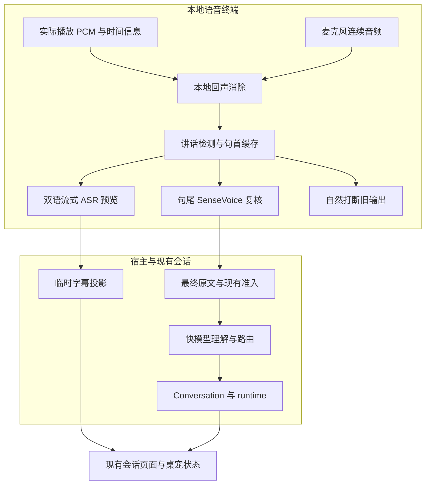
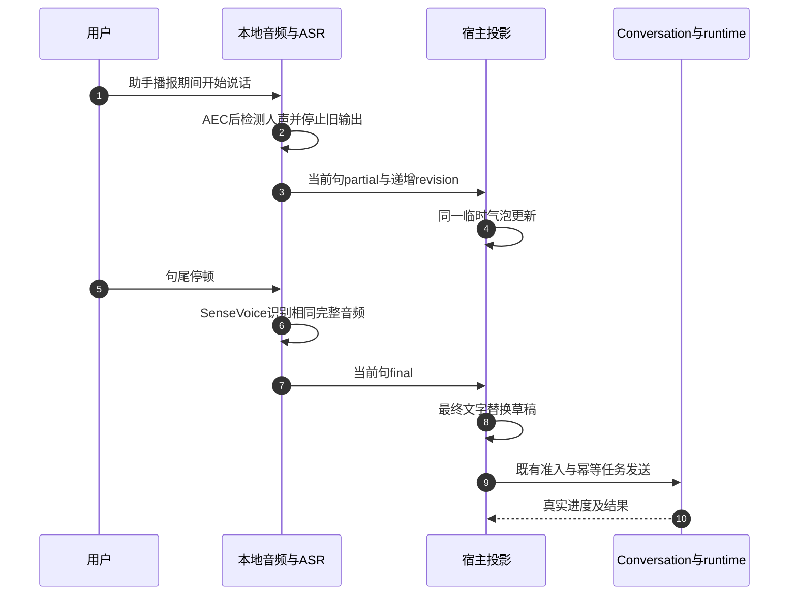

# 本地实时字幕、最终转写与语音打断 · 技术方案及执行 Plan

> **状态**：📋 计划；本轮只核查代码、上游资料并编写方案，未实现业务改动、下载模型或启动设备。
> **核查基线**：2026-10-22，`feat/voice-next`，`648277420`。开始调研时工作区干净。
> **核心原则**：本地生成临时字幕，SenseVoice 复核最终转写；LLM 理解与用户原话分开。语音打断只停止前台输出，不隐式取消 runtime 任务。

## 1. 背景、事实与目标

用户需要像语音通话一样边说边看文字，在助手播报时自然插话，并在最终文字中减少识别错误。目标不是把语音终端改造成另一个独立 agent：复杂任务仍交给当前工作区的 Conversation/runtime，继续复用原来的权限、队列与回执。

| 能力 | 当前代码事实 | 本方案目标 |
|---|---|---|
| 听写 | `process_utterance` 在句尾调用整段 `SttCallback::transcribe` | 讲话期间产生真实音频增量识别结果，句尾整句复核 |
| 本地模型 | `SherpaSttCallback` 使用 `OfflineRecognizer`，SenseVoice `language=auto`、`use_itn=true` | 保留最终识别；评估同一 sherpa SDK 的中英双语 online 模型提供预览 |
| 流式 API | vendored `online_asr.rs` 已有 `OnlineRecognizer/OnlineStream` | 使用现有绑定，不预先重写 vendor 或加入新 ASR 服务框架 |
| `partial` | 会议录音的 `spawn_stt` 在整段识别后逐字发送结果；另有空占位事件 | 不把逐字动画或空占位当作实时识别，也不因此扩改会议录音模块 |
| 展示 | `SpeechRecognized { text }` 更新 `user_text` 并进入 `Deciding` | 新增独立、带身份的临时字幕；partial 不推进决策状态 |
| 文字理解 | 已有 `understood_request`，宿主保存原文与模型输入的不同投影 | LLM 整理复用此字段；不静默重写 `raw_user_text/display_text` |
| 播放中采集 | 播放态消费音频，但未进入讲话识别分支；PRD 明确半双工 | AEC 后的本地讲话检测触发停止播放并开始听写 |

### 1.1 三个不能混为一谈的目标

1. **实时字幕**：降低“软件没有听见”的不确定感，允许暂时写错、修订。
2. **最终转写**：忠实记录用户实际说了什么；模型仍可能识别错误，不宣称保证正确。
3. **理解需求**：解释用户想做什么，可以摘要，但不是用户原话，更不能提供审批授权。

当前方案不把 LLM 后处理加到每句话的必经关键路径，不用一个中文模型冒充中英双语能力，不为本功能新增数据库迁移、任务调度框架或另一套权限模式。

## 2. 全景架构与不变量



- 音频前处理、预览、最终 ASR 和打断检测在本地运行；无需把音频送云端。
- partial 不进入 Conversation 持久消息、记忆 collector、快模型、任务队列或审批接口。
- 同一句只有一个最终转写；有效输入沿用现有消息准入与幂等绑定，创建/发送仍各一次。
- 最终转写到达后禁止旧 partial 回写；任务提交后禁止用迟到纠错改写原命令及其摘要身份。
- 声学状态、前台响应、播放输出和后台任务分别管理。播放被打断不代表任务被取消。
- KWS 只负责待唤醒入口；进入连续会话后不要求每次插话都重复唤醒词。

## 3. 核心设计与模块契约

### 3.1 两遍识别与同气泡修订

推荐候选是 **sherpa 中英双语 Zipformer online 预览 + 现有 SenseVoice 最终识别**。这是待实验验证的选择，不是已通过的模型准入。

1. VAD 开始时分配输入身份和缓存，向 online stream 连续送入本句 PCM。
2. 每隔约 150–250ms 发布一次有变化的完整假设，UI 替换同一个临时气泡的文字，不按 delta 盲目拼接。
3. VAD 确定句尾后，冻结同一音频区间交给 SenseVoice。online endpoint 仅辅助展示，不能另开一条任务或与 VAD 重复结句。
4. 最终转写替换临时字幕，显示最终识别状态；随后才进入原有控制指令/快模型/任务路径。
5. `ignore`、空结果或杂音清理当前临时输入，继续倾听；不清掉其他已完成回合，不写入记忆。

预览分支不可阻塞音频采集。使用有界音频队列和独立识别执行上下文；队列丢帧时重置/停止本轮预览并标记不可用，不把非连续 PCM 当作连续流。最终音频缓存独立保留、受单句硬上限约束。最终识别应优先于下一轮预览，限制线程数，禁止无界 `spawn_blocking`。

两遍使用同一段经前处理的音频、同一采样坐标。设备 44.1/48kHz 与 ASR 16kHz 的转换必须保留区间对应；不能让流式与最终识别听到不同句子。

**失败行为**：预览不可用仍提供 SenseVoice 句尾文字；最终识别失败则明确显示“未完成识别，请重说”，不静默把 partial 升格为可执行最终输入。该轮不启动快模型或任务。重连/重启不恢复未提交草稿。

### 3.2 纠错、整理与用户原话

| 文字层 | 来源 | 允许更新 | 是否可触发任务 |
|---|---|---|---|
| 临时字幕 | 流式声学假设 | 当前句内整段修订；显示“识别中” | 否 |
| 最终转写 | SenseVoice 完整音频识别，含现有 ITN | 最终事件只接纳一次；保留 ASR 来源 | 是，经过现有准入与路由 |
| 我理解的需求 | 现有快模型 `understood_request` | 作为助手解释更新 | 不能取代原文、提供授权或扩大权限 |

最终转写能修正预览中的错误，不能保证纠正所有错别字。现有 ITN 主要负责数字等文字规范化，也不是任意语义纠错器。

**本期不新增必经 LLM 纠错调用**。用户提出的“LLM 总结后覆盖文字”改为：同气泡由最终 ASR 替换临时字幕；LLM 总结显示为独立理解说明。既不伪装用户原话，也避免额外延迟。

如果后续确有“整理版听写”需求，应单独验证本地模型，保留最终 ASR 原文与整理版的来源关系，失败回退原文；数字、单位、否定、路径、代码标识、姓名不能靠简单校验保证同义，故不自动以整理版执行。用户手动编辑或说“更正一下”产生显式新输入；已经接单的任务不能被后台改文悄悄改变。

审批、拒绝、退出和取消走最终转写及既有受约束解析，不使用 partial、LLM 整理或模糊“默认同意”。语音打断不增加任何工具授权。

### 3.3 临时字幕事件与投影

拟在 `nomifun-api-types::voice` 增加可选的独立转写投影，并同步宿主/daemon/TS DTO；以下是契约示意，不是要求新增一套总线：

```typescript
type VoiceTranscript = {
  source_instance_id: string; // daemon 实例，区别宿主重写后的 instance_id
  session_id: string;
  turn_id: string;
  utterance_id: string;
  input_generation: number;   // 输入代次，不复用播放 generation
  revision: number;           // 单句单调递增
  state: 'partial' | 'final' | 'discarded';
  text: string;               // 完整替换文本，非 token delta
  source: 'streaming_asr' | 'sensevoice';
};
```

- Rust 代次/序号必须约束到 JS 可安全表示的整数，或序列化为十进制字符串；文本长度与现有单句硬上限一致，不附带 PCM、密钥或任意上下文。
- 宿主校验当前可信 session、Conversation 绑定和输入代次。匹配身份后只接受更大 revision；`final/discarded` 为单句终态。
- daemon 现有全局 `seq` 用于快照顺序；字幕 revision 用于单句修订，不能互相代替。`SpeechRecognized { text }` 不能直接承担高频 partial，因为它当前会推进到 `Deciding`。
- 音量事件合并时不得清空字幕、任务和审批。宿主重写 `instance_id/seq` 时保留转写来源身份，断线/旧实例结果不可复活草稿。
- `liveVoiceTurn` 当前依赖 `user_text/phase` 及 `projected_turn_ids`；必须单独纳入当前草稿，不能因旧 turn 已落盘而把新草稿过滤掉。已有持久投影接管后按绑定消息身份移除临时气泡，避免双行闪烁。
- 复用现有 `raw_user_text/display_text/voice_context` 与 ledger；partial 不创建消息，无需为临时字幕迁移数据库。必要兼容采用可选字段和协调构建；若执行中证实必须修改持久结构，先单独说明原因及迁移要求。

### 3.4 本地自然打断

AEC 参考必须来自真正送到设备的 TTS/提示音 PCM，并带播放时点/延迟信息；不能只用刚合成、尚未播放的音频。参考覆盖 Flowy 自身输出，不承诺消除任意视频/系统声音。

建议项目外评估 WebRTC APM/AEC3 的 Rust 绑定；按其 10ms 帧接口组织 render/capture，验证 MSVC/macOS/Linux 构建、依赖及许可证后再决定引入。音频回调不能做推理、阻塞等待或动态重活。设备切换、采样率变化、参考丢失时重置 AEC；未通过条件保持清楚标识的半双工与按钮停止，不能假装已全双工。

检测到持续近端讲话后：停止旧 sink、取消旧前台 TTS/响应、清空旧输出、递增输出代次；同时保留约 300–500ms 句首缓存及当前输入代次，在同一 session 内进入倾听。时长只是待调参数，不是已测承诺。

`PlaybackPipeline::interrupt` 可复用，但当前许多路径把 playback generation 当作整轮有效性栅栏。需要审计 `process_utterance/start_utterance` 和迟到回调，明确“取消旧输出”不会一起丢弃触发打断的新输入。禁止简单调用 `stop_session`。

| 状态/事件 | 目标行为 |
|---|---|
| 倾听中收到 partial | 只更新草稿，声学状态保持倾听 |
| 句尾 | 同一输入进入最终识别，禁止重复结句 |
| 播放中疑似人声 | AEC 后门限判断；不因自身回声进入 ASR |
| 播放中确认人声 | 输出中断，同会话继续采集；旧输出永不自动复活 |
| 决策/派单中用户继续说话 | 复用现有有界缓冲/FIFO；不重排已接受任务 |
| 审批提示被打断 | 可停止提示，但审批身份/截止时间不变，不自动授权 |
| 音频恢复/断线 | 清理当前无效草稿与 AEC 状态；后台任务状态保留 |
| 输入 ignore | 删除本句草稿，继续倾听，不污染上下文 |

保留已生成回答文字，标注“播报已中断”；不得把完整生成文本当成用户全部听过。首版至少记录播放中断及实际播放区间，不凭 PCM 时长猜测精确听过的字符；若已有可靠文本音频对齐再记录听过的片段。任务结果通知保留原去重/回执，不因插话重复播报。

### 3.5 本地边界与模型资源

- ASR 预览、最终识别与 AEC 是本方案直接新增/接入的本地路径。
- 若要求整条语音对话离线，快模型也须使用实际可用的本地 provider，TTS 需安装中英文可用本地音色；当前 Edge 优先及“本地优先失败后回 Edge”均不算严格离线。
- 严格离线配置必须禁止云端自动回退，诊断显示实际模型/音色、设备与降级原因。此策略只约束语音推理；用户明确要求搜索等 runtime 网络工具仍遵循会话权限，不能把“本地模型”混同于“所有工具禁网”。
- 每个待增加模型先记录来源、版本、SHA256、许可证、大小、安装路径、最低机器及 CPU/内存测量。仓库已有 SDK 不代表新模型无资源成本，也不代表权重许可证与 SDK 相同。

### 3.6 关键时序



图中最后一步仅适用于路由为任务的有效输入；聊天走现有快回复，ignore 无持久提交。

### 3.7 16GB 机器与本地 LLM 的资源约束

**16GB 仅说明容量，不能保证实时性。**CPU 代际、物理核数、内存带宽、LLM 的权重/上下文/KV cache、后台 runtime 和浏览器负载共同决定体验。本轮未成功读取本机 CIM 硬件信息，也未进行联合模型测量，不能宣称“16GB 已验证可用”。

官方示例中的 bilingual Zipformer int8 ONNX 权重约 190MB；当前 SenseVoice 包的模型检查提示完整模型约 238MB。二者是文件大小，不是进程峰值内存：ONNX Runtime 的中间张量、线程池、分配器、音频缓存和 TTS 都会增加内存。[Zipformer 文件清单](https://k2-fsa.github.io/sherpa/onnx/pretrained_models/online-transducer/zipformer-transducer-models.html)

LLM 通常是更大的变量。仅按参数量计算，3B/4B 的纯 4bit 参数分别约 1.5/2GB；实际量化文件还有比例因子/非量化张量，运行还需 KV cache、计算缓冲和服务进程。不能把“4B Q4 约 2GB 权重”写成“只占 2GB 内存”。GPU offload、独立显存与统一内存分别记账。

16GB 首轮实验建议以 **3B–4B 量化本地快模型、单推理槽、2k–4k 有界输入上下文** 为候选档位，不先默认常驻第二个大型执行 LLM。以上是容量策略，不是具体模型的中英路由质量保证。7B/8B 若用户已有可保留，但须单独测量，不能沿用小模型验收结果。

| 项目 | 初始资源目标，均须实测，不是现有占用 |
|---|---|
| 语音 worker，含预览/最终 ASR、KWS/VAD、本地 TTS | 峰值 RSS 目标不超过 1.5GiB；超过则先拆分定位模型与缓冲 |
| 本地快模型服务 | 峰值进程内存目标不超过 5GiB，另记 GPU/共享内存 |
| 全机余量 | Flowy、后台任务及日常应用运行时仍保留约 2GiB 可用物理内存；不以换页掩盖超预算 |
| 音频实时性 | 音频丢帧为零；预览 RTF 目标低于 0.5，不持续累积待处理音频 |

资源策略采用现有 worker 的有界执行，先实现简单优先顺序，不新增通用调度框架：

1. **常驻不等于同时满速推理。**讲话时 online 解码；句尾暂停该句 online，优先 SenseVoice；最终转写完成才进入 LLM。模型保持预热，避免每句话加载卸载。
2. 新输入可以发生在 LLM/后台任务执行期间，所以仍必须测试真实重叠负载。LLM 不能默认占满全部 CPU 线程；分别限制推理和 prompt prefill 线程，逐档测试，不硬编码一个适合所有 CPU 的核数。
3. 如果前台快回复与后台任务共用本地服务，长任务可能占住推理槽。复用服务已有并发/限流机制并测试忙碌反馈；不能宣称有限算力必定在 8 秒内生成实质回答，也不通过重复启动模型进程规避排队。
4. 内存压力下先停止新 preview 推理，必要时释放 preview 模型/流缓存；保留最终识别与必要回声处理，透明降级为句尾出字。不要丢弃音频、自动调用云服务或自动杀后台任务。连续降级后不反复加载抖动，恢复放在下一次会话/显式重试。
5. 预算不足时允许拒绝加载本地 LLM 并说明原因，不牺牲采集正确性；若用户坚持严格离线，就保留本地听写/文字错误反馈，不隐式换云模型。

S0 加入联合矩阵：ASR 基线、双 ASR、双 ASR 加本地快模型、再加本地 TTS、再加一个真实 runtime 任务；区分冷启动、热启动和连续 30 分钟。记录最终转写/首音 P50/P95、峰值/稳态 RSS、可用内存、换页及 CPU/帧队列。仅限制进程内存的实验不能冒充真实 16GB 整机验收。CPU 线程过多可能使性能下降，这也是 [llama.cpp 官方性能文档](https://github.com/ggml-org/llama.cpp/blob/master/docs/development/token_generation_performance_tips.md)明确提醒的情况。

## 4. 关键决策、上游经验与对抗检查

| 决策 | 选择 | 放弃/限制 |
|---|---|---|
| D1 | 流式预览加整句最终识别 | 不让字幕草稿直接控制工具；不承诺 Zipformer 已优于当前方案 |
| D2 | 默认候选复用 sherpa 双语 online 接口 | 不引入 Python/FunASR 服务作为生产前提，不扩改 vendor |
| D3 | 最终 ASR 可覆盖临时字幕，LLM 理解独立 | 不用摘要静默替换用户原文，不增加每句必经纠错调用 |
| D4 | 本地 AEC 加 VAD 打断 | 单纯开麦/VAD 会被自身播报误触发；流式 ASR不能替代 AEC |
| D5 | 独立输入身份和输出取消 | 不用整会话停止来实现插话，不隐式取消 runtime |
| D6 | 先三次纵向集成，再统一补强 | 不为每个字段增加一次人工审批，也不在未验证时全量替换模型 |

### 4.1 开源方案核查（2026-10-22 访问）

| 上游 | 已核实经验 | Flowy 吸收方式 |
|---|---|---|
| [FunASR 2pass](https://github.com/modelscope/FunASR/blob/main/runtime/docs/SDK_advanced_guide_online_zh.md) | 官方支持在线预览、句尾离线修订，并列出 SenseVoiceSmall 作为离线段选项 | 采用两遍识别模式；不能据此推断其默认中文在线模型已满足英文要求 |
| [sherpa bilingual Zipformer](https://k2-fsa.github.io/sherpa/onnx/pretrained_models/online-transducer/zipformer-transducer-models.html) | 提供中英双语在线模型与麦克风示例 | 复用现有 Rust SDK 做首选候选；官方性能数据不替代本机测量 |
| [Whisper-Streaming](https://github.com/ufal/whisper_streaming) / [SimulStreaming](https://github.com/ufal/SimulStreaming) | 增量假设与稳定输出分开，LocalAgreement 用来减少修订 | 预览做轻量稳定显示；连续一致不等于可靠置信度，SenseVoice final 仍可修订全文 |
| [WebRTC AudioProcessing Rust](https://github.com/tonarino/webrtc-audio-processing) | render/capture 双路本地回声处理；存在 C++ 构建要求 | 项目外编译与双讲实验后决定依赖；不预先保证三端打包可用 |
| [Pipecat interruptions](https://docs.pipecat.ai/pipecat/fundamentals/interruptions) | 高优先级打断、取消在途输出与清空待播缓冲 | 借鉴输出隔离；已交付 runtime 任务不跟随前台输出一起取消 |
| [LiveKit turns](https://docs.livekit.io/agents/logic/turns/) | 误打断、恢复与已播放内容处理 | 借鉴负例和上下文处理；不依赖云端语义打断模型 |
| [eidolon call.py](https://github.com/Sallyn0225/eidolon-sc/blob/main/backend/src/eidolon/call.py) | 中断先传播，重连不挡住停播；当前使用云端 STT/TTS | 只借鉴控制；浏览器 AEC 约束不能直接移植为 CPAL 已具备 AEC |
| [Qwen-Live-Harness](https://github.com/QwenLM/Qwen-Live-Harness) | 主链使用云端 Realtime API，提供前后台输出调度思路 | 借鉴旧输出隔离和后台通知，不作为本地推理已实现的依据 |

以上为上游文档/源码核查，未在本机运行这些框架；Qoder 的交互观察不能当作已取得其私有语音引擎源码。

### 4.2 三个最可能失败的原因

1. **P1 / inference：纠错变成改意图。**“不要删”“十五元”“file_v2”被模型整理为另一件事，随后自动执行。证伪：对否定、金额、路径、代码和中英混说做成对用例，断言执行原文始终等于最终 ASR，整理结果不能进入审批/命令身份。
2. **P1 / evidence + inference：复用现有 final 事件发送 partial。**当前 `SpeechRecognized` 会进入 `Deciding`，同时宿主有持久投影/幂等路径；误接会产生提前决策、重复消息或旧字幕覆盖下一句。证伪：乱序/重复 partial、迟到 final、跨 session 和重启回放，断言只有本句一次最终准入。
3. **P2 / evidence + inference：开麦等于自然打断。**当前没有已接通的 AEC，播放 generation 又承担整轮栅栏；可能自我打断或停播后丢首字。证伪：纯自身 TTS、TTS 加真人双讲、迟到音频和反复打断；必须同时证明不自触发、保留首字及旧输出不复活。

## 5. 串行执行计划与验收

### 5.1 前置实验与三个纵向里程碑

| 阶段 | 完整实施内容 | 出口与失败处置 |
|---|---|---|
| S0：项目外实验 | 使用同一语料比较 SenseVoice-only 基线、双语 online 预览加 SenseVoice；同时编译 AEC 候选并做离线双讲回放 | 保留每项模型/机器/音频身份和原始时序；不通过不把该模型/AEC带入生产。实验不启动用户麦克风、不改主仓依赖 |
| S1：实时字幕纵向闭环 | `nomifun-audio` online 适配 → daemon 单句身份/最终识别 → API DTO → 宿主投影 → 现有会话 UI；最终文字沿用原绑定进入聊天/真实 runtime | 中英混说实时可见；final 替换草稿；乱序不串句；一次准入；ignore 不落盘、不退出；final 失败不执行。此时仍可明确半双工 |
| S2：本地自然打断闭环 | 实际播放参考 → AEC/VAD → 输出中断栅栏 → 同句缓存/ASR；接入后台结果、审批与耳机/扬声器设备路径 | 不自我触发、首字保留、旧输出停止、后台任务继续；设备失效时降级透明。不能仅凭 mock 宣称扬声器可用 |
| S3：补强与交付 | 统一回归、双语双主题与桌宠联动；离线语音配置核对；资源/产物验证；真实设备验收脚本 | 报告自动、真实模型、真实设备与 Owner 各自结果；不自动提交、推送、发布；不把 Windows 通过写成三端通过 |

只在上述集成点核验，不要求每个子步骤人工批准。业务实现授权、新依赖/资源许可证和高风险迁移仍按项目规则处理。本文件不是已获业务实施授权的记录。

### 5.2 S0 实验口径与建议门槛

- 至少 60 条固定、有参考文本的样本：中文 20、英文 20、中英混说 20；含短指令、否定、数字、路径、停顿、口吃、自我更正及噪声。合成语料与真实人声分开报告，预留未参与调参的样本。
- 模拟实时分块按音频时间送入；不能拿离线高速跑完整文件的耗时当首字幕延迟。
- 记录首个非空字幕、句内音频落后量、修订量、句尾到 final、端到端首音、CPU/RSS、音频丢帧及队列深度；中文 CER、英文 WER 和关键实体错误单独统计，不混成一个平均分。
- 建议首字幕 P95 ≤1秒、句尾到 final P95 ≤1秒、final 延迟相对 SenseVoice-only 增量 ≤200ms；是待验证的目标，不是现有保证。
- 建议各语言预览快照在至少 1 秒语音后分别达到 CER/WER ≤25% 的初始可用门槛；关键实体另列错误，不用总平均掩盖英文失败。达不到时保留“流式预览未准入”，不要用错误字幕假装进步。
- 若 online 资源/质量不达标，可在实验中比较限频 SenseVoice 前缀重识别，但必须证明它在用户停顿之前收到新音频就产生结果，并报告重算成本；不得用识别后逐字动画替代。没有候选通过就停在实验报告，不强行集成。
- AEC 目标初值：确认近端讲话到实际可闻停止 P95 ≤300ms；先用 loopback/录音对齐测，再由真人判断首字/误触发。纯回声 10 分钟不得触发任务，固定双讲集打断成功率目标 ≥95%；通过不代表任意房间设备都可用。

### 5.3 验收用例

| 编号 | 触发与必须断言 |
|---|---|
| LS-01 | 中文、英文、混说各自讲话中出字，final 替换同气泡，来源清楚 |
| LS-02 | “不要删除”“not delete”、金额/单位、路径/标识符：LLM 理解不能覆盖原文或授权 |
| LS-03 | partial 重复/乱序/晚到、final 重复：最后 revision 正确，消息/创建/发送均不重复 |
| LS-04 | 旧 session/daemon/Conversation 回调和重启恢复：不复活草稿、不自动发送 |
| LS-05 | 高频音量、任务事件、字幕交错：互不擦除；落盘接管时无双气泡 |
| LS-06 | 噪声/空 ASR/ignore：继续倾听，草稿清理，无持久消息/记忆污染 |
| LS-07 | 预览缺模型、断流、队列溢出：退回句尾识别；final 超时/空结果不执行partial |
| LS-08 | 纯助手 TTS/提示音：无自我打断、唤醒和自动任务 |
| LS-09 | 中英文人声在 TTS 期间插入：停播、首字保留、实时出字、仍为原会话 |
| LS-10 | 打断后旧 LLM token/TTS PCM/播放结束回调晚到：旧输出不复活、不关闭新输入 |
| LS-11 | runtime 执行中插话/查进度/明确取消：前台打断不取消任务，显式取消等真实终态 |
| LS-12 | 审批提示中插话、含糊答复、旧审批/期限耗尽：不自动授权，不延长审批期限 |
| LS-13 | 44.1/48kHz、音量变化、蓝牙路由和断麦恢复：参考对齐或明确半双工降级 |
| LS-14 | 双模型与快模型/TTS/任务并行：采集不被阻塞，无界队列/线程不增长 |
| LS-15 | 本地语音推理禁外网、无本地模型/音色：无隐藏云回退，文字和诊断保留 |
| LS-16 | 现有语音会话、桌宠入口、切工作区、双主题/中英长文：只显示当前绑定草稿，不弹回调试窗口 |
| LS-17 | 真实 16GB 档位，双 ASR 加本地 LLM/TTS/runtime 连续 30 分钟：内存余量、帧丢失、延迟及降级均有证据；大内存机器结果单列 |

### 5.4 执行入口与验证梯子

修改范围应首先落在：

- `crates/backend/nomifun-audio/src/stt/`、`recorder.rs` 的现有 trait 边界、采集/播放模块；不顺手改会议录音逻辑。
- `apps/voice-companion/src/voice.rs`、`voice_events.rs`；`nomifun-voice-terminal` 的 driver/contract/playback。
- `crates/backend/nomifun-api-types/src/voice.rs`；`nomifun-app/src/voice_companion_manager.rs` 的宿主合并与绑定。
- `ui/src/common/adapter/voiceCompanion.ts`；`pages/voiceSession/liveVoiceTurn.ts`、`VoiceConversation.tsx` 及现有实际挂载入口/桌宠状态。
- 模型资源若准入，使用现有 `nomifun-voice-models` 安装/校验方式；不在生产目录写实验模型或假数据。

建议命令（执行 Agent 按最终修改范围缩放；本轮未运行这些业务测试）：

```powershell
cargo test -p nomifun-audio --features local-stt
cargo test -p nomifun-voice-terminal --features local-tts,voice-skeleton
cargo test -p voice-companion --features voice-skeleton
cargo test -p nomifun-app voice_
cargo test -p nomifun-app --test voice_dialogue_integration
bun test ./ui/src/renderer/pages/voiceSession
bun run gen:i18n
bun run typecheck
bun run check:i18n
bun run check:theme
```

随后运行新增真实分块音频/双讲实验、生产 worker → 宿主 → Conversation/runtime 一次执行集成测试。全 feature 图与生产构建分别验证，明确 `voice-skeleton` 不进入默认生产产物。集成节点执行 `cargo check --workspace`、`bun run check`、`bun run build:ui` 与对应宿主/daemon 联合构建；既有失败单独记录，不降低断言。

现有 `voice_streaming` 主要针对助手输出，不将其通过算作新流式 ASR 通过；VT 状态表、ignore 连续性、完整语音闭环和审批测试继续保留，按新合法转换扩展，不为了换实现批量删除。

设备验收至少覆盖耳机、内置扬声器与一组外接设备；Windows/macOS/Linux 编译、安装及真实硬件分别记录，无法访问的平台不签核。保留桌宠入口和正式 Conversation，不恢复调试弹窗。

## 附录：核查记录、边界与历史

本文件是新增方案，没有替换或删减历史文档。原 PRD 的半双工约定仍描述当前已实现行为；只有 S2 代码、自动测试和设备证据齐备后才能更新为已支持。

关键源码入口：`SttCallback`（`recorder.rs`）、`SherpaSttCallback/sense_voice_config`（`stt/sherpa.rs`）、`OnlineRecognizer/OnlineStream`（vendor `online_asr.rs`）、`process_utterance/start_utterance/spawn_acoustic_loop`（daemon `voice.rs`）、`VoiceEventHub`（`voice_events.rs`）、`VoiceConversationTurn/VoiceSessionSnapshot`（API DTO）、宿主 `apply_snapshot` 合并、`PlaybackPipeline::interrupt` 及 `nomifun-audio/src/speaker.rs` 输出回调。

当前历史索引仍引用部分本 checkout 不存在的旧调研文件，本轮没有以这些失效链接作为源码证据，也不扩大范围修复整个文档库。上游链接为访问时的主分支文档；执行 S0 时固定实际选定模型和库的 commit/release、校验值，防止上游漂移。

尚未核实：三端 AEC 构建/设备表现、选定 bilingual online 模型本机实时质量、双模型资源开销、本地中英 TTS 音色与快模型完整离线闭环。它们是 S0/S3 的明确交付项，不能用架构图或 mock 测试代替。

本轮文档核验：17 个唯一验收编号、Markdown 代码块闭合、行尾空白和 `git diff --check` 均通过；两个索引指向本文件。尝试使用仓库现有 Mermaid 11.15 自动解析时，Node 环境因缺浏览器 DOM 导致 `DOMPurify.addHook is not a function`，未完成图表自动解析；未安装额外依赖或修改渲染器。Mermaid 跨端渲染留待执行文档预览验证，不将此检查写成通过。本轮未跑业务测试或资源基准，因为没有改业务代码，也没有启动本地模型。
