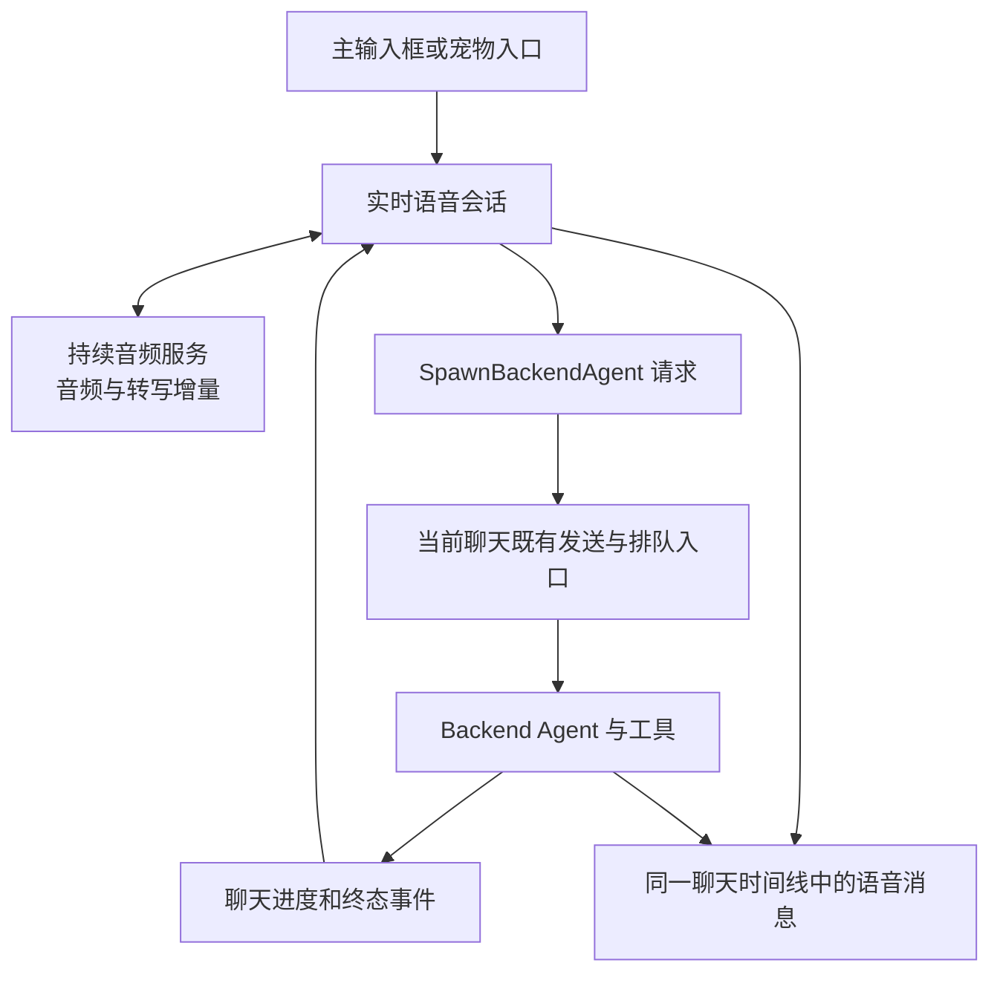
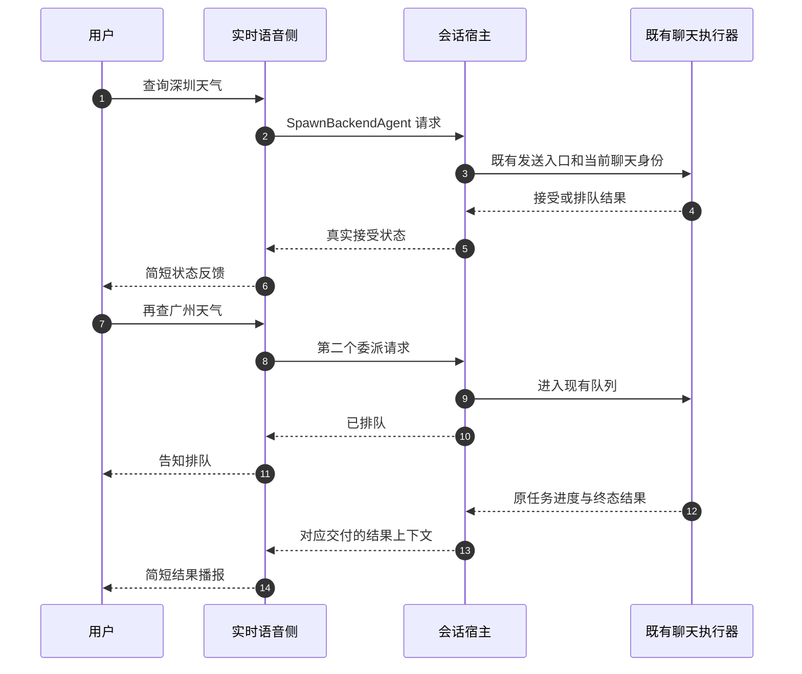

# Qoder CN 实时语音实现调查与 Flowy 候选执行方案

> 状态：只读调查完成；后续方案待决定，未实施业务修改。调查日期：2026-10-20。
> 原则：语音负责即时交互，软件既有会话负责工具工作；两者共享任务归属，保留各自轮次和状态。

## 1. 背景、结论和证据边界

用户观察到 Qoder CN 语音识别、回答、工具过程落在同一会话中，能提前反馈查询状态，并在后台忙碌时接受后续请求。本次除公开文档外，实际静态读取了本机安装包，确认这不是仅从截图猜测的交互设计。

本机版本为 Qoder CN 0.4.8 stable，Windows x64，应用构建提交 `f8c98a817f6059ab9a959f501e9a483805170942`，构建时间 `2026-10-14T16:56:12.560Z`。这是调查时的安装版本，不能据此确认每张历史截图的运行版本。

核心结论：

1. 实时语音使用持续音频交互接口，接收转写增量、音频增量和函数调用。客户端优先尝试 AOQ 原生媒体传输，另有 renderer 音频传输路径。
2. 复杂请求通过 `SpawnBackendAgent` 交给当前聊天已有的发送入口。后台工作的排队、工具和结果继续属于同一个 `chatSessionId`，不是每句话新建任务会话。
3. 语音与后台执行有独立轮次和交付映射；接受、排队、运行、待用户操作、终态分别回传。语音可以继续接收输入，不必等工具执行结束。
4. 这套结构足以解释其低等待感，但尚未实测端到端耗时，不能给出首音 P95、保证 8 秒回复，或确定云端具体模型。

| 证据类型 | 本次取得的内容 | 不能推出的结论 |
| --- | --- | --- |
| 用户截图 | 同一任务呈现语音与工具；可见排队反馈；也出现任务结束却未获得具体数据的语音回复 | 精确延迟、云端模型、每次请求实际状态 |
| 官方文档 | 实时语音可继续当前任务；宠物不另建任务、不改变已选工作区 | 所有客户端版本和 IDE 共用相同代码 |
| 本机安装包 | 编译后的 renderer/main JavaScript、音频 worklet、AOQ SDK 接口和原生依赖清单 | 桌面完整产品已开源；服务端推理结构已公开 |
| 未开展的验证 | 未启动 Qoder、未使用用户凭据、未调用语音或模型服务、未采集音频 | 不能声称验证了本次会话实际传输、运行性能或云端结果 |

公开仓库中本次未找到可核实的桌面实时语音完整源码。读取安装包中的编译产物不等于获取了开源授权；本报告只保留机制说明、符号和指纹，不复制产品实现或完整提示词到 Flowy。

## 2. 实际架构：一个聊天归属，两条执行链路

客户端同时维护 `chatSessionId`、`voiceSessionId`、`turnId`、`callId`。共享聊天归属并不意味着所有身份合并为一个 ID。

宠物通过展示锚点进入现有语音交互，不拥有独立任务系统。[官方宠物说明](https://docs.qoder.cn/qoder/desktop-pet)也明确它不创建独立任务或改变当前工作区。截图中没有配置工作区，不能证明产品不支持工作区上下文；安装包里的委派上下文也包含相关语义。

## 3. 核心机制与边界

### 3.1 为什么语音能快

`startSession` 查询 `getLiveVoiceCapabilities`，可用时传入 `transportPreference: aoq-first`，否则选择 `legacy-only`。返回 `transport: aoq` 后，不启动 renderer 的旧 PCM 采集和 WebAudio 播放链，而是同步原生媒体控制。

安装包包含 `aoq-electron-sdk`，版本 `1.2.0-57793950`，以及 Windows 的 `AoqClientSdk.dll`、`aoq_node_ext.node`、Opus/FFmpeg 相关库。SDK 提供采集、播放、暂停/打断、音量、数据消息、连接状态和网络统计接口；支持 PCM/Opus 类型。接口存在不等于证明实际选择了 Opus、具体采样率或某种回声消除参数。该包清单列出 Windows/macOS，不能拿它为 Linux 支持背书。

另一条 renderer 路径可以直接核对参数：

| 项目 | 静态实现证据 | 解释 |
| --- | --- | --- |
| 输入 | 16 kHz、单通道 PCM16；累积 1600 样本发送一帧 | 每帧约 100 ms，持续上传而非先录完一句再上传 |
| 采集 | AudioWorklet 每积累 640 个浮点样本投递；必要时重采样 | 不把 UI 刷新频率当音频发送频率 |
| 输出 | 24 kHz PCM16 音频块进入 WebAudio 调度 | 能随音频返回增量播放，不等完整回答音频生成 |
| 播放完成 | 追踪活动音源，全部结束才触发 drained | 后端回到 listening 与实际播放完成需要协调 |
| 回声相关 | 请求浏览器 echoCancellation；播放尝试本地 WebRTC 音频桥并有直出路径 | 本地播放桥不等于上云传输必定使用 WebRTC，也不证明任意设备都能可靠全双工 |

main 进程的静态协议名称包含输入转写 delta/completed、输出 audio delta、输出 audio transcript delta、session update 和语音起止事件；还包含 AOQ 会话分配接口路径。这些与 renderer 真实事件处理相互印证。

因此，较强的结论是“采用持续的双向音频交互接口”。它背后究竟是原生端到端语音模型，还是服务端组织的流式 ASR、LLM 和 TTS，本次没有服务端证据。协议外观接近常见 Realtime API，也不能据此认定是 OpenAI。

界面显示的 DeepSeek-Flash 可说明后台聊天选择，不能证明实时语音也由它生成。本次未定位到足以确认云端语音模型身份的配置。

### 3.2 困难问题如何交给既有会话

renderer 对 `SpawnBackendAgent` 校验请求，再调用主输入框所使用的发送处理器，传入当前请求的 `turnId`、完整 prompt 和排队显示文字。默认调度为 `queued`；只有明确的 `interruptCurrent` 才选 `replace`。

对外接受状态区分 started、queued、replaced、rejected。排队成功后另发受约束的状态上下文，要求简短告知排队，避免说成已经运行。不是直接念后台函数的控制 JSON。

还存在 `GetBackendAgentStatus`、`InterruptBackendAgent` 和 `CancelQueuedBackendAgentWork`。查询、打断当前工作、删除尚未开始的排队项是不同控制动作。不能从“能连说多句”推断后台工具无界并发。

### 3.3 上下文不是只有一句 task_goal

委派构造器维护主聊天和语音消息的独立指纹，向后台携带尚未同步的历史增量，包含：

- `chatSessionId`、`voiceSessionId`、`historyMode: incremental`；
- `mainSessionHistoryDelta`、`voiceSessionHistoryDelta`；
- 历史截断和窗口是否仍有更早消息的标记；
- `voiceHistoryLookup`，用于经 `read_chat_session` 进一步读取历史。

构造器限制上下文预算，单条裁剪；只有请求被实际接受后才提交已同步指纹。发送失败时不会误以为后台已经看过上下文。宿主历史与当前用户请求分开封装；不应把历史里的模型自述当成新授权。

这比每次只传“查询天气”完整，也比无界复制所有聊天历史克制。其预算是客户端具体决策，不是 Flowy 必须照搬的参数。

### 3.4 结果、审批和语音历史如何呈现

语音转写通过 `upsertLiveVoiceTranscript` 写入同一聊天，保留 voice stream 和语音身份。后台进度按聊天及轮次绑定，排除语音流，读取对应助手输出作为最新结果；等待问答和等待权限分别处理，并有按工具调用去重的用户操作通知。

终态通过独立的 continuation 上下文送回实时语音侧，包含交付身份、原轮次、终态和结果；有 `completionDelivered` 标记以及投递失败后的复位。长结果有裁剪预算，要求口语总结。

但这里仍有可见风险：客户端终态辅助函数在没有 interrupted/error/failed 证据时倾向归入 completed；最新结果又依赖相应聊天消息已可读。截图中“结束但没有具体数据”与这种状态/内容到达不同步的风险相符，**尚不足以确定这就是截图的根因**。不能复制其 completed 判断作为 Flowy 的目标成功判据。

同样，临时内存中的去重标记不等于已证明跨进程重启恰好一次；也未验证运行中的窗口切换、断网重连或迟到结果覆盖。研究机制和通过真实验收是两件事。

## 4. 对 Flowy 的取舍建议

当前分支已存在句级流式补全和独立 TTS 流；不能再把它描述为完全不流式。`apps/ai-mate/src/voice.rs` 的普通发言处理仍将收集到的 PCM 交给 `transcribe`，宿主的 `voice_dialogue.rs` 负责文本补全，`nomifun-voice-terminal/src/tts.rs` 负责独立 Edge 播报。它与持续的实时音频接口仍有结构差异，减少提示词或关闭思考无法独自抹平这些阶段的延迟。

| 决策 | 建议 | 理由与限制 |
| --- | --- | --- |
| 会话归属 | 语音输入、回答、进度在软件同一 Conversation 呈现；浮窗和宠物只做入口/投影 | 最贴近本次用户诉求；无需把宠物变成必需依赖 |
| 任务执行 | 复用现有 Conversation/runtime 及队列能力 | 语音不另建工具系统，不绕过软件权限 |
| 快速反馈 | 由真实提交回执触发 started/queued 反馈；后台结果单独播报 | 不让快模型猜接单和完成 |
| 上下文 | 原话、需求、引用结果、工作区与必要历史增量一起交付 | 避免追问“第二条”变成新一轮无上下文搜索 |
| 排队 | 先做当前会话有界串行队列；追加、替换、取消待执行项显式分开 | 不先引入通用调度框架，不默认把新一句当中断 |
| 音频升级 | 作为独立纵向试验评估一个公开实时语音接口 | 先量化收益；不直接引入 Qoder 私有 AOQ SDK/服务 |
| 本地路线 | 保留现有本地 KWS/ASR 与文本补全分工 | 实时云音频是另一种能力和数据路径，不能静默替换本地隐私约定 |
| 权限 | 延续现有软件会话模式与审批策略 | 不能因为截图“自动审批”就认定语音应全部放行 |

公开可进一步阅读的参考：[Qwen-Live-Harness](https://github.com/QwenLM/Qwen-Live-Harness)明确使用 Qwen Omni Realtime 做交互，并能委派 Qoder CLI 等后台 harness。这是另一个公开项目，不是已经证明的 Qoder CN 服务端源码。它当前说明完整桌面体验主要支持 macOS，Windows/Linux 仍在推进；不宜整套替代 Flowy 的跨平台宿主。

## 5. 候选串行执行与验收

以下是研究导出的后续入口，尚未获得本轮业务实施授权，不改变现有 PRD 已批准的范围。

| 顺序 | 最小交付 | 验收与边界 |
| --- | --- | --- |
| Q0 统一会话呈现 | 原话、快回复、后台进度和结果关联到选定 Conversation；浮窗只读投影 | 点击语音与唤醒都不无故新建会话；无宠物仍可使用；单次上下文选择冻结后不随页面漂移 |
| Q1 可信委派 | 在现有 API 交付原话、目标、约束、引用和有限历史；保存后提交，真实接受后反馈 | “新闻第二条详情”使用原条目；拒绝/unknown 不播接单；同命令重复至多执行一次；失败不丢上下文同步状态 |
| Q2 有界排队 | 复用或最小扩展现有会话队列，分开排队和替换 | 连说 A/B/C 各有身份和排队位置；取消 B 不影响 A/C；队列满明确拒绝；关闭语音不取消后台任务；审批不被后句隐式批准 |
| Q3 结果一致性 | 终态、结果内容和播报回执分别确认 | 无内容不能报目标成功；后到正文补齐后通知一次；结果播报失败保文且不重做任务；用户说话时不挤占播报 |
| Q4 实时音频试验 | 单一公开 provider，复用 Q0–Q3 的会话执行契约 | 先确认地区、费用、音频出网、平台和鉴权；统计话音结束→首转写→首有效回复→首音及分位数；断网/打断/设备恢复可测；不得用提示音冒充有效回复 |

优先 Q0–Q3 保证产品一致性；Q4 另行决定是否启动。若主要目标转为验证低延迟技术可行性，可先对 Q4 做隔离测量，禁止同时改会话归属和整条业务链，避免无法归因。

验证顺序：生产入口的会话/交付测试 → 有播放节奏和背压的音频测试 → 固定网络与同一音频样本的延迟对比 → 真人设备与跨平台验收。Mock 通过只能证明时序与边界，不能证明真实网络和声音体验。

## 附录 A：静态证据定位

安装包：`C:/Users/38788/AppData/Local/Programs/Qoder CN/resources/app.asar`。

版本依据：同目录 `build-manifest.json`、`product.json`。脱敏证据索引另存 `target/voice-review/qoder-cn-static-evidence-2026-10-20.json`。没有保存凭据、个人会话、音频或产品完整源码。

以下位置为解码后的 JavaScript 字符串 **UTF-16 零起始偏移**，不是字节偏移或源码行号。升级后 bundle 文件名和位置会变化，须先对照 SHA256。

| ASAR 内路径/符号 | 定位 |
| --- | --- |
| `out/renderer/assets/DIR8HOYO.js` | SHA256 `52b8425ff40f90ef76782847291e61183ad0a2eb4a6c44df443494466b8eccef` |
| 同上 `startSession` / 传输偏好 | 7656444 / 7658398 |
| 同上 `startCapture` / `sendFrame` | 7670143 / 7671515 |
| 同上事件处理 / 接受回执 | 7671837 / 7665455 |
| 同上增量上下文 `historyMode` | 7640558 |
| 同上后台事件 / 结果投递 | 7676784 / 7678370 |
| 同上结果上下文 / 既有聊天发送监听 | 7689324 / 7713026 |
| `out/renderer/assets/liveVoiceCaptureWorklet-BYUqjVX_.js` | 481 字节；SHA256 `cdf968f2b8ed458ae0ff1946966f449e7e98c2934f91e73e3faf3e873ce2b2de` |
| `out/main/electronMain.js` | SHA256 `1a382db7062b9acdb910ed78fcebb2a16a8a6900b5d44965f9c8a3cbb4260996`；静态字符串表与音频协议配置交叉核对 |
| `node_modules/aoq-electron-sdk/ts/IAoqClientEngine.ts` | 原生采集、播放、连接、消息、打断与音量接口 |
| `node_modules/aoq-electron-sdk/ts/Types.ts` | 音频编解码、轨道、连接与网络统计类型；不能把可选类型当实际启用配置 |

本次只解码静态字符串数据、读取调用链，没有执行安装包代码或原生 SDK。

## 附录 B：公开来源与历史边界

- [Qoder CN 语音说明](https://docs.qoder.cn/qoder/voice-input)：三种语音方式、继续当前任务、分别控制麦克风与播报、屏幕检查交给 Backend Agent。
- [Qoder CN 宠物说明](https://docs.qoder.cn/qoder/desktop-pet)：入口与当前任务、工作区的关系。
- [QoderAI 公开仓库](https://github.com/QoderAI)：本次公开源码检索范围之一，未证明桌面完整实现已开源。
- [Forward Quickstart](https://github.com/QoderAI/forward-quickstart)：公开 Cloud Agents 接入示例，README 描述 WebSocket 语音；不是本机桌面实现。具体 voiceProxy 源文件读取未成功，不声称审查了该文件。
- [Qwen-Live-Harness](https://github.com/QwenLM/Qwen-Live-Harness)：可读的另一种实时语音与后台委派方案，不能作为 Qoder CN 模型选型证据。
- 前一轮公开网页调查保留于 `target/voice-review/qoder-voice-pet-research-2026-10-20.zh.md`。其中“未取得完整实现”的证据范围是当时的公开检索；本次补充了本机编译产物调查，没有改写或删除旧报告。

本轮验证：应用版本/构建身份、ASAR 文件元数据、上述文件 SHA256、主要 renderer 调用链和公开说明互相核对。未修改业务代码，因此未运行 Rust/UI 构建或启动桌面验证。

## 后续调查补充（2026-10-20）

新一轮已核对 AOQ 官方文档和 Qwen-Live-Harness 固定提交，并追踪 Qoder 工作区入口，详见 [深入调查与候选方案](qwen-qoder-workspace-voice-deep-research-2026-10-20.zh.md)。本报告中的“Qoder 私有 AOQ SDK/服务”应区分理解：AOQ（AI over QUIC）SDK 有公开发行包和接入文档，Qoder 业务服务仍属于其自身产品。Linux 另有 C++/Python SDK，但原生采集/播放覆盖不同，不能将 Electron 包的平台限制推广到整个 AOQ。新建工作区选择还有路由、默认设置与 recent 优先级，不能把一次前台工作区实测概括为所有入口都直接继承当前聊天。保留上述原始调查正文以供追溯。
