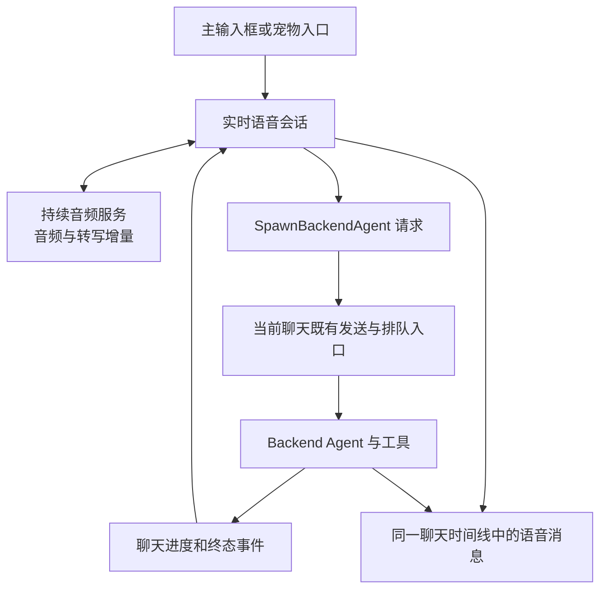
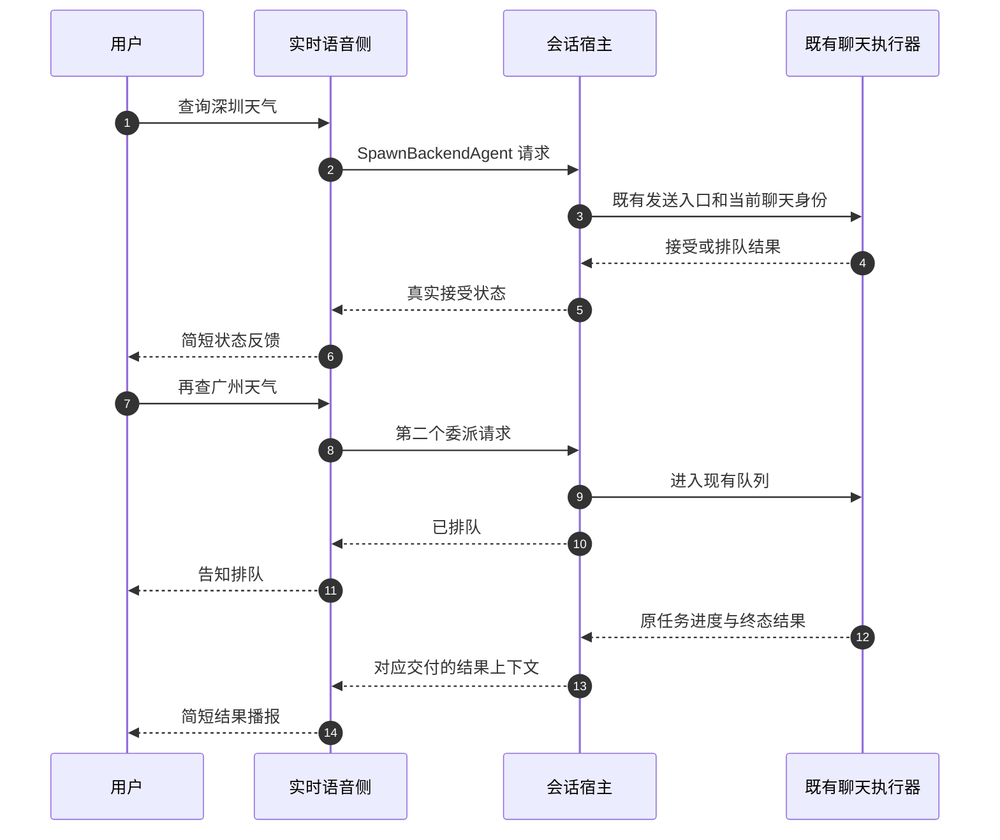

# Qoder CN 实时语音实现调查与 Flowy 候选执行方案

> 状态：只读调查完成；后续方案待决定，未实施业务修改。调查日期：2026-10-20。
> 原则：语音负责即时交互，软件既有会话负责工具工作；两者共享任务归属，保留各自轮次和状态。

## 1. 背景、结论和证据边界

用户观察到 Qoder CN 语音识别、回答、工具过程落在同一会话中，能提前反馈查询状态，并在后台忙碌时接受后续请求。本次除公开文档外，实际静态读取了本机安装包，确认这不是仅从截图猜测的交互设计。

本机版本为 Qoder CN 0.4.8 stable，Windows x64，应用构建提交 `f8c98a817f6059ab9a959f501e9a483805170942`，构建时间 `2026-10-14T16:56:12.560Z`。这是调查时的安装版本，不能据此确认每张历史截图的运行版本。

核心结论：

1. 实时语音使用持续音频交互接口，接收转写增量、音频增量和函数调用。客户端优先尝试 AOQ 原生媒体传输，另有 renderer 音频传输路径。
2. 复杂请求通过 `SpawnBackendAgent` 交给当前聊天已有的发送入口。后台工作的排队、工具和结果继续属于同一个 `chatSessionId`，不是每句话新建任务会话。
3. 语音与后台执行有独立轮次和交付映射；接受、排队、运行、待用户操作、终态分别回传。语音可以继续接收输入，不必等工具执行结束。
4. 这套结构足以解释其低等待感，但尚未实测端到端耗时，不能给出首音 P95、保证 8 秒回复，或确定云端具体模型。

| 证据类型 | 本次取得的内容 | 不能推出的结论 |
| --- | --- | --- |
| 用户截图 | 同一任务呈现语音与工具；可见排队反馈；也出现任务结束却未获得具体数据的语音回复 | 精确延迟、云端模型、每次请求实际状态 |
| 官方文档 | 实时语音可继续当前任务；宠物不另建任务、不改变已选工作区 | 所有客户端版本和 IDE 共用相同代码 |
| 本机安装包 | 编译后的 renderer/main JavaScript、音频 worklet、AOQ SDK 接口和原生依赖清单 | 桌面完整产品已开源；服务端推理结构已公开 |
| 未开展的验证 | 未启动 Qoder、未使用用户凭据、未调用语音或模型服务、未采集音频 | 不能声称验证了本次会话实际传输、运行性能或云端结果 |

公开仓库中本次未找到可核实的桌面实时语音完整源码。读取安装包中的编译产物不等于获取了开源授权；本报告只保留机制说明、符号和指纹，不复制产品实现或完整提示词到 Flowy。

## 2. 实际架构：一个聊天归属，两条执行链路



客户端同时维护 `chatSessionId`、`voiceSessionId`、`turnId`、`callId`。共享聊天归属并不意味着所有身份合并为一个 ID。

宠物通过展示锚点进入现有语音交互，不拥有独立任务系统。[官方宠物说明](https://docs.qoder.cn/qoder/desktop-pet)也明确它不创建独立任务或改变当前工作区。截图中没有配置工作区，不能证明产品不支持工作区上下文；安装包里的委派上下文也包含相关语义。

## 3. 核心机制与边界

### 3.1 为什么语音能快

`startSession` 查询 `getLiveVoiceCapabilities`，可用时传入 `transportPreference: aoq-first`，否则选择 `legacy-only`。返回 `transport: aoq` 后，不启动 renderer 的旧 PCM 采集和 WebAudio 播放链，而是同步原生媒体控制。

安装包包含 `aoq-electron-sdk`，版本 `1.2.0-57793950`，以及 Windows 的 `AoqClientSdk.dll`、`aoq_node_ext.node`、Opus/FFmpeg 相关库。SDK 提供采集、播放、暂停/打断、音量、数据消息、连接状态和网络统计接口；支持 PCM/Opus 类型。接口存在不等于证明实际选择了 Opus、具体采样率或某种回声消除参数。该包清单列出 Windows/macOS，不能拿它为 Linux 支持背书。

另一条 renderer 路径可以直接核对参数：

| 项目 | 静态实现证据 | 解释 |
| --- | --- | --- |
| 输入 | 16 kHz、单通道 PCM16；累积 1600 样本发送一帧 | 每帧约 100 ms，持续上传而非先录完一句再上传 |
| 采集 | AudioWorklet 每积累 640 个浮点样本投递；必要时重采样 | 不把 UI 刷新频率当音频发送频率 |
| 输出 | 24 kHz PCM16 音频块进入 WebAudio 调度 | 能随音频返回增量播放，不等完整回答音频生成 |
| 播放完成 | 追踪活动音源，全部结束才触发 drained | 后端回到 listening 与实际播放完成需要协调 |
| 回声相关 | 请求浏览器 echoCancellation；播放尝试本地 WebRTC 音频桥并有直出路径 | 本地播放桥不等于上云传输必定使用 WebRTC，也不证明任意设备都能可靠全双工 |

main 进程的静态协议名称包含输入转写 delta/completed、输出 audio delta、输出 audio transcript delta、session update 和语音起止事件；还包含 AOQ 会话分配接口路径。这些与 renderer 真实事件处理相互印证。

因此，较强的结论是“采用持续的双向音频交互接口”。它背后究竟是原生端到端语音模型，还是服务端组织的流式 ASR、LLM 和 TTS，本次没有服务端证据。协议外观接近常见 Realtime API，也不能据此认定是 OpenAI。

界面显示的 DeepSeek-Flash 可说明后台聊天选择，不能证明实时语音也由它生成。本次未定位到足以确认云端语音模型身份的配置。

### 3.2 困难问题如何交给既有会话



renderer 对 `SpawnBackendAgent` 校验请求，再调用主输入框所使用的发送处理器，传入当前请求的 `turnId`、完整 prompt 和排队显示文字。默认调度为 `queued`；只有明确的 `interruptCurrent` 才选 `replace`。

对外接受状态区分 started、queued、replaced、rejected。排队成功后另发受约束的状态上下文，要求简短告知排队，避免说成已经运行。不是直接念后台函数的控制 JSON。

还存在 `GetBackendAgentStatus`、`InterruptBackendAgent` 和 `CancelQueuedBackendAgentWork`。查询、打断当前工作、删除尚未开始的排队项是不同控制动作。不能从“能连说多句”推断后台工具无界并发。

### 3.3 上下文不是只有一句 task_goal

委派构造器维护主聊天和语音消息的独立指纹，向后台携带尚未同步的历史增量，包含：

- `chatSessionId`、`voiceSessionId`、`historyMode: incremental`；
- `mainSessionHistoryDelta`、`voiceSessionHistoryDelta`；
- 历史截断和窗口是否仍有更早消息的标记；
- `voiceHistoryLookup`，用于经 `read_chat_session` 进一步读取历史。

构造器限制上下文预算，单条裁剪；只有请求被实际接受后才提交已同步指纹。发送失败时不会误以为后台已经看过上下文。宿主历史与当前用户请求分开封装；不应把历史里的模型自述当成新授权。

这比每次只传“查询天气”完整，也比无界复制所有聊天历史克制。其预算是客户端具体决策，不是 Flowy 必须照搬的参数。

### 3.4 结果、审批和语音历史如何呈现

语音转写通过 `upsertLiveVoiceTranscript` 写入同一聊天，保留 voice stream 和语音身份。后台进度按聊天及轮次绑定，排除语音流，读取对应助手输出作为最新结果；等待问答和等待权限分别处理，并有按工具调用去重的用户操作通知。

终态通过独立的 continuation 上下文送回实时语音侧，包含交付身份、原轮次、终态和结果；有 `completionDelivered` 标记以及投递失败后的复位。长结果有裁剪预算，要求口语总结。

但这里仍有可见风险：客户端终态辅助函数在没有 interrupted/error/failed 证据时倾向归入 completed；最新结果又依赖相应聊天消息已可读。截图中“结束但没有具体数据”与这种状态/内容到达不同步的风险相符，**尚不足以确定这就是截图的根因**。不能复制其 completed 判断作为 Flowy 的目标成功判据。

同样，临时内存中的去重标记不等于已证明跨进程重启恰好一次；也未验证运行中的窗口切换、断网重连或迟到结果覆盖。研究机制和通过真实验收是两件事。

## 4. 对 Flowy 的取舍建议

当前分支已存在句级流式补全和独立 TTS 流；不能再把它描述为完全不流式。`apps/ai-mate/src/voice.rs` 的普通发言处理仍将收集到的 PCM 交给 `transcribe`，宿主的 `voice_dialogue.rs` 负责文本补全，`nomifun-voice-terminal/src/tts.rs` 负责独立 Edge 播报。它与持续的实时音频接口仍有结构差异，减少提示词或关闭思考无法独自抹平这些阶段的延迟。

| 决策 | 建议 | 理由与限制 |
| --- | --- | --- |
| 会话归属 | 语音输入、回答、进度在软件同一 Conversation 呈现；浮窗和宠物只做入口/投影 | 最贴近本次用户诉求；无需把宠物变成必需依赖 |
| 任务执行 | 复用现有 Conversation/runtime 及队列能力 | 语音不另建工具系统，不绕过软件权限 |
| 快速反馈 | 由真实提交回执触发 started/queued 反馈；后台结果单独播报 | 不让快模型猜接单和完成 |
| 上下文 | 原话、需求、引用结果、工作区与必要历史增量一起交付 | 避免追问“第二条”变成新一轮无上下文搜索 |
| 排队 | 先做当前会话有界串行队列；追加、替换、取消待执行项显式分开 | 不先引入通用调度框架，不默认把新一句当中断 |
| 音频升级 | 作为独立纵向试验评估一个公开实时语音接口 | 先量化收益；不直接引入 Qoder 私有 AOQ SDK/服务 |
| 本地路线 | 保留现有本地 KWS/ASR 与文本补全分工 | 实时云音频是另一种能力和数据路径，不能静默替换本地隐私约定 |
| 权限 | 延续现有软件会话模式与审批策略 | 不能因为截图“自动审批”就认定语音应全部放行 |

### 4.1 补充核对：内置宠物与语音入口（2026-10-20）

后续静态核对补上了“默认宠物”这一项，避免把“宠物可选”误解成“Qoder 没有内置宠物”，也避免把 Qoder 的内置桌宠和 Flowy 上游的 companion 档案混为一谈：

| 观察 | 静态证据 | 能推出什么 |
| --- | --- | --- |
| Qoder 自带内置桌宠 | renderer 宠物目录回退值为 `{activePetId, pets:[{petId, displayName:"Qoduck", source:"builtin"}]}`；设置文案写“当前宿主仅支持内置的 Q 达鸭” | 安装即有内置宠物资源，不需要用户先创建伙伴 |
| 桌宠显示与语音入口分离 | 设置文案：“开启后，它会悬浮在桌面上，可拖拽位置；发起语音任务时会临时切换为语音入口。”；主进程桌宠控制器同时维护 `intentVisible` 与 `suspendedByVoice` | 语音启动可临时改变宠物呈现，但不等于修改“显示宠物”设置 |
| 语音启动不写设置 | 语音 `startSession` 只传 `anchor` / `source`；`setDesktopPetEnabled` 仅在用户菜单的显示/隐藏开关里调用 | 语音任务不会把设置里的宠物开关改成开启 |
| 语音会话默认主按钮是麦克风 | composer 动作顺序为 `stopLiveVoice > disabled > send（有内容）> stopAgent > startLiveVoice（空输入）`；空输入渲染 `composer.voice.liveStart` 麦克风 | 语音会话在无文字输入时默认是语音按钮，有文字才变为发送 |
| 关闭桌宠后是否仍强制显示 | 静态代码只能证明“语音临时状态”和“持久设置”分离；未启动 Qoder 实测 | 不能据此断言设置关闭时一定强制显示；需真机确认 |

这里要修正一个容易混淆的表述：上一轮说“上游默认没有宠物”，针对的是 Flowy 上游 `nomifun-desktop` 的 companion 档案；Qoder CN 是另一套设计，内置 `Qoduck` 资源确实随安装存在。两者不能混为一谈。

对 Flowy 的落地建议因此更明确：优先做“内置宠物展示入口 + 独立语音入口”，不要为了一个语音按钮创建真实 companion 档案；语音临时入口不得写回“显示宠物”设置，也不得自动开麦。

### 4.2 会话生命周期、转写保留与退出命令（2026-10-20）

这一节专门核对“Qoder 唤醒后是否一直保持、是否只发送提问、说‘退下’能否关闭且不污染历史”这几个问题。结论是：**连续对话成立，但“永不超时”“只发送提问”“退出词不写入历史”不能当作已证实的 Qoder 行为。**

| 问题 | 静态证据 | 结论 |
| --- | --- | --- |
| 是否说完一句就退出 | `startSession` 成功后保持 `phase:"listening"`，持续发送 PCM；只有 `state idle`、错误、用户 stop 或超时才清理 | 不是逐句退出，可以连续多轮 |
| 是否永不超时 | renderer 内置字符串 `Your session was closed because no response was generated for 180 seconds.`；错误映射同时处理 `response_idle_timeout` 与 `user_idle_timeout` | 有超时；至少 180 秒无回复会关闭，用户空闲超时由服务端返回，客户端未定义其时长 |
| 是否只发送“有意义的提问” | `upsertLiveVoiceTranscript` 只在转写文本为空时移除消息；非空 final 转写全部写入；客户端没有本地“是否提问”分类器 | 客户端没有“只发送提问”的过滤；是否响应由实时模型/服务端决定 |
| “退下”是否是客户端命令 | renderer 未找到“退下/退出语音”等命令字符串；客户端只有 `stopLiveVoice` 按钮/快捷键，以及桌宠的 `desktopPetVoiceRequested` 入口 | 客户端没有“退下”解析；若 Qoder 能响应，属于服务端模型/提示词行为，静态证据不能证实 |
| 退出语句是否不进聊天记录 | 同一 `upsertLiveVoiceTranscript` 没有排除控制语句；唯一清理是空转写 | 客户端不能保证；若服务端仍发送该转写，它会进入聊天记录，除非在宿主侧主动过滤 |
| Flowy 能否直接照搬 | Qoder 是连续实时音频 + 服务端模型；Flowy 是 KWS + ASR + LLM + TTS | 交互目标可借鉴，但生命周期、退出词和上下文过滤必须由 Flowy 自己实现 |

因此，产品目标应写成 Flowy 自己的明确规则，而不是“Qoder 已验证”：

- **会话生命周期**：唤醒或点击后保持一个显式语音会话，直到用户说退出、点击关闭、发生错误或达到产品定义的闲置上限；如果选择“不自动超时”，需单独评估麦克风占用、隐私和资源成本，不能把它描述成 Qoder 的既有行为。
- **控制语句隔离**：退出词、静音、停止等控制语句应在投影到 Conversation 之前被宿主消费，不写入用户消息、不进入 LLM 上下文；不能依赖模型“自己不说出来”。
- **有意义的语音门控**：VAD/ASR 空结果、纯噪声、低置信度片段不提交；是否需要“只提交提问”的本地意图判定应单独设计并测试，不能假设 Qoder 客户端已经做了。
- **转写与结果分离**：即使用户说了退出词，也只改变会话状态；已经接受的后台任务、结果和审批仍按原身份保留。

线上 Qwen-Live-Harness 的公开源码进一步印证这些边界：Qwen 客户端没有“退下”结束工具，只有显式 End call；语义 VAD 会拒绝部分噪声候选，但 `MemoryDialogueCollector` 仍记录所有非空用户文本，没有退出词过滤。详见 [Qwen 调研 §3.8](qwen-qoder-workspace-voice-deep-research-2026-10-20.zh.md)。

### 4.3 证据等级与实现优先级（2026-10-20）

判断规则：

1. **Qoder CN 0.4.8 客户端静态证据是主依据**；用户实际观察用于校验交互，但不把单次截图当作所有版本的契约。
2. **Qwen-Live-Harness 固定提交的公开源码是佐证**：只在它确实实现相同机制时提高可信度；它没有的，不反向否定 Qoder。
3. **QoderAI 公开仓库不包含桌面客户端**；`forward-quickstart` 只能作为 Cloud Agents 语音中继参考，不能证明桌面行为。
4. 两侧都没有源码证据的（如“退下”语音关闭、退出词不入历史），保持“未证实”，不因为产品目标合理就升级为高优先级。

| 结论/候选 | 证据 | 可信度 | 实施优先级 |
| --- | --- | --- | --- |
| 内置桌宠资源 + 临时语音入口；语音不写显示设置 | Qoder 客户端静态 | 高 | P0：先做展示入口，不建 companion 行 |
| 空输入默认麦克风、有文字才发送 | Qoder 客户端静态 | 高 | P0：主输入框交互 |
| 连续多轮，不逐句退出 | Qoder 客户端 + Qwen 连续通话 | 高 | P0：会话生命周期 |
| 显式结束/关闭，而非依赖模型 | Qoder 客户端 stop + Qwen End call | 高 | P0：显式 End call/退出按钮 |
| 长时间保持、不固定 30 秒休眠 | Qwen 客户端无固定空闲关闭；Qoder 有 180 秒无回复关闭 | 中 | P1：产品策略；不能写成“Qoder 已验证无超时” |
| 噪声/无效语音不提交 | Qwen 服务端 semantic VAD + `onInputRejected`；Qoder 未在客户端证实 | 中 | P1：Flowy 自己做 VAD/ASR 门控 |
| “退下”语音关闭 | Qoder 客户端未找到；Qwen 无 end_call；QoderAI 无桌面源码 | 低/未证实 | P2：先做显式按钮/快捷键；语音命令另行验证 |
| 控制语句不进入历史/上下文 | 两侧客户端都没有过滤；Qwen 只过滤空文本 | 低（反向证据） | P1：宿主侧主动消费，不能等模型 |
| Qoder 桌面工作区/会话归属细节 | Qoder 客户端静态 + 用户实测 | 高 | P0：按 §4.1/§4.2 继续 |

“提高优先级”只适用于**两边都有实现证据**的机制（连续通话、显式结束、语义/ASR 门控）。只有 Qwen 有、Qoder 客户端没有的，按“候选实现模式”处理；只有 Qoder 有、Qwen 没有的，以 Qoder 为准。

### 4.4 Flowy 本地化路线与实时音频边界（2026-10-20 讨论稿）

状态：讨论稿，未实施；不改变 PRD 已批准范围。目标是把“Qoder 式连续会话”落到 Flowy 的本地模型路线，而不是复制 Qoder 的云端实时链路。

**180 秒的语义要先说清楚：**

- Qoder 的 180 秒是 `response_idle_timeout`：文案为“no response was generated for 180 seconds”，不是严格的“180 秒没有声音”。
- Qoder 另有 `user_idle_timeout`，时长由服务端返回，客户端不定义。
- 因此“KWS 唤醒后 180 秒无有效语音才退出”是 **Flowy 自己的产品规则**，可以作为目标，但不能写成“Qoder 同款 180 秒静默”。

**本地链路：**

```text
KWS 唤醒
  -> 持续 listening
  -> VAD 切分一句
  -> 本地流式/分段 ASR
  -> 空/噪声/低置信度门控
  -> 本地文本 LLM
  -> 句子级本地流式 TTS（可选 Edge TTS）
  -> 播放完回到 listening
  -> 180 秒无有效语音 / 主动退出 -> 关闭
```

可以借鉴 Qoder 的会话状态、显式结束、增量事件、门控和“语音临时入口”；不需要 AOQ、云端 realtime 模型或每句重新唤醒。真正的本地全双工语音到语音需要本地 omni/realtime 模型和较强硬件，属于独立 S4，不是 S1–S3 的前置条件。

**TTS 路由建议：**

| 模式 | 行为 |
| --- | --- |
| `local-only` | 始终本地 TTS；完全离线，隐私最好，音质取决于本地模型 |
| `auto` | 在线且允许出网时用 Edge TTS；离线/失败/429 自动回退本地 TTS；保留文字 |
| `edge-only` | 仅 Edge TTS，适合在线演示；不可作为离线默认 |

Edge TTS 是云端服务，严格“本地模型路线”下不能作为唯一 TTS。当前 Edge TTS 已有 429 限流证据，必须保留冷却和回退。

**速度判断：**

- 首音延迟：本地小模型（Piper/Kokoro 等）通常更快、更稳定；Edge TTS 取决于 RTT、TLS、服务队列和限流，好网络下也可能很快。
- 音质/资源：Edge TTS 通常音质更好、零本地算力；本地大神经 TTS 音质更好但无 GPU 时可能明显更慢。
- 不能只看“合成速度”，要看“请求→首音、首音→播完、失败率、CPU/GPU 占用”的 P50/P95；用同一组真实句子实测后再定默认。

**建议优先级：**

1. S1 连续会话 + 180 秒静默/主动退出 + 控制语句隔离。
2. S2 内置宠物展示入口 + 主输入框语音态 + TTS 路由。
3. S3 有效语音门控 + 上下文/结果语义。
4. S4 实时音频试验（本地 omni 或公开 provider，独立立项）。

**待决策：**

- 180 秒是否只算“有效用户语音”，任务进度/播放/噪声是否不续期。
- 语音退出是否首版支持，还是只做按钮/快捷键。
- 默认是 KWS 连续模式，还是保留 KWS 短追问 + 点击连续模式。
- “本地模型”是否硬性禁止 Edge TTS；若允许联网，默认 `auto` 还是 `local-only`。
- 本地 TTS/ASR 选型、硬件基线和首音 P95 目标。

已确认（2026-10-20 讨论）：180 秒从**播报结束重新计算**；任务运行/审批/结果待播报期间不关闭语音；本地语音模型优先 CPU，GPU 留给本地 LLM；Edge TTS 在线优先、失败回退本地；KWS 唤醒后默认连续模式；首版只做按钮/快捷键关闭；队列不再后置。

### 4.5 语音会话与普通会话：提示、队列与 runtime（2026-10-20）

Qoder 静态证据表明：语音不是“另一个 runtime”，而是同一 chat 的另一个入口，但语音侧有自己的提示和消息标记。

| 证据 | 位置/内容 | 含义 |
| --- | --- | --- |
| `SpawnBackendAgent` 调度 | 默认 `dispatchMode:"queued"`；只有 `interruptCurrent===true` 才用 `"replace"`；忙碌时 `schedulingOutcome:"queued"`，否则 `"started"` | 语音请求进入现有 chat 队列，不默认中断；替换必须显式 |
| 同一 chat，独立语音身份 | 使用 `chatSessionId`；另有 `voiceSessionId`；消息标记 `messageStream:"voice"` | 语音消息与普通消息在同一时间线，但来源可区分 |
| 语音结果提示 | `[COMPLETE]` 要求 “Give the user a concise spoken result… Do not invoke a function or mention protocol metadata”；`[STATUS]` 要求一句短句、不朗读问题/选项/元数据 | runtime 的完整结果不等于 TTS 文本；语音侧必须做短摘要 |
| 语音不执行工具 | `SpawnBackendAgent` 把请求交给既有 chat 发送入口；工具、审批、队列都在 runtime | 语音只负责交互和委派，不复制工具系统 |
| Qwen 佐证 | `instructions.ts` 有独立实时语音指令；`notification-speech.ts` 发送空 tools 和 `tool_choice:none` | 语音提示与普通 chat 提示不同，但执行仍走 backend |

结论：Qoder 的语音会话与普通会话共享 Conversation、runtime 和队列；语音侧有独立的消息流标记、短回答提示和结果摘要层。没有证据表明它替换了 runtime 的 loop。完整的 Qoder 语音 system prompt 未在静态 bundle 中定位，不能编造。

协作方式既不是“每句话新建 subagent”，也不是“把全部上下文塞进一个 prompt”：

- 语音模型和 backend chat 是两个执行上下文，但共享 `chatSessionId` 和消息时间线。
- `SpawnBackendAgent` 通过既有 chat 发送入口提交请求；backend 使用增量隐藏上下文（`[QODER_LIVE_VOICE_CONTEXT]` + `[CURRENT_USER_REQUEST]`）执行，不会每次复制全部历史。
- 语音侧只接收状态/终态上下文（`[STATUS]`、`[COMPLETE]`）和结果摘要；backend 的完整工具轨迹不进入语音模型。
- Qoder 的 chat 自己可能再使用 subagent，但语音 handoff 本身不是新建 subagent。
- 忙碌时 handoff 进入现有队列，语音继续响应；任务完成后再把摘要送回语音侧。

**队列不应后置：** Qoder 默认 `queued` 是实证，Qwen 也有有界队列（ACP 上限 8，取消排队项不影响运行项）。Flowy 应在现有 Conversation 队列上做有界队列，语音返回 accepted/queued，不能静默丢弃；PRD v0.3 的“首版不隐式排队”需要按此修订。

### 4.6 本地模型选型建议（讨论稿）

- **ASR**：流式 Zipformer/Paraformer 负责增量转写，SenseVoice 负责最终准确文本；VAD 分段。低配 CPU 不要同时跑两套重模型，可先 SenseVoice 分段 + 前端 partial 占位。
- **TTS**：Piper 作为低延迟 CPU 默认；Kokoro/MeloTTS 作为质量优先候选；大模型 CosyVoice/GPT-SoVITS 需要 GPU，不能承诺 CPU 首音。
- **LLM**：语音快回答用独立的小模型（约 3B–7B，量化），任务 runtime 继续用现有模型；不要为了语音把任务模型降级。
- **指标**：首 partial、最终 ASR、首 LLM token、首音、打断停止延迟；ASR 看 CER/WER，TTS 看 RTF/音质。用同一组真实句子测 P50/P95 后再定默认。
- **Edge TTS**：按用户决策优先执行；失败/离线回退本地，保留冷却，不能把 Edge 当本地模型。

### 4.7 伙伴记忆与工作区语音会话（2026-10-20 讨论稿）

问题：伙伴记忆可以复用为语音记忆，但桌宠有自己的聊天框和模型选择；在工作区唤起语音时，应在当前工作区新建语音会话，而不是进入桌宠独立聊天。这样学习和记忆如何归属？

现状事实：

- companion 记忆/学习按 `companion_id` 归属；collector 优先读事件里的 `companion_id`，其次 thread registry，再次默认伙伴（`collector.rs:507-524`）。
- `is_companion_event` 需要 wire `companion:true` 或已登记的 companion thread（`collector.rs:496-505`）。普通工作区语音会话不会被采集为 companion 事件。
- `conversation.extra` 的 `companion_session` / `companion_id` 会触发 companion 绑定、知识挂载和 wire marker；直接复用会把工作区语音变成伙伴会话，带来模型/知识/UI 副作用。
- 当前 Companion 语音模式使用 `companion_active_thread`；忙碌时回默认语音会话（`voice_companion_manager.rs:250-260`）。

可选方案：

| 方案 | 对话归属 | 记忆/学习 | 代价 |
| --- | --- | --- | --- |
| A. 记忆归属与对话归属解耦（推荐） | 当前工作区新建语音会话，使用工作区模型/权限 | 绑定默认伙伴作为 `memory_owner`，注入伙伴记忆/人格并采集学习 | 需要新增 memory owner 元数据与 collector 支持，不能直接复用 `companion_session` |
| B. 真实 companion thread | 语音直接进伙伴独立聊天 | 天然复用伙伴记忆/学习 | 与“当前工作区语音会话”冲突，桌宠聊天与工作区会话分离 |
| C. 无伙伴记忆 | 当前工作区语音会话 | 不学习/不注入伙伴记忆 | 最简单，但用户要求的“伙伴记忆变成语音记忆”无法满足 |

决策（2026-10-20）：选择 **A**。采用“虚拟展示入口 + 当前工作区语音会话 + 默认伙伴作为 memory owner”；不把语音会话伪装成 companion thread，也不让伙伴模型静默覆盖工作区模型。

方案 A 的关键设计：

- 新增 `memory_owner_companion_id`（或等价字段），只用于记忆注入、学习和人格上下文；**不要复用 `companion_session`**，避免工作区语音被当成伙伴会话。
- 语音用户消息用 `message_stream:"voice"` / `input_source:"voice"` 标记；不要把 `origin` 设为 `voice`，因为 collector 会跳过所有非空 `origin` 的用户消息。控制语句（退出/静音/停止）不生成消息。
- collector 需要支持 `memory_owner_companion_id` 作为 companion 事件归属，或事件显式 stamp `companion:true` + `companion_id`；要评估 XP、知识挂载、模型传播等副作用。
- 模型/预设/权限仍来自当前工作区会话；伙伴只提供人格、记忆和默认语音音色。不要静默用伙伴模型覆盖工作区模型。
- 删除伙伴后，语音会话的 `memory_owner` 置空或回退默认语音会话；旧历史保留，不重写。
- 需要产品决定：默认伙伴是否自动成为所有语音会话的 memory owner，还是只对“宠物入口”或用户显式选择的语音会话生效。

### 4.8 Flowy 整合改造切片（讨论稿）

目标架构：

```text
KWS / 宠物入口 / 快捷键
  -> VoiceSession（宿主持有生命周期）
  -> VoiceConversation（当前工作区下的真实 Conversation，出现在会话列表）
  -> ai-mate：本地 KWS / VAD / ASR / TTS
  -> 语音快模型：短回答 + 意图/委派
  -> 现有 Conversation 队列 -> 现有 runtime / 工具 / 审批
  -> 完整结果落聊天记录 -> 语音摘要 -> TTS
  -> 记忆归属：memory_owner_companion_id（默认伙伴，可选）
```

| 切片 | 改造 |
| --- | --- |
| S1 连续会话 | ai-mate 连续模式替代 4 秒追问；180 秒从最后一次有效语音或播报结束计算；任务/审批/结果待播报期间暂停；按钮/快捷键关闭；30 秒单句上限改为可配置 |
| S2 会话与队列 | 每个工作区一个语音 Conversation；用户语音/助手短回复/任务结果在同一时间线；复用现有队列，默认 queued，replace 仅显式；输入框空输入麦克风、有文字发送 |
| S3 记忆归属 | `memory_owner_companion_id` 绑定默认伙伴；注入伙伴人格/记忆、采集学习；不复用 `companion_session`；语音消息用 `messageStream:"voice"`/`input_source:"voice"`；控制语句不生成消息 |
| S4 模型与 TTS | 语音快模型、任务模型、伙伴聊天模型分开；本地语音模型 CPU 优先，GPU 留给 LLM；Edge TTS 在线优先，失败回退本地 Piper；完整结果保留，只播摘要 |
| S5 实时音频（可选） | `RealtimeProvider` 抽象；本地级联为默认，实时 provider 独立评估；不引入 AOQ Electron/Node 依赖 |

关键数据：

- `VoiceSessionScope`：user、workspace、voice_conversation_id、memory_owner_companion_id、mode、started_at、last_accepted_user_speech_at、playback_ended_at、active_task_ids、pending_approvals、ended_reason。
- `VoiceConversation`：`extra.voice=true`、`workspace`、`memory_owner_companion_id`、`voice_mode`；不是 `companion_session`，也不是伙伴 active thread。
- `VoiceTask`：目标为 voice_conversation_id；`dispatchMode=queued` 默认；`replace` 仅显式；`command_id` 幂等；取消排队项不影响运行项。
- `spoken_summary`：完整结果与 TTS 文本分开；TTS 失败保文，不重做任务。

待确认：默认伙伴是否自动创建；语音会话是否同一工作区 30 分钟内复用；键盘输入是否 TTS；队列容量；本地 ASR/TTS 选型。

后续讨论已确认（2026-10-20）：

- 默认伙伴首次启动自动创建；已有至少一个伙伴的用户不重复创建；至少保留一个，禁止删除到 0。
- 语音设置增加“语音伙伴/默认桌宠”选择；语音会话的 memory owner 冻结所选伙伴。
- 任务执行沿用当前语音 Conversation 的模型；语音快回答使用独立快模型；伙伴聊天模型只影响桌宠自己的聊天。
- ASR 后的快 LLM 层保留：负责 Chat/Task/Ignore、短口播回复、任务结果摘要；任务 runtime 仍用当前会话模型。
- 键盘输入默认不 TTS；TTS 默认 Edge，失败回退 Piper；队列有界、可配置，取消排队项可见。
- 30 分钟复用窗口：Qoder 客户端和 Qwen 线上源码均未找到同义规则，属于 Flowy 自有产品规则。建议同一工作区语音 Conversation 在最后一次有效交互后 30 分钟内复用，超过窗口新建；180 秒会话退出与 30 分钟会话复用分层。
- 默认伙伴名称 `Flowy`，复用现有形象 `bolt`（Bolt）；模型默认 `auto`，用户切换后按普通会话规则记住选择。
- 30 分钟任务轮换暂缓：先解决 runtime 与语音会话的衔接，再讨论任务会话轮换；当前保留 180 秒会话退出、30 分钟会话复用和既有任务预算三层独立计时。
- 流式 ASR（Zipformer/Paraformer）暂不接入、不测试，等当前改造完成后再做 S4 A/B；当前先用 SenseVoice 分段。

### 4.9 ASR 后是否还需要一层 LLM（2026-10-20）

需要，但要拆成两层：

| 层 | 作用 | 模型 |
| --- | --- | --- |
| 语音快模型 | 判断 Chat / Task / Ignore / 控制；生成短口播回复；任务结果摘要 | 本地小模型（CPU 或与 LLM 共享 GPU，视资源）；也可用规则兜底 |
| 任务 runtime 模型 | 真正执行工具、文件、浏览器、审批和长任务 | 当前语音 Conversation 的模型/预设，不另设 |

不能简单去掉快模型、把所有 ASR 文本直接送 runtime：

- 小聊、确认、忽略也会变成任务 turn，产生工具/审批和长回复；
- TTS 需要短句，runtime 的完整结果不适合直接朗读；
- Chat/Task 分流、排队回执、结果摘要都需要一个轻量层；
- Qoder 用实时语音模型承担这层，Qwen 用实时 Omni 模型承担；本地级联路线对应一个本地快模型。

如果未来采用本地 omni/realtime 模型，这层可以并入 omni；当前级联路线应保留独立快模型。云端 LLM 不是必需：Edge TTS 只负责合成，快模型和任务模型都可以本地。

任务结果摘要长度建议：

| 场景 | 目标 | 硬上限 |
| --- | --- | --- |
| 状态/排队/权限提示 | 1 句，说明当前状态或下一步 | 30 字 / 约 6 秒 |
| 简单 Chat 回复 | 1–2 句，直接回答 | 60 字 / 约 12 秒 |
| 任务终态摘要 | 1–2 句：结果 + 关键数据 + 是否需要用户下一步 | 120 字 / 约 20 秒 |
| 失败/未知 | 1 句说明未完成原因，再给可执行下一步 | 80 字 / 约 15 秒 |

摘要由语音快模型生成，完整结果继续留在聊天记录；不截断已保存的结果。超过硬上限时强制二次压缩，不把长文直接交给 TTS。

### 4.10 Qoder 协作方式在 Flowy 的可行性（2026-10-20）

结论：**可行，但应做成“语音入口 + 现有 Conversation/runtime”，不修改 harness loop。** 语音只是另一个 ingress，runtime 仍然收到普通用户 turn。

可以不动 harness 的部分：

- 语音 Conversation 是普通 Conversation，只是带 `voice` 元数据；runtime 不知道也不关心语音。
- 语音快模型在 runtime 外（`voice_dialogue`/router）；任务通过既有 send 入口提交。
- 结果摘要、TTS、队列回执由语音层/宿主生成，不进入 agent loop。
- 记忆归属由 collector/metadata 处理，不改工具循环。
- Agent Store/harness 保持隔离。

需要新增或谨慎扩展（都在语音/Conversation 边界）：

- API types：可选 `display_text`、隐藏上下文、`memory_owner_companion_id`、`spoken_summary`、voice 元数据。
- `voice_tasks`：目标改为工作区语音 Conversation；有界 FIFO；accepted/queued；取消排队项；不再每任务新建“语音任务”Conversation。
- `voice_dialogue`：保留本地快模型；Chat/Task/Ignore；结果摘要。
- `nomifun-companion`：首次启动自动创建默认伙伴；禁止删到 0；memory owner；collector 归属。
- UI：语音会话图标/分组、语音设置选择伙伴、输入框麦克风/发送切换、队列状态。
- `ai-mate`：连续会话、180 秒、任务暂停计时。
- Conversation send：需要一种“可见用户气泡 + 隐藏任务上下文”的提交方式，避免重复用户消息；这是 shared layer 的可选扩展，不是 loop 改动。

不能直接复用的：

- 现有 `useConversationCommandQueue` 是 renderer 持有、localStorage 持久化的命令队列，不是后端语音队列；可以复用交互样式，但不能作为语音任务队列。
- 不能把语音消息同时投影一次、再发送一次普通用户消息，否则会出现重复用户气泡和重复上下文。
- 不能把 Qoder 的云端 realtime 模型/AOQ 直接搬进 Flowy；本地级联仍是默认。

需要验证的风险：

- 可见气泡与隐藏 prompt 的关联身份；
- 队列持久化与语音会话关闭的交互；
- 任务结果摘要与完整结果的一致性；
- memory owner 的 collector 归属和删除回退；
- 语音队列与普通命令队列是否最终统一。

完整方案与验收见 [Flowy 语音会话 Qoder 对齐改造方案](flowy-voice-qoder-alignment-plan-2026-10-20.zh.md)。

公开可进一步阅读的参考：[Qwen-Live-Harness](https://github.com/QwenLM/Qwen-Live-Harness)明确使用 Qwen Omni Realtime 做交互，并能委派 Qoder CLI 等后台 harness。这是另一个公开项目，不是已经证明的 Qoder CN 服务端源码。它当前说明完整桌面体验主要支持 macOS，Windows/Linux 仍在推进；不宜整套替代 Flowy 的跨平台宿主。

## 5. 候选串行执行与验收

以下是研究导出的后续入口，尚未获得本轮业务实施授权，不改变现有 PRD 已批准的范围。

| 顺序 | 最小交付 | 验收与边界 |
| --- | --- | --- |
| Q0 统一会话呈现 | 原话、快回复、后台进度和结果关联到选定 Conversation；浮窗只读投影 | 点击语音与唤醒都不无故新建会话；无宠物仍可使用；单次上下文选择冻结后不随页面漂移 |
| Q1 可信委派 | 在现有 API 交付原话、目标、约束、引用和有限历史；保存后提交，真实接受后反馈 | “新闻第二条详情”使用原条目；拒绝/unknown 不播接单；同命令重复至多执行一次；失败不丢上下文同步状态 |
| Q2 有界排队 | 复用或最小扩展现有会话队列，分开排队和替换 | 连说 A/B/C 各有身份和排队位置；取消 B 不影响 A/C；队列满明确拒绝；关闭语音不取消后台任务；审批不被后句隐式批准 |
| Q3 结果一致性 | 终态、结果内容和播报回执分别确认 | 无内容不能报目标成功；后到正文补齐后通知一次；结果播报失败保文且不重做任务；用户说话时不挤占播报 |
| Q4 实时音频试验 | 单一公开 provider，复用 Q0–Q3 的会话执行契约 | 先确认地区、费用、音频出网、平台和鉴权；统计话音结束→首转写→首有效回复→首音及分位数；断网/打断/设备恢复可测；不得用提示音冒充有效回复 |

优先 Q0–Q3 保证产品一致性；Q4 另行决定是否启动。若主要目标转为验证低延迟技术可行性，可先对 Q4 做隔离测量，禁止同时改会话归属和整条业务链，避免无法归因。

验证顺序：生产入口的会话/交付测试 → 有播放节奏和背压的音频测试 → 固定网络与同一音频样本的延迟对比 → 真人设备与跨平台验收。Mock 通过只能证明时序与边界，不能证明真实网络和声音体验。

## 附录 A：静态证据定位

安装包：`C:/Users/38788/AppData/Local/Programs/Qoder CN/resources/app.asar`。

版本依据：同目录 `build-manifest.json`、`product.json`。脱敏证据索引另存 `target/voice-review/qoder-cn-static-evidence-2026-10-20.json`。没有保存凭据、个人会话、音频或产品完整源码。

以下位置为解码后的 JavaScript 字符串 **UTF-16 零起始偏移**，不是字节偏移或源码行号。升级后 bundle 文件名和位置会变化，须先对照 SHA256。

| ASAR 内路径/符号 | 定位 |
| --- | --- |
| `out/renderer/assets/DIR8HOYO.js` | SHA256 `52b8425ff40f90ef76782847291e61183ad0a2eb4a6c44df443494466b8eccef` |
| 同上 `startSession` / 传输偏好 | 7656444 / 7658398 |
| 同上 `startCapture` / `sendFrame` | 7670143 / 7671515 |
| 同上事件处理 / 接受回执 | 7671837 / 7665455 |
| 同上增量上下文 `historyMode` | 7640558 |
| 同上后台事件 / 结果投递 | 7676784 / 7678370 |
| 同上结果上下文 / 既有聊天发送监听 | 7689324 / 7713026 |
| `out/renderer/assets/liveVoiceCaptureWorklet-BYUqjVX_.js` | 481 字节；SHA256 `cdf968f2b8ed458ae0ff1946966f449e7e98c2934f91e73e3faf3e873ce2b2de` |
| `out/main/electronMain.js` | SHA256 `1a382db7062b9acdb910ed78fcebb2a16a8a6900b5d44965f9c8a3cbb4260996`；静态字符串表与音频协议配置交叉核对 |
| `node_modules/aoq-electron-sdk/ts/IAoqClientEngine.ts` | 原生采集、播放、连接、消息、打断与音量接口 |
| `node_modules/aoq-electron-sdk/ts/Types.ts` | 音频编解码、轨道、连接与网络统计类型；不能把可选类型当实际启用配置 |

补充定位（2026-10-20，同一 renderer `DIR8HOYO.js` SHA256 `52b8425ff40f90ef76782847291e61183ad0a2eb4a6c44df443494466b8eccef`；偏移仍为 UTF-16 零起始位置）：

| ASAR 内路径/符号 | 定位 |
| --- | --- |
| 同上 `activePetId` / 内置 Qoduck 目录 | 14758256 |
| 同上设置文案“临时切换为语音入口” | 4307236 |
| 同上 composer 动作判定 `function e60` | 7593775 |
| 同上麦克风按钮 `composer.voice.liveStart` | 7743250 |
| 同上 `setDesktopPetEnabled` | 7898947 |
| 同上语音启动 `p=!!i\|\|n?.source==="desktopPet"` | 7657602 |
| 同上转写写入 `upsertLiveVoiceTranscript` | 5106941 |
| 同上 180 秒无回复关闭文案 | 3768652 |
| 同上 `response_idle_timeout` / `user_idle_timeout` | 7688415 / 7688063 |
| 同上 `stopLiveVoice` | 7593818 |
| 同上“退下/退出语音”命令字符串 | 未找到 |
| `out/preload/index.cjs` | 180610 字节；SHA256 `18b3b69689d406c81dc2e8f9a96e7253cf486251851025df5cdc43db7bbf277c` |
| 同上 `desktopPetGetEnabled` / `desktopPetSetEnabled` | 32634 / 32668 |
| 同上 `desktopPetVoiceRequested` | 33208 |
| 同上 `onDesktopPetEnabledChanged` | 99671 |
| `out/main/electronMain.js` 桌宠控制器 `intentVisible` / `suspendedByVoice` | 14404001 / 14404044 |

本次只解码静态字符串数据、读取调用链，没有执行安装包代码或原生 SDK。

## 附录 B：公开来源与历史边界

- [Qoder CN 语音说明](https://docs.qoder.cn/qoder/voice-input)：三种语音方式、继续当前任务、分别控制麦克风与播报、屏幕检查交给 Backend Agent。
- [Qoder CN 宠物说明](https://docs.qoder.cn/qoder/desktop-pet)：入口与当前任务、工作区的关系。
- [QoderAI 公开仓库](https://github.com/QoderAI)：本次公开源码检索范围之一，未证明桌面完整实现已开源。
- [Forward Quickstart](https://github.com/QoderAI/forward-quickstart)：公开 Cloud Agents 接入示例，README 描述 WebSocket 语音；不是本机桌面实现。具体 voiceProxy 源文件读取未成功，不声称审查了该文件。
- [Qwen-Live-Harness](https://github.com/QwenLM/Qwen-Live-Harness)：可读的另一种实时语音与后台委派方案，不能作为 Qoder CN 模型选型证据。
- 前一轮公开网页调查保留于 `target/voice-review/qoder-voice-pet-research-2026-10-20.zh.md`。其中“未取得完整实现”的证据范围是当时的公开检索；本次补充了本机编译产物调查，没有改写或删除旧报告。

本轮验证：应用版本/构建身份、ASAR 文件元数据、上述文件 SHA256、主要 renderer 调用链和公开说明互相核对。未修改业务代码，因此未运行 Rust/UI 构建或启动桌面验证。

## 后续调查补充（2026-10-20）

新一轮已核对 AOQ 官方文档和 Qwen-Live-Harness 固定提交，并追踪 Qoder 工作区入口，详见 [深入调查与候选方案](qwen-qoder-workspace-voice-deep-research-2026-10-20.zh.md)。本报告中的“Qoder 私有 AOQ SDK/服务”应区分理解：AOQ（AI over QUIC）SDK 有公开发行包和接入文档，Qoder 业务服务仍属于其自身产品。Linux 另有 C++/Python SDK，但原生采集/播放覆盖不同，不能将 Electron 包的平台限制推广到整个 AOQ。新建工作区选择还有路由、默认设置与 recent 优先级，不能把一次前台工作区实测概括为所有入口都直接继承当前聊天。保留上述原始调查正文以供追溯。

本轮进一步补核对了内置宠物与语音入口：Qoder CN 的 `Qoduck` 是随安装存在的内置桌宠资源，设置页的“显示桌面宠物”是持久开关；发起语音任务时它可临时切换为语音入口，语音启动路径没有写回该开关。composer 在空输入时默认显示麦克风按钮，有内容时才显示发送。该结论来自静态 bundle 和 preload 调用链，未启动 Qoder 实测，因此“显示宠物关闭时语音是否仍强制显示宠物”仍需真机确认；上述补充见 §4.1 与附录 A。

关于会话生命周期，本轮另核对到 Qoder 并非无限保持：renderer 明确有 `response_idle_timeout` 的 180 秒无回复关闭文案，并处理 `user_idle_timeout`；客户端转写写入会保留所有非空文本，没有“只发送提问”或“退出词不入历史”的本地过滤，也没有“退下”命令解析。因此“连续多轮”成立，“永不超时/只提交提问/退出词不污染”不能当作 Qoder 的既有事实，详见 §4.2。
