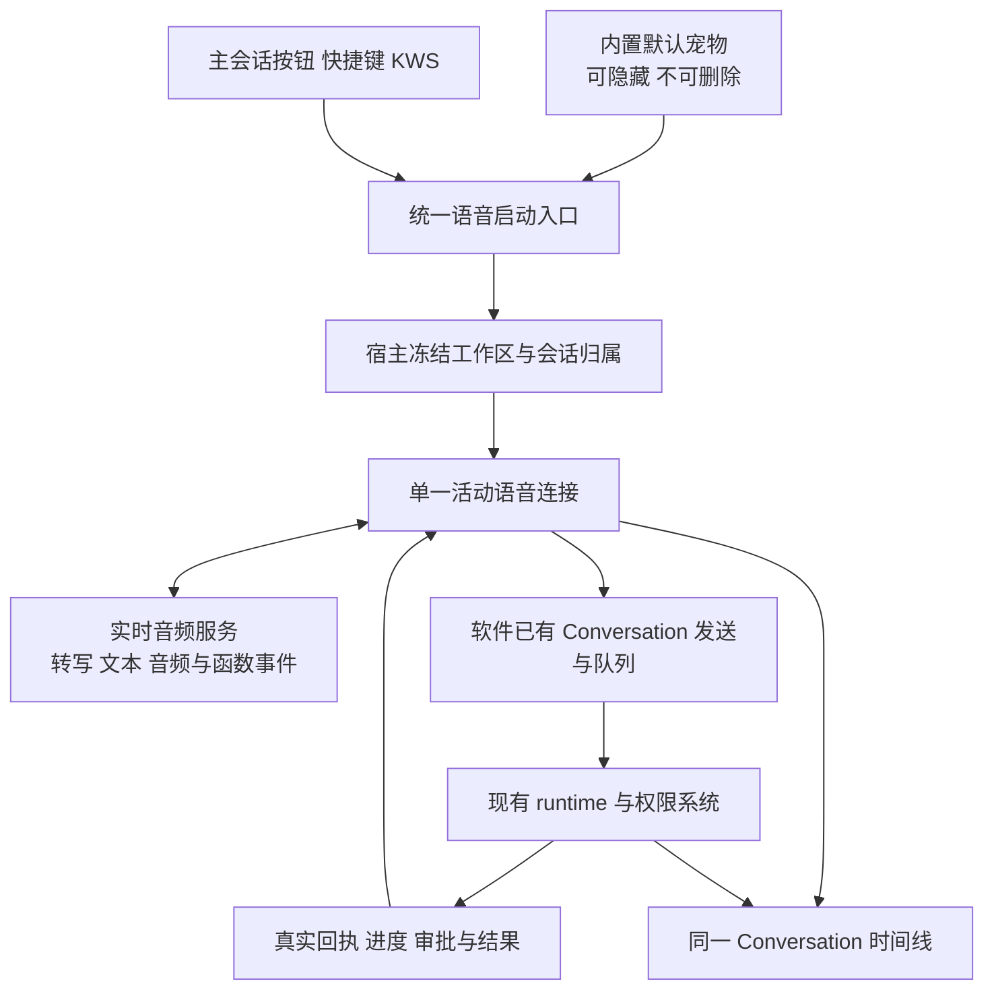

# Qoder 工作区语音与 Qwen-Live-Harness 深入调查 · 后续方案

> 状态：调查完成；候选产品与接口方案，尚未实施业务修改。
> 日期：2026-10-20。原则：默认宠物提供稳定入口，工作区决定环境，软件 Conversation 保存对话并执行任务，实时语音负责快速交互。

## 1. 背景与本轮结论

用户新增观察：没有打开会话时点击 Qoder 宠物，会在默认环境创建语音会话；进入项目工作区后再启动语音，会创建归属该工作区的会话。用户希望 Flowy 自带一个不可删除的默认宠物，以此获得稳定语音入口。

本轮继续静态读取本机 Qoder CN 0.4.8 安装包，并取得 Qwen-Live-Harness 完整仓库，固定在提交 `b2d17b8706b226ff7792683ecd8f050f18f9752e`。阅读了实时音频、工具委派、后台队列、结果注入、审批、重连及相应测试源码；未安装依赖、未启动上游应用、未调用模型或麦克风。

结论：

1. **AOQ 是 AI over QUIC，是媒体传输和客户端 SDK 能力，不是一个 ASR/LLM/TTS 模型。** 有公开文档和发行包；不能再笼统称为 Qoder 私有 SDK。Qoder 自身的会话分配服务仍不能挪作 Flowy 的服务。
2. **Qwen-Live-Harness 默认走 WebSocket 实时模型链路，并不要求先接 AOQ。** 快速交互的重要前提是连续音频、语义轮次检测和增量音频输出，而不是把普通文本聊天换一个模型名。
3. **Qoder 区分已有语音会话和普通聊天。** 前者可继续，后者可能进入新建语音会话流程；新建时携带工作区、模型、权限等配置。继承工作区不等于复用普通聊天的 Conversation ID。
4. **Qoder 工作区解析不是所有路径都直接取当前聊天。** 新建流程有路由指定、设置默认、最近创建记录等优先级。用户实测成立，但不能据此保证所有页面/默认值组合都严格遵循前台工作区。Flowy 应显式冻结工作区，避免依赖偶然的最近使用状态。
5. 默认宠物、会话归属、实时语音 provider 是三个可以分别落地的改动，不应一次重写全部系统。

| 范围 | 已获得的证据 | 尚未验证 |
| --- | --- | --- |
| Qoder | 安装包调用链、版本和文件指纹；用户提供的真实工作区使用反馈 | 云端模型身份；切换多个窗口、默认配置冲突时的完整行为 |
| Qwen | 固定提交下的生产源码及边界测试内容 | 未运行该仓库测试；未测真实模型、设备和性能 |
| AOQ | 官方协议、Electron、Linux SDK 文档 | 未集成 Rust/Tauri，未验证三端打包和实际弱网收益 |

## 2. 方案全景与边界

建议保留当前本地 KWS：它决定何时进入交互；点击宠物与 KWS 走同一宿主入口。进入实时云音频路径之后，采集、传输、转写呈现和播放只有一个有效所有者，不让 renderer、SDK、daemon 同时抢麦克风。

图中的实时音频服务是候选增量，不表示已替换现有本地 ASR。采用云音频需要明确告知音频出网；安装默认宠物不自动启用录音。前台语音故障不能重启已经接受的 runtime 任务。

## 3. 源码发现与模块规则

### 3.1 AOQ 到底是什么

[阿里云 Realtime API 概述](https://help.aliyun.com/zh/model-studio/realtime-api-overview)明确展开为 **AI over QUIC**，与 WebSocket、WebRTC 并列。AOQ 将媒体和模型控制事件分轨：SDK 处理音视频，应用在 Data 轨发送会话配置、取消、工具回执等模型协议事件。

[AOQ 接入流程](https://help.aliyun.com/zh/model-studio/realtime-aoq-access)要求业务服务端保存 API Key，客户端获取临时连接凭证；传输连接成功后还要等待模型初始化确认，才能允许媒体发送。因此“SDK 已连接”“模型可接受输入”“正在采集”是三个不同状态。

公开 Electron 包支持 Windows/macOS。本轮另外确认存在 [Linux C++ SDK](https://help.aliyun.com/zh/model-studio/aoq-linux-cpp-sdk-reference)和 Python 接口。Linux C++ 文档特别指出内置音频采集、播放是空实现，需要外部媒体接线；不能把“存在 Linux SDK”说成“三端声音已开箱即用”。

上一轮报告中“Qoder 私有 AOQ SDK/服务”的说法应拆开：SDK 有公开接入方式；Qoder 的业务服务、用户凭据和会话资源是其产品自己的。也不能把它的 Electron/Node 原生 addon 直接放进 Flowy 的 Tauri renderer。

### 3.2 Qwen：音频直接进入实时会话，转写不是唯一串行入口

源码定位均以固定提交为准，根目录为 `packages/`：

| 文件与定位 | 生产行为 |
| --- | --- |
| `qwen-live-harness/src/config.ts:149` | 默认模型为 `qwen3.8-omni-flash-realtime`，区别于普通文本 Flash 模型 |
| `qwen-live-harness/src/realtime/realtime-session.ts:593` | 构造 `/api-ws/v1/realtime` WebSocket 地址 |
| `qwen-live-harness-host/resources/audio-input-worklet.js:38` | 每 320 样本发送一个 PCM16 帧；16 kHz 对应约 20 ms，这是 Host 分帧粒度，不是完整网络延迟 |
| `qwen-live-harness/src/realtime/realtime-session.ts:3520` | 输入 16 kHz、输出 24 kHz；开启文本和音频；配置输入转写及语义 VAD |
| 同文件 `:3550` | `semantic_vad`，`create_response=false`、`interrupt_response=true`；由客户端协调何时创建响应 |
| 同文件 `:2641`、`:2729` | 对已 committed 的音频输入去重并请求 direct response，不先等待客户端独立 ASR 全文再走 Chat Completions |
| 同文件 `:4011` | 单独消费输入转写增量，供显示、上下文和轮次关联 |

其输入转写配置为 `qwen3-asr-flash-realtime`。这不表示用户先等这个 ASR 完成，再串行调用一个普通文本模型；真实路径是持续的实时音频会话。最终转写可能晚于模型事件到达，代码因此保留真实输入身份与后续校验，不能把模型自己填写的 task 当成用户原话证据。

这解释了“像 live”的交互机制，但不提供固定时延保证。没有本次网络、模型和扬声器测量，就不能声称它一定能在某个秒数内给出有效回答。

### 3.3 Qwen：委派返回收据，不等整项工作完成

`qwen-live-harness/src/tools/definitions.ts:190` 附近定义 `handoff`：工具只返回任务接受回执，完整结果稍后回流。模型应保留用户自己的请求，不能靠一句口头承诺当成已开始执行。

`orchestrator/live-session.ts:5365` 的生产处理会：

1. 校验当前调用和目标；显式 session 优先，未指定时复用当前 call 的默认后台 session，首次才创建（`:5592`）。这与 Qoder 软件工作区路由不是同一套对象。
2. 追加受限的近期语音上下文，并将可用图片引用转换为实际附件（`:5628`）；附件失效明确拒绝，不能静默丢图。
3. 调用既有 adaptor 的 `prompt`；先暂存可能先于回执到达的后台事件，再按回执的 job/message 身份绑定，避免把“下一条完成事件”误当成本次任务（`:5490`）。
4. 返回 accepted/queued/rejected 和对应 job/session；后台事件泵继续获取真正进展与终态。

`tools/dispatcher.ts:20` 的超时处理也值得借鉴：默认 30 秒是“工具回执等待上限”，并不取消已经发生的提交；超时应先查询状态，不能盲目重发。它与 Flowy 的 30 分钟会话连续性规则无关。

### 3.4 Qwen：排队和中途补充有真实能力差异

`adaptor/acp-adaptor.ts:324`：空闲时立即提交；忙碌时不能直接发送以免抢占当前轮次。只有观测到后端支持中途 drain 时才允许相应 steering，否则进入下一轮队列。待执行队列上限为 8，满后明确拒绝。

中途补充的 message 身份与最终归属的 job 分开；如果后端直到本轮结束都没有消费补充，不能声称它已经影响了本轮。取消队列中的 B 也不能误取消正在执行的 A。

Flowy 应优先采用其现有会话队列；第一版可以先只支持可靠的下一轮排队，不为体验承诺假装支持实时 steering。8 是上游参数，不是本项目已经锁定的容量。

### 3.5 Qwen：任务完成与用户听到结果分开

`orchestrator/injector.ts` 将后台变化变成待通知项。它不在以下时机插播：用户讲话、实时回复进行中、传输恢复中、Host 正在播放。默认还有实际播放完成后的 800 ms 安静间隔，进度提示则限流。

结果上下文和口头摘要分开；权限问题、任务结果等有专用通知路径，不能与普通进度混成一段 JSON。`realtime/notification-speech.ts:522` 明确发送空 tools 与 `tool_choice=none`，并拒绝意外工具事件。通知助手只能朗读/总结已有证据，不应再次搜索、重做任务或批准工具。

需要保留一个细节：主交互的音频是增量链路；独立通知 helper 有收集合成结果后再交 Host 的路径，不能把所有播报都概括为“首 token 立即播放”。新连接也有成本，不宜给每一个细碎进度都新建通知合成连接。

真实播放回执带 epoch/输出身份，旧连接的完成不能释放新连接的播放等待。`orchestrator/result-speech.test.ts:382` 就覆盖了错误 epoch 不算送达、真正的播放开始和结束后才算通知送达。

### 3.6 Qwen：权限和重连都保留独立边界

`permissions/permission-broker.ts:151`、`:269`：全局 ask/allow-all 是用户设置；自动审批仍针对实际挂起请求逐条交付一次性决定，先放并发栅栏；自动投递失败保留待处理状态，不宣称授权成功。语音的 allow_always 被降为单次，并不修改全局策略。虽然底层 ACP adaptor 能表示持久批准，生产 broker 不应被绕过。

这不是建议 Flowy 新建同名权限模式。Flowy 应继续复用已有会话模式与唯一审批管理器，吸收请求身份、并发决定和失败回退的处理方式。

`realtime/recovering-session.ts:221` 使用 transport generation 隔离旧 socket，最多两次恢复，恢复上下文明确不重新授权或重跑旧任务；对未安全恢复的输入要求用户重说，而不是猜测补交。后台 job 不随语音连接重建。

Qwen 还实现了语音侧直接 web_search、视觉分析、监控和记忆。本轮不建议照搬这些业务能力：用户已经明确工具工作交给 Flowy 自有 runtime，否则会再次形成两套执行系统。

### 3.7 Qoder：宠物、普通聊天、语音聊天的启动区别

本机 bundle：`out/renderer/assets/DIR8HOYO.js`，SHA256 `52b8425ff40f90ef76782847291e61183ad0a2eb4a6c44df443494466b8eccef`。下列偏移是 UTF-16 零起始位置，不是文件字节数或源码行号。

| 调用链 | 位置与确认内容 |
| --- | --- |
| 宠物点击 | `Ct0`，5205046；发出统一 toggle-live-voice 事件，先交当前页面处理 |
| 已有语音会话 | 11307739；语音类型会话的输入框提供当前 `chatSessionId` 作为启动目标 |
| 没有可处理的当前入口 | 13736602；宠物请求未被处理则导航到 new-chat，保存短暂启动意图 |
| 新建语音 | 13698247；请求带 `workspaceId`，或者 cwd/executionTarget，并带模型、权限、产品模式 |
| 新建工作区解析 | `YP1`，11954090；优先路由指定，再取设置默认，再取 recent；校验实际可用工作区 |
| recent 的来源 | `recordRecent`；记录成功创建的会话工作区，不等于所有页面切换都立即更新它 |

因此，用户看到“从项目启动语音，新会话归属项目”是有效实测；但本轮静态调查不能保证当“最近创建 A、当前查看 B、设置默认 C”冲突时，所有宠物入口都会取 B。更可靠的 Flowy 规则是宿主显式传入并冻结 B，启动前显示实际归属。

另一个结论必须保留：新建项目下语音会话 ≠ 继续项目当前普通聊天 ID。需要使用普通聊天已有事实时，只带用户需要的引用/摘要并标明来源，不能默默挪走整个历史或扩大权限。

## 4. 给 Flowy 的产品决策建议

### 4.1 默认宠物可以内置，但不要让它拥有第二套 runtime

采纳用户提出的“默认带一个不可删除的宠物”，建议把它定义成稳定的内置入口：

- 安装后可见，允许隐藏/重新显示；内置资源不可删除，用户自建宠物仍按现有规则管理。
- 点击进入统一语音入口，展示收音、等待、执行、审批和结果状态；不要求先创建伙伴或配置伙伴专用模型。
- 更换皮肤或宠物外观不更换工作区、权限、Conversation 或录音所有者。
- 隐藏宠物不取消任务；不能因为“不可删除”而强制常驻、自动录音或自动重开用户关掉的麦克风。主窗口语音按钮/快捷键仍然可用。
- 内置入口不自动开启现有伙伴的学习、采集、记忆或技能演化；这些是另一组已有产品能力和授权。

当前 Flowy `nomifun-companion/src/service.rs:614` 是创建真实伙伴档案，首个伙伴成为 default；`:839` 支持删除，删除最后一个后可以没有默认伙伴；Nomi 页面也有空列表状态。因此当前代码并不等价于“安装内置不可删除入口”。实现时先判断能否复用现有内置形象和窗口，避免为了一个语音按钮强行新建具备完整伙伴副作用的档案。

“不可删除”若落实到持久化伙伴实体，必须在后端删除入口与前端一致约束，不能只藏掉删除菜单；若落实为内置展示入口，则不伪装成数据库里的不可删用户对象。最终资源方案在实施前锁定，本轮不加数据库字段或迁移。

### 4.2 建议的工作区和会话规则

| 启动位置/状态 | 建议行为 |
| --- | --- |
| 首次安装、没有选定项目 | 在软件明确的默认工作区创建/继续语音 Conversation；不使用进程 cwd 猜测 |
| 已选项目 A 的普通会话 | 继承 A 工作区；创建或继续 A 下的语音 Conversation，明确展示“语音 · A”；不等于借用普通聊天 ID |
| 已在某个语音 Conversation | 继续该 Conversation；每个新请求有新 turn/command，不创建新会话 |
| 同工作区再次 KWS/点击，连续绑定未到期 | 复用该工作区绑定；6 秒收音结束不清除 Conversation |
| 明确切到项目 B 后再次启动 | 新输入归属 B；A 已接受的任务继续绑定 A，通知标明来源，不将结果写入 B |
| 当前窗口/焦点候选过期或所属工作区已删除 | 不依靠历史指针静默执行；展示实际默认环境，必要时先要求选择合法工作区 |
| 用户明确新建语音会话 | 保留旧历史，创建新 Conversation；不取消旧后台任务 |

30 分钟连续性是 Flowy 自己既有方案中的产品规则，本次没有证明它是 Qoder 或 Qwen 的同义规则。建议计入最后一次有效用户交互，不被音量事件、轮询和心跳无限续期；活动任务/审批维持原身份，不因到期重建。到期只影响下一次是否新建会话，不删除历史或取消任务。

现有录音的 6 秒开口、30 秒单句、播后 4 秒追问，与软件 Conversation 的 30 分钟连续性属于不同层。若升级为手动持续 Live 模式，应另行明确持续收音规则，不暗中让 KWS 模式也无限收音。

### 4.3 接口语义：沿用宿主，不复制上游调度框架

复用现有 `/api/voice/companion` 和 Conversation 能力；先核对现有 DTO，再补缺失语义。建议冻结的作用域至少能表达：本机用户、工作区、目标 Conversation、语音连接实例、作用域版本及选择来源。模型/preset/权限引用通过现有解析规则获得；不保存第二份 API Key。

| 交互 | 必须保证的语义 |
| --- | --- |
| 启动/继续 | 宿主返回实际工作区和 Conversation；宠物、主窗口、KWS 使用同一入口 |
| 委派 | command 身份稳定；原话、目标、约束、相关引用和有限上下文完整；冻结作用域后提交 |
| 接受 | 区分提交中、accepted、queued、rejected、unknown；真实接收后才播回执 |
| 查询与取消 | 指定 command/job 和所属作用域；取消排队项不影响运行项；取消请求不等于已取消 |
| 审批 | 当前真实 call/request，显式有效决定；通知内容不能自己触发批准 |
| 结果通知 | 先保存正文再做短摘要；result-ready、播报中、已播完、失败/中断分开；停止播放不重做任务 |

与当前分支的主要差距在于产品归属：`voice_companion_manager.rs:236` 目前可直接选择空闲前台 Conversation，忙碌时回到默认语音 Conversation；另支持绑定用户伙伴。它尚不是本节明确的“每工作区语音 Conversation + 内置默认入口”规则。改造时需要同步前台录入与执行绑定，不能只替换显示窗口。

### 4.4 音频选型建议

先用一个公开 Realtime WebSocket provider 做最小纵向原型，复用 Rust 侧已存在的 WebSocket/音频基础和软件 runtime；不要为了研究 Qoder 引入完整 Electron/Node 子系统。

选 WebSocket 的原因是能先隔离测量实时模型收益，不是因为它天然比 AOQ 快。AOQ 的原生媒体处理、弱网和回声路径值得后续评估；Tauri/Rust 绑定、Linux 外部音频和打包是实际成本。WebSocket 自身没有回声消除，Flowy 现有半双工设计也不能直接宣称全双工可用；首轮用耳机/明确媒体门控验证，再独立验收扬声器打断体验。

普通 Flowy Cloud 文本 provider 已有模型列表，不等于已经支持实时音频协议、授权和计费。需要平台端确认能力；也可在独立测试配置中使用用户授权的公开 Realtime provider。不能把文本 `chat/completions` 地址当成音频接口。

## 5. 可交接的串行切片与验收

| 顺序 | 交付目标 | 关键验收 |
| --- | --- | --- |
| S0 锁定归属 | 确认本报告的入口/工作区/会话矩阵并补 PRD；记录现有绑定兼容要求 | 解释普通聊天与语音聊天的差别；不改已有历史归属，不悄悄修改用户权限 |
| S1 内置入口到会话 | 默认不可删宠物 + 统一启动入口 + 项目语音 Conversation | 空环境、A、B、已有语音、隐藏宠物、多窗口候选；重启重复初始化不产生重复入口/会话；无自动录音 |
| S2 会话任务纵向 | 原话落盘、真实委派、忙碌排队、进度/结果同时间线 | A/B/C 连说；取消 B 不影响 A/C；相同 command 不重复执行；页面切换不漂移工作区 |
| S3 实时音频原型 | 固定模型、单一采集、增量转写/音频、函数委派复用 S2 | 固定音频样本与真实工具；比较现有链路/Realtime 的话音结束→首有效回复→首音 P50/P95；包含超时和低音量样本 |
| S4 结果/审批/恢复 | 迁移正确时序和身份保护，不搬运整个上游框架 | 讲话时结果到达、response.done 早于实际播放、重复/旧 epoch、拒绝/模糊审批、断线不重跑任务、播放失败留文 |
| S5 三端交付 | Windows→macOS→Linux 分别构建与声学验收 | 检查资源/SDK许可、音频设备、打包退出；没有测过的平台只写结构兼容，不能签核支持 |

优先迁移的上游测试：

- `orchestrator/injector.test.ts:448`：用户新发言、直接回复、Host 播完和安静间隔之前，不插播后台结果。
- 同文件 `:466`：模型回复结束与物理播放回执两种先后顺序，均不让后一个结果抢先。
- 同文件 `:553`、`:566`：排队/提交/播放后去重；打断后不把旧结果注入新轮次。
- `adaptor/acp-adaptor.test.ts:212`、`:959`：取消队列 B 不影响 A；满队列真实拒绝。
- `permissions/permission-broker.test.ts:145`、`:310`、`:367`：自动模式仍逐请求单次决定；切换模式及手动拒绝竞态。
- `orchestrator/task-boundaries.test.ts:821`、`:849`、`:865`：迟到 ASR 只绑定正确输入；新发言和重连撤销旧待授权输入。

以上是读到的测试设计，**本轮没有执行它们**。迁移后必须走 Flowy 的生产 worker/API/Conversation/runtime 联合测试，再单独做网络、真实麦克风和扬声器验收。

## 附录：版本、来源与历史记录

上游仓库（Apache-2.0）仅供阅读，未执行脚本：`target/voice-review/references/qwen-live-harness`。固定提交：`b2d17b8706b226ff7792683ecd8f050f18f9752e`。文件 SHA256 与 Qoder 静态定位索引：`target/voice-review/qwen-qoder-deep-research-evidence-2026-10-20.json`。

可核对的固定源码入口：

- [实时模型及会话配置](https://github.com/QwenLM/Qwen-Live-Harness/blob/b2d17b8706b226ff7792683ecd8f050f18f9752e/packages/qwen-live-harness/src/realtime/realtime-session.ts#L3520)
- [后台会话选择与委派](https://github.com/QwenLM/Qwen-Live-Harness/blob/b2d17b8706b226ff7792683ecd8f050f18f9752e/packages/qwen-live-harness/src/orchestrator/live-session.ts#L5365)
- [有界 ACP 队列](https://github.com/QwenLM/Qwen-Live-Harness/blob/b2d17b8706b226ff7792683ecd8f050f18f9752e/packages/qwen-live-harness/src/adaptor/acp-adaptor.ts#L324)
- [结果注入和播放窗口](https://github.com/QwenLM/Qwen-Live-Harness/blob/b2d17b8706b226ff7792683ecd8f050f18f9752e/packages/qwen-live-harness/src/orchestrator/injector.ts#L568)
- [权限决定](https://github.com/QwenLM/Qwen-Live-Harness/blob/b2d17b8706b226ff7792683ecd8f050f18f9752e/packages/qwen-live-harness/src/permissions/permission-broker.ts#L269)
- [AOQ 官方定义](https://help.aliyun.com/zh/model-studio/realtime-api-overview)、[AOQ 接入](https://help.aliyun.com/zh/model-studio/realtime-aoq-access)、[Electron 接口](https://help.aliyun.com/zh/model-studio/aoq-electron-sdk-reference)、[Linux C++ 接口](https://help.aliyun.com/zh/model-studio/aoq-linux-cpp-sdk-reference)。官方总览平台表和具体 SDK 覆盖范围并不完全相同，部署应以具体版本与平台文档验证。

历史调查保留在 [上一轮报告](qoder-cn-live-voice-research-2026-10-20.zh.md)。本轮补充 SDK 公开性、Linux 能力和工作区解析的限定，未删除历史正文、未将新建议标记为已实施。截图中 Qoder 对 Allo 分支提交数与改动范围的描述属于截图里的产品输出，本轮没有将其当成本仓库事实或执行指令。
