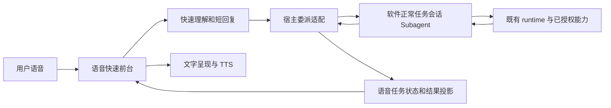
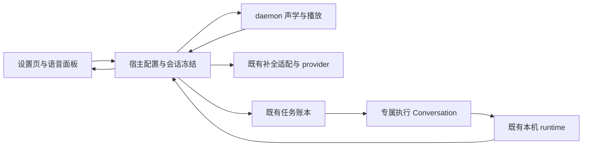

# 语音快速前台与软件会话 Subagent · 串行执行 Plan

> **实施状态补记（2026-10-20）**：基准 `10a1628ab` 已包含真实交付、冻结上下文、部分连续会话、现有权限模式及结果播报改动。当前事实与检查结果见[实现状态表](current-implementation-status.zh.md)；本计划下方“待实施”和“仅修订方案”保留为原阶段记录，不能据此推断当前功能全无或全部达成。

> **状态**：📋 待实施；按用户最新澄清修订。旧 O0–O6 方案正文完整保留在附录，作为历史，不再作为当前实施顺序。
> **核心原则**：第一层语音 LLM 用于快速理解、回应和委派；复杂需求由软件自有 Conversation/runtime 承接，结果回到语音前台更新状态和播报。
> **本轮交付**：仅修订方案与导航，未修改业务代码、运行配置或权限。

依据：[既有前后台方案](voice-fast-front-runtime-execution-plan.zh.md)、[runtime接口契约](voice-runtime-api-contract.zh.md)。本修订以用户最新要求为准：不把语音伴侣发展成另一个具备独立业务工具体系的产品后端。

## 1. 背景与方向纠正

上一版将语音专用执行配置、文件读取、天气接入分别作为主要切片，虽复用了runtime，产品与执行责任仍容易继续向语音侧集中。正确主线是已有软件会话作为任务执行者，语音只负责快速沟通、委派及结果呈现。

| 职责 | 快速语音前台 | 软件任务会话（subagent） |
| --- | --- | --- |
| 用户输入 | KWS/ASR、保留原文、短上下文 | 接收由宿主校验并持久化的目标及必要上下文 |
| 第一层LLM | 快速理解、普通聊天、澄清、决定是否委派、快速说明 | 不等待它完成复杂任务后才回应用户 |
| 执行业务 | 不实现天气、文件、浏览器、MCP业务模块 | 通过软件既有会话/runtime的工具、技能、MCP等实际已授权能力完成 |
| 配置与权限 | 引用并展示软件已有会话配置，声学设置仍独立 | 普通软件会话的模型、工作区、预设、权限与审批是执行权威 |
| 结果 | 消费真实进度与终态，展示全文，播报摘要 | 任务过程及完整结果落盘在软件会话，可打开继续查看 |

当前代码不是完全空白：ConversationVoiceRuntime已有Conversation创建、发送和回执适配；宿主已有结果通知和播报入口。但专用execution配置成为额外必填前提，创建路径强制nomi/关闭delegation，并加载语音专用工具策略。这些是需要与正常软件会话规则逐项对照的差异，不能仅修一条天气规则便宣称目标达成。关闭嵌套delegation本身并不证明不能承接任务；本次subagent指产品上的受委派任务会话，不默认要求Team或递归多Agent。

实测缺execution配置的诊断仍属实；需要改的是解决路径：由宿主复用软件原本的会话配置和创建流程，不要求用户再配置一整套语音执行环境。

## 2. 架构及端到端体验

1. 用户说需求。ASR原文立即展示，第一层LLM快速给理解或简单回答。
2. 需要实时信息、工具、外部操作、多步处理或较长推理时，第一层输出既有agent_task目标，由宿主委派，不在快轨继续尝试做完整业务。
3. 委派前可说“需要查询实时信息，我来处理”；这只是解释意图。只有实际接受回执后才显示/播报“任务已交给后台会话”。不能提前说已接单。
4. 软件正常任务会话接收目标并运行；软件会话列表、详情及会话日志可见，可打开继续查看。语音只投影真实进度，后台运行期间仍可快聊或查询。
5. 运行终态到达，先更新持久结果和任务状态，再将真实结果发回语音前台。完整结果可读，口语摘要播报独立计状态。
6. 播报失败不把任务改成失败；离开窗口/关闭语音不取消后台任务。用户重新回来仍可看到结果并重播。

## 3. 固定决策与接口规范

### 3.1 会话归属及配置

- 保留一个语音前台记录归属（独立语音、合法当前项目、显式宠物绑定沿既有规则），并关联软件任务会话。前台不要求创建宠物。
- 首版对每个被接受的任务创建或通过稳定创建键找回一个软件正常任务会话，充当subagent；它使用现有Conversation服务与runtime，不是另建执行引擎。已有空闲会话的直接执行复用不作为默认，避免向正在运行的任意聊天注入命令。
- 关联前台conversation、任务conversation、command及真实message/runtime turn。关系由宿主持久保存，模型只给目标，不选择ids或权限。语音面板链接到正常软件会话。
- 按软件正常新建会话相同的配置解析方式，复用合法当前项目或用户选定的软件会话/预设及现有默认配置。展示实际模型、工作区及来源；本来就缺配置时引导软件原设置，不再要求一份语音专用execution配置才能开始。不得用快聊模型冒充有效执行模型，也不猜目录或授权磁盘根。
- 实施前核对普通Conversation创建、预设快照、工作区解析及已有委派入口，选择能满足单任务的最小既有入口。不为了subagent这个名称强行引入Team模板、额外Leader LLM、通用调度器或第二次任务规划调用。
- 语音task bridge保留为薄适配：校验作用域、持久交付身份、调用软件会话、订阅回执，不承担业务工具发现/业务执行。
- 不通过删除安全检查来恢复软件能力：复用软件已有权限、审批及授权范围；语音确认仅是已有审批的输入通道。对仅为语音收窄工具白名单的分支逐项审查，避免拦截正常会话已授权的MCP/技能等能力；未知或未经授权工具不能默认放行。
- 原语音execution配置和voice专用标记涉及公开接口/历史记录，不能直接删除或静默改义。盘点调用方后定义兼容读取；新界面不继续要求重复配置。旧任务按原冻结权限恢复，不因改造扩大权限。内部废弃无调用路径确认后删除，不长期双轨运行。

### 3.2 快轨分流及交流

| 输入 | 快轨行为 | 委派行为 |
| --- | --- | --- |
| 寒暄、无需工具的简短问题 | 一次LLM直接短答 | 不启动任务会话runtime |
| 缺少关键参数 | 快速澄清，例如城市/目标文件 | 参数足够且形成明确目标后才交付 |
| 实时查询、文件/浏览器操作、多步复杂任务 | 快速整理理解，说明将交后台 | 使用同一个通用委派入口交软件会话，不按业务类型另接接口 |
| 进度/取消/重播 | 绑定当前明确任务，引用真实状态 | 调既有查询/取消/通知重播，不重新做任务 |

困难不按字数判断，而按是否需要工具/实时数据/多步执行及快轨能否可靠直接答复。既有ignore/chat/agent_task/task_control契约优先复用；不引入逐业务路由表，不从非法或半截JSON猜执行指令。每个声学turn至多一次快轨补全。

初次回应和最终任务结果是不同消息，均关联原需求。完成通知默认使用真实结果的确定性有界摘要并保留全文；确需模型口语整理时必须是显式结果摘要环节，不触发runtime重执行，不伪装为第一层仍在做业务。首版不增加这次模型调用。

### 3.3 最小委派契约与状态

以下是逻辑契约，不表示新增一套API。沿现有voice tasks/Conversation方法映射，DTO留在nomifun-api-types。

| 操作 | 内容及返回 | 约束 |
| --- | --- | --- |
| 提交 | 原文/理解/目标、来源会话及scope、稳定command_id；返回软件任务会话及真实接受身份 | 第一次副作用前保存，创建与发送分开幂等 |
| 观察/订阅 | 原task ref与对应message/turn，返回进度、终态、完整结果或真实错误 | 不按任意当前会话或最近消息猜任务状态 |
| 取消/审批 | 原任务作用域及实际调用审批身份 | 复用原软件控制；不批准其他任务，禁止永久允许 |
| 结果通知/重播 | 原任务、notification/attempt及结果引用 | 去重、实际播放回执；重播不运行模型或工具 |

对用户至少区分：正在理解、等待委派、后台已接受、后台执行中、等待用户确认、完成、失败、取消中、已取消。以当前DTO的真实能力表达，可派生显示态但不虚构底层终态；unknown表示正在核对是否接受，绝不换身份重发。声学Listening/Idle与任务寿命独立。

软件会话消息/回执及运行状态是执行结果权威；语音映射与通知记录不是第二套任务真相。宿主合并两者投影，统一instance_id/seq。结果在语音前台不重复插入软件任务会话为新用户命令，不触发第二次执行。

### 3.4 并发与离屏边界

- 首版维持一个活动语音委派任务；忙时新任务明确提示，不丢弃、不隐式排队或覆盖旧任务，聊天和查询仍可用。
- 子会话的后续键盘消息或额外runtime turn不能被误当成原语音任务结果；按原message/turn跟踪。复杂任务进一步分解交给软件原有能力，本次不另外开放递归或团队权限。
- 进度只说真实阶段；长时间无新事件时说仍在等待/暂无新进度，不假装百分比。沿用已有提醒参数及去重机制，不引入新定时器系统。
- 完成后先落盘和更新状态，声学空闲时通知，避免打断用户或审批；忙时保留待通知，重新连接只读核对。
- 关闭窗口或关闭语音后任务继续；无可播通道时结果仍落在软件会话。显式取消保持取消中直至真实终态。
- 响应丢失、宿主重启、daemon重启、账号凭据切换均不生成新任务身份；本机数据不迁到云端，旧任务通知不串进新作用域。

## 4. 按用户旅程串行实施

| 切片 | 实施内容 | 出口门禁 |
| --- | --- | --- |
| D0 复用盘点与契约 | 比较正常软件会话与现有语音任务创建/配置/权限/事件路径；标出专用差异和可删除内部路径；固化基线和调用方 | 明确唯一委派入口、配置来源与历史兼容；不开始天气等业务适配 |
| D1 第一条会话委派 | 快轨快速理解，宿主通过软件会话创建/发送入口交真实目标，面板提供正常会话详情入口 | runtime实际读取临时目录随机内容；创建/发送各一次；接受前不假ACK；完整执行过程在软件会话可见 |
| D2 回传与播报 | 订阅指定任务turn的真实事件/回执，完整结果落盘、更新前台任务状态、播报摘要 | 实际结果对应原任务；前台不做业务；TTS失败保留完成状态和文字；重播不重执行 |
| D3 快聊与通用分流 | 简单问题直接答，难问题/工具请求委派，缺参数先澄清；后台执行期间可聊天、问进度 | 天气/文件/现有MCP能力通过同一委派入口；不用为每类新增voice业务实现；不扩大既有授权 |
| D4 控制与恢复 | 关窗、停语音、显式取消、实际审批、重启、响应丢失、通知去重和长等待反馈 | 不重复执行/取消错误任务；审批一次有效；结果和通知不丢失或串会话 |
| D5 联合交付 | 构建宿主/daemon/UI；核对产物；完成真实软件会话与Owner离屏验证 | 用户可以在软件会话查看过程/继续操作，同时语音收到结果；自动、真实模型/工具、设备与Owner分别签核 |

全部状态为待实施。每片按失败测试→最小实现→定向验证→真实入口证据推进；前一片自动门禁未通过不得标下一片完成。先D1/D2贯通再做分流及体验增强。天气只是验例，绝不成为独立语音天气模块。

## 5. 验收与检查梯子

| 编号 | 场景 | 必须证明 |
| --- | --- | --- |
| AC-D01 | 简单问候 | 第一层回应和TTS；没有任务runtime初始化 |
| AC-D02 | 复杂任务委派 | 快速理解在先，软件会话真实接受后状态更新；模型不返回假业务答案 |
| AC-D03 | 软件会话可见 | 会话列表/详情、原目标、工具过程及最终结果可查，语音链接对应正确会话 |
| AC-D04 | 随机读取 | 经生产worker和真实Conversation/runtime读取随机值，非硬编码结果 |
| AC-D05 | 通用能力 | 选取软件已支持的两种不同能力，通过同一委派适配成功；替身与真实服务分开记 |
| AC-D06 | 结果回传 | 结果先持久化和更新状态，再通知播报；内容、command/message/turn对应 |
| AC-D07 | 后台运行继续交互 | 快聊/查询不启动重复任务，声学Idle不表示任务结束 |
| AC-D08 | 断线/重启/重复提交 | 原身份只读恢复，创建/发送各至多一次，同ID改目标冲突 |
| AC-D09 | 停止/取消/审批 | 关窗和停止语音不取消任务；显式取消待终态；原审批管理器决定实际副作用 |
| AC-D10 | 播报失败/忙碌 | 完成状态与全文不丢，空闲通知去重，重播不执行任务 |
| AC-D11 | 配置兼容与权限 | 复用软件配置，无语音必填第二套环境；旧任务权限不扩大，新任务不绕原审批 |
| AC-D12 | 错scope/换账号/并发键盘turn | 不串任务或通知，不把无关会话输出认作本次结果 |

运行定向生产worker→宿主→Conversation/runtime回归，再跑受影响crate的cargo test/check。UI运行行为/双语测试、typecheck、i18n/theme/dead-css；改字典执行gen:i18n。集成节点cargo fmt --all -- --check、cargo check --workspace、bun run check、bun run build:ui及联合构建；基线失败与本片回归分别记录。

真实模型首响应仍需要单独阶段取证和连续样本，不能把局部mock通过当云端稳定。保留有界超时与准确错误，不用提示音冒充有效回复。真人麦克风、扬声器、原生窗口和离屏体验由Owner验收；未测试的服务与平台不宣布支持。

## 6. 交付及停止点

每片交付改动、失败/通过命令、证据路径、配置兼容和剩余风险。状态分未开始/进行中/自动通过/真实服务通过/真机通过/Owner通过。最终产物是语音前台与软件会话的委派闭环，不是语音侧的一套业务后端。

不新增依赖/数据库迁移/通用调度框架，不自动提交、推送、发布或切main，不派发并行Agent。当前仅修订计划；从D0实施需后续明确指令。D5完成后停止，性能与声音微调另议。

## 附录：上一版方案全文（历史，逐字保留）

上一版及其诊断底稿完整保留，便于核查为何发生方向纠偏。下文O0–O6不覆盖当前D0–D5顺序，不能据此继续扩展语音专用业务能力。

---

# 语音任务闭环与稳定性优化 · 串行执行 Plan

> **状态**：📋 待实施。本轮仅形成计划，未修改业务代码、运行配置或启动任务。
> **核心原则**：先用现有链路交付真实任务，再修路由和失败体验。接单、执行成功、文字保存和声音播放分别验收。
> **目标**：用户看懂缺什么配置；配置生效后，语音需求交给本机 runtime，获得真实结果；失败准确说明阶段，恢复不重复执行。
> **执行方式**：沿当前 feat/xiaozhi-voice，单 Agent 串行推进。自动门禁未通过不进入下一片，真机与 Owner 签核独立记录。

依据：[纵向方案](runtime-vertical-contract-plan.zh.md)、[前后台执行方案](voice-fast-front-runtime-execution-plan.zh.md)、[现有 API 契约](voice-runtime-api-contract.zh.md)。本计划补齐实测缺口，不重写原架构、审批或任务账本，不改变历史完成与验收状态。

## 1. 背景与实测断点

| 场景 | 已核实事实 | 本期目标 |
| --- | --- | --- |
| 深圳天气被识别成任务但没有执行 | 17:20:11 为 agent_task；execution/source_workspace/command_id 为空；配置文件只有 autostart | 显示具体缺项，完成保存和新会话生效，再交付真实任务 |
| 天气询问出现部分聊天回复及格式错误 | 17:18:46 为 model_response_invalid，未形成最终有效任务决策 | 实时信息路由明确，缺城市先澄清；协议错误不冒充 runtime 失败 |
| 连续模型请求没有回复 | 四轮约8秒首句等待超时，没有首可见文本日志 | 分清连接、首文本、首句与流中断，恢复后下一轮可用 |
| 代码已接线，用户仍无法完成配置 | 生产 routes 注入了 ConversationVoiceRuntime、recorder 和 tasks | 复用已有路径，完成配置、执行、结果、提示及验收闭环 |

直接原因已确认到缺执行配置及首响应截止。模型请求自身的 DNS/TLS/HTTP/网关/排队细分原因尚未确定；同时段其他云接口的 TLS 错误仅为旁证。不能把 unknown 写成已定位。

## 2. 方案全景与范围

| 模块 | 本轮责任 | 必须保持的边界 |
| --- | --- | --- |
| daemon / voice-terminal | 传 scope 与目标、消费合法决策、播放与轮次恢复 | 不选择工作区、不管理 provider key、不创建 Conversation、不批准工具 |
| 宿主 | 配置解析、绑定冻结、准确可用性、交付与产品快照 | 读取设置、重连与恢复不创建或发送任务 |
| Conversation/runtime | 真实创建、发送、回执、进度、结果、取消和审批 | 复用既有接口、消息事务及唯一审批权威 |
| UI | 来源/缺项、保存引导、原文/理解/结果/错误、任务详情 | 草稿不是生效配置；renderer 不提供执行权限 |

不做：新 runtime、调度框架、数据库迁移、新第三方依赖、声学模型、平台专用 TTS、流式 ASR、全双工、性能专项或多平台签核。已有查询、取消及确认保持回归，不另起一套生产实现。

## 3. 固定决策、接口与状态

### 3.1 配置来源与生效规则

- 快轨对话模型和执行模型分开；复用宿主 provider 解析及现有凭据，不复制 key。
- 复用 VoiceExecutionConfig 的 workspace/model/preset_id，VoiceExecutionSettings 的 requested/effective/available/reason_code。显示实际生效值及来源，不能只显示开关或未保存草稿。
- 工作区沿既有合法绑定解析：合格项目 workspace、显式宠物 workspace、已有独立语音 workspace。独立语音缺目录时，要求用户明确保存本机目录；不自动授权数据根目录、磁盘根或任意当前目录，不新增托管工作区机制。
- 独立语音使用显式保存的 execution。执行模型沿原方案：明确语音执行选择优先，其次合法绑定会话的模型/预设。显式引用失效不能静默随机选模型。当前 frozen_execution 可能与原优先级有差异，先列来源用例并复现，再集中修统一解析入口。
- 全局设置代表独立语音默认配置；本轮可用性代表该 session 冻结后的配置。不能用全局 task_ready=false 拦截有效项目绑定，也不能用全局 true 掩盖本轮失效。
- 绑定在 session 内冻结，提交前再验证归属、目录和权限。保存只对新 session 生效：明确提示保存成功及重新唤醒步骤，不静默迁移旧任务或自动重交旧目标。
- 缺配置不阻断聊天。读设置、安装模型、保存表单不自动录音或提交试验任务；不替用户选择真实目录或付费模型。

### 3.2 API 与数据契约

| 入口 | 复用与最小修改 | 不变量 |
| --- | --- | --- |
| GET/POST /api/voice/companion/execution | 保留现有字段和 reason_code，映射具体缺项与设置动作 | 草稿/保存/有效、全局/本轮分别显示 |
| session 快照与 binding | 优先组合已有字段；必要时增加可选本轮可用性及来源摘要，同步 DTO/adapter/旧 JSON 测试 | 宿主唯一维护 instance_id/seq，音量事件不覆盖任务 |
| 既有私有 /complete | 注入由冻结配置及实际工具注册推导的有界能力摘要 | 不暴露凭据、完整 preset 或任意路径；模型不能决定权限 |
| 既有 tasks 与查询/取消/确认 | 保留 record/binding/command 与实际执行身份 | 首次副作用前落盘，创建/发送分别幂等，真实 accepted 后才 ACK |
| 逐轮 stage/code | 保留现有错误码语义，必要时增加可选诊断阶段 | 不新建第二套状态机或生产兼容分支 |

不新增能力注册中心。策略允许、工具已注册、配置齐备和服务实际可用是不同事实；WebSearch 被允许不证明已经有可用搜索供应商。健康未知就显示未知，探针不等于任务成功。

### 3.3 路由规则

1. 寒暄和普通知识走 chat；实时天气、最新信息或明确工具需求走 agent_task。
2. 天气缺城市，且允许上下文没有地点时，先用 chat 一句话澄清；不从无关历史或系统定位猜城市。
3. 深圳天气可以生成查询目标；时间遵循用户输入和请求时点，不擅自扩成未来多日预报。
4. 缺执行配置或实际工具时，解释真实缺项并给修复动作；可保留理解/目标，但不能创建任务或播报正在执行。补齐后由新的明确发言触发，不自动重放旧命令。
5. 每个 turn 至多一次快轨补全。格式不合格不额外问修复模型，不从自由文本或部分 JSON 猜取副作用指令。
6. 只有最终合法且持久化的 agent_task 可提交；chat 短句必须经校验才展示/播报；部分回复标未完成，不能改装为任务授权。

### 3.4 状态及故障投影

| 实际阶段 | 用户看到的事实 | 禁止推断 |
| --- | --- | --- |
| 缺配置或引用失效 | 缺目录、缺执行模型/预设、模型/目录失效及对应设置动作 | runtime 已经执行失败 |
| 模型首文本未到 | 尚未得到助手回答，保留 ASR 原文 | 已收到回答或 TTS 失败 |
| 文本到达但首对象未闭合 | 生成/格式尚未完成，截止后准确说明 | 已接单 |
| model_response_invalid | 本轮格式错误，已有合法部分保留并标不完整 | 自动放宽校验后执行 |
| delivering/unknown | 正在交付/核对原命令 | 换身份重试、假成功或假失败 |
| accepted | 真实接单、任务详情和状态 | 已完成或已听到 |
| completed/failed/cancelled | 真实执行终态、结果；声音是否成功另列 | 没声音等于没执行 |

沿现有 provider 传输入口记录请求发出、HTTP响应头、首可见文本、首合法对象、结束/取消；关联 session/turn/request，记录耗时、最后阶段、重试及剩余预算和安全错误类别。不记录密钥、带查询参数完整URL、用户语音文本或模型推理。不放宽TLS校验，不盲目延长8秒；下层重试遵守上层预算，有文本后不盲重问。

## 4. 串行实施切片与门禁

每片：失败复现 → 最小完整实现 → 定向验证 → 生产入口集成 → 更新证据。以下全部未开始；历史通过不代替本轮验证。

| 顺序 | 纵向场景与改动 | 出口门禁 |
| --- | --- | --- |
| O0 执行基线 | 固定HEAD/dirty/数据目录/产物身份，固化缺配置、坏协议、无首响应三类复现；重跑中断的runtime读取测试 | 三类错误可区分，测试有最终结果，不改用户配置，不把中断算通过 |
| O1 配置闭环 | 设置与面板显示来源/缺项/跳转；统一解析和全局/绑定可用性；保存及重新唤醒生效 | 未配置零任务副作用；有效冻结、失效准确报错；旧session不换权限；中英/双主题通过 |
| O2 第一条真实任务 | 固定音频进入生产worker，宿主使用有效冻结配置，真实runtime读取临时目录随机文件，返回文字、详情及播报 | 正确返回随机内容，创建/发送各一次，真实回执后ACK；Owner另验；未通过不进入O3 |
| O3 路由和协议 | 实时信息规则、地点澄清、目标范围与能力摘要；JSONL/最终决策一致性 | 固定语料分流可断言，坏对象不提交，同轮一次补全，任务不提前播接单 |
| O4 天气任务闭环 | 缺地点先问，带城市交给已配置的真实搜索工具；返回有时间和来源的天气结果及短播报 | 真实工具调用可核对；天气值不硬编码；fixture仅测试；无工具准确不可用 |
| O5 故障与恢复 | 分阶段诊断，连接/流故障、响应丢失、停止/重唤醒、查询/取消/审批回归 | 无重复执行和迟到结果；停止语音不取消任务；unknown只读核对；取消待真实终态；审批一次有效且越界拒绝 |
| O6 联合构建与交接 | 宿主/daemon/UI联合构建，核对feature/路径/hash/资源，交付Owner脚本及真实服务采样 | 自动门禁有明确结果，产物身份一致；模型/搜索/设备/Owner单独签核；不自动发布 |

O4先检查现有搜索工具是否真实注册及配置完整。本期不新增搜索供应商、key副本或权限；缺外部配置时留作明确验收前提，不以fixture冒充真实天气。

## 5. 关键边界与验收矩阵

| 编号 | 场景 | 可判定的标准 |
| --- | --- | --- |
| AC-O01 | 只有autostart，无execution | 聊天可用，任务明确缺配置，执行创建/发送次数0 |
| AC-O02 | 默认/项目/宠物、无宠物/多宠物 | 来源准确，无任意当前聊天回退；有效绑定不受全局缺配置误拦 |
| AC-O03 | 删除目录、junction/越界、模型/预设失效 | 配置和派发边界均拒绝权限扩大，不静默回落 |
| AC-O04 | 保存后旧session与重新唤醒 | 旧冻结不变且解释清楚，新session用新配置；旧目标不重交 |
| AC-O05 | 随机文件读取及进度/结果 | 真runtime读取，返回随机内容，原文/理解/任务/详情身份对应 |
| AC-O06 | 缺城市/带城市/日期边界/闲聊 | 准确澄清或分流，不猜地点，不扩目标，一次快轨补全 |
| AC-O07 | 无搜索工具/缺配置/服务故障 | 区分允许/注册/配置/可运行，不编造天气，保留原文 |
| AC-O08 | JSON截断/非法后续对象/意图变化/正文不一致 | 零副作用，部分文字未完成，错误准确且不泄漏正文或凭据 |
| AC-O09 | 无响应头/头后静默/首对象未闭合/首句后中断 | 生产provider入口受控HTTP/SSE测试，阶段准确、资源释放，新轮能恢复 |
| AC-O10 | 重投/同ID改目标/落盘失败/创建或发送回执丢失 | 幂等及冲突正确，首次落盘失败零副作用，未知只读核对 |
| AC-O11 | 关窗/停止语音/取消/重启/换账号 | 本机已接单任务不被误取消；取消待终态；通知隔离，恢复不重发 |
| AC-O12 | 实际写入/删除的同意/拒绝/静默/过期/旧审批 | 唯一审批管理器，always_allow=false；断言真实副作用，越界始终拒绝 |
| AC-O13 | TTS失败/静音/子任务异常/首音晚到 | 全文保留，错误准确，播放事件不覆盖正文，新轮可恢复 |
| AC-O14 | 音量与任务事件交错/断线重连 | instance_id/seq一致，任务不清空，重取快照不触发任务 |
| AC-O15 | 双语/双主题/窄窗/设置跳转返回 | 缺项、步骤和结果可读，按钮可达，无原始诊断或i18n键泄漏 |

固定音频必须进入生产worker并经过宿主→Conversation/runtime。固定ASR/模型和虚拟sink只能明确标为相应测试边界；真runtime读取与工具副作用不能替换。此前四项审查修复纳入正式回归，不只运行target临时探针。

### 检查梯子

1. 各片先运行定向Rust、接口/回放、UI行为及双语测试，再跑受影响crate的cargo test和cargo check。
2. UI变更跑bun run typecheck及i18n/theme/dead-css相关门禁；改字典时先gen:i18n。
3. 集成节点跑cargo fmt --all -- --check、cargo check --workspace、bun run check、bun run build:ui；基线失败与回归分开，不降低断言。
4. 联合构建复用已有打包和产物同步脚本，生产feature不能带skeleton替身；运行实例锁文件时不替换exe或擅停进程；记录宿主/daemon路径、版本、hash。
5. 真人录音、扬声器和原生窗口交Owner；真实模型首轮/追问/再唤醒各10轮，报告所有失败、P50/P95、超时率及设备/网络/模型/版本，沿原指标评估。提示音不算有效回答，不承诺云端8秒硬实时。
6. 读取通过不等于天气通过；云端一次成功不等于稳定；虚拟sink不等于物理首音。缺条件就保持未验收。

## 6. 交付清单和停止点

每片更新实施记录：改动文件、复现、命令/结果、证据路径、基线失败、自动/真机/Owner状态、下一片入口。状态用未开始/进行中/自动通过/真机通过/Owner通过，不以一个已完成混合不同签核。

最终交付：配置和准确反馈闭环；公共API及旧记录兼容说明；真实文件任务与天气任务证据；幂等/控制/审批回归；模型阶段诊断和30轮报告；联合产物清单与Owner脚本。

实施从O0开始。计划落盘不等于实施授权或验收通过。不自动提交/推送/合并/发布，不改main、不重置dirty工作，不新增依赖/迁移/调度框架/GitHub Actions，不派发并行Agent。O6后停止等待Owner，性能、声音细节、流式识别、多平台和72小时挂机单列后续。

## 附录：原始诊断底稿（逐字保留）

以下完整保留当时证据、测试中断及边界，不用未来计划状态改写历史。

---

# 语音任务未交付runtime：原因与后续入口

本轮只读诊断，不修改业务配置或业务代码。

## 直接原因（已核实）

D:/tmp/flowy-dev/config/voice_companion.json 实际仅有autostart，最后修改2026-10-14 21:54:55（UTC+8），没有execution字段。
D:/tmp/flowy-dev/voice/dialogue-01a13014-570e-7cf0-adf2-8fd12cb94942.json，本轮turn=01a15376-11b3-7ed1-a09c-14b766cb918a：intent=agent_task、projected=true，但execution=null、source_workspace=null、frozen_preset=null、command_id=null。该轮17:20:09 ASR78ms，17:20:11模型完成1810ms。
submit_task读取该冻结记录，缺执行配置返回execution_unconfigured，发生在tasks.submit_frozen及runtime创建/发送之前。面板将此码映射为泛化的“执行暂不可用”。因此本次不是runtime执行了天气任务后失败，而是尚未交付。

## 实现状态

生产routes.rs:825-834已装配ConversationVoiceRuntime，并注入recorder与task service。适配层create_voice_idempotent、send_message_with_idempotency_key、public_turn_delivery_state已存在；声明runtime完全未接通不准确。普通语音完成模型与任务执行模型/预设配置分离；前者可用不会自动补全后者。会话开始冻结配置，保存后需要结束本次声学会话并重新唤醒，不应偷偷改变旧作用域。

## 独立缺口

第一张天气截图对应17:18:46 model_response_invalid，未形成最终有效任务决策。prompt仅描述chat/agent_task字段，没有明确实时信息应委派工具及能力/配置可用性输入；实际同类天气询问出现chat和agent_task两种结果。不能把该格式失败与第二张缺配置混为一谈，原始错误响应缺解析阶段详情，无法确认具体JSON违规字段。
语音策略显式允许WebSearch/WebFetch及小写别名，不是笼统禁止联网，但实际preset/工具供应商是否提供可用搜索仍需配置后的验证，不能承诺一定查询成功。

## 最小后续执行顺序（尚未执行）

1. 完成执行配置引导：明确本机绝对工作区、执行模型或含模型的有效预设，保存后验证available与reason_code；任务入口显示具体缺项和跳转设置入口。保留现有权限边界。不要自动借用任意当前聊天或变更用户配置。
2. 保存后重新建立声学会话，再核对冻结配置非空。先以新建随机文件的真实读取验证接单、runtime、结果、文字和TTS；再单独验天气查询与工具实际可用性。
3. 规范实时信息的路由规则与能力输入：需要真实查询时产生agent_task，缺城市先澄清，缺配置先解释，不让快轨假装联网或因无工具直接放弃。补固定语料及坏JSON/混合JSONL回放，非chat决策不得提前播接单。
4. 验收未配置、无效工作区、失效模型/预设、旧会话、搜索工具不可用、真正接单后失败；每阶段独立反馈，不混称runtime不可用。

## 本轮验证边界

已核对本机实际配置、失败轮次持久记录、daemon日志和生产装配；未提交真实任务、未调用云模型、未变更配置、未操作音频设备。尝试运行a_captured_voice_task_reaches_the_host_real_read_and_spoken_result，编译进程中途退出（exit -1，无最终测试结果）；不据此新增任何通过结论，也不把中断当业务失败。
