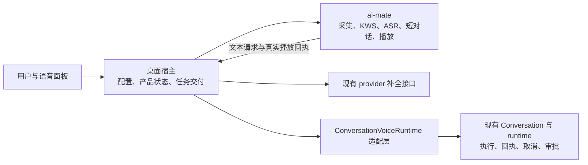
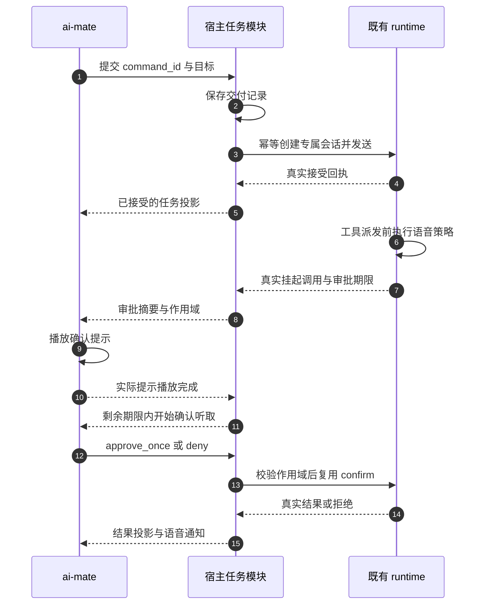

# 语音伴侣后续实施：纵向闭环与 runtime 接口方案

> **状态**：📋 计划，2026-10-15；本轮只整理方案，不实施业务代码、不构建替换程序。  
> **原则**：先让一个真实任务从语音输入走到执行结果，再扩展控制、恢复与确认，最后做体验和性能优化。模块解耦通过少量明确接口实现，不增加新 runtime 或通用调度框架。  
> **承接**：[完整纵向计划](vertical-execution-plan.zh.md)、[原 PRD](../PRD-voice-companion.zh.md)、[v0.2 PRD](../PRD-voice-companion-v0.2.zh.md)、[整合方案](../voice-companion-integration.zh.md)。这些文档的验收继续有效；本文收敛剩余实施顺序与拟定接口，不把历史通过记录提升为当前交付证明。

## 1. 背景与当前断点

基础 KWS → ASR → LLM → TTS 已有 Owner 定性反馈和自动测试。后续应解决真实任务闭环，避免继续累积未接通的模块。

| 能力 | 当前代码/证据 | 本方案出口 |
| --- | --- | --- |
| 普通聊天 | 已接宿主模型目录；不初始化任务 runtime | 接任务后继续独立可用 |
| 任务入口 | `apps/ai-mate/src/voice.rs` 的 `AgentTask`、`TaskControl` 仍返回 `runtime_unavailable` | 生产入口实际调用宿主任务接口 |
| 交付核心 | `voice_tasks.rs` 已有持久化、幂等键、观察和取消；部分测试通过 | 连接真实 Conversation，并覆盖未知回执与完整结果 |
| runtime 适配 | `voice_task_runtime.rs` 已调用专属创建、幂等发送、回执查询 | 宿主真实装配，配置、窗口、回执和通知贯通 |
| 审批 | 实际派发前策略和作用域审批已有部分代码 | 通过真实工具副作用测试后开放写入和危险操作 |
| 状态投影 | 宿主目前整体替换 daemon 快照；快照尚无任务投影 | 宿主按所属模块合并状态，任务不被音量事件清掉 |
| 声音与上下文 | 新增提示音、设置、上下文和起声修复有测试 | 与真实任务结合回归，最终更新产物并实机签核 |

当前最近一批任务/审批改动尚未完成最终编译与集成回归。实施第一步必须补齐这个基线，不能直接把“已有代码”当成“可运行能力”。

## 2. 方案全景与模块职责

| 模块 | 拥有的行为 | 对调用者暴露的接口 |
| --- | --- | --- |
| `ai-mate` 声学模块 | 唯一麦克风采集、KWS/VAD/ASR、倾听期限、短上下文、TTS 和输出消费 | 唤醒/停止、声学快照；调用宿主补全与任务接口；上报实际播放回执 |
| 宿主产品协调模块 | 启用意愿、窗口、当前用户、配置、共享快照、通知去重 | 既有 `/api/voice/companion/*`，新增任务控制与执行配置 |
| 宿主任务交付模块 | 交付记录、稳定身份、单活动任务约束、失败分类、恢复核对 | `submit`、`status`、`cancel`、待审批查询与一次性 `confirm` |
| `ConversationVoiceRuntime` 适配层 | 将语音任务语义转换为既有 Conversation 操作 | 实现 `VoiceTaskRuntime`；屏蔽 registry、事件格式、运行实例细节 |
| 既有 runtime | 任务执行、真实工具授权、挂起与终态 | 复用现有 Conversation/registry，审批权威仍是 `ToolApprovalManager` |
| 对话补全模块 | 模型引用解析、provider 凭据、文本推理 | 保留 `VoiceDialogueCompleter` / `VoiceCompletionClient`；以后接本地模型只替换此处适配 |

约束：daemon 不持有 provider key，不认识任意 Conversation，不获得工具授权。宿主通过 `nomifun-ai-agent` 访问 agent 能力。普通聊天和任务通道分别报告可用性，任务断线不阻断聊天。

### 2.1 固定范围

- 一个活动语音任务；每个任务专属 Conversation；冻结接受任务时的工作区和执行配置。
- 6 秒未开口退出，单句最多 30 秒；回答实际播放完成后 4 秒内可开始追问，最多三轮短上下文。
- 确认听取最多 8 秒，且绝不超过执行侧授权期限。关闭窗口、停止语音、关闭语音功能均不等于取消任务。
- 复用现有模型目录、配置文件、原子写入、Conversation 幂等与审批机制；不增加依赖、数据库表、并行 Agent 或新的调度框架。
- 流式 ASR、全双工 AEC、远程音频、自定义唤醒词、本地模型实装、模型竞速与性能专项后置。

## 3. API 与状态契约

以下新增路径和字段均为**拟实施契约**，当前未提供；实施时沿用既有路由和错误响应封装，不发布另一套协议。DTO 统一放在 `nomifun-api-types::voice`，前端复用同一语义的 adapter。

### 3.1 三类调用通道

1. **面板 → 宿主公开控制接口**：沿用桌面现有本地鉴权和用户作用域，不使用 Flowy provider token 充当本地控制凭据。
2. **daemon → 宿主私有接口**：扩展现有临时回环桥，复用启动时临时凭据；宿主提供文本补全和任务调用。回环凭据不是模型 API key，不进入命令行、日志或前端。
3. **宿主 → runtime 内部接口**：Rust trait 适配现有 Conversation，不让 daemon 或前端直接依赖 runtime registry。

不开放远程控制；不新建 provider key 配置。未来本地模型可以不需要云端凭据，但本地控制作用域校验仍保留。

### 3.2 面板公开接口清单

基础路径为 `/api/voice/companion`。

| 方法与路径 | 现状 | 语义与响应 |
| --- | --- | --- |
| `GET /status`、`GET /session`、`GET /events` | 已有，兼容扩展 | 保留既有字段；新增任务可用性和投影；SSE 首帧完整快照 |
| `GET/POST /config` | 已有 | 保留对话模型配置及响应；不混入另一份 provider key |
| `GET/POST /execution` | 待实施 | 明确工作区、模型引用或预设；返回请求配置、有效配置及不可用原因 |
| `POST /wake`、`POST /session/stop` | 已有 | 保留声学作用域校验；停止会话不取消任务 |
| `POST /tasks` | 待实施 | 提交稳定 `command_id` 和目标；返回真实交付投影及本次是否首次接受 |
| `GET /tasks/{command_id}` | 待实施 | 按当前用户查询已登记任务；核对回执，不创建/发送/启动 runtime |
| `POST /tasks/{command_id}/cancel` | 待实施 | 请求取消当前绑定任务；返回 `cancelling` 或真实终态 |
| `GET /tasks/{command_id}/confirmations` | 待实施 | 只读映射现有真实挂起调用；无活动实例不复活执行 |
| `POST /tasks/{command_id}/confirmations/{approval_id}` | 待实施 | 单次同意或拒绝；必须匹配实际挂起调用和有效期限 |

daemon 私有通道使用相同任务 DTO 和宿主应用方法，不复制业务状态机。私有完整 URL 仍由启动桥提供，不把临时端口写入前端契约。

### 3.3 字段、身份与配置

| 对象 | 必要字段与规则 |
| --- | --- |
| 执行配置 | 复用 `VoiceExecutionConfig { workspace, model?, preset_id? }`；工作区必须为明确的现存绝对目录，规范化后冻结；至少有可解析模型或预设，二者同时存在时沿用现有 Conversation 的覆盖顺序并返回有效模型 |
| 新任务提交 | 复用 `VoiceTaskCommand { command_id, session_id, turn_id, goal }`，请求增加宿主 `instance_id`；宿主从鉴权取得 owner，客户端不得指定 owner、任意 Conversation 或权限 |
| 回执投影 | 复用 `VoiceTaskSnapshot` 的 `command_id/session_id/acoustic_turn_id/conversation_id?/message_id?/runtime_turn_id?/status/result_ok?/result_text?/error_code?`；审批等新增字段保持兼容可选 |
| 任务取消 | `command_id` 在路径，携带当前 `instance_id` 与绑定 `conversation_id`；不要求原声学会话仍存活。旧窗口不能取消新任务 |
| 审批请求 | 当前 `instance_id`、任务绑定、`approval_id`、`msg_id`、`call_id`、`decision: approve_once | deny`；不接收授权期限、权限提升或永久允许 |
| 待审批投影 | `approval_id/msg_id/call_id/tool_name/expires_at_ms`，显示必要的目标和操作摘要；原始 arguments 仅经过现有权限与脱敏路径展示 |

`turn_id` 是声学轮次；`command_id` 是一次任务交付；`runtime_turn_id` 是后台执行轮次。不能互换。一次已识别的任务在重试时保持同一 `command_id`，用户再次明确发起新任务才生成新身份。

初次提交必须匹配当前有效声学作用域。断线后对旧命令只允许查询/核对；不能利用过期会话发起新的执行。已持久化命令的幂等重放校验原请求，不能因面板刷新生成新身份。

### 3.4 交付与错误语义

| 情况 | HTTP/应用语义 | 用户反馈 |
| --- | --- | --- |
| 参数不合法、工作区/配置未设置 | 沿用现有 400/422 规则，明确 `code` | 明确未提交及缺少配置 |
| 用户/本地控制作用域无效 | 沿用现有 401/403；跨用户资源沿用既有隐藏规则 | 要求恢复当前连接，不泄漏其他用户任务 |
| 旧会话、同 ID 不同目标、已有活动任务、审批已失效 | `409`，稳定机器码 | 不执行，说明冲突；失效审批不重放 |
| runtime 无法使用，且确定未发出请求 | `503 runtime_unavailable` | 尚未提交；普通聊天仍可用 |
| 已持久化并确认 runtime 接受 | `200`，`status=accepted` | 只在首次真实接受时播报接单 |
| 任务瞬间完成 | `200`，真实终态 | 直接展示结果，不补播“正在执行” |
| 发送后超时或响应丢失，执行结果未知 | `202`，`status=unknown` | 正在核对是否接单；不宣称失败或成功，不自动改 ID 重发 |
| 原始记录损坏或持久化失败 | 沿用现有 500 规则与 `task_state_*` 码 | 不发起新副作用；若副作用已发生则明确未知并只读核对 |

普通对话与任务错误按 `stage/code` 区分。HTTP 成功不等于执行成功；`accepted` 也不等于完成。`result_ok` 缺失不得推断成功。现有 `Result<_, String>` 需在任务模块内收敛成能区分“确定拒绝/可能已送达/本地存储失败”的错误，HTTP 再映射到项目既有错误封装。

### 3.5 状态与事件

声学仍使用现有 `VoiceSessionPhase`。任务状态独立保留；在现有未完成开发的 `VoiceTaskStatus` 上补足拒绝、明确取消等真实终态语义，实施前同步所有 DTO 调用者和测试。不用声学 `Idle` 表示任务结束。

| 任务状态 | 进入前提 | 允许的后续 |
| --- | --- | --- |
| `delivering` | 配置/作用域验证通过，交付记录落盘，开始创建或发送 | `accepted`、`unknown`、明确拒绝/失败、直接终态 |
| `unknown` | 可能已创建/发送，缺乏可证明的回执 | 只读核对后转真实状态；“暂未找到”不足以证明未执行 |
| `accepted` | 真实接受回执与专属 Conversation 绑定 | 保持接受、`cancelling`、完成/失败/取消 |
| `cancelling` | 取消请求已登记；尚未观察到终态 | 保持取消中或真实终态；取消请求失败需明确展示 |
| 完成/失败/拒绝/取消 | 对应的确定拒绝或真实执行终态 | 同一交付身份不可重新执行；重复查询结果一致 |

审批是运行任务上的可选 `pending_confirmation`，不另建一套执行状态或 token 存储。终态不能被迟到的 accepted 事件覆盖。

宿主是公开产品快照的唯一写入者：现有声学字段保持，新增 `task`、任务可用性及待审批投影；daemon 更新只合并声学字段，runtime 更新只合并任务字段。每次可见变更由宿主递增 `seq`；`instance_id` 更换时重置客户端游标。前端先注册监听再取快照，按实例和序号处理竞态；重连或 Lagged 后重新取得完整快照，不依赖固定延迟重发事件。

不要新造通用事件总线；复用现有 Conversation 事件与运行状态，映射为共享快照。高频音量更新不触发任务查询。恢复/重连查询不得初始化任务实例。

### 3.6 幂等、持久化与恢复

创建和发送分别使用现有稳定键 `voice-create:{command_id}` 与 `voice-send:{command_id}`，并保留 Conversation 内的 owner 作用域。保存冻结的命令与执行配置后才允许副作用。

当前单条记录被后续任务覆盖后，旧命令的参数对照会丢失。需要在实施恢复切片时保留按用户/命令定位的交付记录，复用已有原子 JSON 写入，不加表、不做队列。任务串行执行锁仍由宿主任务模块持有；历史记录不是调度器。不得以清理历史为由破坏已承诺的幂等性。

- 重复同 ID、同内容：返回原投影，不能新增 Conversation、执行或接单声音。
- 同 ID、不同目标：冲突。修改后的模型/工作区不改变旧记录。
- 创建成功但保存 Conversation ID 失败：用创建键只读查找原 Conversation。现有仓库有 `find_by_creation_key`；如应用层缺少合适接口，仅补一个 owner 校验的只读查询方法，禁止调用创建来冒充查询。
- 发送成功但回执丢失：通过 `public_turn_delivery_state` 核对同发送键，不自动重新执行。
- 重启时只读恢复映射，不能自动创建、发送、批准或恢复危险工具。
- 用户切换立即隔离旧投影及通知；不删除或取消旧用户后台任务。
- 协调状态文件写失败：保留旧有效记录，明确报错。已执行副作用必须能由稳定身份继续核对。

### 3.7 实际工具确认与听取期限

语音策略必须在实际工具执行前生效，权限为语音策略与 runtime 权限的交集。只读切片先拒绝所有写入、删除、危险命令、未知工具和越界调用；后续审批切片通过后，才允许受支持的写入/删除走单次确认。不能仅依据 LLM 的 `requires_confirmation` 或 runtime 的 yolo/自动批准。

审批仅由已有 `ToolApprovalManager` 持有。绑定任务、实际消息、工具调用和本次 `approval_id`；同 `call_id` 被再次使用时，旧同意也不能命中新挂起调用。`always_allow=false`，没有持久授权。

执行侧目前的审批倒计时从注册时开始；提示音/合成也会消耗期限。确认听取只能在实际播放完成后开始，窗口长度是 `min(8 秒, 执行侧剩余有效期)`。如果届时已过期，直接拒绝并说明未执行；不能伪造新的 8 秒或延长原授权。若真实测试证明现有总期限不足，应单列评审总授权期限，不能在接线时悄悄放宽。

确认中不再调用普通任务路由；只消费明确的确认/拒绝意图。空白、含糊、识别失败、断线、取消或过期均拒绝。麦克风输入先经过现有播放占用规则；必须证明提示自身不会被当作同意。

## 4. 关键决策与权衡

| 编号 | 选定方案 | 理由与不采用项 |
| --- | --- | --- |
| D1 | 先贯通真实只读任务 | 能验证接单、执行、结果与通知；单纯拼好 trait 或 mock 不算端到端 |
| D2 | 保留两个实际变化接口：对话补全、任务执行 | 二者生命周期和权限不同；不建立统一“万能 Agent API” |
| D3 | 宿主装配现有任务适配层 | 幂等、凭据、owner、工作区留在宿主；daemon 不直接管理 runtime |
| D4 | 回执未知独立呈现 | 请求超时不等于未执行；自动换 ID 重试会造成重复副作用 |
| D5 | 一套 runtime 审批权威 | 不接入工具策略表的第二套 suspended-call/token 存储 |
| D6 | 先确定语义再补性能 | 状态、作用域、实际终态是本轮必需；流式与多任务扩展后置 |

## 5. 串行纵向切片与验收

本文切片是剩余工作的实施顺序，不替代原 V0–V8、AC-01–20、AF-AC-01–16。每片都包含相应 UI、接口、业务适配、测试和失败反馈；不能先做完所有后端再补 UI。状态统一为：未开始 → 进行中 → 自动测试通过 → 真机通过 → Owner 验收；不同证据分栏，不合并签核。

| 切片 | 用户可操作的完整场景 | 必须完成 | 出口证据与原验收映射 |
| --- | --- | --- | --- |
| T0：恢复基线 | 当前代码可编译、基础聊天不回退，准确知道哪些能力未开放 | 检查未完成的任务/审批代码和全部调用者；冻结本节 DTO 语义；收集既有全仓失败；保留任务不可用的真实反馈 | 受影响 crate 检查/测试通过；新接线前失败测试可复现断点；无假接单。T0 通过后才进入 T1 |
| T1：第一个真实任务 | 用户说“读取指定工作区内验收文件并告诉我内容”；看到原文/理解、真实接单、结果，听到结果且能打开任务详情 | 显式执行配置；daemon 客户端→宿主→Conversation；低风险工具白名单和其余硬拒绝；接受/结果快照合并；结果与声音按任务去重，等声学空闲通知 | 真实工作区文件包含每次测试新生成的随机标记，结果必须来自实际工具读取；创建/发送各一次；聊天不初始化 runtime；任务服务失效聊天仍通过。覆盖 AC-09、11、12 的对应子项 |
| T2：控制与恢复 | 任务期间继续聊天、问进度、取消；重启后查看同一任务结果 | 声学/任务状态独立；幂等参数对照记录；未知回执/创建映射恢复；实际取消终态；用户切换隔离 | 丢响应不重复发送；关窗不取消；取消中不假完成；重启不新建/启动任务；旧任务不进入新用户投影。覆盖 AC-12、13、16、17 |
| T3：真实工具确认 | 任务准备删除工作区临时文件，先说明目标，再接受一次口头同意/拒绝/静默 | 现有派发策略+唯一审批权威；真实 pending→提示播放完成→限时听取→confirm；面板可读同一调用 | 拒绝/静默/过期/错作用域/重复同意均无副作用；同意只执行一次；工作区外始终拒绝；yolo/LLM 布尔不能绕过。覆盖 AC-14、15 |
| T4：离屏完整体验 | 离开电脑，仅凭声音完成聊天、提交任务、等待结果、拒绝操作和休眠 | 复用已实现声音设置；把真实接单、任务完成、审批/失败与统一输出所有权接通；补当前剩余声学门禁 | 提示不淹没讲话、不重复排队；处理等待有有限提醒；实际播完计时；TTS 故障文字保留；设备失联与恢复、30 秒时长和真实追问首字回归。原 V1–V4 与 AF-AC-01–16 全量对照，不提前签核 |
| T5：安装与交接 | 干净 Windows 安装后直接完成上述全流程 | 联合宿主/daemon/native 资源；默认产物一致性；安装/退出；性能采样与用户说明 | AC-20 与前述 AC 全量回归；无手工编译、额外控制台或残留进程；Owner 最终实机签核。Mac/Linux 另测后再声明支持 |

### 5.1 验收用例必须跨生产入口

| 编号 | 场景 | 可断言结果 |
| --- | --- | --- |
| TC-VR-01 | 固定音频进入生产 worker，读取真实工作区文件 | 正确 ASR/目标；实际工具读取随机标记；真实接受/完成；正文和 TTS 输出一致 |
| TC-VR-02 | 同一任务重复提交，完成后再投递旧命令 | 不重复执行；变更目标冲突；旧配置不可被当前设置覆盖；接单/结果不重复播报 |
| TC-VR-03 | 创建/发送响应丢失，持久化在各边界失败 | 状态准确区分拒绝与未知；无新身份；恢复只查询；不发假成功 |
| TC-VR-04 | 任务执行中关闭窗口、停止语音、再次聊天 | 后台继续；普通聊天可用；显式取消才请求 runtime 取消 |
| TC-VR-05 | 停止任务、收到迟到运行事件或结果 | 真实终态优先，迟到事件不覆盖；结果通知按任务去重 |
| TC-VR-06 | 同意/拒绝/静默与重复 call_id、旧 approval_id | 在真实派发入口断言文件/命令副作用；一次有效，其余均不执行 |
| TC-VR-07 | 提示合成慢、实际播完时审批已过期 | 不再倾听同意、不延长授权；解释已过期，工具未执行 |
| TC-VR-08 | 高频音量事件与任务事件交错、SSE 重连、用户切换 | 任务投影不丢，序号单调，旧用户结果和旧窗口控制不进入新作用域 |

### 5.2 验证梯子与证据

1. 为当前切片的生产入口写失败测试，再做最小完整实现，保留失败/通过记录。替身限测试范围，不能用生产 fallback 让流程看起来成功。
2. 按修改运行相关 `cargo test -p <crate>`、`cargo check -p <crate>`；受影响范围包括 `ai-mate`、`nomifun-app`、`nomifun-conversation`、`nomifun-ai-agent`，以及实际修改的协议/工具/执行 crate，不机械重跑无关包。
3. UI 改动运行行为和双语测试、类型检查、i18n、theme 及相关质量门禁。依赖/feature 改动后核对完整桌面图，不只测试独立 TTS 包；生产不含 skeleton。
4. 集成节点运行 `cargo fmt --all -- --check`、`cargo check --workspace`、`bun run check`、`bun run build:ui` 和桌面/daemon 构建。保留约 60 项既有非语音类型错误等基线记录，不能删除断言或跳过门禁冒充全绿。
5. 接真实 runtime 的接口集成、真实文件声学回放、物理设备和 Owner 实测分别留证。用受控模型/输出测试的场景必须标明替身；没有实际 runtime 工具回执就不能签 T1，没有实际扬声器证据就不能签 T4/T5。

每片记录：源码/产物身份、输入样本和配置、关键身份链、实际状态序列、创建/发送/ASR/模型次数、工具副作用、取消/审批结果、错误、验证命令与日志、剩余项、真机与 Owner 状态。日志不包含临时凭据、API key 或无关用户内容。

最终实测按 Owner 负责的既定安排交接；每片内部测试通过后可继续内部集成，但不能把 Owner 验收标成通过。发布不自动进行。冷/热窗口 P95、首音延迟等原指标不降级；完整功能走通后采样并报告差距。

### 5.3 后置优化及启动条件

| 后置项 | 启动条件与验收 |
| --- | --- |
| 端到端延迟专项 | T1–T4 行为稳定后，分别采样 ASR/模型/TTS/播放耗时；按原 PRD 指标修复瓶颈 |
| 声音设计微调 | 离屏脚本通过后，根据真实听感调整音高、节奏与相对响度；不改变权限或计时语义 |
| 本地模型适配 | 用户另行启动，复用补全接口运行相同契约回归；不修改声学、任务和审批模块 |
| Mac/Linux 产品签核 | Windows 闭环后独立执行构建、设备、窗口和安装验收，不把结构兼容当作实测 |

## 附录：原始指令与历史参考

本文是新增接续方案，没有删除或重写既有 PRD、执行计划和历史正文；原文仍按文首链接逐字保留。

本轮原始指令：

> 继续整理后续的方案，不要盲目执行，而是先纵向实现然后开始堆砌优化，保证流程走通，然后对于模块是解耦的，做好api接口的规范，方便接入runtime；

本轮只读核对位置：

- `apps/ai-mate/src/voice.rs`：生产任务分支尚未接 runtime。
- `crates/backend/nomifun-app/src/voice_tasks.rs`：交付记录、幂等键、观察、取消。
- `crates/backend/nomifun-app/src/voice_task_runtime.rs`：现有 Conversation 适配层。
- `crates/backend/nomifun-app/src/voice_dialogue.rs`：模型目录与补全接口。
- `crates/backend/nomifun-app/src/voice_companion_manager.rs`：公开路由和宿主快照合并入口。
- `crates/backend/nomifun-api-types/src/voice.rs`：现有 DTO 与待补的任务投影。
- `crates/backend/nomifun-conversation/src/service.rs`：创建/发送/回执/取消/确认和创建键查询所在仓库。
- `crates/backend/nomifun-ai-agent/src/voice_tool_policy.rs`、`crates/agent/nomi-agent/src/tool_execution.rs`、`crates/agent/nomi-protocol/src/lib.rs`：实际派发策略和审批期限。

当前授权范围仅为方案整理。本方案、拟定路径及字段不构成业务代码已实现或验收已完成的声明；后续从 T0 启动，等待实施指令。
