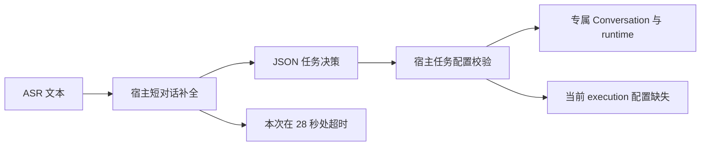
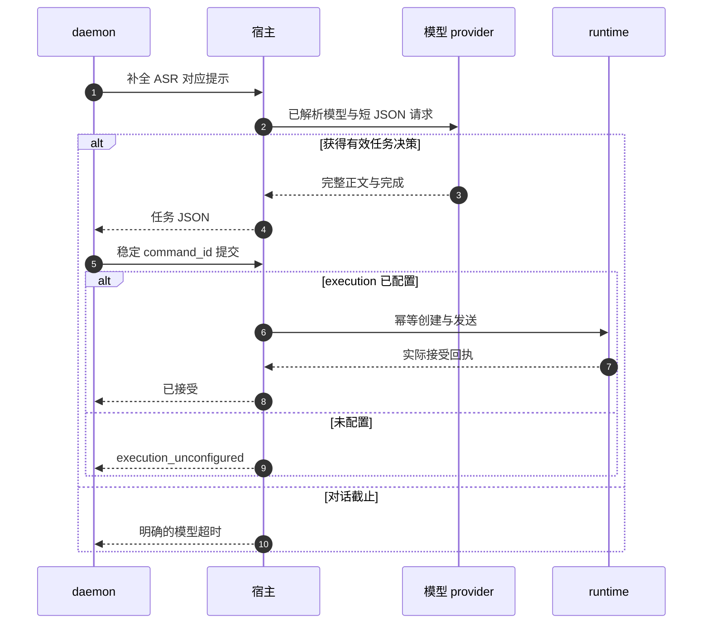

# 语音任务未提交 · 诊断与修复交接

> **状态**：📋 计划；2026-10-16，只读检查完成，尚未实施修复。
> **核心原则**：先区分对话路由超时与任务配置缺失；沿用既有接口和 provider，不以放开工具权限或假接单绕过问题。

## 1. 背景与核心痛点

Owner 截图：前一轮问好及回复仍在历史中，当前轮识别到“明天天气怎么样？”，随后显示“对话模型连接失败或超时”。本轮核对当前代码和两份本机日志：

- 17:53:39：问好 ASR 98ms，模型 834ms 成功，播报 6125ms 成功。
- 17:53:50：第二轮 ASR 101ms，识别文本 8 字；宿主选用 `AIPC-qwen3.8-flash`。
- 17:54:18：第二轮模型耗时 28013ms，返回 `model_network_failed`。宿主 `voice_dialogue.rs` 恰有 28 秒 `tokio::time::timeout`，daemon 客户端预算为 30 秒。没有形成这一轮的有效任务决策，未进入该决策之后的任务提交。
- 实际数据目录 `D:/tmp/flowy-dev/config/voice_companion.json` 当前内容只有 `{"autostart":true}`。代码要求独立的 `execution` 配置，缺失时返回 `execution_unconfigured`。这不是本轮超时的原因，但会是修好超时后紧接着的确定阻断。

| 当前行为 | 修复目标 |
| --- | --- |
| 外层超时统一展示为模型连接失败 | 区分连接失败、响应等待/完成超时，留下脱敏阶段耗时 |
| 通用 one-shot 等待最终正文完成，未显式禁用推理 | 核对真实请求参数和上游阶段，按 provider 能力复用直接补全路径 |
| 聊天可用，但任务配置缺失 | 面板和设置明确分别呈现聊天就绪、任务未配置，保存并校验明确执行配置 |

## 2. 方案全景与架构设计



维持 daemon、宿主、runtime 的既有边界。检查请求阶段不调用危险工具，不自动替用户选择任意工作区；不改云服务地址、不复制 key，不以增加无限超时或自动换模型替代诊断。

## 3. 核心设计与模块规范

按以下顺序交给实施 agent：

1. **锁定超时反馈测试**：通过宿主真实 dialogue handler 接入受控 completer，分别复现未返回、正文已到但无完成事件、正常完成和取消。将超时预算保留为生产固定值，测试用暂停时钟或仅测试内部入口推进时间，不增加产品设置。确保失败不会调用任务 create/send。
2. **补充脱敏观测**：本地关联请求和声学轮次，记录模型、请求开始、上游连接/响应、首个正文、正文数量、完成或截止及总耗时；推理事件仅计数/计时，不记录或展示推理内容。外层 timeout 目前没有独立的失败日志，需要明确 `model_timeout` 等受控分类，并在 daemon、宿主和 UI 贯通。不得打印凭据、完整 URL 或用户原文。
3. **核对推理参数而非猜测**：`one_shot_completion` 当前走 `streaming_completion`，请求的 `thinking` 为 `None`，仅组装正文直到完成。仓库已有 `one_shot_completion_no_thinking` / `streaming_completion_no_thinking`。验证当前 Flowy provider 对 `ThinkingConfig::Disabled` 的实际序列化和支持情况后，语音 JSON 路由可复用已有无推理补全。不要将推理文本当作回答或任务 JSON。若上游实际无响应、缺完成事件或排队，应修对应问题；单纯关闭推理不能宣称已解决。
4. **补齐执行配置体验**：确认设置页的任务工作区、执行模型或 preset 已保存且 `GET /api/voice/companion/execution` 返回 `available=true`；保存失败/未配置有明确原因。对本机当前数据，应由用户选择工作区和模型，不能默认借用当前聊天。聊天开关不代表任务就绪，不为配置缺失重置模型或麦克风。
5. **先验收本地随机文件，再验收天气**：真实 runtime 读取临时验收目录内随机内容，任务 create/send 各一次且 Accepted 后才 ACK。然后测试天气请求；缺城市时应澄清，获得地点后使用实际可用的查询工具，无法获得数据要真实说明。本轮代码的语音策略已出现 WebSearch/WebFetch 放行，仍需核对当前实际二进制、工具注册和网络证据，不能沿用历史“未开放”结论，也不能凭放行表断言天气能力已可用。



不新增公共接口，仅在已有错误码契约中增加明确超时分类，并同步双语映射；保持已有错误兜底兼容。模型超时不产生任务身份、副作用、假接单或 TTS 重试任务。

## 4. 关键决策与权衡

| 决策 | 原因 |
| --- | --- |
| 保留当前 qwen 模型选择 | 现场已经使用 `AIPC-qwen3.8-flash`，不是误用旧模型；前一轮同模型成功 |
| 先诊断上游阶段，再决定补全参数/超时调整 | 28013ms 证明宿主截止，但不能证明上游为何迟迟未完成 |
| 任务配置单独完成 | 对话模型与执行模型职责不同，当前配置缺失有直接文件与代码证据 |
| 不靠扩大工具权限解决 | 此次尚未到工具执行，开放权限无法修复模型超时 |

## 5. 验收标准与验证梯子

| 用例 | 必须断言 |
| --- | --- |
| 对话超时 | 明确超时分类，ASR 保留，任务 create/send 为零，无假接单 |
| 首正文后停滞 | 可以从诊断区分“无响应”和“未完成”；不提交半截 JSON |
| 推理参数 | 真实 provider 序列化符合能力；不把推理内容作为公开回答 |
| 未配置任务 | 明确缺少执行配置，聊天继续可用 |
| 已保存配置 | 重启后配置仍在，available 为真，模型或目录失效时准确报错 |
| 实际任务 | 读取请求中未透露的随机文件内容；create/send/实际工具各一次 |
| 取消与迟到结果 | 停止后旧模型结果不能新建任务或覆盖新轮次 |
| 天气场景 | 缺城市先澄清；实际查询有工具结果，无数据不编造 |

执行梯子：dialogue handler 与 worker 定向失败测试→受影响 Rust crate 检查/测试→面板双语行为、类型及主题检查→生产 feature 图与联合构建→Owner 实机。测试 skeleton 使用独立构建目录，不能覆盖默认程序；既有全仓失败单独记录。

## 附录：原始证据与定位

日志 `D:/tmp/flowy-dev/logs/voice/ai-mate-1792144226777.log`：

```text
2026-10-16T09:53:50.869267Z  INFO ai_mate::voice: voice_asr_finished elapsed_ms=101 text_chars=8
2026-10-16T09:54:18.951681Z  INFO ai_mate::voice: voice_model_finished elapsed_ms=28013 ok=false
2026-10-16T09:54:18.951753Z  WARN ai_mate::voice: voice_model_failed code="model_network_failed"
```

宿主日志 `D:/tmp/flowy-dev/logs/2026-10-16.nomicore.log`：09:53:50.945519Z，`voice_dialogue_model_selected`，model=`AIPC-qwen3.8-flash`。未复制完整日志中的其他用户/运行数据。

关键代码：`nomifun-app/src/voice_dialogue.rs` 28 秒补全截止；`nomifun-voice-terminal/src/completion.rs` daemon→宿主 30 秒预算；`nomifun-app/src/voice_companion_manager.rs` 的 `requested_execution/execution_settings/submit_task`；`nomifun-ai-agent/src/factory/provider_config.rs` 的正文组装与无推理补全；`apps/ai-mate/src/voice.rs` 的决策失败路径。

本轮只新增本交接文档；未调用真实模型、未提交任务、未修改业务代码/配置或替换产物。原 PRD、契约、实施记录和现场日志均保留。
