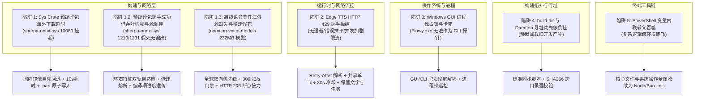

# 语音伴侣实战避坑与经验总结 (Voice Companion Pitfalls & Lessons Learned)

> **发布日期**：2026-10-16  
> **适用范围**：AI Mate (`apps/ai-mate`)、`nomifun-voice-terminal`、`nomifun-audio`、构建与打包流水线及桌面跨层集成。  
> **核心目标**：记录在开发、交付与验证 Flowy 语音伴侣（AI Mate）过程中遇到的五大核心系统级陷阱、根因剖析、解决方案与长效规避准则，供团队及后续研发 Agent 参考。

---

## 1. 踩坑全景图



---

## 2. 陷阱深度剖析与长效规避方案

### 2.1 陷阱 1：Sys Crate 预编译包海外拉取超时 (sherpa-onnx-sys)

#### 现场现象
在干净机器或新拉取分支执行 `bun run dev` 或 `cargo check` 时，构建长时间无响应，最终失败并抛出异常：
```text
thread 'main' (350576) panicked at crates\vendor\sherpa-onnx-sys\build.rs:40:9:
Failed to download sherpa-onnx archive from https://github.com/.../sherpa-onnx-...-win-x64-static-MD-Release-lib.tar.bz2: 
Connection Failed: 由于连接方在一段时间后没有正确答复或连接的主机没有反应，连接尝试失败。 (os error 10060)
error: script "dev" exited with code 101
```

#### 根因分析
1. **硬编码境外 URL**：`sherpa-onnx-sys/build.rs` 直接从 GitHub Releases 镜像下载 C++ 静态库和模型头文件，在缺乏透明代理的国内网络环境下必挂。
2. **缺乏网络超时机制**：`ureq::get` 未设置 `connect_timeout`，操作系统 TCP 连接重试会持续数分钟直至超时抛错。
3. **残余脏文件污染**：下载中断后可能留下 0 字节或不完整的目标文件，下次执行时解包器判定文件已存在却无法解压，造成永久破坏。

#### 解决方案与防线
- **镜像链路容灾**：修改 [`crates/vendor/sherpa-onnx-sys/build.rs`](file:///d:/workSpace/git_clone_test/allo/crates/vendor/sherpa-onnx-sys/build.rs)，新增优先环境变量 `SHERPA_ONNX_BASE_URL`，并默认加入国内加速镜像备用源：
  ```rust
  let mirror_candidates = [
      format!("https://ghproxy.net/{}", base_url),
      format!("https://mirror.ghproxy.com/{}", base_url),
  ];
  ```
- **超时保护**：配置 `Agent` 连接超时为 10 秒（`connect_timeout(Duration::from_secs(10))`），快速故障快速转移。
- **原子临时文件**：下载时统一落盘到 `.part` 临时后缀，下载成功后通过原子重命名转正；发生错误或超时立刻删除 `.part` 文件，绝不留坑。

---

### 2.1.2 陷阱 1.2 衍生：预编译包“握手成功但吞吐枯竭”假死与海内外源倒挂 (sherpa-onnx-sys 首次编译停滞)

#### 现场现象
在新环境首次编译运行包含本地语音（SenseVoice/Silero VAD）的项目时，Cargo 构建进度停滞在：
```text
Building [======================> ] 1210/1231: sherpa-...
```
界面长达十几分钟没有文字滚动，数字不加 1，开发者常误判为死锁或工具链崩溃，反复 `Ctrl+C` 导致留下未完成的 `.part` 文件并无限重复等待。

#### 根因剖析
1. **源拓扑顺序倒挂**：构建脚本硬编码将官方 GitHub Releases 排在 `urls` 首位。
2. **“握手成功但吞吐枯竭”假死陷阱**：国内环境直连 GitHub 或经由本地代理时，TCP 握手能在 10 秒内成功完成（`timeout_connect` 不超时，返回 HTTP 200 OK）。然而后续真实数据下载被限制在 30~80 KB/s 的极低速率。
3. **缺乏传输吞吐量低速熔断**：`ureq` 只做了建立连接超时，未做数据流读取速率监控。一旦连接建立，它便死守该极慢连接，**后排配置的国内镜像源永远没有机会被尝试**。
4. **Cargo 编译期进度压制**：Cargo 在执行单个 crate 的 `build.rs` 期间默认静默标准输出，导致 88.7 MB 大包在下载过程中毫无终端反馈。
5. **未对齐 Flowy 国际化规范**：Flowy 运行时（`nomifun-voice-models`）已实现 ModelScope/GitHub 双源智能测速，但编译期构建脚本仍停留在老旧逻辑。

#### 解决方案与长效规避
1. **环境特征智能双轨路由**：
   - 自动探测构建机环境（检测系统 Locale 是否为 `zh-CN`、时区是否为中国、或 `.cargo/config.toml` 中是否启用了 `rsproxy.cn` 镜像）；
   - **国内环境**：优先 GitHub 加速镜像，官方 GitHub Releases 兜底；
   - **海外环境**：官方 GitHub Releases 优先，加速镜像后备。
2. **传输低速主动熔断（Speed Gate）**：
   - 在流式数据读取循环中监控传输吞吐量；若连接建立后 5~20 秒平均速率低于 **300 KB/s**，主动记录警告并断开当前连接，平滑降级切换至下一镜像源。
3. **编译期进度透传回显**：
   - 依据 `Content-Length`，每推进 20% 通过 `println!("cargo:warning=[sherpa-onnx] Downloading: {}% via {}", percent, mirror)` 输出控制台警告，消除假死误判。
4. **跨工程全局缓存支持**：
   - 引入用户主目录下 `~/.flowy/cache/sherpa-onnx-prebuilt/` 共享机制，跨分支跨项目复用已下载依赖，实现网络零等待。
   - 可选设置 `SHERPA_ONNX_ARCHIVE_SHA256`，对下载的预编译归档做 SHA256 校验；未设置时接受镜像信任边界。

---

### 2.1.3 陷阱 1.3：运行时离线语音套件（232MB）海外候选源缺失与低速吞吐熔断 (`nomifun-voice-models`)

#### 现场现象
用户在客户端点击启用或升级离线语音套件（包含 SenseVoice ASR 200MB + KWS 30MB + VAD 2MB）时：
1. **海外用户大面积报错**：海外用户下载时界面频繁报 `无法连接到模型镜像源 (ModelScope)`，由于默认候选列表仅硬编码了 ModelScope 一个国内源，导致跨国访问超时后直接报 `AllMirrorsFailed`。
2. **弱网长尾假死**：当国内用户接入限速网络（如 10~20 KB/s）时，由于 TCP 流式 chunk 持续到达，总超时无法触发，客户端下载进度条长达数小时停滞不动。

#### 根因剖析
1. **默认候选源单一**：`MirrorConfig::default_mirrors()` 生产默认仅注册了 ModelScope；代码虽有 HuggingFace 的映射实现，但未注入生产候选队列。
2. **流式传输缺乏实时速度门禁**：`download_file_with_resume` 仅依赖 reqwest 的 `timeout(120s)`，无法防范慢速流吞吐饥渴。

#### 解决方案与长效防线
1. **环境特征动态双轨队列**：
   - 国内环境：`ModelScope` (主) -> `hf-mirror.com` (备) -> `huggingface.co` (兜底)；
   - 海外环境（ASR/VAD）：`huggingface.co` (主) -> `hf-mirror.com` (备) -> `ModelScope` (兜底)；KWS 固定 `ModelScope`，HF 没有已验证的官方 KWS 文件。
2. **Speed Gate（速度熔断门禁）**：
   - 流式接收 chunk 时监控吞吐；在非最后一个备用源的情况下，若 5~20 秒平均速率低于 **300 KB/s**，主动 abort 断开连接并返回 `SpeedTooLow`。
3. **断点续传（HTTP 206 Range）接力无缝切换**：
   - 熔断时完整保留已写入磁盘的 `.part` 数据；下一个镜像源直接发送 `Range: bytes=<existing>-`，在断点处高速接力，终端用户无感知。
4. **覆盖自动化回归测试**：
   - 在 [`tests/vt_1_05_06.rs`](../../../../crates/backend/nomifun-voice-models/tests/vt_1_05_06.rs) 中新增环境顺序断言与低速触发 Failover 接力集成测试。

---

### 2.2 陷阱 2：Edge TTS HTTP 429 握手限流与错误分类抹平

#### 现场现象
用户唤醒并说话，ASR 识别原文完整，LLM 思考完成并输出了文字回复，但扬声器迟迟无声，随后界面弹出“语音合成失败或超时”。
本机日志记录：
```text
2026-10-16T09:02:16.958908Z  WARN nomifun_voice_terminal::tts: edge_tts_handshake_rejected status=429
2026-10-16T09:02:16.960902Z  INFO ai_mate::voice: voice_playback_finished elapsed_ms=1654 ok=false
2026-10-16T09:02:16.961025Z  WARN ai_mate::voice: voice_playback_failed code="tts_failed"
```

#### 根因分析
1. **缺乏流控退避**：上游 Edge WebSocket 在高频调用或出口 IP 共享时返回 HTTP 429。原有代码直接抛出 `SynthesisError`，没有任何退避或重试逻辑。
2. **并发雪崩加剧限流**：当用户快速交互或同时触发提示音与回复时，如果多个连接同时冲击 Edge 上游，会导致服务端限流惩罚时间延长。
3. **错误分类被压扁**：下游将所有非扬声器错误全部粗暴转成 `"tts_failed"`（文案：“语音合成失败或超时”），用户无法判断是扬声器坏了、网络断了还是服务限流。

#### 解决方案与防线
- **结构化错误透传**：
  - 底层：`TtsError::RateLimited { status: 429, retry_after: Option<Duration> }`。
  - 支持解析整数秒与 RFC 2822 / 1123 HTTP Date 两种 `Retry-After` 格式，防止大值溢出。
  - 中间层透传至 `AudioSinkError::RateLimited`，daemon 映射为公开码 `tts_rate_limited`。
- **共享单飞与主动冷却**：
  - 单个 `EdgeTtsProvider` 内使用 `Semaphore(1)` 锁死最大并发握手数为 1。
  - 记录 `cooldown_until`，一旦遭遇持续 429，立即激活默认 **30 秒进程内冷却**。冷却期内发起的新合成请求在本地被立刻拦截并返回 `RateLimited`，不再发送网络包，保护 IP 不被深度封禁。
- **单次预算内最多 1 次重试**：
  - 在 30 秒总预算内，若握手遇到可重试的短暂 429，且尚未流出任何音频帧，严格限制**最多退避重试 1 次**。
- **状态与资产绝对安全原则**：
  - TTS 失败绝不中断当前轮次，**必须保留并完整显示 ASR 识别文字与 LLM 回答文字**。
  - TTS 失败绝不重新调用 LLM，绝不重复提交真实任务，绝不延长一次性工具确认的有效期限。
- **前端清晰双语呈现**：
  - UI 明确区分：`voice.audio.ttsRateLimited` -> “**语音服务限流，回复文字已保留，稍后可继续对话。**” / “**Speech service rate limited. The reply is preserved as text; you can continue speaking shortly.**”。

---

### 2.3 陷阱 3：Windows 进程模型与 GUI 宿主文件独占锁 (Flowy.exe)

#### 现场现象
使用终端或脚本试图通过 `Flowy.exe --help` 探测版本时，命令长时间不返回；随后重新执行 `cargo check` 或 `cargo build` 时报：
```text
Blocking waiting for file lock on build directory
```
或者复制可执行文件时报 `ERROR_SHARING_VIOLATION`。

#### 根因分析
1. **Windows 子系统与入口语义**：`Flowy.exe` 编译目标为 Windows GUI 子系统（非 Console 子系统），且内部集成了完整的 Axum HTTP/WebSocket 运行时与 Tauri 事件循环。它并不支持普通的 CLI 参数快速打印后退出，传入任何参数都会启动后台守护服务并占住端口与控制台。
2. **Windows 独占文件锁**：Windows 操作系统内核不允许直接覆盖正在运行的 `.exe` 和正在被调试器/加载器引用的 `.pdb`。一旦残留的 `Flowy.exe` 进程在后台运行，Cargo 构建和脚本复制都会被彻底阻塞。

#### 解决方案与防线
- **禁止将 GUI 宿主当作 CLI 探针**：
  - 严禁在脚本或自动化流程中以阻塞方式调用 `Flowy.exe`。
  - 若需要自测后台逻辑，统一使用无头 daemon `ai-mate.exe`（支持命令行解析并正常退出）或直接运行专注的集成测试（如 `cargo test -p ai-mate --test full_voice_flow`）。
- **进程生命周期检查**：
  - 覆盖开发目录或启动测试前，执行 `Get-Process -Name Flowy, ai-mate` 检查并清理孤儿实例。

---

### 2.4 陷阱 4：`build-dir` 与 Daemon 寻址优先级倒挂

#### 现场现象
开发者修改了 `apps/ai-mate` 的 Rust 源码并执行 `cargo build -p ai-mate`，终端显示编译成功；但在桌面启动应用后，所有修改均未生效，依然复现旧逻辑。

#### 根因分析
1. **Cargo 自定义编译目录**：根目录 `.cargo/config.toml` 中配置了 `build-dir = "{workspace-root}/build.noindex"`，不同工具链/Target 会将二进制输出到 `build.noindex/x86_64-pc-windows-msvc/debug/` 或直接更新 `target/debug/`。
2. **宿主 Daemon 寻址优先级**：
   桌面应用（Flowy）内部维护了一套严格的优先级探测链：
   `NOMIFUN_BUNDLED_BIN_DIR` -> `resources/bin` -> 相邻可执行文件目录 -> `target/debug/bin/ai-mate.exe` -> `target/debug/ai-mate.exe`。
3. **“改了代码、编了文件，但命中了旧程序”**：如果开发者只在 `build.noindex` 中生成了新文件，但 `target/debug/` 下依然残留着上一次构建的 `ai-mate.exe`，宿主会静默加载旧程序，造成极其隐蔽的“假更新”陷阱。

#### 解决方案与防线
- **开发产物规范化同步脚本**：
  编写统一的更新脚本 [`scripts/update-default-dev-artifacts.mjs`](file:///d:/workSpace/git_clone_test/allo/scripts/update-default-dev-artifacts.mjs)，明确定义从最新构建产物向开发探测目录的同步逻辑，并生成包含 SHA256 与时间戳的留痕文件 [`T5-default-dev-restoration.json`](file:///d:/workSpace/git_clone_test/allo/docs/architecture/voice-agent/execution/T5-default-dev-restoration.json)。
- **双向哈希比对**：
  在验收前，运行 `Get-FileHash target\debug\ai-mate.exe, target\debug\Flowy.exe` 检查哈希，杜绝任何中间状态或 Skeleton 假产物混入。

---

### 2.5 陷阱 5：PowerShell 命令内联转义与跨平台脚本执行陷阱

#### 现场现象
在多 Agent 或自动化会话中，通过命令行调用包含 PowerShell 特殊变量（如 `$_`、`$var`、`$($_.FullName)`）的内联脚本时，经常由于 JSON 序列化、引号嵌套和 pwsh 展开机制冲突，导致变量在执行前被吃空，甚至引发空路径误删或未捕获异常。

#### 解决方案与防线
- **收敛至 Node.js / Bun 脚本**：
  所有涉及复杂文件系统遍历、哈希比对、JSON 读写或配置修正的操作，**一律使用 Node.js / Bun 脚本（`.mjs`）实现**，禁止在命令行中拼装超过两行的复杂 PowerShell 脚本块。
- **PowerShell 管道化**：
  若必须调用 PowerShell，使用明确的单步管道命令（如 `Get-Process ... | Select-Object ...`），保持语法确定性。

---

### 2.6 陷阱 6：短音节唤醒词与超低门限碰撞引发的“误触唤醒风暴”与“伪 30s 超时失效”

#### 现场现象
在设置自定义唤醒词（如“你好，小白”）后，系统变得异常敏感，任何轻微的键盘敲击声、呼吸声、咳嗽声都会误唤醒；伴侣在播报“好的，再见”退出通话后，仅仅 1~2 秒又自动被重新唤醒；用户观察到“我不说话 30 秒为什么没有退出语音通话”，其实后台确实退出了，但刚退出 1 秒又被杂音立刻拉回通话。

#### 根因分析
1. **基线规则塞入孤立两音节短词**：在 `build_bilingual_keywords_buf` 中，原作者为了兼容方便，默认写入了 `n ǐ h ǎo :2.0 #0.08 @NI_HAO`。在 Sherpa-ONNX Zipformer 模型中，两音节词（`n-i` + `h-ao`）本身的声学区分度极低，再配合 `#0.08` 的超低门槛，环境背景杂音或声卡本底白噪声有极大概率产生声学特征碰撞，造成假阳性误触率呈指数级上升。
2. **缺乏声学回声冷却（Playback Muting Cooldown）**：扬声器播报告别语“再见”时，音频通过物理空间扩散被麦克风重新录入。如果此时没有抑制收音帧，自己播出的声音就会被 VAD 当作用户输入送进 ASR，导致“自己说话的再见被录进会话”或播报完毕瞬间再次触发短词唤醒。

#### 解决方案与防线
- **坚决剔除基线短词**：通用基线仅保留 $\ge 3$ 个音节的抗干扰长词（如 `Hey Flowy`、`你好 Flowy`），彻底移除裸词 `NI_HAO`（“你好”）与 `FLOWY`。用户自定义词如“你好小白”（4 音节）拥有足够的声学信息量，天然具备极强的抗噪能力。
- **声学播放冷却机制**：在扬声器播放音频期间及播放结束后的 600ms 内，音频流水线主动丢弃收音帧，防止扬声器回声自噬或自我唤醒。

---

### 2.7 陷阱 7：动态实时健康流不用、偏执依赖静态 Benchmark 导致的“全未知/未检查”

#### 现场现象
软件启动后，麦克风正常收音、Zipformer KWS、Silero VAD、SenseVoice ASR 和 Edge/Matcha TTS 全程正常工作，但进入设置页后，界面醒目展示“完整通话待检查 / 尚未检查”，6 大节点（麦克风、唤醒引擎、语音检测、语音识别、语音合成、播放设备）全部显示为灰色的“未知”，逼迫用户每次必须手动点击“检查并准备”才能绿灯。

#### 根因分析
1. **静态报告与实时健康状态倒挂**：设置页的 6 个阶段指示灯强行绑定了后端数据库缓存的静态测试报告（`self.capabilities`）。该缓存默认是 `None`，只有跑完一次昂贵的主动 Benchmark（`run_self_check`，包含离线生成音频并做一次 ASR）后才会被写入。
2. **弃用高频 SSE 真实健康流**：实际上守护进程每 200ms 都在通过 SSE 向外广播 `VoiceSnapshot`，里面的 `audio.capture_state`、`audio.kws_ready`、`audio.vad_ready`、`audio.asr_ready`、`tts`、`playback_ready` 就是 100% 真实的活体健康流，但前端和宿主完全没有利用它来动态派生状态，导致“系统明明完全健康，界面却摆烂说全未知”。

#### 解决方案与防线
- **实时健康流动态推导优先**：
  在后端 `current_capabilities()` 中，若没有静态测试报告，只要当前守护进程处于连接且 6 大组件健康就绪，直接基于实时的 `self.snapshot()` 动态导出能力报告，开机即全绿；前端设置页节点也优先绑定实时的 `voiceSnapshot` 动态健康流，连接成功秒级显示“语音引擎运行中 · 节点全就绪”。

---

### 2.8 陷阱 8：呼叫预定锁悬空未清理引发的 `voice_suite_in_use` 级联死锁

#### 现场现象
用户在主界面点击电话图标发起语音通话，因某种原因（如未检查、模型加载中）提示失败；随后用户前往设置页点击“检查并准备”，页面弹窗报错红色 `voice_suite_in_use`，且无论怎么点都无法自检，陷入死锁。

#### 根因分析
在 `voice_companion_manager.rs` 的 `start_call` 方法中，系统在进行能力检查前，先在对话记录器中登记了一个通话预定锁 `current_call_reservation`。当能力检查不满足返回 `voice_suite_not_ready` 错误退出时，**代码忘记把该预定锁释放注销**。随后用户点击自检时，`run_self_check` 检查 `voice_suite_in_use()`，发现预定锁依然存在，误以为当前有一通电话正在建立中，从而拒绝自检抛出 `voice_suite_in_use`。

#### 解决方案与防线
- **严密的分支释放**：在 `start_call` 的所有提前返回与错误出口，显式调用 `recorder.take_call_reservation(&request.request_id)`。
- **预定锁时间窗口自动失效**：在 `voice_suite_in_use()` 中，仅承认 3 秒内的预定锁，超过 3 秒未转正的悬空预定直接视作陈旧废锁自动忽略。

---

### 2.9 陷阱 9：宿主心跳周期性清零准入导致的 `admission_expired` 唤醒静默吞噬

#### 现场现象
用户对着麦克风大声念出唤醒词，后台日志清晰打印 `Neural KeywordSpotter hit detected!` 和 `SenseVoice transcribed: "你好，小白"`，但伴随紧接着的一条 `Wake hit ignored because host readiness admission is absent or expired stage="host_rejected"`，唤醒被系统直接丢弃。

#### 根因分析
宿主管理器每 4 秒运行一次定时器 `refresh_wake_admission`。因为宿主认为静态测试报告过期，向守护进程推送了 `wake = false, expires_at = 0`，伴侣底层的准入时钟被强制擦为 0。即使底层声学模型已经 100% 准确命中，也会因为宿主层的人工倒计时时钟过期而被当场截杀。

#### 解决方案与防线
- **底层模型命中优先**：底层守护进程直接删除 `admission_expired` 阻断分支，声学模型命中即为权威事实；宿主只要开启了语音且模型在盘，持续下发永久准入 `i64::MAX`。

---

### 2.10 陷阱 10：全局路由监听未设页面隔离导致自检强切会话

#### 现场现象
用户在设置页点击自检，自检测试音频跑完后，主应用突然强制跳转离开设置页，切入到会话界面。

#### 根因分析
主窗口顶层 `Router.tsx` 的全局语音唤醒监听器监听到伴侣从自检测试产生的会话代次变动，误当成用户语音呼叫，且未检查当前路由，直接调用 `navigate('/conversation/...')`。

#### 解决方案与防线
- **设置页绝对路由守卫**：在顶层全局监听器中明确增加保护：身处设置页（`location.pathname.startsWith('/settings')`）或自检活跃时，绝对禁止自动切换页面。

---

### 2.11 陷阱 11：胶囊状态机过度绑定非活跃历史任务（`!task` 陷阱）

#### 现场现象
会话中曾经执行过天气或查询任务，挂断语音通话后，胶囊卡在“未在通话”，无法回归绿色的“等待唤醒”。

#### 根因分析
胶囊状态逻辑写了 `!task`（要求会话里绝对没有任何任务），而忽视了任务状态是 `completed` 还是 `active`。

#### 解决方案与防线
- **状态机阻断条件精确绑定 `activeTask`**：历史完成/取消的任务不得污染当前声学等待状态。

---

### 2.12 陷阱 12：KWS 汉字拼音静态穷举陷阱（硬编码补丁反模式）

#### 现场现象
用户自定义唤醒词输入“香芋片”、“荷包蛋”等日常词汇，Zipformer KWS 直接跳过规则编译：`WARN Custom wake phrase contains unsupported characters; skipping KWS rule generation`。开发者每发现一个词报错，就在 Rust 的 `match ch { ... }` 语句里手动补上几个字，代码陷入“报一个字加一个字”的无底洞补丁泥潭。

#### 根因分析
1. **违背第一性原理**：消费级语音伴侣的核心承诺是“支持用户自由设定个性化唤醒词”。常用汉字有 3500 个以上，若用 Rust 静态 match 分支人工穷举，覆盖率永远不足 3%，任何用户的日常命名都有极大概率被当作“不支持字符”丢弃。
2. **对标方案未学透**：标杆开源项目 `dsh-orb-cordis` 的根本解法并非人工穷举，而是在前端（或构建层）接入成熟的拼音库（如 `pinyin-pro`），通过包含全量常用汉字的声韵母字典，毫秒级将任意汉字直接翻译为 Zipformer 模型所需拼音音素。Flowy 此前在 Rust 层硬写 80 个字符，属于典型的表面修补。

#### 解决方案与防线
- **彻底告别硬编码穷举**：采用系统级拼音转换能力或全量拼音字表，实现任意汉字到声韵母的无缝转换，让 Zipformer 流式 KWS 与 SenseVoice 级联双核真正实现全汉字覆盖。

---

### 2.13 陷阱 13：切片滑动窗口的负长度越界 Panic（saturating_sub 伪安全陷阱）

#### 现场现象
用户设置自定义唤醒词（如 3 字符“荷包蛋”），在说话或杂音被 ASR 转写为短文本（如 2 字符“한 폭”）时，伴侣守护进程后台协程瞬间 Panic 崩溃：`thread 'tokio-rt-worker' panicked at voice.rs: range end index 3 out of range for slice of length 2`。进程虽在，但后台音频流水线彻底中断，导致“无法唤醒、无法识别、无法手动开启通话”的全瘫假死。

#### 根因分析
在滑动窗口算法中，开发者误信了 `saturating_sub` 的“安全性”：
`for start in 0..=n.saturating_sub(kw_len)`。当输入长度 $n < kw\_len$（如 $n=2, kw\_len=3$）时，$2.saturating\_sub(3) = 0$。循环依然把 $start = 0$ 当作合法边界执行了一次迭代，随后直接切片 `&slice[0..3]`，在长度为 2 的数组上触发致命越界 Panic！

#### 解决方案与防线
- **前置硬长度校验守卫**：涉及切片和滑动窗口操作时，绝对不能仅凭 `saturating_sub` 防范越界，必须在最前置进行防御性硬校验：`if n < kw_len { return None; }`。

---

### 2.14 陷阱 14：任务派发与追问状态漏回声门禁导致 ASR 录入自身播报声并连环派发任务

#### 现场现象
AI 在执行任务并向扬声器播报确认语或任务进展时（如“好的，正在为您执行任务”），紧接着 ASR 录音立刻启动，把 AI 自身播出的语音完整录入并转写，甚至被当作新的一条用户指令二次派发了新任务，引发连环自言自语。

#### 根因分析
通过毫秒级时间轴探针（Timeline Probe）实测证实，TTS 播报结束与 ASR 开始转写的间隔不到 1 毫秒（`15:48:18.783043Z` vs `15:48:18.783573Z`）。声音并非在播报结束后录入，而是在整个 5.5 秒的播报期间，由于状态机在 `AcousticState::DispatchingTask` 和 `AcousticState::FollowUpListening` 两个分支中完全漏掉了 `in_echo_cooldown` 门禁，麦克风将扬声器声音作为用户输入持续累积进了 `utterance_pcm`（多达 87,360 采样点）；扬声器停止的瞬间 VAD 判定能量下落为语音结束，瞬间把这 5.5 秒的自身音频倾倒给了 ASR！

#### 解决方案与防线
- **全状态声学回声消除守卫**：在所有可能触发 VAD 采集与切片累积的分支（`DispatchingTask`、`Deciding`、`FollowUpListening`）全面补齐 `if !barge_in_ready && in_echo_cooldown { utterance_pcm.clear(); speech_started = false; continue; }`。扬声器播报中及结束后 600ms 内，麦克风帧一律丢弃，`utterance_pcm` 始终保持清空。

---

### 2.15 陷阱 15：IconPark 实心图标未传 `fill` 导致暗黑主题下呈现深灰色硬编码

#### 现场现象
设置页“完整语音通话已就绪”左侧的圆圈打勾图标是灰色的，完全没有呈现预期的绿色。

#### 根因分析
`@icon-park/react` 组件在 `theme='filled'` 模式下，底层 SVG 圆形背景由 `colors[1]` 填充。如果不传 `fill` 属性，运行时默认使用硬编码的 `#333333`（深灰色），外层 CSS `className="text-success-6"` 只影响 `currentColor`，而 filled 图标默认不读取 `currentColor`。

#### 解决方案与防线
- **显式颜色契约传递**：实心风格的 IconPark 图标必须显式传递 `fill="currentColor"`（配合 `className="text-success-6"`）或 `fill="var(--color-success-6)"`，方能正确继承主题高亮色。

---

### 2.16 陷阱 16：唤醒目标绑定未分流普通文本会话导致覆盖已有工作区文本上下文

#### 现场现象
用户正在某个普通文本对话中进行聊天或编写文档，说出唤醒词后，系统误把当前的普通文本会话当作当前通话，导致文本上下文被语音覆盖。

#### 根因分析
前端 `Router.tsx` 只在 `/` 和 `/guid` 做了新建跳转，而在 `/conversation/:id` 时直接留在当前页面，后端也直接绑定了当前活动的普通会话。

#### 解决方案与防线
- **三场景智能唤醒分流**：
  1. 首页/新建页唤醒：新建语音通话并跳转；
  2. 已有语音通话页唤醒：原地激活继续听音；
  3. 普通文本任务会话唤醒：自动新建独立语音通话并跳转，保护已有文本上下文。

---

## 3. 长效防线与研发 Check List

在未来迭代或多 Agent 协作开发中，任何人及 Agent 均须按以下 Checklist 进行自检：

- [ ] **网络构建安全性**：所有拉取外部资产的 build 脚本均需提供国内镜像回退，且连接超时不得超过 10 秒；
- [ ] **大体积预编译包吞吐与进度保障**：编译期拉取外部大体积二进制（>10MB）时，必须支持海内外双轨自适应路由、传输低速主动熔断机制，并通过 `cargo:warning` 实时回显下载百分比；
- [ ] **三方服务限流防线**：任何调用外部 LLM / TTS 服务的接口，必须设计并发门禁、冷却时钟（至少 30s）与最多一次重试，严禁无限制发起网络重试；
- [ ] **错误表达诚实性**：严禁把明确的 HTTP 状态码（如 429、401、403）和网络故障压制成通用的“服务失败”，必须在 UI 明确提示原因；
- [ ] **文字与任务资产优先**：音频失败只是“耳朵”听不到，必须无损呈现“眼睛”能看到的文字，绝对不能因语音失败去重新派发任务或使工具确认过期失效；
- [ ] **可执行文件身份一致**：修改任何 Rust 后端或 Daemon 后，验证必须核对实际运行文件的 SHA256 哈希，确保未被 `build.noindex` / `target` 优先级倒挂所蒙蔽；
- [ ] **桌面无侵入原则**：严禁在未关闭老进程前强行覆盖二进制，严禁将 GUI 宿主作为 CLI 探针运行；
- [ ] **唤醒词音节长度门槛（$\ge 3$ 音节）**：严禁在 KWS 基线规则中加入 2 音节孤立短词（如裸词“你好”、“Flowy”），避免与环境底噪碰撞形成误触风暴；
- [ ] **动态健康流权威原则**：禁止用昂贵的离线静态 Benchmark 代替实时的活体健康流，只要守护进程连接且关键引擎就绪，系统必须动态呈现全绿；
- [ ] **呼叫预定锁租约化**：任何创建的通话预定锁必须有清晰的清理出口，并在检查层配置超时淘汰机制，杜绝级联死锁；
- [ ] **声学回声全状态冷却防线**：在扬声器播放语音期间及播放刚结束的 600ms 内，音频收音流水线必须在所有可能接收帧的状态（`Idle`, `Listening`, `DispatchingTask`, `FollowUpListening`）丢弃收音帧，阻断回声自吞与自我唤醒；
- [ ] **拼音全覆盖原则**：禁止使用几十个字符的粗糙静态 match 假装支持“自定义唤醒词”，必须建立全量汉字声韵母转换体系，杜绝补丁泥潭；
- [ ] **切片边界防御守卫**：切片前严禁仅靠 `saturating_sub` 控制循环，必须显式校验源长度 $n \ge window\_len$；
- [ ] **三场景唤醒路由分流**：普通文本会话被唤醒必须自动新建语音通话，严禁污染既有文本工作流；
- [ ] **IconPark filled 图标着色契约**：使用 `theme='filled'` 时必须显式指定 `fill="currentColor"`。
