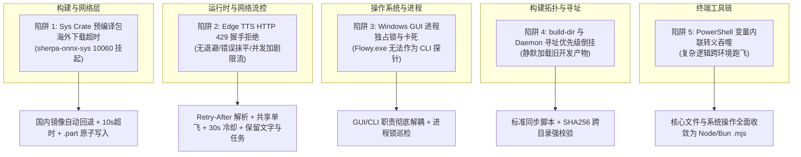

# 语音伴侣实战避坑与经验总结 (Voice Companion Pitfalls & Lessons Learned)

> **发布日期**：2026-10-16  
> **适用范围**：AI Mate (`apps/ai-mate`)、`nomifun-voice-terminal`、`nomifun-audio`、构建与打包流水线及桌面跨层集成。  
> **核心目标**：记录在开发、交付与验证 Flowy 语音伴侣（AI Mate）过程中遇到的五大核心系统级陷阱、根因剖析、解决方案与长效规避准则，供团队及后续研发 Agent 参考。

---

## 1. 踩坑全景图



---

## 2. 陷阱深度剖析与长效规避方案

### 2.1 陷阱 1：Sys Crate 预编译包海外拉取超时 (sherpa-onnx-sys)

#### 现场现象
在干净机器或新拉取分支执行 `bun run dev` 或 `cargo check` 时，构建长时间无响应，最终失败并抛出异常：
```text
thread 'main' (350576) panicked at crates\vendor\sherpa-onnx-sys\build.rs:40:9:
Failed to download sherpa-onnx archive from https://github.com/.../sherpa-onnx-...-win-x64-static-MD-Release-lib.tar.bz2: 
Connection Failed: 由于连接方在一段时间后没有正确答复或连接的主机没有反应，连接尝试失败。 (os error 10060)
error: script "dev" exited with code 101
```

#### 根因分析
1. **硬编码境外 URL**：`sherpa-onnx-sys/build.rs` 直接从 GitHub Releases 镜像下载 C++ 静态库和模型头文件，在缺乏透明代理的国内网络环境下必挂。
2. **缺乏网络超时机制**：`ureq::get` 未设置 `connect_timeout`，操作系统 TCP 连接重试会持续数分钟直至超时抛错。
3. **残余脏文件污染**：下载中断后可能留下 0 字节或不完整的目标文件，下次执行时解包器判定文件已存在却无法解压，造成永久破坏。

#### 解决方案与防线
- **镜像链路容灾**：修改 [`crates/vendor/sherpa-onnx-sys/build.rs`](file:///d:/workSpace/git_clone_test/allo/crates/vendor/sherpa-onnx-sys/build.rs)，新增优先环境变量 `SHERPA_ONNX_BASE_URL`，并默认加入国内加速镜像备用源：
  ```rust
  let mirror_candidates = [
      format!("https://ghproxy.net/{}", base_url),
      format!("https://mirror.ghproxy.com/{}", base_url),
  ];
  ```
- **超时保护**：配置 `Agent` 连接超时为 10 秒（`connect_timeout(Duration::from_secs(10))`），快速故障快速转移。
- **原子临时文件**：下载时统一落盘到 `.part` 临时后缀，下载成功后通过原子重命名转正；发生错误或超时立刻删除 `.part` 文件，绝不留坑。

---

### 2.2 陷阱 2：Edge TTS HTTP 429 握手限流与错误分类抹平

#### 现场现象
用户唤醒并说话，ASR 识别原文完整，LLM 思考完成并输出了文字回复，但扬声器迟迟无声，随后界面弹出“语音合成失败或超时”。
本机日志记录：
```text
2026-10-16T09:02:16.958908Z  WARN nomifun_voice_terminal::tts: edge_tts_handshake_rejected status=429
2026-10-16T09:02:16.960902Z  INFO ai_mate::voice: voice_playback_finished elapsed_ms=1654 ok=false
2026-10-16T09:02:16.961025Z  WARN ai_mate::voice: voice_playback_failed code="tts_failed"
```

#### 根因分析
1. **缺乏流控退避**：上游 Edge WebSocket 在高频调用或出口 IP 共享时返回 HTTP 429。原有代码直接抛出 `SynthesisError`，没有任何退避或重试逻辑。
2. **并发雪崩加剧限流**：当用户快速交互或同时触发提示音与回复时，如果多个连接同时冲击 Edge 上游，会导致服务端限流惩罚时间延长。
3. **错误分类被压扁**：下游将所有非扬声器错误全部粗暴转成 `"tts_failed"`（文案：“语音合成失败或超时”），用户无法判断是扬声器坏了、网络断了还是服务限流。

#### 解决方案与防线
- **结构化错误透传**：
  - 底层：`TtsError::RateLimited { status: 429, retry_after: Option<Duration> }`。
  - 支持解析整数秒与 RFC 2822 / 1123 HTTP Date 两种 `Retry-After` 格式，防止大值溢出。
  - 中间层透传至 `AudioSinkError::RateLimited`，daemon 映射为公开码 `tts_rate_limited`。
- **共享单飞与主动冷却**：
  - 单个 `EdgeTtsProvider` 内使用 `Semaphore(1)` 锁死最大并发握手数为 1。
  - 记录 `cooldown_until`，一旦遭遇持续 429，立即激活默认 **30 秒进程内冷却**。冷却期内发起的新合成请求在本地被立刻拦截并返回 `RateLimited`，不再发送网络包，保护 IP 不被深度封禁。
- **单次预算内最多 1 次重试**：
  - 在 30 秒总预算内，若握手遇到可重试的短暂 429，且尚未流出任何音频帧，严格限制**最多退避重试 1 次**。
- **状态与资产绝对安全原则**：
  - TTS 失败绝不中断当前轮次，**必须保留并完整显示 ASR 识别文字与 LLM 回答文字**。
  - TTS 失败绝不重新调用 LLM，绝不重复提交真实任务，绝不延长一次性工具确认的有效期限。
- **前端清晰双语呈现**：
  - UI 明确区分：`voice.audio.ttsRateLimited` -> “**语音服务限流，回复文字已保留，稍后可继续对话。**” / “**Speech service rate limited. The reply is preserved as text; you can continue speaking shortly.**”。

---

### 2.3 陷阱 3：Windows 进程模型与 GUI 宿主文件独占锁 (Flowy.exe)

#### 现场现象
使用终端或脚本试图通过 `Flowy.exe --help` 探测版本时，命令长时间不返回；随后重新执行 `cargo check` 或 `cargo build` 时报：
```text
Blocking waiting for file lock on build directory
```
或者复制可执行文件时报 `ERROR_SHARING_VIOLATION`。

#### 根因分析
1. **Windows 子系统与入口语义**：`Flowy.exe` 编译目标为 Windows GUI 子系统（非 Console 子系统），且内部集成了完整的 Axum HTTP/WebSocket 运行时与 Tauri 事件循环。它并不支持普通的 CLI 参数快速打印后退出，传入任何参数都会启动后台守护服务并占住端口与控制台。
2. **Windows 独占文件锁**：Windows 操作系统内核不允许直接覆盖正在运行的 `.exe` 和正在被调试器/加载器引用的 `.pdb`。一旦残留的 `Flowy.exe` 进程在后台运行，Cargo 构建和脚本复制都会被彻底阻塞。

#### 解决方案与防线
- **禁止将 GUI 宿主当作 CLI 探针**：
  - 严禁在脚本或自动化流程中以阻塞方式调用 `Flowy.exe`。
  - 若需要自测后台逻辑，统一使用无头 daemon `ai-mate.exe`（支持命令行解析并正常退出）或直接运行专注的集成测试（如 `cargo test -p ai-mate --test full_voice_flow`）。
- **进程生命周期检查**：
  - 覆盖开发目录或启动测试前，执行 `Get-Process -Name Flowy, ai-mate` 检查并清理孤儿实例。

---

### 2.4 陷阱 4：`build-dir` 与 Daemon 寻址优先级倒挂

#### 现场现象
开发者修改了 `apps/ai-mate` 的 Rust 源码并执行 `cargo build -p ai-mate`，终端显示编译成功；但在桌面启动应用后，所有修改均未生效，依然复现旧逻辑。

#### 根因分析
1. **Cargo 自定义编译目录**：根目录 `.cargo/config.toml` 中配置了 `build-dir = "{workspace-root}/build.noindex"`，不同工具链/Target 会将二进制输出到 `build.noindex/x86_64-pc-windows-msvc/debug/` 或直接更新 `target/debug/`。
2. **宿主 Daemon 寻址优先级**：
   桌面应用（Flowy）内部维护了一套严格的优先级探测链：
   `NOMIFUN_BUNDLED_BIN_DIR` -> `resources/bin` -> 相邻可执行文件目录 -> `target/debug/bin/ai-mate.exe` -> `target/debug/ai-mate.exe`。
3. **“改了代码、编了文件，但命中了旧程序”**：如果开发者只在 `build.noindex` 中生成了新文件，但 `target/debug/` 下依然残留着上一次构建的 `ai-mate.exe`，宿主会静默加载旧程序，造成极其隐蔽的“假更新”陷阱。

#### 解决方案与防线
- **开发产物规范化同步脚本**：
  编写统一的更新脚本 [`scripts/update-default-dev-artifacts.mjs`](file:///d:/workSpace/git_clone_test/allo/scripts/update-default-dev-artifacts.mjs)，明确定义从最新构建产物向开发探测目录的同步逻辑，并生成包含 SHA256 与时间戳的留痕文件 [`T5-default-dev-restoration.json`](file:///d:/workSpace/git_clone_test/allo/docs/architecture/voice-agent/execution/T5-default-dev-restoration.json)。
- **双向哈希比对**：
  在验收前，运行 `Get-FileHash target\debug\ai-mate.exe, target\debug\Flowy.exe` 检查哈希，杜绝任何中间状态或 Skeleton 假产物混入。

---

### 2.5 陷阱 5：PowerShell 命令内联转义与跨平台脚本执行陷阱

#### 现场现象
在多 Agent 或自动化会话中，通过命令行调用包含 PowerShell 特殊变量（如 `$_`、`$var`、`$($_.FullName)`）的内联脚本时，经常由于 JSON 序列化、引号嵌套和 pwsh 展开机制冲突，导致变量在执行前被吃空，甚至引发空路径误删或未捕获异常。

#### 解决方案与防线
- **收敛至 Node.js / Bun 脚本**：
  所有涉及复杂文件系统遍历、哈希比对、JSON 读写或配置修正的操作，**一律使用 Node.js / Bun 脚本（`.mjs`）实现**，禁止在命令行中拼装超过两行的复杂 PowerShell 脚本块。
- **PowerShell 管道化**：
  若必须调用 PowerShell，使用明确的单步管道命令（如 `Get-Process ... | Select-Object ...`），保持语法确定性。

---

## 3. 长效防线与研发 Check List

在未来迭代或多 Agent 协作开发中，任何人及 Agent 均须按以下 Checklist 进行自检：

- [ ] **网络构建安全性**：所有拉取外部资产的 build 脚本均需提供国内镜像回退，且连接超时不得超过 10 秒；
- [ ] **三方服务限流防线**：任何调用外部 LLM / TTS 服务的接口，必须设计并发门禁、冷却时钟（至少 30s）与最多一次重试，严禁无限制发起网络重试；
- [ ] **错误表达诚实性**：严禁把明确的 HTTP 状态码（如 429、401、403）和网络故障压制成通用的“服务失败”，必须在 UI 明确提示原因；
- [ ] **文字与任务资产优先**：音频失败只是“耳朵”听不到，必须无损呈现“眼睛”能看到的文字，绝对不能因语音失败去重新派发任务或使工具确认过期失效；
- [ ] **可执行文件身份一致**：修改任何 Rust 后端或 Daemon 后，验证必须核对实际运行文件的 SHA256 哈希，确保未被 `build.noindex` / `target` 优先级倒挂所蒙蔽；
- [ ] **桌面无侵入原则**：严禁在未关闭老进程前强行覆盖二进制，严禁将 GUI 宿主作为 CLI 探针运行。
