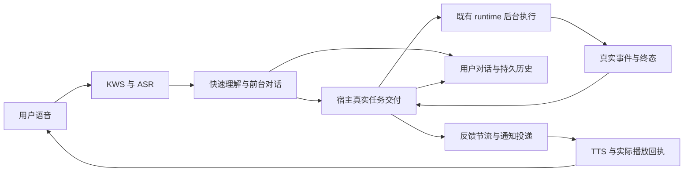
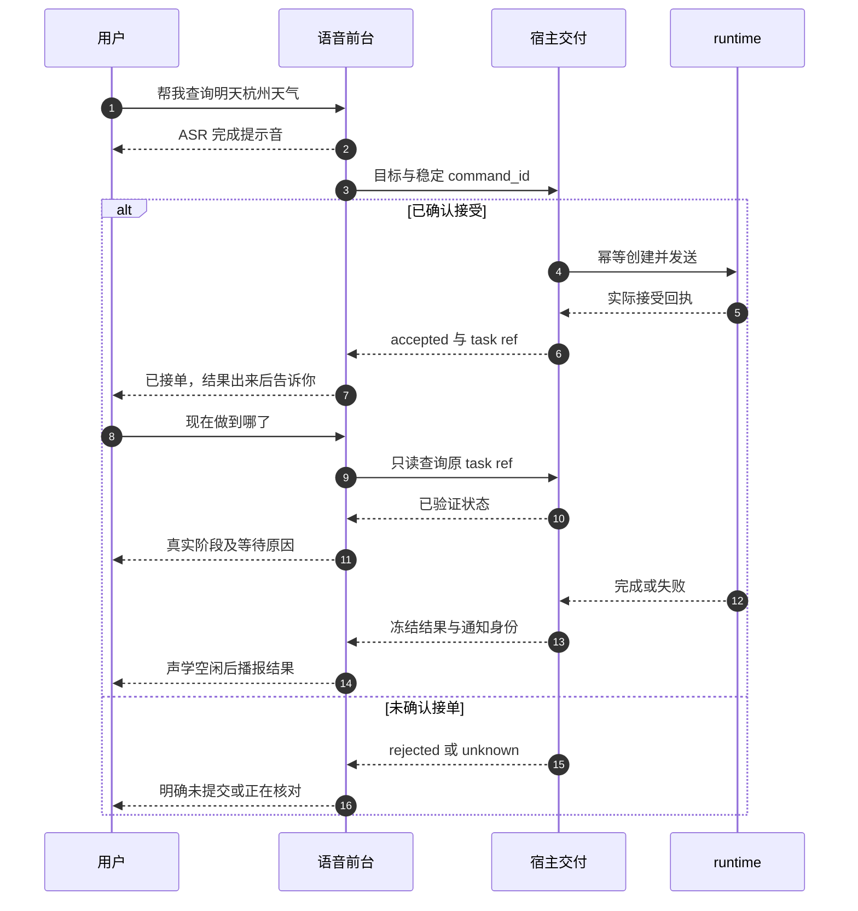

# 快速语音与后台 runtime · 开源调研及离屏交互方案

> **状态**：📋 调研与待实施方案，2026-10-16。核查项目官方文档、配置及部分源代码；未安装或运行这些项目，不能据此宣称完成稳定性验证。
> **核心原则**：保留低延迟前台，真实工作异步交给既有 runtime；及时回应、真实接单、可核对进度、明确等待与可靠结果回传分别建模。

> **执行入口**：后续已整理为 [S0–S9 详细串行计划](voice-fast-front-runtime-execution-plan.zh.md)，含边界、DTO/兼容、失败矩阵与 agent 交接话术。本研究的 Q0–Q5 保留作底稿；实施以 S0–S9 为单一排序，不代表已开始业务修改。

## 1. 背景与核心痛点

用户明确：快速语音层的目的，是 runtime 长任务期间仍能及时回应，尤其照顾不在电脑前的人。此前“所有语音直接走同一 Conversation runtime”的建议会重新引入忙锁与等待，不应作为默认方案。本次修订保留快轨；统一对话归属与落盘，不等于所有生成与执行都必须占用同一个 runtime。

| 现状/风险 | 本轮方案目标 |
| --- | --- |
| 语音短模型自身也可能等到宿主 28 秒截止 | 收到音频和 ASR 完成先有本地反馈，快速理解有独立短预算 |
| 任务提交、执行、模型调用共用“等待”概念 | 接受回执、无响应检测、实际任务预算分别计时 |
| runtime 一直有事件却没有实质成果 | 心跳与业务进度分别记录；总任务期限不被心跳刷新 |
| 用户不在屏幕前，听不到阶段和结果 | 关键阶段说清楚，持续等待有稀疏提醒，结果能重听且不会重执行 |
| 会话合并后前台被后台占用 | 用户会话与执行会话分别绑定，通过任务引用关联 |

### 已核查的开源参考

**cc-connect**：[GitHub](https://github.com/chenhg5/cc-connect)、[配置](https://github.com/chenhg5/cc-connect/blob/main/config.example.toml)、[执行循环](https://github.com/chenhg5/cc-connect/blob/main/core/engine.go)、[用法](https://github.com/chenhg5/cc-connect/blob/main/docs/usage.md)。提供即时收到反馈、流式预览、停止控制；执行循环分别检查事件空闲与单轮墙钟上限。示例建议总执行 30–60 分钟，默认总上限禁用；空闲轮换默认 30 分钟是另一个机制。应借鉴分类，不把它概括为所有 sub-agent 默认 30 分钟。

**LiveKit Agents**：[GitHub](https://github.com/livekit/agents)、[官方后台委派模式](https://docs.livekit.io/agents/logic/patterns/subagent-delegation/)。明确采用快速对话模型与后台推理模型，非阻塞更新后继续会话，结果空闲后回传；示例等待反馈为 5 秒开始、10 秒间隔、最多三次。这是示例参数，不是 Flowy 必须照搬的标准。我们借鉴非阻塞、有限反馈与重复委派保护；真实已接受文件任务不随用户换话题自动取消。

**OpenClaw**：[GitHub](https://github.com/openclaw/openclaw)、[启动与回传](https://docs.openclaw.ai/tools/subagents/slash-command)、[工具参数](https://docs.openclaw.ai/tools/subagents/tool-reference)、[恢复与停止](https://docs.openclaw.ai/tools/subagents/operations)。异步启动返回 run id，完成推回请求方；等待超时和执行超时独立，runTimeout 可按任务配置。投递入队不代表送达，恢复与取消保留原执行身份，不应因读不到结果重复启动。

**Temporal**：[开源仓库](https://github.com/temporalio/temporal)、[官方超时与心跳语义](https://docs.temporal.io/encyclopedia/detecting-activity-failures)。区分排队等待、单次执行、整体预算和心跳超时；只借鉴语义，不引入 Temporal 服务/SDK、数据库或调度框架。进程/传输活跃不等于取得业务进度，用户可见进度仍需应用层事件。

参考均为调研当日可读的 main/官方页面，可能随上游演进；实施前应将实际采用的源码片段钉到 commit，核查许可证。本轮只提出模式，没有复制实现。

## 2. 方案全景与架构设计

daemon 拥有声学、快轨与播放；宿主拥有会话目标、原文/回复持久记录、交付、任务状态、通知和时间策略；runtime 继续拥有执行、工具策略及唯一审批权威。前台不是第二个工具执行器，不和后台同时回答尚未取得的事实结果。

### 与前几轮会话建议的合并

- 仍采用“符合资格的当前会话优先，否则独立语音默认会话；宠物可选绑定”，不要求创建宠物。
- 区分 `dialogue_conversation_id`（用户交谈/查阅入口）、可选 `context_conversation_id`（项目上下文来源）和 `execution_conversation_id`（实际工作承载）。同一逻辑任务只对应一个真实执行身份。
- 首版复用当前专属语音执行 Conversation，向用户会话投影任务卡、进度和结果链接；长任务不会占用快速对话。优先打通该路径，不先给共享项目/宠物 runtime 加复杂并发。
- 快轨聊天落盘需要 Conversation 域提供受信任、幂等的外部轮次记录入口；只记录已有生成结果，不调用 send 触发第二次 LLM。当前尚未实现此入口。不能从语音代码直接拼数据库，不能向正在运行的项目会话任意插入历史使其上下文漂移。忙碌情况下先使用独立语音对话并关联项目，待运行结束再由正式接口写入允许的摘要/链接。
- 项目上下文先提供有界必要快照，避免把全部历史和工具输出塞入快轨；工作区与执行模型经宿主解析，不由快轨 LLM 或 daemon 任意指定。

非目标：本轮不增加并行子 agent、自动恢复副作用、多任务队列、额外 runtime 或 OS 语音回退。未来需要多子任务编排时，应复用项目已有 `nomi_delegate` / Agent Execution 能力，并先验证继承语音限制；当前语音执行禁用委派，不在本方案中直接放开。

## 3. 核心设计与模块规范

### 3.1 真实交付与话术

“已听到”在音频/ASR 事实成立时即可反馈，不需要 LLM；“理解为……”只有有有效理解结果后才说；“已接单”必须有后台接受回执。提交超过前台等待预算时说“还在核对是否接单”，沿原身份查询，禁止换 id 重发。没有依据不说预计几秒、快好了或完成百分比。

### 3.2 离屏反馈规则

| 场景 | 声音与文字 |
| --- | --- |
| 开始倾听 | 既有唤醒/Listening 提示，不要求盯屏幕 |
| 用户说完、进入识别/理解 | 一次 ASR 完成提示；短时间未完成才提醒正在理解 |
| 缺少城市、文件或目标不明确 | 快轨问一个必要澄清问题，不提交猜测任务 |
| 已接受 | 一句目标摘要＋接单状态；慢任务说明可以继续交谈、查询或取消 |
| 有重要进展 | 基于实际工具/阶段事件说简短进度，不逐个朗读工具调用 |
| 长时间没有新业务进度 | 说明正在等待什么；只知道连接状态时明确“暂未收到新进展” |
| 需要确认 | 播实际操作摘要并进入既有受限审批；到期不延长 |
| 完成/失败/取消 | 播简短结论；保留全文、证据与详情入口 |
| 用户说“再说一遍” | 重播已保存结果，不再次调用任务 |

建议任务接受后 15 秒仍未结束时进行第一次必要等待反馈，之后同类提醒至少间隔 30–60 秒，连续相同提醒最多两次；重要变化、确认、终态和用户主动查询不受相同文案限制。上述为待验收初值，不是已达性能。阶段快速跳转要合并提示，终态覆盖过期进度；用户讲话或助手播报期间不插播，不将过期提醒排成长队。

首期保持当前半双工。不能因前台模型保持可用就宣称支持播报中全双工打断/AEC。TTS 限流时保留文字和待听结果，不把它转成任务失败；模型故障也不应阻止宿主对已接受任务进行只读查询或显式取消。

### 3.3 分层时间与健康状态

以下是建议参数和处理规则，必须测试和采样后决定，不是开源项目的统一默认：

| 时钟 | 建议初值 | 到期语义 |
| --- | --- | --- |
| ASR 结束反馈 | 状态事件后尽快；目标 300ms 内入播放队列 | 不等 LLM，不保证包含物理排队的首音延迟 |
| 快轨语义回复 | 目标 ASR 完成后 1–3 秒；建议总预算 8 秒 | 超时明确失败/询问重试；不得假称已接单 |
| 提交回执前台等待 | 3 秒 | 转 unknown 并核对原幂等回执；不表示取消或任务失败 |
| 任务状态活性 | 内部检查约 10 秒，30 秒无新状态即核对 | 不凭无事件直接停止工具；不能把声音提示当心跳 |
| 长时间无业务进度 | 90 秒进入疑似停滞提示 | 活性尚在则说明等待；活性无法确认则显示状态未知，不假称仍在执行 |
| 任务总预算 | 首版普通语音任务建议 30 分钟，从真实 Accepted 计时 | 请求 runtime 取消，保持 cancelling/截止已达直到真实停止或核对；心跳不重置 |
| 实际工具确认 | 沿用最多 8 秒听取且不超过授权到期 | 播放或等待不延长授权，失败关闭 |

工具调用自己的 timeout、任务总预算、声学 6 秒/4 秒窗口和 TTS 网络预算继续独立。30 分钟预算包含审批等待，后续用户明确延长才更新 deadline，不因继续聊天自动延长。不能对共享宿主进程照抄“超时后 kill 整个进程”：应先取消精确任务/turn，无法确认终止就反馈未知，保留原身份，避免执行一半又被重复重跑。

建议宿主分开维护：`last_runtime_event_at`、`last_meaningful_progress_at`、`deadline_at`、`cancel_requested_at`、最近已验证状态。任务控制状态、观察健康状态、通知状态不要塞进同一个 running 布尔值。不为没有 runtime 心跳支持的长工具伪造心跳进度。

### 3.4 完成回传与幂等通知

当前 `notify_task_result` 在发送前持久化 `announcement_claimed=true`，仅特定 409/503 明确退回；这偏向防重，不能证明用户听到了。应将执行终态与结果通知分别记录：执行成功 → 文字结果已保存 → 通知准备/已交给 daemon → 实际播放完成或失败/未知。

宿主生成稳定通知 id，daemon 去重并提供该 id 的播放状态核对；丢响应先核对，不盲播。跨崩溃不能承诺物理声音严格 exactly-once；状态未知保留未确认通知，供用户查询/手动重听，避免自动多次打扰。TTS 失败只改变通知状态，不重跑 runtime。

接口沿用 `/api/voice/companion/tasks`、查询/取消/确认及现有快照事件，按需增加可选字段与内部通知回执；HTTP DTO 留在 `nomifun-api-types`。新增字段须兼容已有交付 JSON，旧记录通知不确定时不能自动重发副作用。持久化仍复用现有文件/Conversation 能力，不新增数据库表。

## 4. 关键决策与权衡

| 决策 | 理由 |
| --- | --- |
| 保留快速语音层 | 与用户保持交互是产品目标，慢 runtime 不能占住前台 |
| 用户会话与执行会话关联而非强制同一 id | 统一阅读与配置，不牺牲长任务期间的响应能力；优先复用现有执行隔离 |
| 首版一个后台任务，不上多 agent 编排 | 当前瓶颈是真实交付、进度和回传；新增并行不会自动减轻焦虑 |
| 提示音和状态话术优先由事实事件触发 | 无需每次花一次模型调用来证明活着，减少延迟与费用 |
| 总预算与无事件检测独立 | 防止永久占用，也避免把安静但正常的工具误杀 |
| 结果落盘与播报送达分开 | 避免“后台完成但用户没听到”被误记为全链路完成 |

## 5. 串行实施与验收

| 切片 | 完整纵向场景 | 必须证据 |
| --- | --- | --- |
| Q0 | ASR 后迅速反馈，快轨失败能说明 | 慢/无响应模型回放；不产生假接单；原文保留 |
| Q1 | 真实任务接受后前台仍可聊天和查询 | 随机文件真实读取；create/send 各一次；受控长任务中至少一轮快聊和真实查询 |
| Q2 | 不看屏幕也知道阶段和卡点 | 真实阶段事件/无进展路径；提示节流、静默、合并及不抢讲话回归 |
| Q3 | 总预算到期、取消、重启核对 | 暂停时钟测试 30 分钟；持续心跳不绕过 deadline；不能确认停止不报 cancelled；重启不新身份重发 |
| Q4 | 完成但 TTS 失败/丢响应后仍能取回 | 文本已保存、通知状态独立；核对/重听不触发第二次任务；无迟到插播 |
| Q5 | 默认语音/当前项目/宠物的统一查阅 | 无宠物可用、显式单一绑定、历史有来源和任务链接；忙碌会话不被外部写入扰动 |

每片先失败测试再实现；跨生产 worker、宿主 API、真实 runtime 和通知接口。快轨 mock 与 runtime 真实工具必须明确区分，之后运行受影响 Rust/UI 检查，再联合构建，最后交 Owner 做物理声音与离屏验收。性能以时间戳和采样报告核对，不把目标当实测结果。

## 附录：30 分钟的区别与本地证据

cc-connect 当前配置/用法分别列出：`reset_on_idle_mins=30` 是用户长时间无交互后下一条消息转新会话；`idle_timeout_mins` 是事件间空闲，示例默认 120 分钟；`max_turn_time_mins` 是不被事件重置的总上限，示例默认禁用并建议 30–60 分钟；cron 默认等待 30 分钟、部分适配器也有自身 timeout。不同场景不能互相替代。本方案不照搬语音长期记忆的 30 分钟自动换会话。

本地代码核查：

- `voice_dialogue.rs` 的宿主 28 秒补全截止与 `completion.rs` 的 daemon 30 秒 HTTP 预算，属于短补全调用，不能拿来当后台总任务预算。
- `voice_tasks.rs` 的 `VoiceTaskRuntime` 已有 create/send/observe/cancel/confirm，持久交付记录保留两个幂等键及真实身份，可继续复用。
- `voice_companion_manager.rs` 已有后台读取与完成通知，`notify_task_result` 的预先 claim 行为需补充通知回执核对，而不是直接删掉防重。
- `nomifun-ai-agent` 已有宿主 `nomi_delegate` 接线；本次不开放语音委派权限，不构建另一套 sub-agent 引擎。

前文方案历史完整保留：[会话绑定探索](voice-conversation-binding-proposal.zh.md)、[任务超时诊断](task-dispatch-diagnosis-2026-10-16.zh.md)、[原接口契约](voice-runtime-api-contract.zh.md)。本文件依据用户新增目标修订推荐方向，不表示已经实施或通过真机验收。
