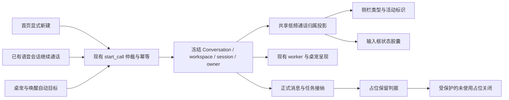
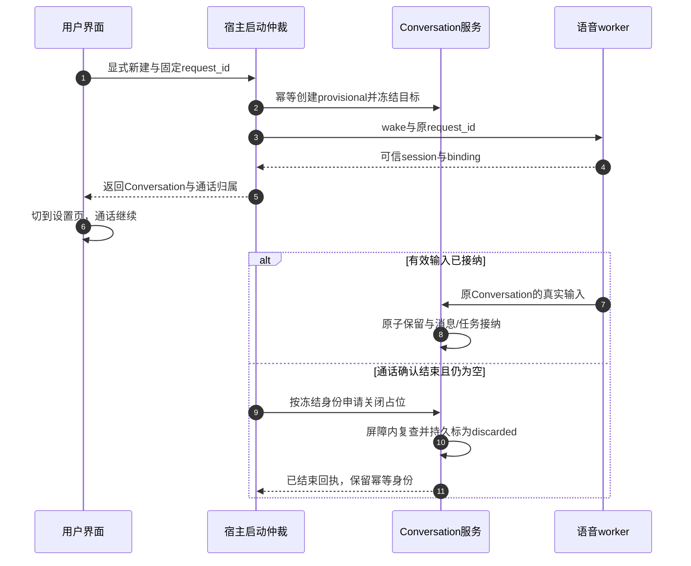

# 语音通话入口、状态胶囊与会话生命周期 · rev3 执行方案

> **2026-10-24 实施及复审修复更新**：已进入业务实施，当前工作树包含原实施和独立复审修复。内部新建 DTO 增补模型/预设引用，保留后发布复用指针，宿主根据可信终态与页面上报清理空占位；不使用公开 `discard_empty` 端点。以 [最新代码事实与验证](voice-ux-rev3/REPAIR-VERIFICATION-2026-10-24.zh.md) 为当前入口，本文以下“待实施”及示例 DTO 保留为原方案历史。未提交、未推送；不是 24 项全部签核。

> **状态**：📋 方案已更新，待执行 Agent 实施；本文不代表业务已实现。
> **核查日期 / 代码基准**：2026-10-24，`feat/voice-next`，`4aca4cd11333a0d4151d03fb8941186c1017462b`。
> **核心原则**：列表说明“是什么、哪一通在进行”，输入框说明“现在能做什么”；切换页面不等于挂断，通话结束不等于取消任务。
> **执行入口**：[可复制任务书](voice-call-ux-rev3-agent-brief-2026-10-24.zh.md)。本轮只更新文档；接管时已有 `voice-ux-rev2/PROGRESS.md`、`RESULTS.zh.md` 外部修改，未覆盖。
> **优先级**：本文替换 rev2 的最右侧固定类型标记、底部 footer 状态、首页文字标签和首页复用语义；其余消息隔离、审批、队列、unknown 恢复、历史重置屏障全部继承。旧文档原文保留。

## 1. 背景与已核实事实

面向使用中文或英文、通过桌宠和会话进行本地语音通话的用户。目标是降低界面拥挤，同时保证通话与工作区、消息、任务的真实归属。

| HEAD 的实现 | 本轮目标 |
| --- | --- |
| 首页 `GuidActionRow` 显式渲染电话旁文字 | 仅电话图标，tooltip/aria 完整双语 |
| `VoiceComposerStatus` 通过 `SendBox.footer` 另占底部一行 | 输入框左上角紧凑圆角状态胶囊；普通状态不占底部一行 |
| `ConversationRow` 用 `Voice` 麦克风，更多菜单为其右移让位 | 标题左侧声波类型标识，右侧只有一个固定更多操作槽 |
| 类型标识无独立点击逻辑，点击冒泡到整行导航 | 明确为非按钮；不暗示可直接接听/挂断 |
| 侧栏没有可信 active-call 归属属性 | 唯一活动行有持续标识，浏览其他页面也不丢失 |
| 首页有活动通话时返回该通话；空闲时工作区复用约 30 分钟 | 有通话时明确“返回通话”；无通话时首页显式创建新的语音会话 |
| 默认工作区使用固定 creation key，非 30 分钟轮换 | 首页新建同时覆盖默认/项目工作区，不误改唤醒的现有复用规则 |
| 启动先创建 Conversation 再唤醒 worker | 需要受保护的未使用占位生命周期，不能按“没回复”直接删除 |

核查依据为附录 A 的源码。悬浮卡片与菜单竞争是代码结构风险，尚未在本轮原生界面复现；不将风险描述成已验证的运行故障。

## 2. 架构、范围与不变量



- 保留一个系统活动通话；启动中的 reservation 也占用槽位。未知结果先核对，不允许第二通抢占。不得自动挂断 A 来启动 B。
- 可信身份为宿主的 instance、request、session、binding、Conversation；选中行、会话名称、RMS、任务忙碌均不能证明通话归属。
- 正式消息、历史分页、任务回执仍使用共享 Conversation 链路；本轮不建立语音专用消息存储。
- 新会话 YOLO 缺省和用户显式选择/有效偏好优先级维持既有服务合同；旧会话不覆盖模式。模型和预设来自已有会话创建权威来源，不增加语音独立配置。
- 范围包含 UI、最小启动 DTO/宿主接线、占位接纳边界与测试。不增加依赖、数据库 migration、权限模式、agent harness、ASR/TTS 模型、流式字幕或生产 AEC。
- 当前生产无已接通 AEC，不显示“说话即可打断”之类承诺；动效不能冒充全双工或真实音量。

## 3. 设计合同

### 3.1 侧栏：类型在左，操作在右

```text
静止语音行   [声波] 会话标题…… [固定操作槽]
悬浮或聚焦   [声波] 会话标题…… [⋯]
当前通话行   [活动声波] 标题…… [⋯ 按需出现]
```

1. 优先使用已安装 `lucide-react` 的 `AudioLines`；不引入图标包。声波 14–16px，无圆形按钮背景，无按压反馈，无单独 tab stop。点击仍由整行导航，不启动/停止通话；中英可访问名称区分“语音会话”和“通话进行中”。
2. 声波占固定左槽；普通行保持原有布局。语音行原生成转圈与类型标识合并到同一槽：通话归属优先，执行状态在既有任务区域可见，不能叠两个同等动画。置顶/能力元数据限宽，既有错误/待审批提示不可被无条件删除。
3. 更多操作右槽固定宽度，悬浮不改变标题宽度。desktop hover、`focus-within`、菜单打开时可见；触屏常显。操作使用真实 button，支持 Enter/Space，Escape 关闭并恢复触发器焦点，点击不触发行导航。
4. 活动声波在 hover、focus、menu、改名、置顶及折叠状态下保留。减少动态效果时使用静态连线/连接点及可访问文案，不能只靠颜色。未选中的活动行仍可辨识。
5. 语音行标题采用省略号，完整名称用单一 tooltip；停止 hover 跑马灯。菜单打开或操作槽交互期间关闭/抑制整行 hover card 和重复 tooltip；不修改普通行 hover card 行为。不得只靠更高 z-index 叠弹层。
6. 折叠侧栏保留声波与已有菜单入口；批量模式优先选择操作，不与更多按钮重叠。搜索、项目子列表、置顶区凡复用 row 的入口一致。虚拟列表复用行不得残留另一行的活动标识。
7. 列表在上层消费共享的低频归属投影，只传稳定的 `isCallActive` 等最小属性；不逐行订阅 voice snapshot，不逐行查库，不随 RMS 全列表重渲染。外部 Conversation 未加载时显示可恢复的返回入口，不猜测选中行就是通话。

### 3.2 输入框左上角状态胶囊

- 在输入框左上沿内侧设置一枚紧凑圆角胶囊，建议高度 28px，图标 14px、文字 12px；复用 SendBox 最小可选 slot，普通输入框不产生空白占位。
- 胶囊参与布局，给正文保留足够顶部间距；可用小幅入场位移，不能绝对定位盖住首行、技能 chip、长英文或输入法候选区域。容器内不裁掉 focus ring / 展开层；不覆盖原有工具按钮。
- 状态文字见下表；不重复工作区路径、UUID、调试信息和长任务说明。普通胶囊是 `role=status`，不是空菜单；只有真实队列、错误/unknown 恢复才有独立详情按钮。审批必须直接可见并复用可信操作，不能藏进 hover。
- 主键继续遵守现有“停止执行 > 发送草稿 > 通话/挂断”优先级；当大主键被停止/发送占用，保留一个可达的小红色挂断。挂断只结束匹配通话，不取消后台任务；不能借这次视觉调整移除审批、逐项取消、核对状态和历史重试。

| 可观察状态 | 中文 / 英文 | 表现与操作 |
| --- | --- | --- |
| 尚未加载、快照失败 | 正在同步 / Syncing；连接不可用 / Connection unavailable | 不显示“未通话”或“正在听”；提供现有恢复动作 |
| 请求发出、binding 未就绪 | 正在连接 / Connecting | 固定大小进度动效，沿用同 request_id 查询/重试 |
| 可信绑定的 listening / follow_up | 正在听，请说话 / Listening | 小幅声波节奏；不是实际电平计 |
| transcribing / deciding | 正在识别 / Transcribing；正在思考 / Thinking | 切换图标/文案，不把识别当实时字幕 |
| synthesizing / speaking | 准备播报 / Preparing audio；正在播报 / Speaking | 仅实际 Speaking 显示播放状态；无 AEC 时不提示可插话 |
| text_follow_up 或声学未就绪 | 可输入文字 / Type to continue | 不承诺麦克风可用 |
| 审批 / unknown / task busy | 复用现有任务状态文案 | 任务状态与声学状态分开；任务忙时仍可 listening |
| 另一 Conversation 通话中 | 另一会话通话中 / Call active elsewhere | 明确“返回通话 / Return to call”，不启动第二通 |
| 无活动通话 | 未通话 / Not in a call | 语音行类型仍在；胶囊可收起，保留电话主键 |

交互动效沿用 DESIGN：120ms 按键反馈、180ms 状态切换、240ms 入场，只用 opacity/transform；无弹跳/荧光。状态变化才播报辅助技术文本，不随音量触发 aria-live。侧栏只传达归属，详细阶段由胶囊承载，桌宠沿用现有耳机 badge 与动作映射，不叠加三处强动画。

### 3.3 三种启动意图及冻结规则

| 入口 | 无活动通话 | 已有活动/启动未决 |
| --- | --- | --- |
| 首页电话图标 | 在明确选择的项目或默认工作区新建一通，不能复用旧历史 | 图标 tooltip/aria 改为“返回通话 / Return to call”，返回 A；不悄悄创建 B |
| 已有语音 Conversation | 在本 Conversation 继续；不用 30 分钟规则改换目标 | 本通话返回；别处通话显示返回动作，不自动切绑定 |
| 桌宠/托盘/快捷键/KWS | 保持现有自动目标与工作区复用；当前可用工作区优先，无候选才按既有默认规则 | 返回已有通话/核对启动结果，不抢占 |

首页无草稿时只显示一个电话图标；有草稿按现有发送主键处理。不得把未发送的首页草稿悄悄转换成语音消息；返回通话保留首页草稿。

**最小契约改动**：在现有 `VoiceCallTarget` 增加一个显式新建变体，例如 `NewVoiceConversation { workspace: Option<String> }`，TS 镜像 `kind: 'new_voice_conversation'`；`null` 指默认工作区。名称可遵项目惯例，三种意图语义不能合并。保留现有四个变体的行为，不全局改变 `ensure_default_voice_conversation`。

- 新变体先仲裁活动/未决通话，再创建；相同 request_id 必须得到相同 Conversation，不使用时间戳作为唯一创建身份。新变体、工作区、mode 等全部参加冲突比较。解析后的 canonical workspace、owner、模型/预设、模式均冻结；重试不重新读取首页选择。
- creation key 包含 user 与原 request_id，服务端验证 owner/工作区，不能从前端 extra 授予权限。工作区失效明确拒绝，不静默转默认。首页选择后切页、切模型、切项目不能改变已接纳请求。
- 全局活动通话身份由宿主决定。没有快照、binding 不匹配或启动 unknown 时，不以 UI 的“空闲”触发无条件新建。
- “返回已有通话”属于用户可见语义；tooltip/aria 必须随状态变化，不再用“开始通话”图标提示表达返回动作。

### 3.4 占位生命周期与安全关闭

**保留判据是有效输入被接纳，不是 LLM 已回复。** 任何已落盘用户消息、被接受任务、审批、键盘发送、用户主动改名/编辑，都必须保留。模型失败/无回复也保留。噪声、`ignore` 和纯 listening 不生成正式问答，继续既有倾听超时。

| 状态 | 转移条件 | 后果 |
| --- | --- | --- |
| provisional，未使用占位 | 显式首页新建成功 | 有稳定 Conversation ID，可进入页面；不替换已保留会话的自动复用指针 |
| retained，正式保留 | 任一保留判据已接纳 | 不可逆；沿现有消息/任务/历史路径继续 |
| ended-empty，已结束但仍为空 | 可信通话终态，所有在途输入/投影/接纳已确认结束 | 同页可保留结束状态；重新打电话使用新的显式请求 |
| discarded，已关闭占位 | ended-empty 且已离开该页面，服务端再次原子复查为空且无任务/审批/未决写入 | 从正常列表与自动选取排除；旧请求返回已结束，不重建 |

1. 路由离开只记录“已离开”，绝不自动 stop。去设置检查麦克风、浏览其他会话时继续通话；晚到的 ASR/键盘/任务接纳仍落到原 frozen Conversation。保留现有静默超时，禁止另加一个短导航计时器。
2. 清理由宿主/服务执行，不依赖组件 unmount 请求成功；按 user + creation key/request + Conversation + session 核对，并复用现有接纳/删除屏障。只检查前端数组或“消息数 0”不够；检查和关闭之间不能插入一次合法写入。
3. 为防止删掉 creation-key 后旧请求重试复活，本轮默认采用**逻辑关闭**：在现有 `extra` 保存仅用于该新建分支的最小生命周期身份/终态，保留空壳及幂等键；列表查询和自动目标解析在服务端排除已关闭占位，分页计数一致。不创建假聊天行，不新增通用软删除框架，不在前端过滤一页了事。
4. `discarded` 是持久终态，后续 send/append/resume 明确拒绝；旧 request_id 返回已结束而非重新创建。服务重启、缓存 128 项淘汰后仍成立；内存 `handled_start_requests` 不能作为持久终态唯一证据。物理回收不在本轮范围。
5. 状态字段缺失的旧 Conversation 按既有正式会话处理，不能追扫历史空会话。新字段随既有 extra 读写，不清空其他字段；若现有 repo 无法安全完成持久终态/查询排除，记录阻断，不自行引入 migration。
6. 断线/发送结果 unknown/worker 重启并不能证明已结束；先查真实回执/日志，不清理。崩溃后只恢复已证实状态；不能凭超时直接丢弃输入。未结束 reservation 同样受保护。
7. 保留后按当前合同发布复用指针；未使用关闭不能覆盖或误删此前保留的默认/项目会话。活动通话的手工删除先要求挂断；改名、导出、查看仍可用。挂断后的后台任务阻止占位关闭。



## 4. 决策与取舍

| 决策 | 采用 | 不采用及原因 |
| --- | --- | --- |
| D1 类型标识位置 | 左侧固定声波，右侧单 More 槽 | 右侧波纹 hover 消失：当前通话提示会消失；再加点会增加一套规则 |
| D2 胶囊交互 | 普通只读状态；有内容才展开 | 每种阶段都做可点击空菜单：虚假可操作性 |
| D3 多通话 | 单通话，返回/核对原通话 | 自动抢占、排队接通或同时监听：引入跨会话路由风险 |
| D4 创建语义 | 首页显式新建；已有行续聊；自动入口继承 | 所有入口一律 new 或复用：不能满足用户任务意图 |
| D5 页面导航 | 通话继续，结束后再处理空占位 | 离页自动挂断：设置/查看资料会中断输入 |
| D6 占位关闭 | 接纳即保留；持久关闭空占位保留幂等键 | 等助手回答才保留或立即硬删：会丢输入或重试复活 |
| D7 动效 | 胶囊阶段、列表归属、桌宠动作各司其职 | 全列表跟随音量动画：噪声与重渲染成本，暗示错误能力 |

## 5. 执行顺序与验收

一个执行 Agent 串行完成，不设置阶段人工确认。只有用户进一步授权才 commit/push/切分支。

| 阶段 | 工作 | 出口 |
| --- | --- | --- |
| V0 | 核对 HEAD/dirty、调用方/服务接纳与 extra 查询能力，复跑基线；为缺失的新语义加行为反例 | 开工回执 ≤10 行；保存 RED，记录原生测试可用性 |
| V1 | 新建/续聊/自动目标，冻结、幂等、未决仲裁，生命周期与服务端列表排除 | LC-01–12 的真实服务/数据库用例；不能只 mock resolver |
| V2 | 上层通话归属投影、左声波右 More、键盘/触屏/菜单互斥 | UI-01–06；避免每行快照订阅 |
| V3 | 首页 icon-only、左上胶囊、控制接替、桌宠回归 | UI-07–12；不减少原审批/队列能力 |
| V4 | 双语/主题/减少动效、完整回归、构建、文档事实和证据 | 24 项验收逐项注明通过/未通过/受限；不以单测替代原生画面 |

### 5.1 验收矩阵

| 编号 | 操作 / 必须断言 |
| --- | --- |
| LC-01 | 首页无活动连续两次开始并结束、均有有效输入：不同 Conversation；默认和项目各测一次 |
| LC-02 | 同 request 并发/响应丢失重试：一个 Conversation；改变目标/模式等冻结参数明确冲突 |
| LC-03 | 已有语音行继续使用原 ID；桌宠/KWS/托盘/快捷键仍用原自动目标；项目候选不串默认 |
| LC-04 | A 活动/启动未决，首页或 B 请求：不创建额外行、不自动停止 A；unknown 沿原请求核对 |
| LC-05 | 切页/切工作区/切模型后迟到 ASR：原 frozen Conversation 落盘，B 不出现 A 消息 |
| LC-06 | 无输入离页：不挂断；可信静默终态后关闭空占位；仍在原页先保留结束态 |
| LC-07 | 有效输入已接纳但 LLM 失败/无回答，以及键盘发送/改名：一律 retained，不清除 |
| LC-08 | `ignore`/噪声继续听且无正式上下文污染；真实任务/审批/unknown 阻止关闭 |
| LC-09 | 关闭与 append/send/task 同时竞争：只能“接纳成功并保留”或“先关闭并明确拒绝”，无已接受数据丢失 |
| LC-10 | 重启、receipt 缓存淘汰、旧 request 迟到：关闭身份仍终态，旧请求不重建，不误关新通话 |
| LC-11 | 新字段缺失旧会话不被扫；关闭占位后列表分页/计数/搜索/自动目标一致，原保留指针仍有效 |
| LC-12 | 显式模式/有效偏好/YOLO 缺省、owner、workspace 失效、当前模型/预设创建来源均不回退 |
| UI-01 | 声波在左且非按钮；类型点击仅导航，More 点击只开菜单，图标不出现第二个通话操作 |
| UI-02 | hover/focus/menu 切换时标题/槽位不跳；长名、省略号、置顶、执行状态、能力标识不重叠 |
| UI-03 | 键盘打开/关闭/焦点恢复、触屏常显、批量与折叠可达；菜单和整行 hover card 不叠弹层 |
| UI-04 | 活动行在未选中、改名、重启恢复及虚拟行复用后身份正确；无绑定时不猜当前选中行 |
| UI-05 | RMS 连续变化不重渲染全部 row；活动归属改变只影响必要行，不能按音量订阅每行 |
| UI-06 | 活动通话手工删除受保护；查看/改名正常；挂断与任务取消独立，A 的迟到控制不作用 B |
| UI-07 | 首页 icon-only；双语 tooltip/aria 随 Start call / Return to call 变化；草稿不丢、不自动发送 |
| UI-08 | 左上胶囊不占旧底部状态行、不遮首行/技能/工具，普通会话没有空胶囊区域 |
| UI-09 | syncing/connecting/idle/active elsewhere 明确区分；合成中不冒充播放，任务忙不冒充麦克风忙 |
| UI-10 | 普通胶囊没有空展开；审批可见，队列逐项取消、unknown 核对、真实错误/历史重试和小挂断均可达 |
| UI-11 | 中英、明暗、最窄支持宽度、100/125/150% 系统缩放与减少动效布局合理；不靠颜色区分活动态 |
| UI-12 | 通话强制临时显示正确 owner 桌宠，沿用耳机/动作/透明首帧与保存位置；结束后恢复原偏好，不开旧调试窗 |

### 5.2 验证阶梯与本轮真实基线

2026-10-24 本轮实跑：**157 pass / 0 fail / 1213 expect calls，20 files，4.86s，exit 0**。原始日志位于忽略目录 `build.noindex/voice-workspace-display-review/ux-rev3-plan-baseline-20261024.txt`，不作为必须跨机器存在的依赖。

在 `ui/` 运行的完整命令：

```powershell
bun test src/renderer/pages/voiceSession src/common/adapter/voiceCompanion.test.ts src/renderer/pages/conversation/platforms/nomi/nomiSendBoxDispatch.test.ts src/renderer/pages/conversation/platforms/nomi/resetSingleFlight.test.ts src/renderer/pages/conversation/SessionList/ConversationRow.structure.test.ts src/renderer/pages/conversation/SessionList/ConversationRow.voice.test.tsx src/renderer/pages/conversation/SessionList/utils/sessionCapabilityItems.test.tsx src/renderer/pages/conversation/SessionList/hooks/useConversationListSync.test.ts src/renderer/components/chat/ComposerSubmitCluster.behavior.test.tsx src/renderer/components/chat/ComposerSubmitCluster.structure.test.ts src/renderer/pages/settings/VoiceSettings.structure.test.ts src/renderer/pages/settings/VoiceDialogueStatus.test.tsx src/renderer/pages/nomi/workspace/tabs/OverviewTab/OverviewModelPolicy.test.ts
```

实施 Agent 在 V0 核实下列仓库命令和包名再执行，**本次文档更新没有重跑这些检查**：

1. 受影响前端行为测试及上面的 157 项；新增主观样式不能只靠源码字符串断言，需真实组件事件/布局证据。旧 footer/右标记结构断言可按本文迁移，附行为覆盖映射，禁止删掉安全场景。
2. `cargo test -p nomifun-conversation voice_ --lib`、`cargo test -p nomifun-app --lib voice_ --no-default-features`，另按实际服务模块选择真实 SQLite/接纳竞态集成测试；filter 必须命中新测试，0 tests 不合格。DTO 变更补序列化/全部调用方检查。
3. `bun run typecheck`、`bun run gen:i18n`、`bun run check:i18n`、`bun run check:theme`、`bun run check:icons`、`bun run check:button-layout-contract`、`bun run check:motion`、`bun run build:ui`；受影响 Rust 编译/格式及 `git diff --check`。其他仓库门禁按变更范围补齐。
4. 61 项 TS 错误只是此前记录，本轮未重测，必须重新保存同环境基线并比较差集；不把全仓 typecheck 失败称全绿。
5. 系统/Tauri 界面检查承担原生首帧、DPI、透明与桌宠联动；Web 只验证共享布局，不签核桌面音频。能由代码注入可控音频/worker 的场景由 Agent 自动完成，不等待用户录音；没有运行能力就明确未签核，不伪造截图或物理效果。

反向验证至少覆盖“首页错误复用旧会话”“关闭与迟到接纳竞态”“More 事件冒泡/菜单互斥”，保留修复前 RED 和修复后 GREEN。不 skip/todo、不弱化断言、不 mock 被测业务链、不修改检查器/CI、不用 `|| true` 掩盖失败。

## 6. 地界、交接与未签核边界

- 白名单：GuidPage/GuidActionRow；SendBox 的最小 slot；ComposerSubmitCluster；NomiSendBox 与 voiceSession；SessionList 行/上层接线/相关工具；现有 voice presence 与桌宠必要只读投影接线；voiceCompanion adapter / API voice DTO；app 的 voice_companion_manager、voice_dialogue、voice_tasks 中接纳/清理校验；Conversation service 与其现有 repository 的 creation-key/extra/列表过滤必要改动；对应测试/locale/generated keys；本域文档。只为本轮合同改动，不能顺手重构整个列表或 Conversation。
- 数据库 migration、auth、agent harness、依赖/lock、release、用户真实数据不在白名单。需要越界写入 `BLOCKED.md`，继续独立项；不盲目降级安全合同。
- 新进度目录建议 `voice-ux-rev3/`，记录 `PROGRESS.md`、`BLOCKED.md`、`RESULTS.zh.md`。旧 rev2 进度保留，避免与外部修改冲突；任务 0 后写开工回执，完成一项就更新证据，断点先读进度继续。
- 同一检查连败三次换诊断方式或独立项；不回退接管修改。完整 V0–V4 一轮，集中回归修复最多两轮，仍不通过就如实交部分结果，不无限补丁或宣称完整交付。
- 完成条件：24 项逐条真实结果；原 157 项行为覆盖不减少、0 新增 skip、0 新增类型/质量诊断；受影响构建通过；已标明无法运行的原生/物理验证。主观观感仍需设计/Owner 后续审阅，但不替代 Agent 代码验收。
- 本轮方案更新未修改业务代码；新 DTO、占位生命周期和 UI 全部待实施。本轮没有重新验证音频硬件或原生窗口。

## 附录 A：源码入口与历史底稿

以下是 2026-10-24 已读取的代码入口；行号随实施变化，以符号定位：

- `ui/src/renderer/pages/guid/GuidPage.tsx`：`handleStartVoiceCall`；`components/GuidActionRow.tsx`：`voiceCallLabel`。
- `ui/src/renderer/components/chat/SendBox/index.tsx`：`topRightTools`、`prefix`、`footer`；`ComposerSubmitCluster.tsx`：主键。
- `ui/src/renderer/pages/voiceSession/VoiceComposerStatus.tsx`、`useVoiceSnapshot.ts`；`ui/src/renderer/services/voice/voiceCallPresence.ts` 当前不是完整共享 snapshot store。
- `ui/src/renderer/pages/conversation/SessionList/ConversationRow.tsx`：`renderRow`、MoreOne span、Voice marker、Popover；`types.ts` 当前无活动通话属性。
- `ui/src/common/adapter/voiceCompanion.ts`：`VoiceCallTarget`、`startVoiceCallIntent` 与 pending intent；`crates/backend/nomifun-api-types/src/voice.rs`：对应 DTO。
- `crates/backend/nomifun-app/src/voice_companion_manager.rs`：`start_call`、`resolve_call_target`、`resolve_target_conversation`、`handled_start_requests`；已有缓存上限 128 不是持久回执证明。
- `crates/backend/nomifun-conversation/src/service.rs`：`ensure_default_voice_conversation_with_mode`、`delete`、`append_voice_message` 等；现有 delete 不等于仅关闭空语音占位的条件操作。
- `ui/src/renderer/hooks/useCompanionWindowsSync.ts`、`pages/companion/index.tsx`：临时显示与耳机 badge；`apps/voice-companion/src/voice.rs`：现有 180 秒 listening/follow-up、生产 AEC 限制。
- [rev2 计划全文](voice-ux-rev2-execution-plan-2026-10-23.zh.md)、[rev2 任务书全文](voice-ux-rev2-agent-brief-2026-10-23.zh.md)、[修复验证记录](voice-ux-rev2/RESET-READINESS-REPAIR-2026-10-24.zh.md)。原文均保留；本文只覆盖开头列明的交互/生命周期合同。
