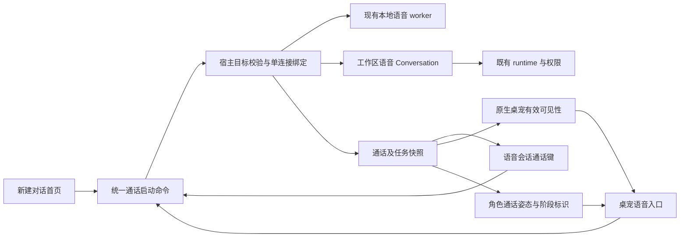
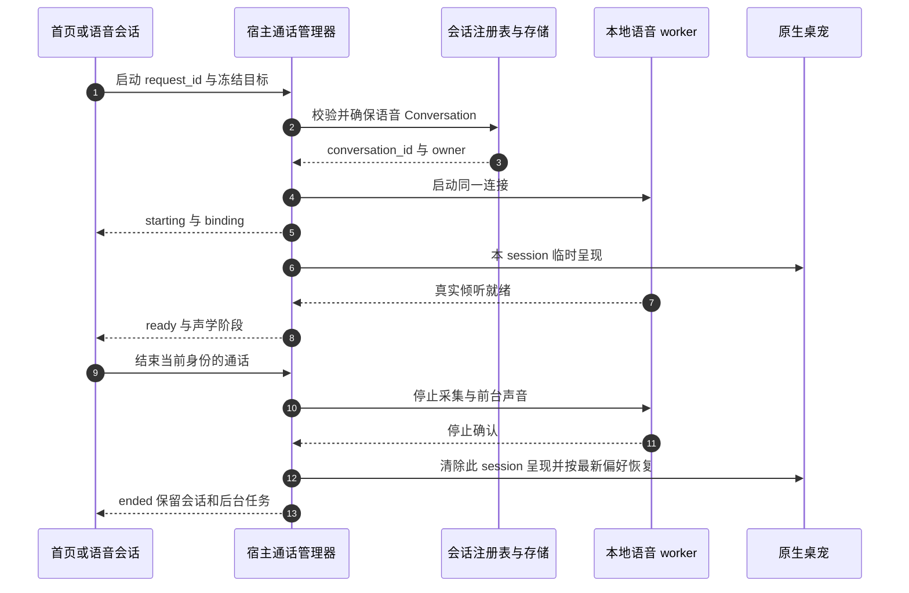

# 语音通话入口与桌宠感知 · 执行方案

> **状态**：📋 计划；已核对当前调用链和开源代码，尚未实施本方案业务修改。
> **基准**：2026-10-23，`feat/voice-next` / `e9b1255362de909f3567450996ab0cb77def4d0e` 加当前未提交修复。执行前须重新记录 HEAD 和工作区，不覆盖在途修改。
> **核心原则**：首页、正式语音会话和桌宠共用一个通话；会话保存记录，桌宠表达通话存在及阶段，宿主决定真实工作区、绑定与声学状态。

> **当前实施入口**：[§9 准入复审与最终执行合同](#9-准入复审与最终执行合同2026-10-23)。先读 §9，再读用户已确认的 §0 和补充 §8；§1–7 及附录中的旧布局/验收选项保留为历史，不得覆盖最新合同。执行提示词见 [Agent 任务书](voice-call-ux-agent-brief-2026-10-23.zh.md)。

> **2026-10-23 增量探索入口**：[§8 配置、工作区路由与会话体验补充](#8-配置工作区路由与会话体验补充2026-10-23) 记录当前代码事实、推荐目标及执行次序。§0 为用户已确认的授权决策；§8 为本轮探索后的建议合同，尚未实施或验收。§8.4 按用户后续要求取代 §3.1/§3.2 的入口布局及固定双按钮选项，旧文保留供追溯。

## 0. 2026-10-23 授权默认值修订（用户已确认，待代码实施）

**最终决策：语音新会话与普通会话统一默认使用全自动 `yolo`，保留用户显式选择优先。不采用此前讨论的首次默认 `auto_edit`，不再为语音缺省配置单独写入 `default`。** 本节只更新实施合同，不代表业务代码已经修复；下方原方案及历史检查全文保留。本文其他 UI 交互仍按后续已确认需求另行修订，不由本节扩大范围。

### 0.1 配置优先级与边界

| 场景 | 最终规则 |
|---|---|
| 复用已有语音 Conversation | 保留该会话已保存的有效模式，不以首页选择或新的产品默认覆盖 |
| 新建语音 Conversation，用户在入口显式选择模式 | 使用当次有效选择，`default`、`auto_edit`、`yolo` 均可；不能把用户选择的 `default` 当作缺省值 |
| 新建语音 Conversation，没有当次选择，有已保存的引擎模式偏好 | 复用现有 Nomi 模式偏好；用户此前显式选择的较低权限仍优先 |
| 新建语音 Conversation，无当次选择且无保存偏好 | 使用 `yolo`，与普通 Nomi 会话的产品默认一致 |
| 历史会话没有模式字段 | 解析后端实际有效模式并统一显示、冻结；缺失不再解释为语音专属 `default`，不批量改写已有有效模式 |
| 提供了非法或不支持的模式 | 明确拒绝并提示重新选择；不得把非法值当作“未提供”而提升为 `yolo` |

首页、工作区、桌宠、托盘/KWS 等入口共享上述解析规则，不创建“语音权限模式”字段或第二份偏好。无界面的入口使用已有会话模式或现有保存偏好；不得通过模拟首页点击取得权限。前端标签、Conversation 保存值、runtime 有效模式以及任务冻结配置必须一致，初始化期间不能先显示“默认”却实际运行 `yolo`。

`yolo` 复用现有会话权限能力，不扩展工具目录、工作区访问范围或独立系统能力开关。已入队/已发送任务仍遵守原冻结配置；切换模式不重写旧幂等 payload、不重发任务、不自动批准已经挂起的审批。已有显式 `default` 会话不会因本次修改自动升级。

### 0.2 执行顺序与代码落点

1. 先在现有创建配置调用链统一解析有效模式，区分“缺失”和“用户显式 default”；新建时在首次副作用前冻结并保存。复用会话直接读取该会话模式。首页已选择但未保存的值不能因语音启动只传工作区而丢失。
2. 检查 `ui/src/renderer/pages/guid/hooks/useGuidAgentSelection.ts` 的偏好恢复及 `GuidPage.tsx` 启动调用；复用已有类型/偏好存储，不另设语音权限配置。普通会话的现有 YOLO 默认无需重做。
3. 检查 `crates/backend/nomifun-app/src/voice_companion_manager.rs` 的工作区和默认会话创建、配置冻结，以及 `crates/backend/nomifun-conversation/src/service.rs` 的 `create_voice_idempotent` / `ensure_default_voice_conversation_with_owner`：新建语音会话须落下已解析模式，不能在缺参时写 `default`。
4. 同步 `crates/backend/nomifun-app/src/voice_task_runtime.rs` 创建和发送前一致性核对，移除缺失模式被视为 `default` 的假设。不能只改创建处为 `yolo`，却保留冻结/发送比较的旧兜底导致配置冲突。
5. 检查 `AgentModeSelector.tsx` 的未初始化显示：使用实际解析结果，不用 `modes[0]` 推断权限；挂载和只读同步不更改权限、不启动 runtime。
6. 保留有效显式模式的原有测试；将“缺失字段应成为 default”的旧断言替换为下表新合同，保留非法输入拒绝、作用域及真实审批测试，不降低断言。

### 0.3 验收与验证

| 编号 | 场景 | 必须结果 |
|---|---|---|
| AUTH-01 | 无偏好的新用户从默认/项目工作区开启语音 | 创建值、标签、runtime、冻结任务均为 `yolo` |
| AUTH-02 | 分别保存 `default`、`auto_edit`、`yolo` 后新建语音会话 | 各自沿用；当次显式选择优先于保存偏好 |
| AUTH-03 | 复用已有三种有效模式的语音会话 | 保持原值，不被首页模式、重连或新默认覆盖 |
| AUTH-04 | 桌宠/托盘/KWS 启动、历史缺失模式及首个任务交付 | 与同条件页面入口一致；无 UI 假默认、无配置比较冲突 |
| AUTH-05 | 非法模式、工作区越界、独立能力未开启 | 不因 YOLO 缺省而绕过原校验；非法模式拒绝 |
| AUTH-06 | 排队后切模式、响应丢失重查、已有挂起审批 | 冻结与幂等保持原约定；不重发、不自动批准旧审批 |

验证顺序：模式解析/创建持久化定向测试 → 真实 runtime 模式与交付一致性 → 前端模式初始化及双语断言 → 受影响 crate 测试/编译及 `bun run typecheck`、i18n 门禁。共享会话入口发生变化时补普通会话回归；不能以文档核对代替这些业务验证。

### 0.4 决策来源与当前事实

- `e010131e199`（2026-06-30，Git 作者 `muri <rika00@qq.com>`）已将普通会话默认改为 YOLO，保留显式偏好优先。
- `2fc9efebb78`（2026-10-22，Git 作者 `hoye <hoyework@qq.com>`）新增的语音创建路径包含缺失模式写 `default`，任务适配层也有同类兜底；本次用户明确要求撤销这项语音差异。
- 本节为已确认的目标合同；代码及 AUTH-01–06 尚待执行 agent 实施和留证，不宣称已通过。

## 1. 背景、目标与当前事实

这些交互解决的是同一个问题：用户需要明确知道“从哪里开始、现在是否在通话、能否开口、怎样结束”，而不是理解后台语音状态机。

面向在电脑前工作、间歇离屏的中文及英文用户。沿用 PRODUCT.md / DESIGN.md 的克制布局、语义主题和短时状态反馈。Qoder 的同一时间线与宠物入口是产品参照；本次可核查的公开实现参照为 AIRI 和 Open-LLM-VTuber，证据边界见附录。

| 入口或能力 | 当前代码事实 | 本次目标 |
|---|---|---|
| 新建对话首页 | `GuidPage.tsx` 通过 `guidInput.dir` 保存所选工作区；`ComposerEntryStrip.tsx` 只有预设/Skills 等入口 | 在输入区附近提供带图标和文字的“语音通话”，明确使用哪个工作区 |
| 会话发送区 | `NomiSendBox.tsx` 根据 `extra.voice` 挂载独立 `VoiceConversationBar`；共享 `ComposerSubmitCluster` 仍显示发送/任务停止及听写麦克风 | 语音会话右侧主操作固定为开始/结束通话；文字发送和任务取消有独立含义 |
| 启动方法 | `startVoiceConversation()` 无目标参数，窗口内 Promise 去重；调用 wake 后轮询绑定并导航，当前总等待期限 3 秒 | 显式冻结入口目标；跨窗口由宿主去重，超时查原启动状态，不能重新创建 |
| 工作区来源 | `useVoiceContext` / `report_voice_context` 只报告当前 Conversation；首页没有 Conversation id，不能把 `guidInput.dir` 传入现有方法 | 首页所选工作区通过可信宿主入口校验，不依赖导航/焦点竞争或伪造候选 Conversation |
| 桌宠显示 | `useCompanionWindowsSync.ts` 与 `main.rs::reconcile_companion_windows` 按 `appearance.companion_enabled` 同步；宠物页 `applyWindowState` 又独立按偏好隐藏 | 通话临时显示绑定伙伴，两个窗口控制路径采用同一有效可见性 |
| 桌宠语音状态 | `petMessageFromVoice` 已按 `memory_owner_companion_id` 过滤，并将声学/任务映射为通用工作状态；可被通用任务 toast 替换或关闭 | 持续通话标识不依赖任务 toast；声学阶段和后台任务分别表达 |
| 动作能力 | `CompanionAvatar` 传递 `motion`；Puff 使用动作状态，Bolt 仅解构 mood/activity，不消费 motion；自定义静态图也不消费 motion | 必须在实际角色渲染路径接通；不能仅改变 enum 或文字便宣称 Bolt 有通话动作 |
| 默认伙伴 | `CompanionRegistry::create_default_if_empty` 在空 roster 原子创建 `Flowy` / `bolt` 并启用显示 | 复用现有初始化；开启通话不重复创建伙伴，不强制替换已有皮肤 |
| 声学限制 | 当前生产无 AEC/render reference，`barge_in_ready=false`；SenseVoice 句尾识别 | 本方案保持半双工，不宣传讲话自动打断，不引入字幕模型或第二条采集链 |

本次不是重新实现语音服务，也不恢复已移除的调试会话弹窗。任务执行、权限审批、FIFO、结果落盘及播报继续复用现有链路。

## 2. 方案全景与不变量



固定规则：

1. 全局最多一个通话和一个采集 owner。页面挂载、重连、音量刷新、宠物显示都不能启动采集。
2. `conversation_id` 是持久记录，`session_id` 是一次通话，`turn_id` 是一句话。重开通话不必新建 Conversation；180 秒空闲和 30 分钟会话复用分别保留。
3. 语音快模型仍负责短回复/需求理解；runtime 仍在现有 Conversation 执行。打开通话不发送空消息、不启动工具。
4. 通话归属冻结后，导航到另一项目不会搬迁正在进行的通话、任务、审批或记忆 owner。
5. 挂断停止本连接采集/前台声音，保留已接受的 runtime 任务；“取消任务”只能作用于明确 command。
6. 临时显示不能写回 `companion_enabled=true`，不能修改记忆归属、模型或权限；用户隐藏宠物仍可在主会话结束通话。
7. 当前不新增模型、依赖、数据库迁移、权限模式或调度框架，不修改 agent harness/loop。若持久化格式确需变化，先单独审查。



## 3. 核心交互与接口契约

### 3.1 首页入口：一个可发现的文字按钮

将“语音通话 / Voice call”放在首页 composer 的入口行，与预设/Skills 同层级；使用现有图标库中的电话或耳机图标，不能只用当前听写麦克风。入口说明复用已有工作区名称，不再提供一份语音工作区设置。

点击行为：

1. 立即显示“正在连接”，固定按钮尺寸，防止连续点击。先冻结当次工作区及可用会话配置，不在 await 后重新读取变化中的表单。
2. 选定本地 P 时，在 P 解析/创建专属语音 Conversation；无选择时使用产品既有默认本地工作区，并在连接前显示名称。目录无效不能暗中改投默认工作区。
3. 复用既有工作区注册表及 30 分钟规则；已有忙碌/审批目标按现有规则保留。普通聊天只提供工作区来源，不直接改成语音会话。
4. 宿主确认 binding 后导航到对应 Conversation，收到声学倾听就绪再显示“正在倾听”。HTTP 成功、窗口出现和模型安装成功均不等于已开麦。
5. 原首页文字、附件、Skills 草稿完整保留，不随通话自动提交，也不复制到新语音气泡。点击前主动刷新已有草稿存储的 debounce，防止快速导航丢末尾字符。
6. 已有全局通话时，入口显示“返回通话”，打开原绑定目标；不得悄悄挂断 P 并改到 Q。显式更换目标需先结束原通话。

语音目前通过 Nomi Conversation/runtime 交付。首页若选中不支持的外部 agent/preset，入口须明确说明并提供切换到支持配置的动作，不隐式丢弃预设。新建采用现有类型和产品模型默认值；复用会话保留该会话配置，UI 展示实际模型，不拿首页草稿覆盖已有 Conversation。

Web 端可显示入口及桌面能力说明，但 `acoustic_ready=false` 时不可进入假通话；输入框普通听写保持原功能。

### 3.2 正式语音会话：固定通话键，保留文字通道

只对可信 `extra.voice=true` 的会话启用，不根据标题、路由名称或旧缓存猜测。metadata 未确认期间不可误发普通消息。

```text
会话时间线：用户原文 → 快回复 / 排队 / 工具与结果

语音通话 · 正在倾听         项目 P · Flowy
[输入文字……                              ]
[现有配置]       [发送文字（有草稿时）] [电话]
```

| 场景 | 固定电话位置 | 其他操作及含义 |
|---|---|---|
| 尚未通话 | 开始语音通话 | 有文字时提供“发送文字”；Enter 沿既有文字发送规则 |
| 正在连接 | 连接中，阻止重复启动 | 可取消本次连接意图；若迟到绑定已启动，按同一身份停止，不能留下幽灵采集 |
| 已连接、倾听/识别/思考 | 结束通话 | 状态行显示具体阶段，不把电话键变成 runtime 的 Stop |
| 正在播报 | 结束通话 | 若提供“停止播报并说话”，须是独立动作且有真实输出 flush→listen 接口及就绪回执；本方案不以 stop_session 冒充 |
| 后台任务执行 | 结束通话保持可用 | “取消任务”在任务控件内单独显示；键盘文字继续走语音 FIFO |
| 正在结束 | 结束中，阻止重复停止 | 收到停止确认后回到开始；失败保留可恢复状态 |
| 另一个 Conversation 正在通话 | 返回当前通话 | 不在当前页面新开第二个采集器 |
| 设备/宿主不可用 | 原位置显示不可用原因及恢复入口 | 保留草稿和时间线，不假装正在倾听 |

这里选择“电话主操作固定，文字发送次操作”的方案，满足用户希望发送位置改为通话键的要求；不采用“输入第一个字便把电话替换为发送”，以免正在通话时挂断入口消失。普通 Conversation 的 send/stop/听写、编辑重发和 AutoWork 保持现有语义。

`SendBox` 当前只提供 `sendButtonPrefix`，不足以替代主操作。可增加一个有明确职责的可选 submit slot 或 voice 控制参数，由 `NomiSendBox` 提供；普通调用方不传时完全沿用原 cluster。保留 `sendMessageHandler` 的草稿、附件及幂等逻辑，不再实现一套发送。语音通话中隐藏或禁用同 composer 的独立听写采集入口，并显示原因，避免两个麦克风 owner 争用。

`VoiceConversationBar` 收敛为状态、队列/任务和折叠诊断；主通话按钮迁移完成后删除重复开始/停止按钮。语音绑定不属于当前页面时只展示“返回通话”。

### 3.3 启动必须带显式目标，不能只调用无参数 wake

当前无参数 `startVoiceConversation()` 和页面 focus candidate 不能覆盖首页工作区。新增一个宿主启动入口，位于原 `/api/voice/companion` 范围内；建议 `POST /session/start`。复用既有 binding、Conversation 创建和声学 wake，不能另建注册表。DTO 放 `nomifun-api-types`，桥接放 common/platform，renderer 不新增 Tauri 直连。

建议最小输入（名称可按现有 DTO 惯例调整，语义不得省略）：

```ts
type VoiceCallStartRequest = {
  request_id: string; // 同一逻辑点击重试稳定；不是 turn_id/command_id
  target:
    | { kind: 'voice_conversation'; conversation_id: string }
    | { kind: 'workspace'; workspace: string }
    | { kind: 'default_workspace' };
};
```

首页必要的新建模型/预设参数复用已有配置类型；服务端校验后冻结。这里不给出第二套 model/preset/permission schema。已有会话的配置不得通过此接口覆写。

宿主职责及出口：

- 校验本机用户、会话所属、`extra.voice`、canonical 工作区和支持的执行配置。renderer 传入的路径/id 只是请求，不授予权限。
- 串行完成“冻结目标→确保会话/binding→唤醒”，不能把首页路径塞进全局候选后再靠延时 wake。
- 同 request 同目标返回同一启动结果；同 request 改目标冲突。两个窗口不同 request 竞争同一个 active call 时，只返回已存在通话及其目标，不再 wake/create。
- 返回或公开 `request_id` 对应的 `starting/ready/failed/cancelled` 结果及 binding；`ready` 必须有真实声学就绪。响应丢失先查询同 request，不换身份重发；重启后不恢复自动开麦。
- 连接取消与迟到 ready 在同一宿主生命周期边界裁决；取消之后到达的 worker 就绪必须停止/撤销该次连接。不能只让 renderer 忽略结果。
- KWS 沿既有信任边界进入同一个宿主绑定逻辑；不把 renderer 可伪造的 candidate HTTP 端点开放为绕过入口。页面点击还需负责导航，KWS 不强制抢焦点。
- 保留既有 instance/seq/session 隔离。查询、页面重挂载和 SSE 重连都只读，不触发 wake、发送或重播。

现有 3 秒适配器轮询是 UI 启动等待，不是模型回复预算。实施时改成受控 pending 与结果查询；不能单纯拉长 timeout 后宣称解决重复启动或绑定丢失。仅为本次短生命周期启动复用现有管理器存储，不引入通用任务调度框架。

### 3.4 同一份通话呈现，不把 task running 当作在听

增加共享只读 `VoiceCallPresentation` 投影供首页、composer、桌宠使用：

- 连接生命周期：未通话、连接中、已连接、连接暂断、结束中、已结束/启动失败。
- 声学阶段：倾听、识别、理解、合成、播报、等待继续说话、等待工具确认、确认听取、设备恢复。
- 后台任务：排队、执行、待确认、终态，仍来自现有 task/queue，不覆盖声学阶段。
- 身份：instance/session/binding/conversation/owner，与现有 snapshot 一致。

优先由现有字段和明确生命周期事件派生；必须写状态表测试。若现有 snapshot 无法区分“有旧 session 的 standby”和“当前连接暂时 idle”，在宿主增加最小 `call_status` 投影，不能让各页面继续复制 `phase !== 'idle'` 猜测。该字段是宿主生命周期的投影，不是 renderer 持久化的第二份真相。

网络断开只显示“连接暂断，正在核对”，不得继续声称在听；终态以后迟到旧事件不能复活通话。`ignore`、空转写和可恢复模型/TTS 错误不自动挂断；180 秒规则仍以既有有效输入/实际播放结束计时，不由 UI 动画或轮询续期。

### 3.5 桌宠自动出现：临时呈现与长期偏好分开

收到宿主确认的连接/binding 后，显示被冻结的 `memory_owner_companion_id` 对应宠物。连接准备中可先展示“正在连接”，声学就绪后才显示倾听。不开独立语音弹窗，不自动展开宠物自己的聊天输入窗。

原生宿主统一计算：

```text
有效可见 = 用户当前显示偏好 OR （当前通话临时呈现 AND 本通话未手动隐藏）
```

临时呈现只绑定 `instance_id + session_id + companion_id`，不落盘为显示偏好。须同时改 `reconcile_companion_windows`、renderer `applyWindowState`、尺寸/命中/点击穿透相关 enabled guard；只改主窗口 sync 会被宠物页立刻隐藏。

| 情况 | 必须行为 |
|---|---|
| 通话前宠物已显示 | 保持位置，结束后继续显示；不反复 show 抢焦点 |
| 通话前宠物隐藏 | 此次通话临时显示；结束后按用户最新偏好隐藏 |
| 通话中用户选择长期显示 | 正常保存用户意愿；结束后保持显示，不回写开始时的旧偏好 |
| 用户通话中主动隐藏宠物 | 记录本 session 的临时展示已关闭，不因音量/配置 echo 再弹出；主会话/托盘仍有通话指示和结束入口 |
| 两只以上宠物 | 仅给冻结 owner 添加耳机/通话状态；其他宠物不自动出现、不改默认伙伴 |
| owner 被删除/配置失效 | 不临时把任务或记忆归给另一宠物；保留主会话指示，显示伙伴不可用；下次通话按既有默认伙伴解析 |
| 主窗最小化/关闭到托盘 | 宠物存在性由宿主语音事件维持，不依赖首页组件还挂载；不额外建立采集器 |
| 宠物窗口创建失败 | 通话页明确提示；仍有可见通话/结束控件时允许语音继续，不把“宠物显示成功”误报为事实。若没有任何可恢复控制入口，停止该次采集并说明原因 |
| 重启、旧 session 迟到、连接结束 | 清理原临时呈现，不能自动开麦；旧清理不能隐藏新 session 的宠物 |

原生 owner 从可信快照和 roster 解析，不信任前端任意 companion id。主窗口同步与原生事件更新使用同一个最终可见性边界，防止互相覆盖。创建、显示和隐藏只在状态边缘触发；音量帧不做窗口操作。沿用已有多屏位置修复，保持非聚焦展示，不增加 `setFocus()`；必须验证 macOS show 的现有夺焦风险，不能只检查 Windows。

### 3.6 动作与耳机：先建立稳定含义，再做角色表现

**共同基线**：所有现有皮肤在通话时都带耳机图标和“通话中”状态，放在独立安全区域，不能叠在脸或挤压停止按钮。耳机表示“处于语音通话”，不单独表示麦克风正在采集；旁边文字/图标说明当前阶段。该标识不可随普通任务 toast 的关闭、过期或优先级消失。

**Bolt 首批增强**：现有 Bolt 是 SVG `viewBox='0 0 160 160'`，无需生成新位图或引入 Live2D。给实际 Bolt 渲染增加受控通话姿态输入，倾听时专注眼神，理解时现有 thinking 表现，播报阶段轻量嘴部变化，确认时注意姿态。可在该 viewBox 内绘制适配 Bolt 的耳机轮廓；若尺寸或天线遮挡验收不通过，保留独立耳机徽标，不将不合格的“佩戴效果”作为交付。

Puff 使用已有动作映射；Mochi/Ink/自定义静态图先完成通用徽标与可理解状态，不要求每只图都具有可定位的耳朵。通话姿态是临时渲染覆盖，不写回伙伴 mood、XP、memory 或配置，不使用 LLM 决定嘴型。

| 实际阶段 | 用户看见 | 动作原则 |
|---|---|---|
| 连接中 | 耳机 + 正在连接 | 短入场，不能先显示收音波形 |
| listening / follow_up | 耳机 + 正在倾听 | 专注姿态；只有真实输入能量才驱动音量反馈 |
| transcribing / deciding | 正在识别 / 正在理解 | 轻量思考反馈，不假装仍接受下一句 |
| synthesizing / speaking | 正在准备播报 / 正在播报 | 半双工文案准确；嘴部只是阶段动画，不冒充音素同步 |
| task running 且声学可听 | 正在倾听，另示后台执行 | 不因后台任务把宠物永久设成 thinking |
| awaiting_confirmation / listening_confirm | 等待确认 / 请说允许或拒绝 | 审批优先可见，但不延长执行侧授权期限 |
| error / reconnecting | 清晰的恢复说明 | 不用庆祝动作；只有真实终态才结束通话标记 |
| ended | 通话已结束 | 去掉通话姿态，按最新可见偏好恢复 |

通话姿态优先于休眠/随机闲置动作；拖动、点击等交互不修改通话状态。后台通知不得覆盖持续标识。使用现有 120/180/240ms 动效节奏，Reduced Motion 完全停止重复动画而保留静态阶段。没有新活动时不新增常驻 RAF、声学轮询或粒子效果。

布局沿用已有 64px status lane，但不能机械地在里面堆第四个控件：窄宠物窗口优先显示耳机、短状态与结束动作；项目/详细结果在主会话。长英文、200% 字体、custom 大小档和多屏 DPI 下由真实测量决定高度，必要时一次性调整窗口，不让声音帧触发布局循环。新徽标/结束控件必须进入 `data-companion-hit` 命中和穿透测试。

## 4. 决策与取舍

| 编号 | 选定方案 | 原因及放弃项 |
|---|---|---|
| D1 | 首页可见文字入口，普通听写保持独立 | 电话/耳机表达连续通话，麦克风表达填入文字；不以改图标替代接线 |
| D2 | 语音会话电话位置固定，有草稿时提供次级文字发送 | 通话中一直找得到挂断；不让输入草稿改变主键含义；普通会话不改 |
| D3 | 带目标的宿主启动命令，复用现有绑定/注册表 | 首页无会话 id，不能靠全局 candidate 与 focus 延时串联 |
| D4 | 宠物按 session 临时显示 | 满足通话可感知，尊重长期偏好；不增加长期“语音专属宠物显示设置” |
| D5 | 共用耳机徽标 + Bolt 受控通话姿态 | 最小范围覆盖所有皮肤并让默认角色有反应；不要求下载新模型或为任意静态图定位耳机 |
| D6 | 声学、连接、后台任务三种语义分别呈现 | 不把任务执行当倾听，不把关闭语音当取消任务；不另建业务状态机 |
| D7 | 先完成一次纵向旅程，再补全异常与视觉回归 | 不先做一整套动画库；不等真人测试才发现入口目标根本未传给宿主 |

## 5. 串行实施步骤

### U0：固化现状与接口出口

记录 HEAD、dirty 文件、当前 locale/theme 与默认伙伴。读完 `GuidPage → useGuidInput`、`NomiSendBox → SendBox → ComposerSubmitCluster`、`voiceCompanion adapter → manager → recorder`、`voice_session_bridge → native window reconcile → companion applyWindowState` 的调用链。

增加最小特征测试：当前首页目标无法传递、Bolt 不使用 motion、隐藏偏好会压过临时显示。测试应观察行为，不把字符串搜索当成完成证据。明确 `call_status` 是否需要新增和既有启动生命周期结果存放位置，不能留给每个页面自由解释。

### U1：第一条完整旅程

先完成“首页选 P → 统一启动 → P 的语音 Conversation → 倾听就绪 → 冻结伙伴临时出现及耳机标记 → 会话电话挂断 → 恢复显示偏好”。跨 UI/DTO/宿主/桌面窗口一起实施，上一段可跑通再继续。此时必须覆盖默认工作区、有草稿、双击和目录失效；首个真实用户输入仍进入既有 ASR/快回复/任务链。

出口：一个 Conversation、一个通话/采集 owner；空点击不创建消息或 runtime 任务；宠物配置文件无自动启用写入；挂断不调用 task cancel。

### U2：状态和角色表现

接通共享只读投影；迁移旧 bar 的重复按钮；实现通话/文字发送/任务取消的独立主次。Bolt 接实际临时姿态，所有皮肤完成持续徽标、隐藏动作与命中区域。完成中英、明暗、缩放、减弱动态，不先扩大到全部角色素材重做。

出口：runtime 忙碌不禁用挂断和语音 FIFO；忽略输入后仍可继续听；TTS 失败保字；半双工提示无误导；状态 toast 被关掉后通话指示仍存在。

### U3：竞争、恢复与原生窗口收口

集中验证跨窗口/KWS竞争、启动响应丢失、取消连接与迟到 ready、P→Q 导航、偏好中途改变、owner 删除、主窗退托盘、旧 session 清理、设备失效/重连、30 分钟轮换与任务未终态。复用既有幂等和任务恢复测试，不删除现有断言以适配新按钮。

出口：无重复采集或任务，旧事件不能恢复采集/隐藏新宠物，原生 show/hide 无连续夺焦/闪烁/穿透失效。

### U4：联合验证与交接

运行下节代码自动验收、Tauri 联合构建与受控系统检查。每条证据绑定 HEAD/dirty 范围、入口目标、instance/session/binding/conversation/owner 和实际断言。记录真实窗口自动检查、受控 worker 回放、物理音频设备证据的区别，不拿浏览器 Web 页替代连续语音系统验收。

不自动提交、推送、发布或替换用户正在运行的桌面产物。发现全仓基线失败分别记录，不扩大修复范围。

## 6. 验收用例与代码验证

| 编号 | 路径/反例 | 必须断言 |
|---|---|---|
| CP-01 | 首页 P，无当前会话 | canonical P 的唯一语音 Conversation；就绪后才显示倾听；未输入时消息/任务为零 |
| CP-02 | 首页无选择 / P 失效 / 不支持预设 | 默认工作区明确；失效 P 不转 Q；不支持配置有可操作说明 |
| CP-03 | 首页有文字、附件、Skills，点击并快速导航 | 草稿最后一次修改不丢、不自动发；重新回首页仍在 |
| CP-04 | 双击、两个窗口、KWS 同时启动 | 宿主最多一个采集连接、一个有效 binding；创建/wake 副作用有计数 |
| CP-05 | 启动响应丢失 / pending 取消后迟到 ready | 查原 request，无换键重开；取消后不存在隐形采集或临时宠物残留 |
| CP-06 | 语音会话有/无草稿，runtime 空闲/忙碌 | 电话位置与意义稳定；文字进入原 FIFO 一次；挂断不取消任务；IME Enter 不误发 |
| CP-07 | 普通聊天、编辑重发、AutoWork、普通听写 | 原 send/stop/编辑幂等行为保留；语音采集中不会再开独立听写 owner |
| CP-08 | P 通话中查看 Q / 打开另一个语音页 | 返回 P，目标不搬迁；Q 草稿和任务不受影响；点击不创建第二通话 |
| CP-09 | 隐藏宠物后开通话，结束；中途改显示偏好 | 临时出现一次，挂断按最新偏好；无需自动持久化 companion_enabled |
| CP-10 | 手动隐藏、配置 echo、密集音量、旧停止到达 | 隐藏不再弹回；不重复 show/抢焦；旧 session 清理不影响新 session |
| CP-11 | 多宠、切默认伙伴、owner 删除 | 仅冻结 owner 有通话覆盖；任务/记忆不重归，主会话仍可结束 |
| CP-12 | Bolt、Puff、静态自定义图 | Bolt 实际消费临时姿态；其他图有独立徽标；脸、状态和控制不重叠 |
| CP-13 | speaking、task running、approval、ignore、TTS失败 | 三种状态含义准确；ignore 继续听不污染时间线；TTS失败保字；审批不延长授权 |
| CP-14 | 180秒无输入 / 30分钟复用 / 忙碌审批 | 计时不由UI事件刷新；连接结束和Conversation轮换分别正确 |
| CP-15 | 主窗卸载、最小化到托盘、设备断开/重连 | 原生事件维持可恢复通话指示；重连/重启不自动 wake/send/replay |
| CP-16 | 双语、明暗、200%字体、DPI、多屏、减弱动态 | 控件可达可读，不靠颜色；点击穿透命中正确；减弱动态无重复动画 |

验证梯子：

1. **行为单测/组件测试**：挂载真实入口/composer，触发点击、输入、导航、卸载和迟到事件，断言调用参数、草稿内容、按钮含义及次数；共享投影枚举覆盖每个现有 VoicePhase。结构测试只作补充。
2. **宿主接口与真实存储**：临时工作区/SQLite，mock 仅限测试侧声学控制边界；断言 canonical 路径、创建/绑定/幂等、取消连接裁决。再将固定 PCM 送入生产 worker 并核对正式 Conversation 的真实转写/短回复投影；不在生产增加测试后门。
3. **原生代码自动验证**：在既有系统验收框架增加可见性/命中/布局断言，验证真实 Tauri 主窗与 `companion-{id}`。控制音频输入可用已有 replay/synthetic source；调用真实 CPAL/WASAPI 的证据单列。纯 mock WindowAdapter 只证明策略，不能签核真正窗口出现、macOS 焦点或系统音频。
4. **静态与构建**：受影响 Rust crate 定向测试及编译；UI typecheck、i18n、theme、button-layout、dead-css、生产 UI build；集成节点执行 workspace check、聚合质量门禁、桌面及 daemon 联合构建。全仓既有失败使用相同 HEAD 基线对比。

推荐命令（执行者按新增测试实际文件名补入，不能把以下目录命令当成本轮已运行结果）：

```powershell
# 根目录：受影响宿主契约
cargo test -p nomifun-app --lib voice_companion_manager
cargo check -p nomifun-api-types -p nomifun-app
# ui 目录：现有回归加新入口/窗口策略/真实点击用例
bun test src/common/adapter/voiceCompanion.test.ts src/renderer/pages/voiceSession src/renderer/pages/companion/messages src/renderer/components/chat/ComposerSubmitCluster.structure.test.ts
# 根目录：按项目验证阶梯执行
bun run typecheck
bun run gen:i18n
bun run check:i18n
bun run check:theme
bun run check
bun run build:ui
cargo check --workspace
git diff --check
```

每条 CP 记录 `{head, dirty_scope, case_id, entry, workspace, instance_id, session_id, binding_id, conversation_id, owner, assertions, side_effect_counts, evidence_paths, limits}`。自动验证由执行 Agent 完成，不把 Owner 真人说话当作阻塞所有开发的必要条件；无法在当前平台自动证明的设备/其他 OS 项明确未签核，不写“全流程通过”。

## 7. 可迁移规律与第一步

1. **入口和结果同处一条时间线**：从首页/宠物进入，仍回正式 Conversation，不再维护独立调试聊天窗。
2. **控制按职责分开**：开始/挂断、停声音、取消任务、听写文字不能复用同一含糊的 Stop。
3. **可见状态来自实际生命周期**：点击只能说明用户意图，收到真实就绪才说明正在听；文字完成也不说明已播放。
4. **角色表现是渲染覆盖**：通话能让宠物戴耳机/变姿态，但不因此重写人格、长期偏好或记忆 owner。
5. **先做默认角色可用的整条旅程**：通用徽标保证多皮肤覆盖，Bolt 提供更强反馈；不把素材完善当作接口缺口的替代。

最值得先尝试的小切片就是 U1：用一个选定的临时工作区，点击首页语音按钮，看到正式会话进入倾听、原本隐藏的 Bolt 出现并带耳机徽标，然后从固定电话键挂断。自动断言只建立一条连接、没有空任务、没有写显示偏好、退出恢复正确。通过后再扩展动作与异常矩阵。

## 8. 配置、工作区路由与会话体验补充（2026-10-23）

### 8.1 当前源码事实与缺口

核查基线仍为 `e9b125536` 加在途工作区。本节为静态调用链与公开资料核对，没有启动桌面应用、占用麦克风或运行新的业务回归，不把执行 agent 的未提交工作视为签核。

| 对象 | 当前事实与代码入口 | 用户可见的问题 |
|---|---|---|
| 桌宠打字 | `pages/companion/index.tsx::ensureThread` 使用 `getCompanionSession` / `ensureCompanionSession`；`deliverTurn` 调普通 `conversation.sendMessage` | 与工作区语音 Conversation 为两条记录；通话中仍可能把文字补充送到伙伴会话 |
| 桌宠开启语音 | `index.tsx::enterVoice` 仍调 `startVoiceConversation()`；common adapter 走无目标 wake 加轮询绑定 | 与首页 `startVoiceCall` 的显式目标入口不同，依赖候选上下文，不能保证当前项目 |
| 首页开启语音 | `GuidPage.tsx::handleStartVoiceCall` 传 `guidInput.dir`，无目录传 `default_workspace` | 目录已选时存在正确路径，不能笼统称工作区功能未实现；但侧栏选择是否进入该值仍须补测试 |
| 项目会话候选 | `useVoiceContext.ts` 只上报 Conversation id；desktop `report_voice_context` 校验主窗口当前 URL、可见和聚焦 | 只有选工作区没有 Conversation 的页面不能报告目录；失焦时触发上报会清空候选，桌宠点击或外部唤醒依赖时序 |
| 后端目标解析 | `resolve_target_conversation(candidate, _config, explicit_workspace)` 忽略 `_config`；候选只接受本机用户的 `nomi` 行，排除临时目录；项目目录走工作区语音注册表 | 不是所有入口恒去默认工作区，但非 Nomi 项目会话、空项目页或候选丢失时无法保证项目路由 |
| 会话归属配置 | `VoiceTargetSettings.tsx` 仍提供独立语音助手/伙伴下拉；`target_settings()` 可返回伙伴有效会话 | “effective”展示与真正解析路径脱节，且中文 hint 仍称任务在独立执行会话运行 |
| 伙伴与音色 | Overview `ModelsSection.tsx` 写 `profile.voice.tts`；`robot_wiring.rs::tts_slot` 消费该字段 | 这是伙伴/robot 链路设置，不能由此断言语音伴侣通话会采用该音色 |
| 通话实际 TTS | `apps/voice-companion/src/voice.rs` 独立装配 Edge 与 Sherpa fallback，环境变量控制次序；播放调用音色参数为空；Edge 默认音色在 terminal `tts.rs` | 通话与伙伴音色不是同一来源；当前默认不能被表述为纯离线，语音页也没有已接通的通话语速控件 |
| 语音文字发送 | `nomiSendDispatch.ts` 纯文字进 `sendVoiceKeyboardMessage`；语音附件、Skills 分支明确拒绝；普通会话走原 command queue | 正式语音页面不能暗示所有普通发送能力都已开放；目前也不能照搬 Qoder 的附件行为 |
| 时间线与状态 | `liveVoiceTurn` 依据 projected turn id 去重；临时原文/回复在 composer 上方 bar，任务区仍常驻诊断/完成按钮 | 临时内容与持久消息视觉分离；重复开始、同页“查看完整任务”、终态面板占空间；须保留去重契约后收敛布局 |

### 8.2 配置职责：伙伴是谁、工作在哪、声音如何，分别有归属

| 设置位置 | 应保留 | 应移除或说明 |
|---|---|---|
| 全局语音设置 | 本地语音资源安装/启闭、已有唤醒能力、提示音级别/音量、回复播报开关、实际能力状态；诊断次级折叠 | 不再单设执行目录、执行权限或第二套执行模型。快回复模型只读显示可读服务商名和模型名，不把 provider UUID 当友好名称 |
| 伙伴设置 | 名字、外观、长期显示偏好、人格/记忆归属、伙伴独立聊天模型 | 模型标为“伙伴聊天模型 / Companion chat model”，不能暗示会覆盖项目执行模型；通话临时显示不写长期偏好 |
| Conversation 设置 | 该会话真实工作区、执行模型、预设、授权模式 | 语音沿用该会话真实配置；新建遵循 §0 YOLO 与显式偏好优先；只改变语音入口不改变工具权限 |
| 通话状态与更多菜单 | 绑定工作区、当前伙伴、声学状态、返回通话、必要恢复动作及语音诊断 | 不在 composer 上方重复整份设置；不提供实际上未接通的设备/语速/自动打断开关 |

对“会话归属”旧下拉的建议：由自动工作区路由取代会话目标选择。伙伴仅决定形象/记忆 owner，不能借选择伙伴把项目任务转到伙伴独立聊天。先盘点 `/target` 的 HTTP/配置调用方、持久化及文档，再决定删除内部旧路径或保留明确的外部兼容边界；不能只藏 UI 便让 API 继续报告虚假的有效目标。当前 default companion 可直接复用，不因这项优化另造一个默认伙伴选择字段。

音色采用分步方案：第一步把现有字段的作用范围写清，并在语音设置只读显示本次通话实际 TTS 来源、在线/本地及降级原因；第二步再将已冻结伙伴的现有音色配置接到 worker，确认各 provider 的传递和 fallback 兼容。不复制一份同名音色配置，也不把 Edge 在线服务标为本地模型。若要语速/播放设备选项，先接通后端与回执再开放 UI。音色切换推荐下一通话生效，已排队/在播片段不混用；中英文样例分别验证，资源缺失时可读降级不谎报成功。

### 8.3 所有语音入口统一工作区目标

**推荐规则：已有活动通话先返回其冻结目标；未通话时，正式语音 Conversation 优先自身 id，其他入口按主窗口当前明确选择的工作区创建/复用语音 Conversation；只有没有明确项目选择时使用默认本地工作区。** 普通项目聊天不被隐式改造成语音聊天。30 分钟规则管理该工作区语音 Conversation 的复用，不是每次唤醒新建，也不等同 180 秒声学空闲期限。

| 启动场景 | 应使用的目标 |
|---|---|
| 首页已选项目 P，点击通话或随后 KWS 唤醒 | P 的工作区语音 Conversation；不能因首页没有 Conversation id 而回默认 |
| 打开项目 P 的普通 Conversation，点击桌宠/快捷入口或 KWS 唤醒 | 从可信项目映射取得 P，创建/复用 P 的语音 Conversation；不直接占用普通对话 turn |
| 侧栏选中项目 P，项目暂无 Conversation | 同样使用 P；只展开某个项目分组而未实际选择不算目标变更 |
| 打开正式语音 Conversation V 后恢复通话 | 使用 V，不再通过工作区创建另一份记录 |
| 主窗因点击宠物或切到其他应用而失焦 | 保留本进程当前用户最近一次明确、可信的工作区选择；不因失焦临时清空成默认。失焦不自动改正在通话的绑定 |
| 用户明确选择默认工作区/离开项目作用域且清除选择 | 清除旧项目目标；后续通话使用默认，不能永久粘住“最近访问过的项目” |
| P 中存在 ACP 等非 Nomi 普通聊天 | 可继承可信工作区 P，语音仍走受支持的 Nomi 执行链；不把 ACP 的模式/model id 强转传给 Nomi；提供真实配置说明 |
| 目录删除、项目解绑、权限不符、上下文尚未核对 | 明确失败或等待核对，不静默改投默认工作区执行 |
| 已在 P 通话，页面切到 Q | 返回/提示 P 的活动通话；显式结束后才能按 Q 新开，不迁移旧任务与审批 |

实施方向：复用当前主窗口导航/项目选择来源和宿主 `report_voice_context` 信任边界，为无 Conversation 的明确工作区选择补报告能力；不要只把所有候选存活期无限延长。主窗导航、首页目录、侧栏实际选择必须得出同一语义，报告有作用域及先后顺序；旧路由 cleanup 的 null 不能覆盖新 P。宿主核对用户、主窗来源、项目映射和 canonical 本地目录；路径不是权限授予。退出登录/换本机用户、主窗销毁或项目失效清理旧选择，重启只恢复已校验选择、不自动开麦。不要把公共 HTTP candidate 端点放开来规避原生来源验证。

桌宠 `startVoiceConversation()`、正式页旧 bar 和设置诊断唤醒统一进入当前宿主目标解析/启动合同；KWS 复用同一个目标解析，不要求触发 UI 导航或模拟按钮。页面重复挂载、GET、重连只读。已有 request_id 去重/迟到绑定等修复继续按审查合同实施，本节不重新发明持久化队列或任务注册表。

### 8.4 桌宠文字与正式语音页面的关系

**推荐先保留伙伴独立聊天，再统一通话中的补充输入。** 未通话时，宠物打字仍使用伙伴独立线程，明确标为“与 Flowy 聊天 / Chat with Flowy”；它不因用户看过项目而自行变为项目执行入口。开启通话后，当前 owner 宠物的通话输入明确标为“发送到 allo 的语音会话 / Send to voice chat in allo”，纯文字进入同一语音 Conversation/FIFO。非 owner 宠物的独立输入不能被一起改道。

打开新通话不得偷偷提交伙伴聊天草稿或把伙伴私聊历史全文注入项目。两种输入草稿按实际目标隔离；有旧草稿时保留并提供明确返回入口，不在样式切换时移动文字。点击发送即冻结目标，异步失败保留原草稿/幂等身份；挂断后不把未送达的语音文字自动发送到伙伴聊天。若第一阶段不接通宠物文字路由，通话期间应提供“打开语音会话继续输入”的明确动作，不能看起来输入到同一处却仍发到独立线程。

语音任务页应当是普通任务页的增强，不再造第二套聊天系统：

| 普通能力继续复用 | 语音独有的最小增强 |
|---|---|
| 用户/助手消息排版、Markdown、工具详情、结果、真实审批 | 标记输入来自语音或键盘；倾听、识别、播报状态与任务状态分开 |
| 原 Conversation 的工作区、模型、权限与历史 | 通话连接状态、开始/挂断、返回活动通话；停止播报与取消任务语义分开 |
| 持久消息及其稳定 message id | 未落盘输入/快回复显示在时间线尾部，落盘后原位接替而非重复插入 |
| 真实执行进度与终态 | 一次已接收/已排队反馈，结果短播报；不因 UI 出现文本就称已播完 |

主按钮按用户最新要求优先级：**任务运行 → 停止任务；无运行任务且有可发送草稿 → 发送；空草稿且未通话 → 开始通话；空草稿且通话中 → 红色挂断。** 附件也属于待发送草稿，但当前语音不支持附件/Skills，必须保留草稿并说明或提供明确的普通任务入口，不静默丢附件或绕过 FIFO。按钮变为发送/任务停止时，紧凑通话状态行仍保留清楚的挂断入口；不要并排放两个竞争的圆形主按钮，也不以停止任务代替挂断。连接/结束 pending 状态防重复；其他会话的活动任务不能错用当前通话停止身份。

首页移除预设/Skills 行里不易辨识的英语 `Voice call` 标签：空输入主按钮配“开始语音对话 / Start voice chat”提示或首次使用说明，输入后自然成为发送。普通听写与持续通话用不同说明，不能只靠同一个麦克风图标。补齐已有 `guid.entry.voiceCall` 与词典 `voice.entry.voiceCall` 不一致导致的中文界面英语 fallback。

composer 上方只保留一行通话/活动任务状态及必要决策；空闲时收起。终态放回时间线，当前会话隐藏“查看完整任务”，例行刷新进入更多菜单，`unknown` 才提供明显核对动作。正常挂断且任务已完成不常驻“后台任务不会取消”说明。审批不能藏进诊断，原始模型 JSON/understood_request 不作为普通回复展示。`ignore`、噪声和空转写不落为正常消息、不终止通话；临时候选可被下句话替换，不能误删已接受任务的真实原文。

桌宠初始化继续沿既有窗口方案修复：隐藏创建、提前透明、真实 profile/角色/位置/尺寸及首帧就绪再显示，避免遮罩、团子转 Bolt 与位置漂移；不能靠永久 opacity=0 掩盖失败。存在失败须在主窗口给出恢复提示。通话标识独立于可关闭 toast；两个主题、中文/英文、窄窗口和系统缩放均核对重叠。

### 8.5 外部方案核查及取用边界

- **Qoder CN 官方交互说明**：[Qoder Voice](https://docs.qoder.cn/user-guide/quest/qoder-voice) 明确描述继承新建页所选工作区、转写与执行在同一任务时间线、补充排队以及挂断不停止后台工作。可以据此支持本方案的交互取舍，但不能推导“任意 IDE 当前会话必定复用”或 30 分钟轮换；后两者仍按 Flowy 自己的合同。该页面为产品文档，本轮未取得 Qoder 私有语音引擎源码或运行 Qoder 实测。
- **桌宠展示分工**：[Qoder desktop pet](https://docs.qoder.com/qoder/desktop-pet) 将伙伴选择、显示大小与气泡宽度分开配置，宠物在语音时可临时作为入口。可借鉴宠物大小与文字区域独立、通话临时呈现；不为 Flowy 引入 Petdex 或新资产依赖。
- **可读开源实现**：本轮查询 `QwenLM/Qwen-Live-Harness` main 固定到 `b2d17b8706b226ff7792683ecd8f050f18f9752e`。实际读取 [audio-output-queue.ts](https://github.com/QwenLM/Qwen-Live-Harness/blob/b2d17b8706b226ff7792683ecd8f050f18f9752e/packages/qwen-live-harness-host/src/preload/audio-output-queue.ts)：输出按 `epoch + outputId` 跟踪，活动帧排空且满足结束标记条件才完成，并有已完成输出去重；[result-speech.test.ts](https://github.com/QwenLM/Qwen-Live-Harness/blob/b2d17b8706b226ff7792683ecd8f050f18f9752e/packages/qwen-live-harness/src/orchestrator/result-speech.test.ts) 有新输入淘汰过时排队纠正播报等测试。可迁移为本地播放状态与旧播报失效验收，不等同本轮已运行其测试。
- Qwen Live Harness 前台依赖 Qwen Omni Realtime API，不能作为纯本地 ASR/TTS 的替换建议；Qoder 文档的全双工、屏幕上下文、声纹能力也不直接纳入本轮。Flowy 保留已选本地 KWS/VAD/SenseVoice；不因参考这些 UI 再引入 Zipformer、第二个 LLM、云端 realtime 或 AEC 实现。

### 8.6 执行次序、验收与交付

| 步骤 | 纵向交付 | 最小出口 |
|---|---|---|
| UX1 工作区路由 | 首页/项目选择→可信宿主上下文→桌宠点击或 KWS→项目语音 Conversation→真实任务回执 | 下列 ROUTE 用例通过，跨目录不误投；含 §0 权限冻结一致性 |
| UX2 输入与时间线 | 通话内宠物纯文字及正式会话纯文字复用 FIFO；临时转写/快回复在同一时间线接替 | 无重复消息、私聊历史不混入、失败草稿不丢、ignore 后继续听 |
| UX3 配置与主操作 | 移除误导会话归属 UI，显示真实配置来源；单主按钮、紧凑状态、双语及透明桌宠首帧 | 组件行为/双语/双主题/缩放布局证据；原生首次窗口不能只凭结构测试签核 |
| UX4 音色及收口 | 在确认现有 provider 能力后接通已有音色来源；不支持部分只读说明，补真实播放回执 | 中英文输出、降级、半句失败及旧播报失效；不能宣称完整离线或自动打断已实现 |

| 验收编号 | 场景 | 必须断言 |
|---|---|---|
| ROUTE-01 | 首页选 P、项目 P 普通会话、项目 P 空页面，分别点击/桌宠/KWS 开启 | 均绑定 P；已有 P 语音会话按 30 分钟及忙碌合同复用；新建无空用户消息 |
| ROUTE-02 | 点击宠物造成焦点变化、P→Q 导航及旧清理事件乱序 | 按最新明确选择解析；旧 null 不覆盖 Q；活动 P 不被搬迁 |
| ROUTE-03 | 明确选默认、项目删除、非 Nomi 项目聊天、用户切换 | 默认选择清旧 P；无效 P 拒绝；有效项目可解析；用户隔离 |
| ROUTE-04 | 同时从两窗口启动、超时重查、重新进入同一正式语音页 | 单连接、单目标、同 request 不重建；不重复创建/发送/开麦 |
| CHAT-01 | 无通话宠物打字，通话后补充文字，再挂断/失败重试 | 目标标签匹配实际 id；独立草稿不串；通话补充只进入同一 FIFO 一次 |
| CHAT-02 | 转写/快回复流、持久消息到达交错、ignore/错误、刷新历史 | 同一 turn 原位接替；无重复/JSON 泄漏；保留有效文字且不假挂断/重播 |
| UI-01 | 空输入、有草稿、运行任务、通话、连接中、其他会话活动 | 单主动作与 §8.4 一致；挂断始终可达且不取消后台任务 |
| UI-02 | 冷启动、恢复位置、两主题、两语言、窄窗及 125%/150% 缩放 | 无遮罩/错角色闪烁/位置跳动，文本不覆盖控件；无英语 fallback 泄漏 |
| CFG-01 | 修改伙伴模型/音色、修改项目模型/模式、打开旧目标设置 | 各职责独立；展示实际 effective 来源，无虚假生效或隐性项目切换 |
| CFG-02 | 本地资源缺失、TTS 在线失败、播报半句中断、旧播放完成迟到 | 文字保留、降级可见、当前状态不被旧输出回执改变，不谎报已听到 |

实施前先重读执行 agent 最新 diff；本轮不改它的业务文件。代码验证以生产解析/真实 Conversation 存储、现有 worker 和 runtime 集成测试为主，不能只 assert 文案或 mock 自己的解析器；前端补事件交错与草稿目标测试、TypeScript/i18n/theme 检查。原生窗口透明/焦点/DPI 仍需真实桌面宿主证据，浏览器截图不能代替；尚无证据就标待验证，不转嫁成用户必须先口述才可继续代码工作。

## 9. 准入复审与最终执行合同（2026-10-23）

### 9.1 结论 (Verdict)

**needs-attention → 合同补齐后可执行。** 不推倒语音链路；本节补全三个跨层缺口，并冻结歧义处。它是实施指导，不是代码修复或原生窗口签核。本文用户已确认决策优先于审查者建议；后续实际用户指令始终优先。

### 9.2 事实清单 (Irreducible Facts)

- 单个采集/播放设备生命周期与异步任务生命周期不同，挂断不等于取消后台工作 — physics。
- 主窗口项目选择、宠物私聊与语音任务属于不同状态来源，必须显式绑定，不能靠相似标题或当前焦点猜测 — convention，由既有产品边界决定。
- 宿主落盘完成和 renderer 已加载消息是两个异步事件；服务端成功不证明用户界面已呈现 — physics。
- 同一个执行 agent 串行处理这些共享边界，避免跨 agent 同写 manager/DTO/SendBox 的交接返工 — economics。

### 9.3 攻击点 (Attack Points, by severity)

1. **[P2][evidence] 旧验收可能把新需求改回去。** §3.2、D2、CP-06、U2 和附录 B 仍描述固定电话主键，§8.4 则要求一个随草稿/任务变化的主键。两套测试都被要求保留会导致互相冲突。**证伪实验**：在同一组件测试依次切换空输入→文字→运行任务→任务结束且通话中，断言主键唯一、含义正确、挂断仍可达。以本节映射为标准，历史视觉断言登记为被替代，不机械保留错误要求。
2. **[P1][evidence + inference] 冲突检查太晚可能留下错误项目的会话。** 当前 `voice_companion_manager.rs::start_call` 先调可能创建 Conversation 的 `resolve_call_target`，之后才检查活动通话；同时 §8 未规定只读解析和写入的顺序。在 P 通话时，Q 的启动请求可能先落下 Q 的新会话再被拒绝。**证伪实验**：真实临时 SQLite/工作区 P、Q，预先保持 P 活动，提交 Q 启动，核对 Q 会话数、创建键、发送数和 wake 数都没有增加；再覆盖同 request 改目标、wake 响应丢失和迟到 ready。
3. **[P2][evidence + inference] 临时消息过早退场会让内容短暂消失。** `liveVoiceTurn.ts` 只看 `projected_turn_ids` 就移除占位；其现有测试没有验证正式消息列表是否已经显示对应持久行。新布局若沿用该逻辑，投影回执先于消息加载时可能空白或闪烁。**证伪实验**：延迟正式列表读取，先送已投影回执，再送持久消息；界面任意时刻同一 turn 必须恰有一份可见内容。服务端写失败、用户滚动阅读旧消息及重连分别覆盖，不能通过无条件强制滚到底掩盖问题。

### 9.4 幸存结论 (What Survives)

继续复用现有 Conversation、runtime、真实工具审批和语音持久 FIFO；工作区独立于伙伴私聊/记忆 owner；新建 YOLO 与显式选择优先；配置只提供真实能力；文字和工具结果在同一时间线。没有证据要求新增队列框架、第二套模型或新的权限模式。

### 9.5 修改建议 (Changes)：执行前冻结的歧义处

1. **现役规则唯一化。** §0 授权规则保持有效，§8.4 单主按钮及本节取代 D2/CP-06/U2 的固定电话选项；CP-06 改为覆盖“唯一主键 + 状态行挂断 + 文字 FIFO”。其余 CP/AUTH/ROUTE/CHAT/UI/CFG 的业务要求保留。执行者可修订被明确取代的旧视觉断言并记录原因，不能借机删减幂等、越界、草稿、取消或消息去重断言。
2. **副作用之前决定目标和配置。** 先查原 request 已冻结结果，再检查活动/正在启动的通话；冲突只返回原通话或明确冲突，不创建 Q、不改候选、不发 wake。只读校验与副作用分离，首次副作用前冻结 target、有效配置和身份；canonical 等价路径按同一作用域处理。同一 request 重查不重新采用变更后的偏好，非法模式拒绝，wake 发送后超时为未知而非确定失败。pending 取消、旧停止和迟到 ready 只能处理匹配身份；不得销毁较新 reservation。复用既有启动修复，不能重建一套通用调度器。
3. **工作区报告有序且有来源。** 首页未保存目录可用当次明确选择；主窗口失焦保留已核验选择，明确选默认才清除。native 来源验证不因补 workspace 字段而变宽；HTTP renderer 请求仍需既有用户及宿主校验。旧导航 cleanup 不能覆盖新选择。不同主窗口来源或用户 epoch 不共享候选；当前项目未核对时等待/报错，不自动转默认。
4. **新建与复用分开。** 新建语音会话仅接受现有支持的 Nomi 配置；当前明确 Nomi 选择可沿既有创建配置链传递，外部 agent 不兼容的模型/预设不静默转换。已有语音会话保留其模型、模式、owner 与工作区；无模型不能假装接单。30 分钟到期遇到任务/审批/未核对回执继续延后轮换；旧任务仍绑定旧会话。此轮不将普通会话原地转换为语音会话，也不迁移旧伙伴聊天历史。
5. **“停止任务”只指向明确任务。** 主键运行态的停止只取消当前绑定 command；显示“取消中”直到真实终态，未知状态仅核对，不换身份重发。已有其他排队项不是隐式取消对象，保留并显示数量/其后行为；不新增“清空全部”或自动终止通话。等待审批时保留审批动作与期限，不以未知语义推断同意。挂断入口独立可达；编辑重发、附件或 Skills 不得绕过语音 FIFO。
6. **前端确认可见才移除临时内容。** 优先复用 message_id/turn_id 映射，在消息列表中合并临时和持久项；不能以文本相同作为身份，不能仅用“后端已投影”认定 UI 接替完成。保留原文、助手 Markdown 与实际任务结果，JSON/诊断另处查看；失效 turn 不因音量事件复活。用户读旧消息时不抢滚动，提供“有新消息”入口；在底部时可跟随。
7. **伙伴文字输入路由严格限定生命周期。** 仅当前冻结 owner 的通话输入走绑定 voice Conversation。独立聊天草稿和通话草稿分开；暂停/重试持有原目标，挂断后不改投私聊。没有可靠绑定时保留草稿并提供打开主会话动作，不猜 owner，也不向其他宠物转交。活跃通话删除 owner 按现有隔离合同处理，不能重归默认伙伴。
8. **音色不扩大实现地界。** 本轮先完成实际来源显示及现有支持的 Edge/Sherpa 能力映射；伙伴配置若选了未支持 provider/模型，不新做云厂商 SDK 或下载资源，保留设置并说明通话实际使用值/降级原因，差异记待办。冻结到连接级，播报中不换；未接通 provider 不算“音色统一完成”。声学开关不会授予屏幕/桌面/文件访问能力。不新增离线模型或 AEC，不改已在途的音频算法。
9. **旧 `/target` 与持久化不能随 UI 一起盲删。** 先做调用方清单。可删除已确认无调用的内部路径；对现存配置和公共 API 没有兼容结论时，仅收起误导 UI，明确报告 requested/effective 的实际语义，将删除列入 `BLOCKED.md`，不抹用户数据，不长期保留伪造的 effective 成功。

### 9.6 分工 (Assignment) 与执行出口

- 当前执行 agent：实现者，串行推进 §0 和 UX1→UX4；先接管同一共享工作区的最新进度，不能与旧执行任务同时写这些文件。不开新并行 agent、不替换分支、不自动提交/推送/发布。
- 本轮审查 agent：独立验收者，复核原始需求、最终合同和 diff；执行者自测通过是交付证据，不代替独立签核。没有“换更便宜模型能省成本”的结论，不要求改变用户当前 agent/model。
- `PROGRESS.md`、`BLOCKED.md` 放本文同目录的 `voice-call-ux-handoff-2026-10-23/`，执行前不存在也不视作失败；首次创建后记录目标、顺序、作用域、命令/数字、每个验收编号状态。当前 HEAD/dirty 若不同于本节基线，不复位仓库，先记录差异后继续不受影响部分。
- 同一验收连续失败三次先停止该项、排查工具/环境与失败根因，写入阻断原因后继续独立项；禁止盲目重试或为全绿降低断言。必要回退只撤销本执行者改动，不覆盖接管前的 dirty 内容。没有未经用户授权的总轮数/时间盒，不能因工时久便宣称完成。

**新增出口用例**：CLOSE-01 验证旧 D2/CP-06 不再约束新按钮；CLOSE-02 验证活动 P 时请求 Q 零副作用；CLOSE-03 验证投影回执与正式列表交错时无消息空白/重复；CLOSE-04 验证取消当前任务与仍排队项、挂断及旧审批互不混淆。与 AUTH-01–06、ROUTE/CHAT/UI/CFG 共十项及未被替代 CP 用例一起逐项留证。

### 9.7 本轮实际核验与限制

2026-10-23，从 `ui/` 实际运行 `bun test ./src/renderer/pages/conversation/platforms/nomi/nomiSendBoxDispatch.test.ts ./src/renderer/pages/voiceSession/liveVoiceTurn.test.ts`，**9 pass / 0 fail / 39 expect**。首次沙箱运行因父目录读取受限产生路径别名 EPERM/EBADFD，精确提升权限重跑后通过，不能把该环境错误记成业务回归。

这九项只覆盖当前发送分流/幂等和临时消息函数，不覆盖 CLOSE-01–04、主窗口项目选择、真实原生透明窗口或实际播放。未重跑 Rust/全仓/UI 构建，不沿用历史数量宣称全部通过。执行者任务 0 必须确认当前工具/feature 图、定向数量及已知失败，再运行必要的定向→集成→聚合门禁；本轮未新增第三方依赖或操作真人设备。

## 附录 A：开源核查证据与取用边界

本次只借交互机制，未复制代码/资产，不下载模型，不主张它们使用与 Flowy 相同的本地 ASR/TTS 或已达到同样延迟。

| 证据 | 实际读到的内容 | 对 Flowy 的启发与限制 |
|---|---|---|
| [AIRI 控制岛源码](https://github.com/moeru-ai/airi/blob/d67487067659b0597cf8fbffb1128360738fde5e/apps/stage-tamagotchi/src/renderer/components/stage-islands/controls-island/index.vue) | 独立聊天按钮、麦克风控制、播报静音；麦克风按钮有 pending/disabled/aria 状态，用户点击才请求权限；输入配置仍决定实际捕获 | 控件含义清晰、启动就绪分开；不能推导“点按钮便保证录音”或“AIRI 已有自动戴耳机” |
| [Open-LLM-VTuber footer](https://github.com/Open-LLM-VTuber/Open-LLM-VTuber-Web/blob/d176e7df2366952e3bacbf12cf9a8b18a4315932/src/renderer/src/components/footer/footer.tsx) | 同一输入区放文字输入、麦克风切换、独立举手打断与状态指示 | 语音与文字不必分窗；Flowy 保持自己的主题、权限和通话/任务边界，不复制其硬编码颜色/缺失标签 |
| [Open-LLM-VTuber interrupt hook](https://github.com/Open-LLM-VTuber/Open-LLM-VTuber-Web/blob/d176e7df2366952e3bacbf12cf9a8b18a4315932/src/renderer/src/hooks/utils/use-interrupt.ts) | 打断会停止当前声音/口型、清播放队列、改变状态并发 interrupt 信号 | 动作必须有实际停止链路，不能只切换图标；这不证明 Flowy 有本地 AEC 或等价 runtime 取消语义 |
| [AIRI 语音分层 ADR](https://github.com/moeru-ai/airi/blob/main/docs/ai/adr/2026-10-16-voice-input-layers.md) | 将 UI 视图作为事件投影；文档仍列出后续迁移步骤 | 借鉴单一事实和事件回放；不把 ADR 所有目标当作它已全部实现，也不移植整个插件框架 |

固定核查 SHA：AIRI `d67487067659b0597cf8fbffb1128360738fde5e`；Open-LLM-VTuber-Web `d176e7df2366952e3bacbf12cf9a8b18a4315932`。源码为经 GitHub API 核对后按固定 SHA 获取；缓存和 SHA256 清单在忽略目录 `build.noindex/voice-review/call-entry-pet-2026-10-23/`。执行者可直接按上述公开 permalink 复核，无需该缓存。

Qoder 部分沿用用户提供的交互截图/实测描述及已有[页面/桌宠验收补充](voice-ui-pet-linkage-acceptance-plan-2026-10-22.zh.md) 的历史分析；本次没有运行 Qoder、重新解包其客户端，也没有取得其私有语音核心源码。旧补充引用的 `qoder-cn-live-voice-research-2026-10-20.zh.md` 等文件在本次 checkout 搜索未找到，不能把缺失链接当作已读证据或再次验证其内部实现。它不阻止本方案根据 Flowy 现有代码与公开项目制定交互。

## 附录 B：历史方案关系与本轮检查

本方案增量细化[页面/桌宠实施及验收补充](voice-ui-pet-linkage-acceptance-plan-2026-10-22.zh.md)。其中“浮窗为第三个常规界面”和“有草稿主键替换为发送”的历史选项，本轮分别选择“不恢复调试浮窗”和“固定电话主操作 + 次级文字发送”。旧文全文保留；执行者以本轮用户需求和本文具体契约为准。

生产半双工及上一轮修复事实仍以[独立审查修复与回归记录](local-barge-in-review-repair-2026-10-23.zh.md) 为准。本文不将 U0–U4/CP-01–16 标记为已实现，不将先前音频回归数量作为这些新增 UI 用例的通过证据。

本轮只添加方案及文档入口，业务 dirty 工作全部保留。文档链接、Mermaid 及 diff 检查结果在核验完成后追加；没有启动应用、访问真人麦克风、切换分支、提交或推送。

### 本轮文档核验结果

- 新文档 3 个本地链接均存在，CP-01 至 CP-16 共 16 个唯一验收编号，新增文件无尾随空白；`git diff --check` 通过。
- 三处目录/状态入口为增量追加，无删除历史正文；本文新增交互仍未实施，不运行或宣称新增业务测试通过。
- 现有 Mermaid 11.15.0 的 Node 解析在 DOMPurify 调用处因缺少浏览器 DOM 失败；未安装额外运行器、未改库或跳过净化伪造通过。两张图已按项目图表规范静态核对，自动解析/实际渲染仍未验证。
- 开源源码按固定 SHA 获取并留 SHA256 清单；没有复制到生产源码或导入第三方角色资产。忽略目录校验脚本仅检查本文，不依赖用户数据。
