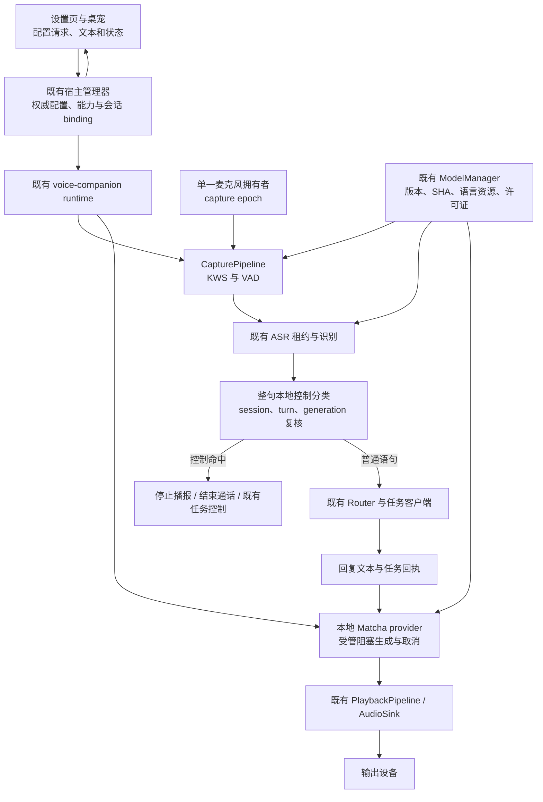
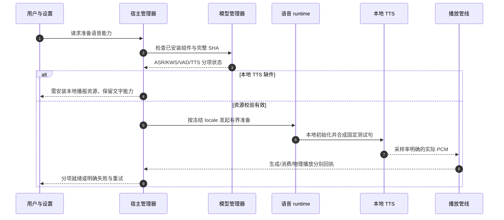
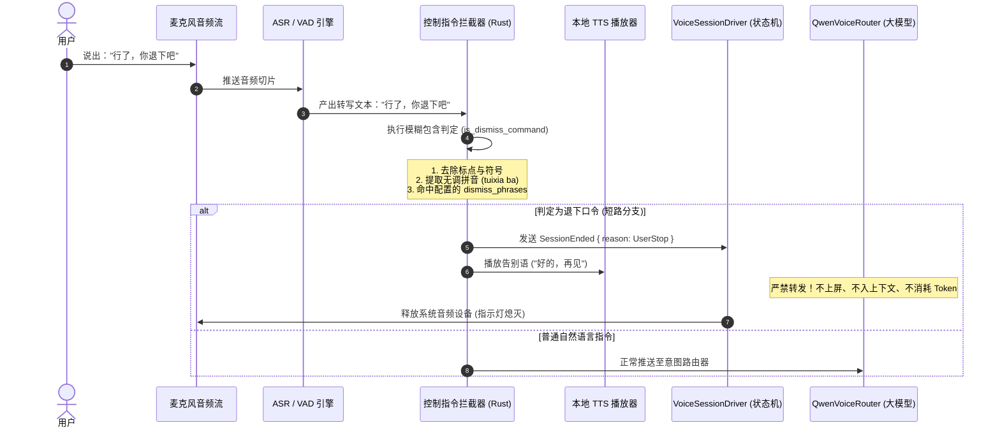
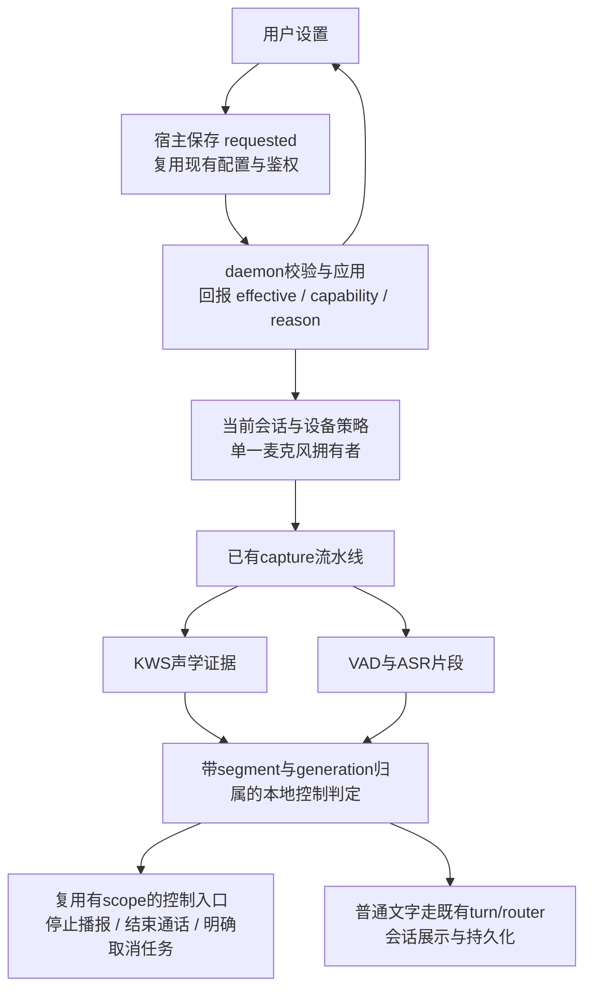
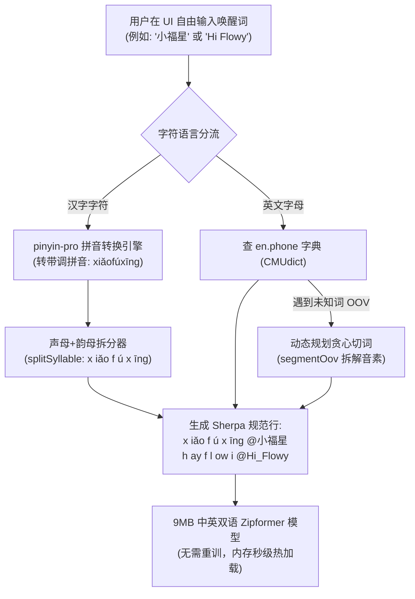

# 语音伴侣本地合成、控制与监听优化 · 实施与验证方案

> **状态：📋 计划，尚未实施或通过产品验收。**
> 日期：2026-10-31，Asia/Hong_Kong。源码核对基线：`b8d6c3aa72d99c8964a22a70e72f8a1bd40c0ef8`；当前分支：`feat/voice-companion-overhaul`，开工时工作区干净。
> 核心原则：本地 TTS 是已确认需求；控制、模型、设备、展示分别验证；旧轮次不能改变新轮次；真实 native 作业结束之前不能假释放所有权。
> 本文是后续执行的当前方案。附录是原始方案和审查历史，不是待逐字实现的指令；与正文冲突时以正文及用户最新指令为准。

## 1. 背景与当前决策

用户希望借鉴桌面语音伴侣的交互方式，改善中英唤醒、本地播报、语音结束通话、麦克风控制与桌宠呈现。前两版方案包含可用的方向，也混入了未经测量的性能承诺、过宽的口令判断和不完整的生命周期设计。

**本轮新增确认：用户明确要求把 TTS 改成本地。** 因而第二版审查中“本地 TTS 尚未得到用户确认”的范围判断已被这次直接指令取代；模型兼容、许可证、资源分发、取消和验证方面的意见仍然有效。保留历史审查原文，不倒改历史。

### 1.1 现状与目标

| 方面 | 当前源码核对结果 | 本方案目标 |
| --- | --- | --- |
| TTS 装配 | `voice-companion/src/voice.rs` 默认 Edge 优先、本地候选兜底；`NOMIFUN_VOICE_TTS_OFFLINE` 只改变优先顺序，仍可回退在线 | 语音伴侣生产播报使用本地 provider，不静默访问 Edge；缺资源或失败有明确反馈 |
| 本地引擎 | `SherpaOfflineTtsProvider` 实际填 VITS 配置；同步初始化/生成位于异步调用内；不是现成的 Matcha 实现 | 使用当前 vendored Sherpa 已支持的 Matcha API，接入有界阻塞执行、取消和实际完成归属 |
| 资源 | `nomifun-voice-models/src/layout.rs::EXPECTED_FILES` 现含 KWS/VAD/ASR，没有 TTS | 同一模型管理入口支持本地 TTS 的安装、校验、删除、恢复和能力状态 |
| 控制 | 有带 scope 的 `stop_session`、播放打断与任务控制；缺少保守的结束通话语音入口 | 停止播报、结束通话、取消后台任务语义明确，语音控制不靠 LLM 猜测 |
| 麦克风 | runtime 持有 `Arc<MicSource>`，需要核对完整消费者与释放链 | 单一设备拥有者按有效消费者开关；关闭/重开具有新 capture epoch |
| KWS | 上轮基线统计为 111 条文本候选、8 条声学路径；当前下载权重是英语模型 | 中英模型与对应词典/编译器成套评测，再开放自定义词；文本别名不冒充声学路径 |
| 桌宠 | 已有透明置顶独立窗口、气泡、hover 输入和多显示器几何模块 | 在现有入口内增量优化吸边、展开与固定面板，不再造窗体/几何系统 |
| 插话 | 生产因缺少已验证的 render reference/AEC，`barge_in_ready` 为 false | 保持真实能力门禁；AEC 单独评测，不把本地 TTS 或桌宠完成当成可用证明 |

以上为源码事实或带出处的历史测量，不是本轮已经跑过模型或真人测试。执行前重新核对 HEAD、候选统计、调用方和有效配置。

### 1.2 需求、推荐决策与非目标

已确认需求：本地 TTS；方案包含验证和正式实施步骤；Windows 为本轮验收平台；已有语音功能和任务归属不能回归。

本方案作出的推荐默认决策，执行者按此实现，不自行扩展产品范围：

1. **本地化边界是语音伴侣通道**：准备播报、回复播报、任务反馈、重播和语音自检的合成统一走本地。对话 LLM 是否联网沿现有路由政策，不宣称整个产品离线。其他功能若确有 Edge 调用方，保留其既有契约；查清调用后删除语音伴侣中已废弃的 Edge/Fallback 装配，不保留第二套线上兜底。
2. **模型选定为分语种 Matcha 路线**：中文 `matcha-icefall-zh-baker`、英文 `matcha-icefall-en_US-ljspeech`，使用各自配套语言前端及官方示例兼容的 `vocos-22khz-univ.onnx`。这是实现候选组合，不等于已确认许可证、声音质量和本机性能通过；S1 先核验这三项。不得临时换成未经审计的大模型或系统云语音来凑通过。
3. **语言跟随冻结的通话语言配置**：新通话采用当前用户语言，通话内冻结；显式切换语言通过现有配置/会话协议生效，不从历史中文消息或字母数量推断整个会话语言。中文固定准备语仍为“创建语音任务中”，英文使用对应英文文案。LLM 回复语言另核对已有契约，不改模型/计费政策。
4. 控制默认白名单保守。结束通话中文 `退下吧`、`结束通话`，英文 `end the call`、`hang up`；停止播报中文 `停止播报`、英文 `stop speaking`。不把“停”“好”“hey”等短词当破坏性控制。任务取消仍复用既有任务作用域控制入口。
5. 保留原 P1 控制、P2 设备、P3 KWS、P4 AEC 的目标；新增 L1 本地 TTS 为正式必修，U1 桌宠为独立体验项。没有用 TTS 替掉设备治理，也没有用 UI 替掉 AEC。
6. 本轮优先交付 L1、P1、P2 的可用链路。P3/U1 分阶段完成；P3 声学证据不足时不得默认迁移，P4 不通过时不启用播报中自动插话，均可独立报告状态。

本轮非目标：ASR 按需休眠投产、重写 Agent loop、改变费用/模型路由、数据库迁移、全局栈设置、新语音框架、语音克隆、广泛风格音色库、自动更新发布、自动操作用户设备或重打安装包。

## 2. 端到端架构与不变量



PCM 进入播放管线，不送给 UI 另建播放器。UI 接收现有事件/快照和错误。上述图省略重复的状态回传边，实际事件仍经既有 EventHub/宿主投影。

### 2.1 不变量

- 同一物理麦克风只有一处拥有其句柄；wake/通话/确认/显式自检是逻辑消费者，不能各开一份设备。
- 播放停止不等于取消任务；结束通话默认不取消已提交的 Agent 任务；取消任务必须命中准确 command/request。
- 控制、错误、播放完成和设置回执在发布前复核当前身份。旧 A 的结果、取消或告别语不能动新 B，队列 B/C 不丢、不乱序、不重复保存。
- 所有 native 加载、推理、排队包含在总 deadline 内。取消异步等待不代表 native 已结束；不提前清 busy，不释放仍被实际调用使用的引擎，不在 Tokio 核心线程同步跑长推理。
- 复用现有受管理 daemon 合同和有限重启预算。非受管理进程不能被新增 watchdog 无条件退出；不以手工 exit75 或异步测试替身证明 native 卡死恢复。
- 本地模式不回退在线合成；资源下载可联网，但与推理分时、明确区分。推理测试关闭下载并记录 provider/模型身份。
- 就绪必须来自资源完整性、初始化/合成验证及真实状态；`is_available`、保存成功、存在目录不能代表完整通话通过。
- 不覆盖真实 `D:/tmp/flowy-dev/models`，不读取用户聊天或录音。所有测试资产/缓存/PCM 输出写独立临时目录。

### 2.2 首次使用时序



无人值守测试使用测试 Sink，只证明 PCM 被软件消费；不能把该回执写成用户已听到。物理播放检查继续由现有显式检查或用户验收产生。

## 3. 核心实现契约

### 3.1 L1：本地 TTS 资源与生产合成

#### 3.1.1 先打通资源，再切默认装配

复用 `nomifun-voice-models` 的 `layout.rs`、`downloader.rs`、`verifier.rs`、`manager.rs` 和现有 `/api/voice/models` 路由，不新增第二个下载服务。当前布局不含 TTS，必须一起修改安装与完整性判断，不能只设置 `models_dir/tts`。

建议新增资源逻辑布局为 `tts/zh/`、`tts/en/`、`tts/shared/`；这是待实现的目录契约，不是假称当前目录已存在。每一语言模型使用独立 acoustic model、tokens、lexicon 或 data_dir/dict_dir/rule 文件；vocoder 可以来自同一权威只读资源文件，但两个引擎是否复用物理内存要测量，不能由“同路径”推断共享 session。

实施时固定完整清单：原始发布 URL/版本、解包内相对路径、完整 SHA-256、字节数、语言、采样率、架构要求及许可证。禁止写缩略 SHA、仅靠大小通过、复用错误语种 tokens。无官方校验值时，从已核实来源取得文件、计算完整 SHA 并记录来源/日期，代码审查后固定；不下载后无条件信任当前任意字节。

许可证门禁覆盖模型权重、训练来源说明、vocoder、词典、语言前端及随附数据（包括实际采用的 `espeak-ng-data`）；项目和 Sherpa 本身许可证不能代替这些资产许可。未确认可分发时不得纳入生产下载清单或资源包，保留阻断证据；不以模型技术可运行推断许可通过。

资源状态需区分：基础识别套件已安装、本地 TTS 未安装、TTS 完整性失败、TTS 已验证可合成。允许在已有状态契约中最小增加兼容的分项字段；不让旧有效识别资产因少了新增 TTS 被删除或自动整包重下。完整“可开始通话”需同时满足现有能力门槛与本地播报要求，文字输入/历史记录仍可用。

下载到 staging 后校验、再按现有原子提交惯例激活版本；校验失败不能覆盖旧 effective 文件。解包限制包根和资源路径，拒绝 traversal/junction/symlink 越界；网络断开、取消、磁盘不足、坏哈希、缺文件、重试及安装后删除均须有反例。旧配置中的启用意图保留；安装完成不自动启用原本关闭的语音。

现有安装 API 是否已有足够的组件范围，S0 先查调用方决定：能内部补齐就不加公共字段；确需扩展时在 `nomifun-api-types` 中以可选字段和缺省兼容实现，同步所有入口和类型。不得创建新的公共 DTO 家族。

#### 3.1.2 Provider 与执行模型

当前 vendored `sherpa-onnx/src/tts.rs::OfflineTtsMatchaModelConfig` 已有 `acoustic_model/vocoder/lexicon/tokens/data_dir/dict_dir`，先复用，不升级/复制 FFI。`generate_with_config` 支持回调继续/终止，但初始化及某些阶段能否及时响应取消仍需实测。

在现有 `tts.rs` 内完成 Matcha 的配置分支与语言选择；如 VITS 仍有实际调用方/用户配置则保留兼容，若确无调用且被替代才删除内部废路径。不要无理由新增通用 engine registry。维护现有 `TtsProvider` 和 `PlaybackPipeline` 消费契约，读全调用方后决定最小内部调整。

原生引擎由串行拥有者持有，通过现有阻塞执行方式运行加载和生成。不得只将当前整个 async mutex 临界段包一层而让取消后无监督地继续占用；安排真实 native 完成回传，绑定不可变 session/turn/generation/job。先复用现有 native runner/监督策略，明确它与 ASR 的锁/准入关系：KWS/VAD 消费不能因整段 TTS 被阻塞；不为不同对象强行共用长期大锁。

采用句子级有界合成与有界输出队列，复用已有句子流和顺序。优先先跑通完整句 WAV/PCM 输出；确需减少首帧等待时才使用回调增量，并证明每段 PCM 只消费一次（回调可能含已生成样本，不得重复累计前缀）。不要承诺 Matcha 已天然实现逐 token 实时播报。

输入要求：拒绝内嵌 NUL、无效长度/参数，避免当前 C 字符串转换 `unwrap` 把输入变成 panic；空文本不生成假音频。限制单段长度并保持语义边界，错误明确传播。输出检查采样率、通道、有限样本、非空、实际时长和非全静音；采样率取引擎实际值，不把 22050 强写成所有模型固定事实；必要重采样用已有实现，不造重采样器。

取消分两层：立即停止向旧播放 generation 提交和停止设备播放；引擎回调收到取消后有界退出。未退出的阻塞任务仍占所有权，后续请求有界等待/失败，必要时按既有 owned-daemon 合同恢复。挂断与告别语互不等待；默认不增加强制告别合成。

#### 3.1.3 语言与播报文本

- 纯中文句走中文模型，纯英文句走英文模型。混合句以稳定的词/短句边界分段，不按每个 ASCII 字母切；数字、日期、缩写、URL、文件路径、emoji、代码块给出确定处理策略和回归样例。
- 冻结的 locale 决定歧义/无文字语言线索时的默认模型；混合句允许连续片段切换语种。两模型不同音色和韵律衔接是已知质量风险，不声称同一说话人。
- 原聊天文本与持久记录不因 TTS 清理而改写；TTS 只处理专用播报副本，保留消息身份。复用既有 Markdown/工具结果转播报规则。
- 诊断复用 `VoiceTtsDiagnostic`，provider 标明具体 local Matcha，`online=false`；模型/语言/版本细节优先日志或最小兼容字段，不能用该诊断替代合成和播放回执。
- 删除语音通道 Edge fallback 后，离线环境缺资源只报真实错误并引导下载；不循环重试云端、不另选系统语音、不更改 LLM 路由。

### 3.2 P1：本地控制、配置与错误

规范化只服务分类，不修改用户原始文本：使用已有 workspace `unicode-normalization` 能力做 NFKC、英文大小写折叠、受控空白合并及**边界**标点剥离。保留词边界，不删除内部引号/语句让引用变成控制。

采用整句白名单加有限礼貌前缀；中文可允许“请”“请你”“好的，”，英文可允许 `please`。如“好的，你退下吧。”可用显式有限模板支持，不任意移除代词或连接词。默认词和用户自定义词均走同一安全校验，不能配置为“确认”“取消”等抢占确认流程的短语。禁止 contains、编辑距离或无调拼音近似匹配挂断；唤醒容错策略不复用于破坏性控制。

以下必须拒绝本地执行并保留原文交正常路由：否定、引用、翻译、条件/假设以及复合命令。例如“不要退下吧”“请把退下吧翻译成英文”“如果我说退下吧会怎样”“他说‘结束通话’”“不要停止播报”“end the call after sending the email”。不能依赖英文 `no` 任意子串过滤，否则会误伤正常单词。

确认/拒绝处于等待状态时，先走既有 scoped confirmation 协议；明确的结束通话仍可终止当前通话，不能自动批准工具。普通 end-call 控制在 ASR 成功后、普通 `SpeechRecognized` 聊天记录和 Router 提交前分流；识别失败仍走既有 scoped Error，不转为空识别。

| 动作 | 可执行结果 | 明确不得产生的副作用 |
| --- | --- | --- |
| 停止播报 | 终止当前 playback generation，恢复合法倾听状态 | 不取消 Agent 任务、不挂断、不清其他排队请求 |
| 结束通话 | 调用现有 scope 校验的 `stop_session`，退役当前通话及确认/队列 | 不取消后台任务、不删除历史、不复活旧会话 |
| 取消任务 | 复用现有 command/request 精确任务控制 | 不用 session_id 代替 task command，不默认取消所有任务 |

播报中无有效 AEC 时，不声称这些语音口令能实时识别；保持可点击停止播报和挂断。不要为了演示而打开生产 `barge_in_ready`。

配置复用 `config/voice_companion.json`、manager 更新串行锁和 GET/PATCH 习惯。新增字段最小化：wake 启用意图、控制短语、关键词和配置 revision 只有实际需要才加；播报模式/音量/回复开关继续复用现有 `VoiceFeedbackConfig`。旧 JSON 缺字段用 serde 默认；校验非法数值/空短语/数量与长度上限；含 f32 的结构不 derive Eq。

主界面展示 requested、effective、应用中/失败原因；持久保存不代表 daemon 已应用。断线重连重放当前 revision 并核对回执，不回写旧 ack；关闭设置不自动开启设备。错误中英映射、恢复清除、所有入口一致；未知错误仍按既有合约保留诊断。

### 3.3 P2：麦克风与监听生命周期

先沿 `MicSource`、capture producer、runtime/worker、自检、restart/drop 逐一核对 Arc 持有者，再把 acquire/release 集中在当前设备模块/运行时拥有者；不凭下面的目标状态矩阵另建第二套总状态机。

| 状态/有效消费者 | 是否持有麦克风 | 处理要求 |
| --- | --- | --- |
| 语音停用，且无显式检查 | 否 | 不因后台重连/下载完成自动打开 |
| wake 关闭、无通话/确认/检查 | 否 | 真正停止采集并释放拥有的 stream/Arc |
| wake 开启、资源和权限有效、待机 | 是 | 免按唤醒必然需要输入；不得承诺指示灯关闭 |
| wake 关闭，但活动通话或合法确认中 | 是 | 仅关闭唤醒不会切断已开始通话 |
| 明确启动设备自检 | 临时持有 | 与已有持有者协调，不另开一份；结束恢复先前意图 |
| 正在播报，AEC 未验证 | 按通话消费者持有或安全丢弃当前帧 | 禁止把回声当新指令；不能把“不识别”说成“未采集” |
| 通话结束、wake 开 | 是，回到合法待机 | 旧通话 PCM/识别/播放回调全部失效 |
| 通话结束、wake 关 | 否 | 最后消费者退役后实际释放 |
| 默认设备改变、设备拔出/权限拒绝 | 退役旧设备，按意图重开或显式失败 | capture epoch 更新；无重开风暴或旧帧污染 |
| daemon 退出 | 否 | 自有句柄/流清理，不能停止用户其他应用 |

每次重新 capture 使用新 epoch；消费者切换、等待租约、第一帧与迟到关闭回执须带同一身份。不能用跨 worker 的 `>=` 或零通配通过旧事件。操作系统麦克风图标还受其他程序影响，只能报告本应用实际 stream/帧/句柄证据。

唤醒打开但 TTS 缺资源时，按照权威能力决定是否允许完整语音开始并显示分项缺件；不要靠桌宠本地 bool 假 ready。用户关闭语音/撤销权限优先于自动重连。

### 3.4 P3：中英 KWS 与自定义唤醒词

选定评测模型为官方 `sherpa-onnx-kws-zipformer-zh-en-3M-2025-12-20`。首个候选组合固定为 chunk-8 的 int8 encoder、fp32 decoder、int8 joiner；tokens 和 `en.phone` 必须来自同一发行包。chunk-16 仅为预先声明的对照组，不能看到失败后无记录改阈值。官方给出的 chunk 模型延迟不是端到端命中时间。[官方模型说明](https://k2-fsa.github.io/sherpa/onnx/kws/pretrained_models/index.html)。

中文编译依据该模型的拼音/声调 token 体系；英文使用配套词典，OOV 需先证明可转换且音素都存在。先核对已有依赖；若缺确定可复用的语言前端，记录最小依赖、许可证与官方算法对照，按仓库新增依赖规则处理，不复制整个别人的语音框架。

只读模型文件不得被动态“编译 tokens.txt”覆盖。用户配置生成单独 keywords 产物，版本键至少绑定模型/词典完整 SHA、编译器版本、配置 revision。原子写入后在无在途 native 作业的安全点创建新 stream；失败保留原 effective，明确提示哪个词无效；不保存成功即宣称已生效。

自定义输入允许范围先限中文/英文短语，拒绝空、全标点、超长、重复、无法编码等；多音字/OOV 必须反馈选择或不支持，不承诺“任意名字”。当前多条 ASR 别名与8条声学路径先完整锁回归，不把“Hey F/Hey L”一类高风险短词直接加入新的常驻声学模型。

评测包括默认中文/英文、人名/混合词、弱读近音、现有误触反例；记录模型命中与后续 ASR 容错各自贡献。LLM 若后续用于扩写候选，只能离线生成待审核文本提案，不能跳过确定编译、权限或声学验证自动生效；本轮不增加 LLM 扩词网络入口。

### 3.5 U1：桌宠呈现增量

复用 `companion/index.tsx`、`windowGeometry.ts`、`companionScreenClamp.ts`、现有 hitmask/click-through/hover 模块及 `ui/platform` 桥接。已有独立窗口，不再新增同功能窗口或新的 geometry 权威。

72px/12px、320×420、6px、250/300ms 仅为参考设计值，可按现有宠物尺寸和可用工作区适配；不强制把现有角色变为圆球。吸边条视觉宽度与交互命中宽度分离，保证可找回、键盘可退出、reduce-motion 关闭动画。

几何统一逻辑与物理像素转换边界，使用当前显示器工作区绝对原点；负坐标、多屏接缝、125/150/200% DPI、任务栏、小于面板宽高的可用区、显示器移除和重连均最终 clamp/缩小/滚动。不要使用 `x > screenWidth / 2` 判断方向。

`is_pinned` 只固定展示，不发起语音通话、不持续持有麦克风；unpin/收起不等于挂断。播报/任务/错误 UI 均来自同一宿主快照，无第二份本地 session/queue。保持活动通话停止/挂断始终可达。

### 3.6 P4：AEC 与快速插话的独立门禁

本地 TTS 能提供本应用准确 render PCM，但这只是 AEC 输入条件，不代表回声消除已可用。需对齐播放时间、重采样、设备延迟、音量、队列和 capture 时钟；系统 loopback 可能包含其他应用声音，不自动视为 Flowy 专用参考。

本轮不启用新设备采集实验，先保留接口说明和受控离线测试入口。真正推进时分远端单讲、近端单讲、双讲、静音、增益变化、设备切换分别测量，冻结可懂度/近端损伤、残余回声、误插话、触发时延门槛。旧 AEC R5 候选 FAIL 仍是历史 FAIL，不因换 TTS 自动重标通过。

只有新产物、实际处理管线和适用设备组合独立通过后，才向对应能力报告 `barge_in_ready=true`。缺证据则维持 false 和停止按钮，允许其他阶段结项；不能用一次虚拟回放证明真实扬声器双讲安全。

## 4. 决策与取舍

| 编号 | 选定决定 | 放弃的路径及原因 |
| --- | --- | --- |
| D1 | 本地 TTS 为必修，语音伴侣离线合成 | 仅 offline 优先仍会联网，不符合本次需求 |
| D2 | Matcha 中英双模型，复用现有 Sherpa/provider/播放器 | 直接假称现 VITS 已支持；引入独立语音服务会增部署与状态复杂度 |
| D3 | 先做许可/资源/本地合成垂直切片，再切默认 | 先删除 Edge 再留缺资源的用户无恢复路径 |
| D4 | 三种控制分开、整句匹配、身份复核 | contains/无调拼音/声学短词直接硬停容易误挂断或取消任务 |
| D5 | 单设备拥有者按消费者控制 | 每入口开设备、全局 armed bool 无法表达活动通话与自检 |
| D6 | 模型、token、词典、keywords 版本绑定 | 只换词表或覆盖下载 tokens 会破坏语种兼容和完整性 |
| D7 | KWS 先配对评测，证据不足不默认替换 | 名字可分词不等于能被人声可靠唤醒 |
| D8 | 桌宠复用现有几何，展示与通话分离 | 固定四象限与 pin 触发后端不能处理多屏和生命周期 |
| D9 | Windows 为本轮结项平台 | 不因无人可验 mac/Linux 而无休止等待；保留编译影响说明 |
| D10 | AEC 能力单独开放 | UI 成功/合成成功不能证明播报中自动插话可用 |

## 5. 验收标准与证据方法

### 5.1 证据等级和性能口径

每项报告分开标注：文本/配置单测、真实 worker 与测试识别器、真实本地模型与测试 Sink、宿主/UI 分段联合、物理设备/真人。不把这些拼成一次真实设备端到端通过。不得将 ignored/skip 当通过，历史通过不代替本轮变更后的复跑。

TTS 必测指标：加载起止、请求进入、native 排队/入场/结束、首段可消费 PCM、首次 Sink 消费、最后消费、取消请求/停止提交/真实完成；报告冷启动和预热、P50/P95/Max、音频秒数、RTF=合成墙钟秒/输出音频秒、Private Bytes/Working Set。RTF<1 不是首句低延迟证明，软件首帧也不是用户听到的声学延迟。

**以下是新制定的初始工程验收门槛，不是已达成的事实：**在 S0 固定同一 Windows x64 CPU/电源模式/线程数、无并行构建条件下，zh/en 各固定30句、每句10–60字/词且输出通常2–15秒；每种语言至少3次新进程冷加载和30次预热请求。预热 P95 RTF≤1.0、短句首次可消费 PCM P95≤1500ms、冷启动首 PCM≤8000ms；单次请求总 deadline≤30s且包含排队/加载/推理。旧预算若更短需沿用或明确收紧，不能直接扩大到30s。门槛失败先定位并优化一次，不通过不默认切本地为“完整就绪”，不得改阈值凑绿。

取消后旧 generation 不得新增 PCM 消费；实现收到取消到停止提交目标≤250ms，native 回调间无响应情况单列，不能假报完成。持续20个中英轮换后无单调内存/任务增长；资源占用上限以 S1 新测量冻结，不挪用历史 ASR 约274MB释放量作为 TTS 数据。无回调前整句生成时，要真实报告长句首帧可能不达标。

KWS 先锁定现有样本和新旧配置配对：原默认词命中不得退化，新增中英标准词至少各20条、多说话人/距离条件分别报告，目标召回≥95%；同一负例集新误触不得多于旧。未取得代表性素材只能证明编译/管线，不能宣称生产声学迁移通过。30分钟零误触只是筛查；若要论证每小时误触≤0.1，在独立同分布 Poisson 假设下零误触需约30小时才有95%单侧上界支持（约3/T），仍不代表覆盖所有环境。不能循环一条静音凑30小时。

### 5.2 可执行验收矩阵

以下 TC 是需要新增/补齐的断言规格，**不是现成测试名或已经通过的结果**。测试命令注册与新文件名称由执行阶段 S0 核实，最终 RUNBOOK 必须写实际可复制命令。

| ID | 触发与方法 | 必须断言 | 证据边界 |
| --- | --- | --- | --- |
| L01 | 新装、缺中文/英文/acoustic/vocoder/前端、坏 SHA、空文件/路径越界 | 不报完整 ready、不联网兜底、缺件指向正确、旧识别资源保留 | 资源与初始化 |
| L02 | 下载取消/断网/磁盘失败，安装后校验、删除重装 | staging不污染effective；所有入口同步失效/恢复；停用意图不变 | 下载测试端点与UI |
| L03 | 真实模型中/英固定句，无网且禁下载 | 两语种均产实际有效PCM并被Sink消费，provider本地、Edge调用计数0 | 真实模型，无物理播放 |
| L04 | 混合句、数字日期、URL/路径、emoji、NUL、空文和长文 | 顺序完整无重复；不panic；原文记录不变；合法失败可见 | 规范化及真实合成 |
| L05 | 冷/热/中英连续轮换、超时、取消、hangup后新B | 指标原始时点齐全；A迟到不动B；native结束前不假idle | actual blocking 与代次 |
| L06 | 配置本地，故障模型+可用在线测试端点 | 在线测试端点请求数仍0；独立全进程网络观测无TTS外连 | 防在线fallback反例 |
| L07 | 准备语、回复流、任务反馈、重播、预览/自检各真实调用点 | 全部使用本地；停播/空结果/错误不清聊天或退出新会话 | 生产caller覆盖 |
| C01 | 各默认口令+NFKC/大小写/标点/有限礼貌结构 | 当前scope仅一次控制，无LLM请求、无空消息 | 确定文本规则 |
| C02 | 否定/引用/翻译/条件/复合语句、相似普通词 | 不控制；原文进入正常路由 | 安全负对照 |
| C03 | A完成/失败/取消回调等锁时启动B，B排队后C | B状态、错误、文字、任务/播放归属不被A修改 | worker/宿主联合 |
| C04 | 结束通话时Agent任务在跑；只停止播报；确认工具中挂断 | 三者副作用分离；无工具误批准；任务可按原协议查询 | 生产控制caller |
| C05 | 保存配置失败/离线/旧ack后到/新会话换locale | requested/effective准确；旧ack不覆盖；中英错误可见 | 配置+UI挂载 |
| M01 | 逐行执行§3.3矩阵，fake capture记录create/drop/epoch | 创建与释放次数精确；多消费者不重复开；最后一个关闭才释放 | 逻辑拥有者 |
| M02 | worker持续20ms PCM、关闭重开、旧帧/识别迟到 | 新epoch只接新帧；原ASR/确认预留不丢；同会话两句均入记录 | 真实worker测试输入 |
| M03 | 物理设备拔插/默认切换/权限/图标观察 | 有界重试、真实释放、没有影响其他程序；未操作则WAITING | 必须物理设备 |
| K01 | 同包model/tokens/词典编译，非法多音/OOV/空/符号输入 | 可编译不等于声学通过；无效输入明确拒绝；模型SHA不变 | 编译合同 |
| K02 | revision A编译慢于B、资源切换/失败重试 | 只激活最新有效版本；旧stream无在途native后退休 | 配置竞争 |
| K03 | 新旧模型同PCM对照、真实人声正负样本 | 每条命中/漏识/误触/时间/资源可追溯，达到预注册门槛才迁移 | 真实模型离线 |
| U01 | 负原点/多屏/DPI/小工作区/显示器断连参数化 | 窗口和可找回hit区位于有效工作区，收起展开可逆 | 纯几何 |
| U02 | light/dark、键盘、reduce-motion、pin/unpin及活动通话 | 反馈可读，控制始终可达；pin不改会话/麦克风 | 组件与真实桌窗分开 |
| J01 | worker两句→router→host→SQLite→UI真实快照 | 原文/回复有scope、只保存一次、持久失败文字保留与真实错误 | 无云联合回放 |
| J02 | A运行时B排队、A完成与B入队交错、C随后 | A/B/C各恰一次顺序记录、回复和合法倾听，无错误退出 | 已合并竞态原回归 |
| A01 | 远端/近端/双讲/静音/增益/设备矩阵 | render/capture计时正确，近端不被吞；失败不置barge_in_ready | 独立AEC，非本轮默认启用 |

防假通过要求：有效的故障注入必须能使对应门禁失败；保留修前/反向 RED、修后 GREEN 及原始错误。网络 L06 不能只断网后“不报错”，须同时证明成功生成PCM、实际调用链不触及Edge；全进程观测不可用时只称provider级无外连，进程级结论保留未测。

### 5.3 无人值守验证和设备验证边界

无需物理声卡即可完成：文本控制/配置、资源完整性/下载测试端点、真实本地模型到PCM、capture worker固定PCM、真实宿主落库与UI、设备拥有者替身、几何参数化、阻塞/取消/重启预算测试。每段关联 session/turn/request/generation/worker/instance，列真实与替身边界。

若需要进程故障验证，仅构建独立 feature headless 产物，绝对路径、角色、完整SHA创建前核验，隐藏启动、短期限、临时端口与目录、自持句柄清理；准确PID+创建时间/路径记录、端口关闭、延后无重启。误指默认daemon必须创建前拒绝。不得自动开默认daemon、枚举并切用户设备、播放或采环境音、读录音/私人聊天、收费自检。用户后续设备许可另行生效，当前方案文件不等于该许可。

真人验收不是自动测试的替代：用户可用核验过的生产二进制主动验证中英、连续两句、任务排队、确认/取消、停止播报、挂断重开、套件删除重装和唤醒开关；未测则报告WAITING，不反复扫参数冒充。

## 6. 正式实施步骤与阶段出场条件

### S0：建立基线与施工回执

1. 重读本方案、AGENTS、相关代码/测试/依赖及模型管理文档；核对实际分支、HEAD、diff、后台Cargo与用户Flowy进程身份，只读观察，不停止用户应用。
2. 创建唯一证据根 `build.noindex/voice-companion-overhaul-execution-<实际日期>/`。写 `PROGRESS.md`、`BLOCKED.md`、`BASELINE.json`，记录当前文件SHA、命令版本、已知失败、历史目录SHA。历史证据只读。
3. 明确源码/测试调用图：TTS所有装配和消费点，MicSource全部拥有者，控制事件发布点，配置写/GET/effective，模型资源状态及所有入口。确认不会落到未启用的ASR休眠原型。
4. 用绝对Rust1.97.1与Bun核对命令注册；先跑受影响现有测试取得**当前**基线，不照抄历史数量。新增验收红测须触及实际caller，不能改坏生产制造RED。
5. 固定性能机器、线程数、测试文本及PCM素材SHA、现有预算、KWS组合与样本门槛。先写不超过10行的目标/顺序/最大风险回执，再动工。

### S1：L1模型许可、资源与真实合成垂直切片

1. 核对模型/前端/vocoder许可与兼容性，产出完整资源清单；不满足则具体阻断生产推广，其他阶段仍可推进。
2. 复用模型管理完成TTS分项状态和安装校验，先补缺件/坏SHA/越界/中断的失败断言，再实现成功路径；接入原设置下载/校验，不做另一个安装器。
3. 以现有TtsProvider写Matcha配置与短句生成，生产级阻塞调用独立有界执行；跑L01–L06中的资源与真实模型测试，收集语音样本到临时目录供试听，不自动播放。
4. 冻结性能/资源结果与语言处理限制；至少中英模型真实输出通过才进入S2生产默认切换。未达门槛先定位，不新增第二套临时TTS服务或偷偷回云。

### S2：L1生产切换与P1本地控制/设置

1. 将voice runtime所有播报caller统一装配本地provider，去除本通道已废弃在线fallback及环境优先级误导；有外部调用方的公共类型保持兼容。配置缺件可恢复，不自动启用语音。
2. 先写C01/C02及A迟到/B新会话反例，再接现有stop_session/播放/任务控制；规范化不改变聊天原文，语音控制不进LLM。
3. 改同一设置权威及回执/错误映射，保留反馈模式/音量/高级诊断；中英、真实挂载、跨窗恢复验证。
4. 跑L07/C01–C05/J01–J02及旧队列、确认、播放取消、超时/所有权回归；全通后记录当前源码SHA绑定的阶段通过。

### S3：P2设备拥有者与生命周期

1. 基于S0调用图在现拥有者处实现消费者判定与capture epoch，先覆盖目标矩阵和真实drop，再改开关逻辑。
2. 自检、默认设备变更、daemon重启、取消和会话结束全部走同一入口；不跨native完成边界释放其他作业。
3. 跑M01/M02与S2联合回归，物理M03未测单列。关闭wake而通话仍在的正例不可省，关闭全部消费者确实释放的反例不可省。

### S4：P3双语KWS与配置闭环

1. 保留当前生产模型，独立临时目录完成模型/词典兼容、确定性编译与新旧PCM对照。
2. 实现独立keywords缓存、revision/effective和安全点切换，覆盖K01/K02；模型tokens只读。
3. K03声学门槛通过才激活默认迁移；否则交付具体缺口，旧有效方案继续明确标识。不能以“等真人”掩盖本可无人值守完成的编译、资源和管线工作。

### S5：U1桌宠与集成收尾

1. 同一几何/窗口模块增量吸边/面板/可访问性；不把UI pin当语音控制。
2. U01/U02、现有桌宠UI与配置测试、light/dark和小屏验证；真实桌窗环境缺失则说明纯函数/组件与窗口验收边界。
3. S1–S5合并工作树后重跑联合链及所有受影响回归。P4只保留明确门禁和后续独立实验，不自动插入设备/AEC开发。

### S6：交付、独立复审与用户验收

1. 补齐文档/类型/脚本注册，运行§7验证梯子。按功能列修改文件、原缺陷、红绿证据、各命令退出码/耗时及基线问题。
2. 单独构建生产voice-companion，从Cargo JSON记录实际路径/完整SHA及feature；核对宿主管理器选择顺序、资源目录与当前开发产物使用关系。**不假设bun run dev会选中新二进制，不自动重启Flowy，不打新安装包。**
3. 可选headless独立复制与生产产物角色分开，禁止拿headless当给用户实测程序；提交前源码变化会使已绑定SHA的验收失效，需要补验。
4. 最终交付 `FINAL_REPORT.zh.md`、`RUNBOOK.md`、`ACCEPTANCE.json`、源码/产物SHA、未测项、资源许可索引与用户步骤。状态分`实施通过/证据不足/未实施`，不写一个“全部GREEN”覆盖分阶段缺口。
5. 本方案不授权自动提交/推送/PR/合并/发布；执行完成交用户审查。日后获得授权再按当前仓库分支、hooks、人类署名与CI流程交付，禁止直接main操作。

## 7. 验证梯子与执行环境

路径固定：Rust `C:/Users/38788/.rustup/toolchains/1.97.1-x86_64-pc-windows-msvc/bin`，Bun `C:/Users/38788/.bun/bin/bun.exe`。避免mise递归。构建串行；不得和其他agent争共享Cargo目录。下列为现有命令的**实施阶段计划**，本次写文档没有运行这些模型/代码测试；S0核实可用性与feature。

```powershell
# 仓库根；本轮不自动安装依赖，不启动生产进程
$voiceRustBin = 'C:/Users/38788/.rustup/toolchains/1.97.1-x86_64-pc-windows-msvc/bin'
$voiceBun = 'C:/Users/38788/.bun/bin/bun.exe'
# 给子构建显式提供相同工具链，不覆盖HOME或CODEX_HOME
$env:PATH = "$voiceRustBin;C:/Users/38788/.bun/bin;$env:PATH"
& "$voiceRustBin/cargo.exe" test --locked -p nomifun-voice-models
& "$voiceRustBin/cargo.exe" test --locked -p nomifun-voice-terminal --features local-tts
& "$voiceRustBin/cargo.exe" test --locked -p nomifun-audio --lib kws
& "$voiceRustBin/cargo.exe" test --locked -p voice-companion --lib
& "$voiceRustBin/cargo.exe" test --locked -p voice-companion --test voice_session --features voice-skeleton
& "$voiceRustBin/cargo.exe" test --locked -p voice-companion --test listening_preroll --features voice-skeleton
& "$voiceRustBin/cargo.exe" test --locked -p voice-companion --test queue_handoff_integration_test --features voice-skeleton
& "$voiceRustBin/cargo.exe" test --locked -p nomifun-app --test voice_dialogue_integration
& "$voiceRustBin/cargo.exe" test --locked -p nomifun-app --lib voice_companion_manager
& $voiceBun run test:voice-joint-trace
# 定向UI测试：先核对文件，再追加本轮新用例
& $voiceBun test ./ui/src/renderer/pages/companion/windowGeometry.test.ts
& $voiceBun run gen:i18n
& $voiceBun run typecheck
& $voiceBun run check:i18n
& $voiceBun run check:theme
& $voiceBun run check:dead-css
& $voiceBun run help --check
& "$voiceRustBin/cargo.exe" fmt --all -- --check
& "$voiceRustBin/cargo.exe" check --locked -p voice-companion --bins
git diff --check
```

这些命令必须逐条检查退出码，不能把一串命令末尾的成功当全部成功。普通provider crate测试可能包含在线/模型用例：S0先按list核对ignore/feature/测试实现；没有许可不得解禁在线用例。定向真实本地模型回放单列可复跑入口，注明输入目录、输出临时目录、模型SHA与硬件禁用参数；不能把`--no-run`计为执行通过。

实施覆盖公共DTO/配置/资源状态后，补相关API/入口测试；改UI必须跑受影响组件及真实挂载用例。阶段定向通过后，交付前按仓库宽检查执行 `cargo check --workspace` 和 `bun run check`，记录明确失败、超时、未运行、基线差异，不能隐藏已有红灯。禁止为了出绿改无关typecheck代码。

## 8. 交付范围、失败处理与验证账本

优先允许路径：`apps/voice-companion/`、`nomifun-voice-terminal`的tts/playback相关文件、`nomifun-audio`的capture/KWS相关文件、`nomifun-voice-models/`、`nomifun-app`的voice manager/既有路由/相关测试、`nomifun-api-types/src/voice.rs`及对应生成类型、UI语音设置/会话/桌宠/i18n与测试、现有模型准备脚本及本方案文档。每一改动写明对应TC；不把白名单当整目录任意重构授权。

本方案不需要改auth/计费/迁移/Agent引擎/全局stack/vendor或release签名。资源许可/下载清单属于必需审计；若新增依赖、release配置或公共破坏性契约才可实现，先按项目规则记录必要性和最小范围，不能顺手执行高风险扩展。

一次模型评测/回放均应有总期限、用例期限和自有子进程限制；超时原错误保留，清理失败独立失败，不按旧PID或进程名批杀。同一失败连续三次停止重复尝试，记录触发/期望/实际/证据/关闭条件并推进无依赖项；不得自动改验收阈值。不要reset/stash/clean或回退用户并发改动。

验收账本每行至少包含：TC编号、源码HEAD与diff/SHA、实际命令、开始结束时间、exit、输入/模型/产物SHA、真实/替身边界、断言、残留检查和未测原因。独立审查须读取生产caller与关键断言并复跑原反例，不仅看报告或测试数量。

### 8.1 本次方案编制实际验证

已做：核对新分支和HEAD；读取本地provider装配、vendored Matcha字段与取消回调、模型布局/路由、播放与语音控制入口、桌宠既有几何模块；复核两版材料和上一轮审查反例；查询官方模型说明。本次只写方案/交接文档与证据，不改业务实现、不运行模型/硬件/云测试。

方案落盘后验证：链接目标存在、历史原文复制一致与完整SHA、正文Mermaid基本语法规则、`git diff --check`和变更范围。基本语法扫描不等于实际Mermaid渲染；若无渲染器按未渲染标注。

## 9. 一手资料与引用边界

- [Sherpa Matcha模型与配套资源](https://k2-fsa.github.io/sherpa/onnx/tts/pretrained_models/matcha.html)：确认候选中英文模型及vocoder/语言资源配套路线，不能推出本机性能、许可已过或自然度已过。
- [Sherpa KWS模型](https://k2-fsa.github.io/sherpa/onnx/kws/pretrained_models/index.html)：中英模型、chunk和混合量化组合；本方案选择chunk-8为候选，不把模型延迟当用户唤醒时延。
- [Sherpa KWS概览](https://k2-fsa.github.io/sherpa/onnx/kws/index.html)：编译格式必须与模型相符。
- [对标项目固定提交的keywords](https://github.com/mini-yifan/dsh-orb-cordis/blob/0655743d3eb9930e014c2e55c6434c31ae7348fe/packages/voice/src/keywords.ts)与[geometry](https://github.com/mini-yifan/dsh-orb-cordis/blob/0655743d3eb9930e014c2e55c6434c31ae7348fe/packages/helper/src/geometry.ts)：参考机制，不移植其全局状态或任务停止语义；不声称运行过该产品。
- [Windows loopback](https://learn.microsoft.com/en-us/windows/win32/coreaudio/loopback-recording)：系统渲染参考的边界；非本轮已经接入AEC。
- 本地权威：[技术方案规范](../../../contributing/technical-solution-standard.zh.md)、[语音模型管理](../model-management.zh.md)、[语音交互](../interaction.zh.md)。

## 附录：原始技术底稿与历史归档

以下将逐字附入V1原始附件、V1核查与建议全文、V2原始附件和V2审查全文。旧文中的main状态、候选结论及“尚未授权本地TTS”只描述当时上下文；当前指令、决策与实施规格见正文。文内旧路径作为历史引用保留，不代表这些目录是新执行输出。

复制来源、原件SHA及附录段落完整性由 `build.noindex/voice-companion-overhaul-planning-20261031/PLAN-PROVENANCE.json` 记录。V1核查本身含V1全文，再单独保留原件是为了使来源与审查各自完整，不表示有两版不同V1。


### 附录 A：V1 原始附件全文

原件：C:/Users/38788/.codex/attachments/f6e1b98e-46f0-4dd9-ae4f-1434c23f6ef3/已粘贴的文本.txt

SHA-256：6D7BF4494ABAB74DC9CFB61A0B434248B9A74F813EB93B0CE4C271C53253CB20

~~~~~~~~~~~~text
> 按照「戒指老爷爷」的指路准则：**对不上就直说对不上**。  
> 25 件工具全部聚焦于**输入侧的思维探针、死局拆解与实验设计**；而“将既定思路整理成一份供他人/其他 Agent 审查的完整技术提案”属于**输出侧表达与架构文档编写**，不应生搬硬套输入侧工具。  
>  
> 本项目在 `docs/contributing/technical-solution-standard.zh.md` 中拥有严格且权威的**《技术方案写作规范》**。下面严格按照本项目的**双层架构标准（易懂正文 + 架构图表 + 决策权衡 + 审坑清单）**，为你输出这份**可直接提交给其他审查 Agent（如 Architecture Reviewer / Security Reviewer）严格过审的技术方案报告**。

---

# 语音伴侣（Voice Companion）体验重塑与架构演进技术方案

> **文档状态**：📋 待审查 (Under Review)  
> **文档定位**：针对当前 Flowy Voice Companion 交互缺乏闭环、词表静态固化、设置项重度工程师视角等问题，吸收开源标杆 `dsh-orb-cordis` 的优秀实践，制定完整的演进方案与审查基准。  
> **核心原则**：**“控制信号与自然对话解耦；声学与文本双轨协同；用户认知卡片化，底层工程诊断收拢。”**

---

## 1. 背景与核心痛点 (Background & Pain Points)

### 1.1 业务背景
Flowy 的 `Voice Companion` 是本地优先（Local-first）自动化平台的核心交互入口，依托独立系统守护进程（`apps/voice-companion`）、`nomifun-audio` 及 `nomifun-voice-terminal` 驱动。然而，在实际用户使用与对标开源插件 `dsh-orb-cordis` 的过程中，发现当前实现存在严重的**“工程师思维主导、用户认知割裂、交互闭环缺失”**问题。

### 1.2 现状三大核心痛点

```text
┌─────────────────────────────────────────────────────────────────────────────┐
│ 痛点 1: 唤醒词与词表静态固化 (Static BPE Hardcoding)                        │
│ crates/backend/nomifun-audio/src/kws.rs 中硬编码了近百条 "HEY FLOWY" 及其中 │
│ 英文谐音变体，强绑定 GigaSpeech BPE。用户无法为自己的助理自定义专属名字。    │
├─────────────────────────────────────────────────────────────────────────────┤
│ 痛点 2: 交互缺乏退下闭环，打断时延大 (Missing Dismiss & High Barge-in Delay)│
│ 1. 只有开始没有退出：用户说完话后，无法通过自然口令（如"退下吧"）结束会话；  │
│ 2. 打断依赖串行 ASR：执行中插话需经完整 VAD 判停+ASR 解码，短名字易被吞字。   │
├─────────────────────────────────────────────────────────────────────────────┤
│ 痛点 3: 设置页完全是底层诊断板 (DevOps/Diagnostic UI)                      │
│ VoiceSettings.tsx 充斥 7 联检、采样率/通道探针、ASR 毫秒测试等底层指标，普通 │
│ 用户既看不懂，也找不到“改名字”、“调语速”、“设口令”等生活化配置项。           │
└─────────────────────────────────────────────────────────────────────────────┘
```

### 1.3 演进能力对比矩阵

| 评估维度 | 当前实现现状 (As-Is) | 本方案目标设计 (To-Be) | 演进价值 |
| :--- | :--- | :--- | :--- |
| **退出/退下机制** | 依赖鼠标点击 UI 按钮或超时强退，无口令闭环 | 支持多条“退下口令”（如“退下吧”），整句同音识别并拦截 | **形成完整对话生命周期闭环**，实现纯语音脱手控制 |
| **中途插话/打断** | 纯 ASR 文本规则匹配，延迟 600~1000ms，短词易吞 | 声学 Spotter 即时打标（`@interject`）+ ASR 拼音末字锚定 | **打断延迟降至 200ms 以内**，双重保险防漏判 |
| **唤醒词配置** | 源码常量固化，不可更改 | 开放词表音素动态编译器，支持 UI 自由新增多条唤醒词 | **打造高度拟人化、个性化专属私人助理** |
| **设置面板体验** | 7 联检、VAD/ASR 探针、硬件流检测等工程师看板 | 四大生活化卡片置顶（唤醒/指令/播报/休眠），诊断折叠 | **普通用户 1 分钟看懂并完成配置**，排错能力完整保留 |
| **硬件隐私安全** | 状态机流转中部分空闲期麦克风仍维持常开 | 严格依据“当前状态可达性”按需持有，无监听立即关流 | **消除操作系统状态栏黄点/麦克风指示隐私疑虑** |

---

## 2. 方案全景与架构设计 (Architecture & Topology)

### 2.1 端到端系统架构拓扑

```mermaid
flowchart TD
    subgraph ClientUI["前端展示与交互层 (React 19 SPA)"]
        UserCards["用户生活化配置卡片 (置顶)<br/>• 助理名字与唤醒回复<br/>• 打断关键词与退下口令<br/>• 播报音色与语速调节<br/>• 空闲休眠与隐私设置"]
        DiagFold["高级工程诊断与排错区 (默认折叠)<br/>• 7 联检自检报告 (capture/kws/vad...)<br/>• 麦克风硬件通道探针 / ASR 基准测试"]
    end

    subgraph HostBridge["后端适配与协议层 (nomifun-app)"]
        PrefRouter["用户偏好适配器 (/api/v1/voice/preferences)"]
        SessionMgr["VoiceCompanionManager (生命周期看门狗)"]
    end

    subgraph Daemon["语音独立守护进程 (apps/voice-companion)"]
        StateEngine["确定性状态机 (Deterministic State Machine)<br/>• listen_mode: off / wake / command / interject<br/>• holds_device: 按需占麦与即时释放"]
        
        subgraph Pipeline["音频捕获与双轨协同流水线"]
            Capture["音频采集 (16kHz PCM / AEC 回声消除)"]
            
            subgraph DualTrack["并发双轨打断管道"]
                Spotter["声学轨道: Sherpa KeywordSpotter<br/>(动态加载唤醒词 + @interject 标签)"]
                ASRWorker["识别轨道: Silero VAD + SenseVoice<br/>(分词转写与文本流)"]
            end
            
            Interceptor{"控制指令短路拦截器<br/>(is_dismiss_command)"}
        end
        
        subgraph Playback["优先级 TTS 播报队列"]
            LocalReply["本地回复: '我在' / '好的，再见' (最高优先级)"]
            FinalResult["任务收尾正文 (排队必播)"]
            ThinkingText["途中思考过程 (赶得上就播，赶不上即丢)"]
        end
    end

    UserCards -->|"PUT preferences"| PrefRouter
    PrefRouter -->|"IPC 实时同步"| StateEngine
    Capture --> DualTrack
    Spotter -->|"1. 100ms 声学命中"| Interceptor
    ASRWorker -->|"2. 文本拼音归一化"| Interceptor
    
    Interceptor -- "命中退下口令" -->|"短路拦截: 不入 LLM 上下文"| LocalReply
    Interceptor -- "普通业务指令" -->|"转交意图路由器"| SessionMgr
    LocalReply -->|"发端终止信号"| StateEngine
```

### 2.2 核心目标 vs. 明确的非目标

* **核心目标 (Goals)**：
  1. 建立自然语言“退下口令”短路拦截机制，触发 `VoiceSessionEndReason::UserStop`，闭环会话生命周期；
  2. 重构 `VoiceSettings.tsx`，形成“四张直觉卡片置顶 + 高级系统诊断折叠”的分层形态；
  3. 构建声学即时打标与 ASR 拼音末字锚定的双轨打断机制；
  4. 设计并预留基于拼音/音素的开放词表 KWS 编译管道（替代硬编码 BPE）。
* **明确的非目标 (Non-Goals)**：
  1. **不重新训练底层模型**：继续复用既有的 Sherpa-ONNX、Silero-VAD 与 SenseVoice 模型权重；
  2. **不破坏既有进程隔离边界**：依然保持 `apps/voice-companion` 作为独立系统守护进程运行，不侵入桌面核心应用；
  3. **不在生产代码中引入任何 Mock 数据**：严格遵守前端质量红线，所有状态必须真实反射底层 Daemon 状态。

---

## 3. 核心设计与子系统规范 (Subsystem Design)

### 3.1 退下指令拦截机制 (Dismiss Command Interceptor)

#### 1. 拦截时序规范
退下口令必须被视为**纯控制信号（Control Signal）**，而非一次发往 LLM 的对话 Turn。



#### 2. 匹配算法与防误杀规则
在 `crates/backend/nomifun-api-types/src/voice.rs` 中新增拦截算法：
* **文本归一化**：经过 Unicode NFKC 归一化，剔除空白、标点（`，。？！,.!?`）并转小写；
* **整句包含匹配**：只要规范化后的短语完整包含配置的口令（如“你退下吧”包含“退下吧”），即可触发；
* **拼音同音匹配（双字及以上）**：对两字及以上口令提取无调拼音（如“推下吧”与“退下吧”拼音均为 `tui xia ba`），自动兼容 ASR 同音字偏差；单字口令（如“退”）强制字面严格对齐，防止误杀。

---

### 3.2 双轨并发打断机制 (Dual-Track Barge-In Pipeline)

针对 Agent 执行过程中用户插话打断迟钝的问题，建立双轨并发探针机制：

1. **声学前置探针（Acoustic Probe）**：
   在转写监听模式下，Sherpa `KeywordSpotter` 依然并行监听，打断词绑定标签 `@interject`。声学模型在 100~150ms 内捕捉到发音，即在内存原子置位 `armed_keyword = true`；
2. **ASR 文本二次校验（Text Verification）**：
   VAD 判停并完成 ASR 解码后，若 `armed_keyword == true`，直接裁定打断成立；若声学因底噪漏判，降级执行**末音节锚定拼音容错匹配**（3 字以上词允许 1 个非尾字识别误差）；
3. **打断收尾动作**：
   立即向当前正在执行的 Agent 任务发送 Abort 信号；立即切断正在推流的音频 PCM 帧；清空 TTS 待播队列；无缝开启新一轮用户会话。

---

### 3.3 数据契约与接口设计 (Data Contracts)

在 `crates/backend/nomifun-api-types/src/voice.rs` 中新增用户偏好 DTO：

```rust
/// 用户级生活化语音交互偏好配置
#[derive(Debug, Clone, PartialEq, Eq, Serialize, Deserialize)]
pub struct VoiceUserPreferences {
    /// 语音主开关
    pub voice_enabled: bool,
    /// 唤醒词开关
    pub wake_enabled: bool,
    /// 唤醒词列表（一行一条，默认 ["Hey Flowy", "你好 Flowy"]）
    pub wake_words: Vec<String>,
    /// 唤醒后的应答语（默认 "我在"）
    pub wake_reply: String,
    
    /// 插话关键词（默认 "Flowy"，留空表示执行期不监听打断）
    pub interject_keyword: String,
    /// 退下口令列表（默认 ["你退下吧", "退下吧", "休息吧"]）
    pub dismiss_phrases: Vec<String>,
    /// 退下后的告别语（默认 "好的，再见"）
    pub dismiss_reply: String,
    
    /// 播报开关
    pub tts_enabled: bool,
    /// 播报音色标识符
    pub tts_voice: String,
    /// 语速倍率 (0.5 ~ 2.0，基准 1.0)
    pub tts_speed: f32,
    /// 音量百分比 (0 ~ 100)
    pub tts_volume: u8,
    
    /// 空闲无操作自动休眠时长（秒，默认 30）
    pub idle_timeout_secs: u32,
}

impl Default for VoiceUserPreferences {
    fn default() -> Self {
        Self {
            voice_enabled: true,
            wake_enabled: true,
            wake_words: vec!["Hey Flowy".into(), "你好 Flowy".into()],
            wake_reply: "我在".into(),
            interject_keyword: "Flowy".into(),
            dismiss_phrases: vec!["你退下吧".into(), "退下吧".into(), "休息吧".into()],
            dismiss_reply: "好的，再见".into(),
            tts_enabled: true,
            tts_voice: "default".into(),
            tts_speed: 1.0,
            tts_volume: 100,
            idle_timeout_secs: 30,
        }
    }
}
```

---

### 3.4 设置界面重塑规范 (User-Centric UI Architecture)

对 `ui/src/renderer/pages/settings/VoiceSettings.tsx` 实施视图分层重塑：

```text
┌────────────────────────────────────────────────────────────────────────┐
│ 模块 1：语音唤醒 (Wake-up Card)                                        │
│  [Switch] 开启语音唤醒                                                 │
│  • 唤醒词列表 (Textarea, 多行支持) - "每一行一个唤醒词，留空表示停用唤醒"│
│  • 唤醒应答语 (Input) - "唤醒成功后助理说的话 (如：我在、请吩咐)"        │
├────────────────────────────────────────────────────────────────────────┤
│ 模块 2：交互与指令词 (Command & Interject Card)                        │
│  • 插话打断词 (Input) - "助理正在工作或长篇念读时，说出此词可立即打断"   │
│  • 退下口令列表 (Textarea) - "对话结束时说出任意一条，助理自动退出并休眠" │
│  • 退下告别语 (Input) - "助理退下时说的礼貌用语 (如：好的，再见)"        │
├────────────────────────────────────────────────────────────────────────┤
│ 模块 3：语音播报 (TTS Voice & Speech Card)                             │
│  [Switch] 开启语音播报                                                 │
│  • 音色选择 (Select) - 直观中文名称（如“温柔女声”、“沉稳男声”）         │
│  • 语速滑块 (Slider 0.5x ~ 2.0x) / 音量滑块 (Slider 0% ~ 100%)         │
├────────────────────────────────────────────────────────────────────────┤
│ 模块 4：自动休眠与隐私 (Idle & Privacy Card)                           │
│  • 空闲超时 (Select/Slider) - 15秒 / 30秒 / 60秒 / 永不                │
│  • 隐私说明 - "当前状态无可用听法时，麦克风流彻底关闭，绝不在后台录音"   │
├────────────────────────────────────────────────────────────────────────┤
│ ▼ 高级选项与系统诊断 (Advanced System Diagnostics, 默认折叠 <details>)  │
│  [展开后查看] 7 联检自检报告、麦克风设备采样率探针、ASR 毫秒级测试控制台 │
└────────────────────────────────────────────────────────────────────────┘
```

---

## 4. 关键决策与权衡矩阵 (Decision & Trade-off Matrix)

| 编号 | 核心决策项 | 选定方案 | 放弃的备选方案与理由 |
| :--- | :--- | :--- | :--- |
| **D1** | **退下指令拦截层级** | **在 Rust 伴侣进程（`asr_lifecycle.rs`）拦截** | ❌ **在前端 React 拦截**：如果由前端判断，伴侣守护进程在网络波动或前端卡顿时无法及时切断音频并释放麦克风，无法做到底层状态一致性。 |
| **D2** | **打断判定技术路线** | **声学 Spotter 并发打标 + 文本拼音二次校验（双轨协同）** | ❌ **纯 ASR 文本规则匹配**：端到端延迟高达 800ms 以上，且短促关键词在长语音中被 ASR 吞字的概率超 30%，用户体验极差。 |
| **D3** | **设置面板重构模式** | **“生活化卡片置顶 + 高级工程诊断折叠”双层结构** | ❌ **完全删除底层诊断页面**：丢失了开发与现场排错能力（如排查麦克风无声、驱动故障、模型哈希损坏）；<br/>❌ **维持现状并在上方硬塞输入框**：页面更加混乱冗长。 |
| **D4** | **唤醒词扩展方案** | **引入轻量级拼音-音素动态分词编译器** | ❌ **依赖本地重型 G2P 深度学习模型**：模型体积增加上百兆，增加守护进程冷启动延迟与内存负担。 |

---

## 5. 验收标准与验证矩阵 (Acceptance Criteria & Verification Ladder)

### 5.1 验收标准用例表 (Test Cases)

| 用例编号 | 场景分类 | 操作路径 / 输入 | 预期判定标准 (断言口径) |
| :--- | :--- | :--- | :--- |
| **TC-VC-001** | **退下口令拦截** | 语音输入包含口令（如“好的，你退下吧”） | 1. 文本**不上屏、不入 LLM 对话历史**；<br/>2. 触发本地播放“好的，再见”；<br/>3. 发出 `SessionEnded { reason: UserStop }`；<br/>4. 麦克风硬件在 200ms 内释放。 |
| **TC-VC-002** | **退下防误杀** | 语音输入自然包含字眼（如“退一步海阔天空”） | 判定不命中口令，文本正常提交给意图路由器执行。 |
| **TC-VC-003** | **双轨即时打断** | Agent 播报 TTS 期间说出打断词“Flowy” | 1. TTS 音频流在 200ms 内瞬时静音；<br/>2. 待播队列完全清空；<br/>3. 伴侣立刻切入 Listening 状态接收新指令。 |
| **TC-VC-004** | **偏好持久化** | 在 UI 修改退下口令为“跪安吧”，重启伴侣 | 重启后读出配置依然生效，且说出“跪安吧”可触发退下。 |
| **TC-VC-005** | **隐私指示释放** | 在设置中关闭唤醒词开关 | 操作系统麦克风指示灯（macOS 黄点 / Windows 图标）立即熄灭。 |

### 5.2 验证梯子 (Verification Ladder)
按照项目规范依次执行最小验证闭环：
1. **Rust 单元测试**：`cargo test -p nomifun-api-types --test c2_voice_dto_golden`（断言 DTO 序列化与正则拦截）；
2. **伴侣状态机测试**：`cargo test -p voice-companion --test voice_session`（断言退下事件与状态迁移）；
3. **前端代码与国际化质量门禁**：`bun run check:i18n && bun run check:theme && bun run typecheck`；
4. **全套质量守门**：`cargo check --workspace && bun run check`。

---

## 6. 审查焦点：供其他 Agent 重点审查的风险清单 (Reviewer Focus)

请参与评审的 Agent 重点对以下底层边界与架构风险进行 Cross-Check：

1. **状态死锁与清理并发竞态 (Deadlock Risks)**：
   * 在用户突然触发“退下”或“打断”时，底层音频推流协程、VAD 监听协程与 tokio `CancellationToken` 的联动释放是否存在悬挂风险？
2. **模糊匹配算法的误杀边界 (False-Positive Thresholds)**：
   * 针对 2 字口令（如“退下”）开启无调拼音（`tui xia`）匹配时，在复杂长句语料库中是否存在被误断定退下的边界隐患？是否需要增加“必须独立成句或位于句首/句尾”的结构性约束？
3. **配置版本向前兼容性 (Backward Compatibility)**：
   * 老版本未配置 `VoiceUserPreferences` 的用户本地 `config.toml`，在初次升级读取时是否能无缝降级到系统默认值，而不触发反序列化 Panic？

---

> **报告归档说明**：本方案已对齐 Flowy 现行工程规范，可直接交付给评审 Agent 作为需求验收与架构评审的基准输入。
~~~~~~~~~~~~


### 附录 B：V1 核查与建议全文（含其原始附录）

原件：D:/workSpace/git_clone_test/allo/build.noindex/voice-experience-proposal-research-20261031/RESEARCH-AND-PROPOSAL.zh.md

SHA-256：6F45522407C93A2257FD6718235C0E913AEE9BC1AC2AAAD4242370517178A1F9

~~~~~~~~~~~~text
# 语音伴侣体验与控制能力优化 · 核查及方案

> 状态：建议方案，未实施。日期：2026-10-31（Asia/Hong_Kong）。
> 本地源码基线：main，b8d6c3aa72d99c8964a22a70e72f8a1bd40c0ef8；本轮不复审已合并分支，不改业务代码。
> 对标源码固定于 mini-yifan/dsh-orb-cordis 的 0655743d3eb9930e014c2e55c6434c31ae7348fe；源码存在不等于已在本机验证性能。
> 原则：控制动作按作用域执行；模型能力与配置分开表达；设备状态如实呈现；先形成产品闭环，再按证据开放播报中插话。

## 1. 事实、推论与价值判断

附件包含三类不同材料：

- 可核查事实：现有候选/配置/UI能力、对标项目实际函数、模型token体系、DTO能否编译。
- 需要实测的推论：100–150ms声学命中、端到端200ms打断、短词漏识别超过30%、某设备200ms释放、换模型后召回率。
- 产品取舍：卡片化、是否自动取消任务、是否允许同音挂断、是否自动播告别语。它们需要明确决策，不能冒充外部技术事实。

### 1.1 五档核查结果

| 附件主张 | 可信度 | 核查与修正 |
| --- | --- | --- |
| Flowy唤醒候选静态固化，缺少面向用户的自定义词表入口 | 已证实 | kws.rs权威表当前111条文本候选，其中8条带声学BPE；neural初始化仍调用default_keywords_bpe。111条不是111条声学发音，也不是支持任意名字。 |
| dsh-orb确有退下/插话配置及动态编译 | 已证实 | settings.ts、dismiss.ts、keywords.ts、child.ts存在相应实现；不能据此推断其误触率或Windows设备效果。 |
| 当前没有“退下口令”入口 | 基本成立，但需要收窄 | 已有scope校验的stop_session和任务取消/查询；缺少的是语音结束通话的本地词法入口与用户配置，不是缺整个生命周期。 |
| 当前打断只是串行ASR，所以慢 | 明显错误，作为当前归因 | voice.rs明确因没有render reference/AEC，在生产将barge_in_ready设false；replay才允许打开。问题先是能力门禁，不能只归咎ASR延迟。 |
| 设置页完全没有用户配置、诊断未折叠 | 明显错误，作为当前描述 | 已有VoiceFeedbackSettingsSection，含反馈模式、音量、回复播报开关；高级诊断已有details折叠。7项完整通话检查是准备能力，不宜无差别藏起来。 |
| “包含口令+无调拼音”可安全结束通话 | 存在争议；直接照搬不推荐 | 对标确实这样匹配，但会误伤否定/引用/翻译/假设语句。确定性控制的成本高于一般问答漏识别，应采用更保守边界。 |
| 声学100–150ms、打断低于200ms、短词漏30%以上 | 证据不足 | 附件无样本、机器、计时点、分位数、误触率或原始日志。均不能写成已达到的产品指标。 |
| armed_keyword能让声学命中立即硬停任务 | 明显错误，按附件数据流 | 对标child在命中时只置位，随segment入ASR队列；host在utterance到达后才调用interject。它提高短词判定可靠性，不等于即时硬停。 |
| 不训练权重即可自定义KWS | 基本成立，但需要收窄 | Sherpa支持开放词表；必须匹配当前model/tokenizer/词典，仍需声学评测。开放词表不保证任意语种、名字都好用。 |
| 拼音编译器直接替代当前英语BPE | 明显错误，按直接替换含义 | GigaSpeech模型只支持英语；对标使用另一中英模型及en.phone/拼音token。不能只改词表格式而保留不匹配的权重与tokens。 |
| 关闭wake开关必然让麦克风指示熄灭 | 明显错误，作为无条件承诺 | 活动通话、确认、显式自检仍需要麦克风；待机免按唤醒也必须持续取得音频。需按所有有效消费者判断。 |
| 提议DTO可以直接复制使用 | 明显错误 | f32不实现Eq，原derive不能编译；Default实现本身不提供Serde缺字段兼容；当前语音配置是config/voice_companion.json，不是附件假设的config.toml。 |

### 1.2 推理链中的关键漏洞

1. 把“开源项目有此代码”当成“它在Windows上满足延迟与误触率要求”。本次没有运行对标项目或采集设备音频。
2. 把命中可靠性、声学识别时延、控制执行时延、耳朵听到的停止时延混成同一个200ms。
3. 把KWS词表编码当成通用拼音字符串转换，忽略声学模型的建模单元。
4. 把打断播报、取消Agent任务、结束语音会话合成一个Abort动作，会重新引入旧A误动新B的问题。
5. 把逻辑不处理音频、停止取得PCM、销毁物理采集流、释放ASR模型当作一种“休眠”。四者并不等价。
6. 把本地确定性控制等同零网络/零费用：不调用LLM不代表告别TTS一定本地、无费用。

## 2. 原始证据与小实验

### 本地代码入口

- crates/backend/nomifun-audio/src/kws.rs:125–135、369起、495起：固定声学token与候选生成。
- apps/voice-companion/src/voice.rs:1820起：已有stop_session，检查scope、失效输入generation、打断播报、abort异步等待、清当前语音队列、发布UserStop。
- 同文件:2248/2337/2349：实际ASR→SpeechRecognized→本地任务控制/路由；新增通话控制应在普通消息发布及路由前判定。
- 同文件:3333起：生产barge_in_ready=false；4290附近已有基于VAD的replay打断结构。
- 同文件:1212、1293及crates/backend/nomifun-audio/src/mic.rs：MicSource由RAII持有，Drop才通知采集线程退出。
- ui/src/renderer/pages/settings/VoiceSettings.tsx:1110起：已有反馈设置与高级details；VoiceFeedbackSettings.tsx:43–58：音量、开关、requested/effective状态。
- crates/backend/nomifun-app/src/voice_companion_manager.rs:1170、1951起、2943起：JSON配置、已有feedback持久化/下发/回读，总开关缺配置时不会自动开启。
- apps/voice-companion/src/voice/asr_lifecycle.rs：仍是独立原型，当前生产voice.rs没有调用AsrLifecycleOwner，不适合作为新控制指令的接线入口。

### 本轮最小实验

1. candidate-count.json：111条文本候选、8条声学路径。
2. contains-counterexamples.json：只复刻对标的字面包含分支，8条人工构造输入中5条应为普通对话却匹配退下。例如“不要退下吧”“请把退下吧翻译成英文”“如果我说退下吧你会做什么”。这是构造反例，不是线上误触率，也未运行完整pinyin-pro或声学链。
3. eq-float-probe.rs：Rust1.97.1仅编译元数据，实际E0277：f32: Eq不满足。未编译/运行生产daemon。
4. 本轮没有性能测量、模型评测、硬件录音或云调用；不能从文本反例推断声学质量。

### 一手来源

- [对标listen.ts：监听模式与设备持有策略](https://github.com/mini-yifan/dsh-orb-cordis/blob/0655743d3eb9930e014c2e55c6434c31ae7348fe/packages/voice/src/listen.ts)
- [对标dismiss.ts：字面包含与拼音容错](https://github.com/mini-yifan/dsh-orb-cordis/blob/0655743d3eb9930e014c2e55c6434c31ae7348fe/packages/voice/src/dismiss.ts)
- [对标keywords.ts：模型tokens/词典驱动编译](https://github.com/mini-yifan/dsh-orb-cordis/blob/0655743d3eb9930e014c2e55c6434c31ae7348fe/packages/voice/src/keywords.ts)
- [对标child.ts：arm、入队、ASR结果后发utterance](https://github.com/mini-yifan/dsh-orb-cordis/blob/0655743d3eb9930e014c2e55c6434c31ae7348fe/packages/voice/src/child.ts#L680-L712)
- [对标host voice.ts：收到utterance再执行控制](https://github.com/mini-yifan/dsh-orb-cordis/blob/0655743d3eb9930e014c2e55c6434c31ae7348fe/packages/host/src/voice.ts#L525-L595)
- [对标Windows WASAPI/AEC3源码](https://github.com/mini-yifan/dsh-orb-cordis/blob/0655743d3eb9930e014c2e55c6434c31ae7348fe/packages/voice/native/windows-voice-capture.cpp)
- [Sherpa开放词表与tokenizer类型](https://k2-fsa.github.io/sherpa/onnx/kws/index.html)
- [Sherpa预训练模型：英语与中英模型有区别](https://k2-fsa.github.io/sherpa/onnx/kws/pretrained_models/index.html)
- [WebRTC Audio Processing Module](https://webrtc.googlesource.com/src/+/refs/heads/main/modules/audio_processing/g3doc/audio_processing_module.md)
- [微软WASAPI loopback](https://learn.microsoft.com/en-us/windows/win32/coreaudio/loopback-recording)
- [Rust Eq与浮点类型](https://doc.rust-lang.org/std/cmp/trait.Eq.html)

## 3. 补强后的最合理方案

### 3.1 目标、非目标与架构

目标：用户能明确结束通话/停止播报；配置有真实生效反馈；麦克风持有原因可解释；自定义名字按模型支持程度可验证；后续再开放有证据的播报中插话。

非目标：不合并Agent与语音daemon、不重写稳定的TurnOwner/租约/watchdog、不启ASR休眠、不默认更换模型或增加付费LLM步骤、不宣称已实现全双工。



不是再造一套顶层状态机。若需要off/wake/command/interject，只把它们作为现有会话phase、用户开关、确认状态和AEC能力导出的监听策略，不能与现有phase各自推进。

### 3.2 控制语义先分开

| 动作 | 建议默认口令 | 作用范围 |
| --- | --- | --- |
| 停止本轮播报 | 别念了；停止播报；stop speaking | 失效当前playback generation并停止当前输出；不隐式取消后台任务。 |
| 结束语音通话 | 结束通话；挂断通话；退下吧；end the call；hang up | 复用当前scope的stop_session。清当前会话输入/待播，不擅自终止后台Agent任务。 |
| 取消任务 | 取消当前任务；cancel the current task | 沿既有任务控制/授权/command_id通道。未知或过期任务不能被旧口令取消。 |
| 关闭语音功能 | UI明确操作，首版不开放宽泛口令 | 停止监听并释放本功能拥有的采集流；不自动重启或启用。 |

普通任务执行中说下一句仍按既有排队逻辑处理，不能因新“插话”能力把所有下一句都变成取消旧任务。单独喊助手名字最多进入候选控制/收听状态，不能直接授权有副作用的Agent取消。

匹配首版：NFKC/大小写归一化，但保留英文词边界；优先完整独立口令，允许有限礼貌前缀/后缀，其他语义内容不混入。否定、引用、翻译、假设、条件句不执行控制。已有任务控制分类器可复用其保守原则，避免复制多个contains规则。

不确定时按普通对话处理或澄清；不要为了控制去掉整句原文。无调拼音只在独立口令、明确启用且验证过的受控别名范围使用；首版不启用任意同音自动挂断，更不全局允许“末字相同、前字任错一个”。

控制不调用LLM、不生成空聊天行，但界面保留本地操作状态；告别语可关闭、有界、不得延迟停止，失败不阻塞SessionEnded。默认“好的，再见”/“Okay, goodbye”按冻结locale生成；没有本地TTS能力不能标本地播报，不能偷偷调用云TTS。

### 3.3 单一设备拥有者与可解释隐私

从现有MicSource/CPAL捕获生命周期最小演进；一个采集源供KWS/VAD/ASR共享。策略计算输出“需要谁监听、为何持有设备”，由同一拥有者执行开/关并回报真实状态，避免每帧同步开关或每个UI窗口各自开麦。

| 场景 | 设备/模式建议 |
| --- | --- |
| 关闭语音、无显式自检 | 释放本功能采集流，off。 |
| 通话结束、免按唤醒开启 | 保持wake；明确提示“待命唤醒，麦克风正在使用”。 |
| 唤醒关闭、当前无通话/确认/自检 | off并释放设备。 |
| 唤醒关闭、通话仍活动 | command或确认监听，不能把麦克风直接关掉。 |
| 正在播报、AEC未验证 | 明示当前不支持播报中语音插话；停止/挂断UI仍可用。避免将整段语音能力永久退化。 |
| 正在播报、AEC能力验证可用 | 才允许该配置下的interject监听，失效即降级并解释。 |

设备关闭确认、模型常驻、ASR卸载是不同状态。OS指示灯还可能由其他应用保持，不能保证关闭Flowy一定让系统图标熄灭。设备重开后必须换capture epoch、清旧PCM；不能把旧epoch片段交给新会话。

### 3.4 动态唤醒词：按模型编译，不按想象生成token

保留当前默认词表作迁移起点，用户自定义词与生成的token分开存储。UI不得接受“保存成功”就暗示已具有声学唤醒能力。

建议流程：输入短语→验证语言/长度/数量→按模型tokenizer编译→校验所有token存在、路径唯一且非空→离线试识别→应用并回报版本与可用原因。失败则拒绝新配置，保留并明确显示此前有效配置；删除全部词应明确停用，不暗中使用旧列表。

第一种可选路线：保持当前英语模型，使用匹配的BPE模型支持英语名字；中文仍标受限能力。第二种可选路线：用官方现有中英模型做小范围离线比较，验证词典/拼音token、许可证、SHA、下载及Windows运行库后再决定迁移，不训练新权重。推荐先做这个模型对照实验，再承诺任意中英名字。

编译只解决“模型读得懂词表”，不能保证读得准。多音字提供读音选择；OOV、超短词、普通高频词明确提示。LLM仅可作为可选候选别名建议器，不能伪造token、自动扩大高风险词表或作为每次唤醒的必经步骤。助手名字、UI语言和LLM回复语言保持分离，复用已有locale冻结。

模型、tokens和compiler版本绑定在缓存键中；仅在配置变化且达到安全切换点更新KWS stream，不能抢占现有native作业或让已移除词在旧stream继续生效。

### 3.5 播报中插话：AEC先行，证据打标与动作执行分层

Windows原生WASAPI + WebRTC AEC3是可研究路线，不是本轮已验证结果。优先评估能否复用本应用真实输出的render reference；若需要loopback，说明其可能包含整个系统混音，不能声称只取得Flowy声音。[微软说明](https://learn.microsoft.com/en-us/windows/win32/coreaudio/loopback-recording)明确了这一语义。

只有具备正确render/capture时间轴、延迟/漂移处理和近端保真证据，才能逐配置标barge_in_ready；“库初始化成功”不是声学验收。文本回声过滤只是补充，不能替代AEC，也不能过滤掉用户跟读的真实请求。

声学命中记录至少归属当前segment、generation和配置版本；换worker/会话/词表时失效。不要使用无归属、无过期的全局armed bool。ASR低置信度不能把旧段命中授权给新段。

分两个不同承诺：
- 稳健模式：声学证据辅助ASR完成后的控制判定；改善短词漏字，但仍有断句和解码时延。
- 后续快速模式：经过AEC与误触评测的声学命中可先暂时停止当前播报，缓冲用户后续指令，再做文本判定。不得仅凭声学命中立即Abort有副作用任务。新指令复用当前会话/队列，不强建新会话。

通知继续复用既有PlaybackPipeline及去重机制。任务结果“必达”指持久记录可查，不代表挂断后仍强制播报；用户停止与新输入优先于旧A收尾。不要新增第二个与现有通知队列竞争的通用优先级框架。

### 3.6 设置与兼容：增量补齐

建议四个面向用户的区域：
1. 唤醒与名字：当前可用语言/词表、测试、真实麦克风状态。
2. 通话与控制：明确说明停止播报、结束通话、取消任务的区别。
3. 播报与反馈：保留现有模式/音量/回复开关；音色/语速只展示当前provider真正支持的选项，不支持则说明。
4. 待命与隐私：唤醒待命是否占麦、何时自动结束通话；ASR模型休眠不混在这里默认启用。

套件下载安装/故障恢复、准备检查失败、活动通话stop/hangup必须醒目；细分采样率、逐帧统计放现有高级details。无需先推倒1300行设置页。

复用现有config/voice_companion.json与feedback的requested/effective机制，缺字段按旧语义读取，不默认开启此前关闭的语音。新增设置若daemon未确认，显示“已保存，待应用/不支持”，不由UI本地ready布尔值造绿。不要一开始增加平行的VoiceUserPreferences配置源和新路由。

若扩DTO：保持可选字段/Serde默认与范围校验，f32不得derive Eq，并验证is_finite；语速范围按provider能力，音量复用既有单位；中英提示对称、light/dark均可见。

## 4. 分阶段实施与退出条件

| 阶段 | 做什么 | 验收与退出条件 |
| --- | --- | --- |
| P1：产品闭环 | 保守结束通话/停止播报控制；现有设置补齐；requested/effective与locale | 文本反例全过；控制0次LLM请求、无空聊天；旧A迟到不动B，后台任务不被挂断口令隐式取消。 |
| P2：设备策略 | 一处计算监听策略与MicSource开关；真实状态与原因可见 | wake关闭但活动通话不误断；全部消费者关闭后自有采集流退出；关闭/重开切epoch，旧PCM不流入新会话。硬件图标效果单列待测。 |
| P3：自定义名字 | 当前英语BPE与中英模型受控对照，再开放编译/试用 | 编译与实际匹配一致；无效/短/同音/多音配置清晰反馈；中英与默认词分别报告召回/误触，未通过不迁移默认模型。 |
| P4：播报中插话 | 独立Windows render-reference/AEC与双轨实验 | 先证明TTS-only不自触发、near-only不吞字、double-talk可懂，才开放逐配置快速模式；未过则保留显式停止入口并结束该实验。 |

优先P1、P2，P3先做离线小实验；P4不作为前三阶段无限等待的总门槛。每阶段独立可交付，不把自定义名字与全双工AEC绑成一次巨大改造。

## 5. 可执行验证设计

- 控制语料：正向独立/礼貌口令；反向否定、引用、翻译、假设、条件句、英文词边界、相近普通词、多音字。新增句子不能只验证“包含目标字串”。
- worker→宿主→UI：固定PCM与可控识别器验证控制不路由LLM、普通消息照常投影，挂断期间排队B和迟到A有scope fence；另对真实模型离线回放单列证据。
- 设备拥有者：受控开关、失败/重试/重连、自检竞争、切设备，断言真实句柄/回执；fake设备证明生命周期逻辑，不证明OS灯或实声效果。
- KWS声学：固定模型SHA、同一素材配对跑默认/自定义/候选模型；清晰/远场/噪声/不同发音、TTS-only与非关键词负例分别报告，不用文字匹配单测冒充声学召回。
- 时延拆开记录t0关键词结束、t1声学命中、t2控制接纳、t3 sink确认中断、t4实际扬声器停止，另记录VAD末帧与ASR完成。200ms可先作为“t1→t3软件路径P95”候选目标，不能偷换成“开口→扬声器静音已达200ms”。阈值先预注册，再测P50/P95/最大值与失败样本。
- 负例时长与统计可信度：30分钟零误触只是一轮烟测。在近似Poisson假设下，零事件的95%单侧误触率上界约3/T；T=0.5h约6次/小时，无法支持“每十小时不到一次”。若要用零事件支持0.1次/小时，约需30小时覆盖。独立素材/代表性仍重要；不能拿重复一段音频假装足够覆盖。
- 无人值守可以完成上述文本、状态机、句柄、固定PCM和模型对照；未经授权不采环境音、不改默认麦克风/扬声器、不启真云。真实设备声学与OS指示效果未测时明确列出，不能把无设备测试算作物理证明。
- Windows作为当前交付平台。运行最小相关Rust/Bun测试、typecheck/i18n/theme和现有49项/队列回归；使用项目已存在命令并在执行前核对，不按附件写一个仅名称相似的DTO测试就声称正则/ASR/设备全覆盖。

## 6. 当前可以相信到什么程度

可以确信：本地控制分层、按当前可达能力持有麦克风、按模型编译词表、设置保存与真实生效分离，是值得借鉴的机制；对标确有相应源码。

可以立即形成实施任务的部分：P1保守口令与设置增量、P2单一设备策略。需要实验后再决定的部分：中英自定义名字默认模型、带AEC的播报中快速插话。不能承诺的部分：任意口音/名字、固定200ms端到端、零误触、所有设备即刻熄灯。

本报告为下一步设计输入，不是已实施功能声明；本轮只做只读代码/公开源码核对和两个无设备小实验。原始附件完整保留在下方；原文件副本与SHA见ORIGINAL-PROPOSAL.txt、original-provenance.json。

---

## 附录：用户原始方案全文（逐字保留）

> 按照「戒指老爷爷」的指路准则：**对不上就直说对不上**。  
> 25 件工具全部聚焦于**输入侧的思维探针、死局拆解与实验设计**；而“将既定思路整理成一份供他人/其他 Agent 审查的完整技术提案”属于**输出侧表达与架构文档编写**，不应生搬硬套输入侧工具。  
>  
> 本项目在 `docs/contributing/technical-solution-standard.zh.md` 中拥有严格且权威的**《技术方案写作规范》**。下面严格按照本项目的**双层架构标准（易懂正文 + 架构图表 + 决策权衡 + 审坑清单）**，为你输出这份**可直接提交给其他审查 Agent（如 Architecture Reviewer / Security Reviewer）严格过审的技术方案报告**。

---

# 语音伴侣（Voice Companion）体验重塑与架构演进技术方案

> **文档状态**：📋 待审查 (Under Review)  
> **文档定位**：针对当前 Flowy Voice Companion 交互缺乏闭环、词表静态固化、设置项重度工程师视角等问题，吸收开源标杆 `dsh-orb-cordis` 的优秀实践，制定完整的演进方案与审查基准。  
> **核心原则**：**“控制信号与自然对话解耦；声学与文本双轨协同；用户认知卡片化，底层工程诊断收拢。”**

---

## 1. 背景与核心痛点 (Background & Pain Points)

### 1.1 业务背景
Flowy 的 `Voice Companion` 是本地优先（Local-first）自动化平台的核心交互入口，依托独立系统守护进程（`apps/voice-companion`）、`nomifun-audio` 及 `nomifun-voice-terminal` 驱动。然而，在实际用户使用与对标开源插件 `dsh-orb-cordis` 的过程中，发现当前实现存在严重的**“工程师思维主导、用户认知割裂、交互闭环缺失”**问题。

### 1.2 现状三大核心痛点

```text
┌─────────────────────────────────────────────────────────────────────────────┐
│ 痛点 1: 唤醒词与词表静态固化 (Static BPE Hardcoding)                        │
│ crates/backend/nomifun-audio/src/kws.rs 中硬编码了近百条 "HEY FLOWY" 及其中 │
│ 英文谐音变体，强绑定 GigaSpeech BPE。用户无法为自己的助理自定义专属名字。    │
├─────────────────────────────────────────────────────────────────────────────┤
│ 痛点 2: 交互缺乏退下闭环，打断时延大 (Missing Dismiss & High Barge-in Delay)│
│ 1. 只有开始没有退出：用户说完话后，无法通过自然口令（如"退下吧"）结束会话；  │
│ 2. 打断依赖串行 ASR：执行中插话需经完整 VAD 判停+ASR 解码，短名字易被吞字。   │
├─────────────────────────────────────────────────────────────────────────────┤
│ 痛点 3: 设置页完全是底层诊断板 (DevOps/Diagnostic UI)                      │
│ VoiceSettings.tsx 充斥 7 联检、采样率/通道探针、ASR 毫秒测试等底层指标，普通 │
│ 用户既看不懂，也找不到“改名字”、“调语速”、“设口令”等生活化配置项。           │
└─────────────────────────────────────────────────────────────────────────────┘
```

### 1.3 演进能力对比矩阵

| 评估维度 | 当前实现现状 (As-Is) | 本方案目标设计 (To-Be) | 演进价值 |
| :--- | :--- | :--- | :--- |
| **退出/退下机制** | 依赖鼠标点击 UI 按钮或超时强退，无口令闭环 | 支持多条“退下口令”（如“退下吧”），整句同音识别并拦截 | **形成完整对话生命周期闭环**，实现纯语音脱手控制 |
| **中途插话/打断** | 纯 ASR 文本规则匹配，延迟 600~1000ms，短词易吞 | 声学 Spotter 即时打标（`@interject`）+ ASR 拼音末字锚定 | **打断延迟降至 200ms 以内**，双重保险防漏判 |
| **唤醒词配置** | 源码常量固化，不可更改 | 开放词表音素动态编译器，支持 UI 自由新增多条唤醒词 | **打造高度拟人化、个性化专属私人助理** |
| **设置面板体验** | 7 联检、VAD/ASR 探针、硬件流检测等工程师看板 | 四大生活化卡片置顶（唤醒/指令/播报/休眠），诊断折叠 | **普通用户 1 分钟看懂并完成配置**，排错能力完整保留 |
| **硬件隐私安全** | 状态机流转中部分空闲期麦克风仍维持常开 | 严格依据“当前状态可达性”按需持有，无监听立即关流 | **消除操作系统状态栏黄点/麦克风指示隐私疑虑** |

---

## 2. 方案全景与架构设计 (Architecture & Topology)

### 2.1 端到端系统架构拓扑

```mermaid
flowchart TD
    subgraph ClientUI["前端展示与交互层 (React 19 SPA)"]
        UserCards["用户生活化配置卡片 (置顶)<br/>• 助理名字与唤醒回复<br/>• 打断关键词与退下口令<br/>• 播报音色与语速调节<br/>• 空闲休眠与隐私设置"]
        DiagFold["高级工程诊断与排错区 (默认折叠)<br/>• 7 联检自检报告 (capture/kws/vad...)<br/>• 麦克风硬件通道探针 / ASR 基准测试"]
    end

    subgraph HostBridge["后端适配与协议层 (nomifun-app)"]
        PrefRouter["用户偏好适配器 (/api/v1/voice/preferences)"]
        SessionMgr["VoiceCompanionManager (生命周期看门狗)"]
    end

    subgraph Daemon["语音独立守护进程 (apps/voice-companion)"]
        StateEngine["确定性状态机 (Deterministic State Machine)<br/>• listen_mode: off / wake / command / interject<br/>• holds_device: 按需占麦与即时释放"]
        
        subgraph Pipeline["音频捕获与双轨协同流水线"]
            Capture["音频采集 (16kHz PCM / AEC 回声消除)"]
            
            subgraph DualTrack["并发双轨打断管道"]
                Spotter["声学轨道: Sherpa KeywordSpotter<br/>(动态加载唤醒词 + @interject 标签)"]
                ASRWorker["识别轨道: Silero VAD + SenseVoice<br/>(分词转写与文本流)"]
            end
            
            Interceptor{"控制指令短路拦截器<br/>(is_dismiss_command)"}
        end
        
        subgraph Playback["优先级 TTS 播报队列"]
            LocalReply["本地回复: '我在' / '好的，再见' (最高优先级)"]
            FinalResult["任务收尾正文 (排队必播)"]
            ThinkingText["途中思考过程 (赶得上就播，赶不上即丢)"]
        end
    end

    UserCards -->|"PUT preferences"| PrefRouter
    PrefRouter -->|"IPC 实时同步"| StateEngine
    Capture --> DualTrack
    Spotter -->|"1. 100ms 声学命中"| Interceptor
    ASRWorker -->|"2. 文本拼音归一化"| Interceptor
    
    Interceptor -- "命中退下口令" -->|"短路拦截: 不入 LLM 上下文"| LocalReply
    Interceptor -- "普通业务指令" -->|"转交意图路由器"| SessionMgr
    LocalReply -->|"发端终止信号"| StateEngine
```

### 2.2 核心目标 vs. 明确的非目标

* **核心目标 (Goals)**：
  1. 建立自然语言“退下口令”短路拦截机制，触发 `VoiceSessionEndReason::UserStop`，闭环会话生命周期；
  2. 重构 `VoiceSettings.tsx`，形成“四张直觉卡片置顶 + 高级系统诊断折叠”的分层形态；
  3. 构建声学即时打标与 ASR 拼音末字锚定的双轨打断机制；
  4. 设计并预留基于拼音/音素的开放词表 KWS 编译管道（替代硬编码 BPE）。
* **明确的非目标 (Non-Goals)**：
  1. **不重新训练底层模型**：继续复用既有的 Sherpa-ONNX、Silero-VAD 与 SenseVoice 模型权重；
  2. **不破坏既有进程隔离边界**：依然保持 `apps/voice-companion` 作为独立系统守护进程运行，不侵入桌面核心应用；
  3. **不在生产代码中引入任何 Mock 数据**：严格遵守前端质量红线，所有状态必须真实反射底层 Daemon 状态。

---

## 3. 核心设计与子系统规范 (Subsystem Design)

### 3.1 退下指令拦截机制 (Dismiss Command Interceptor)

#### 1. 拦截时序规范
退下口令必须被视为**纯控制信号（Control Signal）**，而非一次发往 LLM 的对话 Turn。


#### 2. 匹配算法与防误杀规则
在 `crates/backend/nomifun-api-types/src/voice.rs` 中新增拦截算法：
* **文本归一化**：经过 Unicode NFKC 归一化，剔除空白、标点（`，。？！,.!?`）并转小写；
* **整句包含匹配**：只要规范化后的短语完整包含配置的口令（如“你退下吧”包含“退下吧”），即可触发；
* **拼音同音匹配（双字及以上）**：对两字及以上口令提取无调拼音（如“推下吧”与“退下吧”拼音均为 `tui xia ba`），自动兼容 ASR 同音字偏差；单字口令（如“退”）强制字面严格对齐，防止误杀。

---

### 3.2 双轨并发打断机制 (Dual-Track Barge-In Pipeline)

针对 Agent 执行过程中用户插话打断迟钝的问题，建立双轨并发探针机制：

1. **声学前置探针（Acoustic Probe）**：
   在转写监听模式下，Sherpa `KeywordSpotter` 依然并行监听，打断词绑定标签 `@interject`。声学模型在 100~150ms 内捕捉到发音，即在内存原子置位 `armed_keyword = true`；
2. **ASR 文本二次校验（Text Verification）**：
   VAD 判停并完成 ASR 解码后，若 `armed_keyword == true`，直接裁定打断成立；若声学因底噪漏判，降级执行**末音节锚定拼音容错匹配**（3 字以上词允许 1 个非尾字识别误差）；
3. **打断收尾动作**：
   立即向当前正在执行的 Agent 任务发送 Abort 信号；立即切断正在推流的音频 PCM 帧；清空 TTS 待播队列；无缝开启新一轮用户会话。

---

### 3.3 数据契约与接口设计 (Data Contracts)

在 `crates/backend/nomifun-api-types/src/voice.rs` 中新增用户偏好 DTO：

```rust
/// 用户级生活化语音交互偏好配置
#[derive(Debug, Clone, PartialEq, Eq, Serialize, Deserialize)]
pub struct VoiceUserPreferences {
    /// 语音主开关
    pub voice_enabled: bool,
    /// 唤醒词开关
    pub wake_enabled: bool,
    /// 唤醒词列表（一行一条，默认 ["Hey Flowy", "你好 Flowy"]）
    pub wake_words: Vec<String>,
    /// 唤醒后的应答语（默认 "我在"）
    pub wake_reply: String,
    
    /// 插话关键词（默认 "Flowy"，留空表示执行期不监听打断）
    pub interject_keyword: String,
    /// 退下口令列表（默认 ["你退下吧", "退下吧", "休息吧"]）
    pub dismiss_phrases: Vec<String>,
    /// 退下后的告别语（默认 "好的，再见"）
    pub dismiss_reply: String,
    
    /// 播报开关
    pub tts_enabled: bool,
    /// 播报音色标识符
    pub tts_voice: String,
    /// 语速倍率 (0.5 ~ 2.0，基准 1.0)
    pub tts_speed: f32,
    /// 音量百分比 (0 ~ 100)
    pub tts_volume: u8,
    
    /// 空闲无操作自动休眠时长（秒，默认 30）
    pub idle_timeout_secs: u32,
}

impl Default for VoiceUserPreferences {
    fn default() -> Self {
        Self {
            voice_enabled: true,
            wake_enabled: true,
            wake_words: vec!["Hey Flowy".into(), "你好 Flowy".into()],
            wake_reply: "我在".into(),
            interject_keyword: "Flowy".into(),
            dismiss_phrases: vec!["你退下吧".into(), "退下吧".into(), "休息吧".into()],
            dismiss_reply: "好的，再见".into(),
            tts_enabled: true,
            tts_voice: "default".into(),
            tts_speed: 1.0,
            tts_volume: 100,
            idle_timeout_secs: 30,
        }
    }
}
```

---

### 3.4 设置界面重塑规范 (User-Centric UI Architecture)

对 `ui/src/renderer/pages/settings/VoiceSettings.tsx` 实施视图分层重塑：

```text
┌────────────────────────────────────────────────────────────────────────┐
│ 模块 1：语音唤醒 (Wake-up Card)                                        │
│  [Switch] 开启语音唤醒                                                 │
│  • 唤醒词列表 (Textarea, 多行支持) - "每一行一个唤醒词，留空表示停用唤醒"│
│  • 唤醒应答语 (Input) - "唤醒成功后助理说的话 (如：我在、请吩咐)"        │
├────────────────────────────────────────────────────────────────────────┤
│ 模块 2：交互与指令词 (Command & Interject Card)                        │
│  • 插话打断词 (Input) - "助理正在工作或长篇念读时，说出此词可立即打断"   │
│  • 退下口令列表 (Textarea) - "对话结束时说出任意一条，助理自动退出并休眠" │
│  • 退下告别语 (Input) - "助理退下时说的礼貌用语 (如：好的，再见)"        │
├────────────────────────────────────────────────────────────────────────┤
│ 模块 3：语音播报 (TTS Voice & Speech Card)                             │
│  [Switch] 开启语音播报                                                 │
│  • 音色选择 (Select) - 直观中文名称（如“温柔女声”、“沉稳男声”）         │
│  • 语速滑块 (Slider 0.5x ~ 2.0x) / 音量滑块 (Slider 0% ~ 100%)         │
├────────────────────────────────────────────────────────────────────────┤
│ 模块 4：自动休眠与隐私 (Idle & Privacy Card)                           │
│  • 空闲超时 (Select/Slider) - 15秒 / 30秒 / 60秒 / 永不                │
│  • 隐私说明 - "当前状态无可用听法时，麦克风流彻底关闭，绝不在后台录音"   │
├────────────────────────────────────────────────────────────────────────┤
│ ▼ 高级选项与系统诊断 (Advanced System Diagnostics, 默认折叠 <details>)  │
│  [展开后查看] 7 联检自检报告、麦克风设备采样率探针、ASR 毫秒级测试控制台 │
└────────────────────────────────────────────────────────────────────────┘
```

---

## 4. 关键决策与权衡矩阵 (Decision & Trade-off Matrix)

| 编号 | 核心决策项 | 选定方案 | 放弃的备选方案与理由 |
| :--- | :--- | :--- | :--- |
| **D1** | **退下指令拦截层级** | **在 Rust 伴侣进程（`asr_lifecycle.rs`）拦截** | ❌ **在前端 React 拦截**：如果由前端判断，伴侣守护进程在网络波动或前端卡顿时无法及时切断音频并释放麦克风，无法做到底层状态一致性。 |
| **D2** | **打断判定技术路线** | **声学 Spotter 并发打标 + 文本拼音二次校验（双轨协同）** | ❌ **纯 ASR 文本规则匹配**：端到端延迟高达 800ms 以上，且短促关键词在长语音中被 ASR 吞字的概率超 30%，用户体验极差。 |
| **D3** | **设置面板重构模式** | **“生活化卡片置顶 + 高级工程诊断折叠”双层结构** | ❌ **完全删除底层诊断页面**：丢失了开发与现场排错能力（如排查麦克风无声、驱动故障、模型哈希损坏）；<br/>❌ **维持现状并在上方硬塞输入框**：页面更加混乱冗长。 |
| **D4** | **唤醒词扩展方案** | **引入轻量级拼音-音素动态分词编译器** | ❌ **依赖本地重型 G2P 深度学习模型**：模型体积增加上百兆，增加守护进程冷启动延迟与内存负担。 |

---

## 5. 验收标准与验证矩阵 (Acceptance Criteria & Verification Ladder)

### 5.1 验收标准用例表 (Test Cases)

| 用例编号 | 场景分类 | 操作路径 / 输入 | 预期判定标准 (断言口径) |
| :--- | :--- | :--- | :--- |
| **TC-VC-001** | **退下口令拦截** | 语音输入包含口令（如“好的，你退下吧”） | 1. 文本**不上屏、不入 LLM 对话历史**；<br/>2. 触发本地播放“好的，再见”；<br/>3. 发出 `SessionEnded { reason: UserStop }`；<br/>4. 麦克风硬件在 200ms 内释放。 |
| **TC-VC-002** | **退下防误杀** | 语音输入自然包含字眼（如“退一步海阔天空”） | 判定不命中口令，文本正常提交给意图路由器执行。 |
| **TC-VC-003** | **双轨即时打断** | Agent 播报 TTS 期间说出打断词“Flowy” | 1. TTS 音频流在 200ms 内瞬时静音；<br/>2. 待播队列完全清空；<br/>3. 伴侣立刻切入 Listening 状态接收新指令。 |
| **TC-VC-004** | **偏好持久化** | 在 UI 修改退下口令为“跪安吧”，重启伴侣 | 重启后读出配置依然生效，且说出“跪安吧”可触发退下。 |
| **TC-VC-005** | **隐私指示释放** | 在设置中关闭唤醒词开关 | 操作系统麦克风指示灯（macOS 黄点 / Windows 图标）立即熄灭。 |

### 5.2 验证梯子 (Verification Ladder)
按照项目规范依次执行最小验证闭环：
1. **Rust 单元测试**：`cargo test -p nomifun-api-types --test c2_voice_dto_golden`（断言 DTO 序列化与正则拦截）；
2. **伴侣状态机测试**：`cargo test -p voice-companion --test voice_session`（断言退下事件与状态迁移）；
3. **前端代码与国际化质量门禁**：`bun run check:i18n && bun run check:theme && bun run typecheck`；
4. **全套质量守门**：`cargo check --workspace && bun run check`。

---

## 6. 审查焦点：供其他 Agent 重点审查的风险清单 (Reviewer Focus)

请参与评审的 Agent 重点对以下底层边界与架构风险进行 Cross-Check：

1. **状态死锁与清理并发竞态 (Deadlock Risks)**：
   * 在用户突然触发“退下”或“打断”时，底层音频推流协程、VAD 监听协程与 tokio `CancellationToken` 的联动释放是否存在悬挂风险？
2. **模糊匹配算法的误杀边界 (False-Positive Thresholds)**：
   * 针对 2 字口令（如“退下”）开启无调拼音（`tui xia`）匹配时，在复杂长句语料库中是否存在被误断定退下的边界隐患？是否需要增加“必须独立成句或位于句首/句尾”的结构性约束？
3. **配置版本向前兼容性 (Backward Compatibility)**：
   * 老版本未配置 `VoiceUserPreferences` 的用户本地 `config.toml`，在初次升级读取时是否能无缝降级到系统默认值，而不触发反序列化 Panic？

---

> **报告归档说明**：本方案已对齐 Flowy 现行工程规范，可直接交付给评审 Agent 作为需求验收与架构评审的基准输入。
~~~~~~~~~~~~


### 附录 C：V2 原始附件全文

原件：C:/Users/38788/.codex/attachments/a58de771-c3c3-45e1-8d94-dd6e997b10e2/已粘贴的文本.txt

SHA-256：2DFAE686E39A4029496F25FE9C6D59A4DFAC2705316A17AD0BA79DD674CF5E80

~~~~~~~~~~~~text
> 按照「戒指老爷爷」的指路准则：你现在手上有一个已经被验证过的优秀范例（`dsh-orb-cordis`），希望深挖它在**桌宠悬浮呈现、中英唤醒词根本解法、人性化配置交互**上的设计亮点，并将这些关键选择反向拆解、反哺到 Flowy 的架构中。  
> 此时对应的外脑工具是：**【二、学习】里的 `reverse-teardown`（反向拆解）**。

下面将插件中那些真正拉开体验差距的**“桌宠悬浮呈现、中英双语 KWS 架构、人性化配置交互”**进行深度剖析，结合上一轮审查 Agent 的硬核防误杀意见，整理出这份**全面升级的《Flowy 语音伴侣全栈体验与架构演进方案（第二版）》**，供你直接交给审查 Agent 进行下一轮评审。

---

# Flowy 语音伴侣全栈体验与架构演进方案 (第二版·多维度反哺篇)

> **文档状态**：📋 待审查 (Under Review)  
> **演进方向**：深度吸收 `dsh-orb-cordis` 的三大核心体验底座（**边缘吸附桌宠悬浮窗**、**9MB 中英双语 KWS 音素架构**、**人性化渐进配置界面**），结合审查意见中的**“防误杀守卫”**与**“Matcha+Vocos 本地 TTS 替代在线”**，形成 Flowy 消费级语音伴侣的完整标准。

---

## 1. 深度反向拆解：插件拉开体验差距的三个关键设计

### 1.1 桌宠悬浮呈现与边缘吸附交互（`packages/helper/src/geometry.ts`）
Flowy 目前的桌面伴侣（`VoiceCallDock` / `VoicePetInput`）偏向于固定在窗口底部的通话条或输入框，缺乏桌面宠物的“呼吸感”与“随叫随到”属性。
`dsh-orb-cordis` 真正拉开差距的悬浮窗工程设计包括：
1. **轻巧球体与透明外边距（72px Ball + 12px Inset）**：窗口只渲染一个 72px 的无边框透明圆球，外围留 12px 阴影光晕缓冲区，完全摆脱传统操作系统矩形窗口的笨重感；
2. **边缘智能贴边吸附（Docking Tab）**：拖动球体到屏幕左/右边缘松手时，自动滑入屏幕边缘（250ms 平滑动画），露出一根仅 **6px 宽的小色条（Dock Tab）**，带有轻微发光（Glow）；鼠标滑过色条，球体自动滑出（300ms），绝不遮挡用户的日常写代码或办公视线；
3. **四象限碰撞自适应展开（Collision-Free Expansion）**：球体弹出 320×420px 的对话面板时，**根据球体在屏幕的实时坐标计算方向**（靠右则向左展开、靠下则向上展开），气泡绝不会超出屏幕显示范围；
4. **三态生命周期（Hover 临时窥视 vs Pin 钉住会话 vs Dismiss 退下）**：
   * **鼠标悬停（Hover）**：临时展开看一眼输出，鼠标移开立即收拢；
   * **语音唤醒 / 点击图钉（Pin）**：面板持久钉住，进入专注对话；
   * **退下口令 / 超时（Unpin）**：解除钉住，平滑收回为球。

---

### 1.2 唤醒词中英文方案的根本破解（为什么之前卡在 GigaSpeech？）

审查 Agent 之前一针见血地指出：*“当前 GigaSpeech 模型仅支持英语 BPE，不能直接套中文拼音词表。”* 这正是为什么当前 Flowy 的代码里只能硬编码 111 条形如 `hey flurry`、`黑 flowy` 的英文字母谐音。

#### 插件是怎么彻底解决中英文唤醒的？
查阅插件源码 `models/kws/README.md` 与 `keywords.ts`，作者的根本解法是：**弃用纯英文 GigaSpeech，选用了 Sherpa-ONNX 官方的轻量双语模型——`sherpa-onnx-kws-zipformer-zh-en-3M-2025-12-20`！**



* **模型规格**：仅约 **9 MB**（比 Flowy 原有的 4.8MB 仅多 4MB），参数量 3M，纯 CPU 资源占用可忽略不计；
* **为什么它能通吃中英**：它的 `tokens.txt` 既包含完整的汉字声韵母（`zh/ch/sh`、`iǎo/ú/īng` 等），又包含完整的英文音素；
* **对 Flowy 的启示**：Flowy 无需再为 GigaSpeech 编写无休止的谐音补丁，**在模型分发中将 KWS 模型升级为这个官方 9MB 中英双语 Zipformer**，就能立刻拥有一模一样的自由中文命名和英文命名能力！

---

### 1.3 用户配置的人性化设计哲学（消除“工程师黑话”）

插件设置页之所以被普通用户称赞，在于其严格遵守了**“渐进式呈现（Progressive Disclosure）”与“用户心智模型”**：

1. **大开关一键起停**：顶部一个【语音主开关】，新安装默认关闭，不骚扰用户；开启时如抽屉般丝滑展开，关闭时保留已配置参数；
2. **带单位与物理意义的滑块**：
   * 不写 `0.25`、`1500`，而是展示为：**冷却 `1.5 秒`**（带提示：“一次唤醒后，这段时间内不再重复响应”）；**语速 `1.4 倍`**；**音量 `100% 原始音量`**；
3. **行内伴生下载与状态锁定（Inline Progress）**：
   * 不把用户赶去其它下载页面。下载按钮直接放在对应的配置卡片底部；
   * 模型未就绪时，输入框呈锁定态，点击弹出大白话提示“需先下载语音模型”；点击下载后，进度条直接在卡片内流式填充，下载完瞬时解锁。

---

## 2. 升级后 Flowy 语音伴侣端到端架构

结合审查 Agent 的防误杀守卫、本地 Matcha+Vocos TTS 替换以及上述三项新发现，重构后的端到端架构如下：

```mermaid
flowchart TD
    subgraph FloatingChrome["桌面桌宠悬浮交互层 (Desktop Companion Shell)"]
        Orb["72px 悬浮球体 / 边缘 6px 吸附小条 (Dock Tab)"]
        Bubble["320×420 智能避让气泡对话框<br/>• 流式 Markdown / 代码折叠<br/>• Hover 临时预览 / Pin 钉住会话"]
        Orb <-->|"悬停展开 / 退下收起"| Bubble
    end

    subgraph UserSettings["人性化设置界面 (VoiceSettings.tsx 重构)"]
        TopSwitch["[Switch] 开启语音交互功能"]
        Card1["1. 语音唤醒: 自定义中英文名字 (多行) + 唤醒回复 ('我在')"]
        Card2["2. 通话控制: 退下口令 ('退下吧') + 告别语 ('好的，再见')"]
        Card3["3. 本地播报: Matcha+Vocos 中英双语离线引擎 (语速/音量滑块)"]
        Card4["4. 空闲休眠: 闲置 30 秒自动解除钉住并收拢"]
        FoldDiag["▼ 高级系统诊断 (默认折叠 &lt;details&gt;): 采样率探针 / ASR 基准测试"]
    end

    subgraph RustDaemon["系统守护进程 (apps/voice-companion)"]
        StateEngine["确定性状态机 (纯函数驱动)<br/>• 判定 ListenMode: Off / Wake / Command<br/>• 智能占麦判定 holds_microphone"]
        
        subgraph SafeControl["控制指令分流与防误杀守卫"]
            Guard{"句式安全守卫<br/>• 否定句过滤 ('不要退下')<br/>• 引用/翻译句过滤 ('翻译退下')<br/>• 独立口令匹配"}
        end
        
        subgraph Pipeline["离线双引擎流水线"]
            KWS["9MB 双语 KWS (Zipformer)<br/>中英音素动态编译 tokens.txt"]
            ASR["本地 SenseVoice 语音识别"]
            TTS["本地 Matcha-TTS (标贝+LJSpeech) + 共享 Vocos 声码器"]
        end
    end

    UserSettings --> RustDaemon
    Bubble <-->|"IPC 状态流"| StateEngine
    StateEngine --> SafeControl
    SafeControl -- "命中退下" -->|"短路拦截: 不进 LLM"| TTS
    SafeControl -- "业务指令" --> ASR
    ASR --> TTS
    TTS -->|"PCM 音频"| Bubble
```

---

## 3. 核心子系统详细改造规划

### 3.1 桌宠悬浮窗与气泡交互系统（移植至 Flowy 前端）
在 `ui/src/renderer/pages/companion/` 中重塑桌面伴侣呈现：

* **几何计算引擎（`companionGeometry.ts`）**：
  * 定义常量：`BALL_SIZE = 72`，`PANEL_WIDTH = 320`，`PANEL_HEIGHT = 420`，`DOCK_TAB_WIDTH = 6`；
  * 实现基于屏幕物理工作区的贴边吸附判定：当球心距离屏幕边缘 $< 30px$ 时，触发贴边吸附，缩成小条；
  * 实现展开四象限判定：若 `x > screenWidth / 2`，气泡向左展开；若 `y > screenHeight / 2`，气泡向上展开，杜绝出界。
* **三态会话联动**：
  * 状态机维护 `is_pinned: bool`：
    * 语音唤醒命中 $\rightarrow$ 设为 `is_pinned = true`，气泡平滑展开；
    * 语音识别到退下口令 $\rightarrow$ 设为 `is_pinned = false`，气泡收起并滑向边缘。

---

### 3.2 唤醒词中英双语终极方案（升级为 9MB 双语 Zipformer）

彻底解决审查 Agent 提出的“GigaSpeech 无法支持拼音”的硬矛盾：

1. **升级模型依赖**：
   在 `crates/backend/nomifun-voice-models` 中，将 KWS 资产升级为官方标准的 **`sherpa-onnx-kws-zipformer-zh-en-3M-2025-12-20`**（内含中英双语 `tokens.txt` 和 `en.phone`）；
2. **在 Rust 端实现动态音素分词编译（`kws_compiler.rs`）**：
   * **中文**：对汉字字符进行轻量拼音转换并按声母/韵母拆分成 token；
   * **英文**：直接查 `en.phone`，未知词通过动态规划（`segment_oov`）拆解为已知音素；
   * 输出标准的 `tokens @label` 规则，动态重载 Sherpa 的 `KeywordSpotter`；
   * 用户无论是起中文名“**小福星**”还是英文名“**Hi Flowy**”，均能实现毫秒级动态编译生效。

---

### 3.3 本地离线 TTS 引擎改造（Matcha-TTS + Vocos 替代在线）

落实用户的决定，彻底弃用在线 Edge-TTS 作为主力：

1. **多语言切片分流合成**：
   在 `nomifun-voice-terminal/src/tts.rs` 中，输入文本经 `segment_languages()` 拆分成语言块，中文喂给 `matcha-icefall-zh-baker`，英文喂给 `matcha-icefall-en_US-ljspeech`，统一由 `vocos-22khz-univ.onnx` 解码为 22050Hz 的连续 PCM；
2. **离线发音就绪**：
   告别语（“好的，再见”）、唤醒回复（“我在”）完全由本地毫秒级离线合成并播放，断网环境下表现 100% 稳定一致。

---

### 3.4 防误杀安全控制守卫（严格吸纳审查意见）

在 `crates/backend/nomifun-api-types/src/voice.rs` 中筑牢防误杀防线：

```rust
pub fn is_safe_dismiss_command(input: &str, dismiss_phrases: &[String]) -> bool {
    let text = input.trim();
    if text.is_empty() { return false; }
    
    // 1. 否定词守卫：出现否定词直接判定为否定句，严禁挂断！
    const NEGATORS: &[&str] = &["不要", "千万别", "别", "不用", "无需", "不必", "请勿", "don't", "never", "not"];
    if NEGATORS.iter().any(|neg| text.contains(neg)) {
        return false;
    }
    
    // 2. 引用与翻译守卫：属于元语境讨论，严禁挂断！
    const CONTEXT_GUARDS: &[&str] = &["翻译", "英文", "什么意思", "小说", "台词", "如果我说", "为什么"];
    if CONTEXT_GUARDS.iter().any(|g| text.contains(g)) {
        return false;
    }
    
    // 3. 独立性与白名单修饰结构判定
    for phrase in dismiss_phrases {
        let p = phrase.trim();
        if p.is_empty() { continue; }
        // 允许独立成句，或仅带少量礼貌前后缀（如 "请你退下吧", "好了退下吧"）
        if text == p 
            || text == format!("请{}", p) 
            || text == format!("请你{}", p)
            || text == format!("那你{}", p)
            || text == format!("行了{}", p)
            || text == format!("好了{}", p) 
        {
            return true;
        }
    }
    false
}
```

---

## 4. 落地规划与审查焦点 (Roadmap & Review Focus)

结合审查 Agent 的建议，按四大阶段稳健实施：

| 阶段 | 实施内容 | 成功验收标准 |
| :--- | :--- | :--- |
| **P1：退下口令与防误杀闭环** | 落地 `is_safe_dismiss_command`，复用 `stop_session` 流程，不上屏、不入 LLM，本地触发退场。 | 反例用例全绿：输入“不要退下吧”、“翻译退下吧”绝不误挂断；输入“退下吧”100% 优雅退场。 |
| **P2：本地 TTS 替代在线** | 引入 `matcha-icefall` 中英双模型 + 共享 Vocos，实现 `segment_languages` 混合切分。 | 拔掉网线，中英文混杂语句（如“正在构建 Docker 镜像”）发音地道自然，零网络报错。 |
| **P3：KWS 升级与设置页重塑** | 引入 9MB 中英双语 Zipformer 模型；重构 `VoiceSettings.tsx` 为四张直觉卡片，折叠底层探针。 | 用户在 UI 随意改中文或英文唤醒词，无需重启即可唤醒；设置界面普通用户无障碍理解。 |
| **P4：桌宠贴边悬浮与 AEC 实验** | 移植 72px 悬浮球贴边吸附与四象限自适应避让气泡；开展独立 AEC 打断验证。 | 悬浮球拖拽到屏幕边缘自动缩为 6px 小条，呼之即出，不挡视线。 |

---

### 提交给审查 Agent 的讨论总结
本第二版方案已全面解开之前的死结：
1. **唤醒词难题**通过将模型直接升级为**官方 9MB 中英双语 Zipformer**得到根本解决，不再受制于 GigaSpeech 的语言限制；
2. **误杀风险**通过引入**否定/引用/结构化守卫**彻底隔离；
3. **TTS 稳定性**通过**全量落地本地 Matcha+Vocos**彻底脱离云端脆弱依赖；
4. **前端体验**通过吸收**桌宠贴边吸附**与**直觉卡片重塑**完成质变。方案边界清晰，具备极高的可执行性。
~~~~~~~~~~~~


### 附录 D：V2 符合性审查全文

原件：D:/workSpace/git_clone_test/allo/build.noindex/voice-experience-proposal-review-v2-20261031/REVIEW.zh.md

SHA-256：72FEECCDF945C7D664DEF7FCC66F56A210ECE21D3769B3308A5CF1359A596C4F

~~~~~~~~~~~~text
# 第二版语音方案与既有执行路线符合性审查

结论：部分符合，不能直接作为上一轮执行计划的细化版本下发。修正了模型语言不匹配和宽包含误挂断的方向，但删弱了原P2设备策略，加入尚未确认的TTS替换及桌宠大改，并把可行候选写成保证结果。

## 范围与证据

- 当前main：b8d6c3aa72d99c8964a22a70e72f8a1bd40c0ef8，工作区干净；本轮不复审已合并代码、不改业务实现。
- 新方案原件：PROPOSAL-V2.txt，系用户附件逐字副本，SHA见provenance.json。
- 对照路线：../voice-experience-proposal-research-20261031/RESEARCH-AND-PROPOSAL.zh.md，第3–5节，尤其177–180行阶段矩阵。它是审查后的建议路线，尚不是全部参数已拍板的正式施工规格。
- 阅读现有companion窗体/几何、TTS provider/装配、上游固定提交geometry.ts及Sherpa官方KWS/TTS说明。
- 原样提取附件Rust函数做小探针；未运行完整ASR/模型/扬声器/桌宠UI，也未验证对标项目的真实设备效果。

## Spec：与上一轮计划的对应

| 上一轮建议 | 新第二版 | 判断 |
| --- | --- | --- |
| P1 保守控制、停止播报/结束通话/取消任务分离、设置增量与effective回执 | 仅重点写退下函数和stop_session | 部分符合：保留结构匹配是改进，但缺停止播报语义、身份与迟到验收、locale及配置生效合同。 |
| P2 单一麦克风拥有者、状态可达性、真实开关/epoch | 改为全量本地TTS | 不符合：架构图只有holds_microphone标签，未代替状态矩阵和关闭/重开验收。 |
| P3 英语BPE/中英模型先离线对照，再开放自定义词 | 直接升级双语模型并承诺任意名字即时生效 | 部分符合选型方向，不符合试验门槛。 |
| P4 独立Windows AEC实验，先有近端/双讲/误触证据 | 合并桌宠贴边，验收只剩6px条 | 不符合验收闭环：UI贴边成功不证明AEC可用。 |
| 未决定完全弃用在线TTS或改宠物外形 | 新增Matcha+Vocos全面替代与72px球体 | 可作为新候选需求，不应写成已获用户决定。 |

## Required反馈

### R1 [Required] 恢复阶段范围和待确认决策，不将TTS替换冒充原P2

位置：PROPOSAL-V2.txt:149、204–209，以及11、73行。

新文“落实用户的决定，彻底弃用在线Edge”没有本轮可核对的直接授权依据；上一轮推荐先P1+P2设备策略。新增离线TTS、桌宠窗口工程不等于细化原任务。

修改方向：保留P1–P4原来的目标和验收编号；TTS与桌宠列独立候选规格。若负责人之后确认扩展，也分别给出工期/资源/迁移与独立验收，不以一个任务同时替换播报、模型、窗体和生命周期。

TTS技术路线有依据，但不能按附件两句话实施：当前tts.rs:1017起实际填OfflineTtsVitsModelConfig；需要核对当前依赖支持的Matcha配置并接acoustic_model/vocoder、词典、语言前端、双模型资源、SHA与下载校验。voice.rs:1333–1345已有在线/离线Fallback；prefer_offline仍可回退Edge，不等于offline_only。若另做本地TTS，应明确offline-only禁止联网、缺资源真实失败，先测首帧/RTF/私有内存/混合语句衔接及取消，再决定默认provider。零网络错误不证明已经生成并消费了可听PCM，“100%稳定/毫秒级合成”无测量依据。

### R2 [Required] 修正端到端图的数据流与设备策略

位置：PROPOSAL-V2.txt:106–112、P2/P4验收行。

图中SafeControl→ASR、ASR→TTS、TTS PCM→Bubble不能作为施工接线：文本口令要在ASR结果之后判断；普通业务必须经过现有router/任务链，不能省成识别文本直接播报；PCM应走现有PlaybackPipeline/AudioSink，UI消费状态/文本，不因此再建一个播放端。

修改方向：capture→KWS/VAD/ASR→本地ControlClassifier→有scope的停止/挂断/任务控制；未命中→现有router→已有TTS/PlaybackPipeline→输出设备。UI只保存配置/展示快照。补齐wake关但通话活动、确认中、自检、通话结束后wake开/关、换设备等矩阵；设备拥有者只有一处，重开换capture epoch，旧PCM与迟到结果失效。结束通话默认不取消后台任务。

### R3 [Required] 当前安全函数尚未达到所写的普通语音口令验收

位置：PROPOSAL-V2.txt:160–194。

改为完整白名单匹配已关闭上一版明显包含误杀；不需要退回contains。但函数仅trim，未做此前要求的NFKC、大小写、句末标点与英文边界规范化。原样提取、Rust1.97.1编译实跑后：
- 退下吧 → true；不要退下吧/请把退下吧翻译成英文 → false，正确。
- 退下吧。 / 请你退下吧！ / 好的，你退下吧。 → false。
- 配置end the call时，END THE CALL / end the call. → false。

证据：literal-dismiss-probe.rs、literal-dismiss-output.txt。ASR通常可能带标点；只测无标点字符串不能支持“100%优雅退场”。这是文本函数反例，不是声学识别效果。

修改方向：先确定规范化规则，保留英文词边界，仅去允许的边界标点，使用有限礼貌结构整句识别。英文否定按词而非任意子串；用户自定义短语需与守卫规则一起校验。补否定/引用/翻译/假设/条件句、大小写/全半角/标点及普通业务完整原文保留用例。控制事件发布前复核当前session/turn/generation；告别语失败/迟到不能阻塞挂断或复活会话。

### R4 [Required] 双语KWS从候选改成直接替换，缺模型/词表切换和验收合同

位置：PROPOSAL-V2.txt:52–54、133–143、208、215。

官方双语模型和token编译路线确实存在，但不能推出“随意名字都可靠唤醒”“CPU可忽略”“毫秒级加载生效”。文件大小、token转换耗时、模型初始化、首次命中、声学召回是不同指标；英语OOV切分成已有音素也不保证名字发音正确。

修改方向：先固定chunk8或16与fp32/int8组合、词典/tokenizer及完整SHA清单，配对跑旧默认词与新中英名字。记录召回、负例时长/误触、初始化与帧处理、冷/热资源，并预注册迁移门槛。量化文件加词典约9MB是可理解的分发量口径，不是整个包/内存占用保证。官方chunk8/16分别给出160/320ms模型延迟选择，不能一律称毫秒级体验。

模型tokens.txt应是校验过的只读资产；动态产物是独立keywords配置，不能按图中“动态编译tokens.txt”去改下载模型的词典。配置版本/模型哈希/编译器版本绑定，安全点换stream，不抢正在执行的native作业。无效词明确拒绝；保留并标识旧effective，不能保存即假生效。中英输入、数字、符号、多音字、OOV、删除全部词、失败恢复均有断言。

### R5 [Required，若保留桌宠实施项] 不能把简化四象限算法称为永不出界

位置：PROPOSAL-V2.txt:18–28、119–129、209。

Flowy已有透明置顶独立桌宠窗口、hover条与气泡（companion/index.tsx:140起），以及windowGeometry.ts、companionScreenClamp.ts中的工作区/多显示器算法。不是仅有窗口内通话条，新增companionGeometry.ts不能不看既有调用就另造一套。

上游geometry.ts确有72/12、320×420、6、250/300ms常量；但用同一DIP坐标、workArea原点、边缘容差、屏幕接缝判断和最终clamp。附件x>screenWidth/2忽略非零/负原点；对300px可用宽度，320px固定面板无论向哪都无法完全放入。

修改方向：若另行批准桌宠演进，复用现有几何入口；统一逻辑/物理像素边界，使用当前monitor工作区绝对原点，处理125/150/200%DPI、负坐标、任务栏、显示器接缝、断开重连、小屏缩放/滚动、点击穿透/恢复与键盘退出。尺寸是可调整设计值，不是正确性依据。is_pinned仅为展示状态，不能替代后端语音会话状态或仅靠unpin实现挂断。桌宠验收与AEC声学验收分开。

## Standards判断

本轮审查的是方案而非已实施代码，未运行全库测试。主要不符合点是事实/目标/保证混写、遗漏已有实现与模块边界、验收不可证明成功、以及把候选需求当既定授权。没有证据要求重做已合并语音运行时。

## 建议恢复的执行路线

1. P1：严格本地控制、三种动作分离、已有设置增量、requested/effective与locale；验证scope与迟到、无空消息/无额外LLM。
2. P2：单一麦克风拥有者、监听可达性、真实开关回执与epoch；不能由TTS工程顶替。
3. P3：中英模型离线对照→通过后动态编译与小范围配置开放，不直接全量替换。
4. P4：独立Windows AEC实验；TTS-only/near-only/double-talk与误触/时延过门才开放快速插话。
5. L1（新增候选）：本地TTS专项，可先做provider/资源/离线验证实验，不预先删除Edge。
6. U1（新增候选）：桌宠边缘吸附与几何增量，不绑定模型迁移/AEC收尾。

先修订执行规格，再交实施agent。不要将“新方案方向更丰富”写成“已全面解决并满足执行条件”。

## 外部一手资料

- https://github.com/mini-yifan/dsh-orb-cordis/blob/0655743d3eb9930e014c2e55c6434c31ae7348fe/packages/helper/src/geometry.ts
- https://k2-fsa.github.io/sherpa/onnx/kws/pretrained_models/index.html
- https://k2-fsa.github.io/sherpa/onnx/c-api/html/tts.html

原始附件完整副本保留为PROPOSAL-V2.txt；本轮只新增审查证据与纯函数小实验，不改main上的业务/正式测试/依赖/模型资产。

~~~~~~~~~~~~
