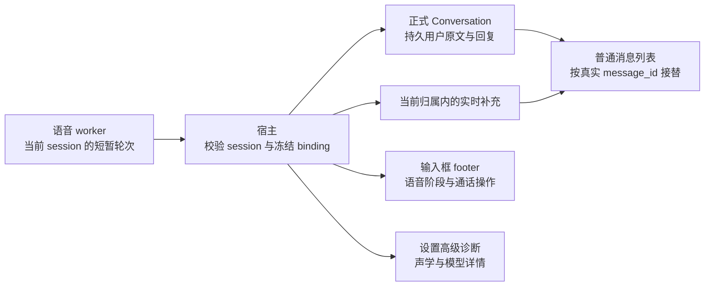
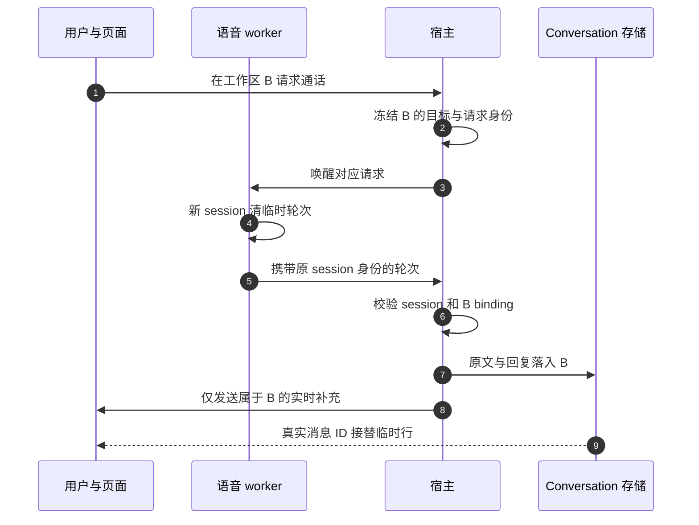

# 语音会话历史隔离与输入框收敛 · 执行方案

> **rev2 执行裁决**：本文件完整保留为原需求与证据底稿；最新执行使用 [rev2 最终计划](voice-ux-rev2-execution-plan-2026-10-23.zh.md) 和[执行任务书](voice-ux-rev2-agent-brief-2026-10-23.zh.md)。复审补齐通知/审批归属、避免通知阻塞、实时消息分页接替和旧面板控制接替；验收扩展为 29 项。业务仍未实施。

> **状态**：📋 计划；跨会话显示问题已定位并有失败探针，业务修复尚未实施。
> **核查日期 / 代码基准**：2026-10-23，`feat/voice-next`，`7de276e61e93836365c5a1c7e006c557ce3e3c6d`。
> **核心原则**：先确保消息身份和会话归属，再精简展示。正式 Conversation 保存聊天事实；语音快照只补当前归属内尚未被持久消息接替的内容。
> **本轮范围**：整合用户截图反馈、只读核查本地记录及生产调用链、编写计划。未修改业务代码、聊天数据、模型配置，未提交或推送。
> **侧栏补充**：§3.5–3.7 增加最右侧固定波纹、普通/语音会话差异及耦合控制，新增 LI-01–06；本计划合计 20 项 HI/UX/LI 用例。

## 1. 背景与核心痛点

语音已有正式 Conversation、任务 FIFO、桌宠入口及通话按钮。接下来需要减少调试信息干扰，并解决切换工作区后的历史错觉。

| 用户看到的现象 | 当前核查结果 | 本方案目标 |
| --- | --- | --- |
| 新工作区“语音 - 2026-07”底部出现旧默认会话的问答 | **已复现跨会话实时显示残留**；本次两边数据库消息归属正确 | 已完成的旧轮次只从原 Conversation 历史读取，不被新快照重新包装 |
| 输入框上方有状态、目录、诊断、任务状态、多个操作区 | `VoiceConversationBar` 仍承载这些信息和部分唯一操作入口 | 状态和通话操作进入输入框；任务进度、结果和审批留在消息时间线 |
| 设置展示快速回复模型的 provider UUID、长篇唤醒容错说明 | 属于实现/诊断信息；并非必要配置 | 正常设置保留用户能理解和操作的内容，诊断收进高级面板 |
| 桌宠概览有模型和音色配置 | 模型与伙伴私聊选择器重复；音色字段仍有机器人调用方 | 移除重复概览配置；暂不开放音色选择，保留有调用方的数据与接口 |

### 1.1 本次跨工作区问题的证据

本地数据来自 `D:/tmp/flowy-dev`，通过 SQLite 只读连接和交付 journal 核查，不改数据库。以下仅列会话身份及截图相关文字，不将完整聊天内容复制到仓库。

| 核查项 | 旧默认会话 A | 新项目会话 B |
| --- | --- | --- |
| Conversation | `01a1616d-b034-7743-9eae-e8aa0d83704e` | `01a168c1-29f4-77c1-b5c3-ad597fdfc8c1` |
| 名称 | 语音助手 | 语音 - 2026-07 |
| 工作区 | 默认 conversations 目录下的独立目录 | `D:\AllDownload\2026-07` |
| 可见数据库消息数 | 49 | 7 |
| 截图相关归属 | “这是啥东西啊？”及“你是指哪个东西呀？”只在 A | 两轮“你好你好……”及“没事”的用户、思考、回复行在 B |

交付 journal 中，B 的两轮快聊使用新 `session_id`、B 的 `conversation_id`、新工作区和各自消息 ID；工作区 registry 也指向 B。因此，本次证据支持“**实时展示把旧轮次混入新页面**”，不支持“B 的新消息被写入 A”。没有理由删除、搬迁或批量重写聊天记录。

失败探针直接调用生产 `buildVoiceLiveMessages`，使用上述 journal 的真实轮次和消息 ID，构造“旧 A 轮次仍在快照、新 B 已有持久消息”的场景：预期 live 列表为空，实际得到 A 的旧问答，并被包装成 B 的消息。正向对照中，只有 B 轮次时可被持久消息正确接替，绑定 B 的快照也不会直接显示在 A 页面。问题出在**快照内部缺少轮次归属校验**，不只是页面最外层缺少 Conversation 过滤。

证据边界：这是实际数据核对加生产显示函数的确定性复现，不是原生窗口/麦克风全链路复测；未校验用户此前运行二进制的构建 SHA。尚无证据证明此次污染了 LLM handoff 上下文；新唤醒确实会清空快聊 context，不把显示残留等同模型上下文污染。

### 1.2 已确认的调用链

1. worker 的 `VoiceEventHub::WakeHit` 创建新 `session_id`，清空顶层文本和快聊 context，**没有清空 `state.conversation`**。这个最多 3 轮的缓存可能仍带着 A 的内容；不能依赖再说三轮来淘汰它。
2. 宿主 `VoiceCompanionManager::project` 给新快照附上 B 的 binding，同时按全局 `turn_id` 查表补消息 ID；查表接口没有要求 session/Conversation 归属匹配。
3. 前端 `liveVoiceTurn` 只验证快照顶层 binding，然后遍历全部缓存轮次。A 的真实消息 ID 不在 B 的可见持久消息内，因此未被接替过滤。
4. `buildVoiceLiveMessages` 将这些轮次统一标为当前 `conversationId`，时间放在当前持久消息之后；`MessageList` 再把它们追加到列表底部。这与截图中旧问答出现在最新位置一致。

另行检查了持久历史的加载路径：`useMessageLstCache` 已按 Conversation、epoch、请求序列保护迟到响应。本次未发现它把 A 的数据库历史写进 B 缓存的证据；快速切换、分页、重连仍列为回归场景。

## 2. 方案全景与架构设计



不变量：

- workspace 决定可信启动目标，Conversation 决定消息归属；页面当前选择不能重写已冻结的交付目标。
- 声学 session 可以重建，同一工作区 30 分钟内的 Conversation 仍可按现有规则复用；清除 volatile 轮次缓存不清除持久历史、任务、队列或审批。
- 任务 A 的迟到结果仍属于 A。用户正在 B 通话，不代表 A 的结果可以改标成 B 的聊天消息。
- 单份持久消息只渲染一次；不能用文本相同、时间接近或 UUID 外形推断归属。
- 权限沿用现有模式：语音新会话缺少用户显式选择/有效偏好时默认 YOLO；已有有效模式及用户选择优先。本轮不新增权限模式。

非目标：不引入 Zipformer、流式字幕、额外纠错、声纹、另一个任务调度器或 agent harness；不更换 TTS；不通过数据库迁移修补此次显示问题；不把原生半双工/AEC 历史门禁标为通过。

## 3. 核心设计与模块规范

### 3.1 S0：先闭环轮次归属

**worker：清理缓存，并为轮次保存原始 session 身份。**

- 在新 `WakeHit` 时清空上一声学 session 的 `conversation` 临时缓存。已完成内容由正式 Conversation 加载。
- 审查全部创建/更换 session 与插入轮次的位置，包括 `Transcribing`、`TaskResultReady`、`ConfirmationPrompted`。新的 session 不继承旧 session 的临时轮次；审批/任务的持久状态与真实归属保持不变。
- `VoiceConversationTurn` 最小增补 `session_id`，由轮次创建者写入；不能在宿主看到旧轮次时用当前 session 批量补写。Rust/TypeScript DTO、序列化及全部构造点一起更新。
- 对任务结果、审批播报，身份必须来自已校验的任务/审批归属。不能因回调发生在 B 通话期间，就把 A 的内容标为 B 的用户轮次或快聊上下文。当前宿主是否已经拦截此类事件要由定向测试验证，不预先认定另一个缺陷已成立。

**宿主：复用既有交付记录中的身份，不做新的全量历史查询。**

- 将 `is_projected` / `projected_message_ids` 的内部查询限定为 `session_id + conversation_id + turn_id`，或等价的完整身份比较；缓存写入和 journal 恢复都保留 record 原本的归属。
- 只有轮次身份、当前 source session 和冻结 binding 一致，才允许进入当前 live conversation，补对应用户/助手消息 ID 及 projected 标记。
- 没有可信归属的旧数据只能从持久 Conversation 读取，不自动“认领”为当前会话。不要在高频音频快照路径新增逐条数据库读取。
- 审查无 session 时“保留上一段可读回复”的恢复逻辑：不得在后续绑定 B 时让保留的 A 文本重新获得 B 身份；全局状态可以保留诊断，页面消息必须通过归属门禁。

**前端：在包装为普通消息前逐轮验证。**

- `liveVoiceTurn` 保留顶层 binding 校验，增加每轮 `turn.session_id === snapshot.session_id` 检查；宿主确保该 session 对应唯一可信 binding。
- 持久接替继续按真实用户/助手 `message_id` 分别进行，处理只有用户行先落盘、助手还在流式输出的情况。已投影但因分页不在当前窗口的历史行，不得再次插到最新尾部。
- 临时渲染 key 包含 Conversation、session、turn 和消息侧别；临时排序值只用于当前 live 内容，不作为实际历史时间展示。不能给旧历史伪造“最新”时间。
- 对缺少 session 身份的旧 live 快照，允许反序列化但不渲染不明归属的消息，持久历史仍正常可读。此为新增可选 DTO 字段的读取边界，不新增双轨历史系统或持久数据回填。

建议增补的最小线协议形态：

```ts
// 新 worker 必填；旧快照缺失时不用于 live 消息渲染。
type ScopedVoiceTurn = VoiceConversationTurn & { session_id?: string };
// 不新增数据库字段。宿主内部记录已有 request.session_id、conversation_id。
```

实施前确认本地 worker/宿主/SPA 的共同构建发布路径；独立旧客户端容忍新增字段。不能为了“兼容”把未知归属静默填成当前身份。



### 3.2 S1：输入框成为唯一常驻语音操作区

移除输入框上方独立 `VoiceConversationBar` 的常驻排版。先接替它独有的控制，再删除无调用方的旧呈现组件；不能只隐藏整个区域。

| 位置 | 保留内容 | 不再常驻展示 |
| --- | --- | --- |
| 输入框 footer 左侧 | 一个阶段图标 + 一条状态；必要时一个队列数量入口 | 重复工作区名称/路径、任务已接受的重复提示、麦克风遥测 |
| 输入框右侧 | 一个大主操作；必要时小型挂断次操作 | 并排的大型发送与通话按钮、独立取消/挂断栏 |
| 对应任务消息/工具卡 | 真实任务进度、结果、审批、失败与重试操作 | 与它重复的任务状态面板、通用“刷新任务状态” |
| 输入框按需展开 | 当前 Conversation 的排队项及逐项取消 | 无队列时的空队列区 |
| 设置高级诊断 | 声学、连接、真实错误码、快模型与 TTS 来源、调试输出 | 聊天页里的诊断、模型 JSON 和 understood_request 折叠面板 |

主操作优先级：**当前 Conversation 有可停止执行 → 停止该 command；否则有草稿 → 发送；否则通话活动中 → 红色挂断；否则 → 开始通话**。连接中使用真实 pending/禁重入状态，不能发送到尚未确认的目标。存在附件或 IME 组合输入时沿用普通输入框草稿定义，不用单纯字符串长度替代。

当主操作被发送或停止占用，活动通话仍须有小型挂断图标，带 tooltip/aria-label/键盘焦点。挂断停止本轮收音/播报，不取消后台任务；停止任务精确到当前 command，不顺带清空其他 FIFO 项。若其他 Conversation 正在通话，仅给出进入活动通话的简洁入口，不把其阶段和错误当成本页状态。

审批控件必须指向对应 task/approval 身份。若普通工具卡尚不能承载语音审批，先在输入框内提供有作用域的审批操作，待接替完成再删除旧唯一入口。审批仍按当前权限规则，不因界面精简而自动放行。

### 3.3 阶段文案与状态优先级

复用既有状态枚举和图标库；emoji 可作装饰，但不能是唯一状态提示或操作名称。阶段与任务状态是两个维度：任务忙碌时，声学若正在倾听，仍显示倾听，并按需附队列数量，不能统一写“正在思考”。

| 实际阶段/条件 | 中文建议 | English | 图标语义 |
| --- | --- | --- | --- |
| connection starting | 正在连接 | Connecting | 连接/进度 |
| listening 且采集就绪 | 正在听你说 | Listening | 麦克风 |
| transcribing | 正在识别 | Transcribing | 文字/进度 |
| deciding | 正在整理回复 | Preparing a reply | 思考/进度 |
| synthesizing | 正在准备语音 | Preparing audio | 音频/进度 |
| speaking | 正在播放语音 | Speaking | 扬声器 |
| follow_up 且麦克风恢复 | 可以继续说 | You can keep talking | 麦克风 |
| text_follow_up | 语音不可用，文字已保留 | Audio unavailable; text saved | 文字/提示 |
| awaiting_confirmation | 等待你的确认 | Awaiting confirmation | 确认 |
| listening_confirm | 请说出确认选择 | Listening for your choice | 麦克风/确认 |
| dispatching | 正在提交任务 | Submitting task | 提交/进度 |
| idle / ended | 未通话 / 通话已结束 | Ready to call / Call ended | 电话 |
| error / offline / readiness 失败 | 一条真实可理解的错误及必要恢复操作 | A concise actionable error | 警示 |

优先处理当前作用域内的错误、断线、启动 pending，再显示正常阶段；`acoustic_ready` 表示能力就绪，不能单独证明半双工播放期间已经恢复收音。`text_follow_up` 是否允许继续语音必须核对实际采集驱动状态，不能仅凭名称显示可追问。播报排队/合成不等于已发声；播放器真实 drain/结束之后才能显示可继续说。`ignore` 清理本轮无效输入后继续倾听，不持久化调试 JSON、不退出通话。

采用 `role=status` / `aria-live=polite` 表达阶段；错误按既有规范使用 alert。不要播报每次音量变化或每个 token。双语文案必须同时声明于 zh-CN/en-US，浅深主题使用语义 token，挂断用现有 danger 样式。

### 3.4 S2：设置与桌宠概览精简

- 移除正常设置的 `VoiceDialogueStatusSection` 大块只读展示。保留自动选择快速回复模型的服务、可用性检测和清晰错误；高级诊断若展示模型，应使用名称，不以原始 provider UUID 作为正常文案。
- 移除长篇“发音与识别建议”“任意变体均自动成功”的说明。可保留一行标准唤醒词 `Hey Flowy`；实际 KWS/cascade matcher 容错能力不改，也不承诺任何发音都成功。
- 从桌宠概览移除重复主对话模型选择和声音音色选择。伙伴私聊中的既有模型选择继续写 `profile.model`，不能误删唯一的模型选择入口/未配置时的引导。
- 伙伴模型影响伙伴私聊及已有绑定渠道；修正“所有会话全局跟随”的误导描述，不将项目 Conversation 的模型同步为伙伴模型。
- 暂不开放音色配置，保留已保存的 `voice.tts` 数据及机器人调用。现有通话走的 Edge/Sherpa 装配与伙伴音色字段不是同一条配置链，不伪造统一音色能力。
- 搜索调用方后删除真正无用的内部 UI、样式、i18n key 和只验证旧排版的测试；保留仍验证路由、可用性、归属、控制行为的测试。不能为了过测试重建已移除的用户界面。

### 3.5 S1 补充：侧栏最右侧固定波纹标识

用户新增要求：项目会话列表需要不依赖名称的语音身份标记，解释进入后空输入框为何显示通话键。**采用静态声波/波纹图标，始终位于语音会话行最右侧**；重命名、通话挂断和应用重启均不移除它。

当前事实：`ConversationRow.tsx` 已有普通会话标题、左侧生成 spinner/能力标记、右侧年龄/未读及悬浮菜单，但没有消费 `extra.voice`。重命名接口只发送 `updates.name`，不修改 extra。项目语音会话和普通会话进入同一工作区列表，不需要另建列表或根据“语音”名称前缀筛选。

布局合同：

- 展开行采用“弹性标题 → 年龄/未读 → 更多操作槽 → 固定波纹”的顺序。年龄/菜单的既有显隐不能隐藏波纹，也不能用绝对定位压住它；调整相关定位/预留宽度，长名称仅截断标题。
- 使用已有 `@icon-park/react` 的 `Voice` 声波图形（仓库设置/会议页已有用法），约 13–14px，固定占位、不压缩，沿用语义颜色。图标是类型标记，点击仍按整行进入 Conversation，不新增一个启动通话按钮。
- tooltip/可访问名称为“语音会话，可通话或发送文字” / “Voice conversation: call or send text”。普通会话名即使含“语音”也不展示该标记；实际语音会话改名为任意名称仍展示。
- 本轮标记**不播放永久动画**。静态波纹表示会话类型，不等于正在通话、正在录音或任务正在运行；运行 spinner 仍表达真实 runtime 状态。不要让每个侧栏行独立订阅 voice snapshot；将来若确需活动动效，必须从列表单一订阅按 binding 精确派生，并尊重 reduced-motion，本轮不实现。
- batch 模式继续保留类型标记但不妨碍复选；移动端的常显更多按钮不遮挡它。侧栏折叠后空间不足时在同一行图标区域及 tooltip 暴露语音类型，不强塞一个超出列宽的“最右侧”槽。

类型判断合同：

1. 使用一个小型纯函数，放入现有 Conversation utils，与侧栏、`ChatConversation`、`nomiSendDispatch` 和 composer 共用；不让侧栏导入整个发送组件或语音 manager。
2. 新会话权威字段为严格布尔 `extra.voice === true`。既有后端 `send_voice_bound_message` 也兼容 `extra.is_default_voice === true`，共享判断需明确覆盖同一旧默认会话范围；不把 `voice_task_workspace`、伙伴 owner、名称、模型或当前是否正在通话当作类型判据。
3. 已知 Conversation 元数据从上层传给聊天内容和输入框，减少 `ChatConversation` 与 `NomiSendBox` 各自读取/判断造成的短暂不一致；独立入口缺元数据时才走现有 cache/fetch 恢复。`unknown` 必须保持加载/禁止错误分发，不能按 ordinary 猜测提交。
4. 类型只是展示/分发依据，不授予执行权限。旧语音会话若缺 policy/workspace，仍由服务层拒绝并给出可理解错误，不能只因出现波纹就绕过可信绑定。

### 3.6 普通与语音会话的实际差异及边界

下表是当前代码事实，不宣称两类会话在功能上已经完全等价。

| 层面 | 普通 Nomi Conversation | 项目语音 Conversation | 共同基础 / 本轮处理 |
| --- | --- | --- | --- |
| 身份与侧栏 | 普通 Conversation 元数据 | 同一 Conversation 类型体系，extra 带 voice 标记及受控工作区策略 | 共用列表、路由、重命名、置顶；补右侧波纹，名称不决定类型 |
| 主操作 | 发送 / 精确停止，普通听写入口 | 空输入为通话键；有文字可发送；任务忙时停止；听写键不重复出现 | 共用 composer；保持单主操作及必要小挂断 |
| 文字发送 | `dispatchNomiSend` 进入现有 renderer command queue，再调正式 Conversation 发送 | `sendVoiceKeyboardMessage` 进入宿主 VoiceTaskService，冻结目标/配置、持久 FIFO；键盘文字直接按任务执行 | 最终复用 Conversation/runtime，不合并两套队列的生命周期或取消身份 |
| 当前附件/技能能力 | 现有附件与本轮显式技能发送路径 | 分发器明确拒绝附件；`onSendWithSkillsHandler` 拒绝本轮显式注入技能 | 语音 UI 隐藏/禁用未接通的入口并说明原因；不移除会话已配置的技能/预设，也不宣称禁用所有工具 |
| 说话输入 | 输入框听写主要用于填草稿 | ASR 后快速回复/澄清，复杂目标再交付任务 | 语音工作区、模型、权限随可信会话绑定，不由名称或快模型决定 |
| 历史记录 | 正式 messages、分页、工具/思考/审批/结果 | 同一 messages；快聊原文/回复以普通 text 消息投影，任务沿用真实 runtime 记录 | 不新增第二张聊天表；隐藏 handoff 不冒充用户原话；调试 JSON 不进入正常消息 |
| 实时显示 | 既有 runtime 流与消息接替 | 增加 volatile voice turn 补充、播放阶段 | S0 修复逐轮归属；最终按真实 message_id 接替，不能凭文本去重 |
| 排队持久性 | 当前普通 command queue 使用 renderer `sessionStorage` | 宿主 voice 任务 ledger 和配置冻结/恢复 | 这是实现差异，不在本轮把普通任务改成语音队列，也不降低语音持久性 |
| 停止与挂断 | 停当前执行 | 停执行与结束通话是不同操作 | 不能把“挂断”映射为清空 Conversation / 所有任务 |
| 导出与重新打开 | 从正式持久消息导出 | 同一持久消息导出；JSON 含 Conversation/extra | 临时 voice 快照不直接导出为历史；Markdown 现有 Type 仍可能为 nomi，不以纯文本标题恢复语音类型 |

重命名/置顶保持类型；删除、清空上下文、编辑重发、分页和导出必须走现有 Conversation 语义。为语音端新增展示不能擅自把编辑旧文字转换为重放已执行的 command；这些操作需验证 epoch/回执与当前绑定，不支持时明确拦截，不能误发到普通队列。

### 3.7 耦合风险与最小修改边界

当前设计已有共享基础，**方便修改右侧标记和状态呈现，但发送控制的差异不能用换图标掩盖**。实际需要防住的接缝如下：

| 接缝 | 目前事实 / 风险 | 本轮最小处理 |
| --- | --- | --- |
| 多处类型判断 | ChatConversation、NomiSendBox、dispatch 各自读 voice；后端还接受旧默认标记 | 共用严格纯函数、元数据向下传，保留 unknown 与服务端最终校验；不增加一个全局类型状态管理器 |
| 全局 voice snapshot 与页面消息 | 已有跨 session 缓存被新页面包装的实际反例 | 按 S0 修复 producer 和逐轮 ownership；侧栏波纹只读元数据，避免又耦合进全局快照 |
| 共用 NomiSendBox 的两种发送/停止路径 | 普通 queue、voice FIFO、按 command 停止是不同合同 | 复用已有 `nomiSendDispatch` 边界，语音状态/操作留在 voiceSession 模块；不复制整套聊天页面，也不整体重写 2000 多行输入框 |
| 列表运行状态与播报状态 | 快聊完成投影用 message.stream，已有完成投影不触发生成 spinner 的测试 | 波纹不接管运行 spinner，不把 speaking 当作 runtime executing，不把最终文本投影当新任务开始 |
| 能力 UI 与发送边界 | 发送层拒绝语音附件/本轮技能，但共用输入框容易呈现普通入口 | 复用现有 props 限制不可用入口，保留后端拒绝与失败时草稿；本轮不扩建附件协议 |
| 右侧标记与既有菜单 | 当前更多按钮绝对定位，年龄 hover 隐藏但保留宽度 | 波纹独立固定槽，菜单为其让位；结构测试配合实际渲染验证，不能仅改断言字符串过门禁 |

不用为了这些风险建立新 Conversation 子类、双套消息组件、新数据库 kind 字段或新队列框架。正确的共享边界是“同一身份/存储/渲染基础，不同输入与控制适配”，并以真实消息接替及错误路径测试约束。

## 4. 关键决策与权衡

| 编号 | 决策 | 采用方式 | 放弃方式及原因 |
| --- | --- | --- | --- |
| D1 | 先处理串会话 | 清 session 临时缓存 + 每轮身份 + 宿主/页面校验 | 仅隐藏旧问答或等 3 轮淘汰，仍会让用户误判任务归属 |
| D2 | 保持存储事实 | 继续读取已有 Conversation 消息 | 清库、合并/搬迁记录，无证据且可能破坏正确历史 |
| D3 | 收敛主操作 | 单大按钮 + 必要的小挂断 | 永久并列发送/通话或删掉所有辅助控件，前者重复，后者不可操作 |
| D4 | 调试与产品分离 | 正常聊天只显示阶段，诊断入高级设置 | 删除可观测性或常驻暴露实现字段，均不利于使用/排障 |
| D5 | 去重复配置 | 保留模型权威入口，暂隐藏音色 UI | 删除持久字段/机器人调用，超出界面精简范围 |
| D6 | 持久语音类型标记 | 侧栏最右侧静态波纹，严格读取已有 extra 元数据 | 名称前缀、永久录音动画或每行订阅声学状态，分别会丢身份、误导状态或加重耦合 |
| D7 | 统一基础与适配差异 | 共用类型判断、存储/消息列表，保留各自队列与控制合同 | 复制整个语音聊天页或强行把普通/语音 queue 合并，会扩大回归范围 |

## 5. 执行顺序、验收与验证矩阵

按 **S0 会话隔离 → S1 输入框接替 → S2 设置精简 → S3 联合验证和文档事实** 串行推进。S0 与其正式回归先完成，避免在排版改动中掩盖数据身份缺陷。无需重复撰写一轮新架构计划；以下用例直接作为执行出口。

| 编号 | 场景 | 可断言结果 |
| --- | --- | --- |
| HI-01 | A 默认工作区聊完，在 B 项目开启通话 | 首帧和后续每帧均无 A 的 live 轮次；B 已有历史和新回复正确 |
| HI-02 | A → B → A，同一 worker 进程，多次唤醒 | 不靠重启/第三轮淘汰；30 分钟复用各自 Conversation，历史不丢不重排 |
| HI-03 | 混合旧 A 与当前 B 轮次快照 | 宿主不为 A 补 B 身份；前端拒绝 foreign/missing session live 行；实际失败探针转为正式回归 |
| HI-04 | 用户行先落盘，助手仍流式输出，然后全部落盘 | 用户不重复、助手不中断显示，真实 ID 接替；已分页出去的投影不回到最新尾部 |
| HI-05 | 两个工作区说相同文字 | 按身份区分，不按文本去重；各自数据库行、journal、页面一致 |
| HI-06 | 切页时迟到历史 GET/SSE、分页、断线重连、宿主恢复 | 不串页；未绑定保留文本不被新绑定认领；恢复读取正确归属 |
| HI-07 | A 任务未完，B 通话收到 A 的迟到结果/审批 | 结果、权限、队列和取消继续属于 A；不注入 B 的消息或快聊上下文 |
| HI-08 | ignore / 噪音 / 无效输入后继续有效提问 | 不写调试 JSON、不退出通话，无效 live 行被清理，下一句正常接续 |
| UX-01 | 全部阶段及 starting/offline/readiness 异常 | 中英文映射完整；合成/播放/可继续说不混淆，异常不被正常阶段遮盖 |
| UX-02 | 空白、有草稿/附件、IME、执行中、连接中、通话中 | 一个主操作，优先级正确；所有活动通话可挂断；精确停止不清其他 FIFO |
| UX-03 | 真实工具审批和队列逐项取消 | 精简后仍可完成批准/拒绝/取消；接口身份正确、失败提示可见，不自动放权 |
| UX-04 | 非活动会话页面、无队列、通话结束 | 无跨页状态噪音和空面板；必要时有进入真实活动通话的入口 |
| UX-05 | 普通设置、伙伴概览、私聊、机器人回归 | 无 UUID/长容错宣告/音色选择；快模型仍自动可用，私聊选模和既有音色数据调用不破坏 |
| UX-06 | zh-CN/en-US，Light/Dark，窄窗口/高 DPI，键盘 | 状态和按钮不遮挡重叠；tooltip/aria 可理解，红色挂断明确，无未翻译 fallback |
| LI-01 | 新建项目语音会话后重命名、置顶、刷新、重启 | 同一 Conversation 的最右侧波纹保持；普通会话即使叫“语音任务”也无该标记 |
| LI-02 | 长标题、年龄/未读、运行 spinner、hover/菜单、batch、移动/折叠 | 标记不被遮挡，标题宽度稳定，菜单/复选可操作，折叠 tooltip 表达类型 |
| LI-03 | 列表 → 聊天内容 → composer → 文字发送，含缓存未就绪和旧默认标记 | 类型判断一致；unknown 不误发普通队列；旧标记不绕过 workspace/policy 校验 |
| LI-04 | 通话已结束但后台任务仍运行、快聊完成文本投影 | 波纹仍表示类型；只有真实 runtime 显示生成/停止，不把播报和任务状态混为一谈 |
| LI-05 | 普通/语音附件、显式技能、草稿失败恢复 | 普通功能不回退；语音未支持入口受控且失败保留输入，不删除已配置技能/工具 |
| LI-06 | 普通/语音重新打开、导出、编辑重发、上下文清理、删除 | 使用同一持久历史，不导出重复临时行；类型/epoch/回执不串用，不因展示改动重放已执行任务 |

### 5.1 验证梯子与证明边界

1. **正式单测**：将 HI-01/03 的失败反馈移入已有 hub、manager、`liveVoiceTurn` 测试。测试使用隔离临时数据库/fixture，不依赖本机真实聊天文件。先复现失败再修复；加入同会话及已投影接替的正向对照。
2. **跨模块自动链路**：使用现有集成装配，在 A/B 两个临时工作区执行真实消息落盘、快照投影、重连恢复和前端渲染；同时核对数据库与页面身份。不是只检查源码存在某段字符串。
3. **定向命令**：`cargo test -p voice-companion`；`cargo test -p nomifun-app --lib voice_ --no-default-features`；按改动范围运行已有 Conversation/语音集成；在 `ui/` 用 `bun test` 执行 live、状态、composer、设置/伙伴相关文件。不要复写历史测试数量冒充实跑结果。
4. **类型与门禁**：`bun run typecheck`，文案变更先 `bun run gen:i18n` 再 `bun run check:i18n`，以及 theme/icons/button-layout/motion/dead-css 等受影响检查，`git diff --check`。记录全仓既有错误与新增错误；不降低门禁。
5. **装配与界面**：DTO/worker/宿主变更后 `cargo check -p Flowy`；`bun run build:ui`。通过组件/渲染测试和截图检查输入框两种主题/语言。纯 Web 的声音能力不能代替桌面收音签核；本问题身份与存储验证不需要用户重新对麦克风说话。
6. **交付事实**：说明代码、正式测试、构建、原生窗口/物理音频分别验证到哪里；未运行的项目保留风险。最后更新本文执行结果及 current status，不能将本次计划标为全部闭环。

### 5.2 本轮已执行与未执行

已执行：只读数据库/journal/registry 查询、worker→宿主→live→MessageList 调用链核对、确定性显示探针。探针 1 项失败（预期 RED），同项中的归属及接替正向对照通过；不是新增业务回归通过。

未执行：业务修复、正式回归集改动、全量 cargo/UI 构建、原生窗口/麦克风/扬声器验证。本轮是文档与诊断，不复用此前提交的通过数量作为本轮结果。

### 5.3 本轮侧栏与分发核查补充

新增范围为 §3.5–3.7、D6/D7、LI-01–06；业务仍未实施。执行时把侧栏标记及类型一致性纳入 S1，能力入口约束也在 S1 完成，不另起一次队列重构。

基线测试命令（在 `ui/`）：

```powershell
bun test src/renderer/pages/conversation/SessionList/ConversationRow.structure.test.ts src/renderer/pages/conversation/SessionList/utils/sessionCapabilityItems.test.tsx src/renderer/pages/conversation/SessionList/hooks/useConversationListSync.test.ts src/renderer/pages/conversation/platforms/nomi/nomiSendBoxDispatch.test.ts src/renderer/components/chat/ComposerSubmitCluster.behavior.test.tsx src/renderer/pages/voiceSession/liveVoiceTurn.test.ts
```

该组是现有侧栏/分发/显示行为基线，不覆盖尚未实施的波纹标记，也不撤销 HI-03 的失败反例。结果以实际运行日志 `build.noindex/voice-workspace-display-review/sidebar-and-dispatch-baseline.txt` 及后续执行补记为准。正式实施需新增 LI 的双语真实渲染与交互测试，不能只增源码字符串断言。

2026-10-23 实跑结果：上述 6 文件 **32 passed / 0 failed / 155 assertions**，Bun 1.3.14，4.40 秒。覆盖普通队列与语音宿主分流、unknown 保持/恢复、语音附件拒绝与草稿保留、幂等重试、完成投影不触发生成 spinner、两种语言主操作互斥及既有 live 接替。它们没有覆盖“同一快照混入不同 session 的旧轮次”，所以不能据此把 HI-03 标为通过；该反例仍为预期 RED。文档链接及 `git diff --check` 通过；本轮没有业务变更，因此没有重跑 Rust 编译或生产构建。

## 附录 A：证据与代码入口

| 职责 | 核查入口（基准提交中的位置） |
| --- | --- |
| 新唤醒保留 conversation | `apps/voice-companion/src/voice_events.rs`，`WakeHit` 约 171 行；`Transcribing` 约 218 行；任务/审批轮次约 285–330 行 |
| 宿主投影与全局 ID 缓存 | `crates/backend/nomifun-app/src/voice_companion_manager.rs`，缓存约 206 行、查询约 543 行、恢复约 631 行、投影约 2020 行 |
| 轮次 DTO | `crates/backend/nomifun-api-types/src/voice.rs`，`VoiceConversationTurn` 约 690 行；前端 `ui/src/common/adapter/voiceCompanion.ts` |
| live 归属与重新包装 | `ui/src/renderer/pages/voiceSession/liveVoiceTurn.ts`，约 7–33 行 |
| 真实列表接线 | `ui/src/renderer/pages/conversation/platforms/nomi/NomiChat.tsx`；`Messages/MessageList.tsx` 约 883 行；`Messages/hooks.ts` 约 1081 行起 |
| 状态与重复面板 | `ui/src/renderer/pages/voiceSession/VoiceConversationBar.tsx`、`VoiceTaskStatus.tsx`、`VoiceTaskQueue.tsx` |
| 输入框主操作 | `ui/src/renderer/components/chat/ComposerSubmitCluster.tsx` 及其 behavior/structure 测试 |
| 列表标记、菜单与重命名 | `ui/src/renderer/pages/conversation/SessionList/ConversationRow.tsx`；`utils/sessionCapabilityItems.tsx`；`hooks/useConversationActions.ts` 约 174 行；`hooks/useConversationListSync.ts` |
| 类型与发送路径 | `ui/src/renderer/pages/conversation/components/ChatConversation.tsx` 约 241 行；`platforms/nomi/nomiSendDispatch.ts`；`NomiSendBox.tsx` 约 251、514、1067、1089、1971 行 |
| 键盘 FIFO、消息复用、导出 | `nomifun-app/src/voice_companion_manager.rs` 约 1798 行；`voice_task_runtime.rs` 约 130、231 行；`nomifun-conversation/src/service.rs` 约 9294、11315 行；前端 `SessionList/utils/exportHelpers.ts` |
| 设置快模型/容错提示 | `ui/src/renderer/pages/settings/VoiceDialogueStatus.tsx`、`VoiceSettings.tsx`；宿主 `voice_dialogue.rs` |
| 伙伴模型与音色 | `ui/src/renderer/pages/nomi/workspace/tabs/OverviewTab/ModelsSection.tsx`；`CompanionModelControl.tsx`、`CompanionConversation.tsx`；`nomifun-companion/src/service.rs`；`nomifun-app/src/robot_wiring.rs` |

本机忽略目录证据：`build.noindex/voice-workspace-display-review/cross-workspace.test.ts` 与 `cross-workspace.txt`。该探针读取本机相关交付记录，不可直接作为可移植正式用例交付；其真实归属断言须迁入隔离测试。原始 SQLite 为 `D:/tmp/flowy-dev/flowy-backend.db`，journal/registry 位于其 `voice/` 下；这些是本机用户资料，不加入 Git。

## 附录 B：历史方案与本轮取代范围

这是新增方案，没有重写或删除旧底稿。此前完整原文继续保留：

- [通话入口与桌宠感知方案](voice-call-entry-pet-presence-plan-2026-10-23.zh.md)：目标路由、YOLO 优先级、桌宠临时呈现、启动/停止身份等合同继续有效；本方案取代其中旧独立 bar 的正常展示布局，不推翻其控制语义。
- [通话 UX 交接](voice-call-ux-handoff-2026-10-23/HANDOFF.zh.md)、[修复结果](voice-call-ux-handoff-2026-10-23/REPAIR-RESULTS.zh.md)、[恢复补充](voice-call-ux-handoff-2026-10-23/RECOVERY-REPAIR.zh.md)：已实施范围与既有验证记录保留。此前定向通过并不覆盖本次新发现的跨 session 轮次残留。
- [方案 A 配置修复](plan-a-configuration-repair-2026-10-22.zh.md)：自动快模型和可信执行配置仍沿用；“正常设置展示快模型详情”的呈现由本方案收敛。

本轮未重新进行 Qoder 或其他远端源码调查；新的存储/显示结论完全来自当前 Flowy 代码与本地记录，不能归因于外部项目推测。
