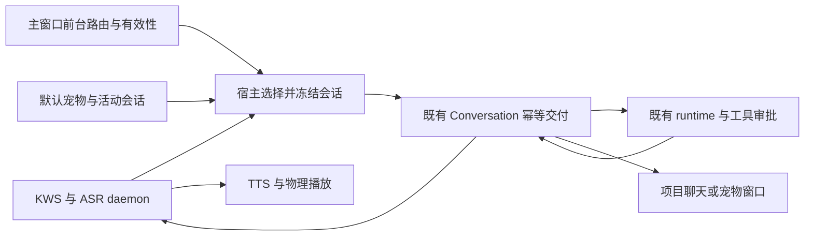
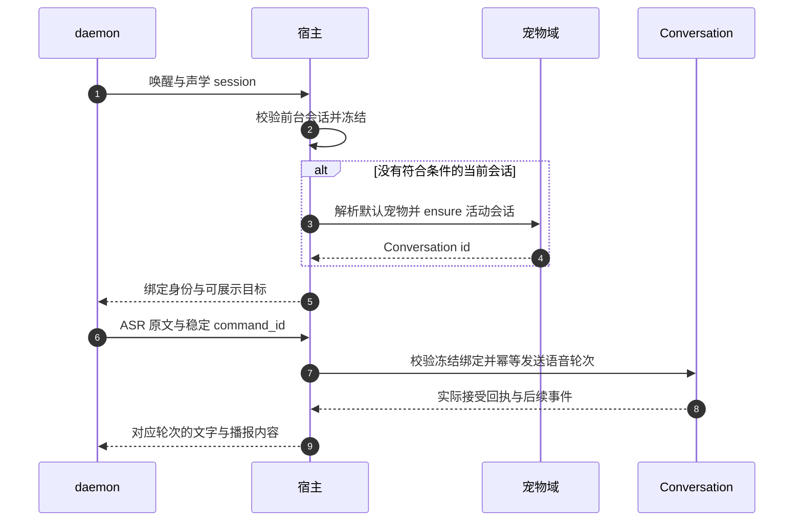

# 语音输入绑定当前会话与宠物会话 · 探索方案

> **状态**：📋 待决策；2026-10-16。仅探索当前分支并新增方案，未修改业务实现。
> **核心原则**：语音作为输入和播报通道，复用标准 Conversation 的历史与执行能力；宿主选择并冻结目标，daemon 不拥有页面、provider 或权限决策。

> **后续修订**：用户补充“首次安装没有宠物、允许多个宠物”。默认归属以文末《补充决策：无宠物与多宠物》为准；前文“默认宠物兜底”保留为探索底稿，不再作为无条件默认行为。方案仍待确认，未实施。

> **快速响应目标修订**：用户进一步明确需在 runtime 长任务期间保持快速语音交互。因此不再推荐将所有语音生成与执行串入同一个忙碌 runtime；保留前台快轨，用户会话与后台执行会话关联。最新编排、超时及离屏反馈建议见 [快速语音与后台 runtime 调研方案](voice-background-runtime-research.zh.md)。本文其余内容完整保留，作为选择依据。

## 1. 背景与核心痛点

用户提出：在项目对话页面唤醒时继续该会话，不在会话页面时进入宠物的会话，让语音交互有可阅读、可恢复的正式记录。

当前路径：daemon ASR → 宿主短补全 → chat/agent_task 决策。chat 的三轮上下文与阅读历史在声学进程内存；agent_task 才进入宿主交付记录，随后 `ConversationVoiceRuntime::create` 调用 `create_voice_idempotent` 新建专属 type=nomi Conversation，再以独立幂等键发送规整目标。创建和发送各自幂等。任务消息与结果落入 Conversation，全部 ASR 原文和普通语音聊天并没有因此自动落入任务聊天。

宠物现有实现：`CompanionService::create_companion_thread` → `CompanionConversation::create`，复用该宠物的活动 Conversation；不存在时建立新的标准 nomi Conversation，带人格、记忆、模型/预设和专属本地工作区。是**每只宠物一个活动会话**，不是整个应用永远只有一个 Conversation；会话删除后可重建。宠物窗口只是该 Conversation 的一种呈现，消息由标准 Conversation 管理。

| 方面 | 当前语音 | 建议方向 |
| --- | --- | --- |
| 用户归属 | 普通聊天在语音面板，任务一事一会话 | 当前有效 Conversation 优先，否则默认宠物活动会话 |
| 历史 | 声学三轮缓存与任务记录分开 | 原文、回复、工具记录在目标 Conversation，面板仅投影 |
| 执行配置 | 另配工作区、模型/预设 | 继承所选 Conversation 的有效配置，语音约束只减不增 |
| 模型调用 | 路由补全后可能再进入 runtime | 推荐普通请求直接发送 Conversation，减少重复理解/生成 |
| 审批 | 新建语音 Conversation 上的专用策略 | 改为绑定语音这一轮的调用策略，不能污染键盘输入轮次 |

这更改了先前“每任务专属 Conversation”和“快轨聊天不初始化任务 runtime”两项产品决策，不能当作无行为变化的 session_id 修补直接实施。

## 2. 方案全景与架构设计



推荐统一 Conversation 生成链路：语音普通请求直接送目标 Conversation 的 runtime，由其回答或使用工具；“我理解的需求”作为简短可展示字段或摘要，不公开模型推理，不把原始内部 JSON 作为聊天回复。不要先让语音路由器生成一遍答案，再让 Conversation 生成第二遍。

代价是普通语音聊天也依赖 Conversation/runtime 的可用性。声学进程、唤醒、停止和设备诊断仍应独立存活，但不能同时承诺“普通聊天完全不依赖 runtime”。若坚持此前快轨要求，应另选保留短补全、增加受信任历史写入的方案；那需要防止重复生成和两套历史分叉，不是本方案默认路径。

非目标：不新增 runtime、数据库迁移、通用任务队列、任意宠物创建或自动恢复执行；不将这次会话设计视为模型 28 秒超时的修复。

## 3. 核心设计与模块规范

### 3.1 目标选择规则

1. 在唤醒事件创建声学 session 时，由宿主读取**唤醒前**的主窗口上下文。主窗口可见、非最小化、处于有效 Conversation 页面，且是用户正在使用的窗口时，优先绑定该 Conversation。只打开项目列表/项目主页并不足以推断会话，终端页面也不是 Conversation。
2. 主窗口隐藏、最小化、后台，或者当前是设置/其他页面时，解析既有默认宠物，再复用其活动 Conversation；没有活动会话才调用现有 ensure 创建。宠物窗口不必打开，不应靠 renderer 常驻来创建会话。
3. 默认宠物缺失或模型不可用，应提示配置，不能随机选择宠物或新建空白工作会话。
4. 绑定后面板显示“正在与项目会话 X 对话”或“正在与宠物 Y 对话”，可用短提示语说明。语音窗口自身被显示、用户切页或焦点变化不能悄悄改变本次归属。
5. 用户主动切换目标才重新绑定。旧任务查询、取消与确认仍指向原 command/message，不随当前页面或宠物变化。

前台资格建议成为明确产品规则；若用户希望“只要主窗口留在某聊天页，即使在其他软件里也继续那个聊天”，可以改这一条，但应展示目标并保持其他冻结规则。不要以旧路由缓存推断用户意图。

### 3.2 宿主接口与冻结信息

复用 `parseSessionRoute` 的会话身份规则和已有桌面焦点能力，增加最小的主窗口上下文上报及宿主校验。上报页面 id 只是候选，宿主要核对窗口、会话存在/归属、后端类型、本地或远程工作区、模型与运行状态；不能信任 renderer 传来的模型、工作区或权限。首版优先支持本地 nomi Conversation，不把任意 ACP、SSH 或其他运行时当作已兼容。

建议宿主内部冻结结构：

```text
VoiceConversationBinding
  binding_id: string
  acoustic_session_id: string
  conversation_id: string
  source: current_conversation | default_companion
  companion_id: optional string
  context_revision: integer
  effective_config_revision: string
```

冻结后的真实任务交付记录还要保留 command_id、声学 turn_id、消息 id、runtime_turn_id、发送幂等键及实际策略；不能把声学 session_id 当作 Conversation id。模型、workspace、preset 在接单前校验并冻结，不在恢复或重试时重新解析成另一个目标。已有历史交付不能因新方案失去参数冲突校验；新增可选绑定字段时须保留读取旧记录的兼容性。

daemon 仅知道宿主发出的不透明绑定身份与当前轮次作用域。当前语音 DTO 没有候选目标、绑定版本或页面上下文，需要补齐；所有者与凭据仍由宿主管理。



### 3.3 持久化与消息展示

以标准 Conversation 消息为事实源；显示“语音输入”来源和 ASR 原文，需求理解作为可选摘要；助手回答、工具进展和结果按该轮消息投影到语音面板。TTS 失败不删除消息，重播只播已保存文字，不能再发模型或执行工具。

原文经确认后不为播报清洗而覆盖；内部提示音、播放失败或重复重连不应各自创建用户消息。现有 Conversation 消息已持久化，不能仅为统一阅读再新增一套语音聊天数据库。若有后台任务结果摘要，应链接原消息并去重，不能将语音 ACK 当成任务最终结果。

### 3.4 权限与并发：不能只替换 conversation_id

当前 `voice_task_workspace` 写在新建 Conversation 的 extra 中，factory 读取后强制 default 模式并装配语音策略；send、cancel、confirm 路径也校验这一标记。直接把 id 换成宠物/项目 id 会被 `task_policy_missing` 拒绝。

同时，当前 factory 对未显式指定模式的 nomi 会话默认使用 yolo；宠物创建也没有默认降级此模式。**不能删除标记校验后直接复用其自动批准。** 应通过受信任的“语音轮次”提交入口，将语音限制绑定实际 operation/message/call；权限取会话既有权限与语音约束交集，复用唯一 ToolApprovalManager。不得永久改写宠物/项目 extra，使该会话以后所有键盘输入都套用语音限制。runtime 已存在时也必须实际应用本轮策略，不能只在新建 runtime 时检查。

同一 Conversation 运行时可能已有键盘/宠物操作。代码存在 durable Running 冲突保护，不能假设新语音会自动排队或不会中断。建议首版：

- 空闲会话正常接收语音；运行中的同目标先提示忙，不强制停止、不偷偷改投其他工作区，也不增加无界队列。
- 任务查询/取消走已绑定控制接口，不向当前会话发第二个普通任务。
- 运行期间继续独立闲聊可明确切换宠物空闲会话；若宠物本身也忙，则说明忙碌。既有“长任务期间随时短聊”的保证需要单独验证，不能因共用 Conversation 而自动成立。

## 4. 关键决策与差距评估

| 方案 | 收益 | 代价/结论 |
| --- | --- | --- |
| 保持每任务新会话，向宠物镜像结果 | 小改动、保留现有隔离 | 双历史和上下文仍分离，不满足完整会话连续性 |
| 保留快轨补全，给目标 Conversation 追加历史 | 保留聊天与任务 runtime 解耦 | 需要正式外部轮次写入与上下文同步，不能借 send 再生成一遍 |
| 语音作为标准 Conversation 输入通道 | 统一历史、上下文、模型配置和工具执行；最符合用户建议 | 推荐方向，但需确认替换原快轨/专属任务设计，以及完成轮次权限和忙碌行为 |

差距是**中等偏大的会话编排改造**，不是重做声学，也不是一个参数改动：

1. 前台页面与窗口资格同步：缺失，需新增宿主接线。
2. 默认宠物活动会话解析：已有大部分能力，补宿主装配和错误投影。
3. 冻结绑定、幂等交付与重启恢复：现有交付账本可复用，目标选择/冻结需扩展。
4. 单一生成与正式历史：现有 ASR/补全快轨需调整到 Conversation 入口，语音面板改为投影。
5. 语音轮次权限/实际确认/取消：改造风险最高；现有策略以专属 Conversation 为范围，必须变为准确的轮次范围。
6. 同会话多输入与生命周期：补忙碌、目标删除、默认宠物切换、切页、旧窗口、重连的行为与验证。

不作未经排期的工期承诺。唤醒、ASR、音量、TTS、声音反馈、现有 Conversation 持久化和宠物人格/工作区管理均可复用。模型 28 秒超时仍独立待修。

## 5. 串行实施与验收

建议下一轮先确认上述两个原产品决策变更，再按以下纵向切片实施，上一片自动验证未过不进入下一片：

| 切片 | 完整用户场景 | 出口 |
| --- | --- | --- |
| B0 | 后台唤醒，宿主确定默认宠物目标 | 不依赖宠物窗口；没有配置就明确失败；不创建重复会话 |
| B1 | 语音问好直接进入宠物 Conversation，文字与播报一致 | 一次模型生成、一份持久化历史、重启后仍可读；TTS 失败不丢字 |
| B2 | 打开本地 nomi 项目会话后唤醒，读取随机文件 | 继承实际上下文与 workspace；有真实工具结果；没有重复 create/send |
| B3 | 在共享会话内执行需要确认的操作 | 声音与键盘轮次策略不串扰；yolo 不绕过语音确认；错轮、过期、重复确认均不执行 |
| B4 | 切页、会话忙、任务查询取消、重连和重启 | 接受后身份不漂移；无假取消、无新身份重发；历史交付仍可查 |

所有直接向共享会话提交的试验都必须先具备轮次权限护栏；B0 可只解析不执行，B1/B2 使用受限测试能力，不能先放开所有工具再等 B3 补安全。

额外验收：主窗口隐藏/后台时不拿陈旧项目 id；唤醒窗口不抢走用于路由的焦点；无默认宠物不随机选；首次语音与宠物键盘同时创建能只保留一个有效活动会话；多个轮次只播属于语音来源且未取消的回答；语音停止/关窗不取消已接受任务。Mac/Linux 仍需分别实测。

## 附录：代码证据与历史关系

- `crates/backend/nomifun-app/src/voice_task_runtime.rs`：`create/send/observe/cancel`；专属任务 Conversation 的创建及策略标记校验。
- `apps/ai-mate/src/voice_events.rs`：三轮内存上下文、阅读历史与 wake 清理。
- `crates/backend/nomifun-companion/src/companion.rs`：`create/active_thread_id`，单活动会话、模型、人格及固定 workspace。
- `crates/backend/nomifun-companion/src/service.rs`：`create_companion_thread/companion_active_thread`；`routes.rs` 中已有 ensure/get session。
- `ui/src/renderer/pages/companion/index.tsx`：`ensureThread` 和 `conversation.sendMessage`，宠物没有另一套独立聊天引擎。
- `ui/src/renderer/utils/routes/sessionRoute.ts`：现有 Conversation/Terminal 路由解析；`Titlebar/useTitlebarContextTitle.ts` 已复用该规则。
- `crates/backend/nomifun-ai-agent/src/factory/nomi.rs`：`voice_task_workspace` 的读取、default 模式限制，以及普通会话的默认 yolo。
- `crates/backend/nomifun-conversation/src/service.rs`：语音创建/取消/确认的范围校验及 durable Running 冲突。

原 [串行接口方案](runtime-vertical-contract-plan.zh.md)、[API 契约](voice-runtime-api-contract.zh.md) 与 [任务超时诊断](task-dispatch-diagnosis-2026-10-16.zh.md) 均保留。本文件提出替代产品方向，不表示已改变生产契约或完成运行验收。只读代码探索不能证明新方案已经可运行。

## 补充决策：无宠物与多宠物

### 产品规则

语音是单一输入通道，宠物是可选人格和会话归属，不应成为启用语音的前置条件。建议增加一个**默认语音会话**：复用标准 Conversation，首次有效交互需要落盘时由宿主幂等创建并保存指针，后续复用；不因每次唤醒新建，不为下载模型或打开设置自动启动 runtime，不创建隐形宠物。

| 条件 | 目标 |
| --- | --- |
| 用户正在使用符合资格的项目 Conversation | 本次绑定该 Conversation |
| 无当前目标，且用户明确选择了语音绑定宠物 | 使用该只宠物的活动 Conversation |
| 无当前目标，也没有绑定宠物 | 默认语音 Conversation |
| 曾明确绑定的宠物已删除或不可用 | 提示绑定失效，提供切回默认语音会话；不静默换成另一只宠物 |

只有一个活动声学会话、一个默认语音目标；项目中的语音记录可分别落入对应 Conversation。“一个语音入口”不等于全应用只能有一个聊天记录。多个宠物不广播、不同时生成回答、不同时播报。

### 设置与生命周期

- 首版只提供一个“默认语音对话”选择：`独立语音会话（默认）` 或某一只已有宠物；选择宠物是可选增强，不要求首次用户先创建宠物。
- `voice_home` 与 `companion:<id>` 是互斥的默认目标模式；独立语音会话可以作为持久历史保留，但不能和宠物会话同时响应同一句话。不要将两个目标维护成双写镜像。
- 宿主保存明确的 companion_id，不跟随全局默认宠物指针、当前显示宠物或改名自动切换。没有显式选择时，不调用“第一只/任意可用宠物”的兜底选择器。
- 改目标只影响下一次新唤醒或用户明确的新绑定；当前轮次、已接受任务、旧结果和审批继续绑定原 Conversation。历史不自动迁移或合并。
- 独立语音会话被删除后，在下一次新交互中幂等创建继任会话；旧任务的只读恢复仍查原身份，不能重发到继任会话。已有任务的删除限制沿用 Conversation 规则。
- 默认语音会话使用现有 Conversation 管理工作区能力，在自己的本地目录中工作；不把用户整个磁盘作为默认执行范围。需要项目文件时明确切到项目会话或选择工作区。
- 模型引用沿用现有 provider 解析。首次没有可用模型就引导配置对话模型；不把“没有宠物”当成模型未就绪，也不复制 provider 凭据。

### 对实施切片的调整

将 B0 改为“解析当前有效会话，否则解析用户选定默认目标”；将 B1 改为“无宠物首次语音聊天可保存进默认语音 Conversation”。宠物绑定在 B1 后做可选场景，其余轮次权限、单一生成、幂等、忙碌和验收约束不变。

新增验收：零宠物首次使用与重启；同时首次唤醒只建一个默认会话；多宠物显式绑定且只执行一次；更换全局默认宠物不改变语音目标；删除绑定宠物不静默换号；绑定切换后旧任务/确认不漂移；项目语音退出后下一次按默认目标解析；宠物窗口未运行时仍能使用其已绑定 Conversation。

### 当前代码证据与实现范围

`CompanionRegistry::resolve_default` 可以在有宠物时解析现有对象，但语音不应因此默认依赖其选择；`CompanionService::create_companion` 会设置默认宠物。普通 `ConversationService::create_inner` 已有自动管理本地 workspace 的路径，可以复用，不需要为默认语音会话新建宠物域、runtime 或数据库表。语音默认会话指针、目标配置和首次创建幂等接线尚未实现，不能把建议表述成现有能力。
