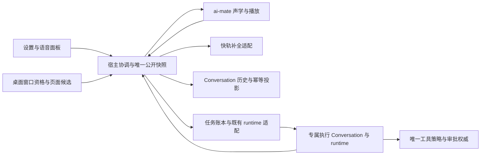
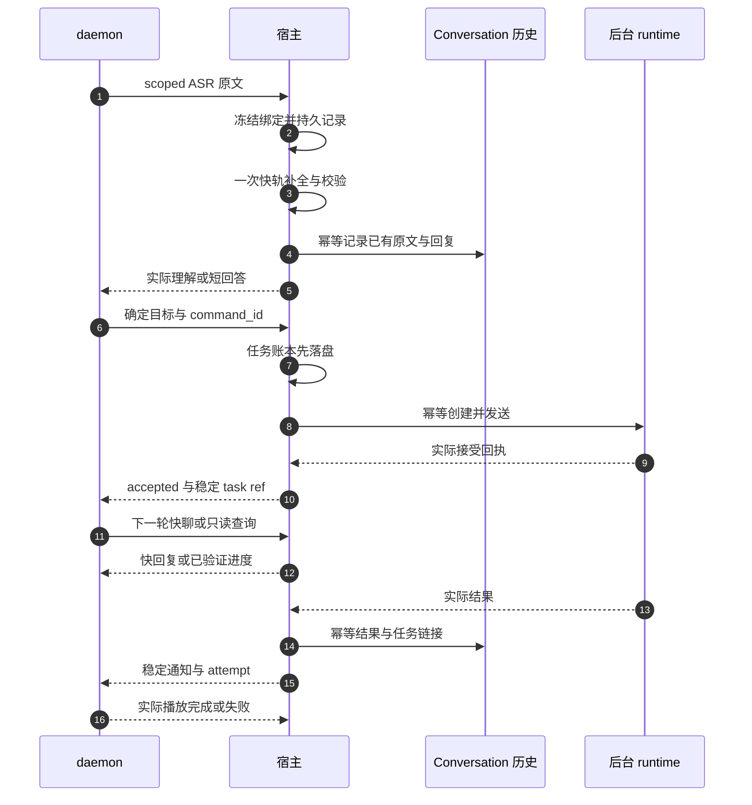

# 语音伴侣快速前台与后台执行 · 串行执行 Plan

> **状态**：📋 可交接计划，2026-10-16；本轮只编写文档，所有下列实施片均为“未开始”。不将既有 T0–T5 测试结论等同于本计划通过。
> **目标**：保留快速语音交互，在 runtime 长任务期间仍能聊天、查询、取消和确认；对话有正式历史，后台有真实回执，离屏用户能判断阶段和取回结果。
> **核心原则**：声学、用户对话、后台执行、权限审批、通知投递各自有明确权威；共用界面不要求共用 runtime 忙锁。先纵向跑通，逐片加可靠性，不扩大工具权限换取成功。
> **使用方式**：Owner 将本文件交给实施 agent 后才开始业务修改；推荐一个集成负责人按 S0–S9 串行交付，不默认并行开发或创建其他 agent。

## 1. 背景、范围与执行基线

### 1.1 已有事实与尚未实现的差距

| 当前可复用 | 本计划新增或修正 |
| --- | --- |
| 独立 ai-mate，KWS/VAD/ASR、音量、TTS、声音反馈 | 保持该进程独立；反馈和快轨调用有各自预算 |
| 宿主补全适配，复用 Flowy/已配置 provider | scoped 快轨轮次、超时细分、单次生成与正式历史 |
| 专属任务 Conversation、幂等创建/发送、真实查询取消确认 | 用户会话与执行会话关联、后台期间持续对话 |
| 宠物的单活动 Conversation 与本地工作区 | 独立语音默认会话；宠物是可选显式绑定 |
| 产品快照及 seq/instance 栅栏 | 绑定、任务健康和通知投影，防止音量事件覆盖 |
| `project_assistant_message_idempotent` | 复用其事务/回执/事件模式，补正式用户原文与成对快轨轮次记录 |
| 结果通知的持久 claim | 分开记录任务结果和通知/实际播放，不把 claim 当作听到 |

现场曾出现短模型 28 秒超时；当前代码仍须在 S0 重新验证，不能假定其他 agent 已修复。TTS 429 已有其他 agent 修改，应读取新实现和测试，保留已完成工作，不重做上一版修复或覆盖其产物。

### 1.2 固定范围

- Windows 是首轮自动集成与 Owner 交付平台。Mac/Linux 保持代码结构兼容，分别实测后再签核。
- 一个活动声学会话、一个活动语音后台任务；后台任务期间可继续快聊与控制原任务。第二个任务明确忙碌，不隐式排队、不取消旧任务。
- 不需要创建宠物；多个宠物只能明确绑定其中一个。默认是独立“语音助手”Conversation。
- 前台快模型负责普通聊天、必要澄清和目标理解；后台 runtime 负责真实工具与任务执行。前台不执行工具，不编造后台结果，不重复生成已委派任务的答案。
- 不新增 runtime、第三方依赖、数据库迁移/表、通用调度框架、GitHub Actions；不引入 Temporal/LiveKit/OpenClaw 作为运行时依赖。已有仓库库与获准的测试 ai-mate 引用继续复用。
- 不做流式 ASR、全双工 AEC、自定义唤醒词、远程音频、多任务队列、多 sub-agent 执行；既有语音委派禁用保持不变。
- 不自动提交、推送、rebase、合并、发布或安装。真实麦克风、扬声器、干净安装和最终 Owner 验收由用户完成。

### 1.3 工作区保护与依据优先级

本轮只读观察：`feat/xiaozhi-voice` 相对 origin/main ahead 40/behind 29，存在大量未提交和未跟踪工作。此状态可能继续变化，实施前必须重新读取 `git status --short --branch`、HEAD、变更及相关测试。不得 reset/clean、重放 stash、切 main 或自动追平历史；不覆盖其他 agent 正在修改的文件。

本计划是本轮实施的单一排序入口。用户新增目标优先；既有公开 API/持久历史/实际权限必须兼容；技术细节以当前代码验证后冻结。此前“全部语音直接进入同一个 runtime”“默认必须有宠物”“共享会话先跑起来再补权限”的探索不再是执行方向。原文档保留，不能删除历史以消除矛盾。

## 2. 模块架构与不得越过的边界



| 模块 | 拥有 | 明确不拥有 | 实施主要入口 |
| --- | --- | --- | --- |
| daemon | 唯一麦克风采集、KWS/VAD/ASR、轮次取消、TTS/sink、实际播放回执 | 页面选择、Conversation 创建、provider key、工具执行和批准 | `apps/ai-mate/src/voice.rs`、`voice_events.rs`、`voice/confirmation.rs` |
| voice-terminal | 可复用的提示/JSON 校验、补全客户端、播放抽象 | Tauri/页面状态、SQL、任务权限的最终决定 | `crates/backend/nomifun-voice-terminal/src/` |
| 宿主 | 目标解析、绑定、快轨记录、配置/权限引用、交付/恢复、通知、产品快照 | 声学采集、伪造 runtime 接受/完成、第二套审批 token | `nomifun-app/src/voice_companion_manager.rs`、`voice_dialogue.rs`、`voice_tasks.rs`、`voice_task_runtime.rs` |
| Conversation | 用户/助手消息、原有事务与幂等回执、历史更新事件、运行状态与持久边界 | 声音是否被用户听到 | `nomifun-conversation/src/service.rs`、现有 repository |
| runtime/桥 | 工具、执行与实际运行/取消/确认 | 依靠 LLM 文案当授权，按 UI 新页面转移旧任务 | `nomifun-ai-agent` 单桥、既有 agent/tool dispatch |
| 宠物域 | profile、人格、模型/预设、活动会话、本地 workspace | 自动接管所有语音、按全局宠物切换迁移旧任务 | `nomifun-companion/src/service.rs`、`companion.rs` |
| 桌面与 UI | 原生可见/前台资格、路由候选、展示/控制 | renderer 提供权限或任意工作区、直接导入 Tauri、直接访问 daemon 凭据 | `apps/desktop/src/voice_session_window.rs`、`ui/src/platform`、`ui/src/common/adapter` |

后端到 agent 继续通过 `nomifun-ai-agent`，不得从 app/conversation 新增未授权直接 nomi-* 依赖。所有 HTTP DTO 放 `nomifun-api-types`；内部辅助 struct 留所属模块，不建通用“语音平台”框架。

### 2.1 会话的三个身份

- `dialogue_conversation_id`：用户阅读与对话记录的归属。
- `context_conversation_id`：可选项目上下文来源；不代表可以向它发送执行任务或读取其所有内容。
- `execution_conversation_id`：专属语音执行 Conversation，任务工具、取消和审批绑定此处。

一个任务通过稳定 task ref 关联前台会话；首版不将任务直接发到已有项目/宠物 runtime，不修改它们的 yolo/default 模式。把前台目标换成宠物/项目不能绕过现有 `voice_task_workspace` 等约束。复用专属执行隔离，可以保持语音策略范围与键盘运行互不污染。

## 3. 冻结的行为、状态及接口契约

### 3.1 目标选择、无宠物与多宠物

1. 唤醒前主窗口可见、非最小化且是用户正在使用的窗口；其路由对应存在、属本机所有者、受支持的本地 nomi Conversation，才作为当前候选。项目列表/终端/设置页不能推断 Conversation。
2. 宿主检查候选是否空闲及是否可安全写外部轮次。空闲时绑定该会话；忙碌时使用独立语音默认会话，保留项目引用，显示/说清“项目仍在工作，我在语音会话中接着听”。不能向 busy 会话直接插历史或 steer。
3. 无合格当前候选时，按显式默认目标配置选择独立语音会话或一个 companion_id。宠物绑定失效须提示并允许显式切回独立语音，不能静默换宠物。
4. 默认目标指针只有一份；首次有效 ASR 需要落盘时幂等创建默认 Conversation，不在安装/下载/设置读取时创建、启动音频或初始化 runtime。连续唤醒复用它。
5. 绑定在声学 session 内冻结；换页、弹出语音窗口、全局默认宠物变化不改本轮。切换设置只对下一次新唤醒生效。若冻结目标被删除、归属变化、开始忙碌或配置失效，返回 `binding_invalid/binding_busy/config_changed`，不在同一 turn 静默换目标或重跑模型。下一次交互可重新解析。
6. 默认语音会话不依赖宠物窗口。宠物首次 ensure 与键盘同时触发时必须复用唯一有效活动会话；如果现有 ensure 存在竞态，集中修单一创建入口，不能语音另建一套宠物会话注册。

主窗口路由只是候选，由 renderer 通过已有 platform/IPC 报告；桌面宿主校验原生窗口身份与资格。主 renderer 关闭时默认路径必须独立可用。只缓存最近页面不能证明前台；过时 context revision 必须拒绝或在新绑定前重新解析。Web 宿主没有桌面前台证明，首版只使用显式默认目标，不模拟桌面资格。

### 3.2 原文、理解、回答与幂等落盘

快轨历史至少保存 ASR 原文、可选理解摘要、实际回答、来源轮次和绑定；不保存或展示模型私有推理。内部 JSON 可在诊断面板展开，但不作为聊天回答正文或执行授权。

- 以声学实例/session/turn 关联宿主稳定 `voice_record_id`，首次建记录后不随 SSE 重连改变。普通新发言分配新 id，网络重试复用原 id。
- 首次模型调用前，宿主持久化原文、目标及冻结配置；写入失败返回 `voice_record_write_failed`，本轮不调用模型、不提交任务，不展示“已保存”。
- 一轮前台最多一次补全调用；语音 daemon/路由模块与宿主不得各自再调用一次。宿主装配必要上下文，复用既有 JSON 提示和校验逻辑；LLM 不选择底层 ids/权限。`VoiceDialogueCompleter` 仍仅做 provider 解析与补全，不初始化任务 runtime。
- 现有 `/complete` 私有桥加声学 scope、`voice_record_id`/绑定引用和原文等必要结构字段，返回保持 `content`，可增补本轮记录/已验证决策。生产 daemon 传结构化原文，不能从自由文本 prompt 反推落盘内容。只保留一套生产决策路径；内部旧调用无调用方后删除，外部公开兼容另行处理。
- 完成 JSON 校验后先保存决策与已生成文字，再允许 task submit。任务目标必须和宿主保存的本轮 `agent_task` 决策完全匹配，不能把另一个 goal 塞进相同 record。
- 调用进行中返回处理中，不开第二次模型；已完成重试返回原输出；同 id 不同原文/目标/冻结参数返回 409。宿主崩溃且模型调用结果未知时标记轮次中断/未知，只读恢复，不自动重新调用付费模型或执行任务。
- 已生成但历史投影暂失败：宿主持久记录进入待投影，保留文字、明确“保存尚未完成”，可重试写入；不能为了重投影再问模型。首次原文写入失败与后续投影失败必须区分。

Conversation 域提供受信任的外部轮次记录入口，使用既有消息/回执事务，来源与角色由代码固定。不得通过 `send_message_with_idempotency_key` 记录快轨回答而触发第二次模型；不得在 app/daemon 直接写 SQL。

`project_assistant_message_idempotent` 已实现助手结果事务和稳定 msg_id 的提交后事件，优先复用；用户原文与成对记录仍需补齐。S0 必须核查现有 receipt kind/唯一键/事务能支持无 schema 变化的实现：规范化请求包含角色/原文/回答/来源，不得把用户消息伪装成助手消息，不得伪造 runtime 的 accepted/completed 回执。使用一次事务写成对消息或可核对的固定消息 id，使崩溃恢复不会产生半对话/重复回答。若无法在现有 schema 内正确实现，停止该片并提交具体阻断与最小变更方案，不能隐式新增迁移。

外部记录必须与普通发送/清空/删除共享 Conversation 的准备/线性化保护；前台候选在模型等待期间变 busy 时，只保存宿主记录并标记待投影，不插入正在运行的上下文。后续在原目标空闲且代际未变时由该域重试正式投影；代际变更/清空/删除后不复活被删除历史，给出可导出的保存失败信息。返回“保存成功”必须有真实事务依据。

### 3.3 身份与配置冻结

| 身份/字段 | 用途，不得替代 |
| --- | --- |
| host `instance_id/seq` | 产品快照排序与旧窗口控制栅栏 |
| daemon instance、acoustic session/turn | 声学 generation 与停止后迟到消息隔离 |
| `binding_id/revision` | 冻结用户会话、上下文来源与目标配置 |
| `voice_record_id` | 一轮快轨的原文、模型调用与正式历史幂等 |
| `command_id` | 一次持久任务交付；创建和发送各有独立稳定幂等键 |
| execution Conversation/message/runtime turn | 真正执行、进度、取消与审批范围 |
| `approval_id/call_id/msg_id` | 实际挂起调用的一次同意/拒绝 |
| `notification_id/attempt_id` | 逻辑结果通知及单次实际播报，不能当任务重试键 |

宿主冻结本地所有者、会话引用、provider/model/preset revision、canonical workspace、允许的上下文快照和语音策略 revision。仅保存引用及已解析配置，不复制 API key。云登录只影响凭据，不创造云工作区或迁移本地历史；退出/换号清除快轨内存和撤销未交付轮次，后续模型调用重新解析凭据；已接受本地任务继续保留并按原身份只读核对，不把旧通知自动播入新声学会话。已发送网络请求无法承诺撤回，迟到结果按轮次栅栏处理。

工作区选择顺序：合格项目绑定的有效本地 workspace；显式宠物绑定的 workspace；独立语音 Conversation 的既有托管 workspace。禁止使用 data 根目录或整个磁盘作为默认授权范围。执行模型优先明确语音执行选择，其次所选会话的有效模型/预设；解析后的实际值在 UI 可见，不在 daemon 按型号猜 key。缺少有效值就明确不可用，不能临时随机选模型。

快轨模型仍由独立 dialogue 配置及既有 provider 解析决定，不因项目使用重推理模型而自动切换到该模型；任务模型与快轨模型分别展示。用户选择宠物时可注入有界人格/记忆摘要，不能把宠物执行模式或项目文档中的指令当作权限；上下文数据与宿主控制指令明确区分，不接受上下文自称的“已批准”。

归属/路径/权限在提交前再次验证；目录符号链接、junction、删除重建或 preset revision 变化导致权限扩大时拒绝并要求新交互，不沿旧绑定默默扩大。最终路径约束与工具派发处仍需检查，不能只依赖配置时 canonicalize。

### 3.4 接口清单与兼容规则

保留 `/api/voice/companion` 与已有响应字段。以下是本轮接口增量，S0 产出 DTO/错误表后冻结；实现名称可遵循项目惯例，但语义、调用者和测试必须一致。

| 接口/入口 | 输入与输出 | 限制 |
| --- | --- | --- |
| `GET/POST /target` | 默认模式 `voice_home` 或 `companion` 与唯一 companion_id；返回 requested/effective/reason | 保存偏好不触发录音/模型；无宠物默认 home |
| desktop context 内部 IPC | 原生窗口对应的路由候选及 revision | renderer 不提供可信权限/路径；非桌面不冒充原生焦点 |
| `GET /session`、SSE | 增加可选 binding、目标展示名、task health/通知投影 | 首帧完整快照；宿主唯一 seq 写入者 |
| 既有私有 `/complete` | scoped 原文、轮次、宿主记录与绑定；返回已有 content 和可选记录引用 | 回环临时凭据；无代理/重定向；宿主一次补全与持久记录 |
| 既有 `POST /tasks` | 保留旧字段，新增可选 record/binding 引用 | 新生产 daemon 必须携带引用；冻结 goal 与配置核对，旧历史可读 |
| 既有任务 GET/cancel/confirmations/confirm | 继续使用原 task/message/call 身份 | 不随 UI 当前会话切换；永久允许禁止 |
| `GET /tasks/{command_id}/notification` | 逻辑结果通知、实际 attempt、播放状态 | 只读，不触发重发或 runtime |
| `POST /tasks/{command_id}/replay` | 当前声学 scope、原结果引用、用户发起的 replay id | 仅重播保存文字，取消旧 attempt；不提交模型或工具 |
| 私有 task-result 与 notification query | 稳定 notification/attempt id、冻结内容摘要/hash；接收/播放回执查询 | daemon 幂等、相同 id 改正文冲突；旧实例 unknown 不盲重播 |

API 类型与前端 adapter 同步；优先可选字段 + serde default 兼容历史 JSON。旧命令继续原恢复/取消/确认，不用空 binding 填充成当前项目。新命令缺少新字段时，仅允许通过既有明确配置的 legacy 任务入口语义，不能选择新会话、获得新权限；若内部 daemon/宿主版本不匹配，应明确拒绝新协议并联合升级，不长期保留新旧两套编排。S0 核查现有外部调用者后冻结这一兼容策略，不能直接删公开入口。

错误至少区分：`binding_invalid`、`binding_busy`、`config_changed`、`voice_record_write_failed`、`model_timeout`、`model_network_failed`、`model_auth_failed`、`model_response_invalid`、`task_delivery_unknown`、`task_already_active`、`task_announcement_failed`、`notification_unknown`。结构冲突/旧 scope 409；missing 404；未配置/确定拒绝沿既有状态约定；持久化失败不得伪装成功。不要用 HTTP 200 表示业务失败而遗漏明确状态。

### 3.5 真正接单与前后台并发



短补全与任务 submit 均不能持有覆盖整个任务生命周期的全局锁；单活动任务检查和账本写入需原子 admission，不能两个请求分别检查空闲后都开工。宿主受信任短后台工作只延续已持久化 admission，不因 HTTP 调用方掉线而取消已接受任务。

重复 command 原参数相同 → 返回原记录；改原文/goal/binding/config → 冲突。发送响应未知 → 查询原创建/发送回执；禁止直接 new command/new Conversation 重试。只在确证原副作用未发生且既有幂等契约允许时，以同身份继续原交付；启动恢复默认只观察，不自动执行未发送草稿。

网络重复与用户再次说同一句话不同：前者沿原 voice_record/command 去重，后者分配新轮次，由一个活动任务规则与明确意图处理，不能用全局文本 hash 永久吞掉用户真正的新请求。快模型给了 task 决策也不能绕过宿主的 busy、scope 和配置检查。

“收到你的声音”不代表识别正确；“理解为……”有有效决策才说；“已接单”有 Accepted 才说。前台模型失败不阻断不依赖模型的既有任务状态查询、明确取消或已保存结果重听；口头本地控制仅识别窄而明确的命令，含糊答复不能猜任务或授权。

### 3.6 状态、时间与生命周期

不混成一个状态枚举：

| 维度 | 状态与迁移 |
| --- | --- |
| 声学 | 沿用 Idle/Listening/Transcribing/Deciding/Synthesizing/Speaking/FollowUp/TextFollowUp/确认状态；音频取消不改任务终态 |
| 任务控制 | 沿用 delivering/unknown/accepted/cancelling/completed/failed；取消、超时原因放独立 outcome/reason，先保留公开兼容 |
| 观察健康 | fresh / no_recent_progress / unverified；是投影，不是假造 runtime 状态 |
| 通知 | pending / dispatched / played / failed / unknown / suppressed；attempt 与逻辑结果分开 |
| 快轨记录 | recorded / generating / generated / projected / interrupted 或 projection_pending；任何恢复不自动重新生成 |

所有终态单调；晚到 running/accepted 不得覆盖更晚已核实终态。自然完成与取消竞态保留真实最终结果；取消成功响应不代表回滚了先前工具副作用。

| 时钟 | 本轮默认/目标 | 行为 |
| --- | --- | --- |
| 静默/单句/追问 | 6 秒无语音、单句最多 30 秒、实际播放完成后 4 秒开始发言 | 已开始的追问不被 4 秒截断；继续最多三轮快轨上下文 |
| ASR 完成提示 | 目标事件后 300ms 内提交播放队列 | 不是已验证物理首音指标；不等待 LLM |
| 快轨补全 | 总预算 8 秒；目标 1–3 秒 | provider 等待/流式收集全含；daemon 外层建议 10 秒，避免先于宿主截断分类；所有权内取消，无遗留请求 |
| 接单等待 | 前台 3 秒 | 变 unknown、开始只读核对；不取消宿主已持久化 admission |
| 状态核对 | 内部复用现有事件/循环，最多约 10 秒检查一次 | 没有事件时只读核对，不用另一个 LLM 轮询 |
| 无近期观察/业务进度 | 30 秒核对；90 秒无新业务进度提示 | 活性与进度分开；不能凭时长判死或报“仍在正常执行” |
| 任务预算 | 30 分钟，接受后不被心跳/聊天重置 | 记录持久 deadline；等待审批也计入；用户明确延长才允许另行更新 |
| 口头审批 | 物理提示结束后最多 8 秒且受原授权到期限制 | 超时/否定/含糊/取消均失败关闭 |

deadline 的边界：有可信接受时间则据其计算；接受响应丢失时使用首次可能执行的 `send_started_at` 作为保守锚点，后续查到回执不能把预算向后刷新。先落盘 anchor/deadline，再允许发送。仅有创建未发送不算 runtime 已执行，但记录不能恢复后自动发送。

30 分钟到期先持久化截止/取消意愿，再向**原 task operation**请求取消；缺 message ref 就先查原回执，不能按整个 Conversation 或宿主进程杀掉其他工作。无法确认结束持续 unverified/cancelling，提供状态与日志入口，禁止声称 terminated 后重新执行。重启发现 deadline 已过，可自动重试已持久化的同一取消意愿，但绝不自动发新任务；重启前没有取消意愿时，先核对，再按已冻结 deadline 规则发起该原任务取消。取消失败后以有界退避核对，不无限高频重试。

单调时钟用于进程内 elapsed；持久 deadline 使用 UTC 毫秒。重启/系统时间明显回拨不得延长预算：保存最近观察时间与冻结预算，检测矛盾时标记不可验证并核对/请求原任务取消，不无限等待。不能通过关闭语音、重连或更新模型刷新 deadline。

### 3.7 离屏反馈与结果送达

- 唤醒、ASR 完成、理解慢、真实接受、重要阶段、等待原因、需要确认、完成/失败/取消都有可区分反馈；不逐个读工具名/路径，不播模型推理或敏感参数。
- Accepted 后 15 秒仍未完成且无其他有意义播报时，第一次简短等待反馈；同类重复至少隔 45 秒，连续同文最多两次。阶段变化才重置同类计数，心跳不算变化。没有依据不说“快好了”、预计时长或百分比。
- 优先级：明确停止/取消控制 → 当前有效审批 → 用户本轮回答 → 任务终态 → 重要进展 → 可选等待提示。终态替换尚未播放的旧进度，过期审批丢弃；所有输入讲话期间的异步播报延期并由 daemon 二次检查。
- 可选声音不排队积压；只保留当前任务最新一条进展、当前终态和一个有效审批引用，复用现有 supervisor/事件循环，不建通用调度器。
- 停止语音或关窗：停止当前声音和当前快轨，已接受任务继续；同一 session 不自动重开通知，待用户再次启用/唤醒时可提示有未听结果。关闭功能不等于取消任务。
- TTS/设备失败时保留原文、理解、回答和正式结果；错误属于播放，不将已成功任务改失败。可以明确请求“重听刚才结果”，不再调用模型或执行。

### 3.8 通知身份、恢复与实际播放回执

每个终态 result revision 对应稳定 `notification_id`，每次实际用户授权重听有独立 `attempt_id`；正文摘要/hash 冻结，同 id 改内容冲突。通知记录位于宿主既有持久账本；daemon 提供同一实例内的接受/开始/完成/失败查询，按稳定 id 去重。

| 故障点 | 必须处理 |
| --- | --- |
| 宿主提交前崩溃 | pending 可在下次满足声学资格时交付 |
| daemon 接受后响应丢失 | 宿主先 query 同 id/同实例；不直接发新 attempt |
| 已播放但宿主没收到完成 | query played 后更新；重复事件不重复播 |
| daemon 在播放中崩溃/实例变化 | unknown，文字与未确认通知保留；不跨实例自动盲播 |
| TTS 明确失败 | failed/retryable 投影；用户可重听，不创建新任务 |
| 用户主动停止 | 当前 attempt suppressed，不自动立刻重试；以后显式重听才新 attempt |
| 结果已落盘但聊天投影失败 | 重试相同 projection 身份，不能重执行 runtime |

既有 `announcement_claimed` 历史记录不代表 played；兼容读取时显示“历史通知未确认”，不自动全部重播。pending/played/unknown 是结果送达状态，不覆盖实际任务 status。物理声音无法跨崩溃保证严格 exactly-once，应如实保留未知，而不是做虚假已送达。

### 3.9 审批、权限与本机身份

沿用唯一 ToolApprovalManager，规则取语音限制与实际 runtime 权限交集。前台 LLM 的 `requires_confirmation=false`、宠物人格提示、yolo 模式、用户说“以后都允许”均不能扩大范围。确认绑定 command/execution Conversation/message/runtime turn/call/approval/deadline，不得只绑定“当前活动任务”。

保持现有已经验证的工具范围；未知工具、路径越界、工作区变化、任意脚本或委派明确拒绝。天气必须有真实可用查询工具及地点，S0 核对本分支新放行 WebSearch/WebFetch 的实际策略、调用链和测试，不以历史表或源码一行 allow 当可用证据。不得为了演示天气放开浏览器/终端/网络所有能力。

本地临时控制凭据保护的是进程间控制，不是另一个云用户 token。继续经既有认证桥；不改 `nomifun-auth`、不关认证、不过日志/前端暴露 key。发现必须改安全高风险模块时，依据项目规则先提交具体必要变更供 Owner 决定，正常既有接口接线无需重复审批。

## 4. 串行执行工作包与决策

### 4.1 S0–S9：每片先失败测试，再最小完整实现

| 片 | 贯通用户场景与实现 | 自动出口门禁 | 可交付证据 |
| --- | --- | --- | --- |
| **S0 基线与契约冻结** | 固化 WIP/HEAD/现有产物，复查模型超时及 TTS 新修复；核对助手投影与用户成对落盘事务；写 DTO/状态/兼容快照 | 现有受影响测试跑通或逐项记录真实基线；新模型 timeout 与记录缺失可红；无生产 skeleton | baseline、当前调用链、API fixtures、范围及失败清单 |
| **S1 无宠物快聊落盘** | 独立默认语音 Conversation 首次幂等创建；scoped ASR→一次快补全→原文/理解/回复→正式历史→现有 TTS；前台 8 秒截止 | 零宠物、重启复用、并发首次 ensure、原文写失败零模型调用、重复请求零额外生成；不初始化任务 runtime | worker→宿主→实际 Conversation repository 的联合回放；慢/空/鉴权失败日志 |
| **S2 当前会话与宠物绑定** | UI/native 候选→宿主资格→冻结目标；设置显式绑定宠物；忙碌项目关联独立语音 | 后台旧路由不生效、无 renderer 不阻断、零/多宠物、绑定删除、切页/换号/键盘竞态、模型后目标变 busy 不插历史 | 绑定行为双语测试、native adapter 证据；原生焦点 Owner 待验 |
| **S3 第一个后台真实任务** | 记录决策后稳定 command 提交，继承已验证 workspace/model；专属执行 Conversation，前台任务卡与真实 ACK | 随机文件内容实际 Read；create/send/tool 各一次；持久失败零副作用；Accepted 前无 ACK；后台运行期间一轮快聊不等待任务锁 | 生产 worker + host API + 真实 runtime/read 联合证据 |
| **S4 查询、取消与超时恢复** | 窄本地控制不依赖快模型，执行健康/进度分开；3 秒 unknown 核对、30 分钟 deadline、真实取消、恢复只观察 | 发送丢响应不重发、第二任务忙、查询不重复生成、持续心跳不刷新总时长、取消完成竞态、时间回拨/重启/关闭语音 | 暂停时钟与真实 cancellation 回归；旧 T2 场景重新验证 |
| **S5 离屏进度闭环** | 真实事件→最新阶段→15 秒首次/45 秒节流反馈；终态覆盖旧进度，讲话期间延期 | 无事实不编百分比、相同提示最多两次、讲话/播报无抢占、音量高频不清 task、活性未知明确反馈 | 事件乱序/延迟回放及可导出时间轴；真实听感待 Owner |
| **S6 可靠结果与重听** | 逻辑通知和 attempt 独立，daemon 回执查询，投影/播报失败分别恢复 | 接受/播放后丢响应、宿主/daemon 任一点崩溃、失败保字、重听零新模型/工具；历史 claim 不伪 played | 故障注入矩阵、真实 Edge 合成另列、sink 消费回执 |
| **S7 实际工具确认全链复验** | 在既有策略/唯一审批链上串接新增绑定/超时/通知；不改变允许范围 | 真实临时删除的同意一次、拒绝/静默/过期/错审批/越界均不执行；yolo 不绕过；长提示不延长授权；任务截止与审批竞态失败关闭 | 真实工具副作用与审批证据，不能只断言提示出现 |
| **S8 联合构建与接口回归** | Rust/UI/宿主/daemon 一致构建，协议与旧记录兼容；脚本资源/许可证核对 | 无生产 skeleton，类型/i18n/theme等定向门禁；已有失败独立列；产物 hash/build id 一致 | build receipt、feature 图、安装资源清单、自动验收矩阵 |
| **S9 Owner 离屏验收交接** | 无宠物首次→快聊→长任务→进度→确认/拒绝→完成/重听→取消/重启/拔插→干净安装 | 自动证据齐备才交验；真人项逐项有结果，不自动代签 | Owner 脚本、日志路径、时间点、通过/失败与下一修复入口 |

S3 起就必须使用原有实际权限护栏；S7 是新接口下全链复验，不是先开放危险能力后补权限。每片同时修改必须的 DTO/业务/UI/测试，禁止只堆接口壳再宣称纵向完成。

### 4.2 单片执行约定与停止条件

每片固定输出：失败复现命令 → 最小修改 → 定向测试 → 生产入口证据 → 验收表更新。状态为未开始/进行中/自动通过/Owner 通过，不能“代码写完”就标自动通过。上一片自动门禁未过，下一片不标完成、不扩大功能。

允许常规独立实现选择；以下必须暂停相应依赖工作并报告具体证据：需要新依赖或迁移；需要关闭认证/扩大工具权限；现有公共外部调用者无法兼容；无法证明原任务已停止却打算启动替代任务；需要共享会话 runtime 并发才能继续。无需因此停掉可独立的只读诊断/文档，但不得用生产 fallback 绕过。

若 Owner 分给不同 agent，按 S 片接力并读同一状态记录；只一个写入/集成负责人维护共享 DTO、Conversation service、voice manager 与测试基线。没有另行授权，不在同一脏工作区并行改这些文件、不同时 Cargo 构建/替换默认 exe。不得从“研究 sub-agent”推断允许本轮产品并行执行。

### 4.3 关键决策与替代方案

| 决策 | 采用 | 不采用的原因 |
| --- | --- | --- |
| 快响应 | 保留快轨，后台实际工作独立 | 全部入同一 runtime 会重新受长任务忙锁影响 |
| 会话 | 默认独立、项目资格优先、宠物显式可选 | 强制创建宠物增加首次使用门槛；多宠物广播产生重复执行 |
| 历史 | Conversation 域幂等投影已有结果 | 普通 send 会再次生成；另建历史库会分叉 |
| 权限 | 复用专属执行 Conversation 与唯一审批 | 借用宠物 yolo 或全局改模式会扩大/污染权限 |
| 任务预算 | 单调进程计时＋持久 deadline，未知先核对 | 单一 HTTP timeout 无法表示后台寿命，kill 宿主误伤其他任务 |
| 通知 | 稳定逻辑 id、单次 attempt、播放回执 | claim/HTTP 200 不代表物理播完，严格跨崩溃 exactly-once 不可承诺 |
| 编排规模 | 一活动任务，复用现有后台能力 | 当前无须新增 scheduler、队列或 sub-agent 框架 |

## 5. 验收矩阵、检查梯子与交接

### 5.1 必须覆盖的边界测试

| 编号 | 场景 | 断言 |
| --- | --- | --- |
| BV-01 | 零宠物首次/并发首次、重复唤醒、重启 | 一个默认活动 Conversation；安装/GET 不自动初始化音频/runtime |
| BV-02 | 多宠物、换默认宠物、改名、删除绑定宠物 | 只显式一只收请求；绑定不漂移；失效明确说明 |
| BV-03 | 主窗口隐藏/后台/设置/终端/项目页、语音窗弹出 | 不以陈旧/错误页面选目标；不抢焦点影响判定 |
| BV-04 | 模型等待期间切页、目标被删/清空/变 busy/配置换 revision | 原 scope 冲突；不插入运行上下文、不悄悄换目标、不重生成 |
| BV-05 | 原文写失败、模型后投影失败、成对事务中断、事件丢失 | 首次失败零模型；后续失败已生成内容可恢复；提交后稳定 msg_id 重播事件无重复消息 |
| BV-06 | 同轮完成/进行中重试、相同 id 改原文/goal | 只有一次模型；进行中不二次调用；改参数冲突 |
| BV-07 | 模型无响应、仅推理无正文、正文后无 Done、坏 JSON、401/429 | 8 秒预算与明确分类；不把推理当答案，不产生假任务 |
| BV-08 | 任务实际 Read 随机内容、create/send 丢响应 | 原身份至多一次执行；未知查询原回执；结果与文件一致 |
| BV-09 | runtime 不可用/运行很久，继续聊天、查询、取消 | 快聊不等待 runtime 锁；控制不用第二个模型证明；没有虚假 accepted |
| BV-10 | 一个活动任务时新请求、重复取消、自然完成与取消竞态 | 新任务忙；取消中直到真实终态；无误取消另一个任务 |
| BV-11 | 活性事件持续但 30 分钟截止、长工具无事件、重启/时间回拨 | deadline 不刷新；无进展不误判死；到期取消精确任务，未确认不报停止 |
| BV-12 | 高频 PCM 音量与任务/审批交错，SSE Lagged/乱序、宿主/daemon 换实例 | seq 单调，声学不清任务；旧事件/旧控件不生效 |
| BV-13 | 讲话中任务完成、旧进度排队、用户停止或关闭功能 | 无抢话/陈旧提醒；后台继续，当前声音停止，不能自动复活会话 |
| BV-14 | 结果已保存/TTS 失败/通知响应丢失/daemon 崩溃 | 执行与通知状态独立；unknown 可见；重听不重新执行 |
| BV-15 | 实际删除或受支持危险调用的同意、拒绝、静默、过期、错任务与越界 | 只有未过期本次授权一次副作用；永久允许/LLM false/yolo 不能放行 |
| BV-16 | 本机云凭据换号、退出、控制窗口过时 | 不迁移本地文件/任务；清上下文和未交付权限，旧结果不自动进新声学会话 |
| BV-17 | 天气无城市、查询工具不可用、模型猜测数据 | 先澄清或真实拒绝；只有实际工具结果才能播实时天气 |
| BV-18 | 明暗/双语、长结果/长文件路径/无音频/键盘读屏 | 无硬编码与低对比；阶段、错误、目标与任务链接可理解 |
| BV-19 | 安装资源、旧 daemon 版本、退出/端口冲突 | 明确版本不匹配；不以重试无限拉起；父子退出无孤儿 |
| BV-20 | 老任务/单条账本/announcement_claimed 历史读入 | 原记录保持可查可控；不迁移为新身份，不伪装 played，不重发副作用 |

### 5.2 检查梯子

1. 对应片的 worker/HTTP/Conversation 事务/真实工具失败测试；使用暂停时钟测试截止，不实际等待 30 分钟。确定性失败路径和真实外网探针分别报告。
2. 受影响 crate 的 `cargo test -p <crate>`、`cargo check -p <crate>`；新生产 feature 图必须无 `voice-skeleton`。测试使用 `target/voice-review`，生产 `target/voice-staging`，禁止测试构建覆盖默认 daemon。
3. UI 行为双语断言、`bun run typecheck`、i18n 生成/检查、theme、dead-css 及相关门禁；主题/焦点真机项单列，源码断言不能替代行为。
4. 集成节点运行 `cargo fmt --all -- --check`、`cargo check --workspace`、`bun run check`、`bun run build:ui` 与宿主/daemon 联合构建。Windows 格式参数限制可运行受影响包最小检查，但如 root 禁用格式化必须如实报告，不把 no-op 当格式质量证明。
5. 使用现有资源脚本打包 native 依赖和许可证，核对宿主、daemon、资源 bin、默认目录优先级、hash 和 UI build id。产物被占用时不得杀未授权的用户应用或硬覆盖；先完成其他检查，按已有退出授权与实际进程状态更新。
6. Owner 的麦克风/扬声器、离屏、原生焦点、干净安装和退出验收。单次网络成功不代表长期可用；未测平台/72 小时挂机仍未签核。

基线错误重新采样，不沿用旧“60 个 TS 错误”当永久事实；分别记录预存失败与本片回归，不降低断言、不删测试、不在生产放假数据。

### 5.3 交付文件与完成定义

实施 agent 在 `docs/architecture/voice-agent/execution/` 新建 `fast-front-implementation-progress.zh.md` 和 `fast-front-evidence/`，仅索引必要日志、fixture 身份及命令结果，不保存原始麦克风隐私音频/凭据。现有 PRD/历史报告保留；更新 API 契约时追加本轮版本与旧字段兼容说明。

每片记录：S 编号、Owner/执行 agent、HEAD/脏工作区摘要、失败与通过命令、输入/模型/工具次数、全部关键身份、实际状态序列、缺失证据、自动/Owner 各自状态和下一入口。与无关质量清理、其他 agent 的 TTS/打包修改分开描述。

最终交接须包含：

- 源码及产物身份、实际构建目录、默认启动方式与日志位置。
- BV-01–20 自动覆盖位置与 Owner 未验项，不提前勾选。
- 真实随机文件任务、后台期间快聊、查询取消、一次确认/拒绝、通知失败与重听的可重放脚本。
- 快回复与阶段反馈的采样起止点、设备/模型/网络/样本量；目标和实测分开，不更改旧 PRD 性能阈值来“达标”。
- 明确剩余风险：外部模型/TTS 可用性、状态未知、物理播报跨崩溃不可严格一次、未测试平台与安装环境。

本计划的完成定义是 S0–S8 自动证据齐备并完成 S9 交接；产品体验最终通过仍依赖 Owner 的具体实测结果。任务实现、自动通过、实际设备通过、Owner 接受必须分别呈现。

## 附录 A：可直接交给实施 agent 的任务说明

```text
请在 feat/xiaozhi-voice 现有工作上实施本文件 S0–S9。
先读实际 AGENTS、当前代码/测试、基线与相关方案，保护全部脏文件和历史；不要重置、切 main、自动 rebase/提交/推送/发布。
保留快速语音前台；一个后台真实任务；默认独立语音会话，宠物可选、当前项目仅经资格与并发校验后作为记录/上下文入口。
首版继续使用专属执行 Conversation，不将语音直接发到宠物/项目 runtime，不扩大工具/自动审批，不新增 runtime/依赖/数据库迁移/调度框架。
按 S 片串行执行，每片失败复现→最小实现→定向验证→生产入口证据→进度记录；上一片未过自动门禁不推进下一片。
快轨每轮只生成一次，Conversation 仅记录既有结果；任务仅真实接受后 ACK；未知只核对原身份，不新建重发。
任务执行、任务健康、结果通知和实际播放分别记录。停止语音不取消任务；显式取消/截止仅作用于原任务。
不要主动操作我的麦克风、扬声器或安装包；完成自动验证、联合产物和详细实测脚本后交我验收。
```

## 附录 B：依据与原始底稿

本文件新增实施计划，不替换历史正文。依据：[快速前台与后台调研](voice-background-runtime-research.zh.md)、[会话绑定探索及两次修订](voice-conversation-binding-proposal.zh.md)、[任务失败诊断](task-dispatch-diagnosis-2026-10-16.zh.md)、[既有 API 契约](voice-runtime-api-contract.zh.md)、[T0–T5 实施记录](T0-T5-implementation-progress.zh.md)。此前 B/Q 切片作为研究底稿，本轮执行顺序统一为本文 S0–S9，不能多个计划同时勾进度。

开源模式的来源链接与核查范围保留在调研文档；本计划参数是 Flowy 的待验实现决定，不宣称来自通行标准。若实施时复制上游代码，须先固定 commit 并核查许可证；本轮未复制第三方代码。

文档结构遵循项目技术方案写作规范；本轮未运行业务测试、未修改生产代码/配置、未替换可执行文件。S0 必须重新确认其他 agent 此后更新的基线。
