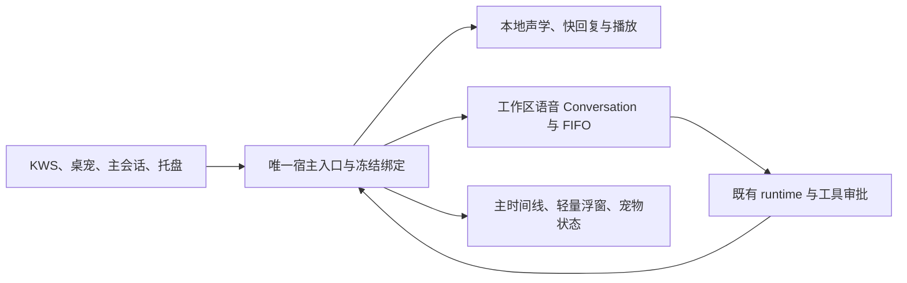

# 语音修复与桌宠联动 · 最终串行实施交接

> **状态：📋 可执行的修复与优化方案，业务实现未由本轮执行。** 2026-10-22 复核；提交基准 `c308b0158b32846d024225c553c2082d2f41558d`，分支 `feat/xiaozhi-voice`，领先远端 5 个提交。基准测试与当前未提交修改分开记录，不能用基准成绩签核在途代码。
>
> **核心原则：** 保留本地 KWS/VAD/SenseVoice 和现有 Conversation/runtime；先修数据与身份边界，马上打通一条含页面、桌宠和真实任务的纵向流程，再沿同一路径补齐队列、连续对话与性能。本文件为最新执行导航；历史方案全文保留，旧入口中的并行安排不适用于本轮。

## 1. 背景与结论

用户需要的不是独立的语音工具系统，而是已有软件会话的语音入口：简单话及时回应，需要工具的工作交给原 runtime，状态和结果回到同一时间线并播报。

当前主链已有实现，不能整体推倒；但“R1–R5 已全部验收”不成立。可重复审查定位到锁、清空竞争、幂等、会话选择、录音续接和记忆归属缺口；桌宠入口、默认可见和完整队列交互也未完成。实施可以开始，产品交付尚不可签核。

| 当前事实 | 本轮目标 |
|---|---|
| 基准存在语音消息绑定、ledger、任务执行与结果通知代码 | 用竞争、恢复和真实工具验证关闭边界，而非仅沿用旧测试数量 |
| 主 composer 是录音转文字，桌宠尚无统一语音入口 | 保留普通听写；新增明确连续语音动作，统一交给宿主 |
| 浮窗承担大量诊断，队列主要显示单任务状态 | 主会话保存全文，浮窗显示必要控制，宠物作入口与归属明确的提醒 |
| 本地 TTS 引擎接缝存在 | 实际音色、许可证、三端资源与安装独立留证；缺资源不能写 R5 完成 |

### 1.1 当前在途修改，不当作已修复

本轮只读刷新时，另一执行者已在修改 `nomifun-db` 的 repository、SQLite 实现与测试，并继续改 `nomifun-conversation/src/service.rs` 的 epoch 传递。更早观察到的 `stream_relay.rs` 临时调试 diff 已不再出现在随后状态中。这些都是时间点观察，不能据此认定他人的工作已验证或被撤销。

新 repository 草稿已开始把 expected epoch 放到事务内，但同时加入 busy 拒绝；`insert_message_with_epoch` trait 默认实现还会忽略 expected epoch 并调用普通 insert。**复审必须补两个反例：A 活跃时 B 原文仍可落盘；不支持原子条件的实现收到条件时必须拒绝，不能静默降低约束。** 已存在消息/回执的重放也要检查清空后的旧事件不能重新广播。这里列的是在途风险，尚未对不断变化的草稿跑稳定版本测试。

交接开工先固定 HEAD、完整 diff、文件 ownership；同一文件只允许一个写入者。不得覆盖他人修改来恢复本报告所用基准。

文档自检结束再次读取状态时，另一执行者的在途范围还包括 manager 和 voice_tasks。本轮未改这些文件，也不对动态草稿逐次重跑测试或提前关闭 C01/C07；交付后的独立验收应以其稳定快照为准。

## 2. 架构与范围



- daemon 管采集、识别、短回复和播放；不管理 provider key、Conversation 权限或另一套工具。
- 宿主管工作区/owner 绑定、任务 ledger、快照与通知；不把快模型承诺当成真实接单。
- Conversation 提供持久原文/回复、绑定发送、真实回执/取消/审批。后端使用现有 bridge，不直接扩展 agent harness。
- 三视图消费同一事实，沿用 instance/seq、command/message/runtime turn 身份。入口宠物、memory owner、工作区、Conversation 是不同维度。
- 180 秒是连接空闲，30 分钟是工作区会话复用；审批最多 8 秒、单句上限、排队/执行预算独立。
- 不新增依赖、数据库迁移、权限模式、调度框架；不接入 Zipformer/Omni，不自动开启麦克风，不自动提交、推送、发布。

## 3. 修复清单与纵向实施

以下编号从固定提交审查搬入受版本管理的正式文档；完整旧日志仍在忽略目录。行号用于导航，实际修改须按符号重新定位。

| 编号 | 已核实触发与影响 | 最小修复和必须新增的验证 |
|---|---|---|
| C01 | manager 的 project_task 先 snapshot 后 source，project 先 source 后 snapshot，存在 AB/BA 等待环 | 统一锁顺序或缩短 guard；并发两条生产路径有界结束，seq/终态不倒退。测试须有进程级止损，不能让同步死锁挂住整套运行器 |
| C02 | 基准 append_voice_message_with_epoch / project_assistant_message_idempotent_with_epoch 仅写前查 epoch，事务未接条件 | 实际事务内检查所有权、epoch 和副作用；分别 barrier 后 clear，再写入，旧消息/回执/成功事件均无；覆盖重放分支及 A 忙时 B 落盘。当前在途补丁不能仅靠签名变化关闭 |
| C03 | manager 空闲候选直接返回普通聊天，忙时才查 workspace voice 注册表；空闲语音候选也绕过轮换 | 普通聊天只供 workspace；统一 canonical workspace 解析和 30 分钟规则，原聊天 metadata/消息不变 |
| C04 | 注册表读取错误当空表、写失败仍创建；create 成功回填前中断后生成新 key | 首次副作用前持久化；原 pending key 查询/恢复；预写失败零创建，创建丢响应不重复；损坏/失效工作区显式失败、不换默认目录 |
| C05 | worker A ignore/TaskAccepted 后进 Idle，有效 B 的 FollowUpSpeech 非法后仍 pop；后续 C 无消费保证 | 明确连续连接状态；成功取得处理权才出队，否则保留或可见终结。A ignore/空ASR/接单/模型失败带 B/C；停止再唤醒不执行旧PCM |
| C06 | driver 首次 WakeHit、Listening 和 worker ListeningReady 仍为 6 秒，只有追问改为180 | 首次与播放排空后的空闲契约一致；控制时钟测179.999/180边界、讲话续期、任务/审批暂缓；强制 expire helper 不算边界测试 |
| C07 | voice_tasks 重放比较受 is_some 门控，未完整比较 preset_snapshot，Some→None 可跳过 | 规范化完整冻结请求；逐字段变更/省略、同preset不同内容、Some(None)均冲突；exact replay 不增加create/send次数，旧入口兼容要显式表达 |
| C08 | manager 最近三轮按旧到新耗尽1000字预算，可丢最新否定/城市/数字更正，缺逐轮来源 | 最近有效约束优先、完整单元裁剪，保存来源与截止点；长旧回复+最新纠正不能生成误导目标，安全保留不了就澄清，不增加摘要模型前置依赖 |
| C09 | CompanionStore 的侧库 memory.db 查询主库 conversations；一次性真实测试报 no such table；collector 吞错回当前默认伙伴 | 主库可信边界解析并冻结owner，通过事件传递；侧库不跨查/ATTACH。真实主侧库分离、owner切换/删除、事件重播、collector/learner只归原owner；解析失败隔离，不能重归新默认伙伴 |

主要入口：`nomifun-app/src/voice_companion_manager.rs`、`voice_tasks.rs`；`nomifun-conversation/src/service.rs`；`nomifun-db/src/repository/{conversation,sqlite_conversation}.rs`；`apps/voice-companion/src/voice.rs`；`nomifun-voice-terminal/src/{driver,contract}.rs`；`nomifun-companion/src/{store,collector,learner}.rs`。

### 3.1 一个执行者，四步连续推进

1. **事务与身份：C01/C02/C07/C09。** 修锁、原子清空防线、完整幂等和可信归属；先补真实失败例再修。没有这些前提，不做会制造更多错误记录的 UI 接线。
2. **第一条可见纵向：C03/C04/C08 + UI1。** P 的普通聊天 → 点击宠物 → 同一 P 专属语音会话 → 固定音频 → 真实 runtime 读取随机文件 → 同时间线、浮窗及宠物正确指向结果。立即实现必要页面与默认可见，不先堆完所有后端。
3. **连续控制：C05/C06 + UI2/UI3。** A 执行时 B/C 和键盘 D 排队；列表、位置、逐项取消、unknown 恢复、审批和播放一致；多宠同点/旧窗/音量乱序不串身份。
4. **完整交付：UI4/U4/U5 + R5 差额。** 双语/主题/缩放和键盘、真实按钮/路由/窗口、延迟分段测量、失败恢复、联合构建。资源缺失单列，不为凑 R5 更换整个声学方案。

对应 [页面联动规格](voice-ui-pet-linkage-acceptance-plan-2026-10-22.zh.md) UI0–UI4 / VP-01–24；[原执行辅导](R1-R5-execution-coaching-2026-10-21.zh.md#sensevoice-consolidated-execution) U0–U5；[alignment rev2](flowy-voice-qoder-alignment-plan-2026-10-20.zh.md) 是完整契约底稿。页面状态、队列和审批时序沿用这些既定定义，不额外发明一套状态枚举。

### 3.2 可执行默认与待裁决项分离

- 新默认沿用工作区 voice 路径；旧显式 `VoiceTargetConfig.mode=companion` 保留原语义和数据。实现新交互不等于已完成旧模式迁移，不能静默重释配置。统一迁移及提示策略单列待裁决，不阻塞无依赖路径。
- 当前连接和任务冻结 P 及 owner；导航 Q/切默认伙伴影响下一次显式连接。过期/不存在绑定失败，不暗中转默认目录/owner。
- 会话 permission/session_mode 从真实配置继承并冻结；用户原有 yolo 不被强制改成另一模式，也不为语音默认开启 yolo。只有引擎实际挂起的调用才走一次审批，模糊 ASR 不等于同意。
- UI 首屏提供原文、真实状态、队列和动作；完整JSON/诊断折叠可展开。结束/X 停采集与声音，后台任务继续；重播只播文字结果，不重跑任务。
- 本地离线音色/许可证尚不能拍板代替验证；只验现有已许可资源，缺失明确未完成。浏览器、Tauri、真实设备/安装各自留证。

## 4. 决策与取舍

| 决策 | 采用 | 不采用及原因 |
|---|---|---|
| 模型和声学 | 继续本地 SenseVoice，快文本模型与任务执行分离 | 不以流式模型替换掩盖队列、路由和身份故障；外置小样本不足以证明新模型产品更好 |
| 会话和任务 | 复用原 Conversation/runtime 与 ledger | 不做宠物独立 runtime/新服务器队列框架，避免持久身份和权限双轨 |
| Qoder 借鉴 | 统一入口、workspace上下文、同时间线、明确 queued/replace、主输入动作区分 | 不复制私有 bundle，不把客户端静态符号推成云服务模型/延迟结论 |
| 节奏 | 四步纵向串行，必要 UI 跟随第一条真实任务 | 不每片等待 Owner，不并行编辑共享manager/service，也不延期到最后才接页面 |
| 证据 | 新边界红→绿，旧回归保留，产品签核分层 | 不以数量、SSR、mock回执、状态文案冒充真实工具/窗口/声音 |
| 旧配置 | 明确暂保原语义，迁移另裁决 | 不静默改成memory owner，不清空旧数据求统一 |

## 5. 已测基线、命令与验收

### 5.1 实际运行结果及限制

这些是本会话对固定代码基准的独立结果；在途 db/Conversation 代码继续改变后必须重跑受影响项。未在旧提交对照过的失败不能武断命名为既有故障。

| 检查 | 实际结果 |
|---|---|
| 宿主 voice_dialogue_integration | 15 passed |
| 宿主 lib voice | 79 passed / 3 ignored |
| voice-companion voice-skeleton 各目标合计 | 86 passed / 11 ignored |
| nomifun-voice-terminal | 38 passed / 1 ignored |
| Conversation | library 643 passed；随后ACP集成3失败，退出101，后续目标未继续 |
| nomifun-db projection | 匹配16项通过，未覆盖新C02竞争窗口 |
| workspace check | 通过，有warnings；不证明联合打包通过 |
| UI定向9文件 | 96 passed / 0 failed，560断言；含结构/SSR，不证明点击/Tauri |
| i18n/theme | 11653 keys / 55 modules一致；theme contract通过 |
| UI TypeScript | 60条错误，退出2，未归因；不纳入本轮无关修复 |
| C09真实探针 | 0 passed / 1 failed，SQLite no such table: conversations |
| 定向fmt/diff | 退出0；根rustfmt disable_all_formatting=true，fmt证据有此限制 |

Rust日志：`target/voice-review/c308b0158-20261021/`。前端、Qoder、C09源码及日志：`target/voice-review/ui-pet-20261022/`。C09临时测试已从业务tests目录移除，执行者应按§3增加永久回归，不是删除出错查询就算完成。正式报告保存必要脱敏日志，不能只留下会被清理的target链接。

### 5.2 已实际运行的命令族

Windows mise shim 曾无响应，使用已安装绝对路径。Cargo依次执行，不与开发监听器争用目录。普通sandbox曾产生假文件权限失败；相同命令正常权限通过，先区分环境与产品问题，不放宽断言。

```powershell
# 仓库根
git status --short --branch
git rev-parse HEAD
git diff --check
$voiceToolBin='C:/Users/38788/.rustup/toolchains/1.97.1-x86_64-pc-windows-msvc/bin'
$env:PATH="$voiceToolBin;$env:PATH"
$env:RUSTC=Join-Path $voiceToolBin 'rustc.exe'
$voiceCargo=Join-Path $voiceToolBin 'cargo.exe'
& $voiceCargo test --locked --offline -p nomifun-app --test voice_dialogue_integration
& $voiceCargo test --locked --offline -p nomifun-app --lib voice
& $voiceCargo test --locked --offline -p voice-companion --features voice-skeleton
& $voiceCargo test --locked --offline -p nomifun-voice-terminal
& $voiceCargo test --locked --offline -p nomifun-conversation
& $voiceCargo test --locked --offline -p nomifun-db projection
& $voiceCargo check --locked --offline --workspace
& 'C:/Users/38788/AppData/Local/mise/installs/node/24.16.0/node.exe' ui/node_modules/typescript/bin/tsc --noEmit -p ui/tsconfig.json
& 'C:/Users/38788/AppData/Local/mise/installs/node/24.16.0/node.exe' scripts/generate-i18n-types.mjs --check
& 'C:/Users/38788/AppData/Local/mise/installs/node/24.16.0/node.exe' scripts/check-theme-contract.mjs
# 工作目录 ui
& 'C:/Users/38788/.bun/bin/bun.exe' test src/common/adapter/voiceCompanion.test.ts src/renderer/pages/voiceSession src/renderer/services/i18n/voiceLocales.test.ts src/renderer/pages/settings/VoiceSettings.structure.test.ts src/renderer/components/chat/ComposerSubmitCluster.structure.test.ts src/renderer/hooks/system/useSpeechInput.test.ts src/renderer/pages/companion/messages/project.test.ts
```

新增边界/交互测试、受影响companion回归、UI聚合门禁及联合构建的具体命令由执行者在任务0核对仓库脚本后登记，实际运行并保留退出码；上表不声称它们已经通过。原有ignored保留且单列，新增边界必须执行，不能新增skip、过滤0项或降低断言。先红→绿应来自真实缺陷触发，不人为破坏无关代码制造红灯。

### 5.3 两条完成指标

1. C01–C09有对应失败复现及修复后自动证据；固定中英音频走生产worker、同工作区Conversation/FIFO、真实随机文件工具、正文与输出消费回执，副作用次数正确；VP-01–24无漏项，分别标自动/浏览器/Tauri/Owner，未验证不签核。
2. 范围、原数据和权限契约保持；无新增相关自动回归失败。workspace/聚合/联合构建逐项报告，未归因失败不得冒充全绿；未自动提交、推送或发布。

三轮集中修复/验证为止损上限，同一命令三连失败记录根因转独立项。需要越界、配置迁移、资源授权或真人设备的事项写入 `voice-repair-20261022/BLOCKED.md`；进度存同目录 `PROGRESS.md`，本轮尚未创建执行记录，交给执行者启动时创建。

本轮交接文档自检：任务书3335字符；C01–C09九项唯一、VP-01–24二十四项唯一；四份既有入口的历史内容保留且diff零删除。链接扫描另发现 current-implementation-status 历史段有两处旧 apps/ai-mate/src/voice.rs 路径，已用 HEAD 原文确认并非本轮新增，未为修链接改写历史；新增交接/补充文档链接须零失效。完整扫描含历史失效的第一次检查退出1，该失败保留；随后分别报告新增与历史链接，不宣称全库链接全绿。

## 附录 A：laoyeye 点子王对抗复核

### 结论 (Verdict)

**needs-attention** — 主架构可继续，交接已可执行；数据/身份阻断和真实页面联动必须作为交付门禁，不能沿用“全部完成”的说法。

### 事实清单 (Irreducible Facts)

- 麦克风、输出设备及实际播放排空不是UI状态字符串；网络模型不能保证任何环境都8秒内返回 — physics。
- 重复创建、混归伙伴或恢复重发会产生真实数据与执行成本；不能靠更快模型修复 — economics。
- 同workspace专属语音Conversation、180秒/30分钟规则、现有权限和本地环境均为已批准产品契约 — convention。
- Qoder本机CN0.4.8的统一入口/voice消息/workspace上下文可静态复核；没有据此验证云服务延迟或拿到完整公开桌面源码 — evidence。

### 攻击点 (Attack Points, by severity)

1. **[P1] [evidence] 数据前提不稳却继续接UI，会把一次偶发问题放大成持久错写/串归属。** C01/C02/C07/C09均有具体调用链，C09有真实SQLite反例；在途epoch草稿还需防busy误拦与trait静默忽略。→ **证伪实验：** barrier夹住清空与写入，A忙B落盘，主/侧库分离后切默认owner再重播；断言旧epoch零写入、B一次落盘、记忆只归原owner。
2. **[P1] [evidence] 入口、工作区、owner与Conversation若混为一体，所谓同时间线在宠物点击/重启时仍会分裂。** C03/C04、主窗口失焦清candidate和旧companion配置均有实码。→ **证伪实验：** P普通聊天→宠物使失焦→启动→导航Q→create丢响应重启；原任务仍在P、原普通聊天未污染，恢复同键同Conversation；旧配置未静默变义。
3. **[P2] [evidence] 旧测试通过掩盖连续句子丢失和交互缺席，用户会再次遇到第一句后无反应。** C05/C06与未接桌宠/队列入口已核查，96前端测试没有证明实际桌宠点击。→ **证伪实验：** A取ignore/失败/真实接单分别带B/C，真正挂载点击队列/审批/停止并跑180秒受控时钟；每句有结果或明确终结，停止不取消A，超时/失败保字。

### 幸存结论 (What Survives)

- 快回复和runtime分工、现有Conversation/ledger、SenseVoice及三视图共用宿主事实，均继续适用。
- 参照Qoder的统一入口、同时间线、明确排队和中断动作合理；无需复制其内部实现。
- 四步串行纵向交付比新增调度框架或每片人工复审更适合当前共享调用链。

### 修改建议 (Changes)

- 把九项缺口与红→绿要求正式存档，先修原子身份，再立即实现第一条页面/桌宠纵向路径。
- 将busy准入、epoch失效和旧配置迁移明确拆开；缺少原子能力时拒绝，不能默认忽略安全条件。
- 只测量实际慢点，按中文/英文/混说分组报告；不以字幕流式化代替端到端修复，也不承诺网络绝对8秒。
- 完成一组就运行定向回归，稳定节点集中独立复审；设备、安装和离线资源单独签核。

### 分工 (Assignment)

- 四步实现、回归和交付文档 → owner：用户指定的单个执行Agent，role：deep_reasoner；同一调用链内串行完成，不拆成并行共享文件写入。模型与工具由用户现有设置决定。
- 稳定交付后的独立复审 → owner：本审查Agent，role：deep_reasoner；只核证据和边界，实施者不能自签产品完成。
- 真人麦克风/扬声器及安装体验 → owner：Owner；自动测试明确保留未验项目，不要求Owner替执行者跑命令。

### 未解疑问 (Open Questions)

- 旧显式companion目标何时统一迁移、怎样提示用户？影响旧配置全量对齐签核；本轮保留原语义，不阻塞workspace voice路径。
- R5最终要分发的具体中英音色及许可证/体积/RTF是否满足要求？影响离线与三端发布，不影响已有Edge/文字主链修复；无证据不捆绑。

## 附录 B：可直接交给执行Agent的任务书

```text
你是本轮唯一执行者；只依据本任务书及其引用规格实施，冲突记入 BLOCKED.md，不自行扩大权限。断点续跑先读 PROGRESS.md，每完成一项立即更新。
目标：把已存在的语音主链修稳，并贯通桌宠、工作区语音会话与真实任务；用户能看见原文、排队、执行、审批和结果，离屏能听到真实结果。
优先级：数据/授权/身份正确 > 流程完整 > 体验与速度。“只允许/不许”为硬约束，其余实现建议可替换并记录理由。

## 我替领导拍的板
- 沿用已确认的 SenseVoice、现有快模型/TTS接缝和 Conversation/runtime；本轮不接 Zipformer、不重建调度器。
- 串行纵向推进，不每片等人工复审；先修原子边界，再完成一条可见联动，然后扩展队列、连续倾听和性能。
- 旧 companion 目标配置：默认保留原语义和数据（临时兼容决策）；只对既定 workspace voice 路径实施新交互。统一迁移另列待裁决，不能声称旧路径已符合新产品规则。
- 离线音色缺资源/许可证、真人声音和安装效果不能自动签核；不影响可独立完成的主链修复。

## 界限
仓库 D:/workSpace/git_clone_test/allo，沿用 feat/xiaozhi-voice，保护全部未提交工作；禁止自动提交/推送/发布。
白名单：apps/voice-companion、apps/desktop/src/voice_session_window.rs；backend 下 nomifun-app 的 voice* 与必要 services 装配、nomifun-voice-terminal、nomifun-api-types 的 voice DTO、nomifun-conversation 的语音消息/投影接缝、nomifun-db 的 Conversation repository（无 migration）、nomifun-companion 的 profile/service/store/collector/learner 相关归属及 roster；ui 的 voiceCompanion adapter、voiceSession、companion、useVoiceContext、composer 连续语音入口、双语字典及生成类型；对应测试和 voice-agent 文档。其他路径只读。
不改 agent harness、auth、CI/门禁判据、依赖/lockfile、数据库迁移或权限模式；不扩大修复全 UI TypeScript 与 ACP 未归因失败。需要越界写 BLOCKED.md，先做无依赖部分。

## 现状与任务0
审查基准 c308b0158，ahead 5；2026-10-22 已实跑：宿主集成15通过，voice库79通过/3 ignored，daemon86通过/11 ignored，terminal38通过/1 ignored，前端96通过；workspace check通过。Conversation库643通过后ACP集成3失败；UI类型60错误，未归因。真实owner探针失败 no such table: conversations；不能用测试总数证明新边界通过。
规格目录 D:/workSpace/git_clone_test/allo/docs/architecture/voice-agent/execution/：
1. voice-repair-final-handoff-2026-10-22.zh.md（本轮顺序、C01–C09、命令及当前在途风险）
2. voice-ui-pet-linkage-acceptance-plan-2026-10-22.zh.md（VP-01–24）
3. R1-R5-execution-coaching-2026-10-21.zh.md §10–12；alignment rev2作契约底稿。
先 git status --short --branch、git rev-parse HEAD、git diff --check，核对实际diff和他人修改；当前另有执行者在改db/Conversation epoch，先协调写入所有权，不能同时改同文件或覆盖其补丁。按主交接文档§5复跑受影响基线。命令/环境/数字不同先记录证据，只暂停依赖该前提的部分，不强行恢复旧代码。
进度与待裁决写 execution/voice-repair-20261022/PROGRESS.md、BLOCKED.md。核对后先写≤10行开工回执：目标、顺序、最大风险。

## 任务1–4（依赖顺序）
1. 关闭 C01/C02/C07/C09：统一锁顺序；epoch在实际写入事务内校验，含已存在消息重放；A运行时B原文仍可落盘，不把busy当epoch失败；完整冻结请求冲突；主库可信边界冻结owner，collector不跨侧库查主表、不吞错转当前默认伙伴。验收：锁交错、clear竞争、payload逐字段变更、主/侧库分离与owner切换重播，均先给红例再绿；新增接口不能默认忽略安全条件。
2. 关闭 C03/C04/C08并实现UI1：普通聊天只供workspace，P忙闲都解析同一专属voice Conversation；30分钟按有效交互，运行/审批暂缓轮换；注册表预写失败零创建，响应丢失用原键恢复；最近否定/数字纠正及来源冻结。接桌宠→统一wake→binding→同一主会话；新装Flowy/Bolt可见、升级尊重隐藏、不自动开麦。用固定中英音频进入生产worker，真实runtime工具读取临时随机文件，结果回到同一时间线；断言创建/发送各一次。
3. 关闭 C05/C06并实现UI2/UI3：A ignore/失败/接单后B/C不静默丢失；首次及播放排空后180秒空闲，审批最多8秒、单句上限分别计。键盘/语音同FIFO；unknown先查回执且阻挡后项；列表位置、逐项取消、审批倒计时和实际终态一致。结束/X不取消后台任务，重连不自动发送或开麦。两宠同点、P→Q导航、旧窗口、密集音量与乱序事件不串身份、不双播。
4. 完成UI4/U4/U5与R5差额说明：浮窗精简、JSON可展开，主会话保留全文；三视图双语/主题/键盘/缩放可操作。测VAD结束→ASR→LLM稳定句→TTS→sink首帧/排空的p50/p95，实际排空后续期；TTS失败保字，重播不重做任务。R5只验现有合法资源，缺音色/许可证/三端安装明确未完成；不承诺网络下必定8秒。
每项运行§5对应实际命令及新增边界测试；新测试必须列命令、case数量和退出码，不能用过滤到0项冒充。VP24项逐项记录自动/真机/Owner证据层级，不拿SSR代替点击或Tauri。

## 规矩
不删、skip/todo、放宽旧断言/阈值或改门禁求绿，不用生产假数据、替身runtime、假播放回执或“|| true”。允许新增测试及随明确契约补充断言；既有ignored单列，不新增忽略；审批仍服从会话真实权限，模糊语音不当同意。
同一验收连续失败3次记根因并转可独立项；不反复扩大重构。最多3轮集中修复/验证后交付现状。回退只限本轮自有且确认造成退化的补丁，不动他人工作。

## 完成条件
1. C01–C09有对应红→绿证据；中英固定音频经生产worker、同工作区Conversation/FIFO和真实随机文件工具返回正文及播放回执，创建/发送次数正确；VP-01–24逐项无遗漏，不能验证的明确未签核。
2. 白名单与旧数据/权限契约守住；相关自动回归无新增失败，工作区/聚合检查及联合构建分别报告实际结果，未归因旧失败不冒充通过；无自动提交推送。
交付贴实际命令输出摘要、红→绿证据、HEAD/diff、产物身份和剩余限制；PROGRESS.md/BLOCKED.md必须齐全，后者无事项写“无”。部分受阻就明确部分完成，不能写“R1–R5全部完成”。
```

## 附录 C：来源与历史保护

本文件是新增交接，不删除或改写已有方案全文。上游研究与UI详细证据见 [Qoder本机调研](qoder-cn-live-voice-research-2026-10-20.zh.md)、[工作区深研](qwen-qoder-workspace-voice-deep-research-2026-10-20.zh.md)、[页面联动补充](voice-ui-pet-linkage-acceptance-plan-2026-10-22.zh.md)。Qoder CN构建为 `f8c98a817f6059ab9a959f501e9a483805170942`；renderer SHA256 `52b8425ff40f90ef76782847291e61183ad0a2eb4a6c44df443494466b8eccef`、main `1a382db7062b9acdb910ed78fcebb2a16a8a6900b5d44965f9c8a3cbb4260996`，本次本机静态复核与前次一致；不宣称Qoder模型/云语音实现或延迟已实测。

与当前代码冲突时，先记录事实和新diff，不能覆盖他人修改来凑旧结论；与本文件范围冲突的历史并行/迁移安排不自动执行。现有文档仍用于追溯需求，最新执行顺序以本文件§3和任务书为准。

