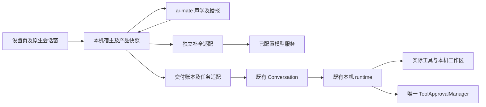
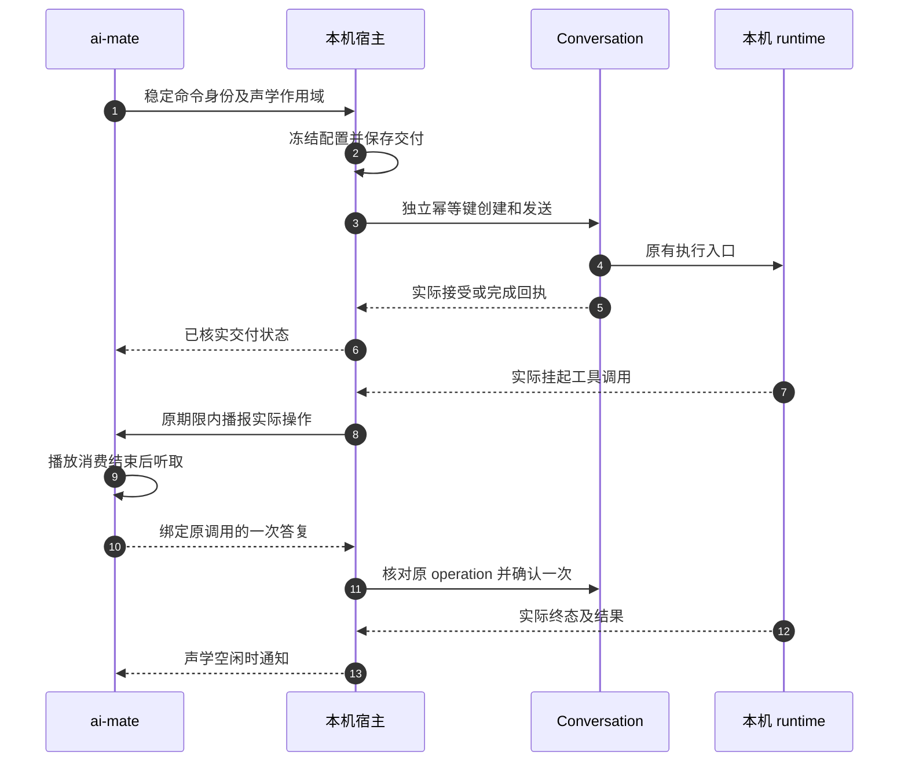

# 语音伴侣与本机 runtime · 接口契约

> **状态**：🔧 T1–T3 已接线；自动门禁见[实施记录](T0-T5-implementation-progress.zh.md)，安装和 Owner 验收单独记录。
> **核心原则**：daemon 负责声学，宿主负责交付和产品状态，既有 runtime 执行本机任务。云账号提供模型访问凭据，文件和工作区始终在本机。

> **T4 接续**：私有任务结果通知增加可选 `goal`（默认缺省，旧请求仍可解码），与真实 `text` 构成最多三轮的成对追问上下文；不当作新的任务命令。宿主仅在真实输入静默时通知，daemon 二次核对。设备恢复仅重建 daemon，任务账本/runtime 留在宿主；旧会话控制失效，阅读文本保留。自动证据见实施记录，硬件与 Owner 未验收。

## 1. 背景与痛点

语音会话和后台任务寿命不同。关闭语音窗口不能取消已接受任务；模型的“已接单”文案也不能证明执行侧已接受。

| 原断点 | 当前契约 |
| --- | --- |
| 有声学事件但没有任务消费者 | 宿主连接原 Conversation 创建、发送和回执接口 |
| 响应丢失导致重发或重复提示 | 首次副作用前保存、两个稳定幂等身份、只读恢复、通知独立认领 |
| 模型布尔值被当成授权 | 实际挂起调用及唯一审批管理器才是权威 |

本接口沿用 `/api/voice/companion`，保留已有公开字段，不新增 runtime、数据库表或 provider key 副本。

## 2. 架构与模块边界



- `VoiceDialogueCompleter` 解析模型引用并补全，不初始化任务 runtime；接本地模型时替换或复用这一适配。
- `VoiceTaskRuntime` 封装配置冻结、创建、发送、观察、取消及实际确认，生产实现为 `ConversationVoiceRuntime`。
- `VoiceTaskService` 持久化交付及幂等记录，恢复路径只查询原身份。
- `VoiceCompanionProcessManager` 是公开产品快照的单一写入者，维护 `instance_id/seq`，声学投影不能清掉任务与审批。
- daemon 唯一拥有采集、ASR、短对话和播放，不能改变工具权限或管理 Conversation。

## 3. 交互、身份和 API



### 3.1 身份不能互相替代

| 字段 | 所属范围与用途 |
| --- | --- |
| `instance_id` | 公开接口校验宿主实例，私有桥校验 daemon 实例，由宿主转换 |
| `session_id` / `turn_id` | 声学会话及轮次；阻止旧窗口或停止后的轮次提交新任务 |
| `command_id` | 持久命令；同 ID 不得改变目标、会话和轮次 |
| `conversation_id` | 专属任务会话，不借用当前聊天或桌宠会话 |
| `message_id` | 原持久化用户消息回执，不是 runtime 根轮次 |
| `runtime_turn_id` | 既有运行根轮次，不替代交付身份 |
| `msg_id` / `call_id` / `approval_id` | 实际挂起工具调用；三个字段都必须匹配 |

创建键为 `voice-create:{command_id}`，发送键为 `voice-send:{command_id}`。首次副作用前保存已规范化的绝对工作区、模型引用和 `ResolvedPresetSnapshot`，不保存 key。后续预设编辑不能改变原命令。

### 3.2 公开接口

下表路径均相对于 `/api/voice/companion`，复用宿主现有所有者校验和前端认证桥。

| 接口 | 请求及响应 |
| --- | --- |
| `GET /execution` | `requested/effective/available/reason_code`；不录音或初始化任务推理 |
| `POST /execution` | 配置对象或 `null`，保存明确工作区及 `model/preset_id` 引用，返回解析结果 |
| `POST /tasks` | `{instance_id, command_id, session_id, turn_id, goal}` → `{task, freshly_accepted}` |
| `GET /tasks/{command_id}` | 查询原回执，不重发；旧命令目标校验仍保留 |
| `POST /tasks/{command_id}/cancel` | `{instance_id, command_id, conversation_id, message_id}` → 实际任务投影 |
| `GET /tasks/{command_id}/confirmations` | 原任务仍有效的实际挂起调用列表 |
| `POST /tasks/{command_id}/confirmations/{approval_id}` | 下列一次性确认对象 → `{success:true}` |

```json
{
  "instance_id": "当前宿主实例",
  "command_id": "原交付命令",
  "conversation_id": "原专属会话",
  "message_id": "原持久消息",
  "msg_id": "实际工具消息",
  "call_id": "实际调用",
  "approved": true
}
```

确认请求禁止未知字段，不能传 `always_allow`。最终放行在现有运行状态线性化锁中再次核对原交付 operation，复用 Conversation 确认入口，固定一次授权。不能授权同一 Conversation 的另一个运行轮次。

任务投影为 `VoiceTaskSnapshot`：`command_id/session_id/acoustic_turn_id/conversation_id/message_id/runtime_turn_id/status/result_ok/result_text/error_code`。尚未核实的身份可为空，不能生成替代值填补。

| `status` | 前置条件与语义 |
| --- | --- |
| `delivering` | 首次副作用前已保存，尚无接受依据 |
| `unknown` | 创建、交付或结果不完整，只读核对原身份 |
| `accepted` | 原交付的实际接受回执已匹配 |
| `cancelling` | 已请求取消，仍等待实际终态 |
| `completed` | 原 runtime 终态明确 `result_ok=true`；具体工具结果及副作用仍需分别说明 |
| `failed` | 明确拒绝或实际失败、取消终态 |

已保存但未核实的交付返回 HTTP 202，已核实投影返回 200。只有新且完整匹配的实际接受回执才播报新接单。缺失结果不能推断成功，取消调用成功也不能代替终态。

领域错误返回 `{code}`：作用域变化、改目标、第二活动任务、旧审批/重复/过期审批为 409；缺少任务为 404；确定拒绝为 422；缺少 runtime 为 503。损坏 JSON、错误类型和未知字段可由现有框架返回 422，客户端不能将框架正文当成功回执。其他持久化/传输错误也不能推断未执行。

### 3.3 私有桥与声学控制

- 宿主私有桥为 `/complete`、`/tasks`、`/task-control`；daemon 只传目标及当前作用域。接口限定回环、无代理、无重定向；临时凭据由 supervisor 注入环境，不进入命令行、前端状态或日志。
- daemon 控制入口包括 `/api/voice/snapshot`、`/api/voice/wake`、`/api/voice/stop`、`/api/voice/task-result`、`/api/voice/confirmation` 及声音设置。前端不能直接取得控制凭据。
- 提交和控制前读取新快照，不靠固定延迟重放事件。宿主缓存仍为 Dispatching 时，也要能读取 daemon 的实际 Idle 状态。
- 历史结果按命令持久化认领，响应丢失时保留文字，不自动重播。停止语音与显式取消任务分开。
- 口头提示完整列出操作目标；过大或无法完整描述的范围保留面板审批，不能截断目标后授权。
- 口头听取从实际 sink 消费完成后开始，最多 8 秒且受原授权剩余期限限制；停止、否定、含糊答复、静默及迟到结果不能放行工具。

## 4. 决策与权衡

| 决策 | 采用 | 未采用及原因 |
| --- | --- | --- |
| 交付 | 原 Conversation 与两个稳定幂等键 | 新 runtime 或模型接单文案不能证明实际接受 |
| 配置 | 首次副作用前保存完整预设快照 | 创建时重解析会漂移到新 revision |
| 确认 | 唯一 `ToolApprovalManager`，权限取交集 | 双 token/挂起存储会产生双重权威 |
| 恢复 | 查询原创建和发送身份 | 换身份重发可能重复执行 |
| 环境 | 本机工作区，宿主复用模型凭据 | 云电脑/云工作区不属于本产品架构 |

## 5. 验证与签核

| 边界 | 证据与状态 |
| --- | --- |
| worker、宿主、实际 Read、结果文字与播报输入 | T1 自动回归及已安装真实声学回放 |
| 幂等、响应丢失、停止、查询、取消 | T2 自动回归 |
| 实际删除、命令、拒绝、静默及错作用域 | T3 策略和宿主自动回归 |
| 提示消费后计时、停止及过期 | T3 daemon 自动回归 |
| 安装、真实设备、原生窗口和 Owner | 未验收，T5 交接单独记录 |

各命令、结果及门禁以[实施记录](T0-T5-implementation-progress.zh.md)为准。替身仅在测试范围；任务夹具使用真实 Conversation、runtime、工具及随机临时文件。不能以这些证据替代真人麦克风、物理扬声器、安装、跨平台或 72 小时挂机证明。

## 附录：原始技术底稿与历史归档

本文件为新增实施契约，没有替换旧正文。原始 [PRD](../PRD-voice-companion.zh.md)、[技术方案](../voice-companion-integration.zh.md)、[串行计划](runtime-vertical-contract-plan.zh.md)及[最初计划原文](vertical-execution-plan.original.zh.md)继续完整保留。

权威 DTO 位于 `nomifun-api-types/src/voice.rs`。宿主实现位于 `nomifun-app` 的 `voice_companion_manager.rs`、`voice_tasks.rs`、`voice_task_runtime.rs`；声学控制位于 `ai-mate/src/voice.rs`、`voice/confirmation.rs`。失败及通过日志由实施记录索引，接口变更必须同时检查调用者和生产入口测试。
