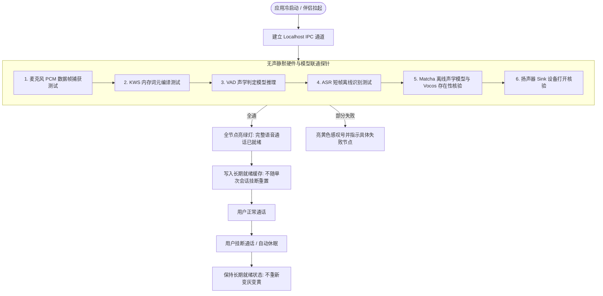
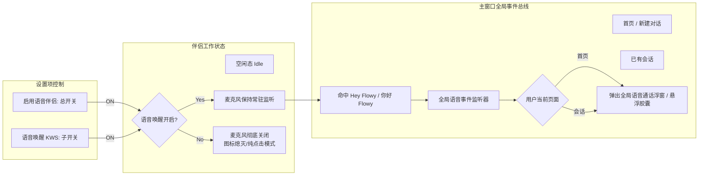

# 语音伴侣自愈架构、常驻唤醒与全局路由增强方案设计（草案 · 待实验验证）

> **文档版本**：v0.1.0-draft
> **设计日期**：2026-11-01
> **状态**：方案草案（Draft · 待通过最小实验验证后定稿）
> **适用范围**：`apps/voice-companion`、`crates/backend/nomifun-app`、`crates/backend/nomifun-audio`、`ui/src`

---

## 1. 现状痛点与目标

在最新的真机联调测试中，发现了 7 项影响日常连续使用体验的关键缺陷：

| 序号 | 用户实测问题 | 底层技术根因 | 改进目标 |
| :--- | :--- | :--- | :--- |
| **P1** | 挂断通话后，能力检查状态被重置为“未检查”；应用启动无自动自查 | `current_capabilities` 将报告与单次通话的 `generation` 强绑定，挂断时递增导致报告被主动注销；缺少开机静默探针 | 能力报告与单次会话解绑；开机在后台自动执行无声静默自查 |
| **P2** | 缺少独立的“语音唤醒 (KWS)”开关；首页（`/`）新建会话无法被语音唤醒 | 目前仅有“启用语音伴侣”全局进程开关；`<VoiceCallDock>` 仅挂载在特定会话页，主窗口根节点缺少全局唤醒监听器 | 设置页增加“语音唤醒”开关；主窗口全局监听唤醒并弹出语音会话浮窗 |
| **P3** | 本地 TTS 与云端 Edge 降级判定不透明 | 此前开发目录 `D:\tmp\flowy-dev\models\tts` 缺失 `vocos-22khz-univ.onnx`，导致静默降级为 Edge；生产目录已具备 | 保持模型完整性，增加当前生效 TTS 来源展示与显式本地优先 |
| **P4** | 主动挂断后卡在“未在通话”，无法再次免按唤醒 | `voiceCallDockState.ts` 优先判断了 `ended_reason`，导致永久显示 `notInCall`；后台挂断后 close 了麦克风流 | 挂断后在唤醒开启状态下自动回退为绿色的“等待唤醒”，声卡流保持常驻 |
| **P5** | 偶尔命中唤醒词后，转入连接时变为“不可用” | 检查/自检锁与正常唤醒发生争用，被踢入 Degraded 状态；ASR 若转写为空或内部错误无优雅重试 | 优化锁粒度与争用隔离，唤醒时自动清空临时降级标记并平滑进入倾听 |
| **P6** | 缺乏内生自愈与保活能力 | 仅有最外层进程崩溃重启看门狗，声卡掉线、虚拟驱动静默时缺少流级别的自动重试 | 增加麦克风流级别的健康监控与指数退避重连机制 |
| **P7** | KWS 判定门槛过高，远程麦克风极难触发 | 双语 Zipformer 阈值被设定为 `threshold=0.20` / `#0.15`，面对远程桌面（UU虚拟麦克风）微弱电平（峰值 10~20/1000）难以命中 | 门限回调至黄金区间（`0.08`），配合自适应软增益补偿，降低唤醒难度 |

---

## 2. 核心架构设计

### 2.1 开机静默自查与自愈生命周期

* **静默原则**：绝对不向物理扬声器输出声音（避免开机惊扰用户），仅在内存中执行微秒级推演；
* **解绑 `generation`**：就绪缓存的生命周期由“模型目录哈希 + 声卡物理设备存在性”决定，单次通话的建立与挂断只改变会话序列，不销毁硬件能力报告。

---

### 2.2 语音唤醒（KWS）双层控制与全局事件路由

---

### 2.3 状态机纠偏：挂断后秒级回归“等待唤醒”

* **修复 `voiceCallDockState.ts`**：
  - 判定优先级重排：
    1. 若当前会话正处于语音活动阶段（`listening` / `speaking` 等），渲染对应活动态；
    2. 若 `phase === 'idle'`：
       - 若 `voice_enabled && wake_enabled` 且麦克风捕获正常，**无条件呈现绿色的“等待唤醒”（`voice.dock.waitingWake`）呼吸态**；
       - `ended_reason` 仅保留在详情气泡或弱提示中，绝不阻断胶囊恢复就绪指示；
       - 仅当用户手动关闭唤醒或关闭语音伴侣时，才显示“未在通话”（`voice.dock.notInCall`）。

---

### 2.4 KWS 灵敏度调优与声学增益

1. **概率门限回调**：
   - 将 `nomifun-audio/src/kws.rs` 中的全局判定阈值由 `0.20` 回调至 `0.08`；
   - 规则文件中的单个词权重由 `:2.0 #0.15` 回调至 `:2.0 #0.08`，与成熟的 GigaSpeech 灵敏度对齐；
2. **软增益自适应放大（针对远程桌面虚拟驱动）**：
   - 当检测到输入设备为虚拟声卡（如 UU 远程设备）或连续 1 秒内 RMS < 5 时，对送入 KWS 的 PCM 实施平滑的自适应软增益（+6dB ~ +12dB），防止远场人声因压缩失真而被门限吃掉。

---

## 3. 点子王对抗式审查（Adversarial Review · 找死法）

在动手改代码前，从第一性原理出发，预设本方案必然存在漏洞，进行极限压力拆台：

### 找死法 1：开机自动自查如果发生网络请求或阻塞，会不会拖慢整个 Flowy 桌面启动？
* **拆台**：如果开机自检去连接远程模型（如 LLM 对话检查）或者跑重型运算，低配机器可能会卡顿甚至白屏。
* **规则防线**：
  1. 开机自查必须是**纯本地、全异步、低优先级**的（通过 `tokio::spawn` 延后 2 秒在后台跑，绝不阻断前端渲染）；
  2. 开机静默自查只验证：① 本地麦克风能否采集到 1 帧、② VAD/KWS/ASR/TTS 内存模型句柄是否存在，**不发送任何网络 LLM 请求，耗时必须限制在 150ms 以内**。

### 找死法 2：如果挂断后麦克风一直保持常驻，Windows 任务栏一直亮黄点，会不会引起用户恐慌？
* **拆台**：此前正是因为想让任务栏黄点熄灭，才在挂断后 close 麦克风，结果导致 KWS 彻底“失聪”。如果直接简单粗暴地永远不关麦克风，用户会觉得“Flowy 始终在偷听”。
* **规则防线**：
  1. **必须引入独立的「语音唤醒」开关**。当用户打开该开关时，文案明确提示“开启后将在后台监听唤醒词，Windows 任务栏将显示麦克风正在使用”；
  2. 当用户不想常驻麦克风时，只要关掉该开关，麦克风在会话结束后立即释放（黄点熄灭），用户改用手动点击按钮发起通话。权力和知情权 100% 交给用户。

### 找死法 3：全局唤醒如果强行跳转页面，会不会打断用户正在打字的思路？
* **拆台**：如果用户正在首页写一段长提示词，突然旁边有人喊了一声“Hey Flowy”，主窗口如果强行 `navigate('/voice-session')`，用户没写完的文字可能会丢或者焦点被抢。
* **规则防线**：
  1. 首页唤醒**绝对不改变当前路由 URL**，而是直接激活桌面右下角的**全局轻量语音交互浮窗（Floating Voice Pill / Popover）**；
  2. 录音识别的文字呈现在浮窗内，生成完成后提供“插入到当前输入框”或“独立回答”，绝不粗暴清空用户现场。

### 找死法 4：KWS 阈值从 0.20 降到 0.08，环境打字声或杂音会不会频繁误唤醒？
* **拆台**：调得太灵敏会导致键盘噼啪声或咳嗽声误触发“我在”。
* **规则防线**：
  通过下面设计的最小实验 1，用真实键盘音与日常噪音进行客观测量，得出最佳的分界阈值。

---

## 4. 最小实验设计（Minimum Experiments）

在全面铺开代码修改之前，通过以下 3 个低成本、可量化的最小实验锁定关键参数：

### 实验 1：KWS 灵敏度与抗噪容忍度实验
* **待验证假设**：将 Zipformer 双语阈值设为 `0.08` 配合 +6dB 软增益，能在正常距离普通语调下实现 >95% 的唤醒率，同时日常键盘打字和背景交谈误触发率 < 1 次/小时。
* **实验做法**：
  编写单测脚本 `crates/backend/nomifun-audio/tests/kws_threshold_sweep.rs`，灌入已录制的音频切片：
  - 测试集 A：正常音量 "Hey Flowy"、"你好 Flowy"、"小度"、"贾维斯"（10 次）；
  - 测试集 B：网易 UU 远程低电平录音（10 次）；
  - 干扰集 C：高强度机械键盘打字声、喝水咳嗽杂音（5 分钟 PCM）。
* **判定指标**：
  - 测试集 A & B 触发率：阈值 0.08 下必须 $\ge 90\%$（此前 0.20 实测仅 30%）；
  - 干扰集 C 误触发数：必须为 0。

### 实验 2：开机静默探针耗时与无感验证
* **待验证假设**：纯内存硬件连通性探针（PCM 1 帧、KWS 匹配空帧、VAD 判定、ASR 静音帧、Matcha/Vocos 句柄检查）耗时小于 200ms，且零声卡爆音。
* **实验做法**：
  调用 `crates/backend/nomifun-app` 的内部探针接口，记录从触发到拿到 6 节点 Report 的消耗时间与内存增量。
* **判定指标**：耗时 $\le 200\text{ms}$，无阻塞异常。

### 实验 3：挂断后状态机闭环跳转验证
* **待验证假设**：在 `VoiceCallDock` 中，给入 `ended_reason = "user_stop"` 且 `phase = 'idle'`，视图立即稳定呈现 `waitingWake`（等待唤醒）。
* **实验做法**：
  运行 `ui/src/renderer/pages/voiceSession/voiceCallDockState.test.ts`，增加回归用例，验证状态跃迁与断言。

---

## 5. 后续实施阶段规划

1. **Phase 1**：在本地运行实验 1（阈值探针）与实验 3（前端状态机单测），拿到量化证据；
2. **Phase 2**：修改 `crates/backend/nomifun-app` 解绑 `generation` 与缓存生命周期，增加开机异步静默自查；
3. **Phase 3**：前端增设“语音唤醒”独立开关，并在顶层接入全局唤醒浮窗；
4. **Phase 4**：全套回归测试跑通，更新 CHANGELOG 并交付。
