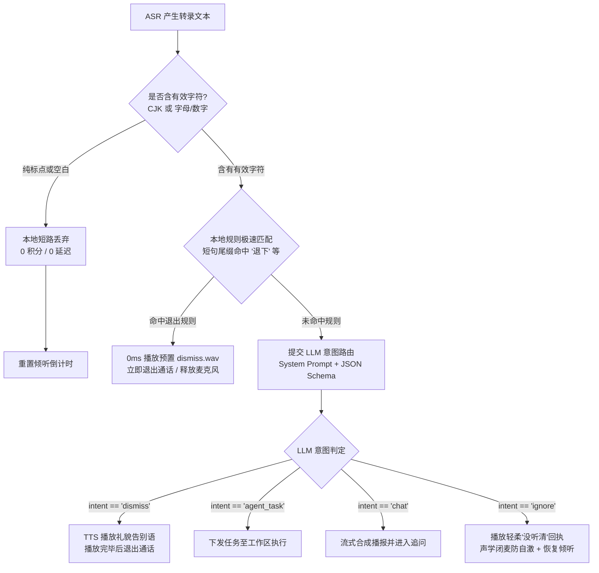
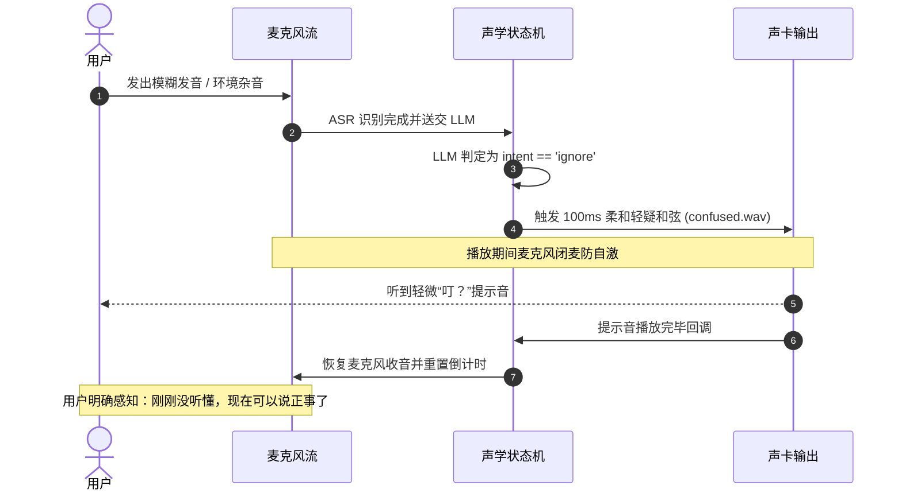

# Flowy 语音伴侣 · 语义退出、ASR 前置净化与交互式声学反馈架构方案

> **状态**：📋 方案草案 / 架构设计基线
> **日期**：2026-11-02，Asia/Hong_Kong
> **代码分支**：`feat/voice-kws-barge-in`
> **核心原则**：**“复合意图任务优先，纯标点零网路损耗，规则秒退语义兜底，未听清显式回响防死寂。”**

---

## 1. 背景与核心痛点 (Background & Pain Points)

在真实的语音对话场景中，用户输入经常面临发音含糊、方言口音、环境杂音与口语化表达的综合挑战。从真机实测（如用户说“谢解退下吧。”）与后台日志追踪中，暴露了当前语音交互链路的三大核心痛点：

```text
┌──────────────────────────────────────────────────────────────────────────────────┐
│ 实测典型断层案例：                                                               │
│ 用户输入：“谢解退下吧。”（ASR 因语音同音字将“谢谢/先”识别为“谢解”）             │
│ 系统行为：花费 10 积分调用 Qwen 大模型，模型回答“好的，您先忙”，但通话坚决不退出！  │
└──────────────────────────────────────────────────────────────────────────────────┘
```

### 1.1 现状的三大核心痛点

1. **退出意图严重缺乏语义泛化，且缺失大模型意图定义**：
   - 现存机制仅依赖本地规则库 `classify_voice_direct_control` 进行死板的前缀匹配（必须以“请你”、“好的”等开头，或者精确等于“退下吧”）；
   - 当 ASR 识别产生前导错别字（如“谢解退下吧”、“那你就退下吧”、“你先撤吧”）时，规则直接失配；
   - 随后请求送入大模型 LLM Router，但当前的 `VoiceIntentType` 只有 `ignore | chat | agent_task | task_control` 四种类型，**根本没有定义 `dismiss`（退出通话）意图**！
   - 大模型别无选择只能归类为 `chat`（闲聊），礼貌回答一句“好的，您先忙”，播报完后再次进入监听追问态，**导致用户下达了退下指令，AI 却扣了积分赖着不走**！
2. **纯标点符号/空白杂音穿透门禁，白白消耗大模型积分**：
   - 伴侣端前置过滤仅检查了 `text.trim().is_empty()`；
   - 当环境噪音、叹气或杂音被 ASR 误识别为单个标点符号（如 `。`、`，`、`？`、`...`）时，系统未加拦截，直接发起耗时 1~2 秒的云端 LLM 请求；
   - 大模型返回 `ignore`，白白耗费了用户的调用积分与网络带宽。
3. **判定为“无效输入/没听清”（Ignore）时系统陷入纯静音死寂**：
   - 当判定为 `ignore` 时，伴侣在 `discard_utterance` 中静默重置 30 秒倒计时，**没有任何声音或口语回执**；
   - 用户无法分辨是“没听懂”、“卡死了”、“还在思考”还是“可以说话了”，心理模型完全断裂。

### 1.2 能力演进对比矩阵

| 场景 | 现状行为 | 本方案重构后行为 |
| :--- | :--- | :--- |
| **口语化退出（如“谢解退下吧”、“你撤吧”）** | 规则失配 $\to$ 走 Chat 闲聊回复 $\to$ 通话保持连接继续听（扣 10 积分） | 规则层模糊秒退（0 积分）+ LLM 原生 `dismiss` 意图兜底挂断 |
| **纯标点输入（如单一的“。”、“？”）** | 穿透至大模型 $\to$ 耗时 1.5 秒 $\to$ 返回 ignore（扣 10 积分） | 本地净化门禁直接拦截丢弃（0 网络开销，0 积分消耗） |
| **模糊无效输入 / 没听清** | 彻底静音，用户面对死寂不知所措 | 播放专属疑问提示音（Earcon）或预固化“没听清”微短语，节奏清晰 |
| **单字确认指令（如“好”、“对”、“行”）** | 易被误伤拦截或超时 | 精准 CJK 字符集判定，确认态特别豁免放行 |

---

## 2. 方案全景与架构设计 (Architecture & Topology)

### 2.1 端到端处理流拓扑图



### 2.2 核心目标 vs. 明确非目标

* **核心目标**：
  1. **双轨退出收敛**：规则层支持短句尾缀模糊命中（0ms 退出），LLM 层具备原生 `dismiss` 意图，彻底解决口语化表达无法退出的问题；
  2. **非语义输入零成本拦截**：纯标点、纯空白零 HTTP 消耗、零积分扣减；
  3. **交互节奏声学闭环**：未听清或无效输入提供明确的声学回响，消除等待焦虑。
* **明确非目标**：
  1. 不改变正在执行中的后台自动化任务生命周期（退出语音通话绝不等于终止后台任务）；
  2. 不将整个对话历史的退出判断转嫁给前端（状态裁决严格保持在伴侣守护进程与终端驱动层）。

### 2.3 架构不变量
1. **意图优先级铁律**：`AgentTask` > `Chat` > `TaskControl` > `Dismiss` > `Ignore`。只要句子中包含具体的任务或明确疑问，严禁触发退出；
2. **麦克风物理安全**：退出通话状态必须彻底释放麦克风句柄（OS 录音红点熄灭）；
3. **声学防自激屏障**：播放“没听清”提示音或告别语期间，麦克风必须处于硬件静音态（`pause_listening_for_feedback`）。

---

## 3. 核心设计与模块规范 (Subsystem Design)

### 3.1 意图路由层扩展：`VoiceIntentType::Dismiss`

#### 数据结构扩展 (`nomifun-api-types/src/voice.rs`)
```rust
#[derive(Debug, Clone, Copy, Serialize, Deserialize, PartialEq, Eq)]
#[serde(rename_all = "snake_case")]
pub enum VoiceIntentType {
    Ignore,
    Chat,
    AgentTask,
    TaskControl,
    Dismiss, // 退出语音通话 / 告别退下
}
```

#### LLM Router System Prompt 规范 (`nomifun-voice-terminal/src/router.rs`)
在双语 Prompt 中明确约束：
* **中文规范**：
  > `- intent_type 必须为 "ignore" | "chat" | "agent_task" | "task_control" | "dismiss" 之一。`
  > `- 当用户明确表达想要结束通话、告别、离开或让助理退下时（例如：“退下吧”、“你先撤吧”、“不用了你先忙”、“拜拜”、“退出语音”），且不含后续新任务时，intent_type 必须归为 "dismiss"，并在 reply_tts 中给出简短礼貌告别语（<=20字，如“好的，您先忙”、“好的，随时叫我”）。`
* **英文规范**：
  > `- intent_type: Must be one of "ignore" | "chat" | "agent_task" | "task_control" | "dismiss".`
  > `- When the user explicitly requests to end the call, leave, or dismiss the assistant (e.g. "hang up", "goodbye", "dismiss", "exit voice", "that's all for now"), and no follow-up task is present, intent_type must be "dismiss", with a polite farewell in reply_tts (<=20 words, e.g. "Goodbye! Let me know if you need anything.").`

---

### 3.2 规则层模糊容错：短句尾缀命中与中英夹杂（Code-Switching）规则

在 `classify_voice_direct_control` 中强化尾缀模糊容错与中英夹杂支持：
对于长度 $\le 8$ 个汉字（或 $\le 4$ 个英文单词）的极短语音，只要末尾包含强特征退出词，且不包含否定词与转述前缀，直接在本地以最高优先级拦截。

#### 1. 规避英文开发高频词碰撞（严禁裸词 `exit / quit`）
在开发者桌面环境（Flowy），英文的 `exit / quit / stop` 是极高频的系统术语（如 `exit vim`, `exit code 1`）。**英文规则严禁单字裸词模糊匹配**，必须要求完整动作短语。

#### 2. 中英语气助词与尾缀双向打通
```rust
const SHORT_DISMISS_SUFFIXES: &[&str] = &[
    // 中文强退出尾缀
    "退下吧", "退下", "休息吧", "结束通话", "挂断吧", "退出语音", "退下了", "撤吧",
    // 英文与中英夹杂常见尾缀（必须整词或完整短语）
    "bye", "byebye", "goodbye", "exit voice", "end the call", "hang up"
];

// 前缀清洗白名单（打通中英语气助词）：
const PREFIXES: &[&str] = &[
    "请你", "请您", "麻烦你", "那你就", "好的", "行了", "好了", "那你", "那就", "麻烦", "请",
    "ok", "okay", "please", "alright", "then"
];
```
用户即使说：*“OK 退下吧”*、*“Bye 啦”*、*“那就退下吧”*，也能在本地前置清洗后瞬间剥离出退出核心词，**0 毫秒、0 积分极速退出**！

---

### 3.3 ASR 纯标点与无效音前置净化门禁（中英双语标准）

在 `voice.rs` 的 `handle_dialogue` 中，请求发起前增加过滤网：

```rust
// 1. 过滤纯标点符号与纯空白（0 网络交互，0 积分消耗）
// 必须同时兼顾中文 CJK 汉字与英文 ASCII 字母/数字，保护英文撇号缩写（don't, I'm）
let has_semantic_content = clean_input.chars().any(|c| {
    c.is_ascii_alphanumeric() || nomifun_audio::cjk_pinyin_table::is_cjk(c)
});

if !has_semantic_content {
    tracing::info!(raw = ?text_opt, "ASR produced only punctuation or whitespace; dropping locally");
    Self::discard_utterance(driver, playback, event_tx, generation, &control_scope).await;
    return;
}
```
* **英文撇号与单字母保护**：单个单词 `"No."`（2 字母）或 `"K."`（1 字母）均含有 `is_ascii_alphanumeric() == true`，属于有效命令，绝不误杀！
* **纯标点拦截**：针对纯粹的 `"。"`、`"，"`、`"？"`、`"..."`、`"---"` 实施 100% 本地拦截，不发起 HTTP 请求。

---

### 3.4 没听清声学反馈（Unclear Earcon）与连续失败熔断器

当请求被归类为 `intent_type: "ignore"` 时，不再保持绝对死寂，而是建立**阶梯式声学反馈机制**：



#### 双语声学反馈设计（拒绝英文啰嗦病）
在英文语境下，TTS 念一句 *"Sorry, I didn't quite catch that. Could you please repeat?"* 耗时高达 1.8 秒，极易引发烦躁感和麦克风自激回声。
因此确立双语规格：
* **首选（Earcon 提示音模式）**：播放一声 **100ms 柔和的疑问小和弦（`EarconKind::Confused`）**，完全跨语言通用，全球人类听感一致，0 语言隔阂；
* **拟人语音模式**：仅播放预固化的微短语：
  - 中文：`"没听清"`（320ms）
  - 英文：`"Pardon?"`（350ms，极其短促自然，坚决不用 2 秒长句子）。

#### 连续失败熔断防自激（Anti-PingPong Loop）
为彻底杜绝外放声音被麦克风重新收录造成“循环播报没听清”，引入连续 Ignore 计数器：
* **第 1 次未听清**：播放 100ms 柔和轻疑音（`EarconKind::Confused`）；
* **第 2 次连续未听清**：播报预置 0ms WAV（中文“没听清” / 英文“Pardon?”）；
* **第 3 次连续未听清**：**静默熔断**，不发出任何声音，直接退回待机，彻底粉碎死循环。

---

## 4. 关键决策与对抗式排雷矩阵 (Decision & Adversarial Review)

| 潜在致命漏洞 | 触发场景（中文/英文/双语） | 破局与防范手段（代码红线） |
| :--- | :--- | :--- |
| **1. 复合长句被误挂断 (Accidental Hangup)** | 用户说：“好的我知道了，但你再帮我查一下天气” / *"Okay thanks, but could you also check the build status?"* | **意图优先级铁律**：Prompt 与判定逻辑中 `AgentTask` 权重高于 `Dismiss`。只要检测到伴随任务或疑问，一律放行给 Agent 执行，严禁挂断！ |
| **2. 英文开发词汇碰撞 (`exit / quit`)** | 用户问：*"How do I exit vim?"* / *"The script returned exit code 1"* | **英文严禁裸词子串匹配**：规则层必须是完整短语（如 `"exit voice"`, `"hang up"`），带有疑问词或技术上下文的一律由 LLM 正常回答，严禁误退！ |
| **3. 英语地道告别语规则失配** | 用户说：*"That'll be all, thanks."* / *"I'm good for now."* / *"You can take off."* | **LLM 原生纳管 `dismiss`**：依靠模型对地道英文告别语境的泛化语义理解，准确分类为 `dismiss` 并挂断。 |
| **4. 极短单字指令被误杀** | 工具确认时回答“好”、“对”、“行” / *"No."*, *"Yes."*, *"K."* | **精准字母/CJK字符集判定**：只要含有一个汉字或英文字母即视为有效内容，绝不采用简单字符长度截断。 |
| **5. 中英代码夹杂导致规则失配** | 用户说：*“OK 退下吧”*、*“Bye 啦”*、*“Stop 别说了”* | **清洗层打通中英公共词表**：前缀白名单打通 `ok / please / 好的`，尾缀包含 `bye / 退下`，在本地 0 毫秒秒退。 |
| **6. “没听清”提示音引发声学死循环** | 提示音外放被麦克风录入，反复触发 ignore；英文长句 TTS 造成严重自激 | **闭麦保护 + 3次连续熔断 + 英文仅允许 350ms "Pardon?"**：播放提示音期间调用 `pause_listening_for_feedback()` 强制闭麦，优先使用 100ms 疑问和弦。 |
| **7. 退出通话误杀后台长任务** | 后台正在运行耗时 5 分钟的自动化任务时用户说“退下吧” / *"Hang up"* | **生命周期解耦**：退出动作仅调用 `d.reset()` 释放声卡与麦克风，`task_client` 与 Agent 任务进程保持独立运行。 |

---

## 5. 验收标准与验证矩阵 (Acceptance Criteria)

### 5.1 自动化测试用例清单

| 用例编号 | 测试目标 | 输入条件 | 预期断言 |
| :--- | :--- | :--- | :--- |
| `TC-DISMISS-01` | 本地规则短句尾缀模糊命中 | 用户输入 `"谢解退下吧。"` | 本地返回 `DismissSession`，不发起 LLM 调用，0 积分消耗 |
| `TC-DISMISS-02` | LLM 原生 Dismiss 意图流转 | 用户口语化表达 `"今天先这样吧你撤吧"` | LLM 输出 `intent_type: "dismiss"`，播报告别语并触发 `SessionEnded` |
| `TC-DISMISS-EN-01`| 英文技术词汇防误退下测试 | 用户输入 `"How do I exit vim?"` | 本地规则与 LLM 均判定为 `chat`，严禁判定为 `dismiss` |
| `TC-DISMISS-EN-02`| 英文地道告别语识别流转 | 用户口语表达 `"That'll be all, thanks."` | LLM 输出 `intent_type: "dismiss"`，播报 *"Goodbye"* 并退出 |
| `TC-CODESWITCH-01`| 中英夹杂短句极速退出 | 用户输入 `"OK 退下吧"`、`"Bye 啦"` | 本地规则秒退，返回 `DismissSession`，0 积分消耗 |
| `TC-SANITIZER-01` | 纯标点符号前置拦截 | ASR 产生 `"。"`、`"，"`、`"？"` | 本地丢弃，不发 HTTP 请求，不扣减积分 |
| `TC-SANITIZER-02` | 单字与英文极短指令放行 | ASR 产生 `"好。"`、`"No."`、`"K."` | 正常放行至后续意图与工具确认判定 |
| `TC-UNCLEAR-01` | 未听清声学提示音回执 | 真实背景噪音触发 `intent == "ignore"` | 派发 `VoiceCueKind::Confused`，播放 100ms 疑问音，麦克风在播放期保持静音 |
| `TC-UNCLEAR-02` | 连续三次未听清熔断 | 模拟连续 3 次 `ignore` | 第 3 次保持静音，不发生声音死循环 |

### 5.2 验证运行命令梯子
1. 运行 API 类型与 DTO 契约测试：
   `cargo test -p nomifun-api-types --test c2_voice_dto_golden`
2. 运行终端路由意图分类测试：
   `cargo test -p nomifun-voice-terminal --test vt_0`
3. 运行流式声学与退出验收测试：
   `cargo test -p voice-companion --features voice-skeleton --test voice_streaming`
4. 运行前端国际化键位对称性测试：
   `bun run check:i18n`

---

## 附录：原始讨论与技术背景归档 (Appendix)

* **2026-11-02 真机交互切片记录**：
  - 用户输入：`谢解退下吧。`
  - ASR 模型输出：`Turn ID: 01a19b52-2977-7433-bb63-72ad415bad69`
  - 模型决议响应：`{"intent_type":"chat","understood_request":"用户说'退下吧'","reply_tts":"好的，您先忙。有需要随时叫我。"}`
  - 问题现象：大模型缺少 `dismiss` 意图，闲聊播报完毕后通话继续占线，麦克风持续收音。
* **参考开源项目索引**：
  - Home Assistant Assist Pipeline: `homeassistant/components/assist_pipeline`
  - Open XiaoAI (小爱同学开源集成): `idootop/open-xiaoai`
  - Amazon Alexa Skills Kit: `AMAZON.StopIntent` & `AMAZON.FallbackIntent`
  - Wyoming Satellite: `rhasspy/wyoming-satellite`
