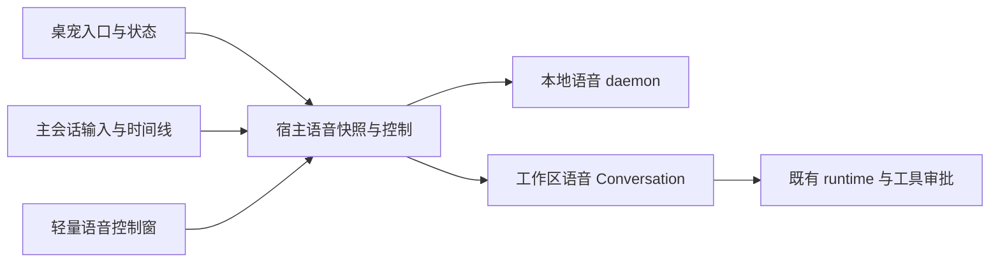

# 语音页面、工作区会话与桌宠联动：实施及验收补充

> 状态：2026-10-22 已完成代码核查、Qoder 本机静态复核和现有前端定向测试；本文新增交互尚未实施，浏览器点击、Tauri 窗口、真实设备和 Owner 验收未签核。代码基准为 `c308b0158b32846d024225c553c2082d2f41558d`。不以 R1–R5 后端测试数量代替页面与桌宠验收。

## 1. 目标与范围

让坐在电脑前和暂时离屏的中英文用户都能回答四个问题：现在是否在听、话和任务落在哪个工作区/会话、哪项工作正在执行、下一步需要我做什么。借鉴 Qoder 的统一入口、同时间线、排队与状态反馈；保留 Flowy 的本地 KWS/SenseVoice、现有 Conversation/runtime 和权限能力。

继承 [alignment rev2 §3.1–3.8](flowy-voice-qoder-alignment-plan-2026-10-20.zh.md)、[v0.4 PRD](../PRD-voice-companion-v0.4.zh.md) 和[执行辅导 §10](R1-R5-execution-coaching-2026-10-21.zh.md#sensevoice-consolidated-execution)。本文补齐页面、桌宠和联合证据，不重新定义 runtime，不增加云电脑、第二个任务系统或实时音频 provider。

本轮只增加文档；不修改业务代码、不下载模型、不替换产物、不提交或推送。产品场景为用户在桌面长时间阅读/工作、间歇离屏说话；沿用 PRODUCT.md / DESIGN.md 的克制布局、语义主题、键盘操作和减弱动态效果，明暗主题均保留相同控制含义。

## 2. 当前代码事实，不是完成声明

| 项目 | 当前事实及入口 | 判定 |
|---|---|---|
| 默认 Flowy/Bolt | `nomifun-app/src/services.rs:3060`：空 roster 时调用 `create_companion("Flowy", "bolt")`，已有伙伴不重复建；创建错误被忽略 | 有初始化代码，失败恢复与并发原子保证未闭环 |
| 新装默认显示 | `nomifun-companion/src/profile.rs:29,535`：appearance 取派生 Default，`companion_enabled=false`；上述创建路径没有设为 true | 未落实新装默认可见；不能把创建档案当作桌宠显示通过 |
| 至少一个伙伴 | `nomifun-companion/src/service.rs:842`：删除持 delete_lock 并拒绝最后一个；create/bootstrap 不持同一锁 | 最后一个删除保护已有；共同 roster 修改边界和写失败恢复仍须测 |
| 桌宠语音入口 | `pages/companion/index.tsx`、`companionNativeMenu.ts:1` 只有伙伴聊天/记忆/设置/隐藏等，未调用 wakeVoiceSession 或订阅语音快照 | 未实施统一语音按钮/菜单 |
| 主输入框麦克风 | `ComposerSubmitCluster.tsx:115,197` → `SpeechInputButton.tsx:90` → `useSpeechInput.ts` → SpeechToTextService；回调为 onTranscript | 已有录音转文字，不是语音伴侣连续对话；不能直接改名冒充 |
| 语音浮窗 | `pages/voiceSession/index.tsx` 已显示原文、理解、回复、音量、任务进度、审批与停止；`VoiceConversation.tsx` 默认展开完整模型输出 | 部分实现，仍偏诊断页面；主会话与浮窗职责需收敛 |
| 窗口行为 | `apps/desktop/src/voice_session_window.rs:40,99`：主窗口失焦清候选；原生 X 调 stop_session 后隐藏，不取消 runtime 任务 | 关闭语音与取消任务已区分；桌宠点击带来的焦点/工作区丢失仍须解决 |
| 工作区语音 Conversation | manager 空闲候选直接返回原聊天，忙碌才查工作区语音注册表；旧 companion 模式可创建伙伴聊天线程 | 专属工作区语音会话规则尚未统一，承接上一轮 C03/C04 |
| 桌宠任务信息 | `pages/companion/messages/project.ts:278` 订阅通用 Conversation 事件，能呈现一般任务活动；没有 voice snapshot、声学阶段、冻结语音 owner 的专用投影 | 可能看到普通任务提示，不等于完整语音联动；多宠归属/重复提示未证明 |
| 记忆 owner 实际解析 | `nomifun-companion/src/store.rs:3763` 在独立 memory.db 查询主库 conversations；`collector.rs:567` 吞查询错误后返回当前默认伙伴 | 一次性真实 CompanionStore 内存测试已复现 no such table: conversations；不能签核冻结 memory owner 已贯通 |
| 排队页面 | `VoiceTaskStatus.tsx` 能显示单任务 queued；现有 VoiceSnapshot 没有队列列表、位置和逐项取消投影 | 单条文案已有，可视 FIFO 清单未实施 |
| 语音伙伴选择 | `VoiceTargetSettings.tsx` 选择 voice_home / companion，会影响对话目标；binding 只有 session/binding/conversation/workspace | 不能将旧目标选择无声重释为新的 memory owner 设置 |
| 双语与主题 | 已有 zh-CN/en-US 和语义 token；本轮定向测试、i18n/theme 静态门禁通过 | 不等于真实点击、焦点、布局和 Tauri 窗口验证通过 |

本表说明至少三个不同层次：伙伴档案存在、桌宠窗口可见、语音任务与桌宠联动。任何一层存在都不能推出另外两层已经完成。

**[Required] 伙伴归属的额外阻断：** `CompanionStore::open_memory`/生产 open 使用伙伴侧库，schema 没有主库 conversations 表；对非 companion_thread 的语音 Conversation 调 `thread_companion_id` 会失败。collector 的 `.await.ok().flatten()` 丢掉错误，随后退回当时的 default_companion_id；即使主库 extra 写了 memory_owner_companion_id 也无法由此读到。一次性探针得到真实 SQLite `(code: 1) no such table: conversations`。这证明查询链断裂；没有读取或修改 Owner 真实记忆，不能声称已观察到实际数据污染。

最小修复方向：在已有宿主/Conversation 可信边界用主库 repo 解析并冻结 owner，通过已有事件传递；收集器只消费可信归属，不在 memory.db 假设主表存在，不为此新增数据库/ATTACH 通道。有明确语音 owner 的事件解析失败时隔离并报错，不能悄悄转给新默认伙伴；普通非语音事件的历史归属规则不借此重构。补真实主库与侧库分离测试、默认伙伴切换/删除后旧事件重播，以及 learner 只处理原 owner 的验证。

## 3. Qoder 可借鉴的模式与证据边界

2026-10-22 重新只读核对本机 Qoder CN 0.4.8 编译产物，构建 commit `f8c98a817f6059ab9a959f501e9a483805170942`。renderer `DIR8HOYO.js` SHA256 为 `52b8425ff40f90ef76782847291e61183ad0a2eb4a6c44df443494466b8eccef`；main `electronMain.js` 为 `1a382db7062b9acdb910ed78fcebb2a16a8a6900b5d44965f9c8a3cbb4260996`，均与前次证据相同。没有启动 Qoder、登录或调用其语音服务，不代表取得公开桌面源码或复现其延迟。

| 可复核机制 | Flowy 应采用的交互 | 不应推导的结论 |
|---|---|---|
| 桌宠请求转入统一 toggle-live-voice 命令 | KWS、桌宠、主会话、托盘/快捷键共用宿主入口及去重 | 每个宠物应拥有自己的采集器或 runtime |
| 新语音入口携带 workspace/model/permission 创建上下文；已有 voice chat 使用原 chatSessionId | 当前普通聊天只提供工作区；同工作区解析专属语音 Conversation，已有语音会话复用 | 任意当前普通聊天都必须被改为语音会话 |
| 转写带 messageStream:"voice"；委派走已有 chat 发送及 queued/replace | 原文、短回复、任务/结果在同一持久时间线；排队和正在执行分开显示 | 快模型一句“我来查”已等于接单，或可以默认替换当前任务 |
| composer 区分 stopLiveVoice、send、stopAgent、startLiveVoice | 连续语音、结束语音、发送文字、取消任务必须可区分 | 可把录音转文字按钮直接换成同义图标而不改调用链 |
| intentVisible 与 suspendedByVoice 分开 | 临时语音呈现不写回“显示桌宠”偏好；关闭后恢复用户当前偏好 | 隐藏宠物时一定会强制显示；此行为未真机证实 |
| 内置 Qoduck 资源 | 安装即有可发现入口；Flowy 沿用已批准的 Flowy/Bolt 伙伴规则 | Qoduck 与 Flowy 的持久 companion 实体/记忆归属相同 |

证据定位及更完整解释见 [Qoder 调研 §3–§4.2/附录 A](qoder-cn-live-voice-research-2026-10-20.zh.md) 和[工作区深研](qwen-qoder-workspace-voice-deep-research-2026-10-20.zh.md)。本轮脱敏索引与探针在 `target/voice-review/ui-pet-20261022/`；只保存选定交互符号、偏移和哈希，不将产品完整 bundle 纳入仓库。

Flowy 的“180 秒有效语音空闲”和“30 分钟工作区语音 Conversation 复用”继续属于自己的规则，不写成 Qoder 同义实现。

## 4. 三个界面，共用一份事实



### 4.1 主会话是完整记录

- 在现有 Conversation 页面呈现用户 ASR 原文、可折叠的理解需求、快回复、排队/执行/审批/结果。任务目标与隐藏上下文不是第二条用户气泡。
- 标题/导航显示语音标记；顶栏持续显示本连接工作区、语音伙伴和麦克风状态。用户可打开同一 Conversation 的完整记录。
- 输入框为空时语音 Conversation 显示“开始语音”；连接中显示“结束语音”。输入有文字时显示发送，语音状态另有明确控制；结束语音不等于取消任务。
- 普通聊天的录音转文字保持现有能力，明确标注“语音输入文字”；如提供连续语音入口，使用不同动作进入对应工作区语音会话，不篡改普通聊天。浏览器端不具备桌面 daemon 时明确不可用，不假装已开麦。
- 键盘与语音在该语音 Conversation 共用持久 FIFO；键盘文字默认不 TTS。不改普通 Conversation 的现有发送语义。

### 4.2 浮窗只保留必要控制

```text
Flowy · 语音伙伴名称        本地工作区 P
麦克风正在倾听             后台：A 正在执行，B 等待第 1 位
你刚说：再查广州天气
回复：已排队，前项完成后处理
[查看同一会话]  [队列 2]
[结束语音]
▸ 音量、引擎、错误码与完整模型输出
```

这是信息层级草图，不是新增生产 mock 页面。首屏优先用户原话、真实状态和下一动作；完整 JSON/声学诊断默认折叠但保留展开、复制能力，满足调试需求。长结果在主会话可读；浮窗只显示最近消息/摘要和详情入口。顶栏/底部控制固定、中间内容独立滚动，窄窗不能把结束按钮挤出视口。

原生 X 及“结束语音”都停止本连接采集/播报，不取消已接受任务。若增加“收起”，必须是独立动作：仅隐藏面板，持续采集时保留主会话/托盘等可见隐私指示。不能让同一 X 在不同阶段悄悄变成取消 runtime。

### 4.3 桌宠是入口与提醒，不拥有另一条会话

- 当前默认语音伙伴提供主要语音按钮与状态；其他宠物如提供“打开语音”，也只打开同一个全局语音连接，并明确显示当前语音伙伴名称，不隐式切换人格/记忆归属。
- 一次只允许一个有效采集/播报连接；重复点击、KWS 与点击同时到达、两只宠物同时点击只能唤起现有连接或收到明确状态，不创建多个 Conversation/麦克风。
- 开启连接只确保/复用语音 Conversation，不直接指派 runtime；只有实际用户输入被识别、判为任务并通过宿主校验后才提交。快聊、静音和打开控制条不得产生工具副作用。
- 倾听、识别、等待回复、播报、后台执行、等待确认、结束/失败分别有文本或图标含义；不能只换颜色或播放庆祝动画。
- 后台任务归属使用冻结 command/conversation/owner。语音专用事件只投影到该 owner 的宠物；现有通用 Conversation 提示应识别语音来源，避免同一结果在专用与通用路径重复提示。普通任务原行为不借此重构。
- 宠物可隐藏、改名、换皮；真实身份用 companion_id。沿用“至少保留一个伙伴”的已批准规则，不新增“名称为 Flowy 永远不能删除”的特殊判断。
- 默认伙伴切换对下一连接生效；当前连接、已排队项、旧结果不重归新伙伴。隐藏宠物不取消任务，不自动开启语音，也不写回/覆盖其他宠物偏好。

## 5. 启动、工作区与身份规则

| 启动情境 | 应冻结的目标 | 验证重点 |
|---|---|---|
| 主窗口处于 P 的普通聊天 | P 的专属语音 Conversation | 普通聊天只提供工作区，不被转换或污染 |
| 主窗口已处于 P 的语音会话 | 30 分钟内复用；忙碌/审批时暂缓轮换 | 不因再唤醒新建，不绕过空闲期限 |
| 点击桌宠后主窗口失焦 | 宿主最近确认的 P；以已确认上下文为准 | 不能依赖会被 Focused(false) 清掉的瞬时 candidate |
| 首页/无确认工作区 | 明确的本机默认工作区 | 页面能看到实际目录，不凭快模型猜路径 |
| 已确认 P 但目录失效/无权限 | 保持 P 的失败说明，停止交付 | 不悄悄转到默认工作区或另一伙伴工作区 |
| 连接中导航 P → Q | 本连接和已收录请求继续冻结 P | 明示当前连接仍在 P；显式结束后再开才采用 Q |

一次成功的明确启动可确保/复用语音 Conversation，并在绑定成功后展示；纯静音不得生成用户消息或 runtime 任务，关闭不自动删除历史。创建、发送使用各自稳定幂等键，不能由页面生成第二套身份或在刷新时自动发送。

**必须保持不同的身份：** 发起入口宠物、默认语音伙伴/memory owner、声学 session/turn、持久 Conversation、command/message/runtime turn。点击哪个宠物不是工具授权、路径授权或永久改默认伙伴的依据。

### 5.1 最小接口补齐，不重建状态中心

优先在现有 `/api/voice/companion`、VoiceSessionSnapshot、任务 ledger 与 i18n 层补齐以下展示信息，名称在实现前以现有 DTO 规范确定，本文不是这些字段已存在的声明：

- binding 的冻结 `memory_owner_companion_id`、可展示伙伴名、Conversation/工作区标识；采集可用性与真正活动态分开。
- 宿主从 ledger 生成有界队列投影：command_id、conversation_id、用户展示文字、状态、排队位置、可取消性。UI 不用快模型输出推测顺序，取消 B 按 B 身份提交。
- 所有视图沿用同一 instance_id/seq；owner/任务字段不被高频音量覆盖；迟到旧请求不能改当前按钮 pending/error。
- 入口需要 source/companion_id/已确认工作区上下文时，扩展现有 wake/宿主 bridge 的可选 DTO，服务端验证；不增加独立“宠物语音 API”或直接调用 daemon 私有端口。
- 不将 `VoiceTargetConfig.mode=companion` 静默重释为 memory owner。先列出已有配置/调用方，明确迁移及用户可见提示；新默认路径统一工作区语音 Conversation。需变更持久配置格式/公开语义时单独确认，不能用默认值掩盖。

默认语音伙伴优先复用现有 default_companion_id 选择能力，展示入口与 Conversation 目标分离；只有现有字段确实无法表达已确认语义时再提出字段变更。禁止为页面新增数据库或调度框架。

## 6. 页面状态与反馈契约

| 真实阶段 | 看得见/听得见 | 可操作边界 |
|---|---|---|
| starting | 连接/设备检查中；未标成正在收音 | 取消启动，失败后可重试 |
| listening / recognizing | 明确正在听/识别；最终 ASR 原文出现后保留；音量只来自真实 PCM | 结束语音；无 AEC 播放时不能假装同时识别 |
| quick reply | 已收到的稳定文字可显示/播报；处理中不是已完成 | 失败保留文字；后续句有处理结果或明确拒绝 |
| queued / accepted | 已排队及位置 / 真实接单执行中分别显示 | 取消指定排队项或显式取消当前任务 |
| approval | 工具、对象/路径、一次允许/拒绝、真实剩余期限及过期状态 | 模糊 ASR 不当同意；旧审批/错任务不执行；不能永远允许 |
| terminal | 结果文字、执行成败、播报 pending/played/failed 分开 | 查看同一会话；失败重播只重播，不重做任务 |
| ended / offline | 结束原因和后台任务是否仍继续 | 手动再开；不自动重发旧任务或恢复开麦 |

沿用轻量离屏提示：就绪、识别完成、等待较久、审批、任务终态和结束可区分；说话/播报期间不重复排队提示。180 秒从就绪/实际播放排空等既定有效时点计；单句上限、模型超时、最多 8 秒审批和 30 分钟 Conversation 复用分别处理。

所有按钮含键盘 focus、pending、disabled 和错误状态；中文/英文对称，无后端错误码裸露。审批按钮到期必须随时间自动更新，不能只在音量事件恰好重渲染时失效。进入确认不抢夺输入焦点导致正在说的 B 被当成 A 的授权。

## 7. 串行实施及出口

| 顺序 | 改动及复用入口 | 出口 |
|---|---|---|
| UI0：固定事实 | 保存 c308b0158 基线、本轮 Qoder 哈希、测试日志及上一轮 C01–C08 | 当前事实与未完成项可复核；本轮已完成此核查，不代表后续完成 |
| UI1：第一条可见联动 | 必要的锁/epoch/身份修复后，统一 P 的会话路由及可信 owner 事件；接默认宠物按钮 → 现有 wake → binding → 同一主会话；新装显示/旧偏好分离 | 在 P 点击宠物，用固定音频完成一次真实随机文件读取；原文/回复/结果在同一会话，浮窗/宠物指向它。不是先完成全部后端再补页面 |
| UI2：连续任务与控制 | 队列投影、列表位置、逐项取消；主会话语音态与键盘共用队列；缩减浮窗诊断层级 | A 执行时 B/C 可见排队；取消 B 不影响 A/C；结束语音不取消 A；详情入口打开正确 Conversation |
| UI3：状态和恢复 | 伙伴 owner 过滤/去重、审批、播放回执、180 秒/30 分钟、断线和旧窗口 | 三视图语义一致，不重复播报，不错归伙伴；断线/恢复/旧结果不自动开麦或重发 |
| UI4：联合交接 | 双语、双主题、窄窗/缩放/键盘/减弱动态、Tauri 焦点及真机脚本 | 自动与桌面/设备证据分别留存；联合构建身份一致，Owner 签核后才标产品通过 |

上一轮 c308b0158 独立复审的锁顺序反转、epoch 非原子、候选复用/轮换、录音出队、首次 6 秒、preset 重放和上下文截断仍需处理；不因页面显示更多状态而跳过。按既有 U1–U5 连续推进，不增加逐片等待 Owner 的人工审批流程。旧 `VoiceTargetConfig` 公开语义迁移是实施前单独确认项，不能由执行 Agent 偷换。

## 8. 联合验收矩阵

每项记录固定 HEAD、主题/语言、触发入口、workspace/conversation/session/turn/command/message/owner、可见结果和副作用次数。下表为待实现/待验证用例，不因已有 96 个测试通过自动打勾。

| 编号 | 触发场景 | 通过断言 |
|---|---|---|
| VP-01 | 空数据首次启动、重复 bootstrap | 恰好一个 Flowy/Bolt，首次可见，无自动开麦；写失败可观察且可恢复 |
| VP-02 | 升级时已有伙伴/隐藏偏好 | 不重复创建、不重置名字皮肤或隐藏偏好 |
| VP-03 | 并发创建/删除、删最后一个 | 共同 roster 边界后仍至少一个；失败没有半删除或孤儿默认引用 |
| VP-04 | 桌宠按钮与 KWS/双击同时启动 | 同一全局连接、一个 capture owner、一个有效 binding；无多次 create/send |
| VP-05 | 无主会话，从宠物开始 | 默认本机工作区可见；任务走既有 runtime；不建 companion_session 代替语音 Conversation |
| VP-06 | P 普通聊天前台/忙碌，点击桌宠失焦 | 始终解析 P 专属语音会话；普通聊天消息与 metadata 不受改造 |
| VP-07 | 再唤醒与 30 分钟边界/活动任务 | 窗口内复用、真正空闲后轮换、任务/审批未终态不轮换；丢响应后不换键重复建 |
| VP-08 | P 目录失效、模型不可用 | 提示具体原因，不能默认转 Q；短聊天可用性与任务可用性分别展示 |
| VP-09 | 导航 P→Q、已有连接说下一句 | 当前任务/连接仍属 P，页面明示；下次显式新连接才采用 Q |
| VP-10 | 语音 Conversation 空/有文字、普通聊天麦克风 | 连续语音/发送/结束/取消不混淆；普通听写不自动提交任务或启用连续连接 |
| VP-11 | 真实转写、快回复、隐藏 handoff | 用户原文一次落盘/一气泡；完整结果可读，隐藏上下文不冒充用户发言 |
| VP-12 | A 运行时连续说 B/C，再键盘 D | FIFO 身份、位置和界面一致；A 上下文不含未执行 B/C；满队列明确拒绝 |
| VP-13 | 取消队列 B / 显式取消 A | 只影响指定 command；A 保持取消中直到真实终态，无假完成 |
| VP-14 | A ignore/ASR 空/模型失败时已录 B | B 有处理结果或明确终结原因，无静默 pop、无跨停止旧录音执行 |
| VP-15 | 审批允许/拒绝/模糊/静默/过期/旧窗 | 实际调用仅一次同意生效；不确定不执行；显示倒计时与过期自动禁用，不能靠音量刷新 |
| VP-16 | 任务终态先到、正文/播报回执后到 | 已结束不冒充目标成功或已播；正文补齐一次通知，TTS 失败仍可看完整结果 |
| VP-17 | 结束按钮、原生 X、收起、隐藏宠物 | 结束停止采集/声音，后台任务保留；收起有持续隐私指示；隐藏不改任务和其他宠物偏好 |
| VP-18 | 两只宠物、切换默认伙伴、删/隐藏旧 owner | 当前 voice 状态/结果只对应冻结 owner；无双重播报/重复通用提醒；历史记忆不重归 |
| VP-19 | 相同 seq 重连、旧 task 延迟、音量密集 | 页面/宠物不回退到旧任务，不清 task 状态，不死锁；自动恢复不发送未发送任务 |
| VP-20 | owner 知识采集关闭/开启、主/侧库分离、事件重播 | 关闭不学习；开启只采原文一次；不存在跨错数据库查询；collector/learner 归属一致，明确 owner 失效不得回当前默认伙伴 |
| VP-21 | 语音会话已设置 model/preset/session_mode | 新任务按冻结的真实会话配置，default/auto_edit/yolo 不被语音强制覆盖；审批仍由既有引擎裁决 |
| VP-22 | 无 AEC 播放、播放中用户讲话、音频失败 | 半双工状态明确；回声不派任务；实际排空后续期，失败保字并给恢复入口 |
| VP-23 | zh-CN/en-US、明/暗、360×340 与 440×520、200% 缩放 | 主操作可达、无截断关键路径/审批对象、无翻译 key 泄漏；状态不只靠颜色；动态效果可减弱 |
| VP-24 | 主窗口最小化/关闭、托盘入口、后台完成 | 同一语音会话/任务详情可恢复；不会唤起错误会话或抢占文字输入；无悬空隐私状态 |

### 8.1 证据分层与本轮实际结果

1. **代码事实**：追踪 renderer → host bridge/API → manager → Conversation/runtime 以及宿主快照回到三个视图；不能只搜索按钮文案判定联动。
2. **自动回归**：交互测试须真实触发点击/输入/定时器与挂载/卸载，控制迟到事件；API/SQLite 测试断言身份及副作用次数。现有结构字符串测试和 SSR 只能继续承担其原有静态职责，不能换名字升级为桌面验收。
3. **浏览器页面**：隔离测试账号/临时目录，在实际路由跑焦点、按钮、队列、导航、双语主题和失败恢复；受控数据放独立测试夹具，不能加生产 fallback/mock。不得复用 Owner 的实时任务或私密浏览器标签。
4. **Tauri/设备**：验证真实桌宠、主窗/浮窗/托盘、点击穿透、最小化/多屏/缩放、麦克风许可、单一采集/输出；浏览器通过不能替代。记录固定音频生产 worker 回放与真人扬声器/麦克风两种不同证据。

本轮固定 c308b0158 的实际结果：

| 检查 | 结果 | 证明范围 |
|---|---|---|
| Bun 定向 9 文件 | 96 passed / 0 failed，560 断言 | voice adapter、浮窗三个展示组件、voiceLocales、VoiceSettings 结构、composer 结构、听写结构、通用宠物任务投影；没有桌宠启动语音点击测试 |
| i18n 类型/键检查 | 通过，11653 keys / 55 modules | 双语声明与生成产物静态一致 |
| theme contract | 通过 | 主题静态规则，不代表真实窗口视觉通过 |
| 一次性 owner 查询反例 | 预期 Ok(None)，实际 Err(no such table: conversations)，退出 101 | 真实 CompanionStore 内存库复现，证明新 owner 查询没有接到主库；测试源码已从业务目录移除，脱敏源码/日志留 target |
| UI TypeScript | 退出 2，60 条 TS 错误；涉及 credits、壁纸、Conversation、videoCanvas/videoGeneration 等 | 本轮未改业务代码，未在旧提交归因；不能写全仓门禁全绿，不扩大修这些无关模块 |
| Qoder 本机静态复核 | main/renderer 哈希与前次相同 | 0.4.8 固定编译产物行为线索，不是运行/服务性能验收 |
| 浏览器/Tauri 点击、截图、物理设备/安装 | 未执行 | 本轮只完成核查与方案，新增 VP 用例仍待执行 |

首次 sandbox 运行 Bun 出现 EPERM/EBADFD 和 alias/package 解析失败；同命令在 ui 工作目录、正常本机权限下得到 96/96，上述环境失败保留日志、不计作产品回归。证据目录 `target/voice-review/ui-pet-20261022/`：`ui-tests-normal-permissions.log`、`typecheck.log`、`i18n.log`、`theme.log`、`qoder-ui-evidence.json`、`owner-probe.log`、`voice_owner_review_probe_20261022.rs` 与只读探针。该目录被忽略，正式交接时保留脱敏证据，不把 Qoder bundle、私密数据或音频纳入源码提交。

### 8.2 执行命令与交接格式

从仓库根执行静态门禁，前端定向测试在 ui 工作目录执行；使用已安装 Bun，不安装新运行器。Windows mise shim 无响应时使用已安装工具的绝对路径，不因此改变依赖。

```powershell
# 工作目录：ui
bun test src/common/adapter/voiceCompanion.test.ts src/renderer/pages/voiceSession src/renderer/services/i18n/voiceLocales.test.ts src/renderer/pages/settings/VoiceSettings.structure.test.ts src/renderer/components/chat/ComposerSubmitCluster.structure.test.ts src/renderer/hooks/system/useSpeechInput.test.ts src/renderer/pages/companion/messages/project.test.ts
# 工作目录：仓库根；新增实际交互测试后把它们加入第一条命令
bun run typecheck
bun run check:i18n
bun run check:theme
bun run check
git diff --check
```

受影响 Rust crate 按修改补定向测试/编译，集成节点运行 workspace 检查与联合构建。现有全仓失败单独记录，不能降低断言或宣称已通过。不得启动发布、GitHub Actions、自动提交或推送。

每个 VP 用例交付 `{head, case_id, locale, theme, entry, identities, visible_assertions, side_effect_counts, result, evidence_paths, remaining_limit}`。Owner 脚本至少一条完整旅程：P 普通聊天 → 点击 Flowy → 声音 A/B/C → 确认一次真实工具 → 查看同一时间线/队列 → 关闭语音 → runtime 完成 → 结果保留 → 手动恢复播报。中文与英文分别跑，未完成项保持未签核。

## 9. 历史与决策保护

本文为增量补充，旧方案、旧研究和先前通过/失败日志全文保留。Qoder 私有编译产物仅用于理解交互，不复制代码进产品；本地保留 SenseVoice，不为“像 live”在本补充引入 Zipformer/AOQ/Omni。实施先打通同一路径的界面、宿主与任务，再集中视觉与性能补强；不以动画、音效或快模型口头承诺掩盖真实任务/授权/播放状态。

收尾观察：工作区另出现 `nomifun-conversation/src/stream_relay.rs` 的一行未提交调试输出；不是本轮写入，未撤销、未计入固定 c308b0158 的实施结论。后续执行/复审先重新记录实际 HEAD 与 diff，不能把其他在途修改混入本轮已验证范围。

## 附录：代码导航

- 伙伴初始化与删除：[宿主 services](../../../../crates/backend/nomifun-app/src/services.rs#L3060)、[档案默认值](../../../../crates/backend/nomifun-companion/src/profile.rs#L29)、[最后伙伴保护](../../../../crates/backend/nomifun-companion/src/service.rs#L842)。
- 伙伴归属反例：[侧库错误查询](../../../../crates/backend/nomifun-companion/src/store.rs#L3763)、[collector 回退](../../../../crates/backend/nomifun-companion/src/collector.rs#L567)、[learner 归属过滤](../../../../crates/backend/nomifun-companion/src/learner.rs#L335)。
- 入口与工作区：[桌宠页面](../../../../ui/src/renderer/pages/companion/index.tsx)、[桌宠菜单](../../../../ui/src/renderer/pages/companion/companionNativeMenu.ts)、[主窗口上下文](../../../../ui/src/renderer/hooks/useVoiceContext.ts)、[Tauri 窗口](../../../../apps/desktop/src/voice_session_window.rs)、[目标解析](../../../../crates/backend/nomifun-app/src/voice_companion_manager.rs#L271)。
- 主会话动作：[composer](../../../../ui/src/renderer/components/chat/ComposerSubmitCluster.tsx)、[听写按钮](../../../../ui/src/renderer/components/chat/SpeechInputButton.tsx)、[录音处理](../../../../ui/src/renderer/hooks/system/useSpeechInput.ts)。
- 展示与数据：[语音页面](../../../../ui/src/renderer/pages/voiceSession/index.tsx)、[任务操作](../../../../ui/src/renderer/pages/voiceSession/VoiceTaskStatus.tsx)、[桌宠通用任务投影](../../../../ui/src/renderer/pages/companion/messages/project.ts#L278)、[前端适配器](../../../../ui/src/common/adapter/voiceCompanion.ts)、[服务 DTO](../../../../crates/backend/nomifun-api-types/src/voice.rs)。
- 界面基线：[PRODUCT](../../../../PRODUCT.md)、[DESIGN](../../../../DESIGN.md)；前端门禁与真实视觉验收按两者及仓库贡献规范执行。
