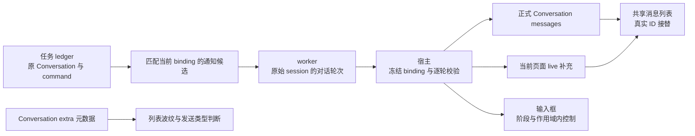

> **2026-10-24 当前实施事实**：rev2 的 E1–E3 已实施；代码/服务/构建回归已执行，E4 原生视觉与物理设备边界单列。参见 [实施与验证记录](voice-ux-rev2/IMPLEMENTATION.zh.md)。仍在 `feat/voice-next`，未提交、未推送；以下方案和状态声明按历史原文保留，请勿从 E0 重复开工。

# 语音交互优化 rev2 · 最终执行计划

> **状态**：📋 可进入实施；已收敛本轮决策，业务尚未修改。
> **日期 / 核查基准**：2026-10-23，`feat/voice-next`，`7de276e61e93836365c5a1c7e006c557ce3e3c6d`。
> **核心原则**：正式 Conversation 是聊天事实来源；临时文本、任务通知、通话阶段必须保持各自身份。先修隔离，再替换界面，最后移除旧入口。
> **权威范围**：本文件是本轮执行入口；[原整合方案](voice-composer-simplification-and-history-isolation-plan-2026-10-23.zh.md) 全文保留作需求/证据底稿。冲突处按本文裁决；未修订的 HI/UX/LI 验收继承。执行提示词见[任务书](voice-ux-rev2-agent-brief-2026-10-23.zh.md)。

## 1. 背景与目标

本轮解决三类可观察问题：新工作区出现旧实时问答；语音状态和调试面板占据聊天区域；会话改名后无法识别语音类型。用户不要求新增 ASR、TTS、AEC、权限模式或任务引擎。

| 当前 | 完成后的行为 |
| --- | --- |
| 当前页面可能包装旧 session 的轮次或外任务通知 | 聊天原文/回复严格属于其 Conversation，通知不冒充新聊天 |
| 输入框上方有目录、诊断、任务状态、取消/挂断栏 | 输入框内部一行阶段和必要操作；审批/队列仅按需展开 |
| 列表只有名称差异 | 语音会话最右侧固定静态波纹，重命名和挂断后仍保留 |
| 设置展示 UUID、长容错宣告、重复模型和音色入口 | 普通设置简洁，高级诊断仍可用；伙伴私聊保留选模，暂隐藏音色 UI |

**准入结论**：原方向成立，但必须纳入 §3 的通知归属、状态接替及控制保留合同后再实施。不要把此前 32 项测试通过视为覆盖本次隔离缺陷。

## 2. 架构及范围

- 保留现有 Conversation、消息表、分页、runtime、普通 queue 与语音 FIFO。没有新的 DB migration、权限模式、调度框架、模型或依赖。
- 新语音会话继续默认 YOLO，用户显式选择/有效偏好优先；已有模式不覆盖。波纹标记不授予权限。
- 声学 session 的结束/更换不删除持久历史，也不取消后台任务；工作区 Conversation 的 30 分钟复用规则保持。
- 项目语音与伙伴私聊分别使用自己的配置/消息归属。不能把伙伴模型变更传播到所有项目会话。
- 本轮不重写桌宠首帧逻辑：当前已有 `flowy-pet-boot` 透明根节点保护，profile/位置/尺寸/资源加载后解除；保留失败重试、主窗错误反馈和临时桌宠显隐回归。源码门禁不等于已验证原生画面。

## 3. 已锁定的实施合同

### 3.1 P0：对话轮次、通知和审批必须分开

1. **对话轮次**：新 WakeHit 清上一 session 的临时 conversation；`VoiceConversationTurn` 增补原始 `session_id`，在创建时写入。宿主查询投影/消息 ID 时同时验证 session、Conversation 和 turn；前端逐轮校验后才包装为普通消息。不能把当前 session 批量赋给旧轮次。
2. **任务进度/结果/语音审批**：宿主以 task 的原 `conversation_id` 对比当前可信 binding，并校验绑定 session 与新鲜 daemon snapshot 一致，之后才派发。无有效 binding、外会话、UserStop 或不允许抢话时不派发，不 claim 为已播报，不替其他任务作确认决定。保留原通知/审批供对应 Conversation 查看；真正到期继续按现有规则处理。
3. **避免通知阻塞**：现有 `pending_result()` 是全局 first-match；改为在已有 ledger 里先按目标 Conversation 过滤再选首个候选。A 的待播结果不能挡住 B 的结果，也不能为了放行 B 把 A 标成已播报。保留既有键盘任务不自动口播的规则。本轮只改候选选择，不改执行 FIFO 调度。
4. **审批是当前任务的子流程**：有合法通话 binding 时，提示/听取确认不另造聊天 session，使 binding 失效；无合法绑定不主动认领当前页面。`instance + command + conversation + message + approval/call` 继续约束确认，scope 变化不能被当作用户拒绝/同意。后台轮询不能用错误会话的审批阻塞当前会话通知候选。
5. **合成通知不是新聊天行**：任务结果已经在其正式消息中；审批提示已经有实际工具卡/操作。合成播报不再作为新的普通用户/助手问答追加，不凭 `task-result-*` / `approval-*` 名称认定来源。最小方案是在生产事件处理处停止把这些 notice 加入普通 conversation，同时逐个保护使用 `last_mut()` 的输出更新，避免更新上一条真实对话。需要保留的诊断留在既有任务通知状态。
6. **上下文**：只有与当前可信绑定匹配的真实任务结果，才能进入该通话的短上下文；外会话结果不进入。新唤醒清缓存不清 journal、任务回执或尚待重试的持久投影。

现有 `VoiceTaskResultAnnouncement.scope` 只是声学控制身份，不能证明 task 属于当前 Conversation。优先在宿主用已有任务身份校验，不新建通知业务协议。若发现还需变更 DTO，限定为本条合同所需的最小增补，所有序列化/构造点/恢复测试一并更新。

### 3.2 P0：实时文字与持久历史的接替判据

原方案同时要求“落盘行尚不可见时保留实时文字”和“历史分页出去的消息不回到尾部”。仅比较当前 `visibleIds` 不能区分这两种情况，必须接入既有消息加载状态。

| 状态 | 明确行为 |
| --- | --- |
| 当前合法轮次尚无持久回执 | 展示 live 原文/回复，键包含 Conversation/session/turn/侧别 |
| 有回执，但该 Conversation 最新页还未同步完成 | 保留尚未接替的 live；按持久消息 ID 合并请求一次刷新，不按音量事件重复刷新 |
| 用户行已出现、助手仍未出现 | 仅退休用户 live，助手继续显示 |
| 对应持久行已出现 | 以真实 message_id 接替，记录本页生命周期内已接替身份，后续音量/重连快照不得复活它 |
| 持久回执后，更新过的权威最新页已成功返回，该旧行属于窗口外 | 不把它 append 到最新尾部；历史由原分页负责。分页窗口边界与同步完成来自 loader，不能只看当前 DOM 有无它 |
| 最新页同步失败 | 显示可恢复错误，保留当前合法未接替内容；不能伪装“已同步”，也不能重新发送模型/任务 |
| 清上下文、删除、epoch 改变或切换页面 | 退休旧作用域临时内容，迟到响应不复活；不删除正确持久历史 |

实现优先复用 `useMessageLstCache` 的 conversation/epoch/加载代次与消息 ID 状态，只增加最小接替信息；不新建消息 store，不按文本/固定延时判断完成，不在高频快照回调逐条查库。正式测试必须同时证明“先回执后消息”无闪空和“旧消息已离开窗口”不重新插尾。

### 3.3 P1：先接上新控制，再删除独立 bar

正常状态只在输入框 footer 展示一个图标和阶段文案；当前工作区已在会话标题中，不重复展示路径。原面板的以下职责必须有实际替代操作后才能移除：

| 控制 | 固定接替位置和规则 |
| --- | --- |
| 挂断 | 空草稿时为红色主键；主键被发送/停止占用时，footer 保留一个小型挂断键。只结束匹配的通话，不取消后台任务 |
| 停执行 | 主键精确取消本 Conversation 的当前 command；不清其他 FIFO，不作用于全局其他任务 |
| 工具审批 | 普通工具卡已有可信操作时复用；否则在输入框内按需展开，抽取/复用既有 `VoiceTaskStatus` 审批逻辑。不额外建立第二套确认协议，不依赖声学 phase 等于某值才允许看到审批 |
| 队列 | 有本页排队项才显示数量，点击在输入框内部展开并可逐项取消 |
| unknown / delivering / cancelling / 控制失败 | 显示相应阶段；unknown 提供“核对任务状态”的按需操作，调用既有查询，不自动重新 submit/send；无法确定终态时不解锁下一个有风险操作 |
| 调试/错误 | 正常错误保留简短提示和恢复动作；详细声学/模型/原始输出进设置高级诊断，不能只删除可观测性 |

所有异步 UI 操作按 `instance + conversation + command/approval + 页面代次` 作用域隔离；切到 B 后，A 的迟到取消/审批结果不能清掉 B 的 pending 或展示 A 的错误。`VoiceTaskQueue` 目前只按 instance 隔离本地请求，这在复用组件/切页时需要补齐 Conversation 维度。

阶段枚举继承原方案 §3.3，不能把 Synthesizing 当 Speaking，也不能把任务忙当作麦克风忙。`ignore` 不退出、无效输入不写正式上下文。连接状态从 request 回执和匹配 snapshot 协调，不仅依赖本地 Promise 的 finally；未知启动重试沿用原 request_id，明确拒绝后才可新请求。尚无有效 session 时不能伪造空身份挂断，显示核对/重试状态；绑定成立后小挂断始终可达。

### 3.4 P1：侧栏及输入能力一致

- 新语音会话严格消费 `extra.voice === true`；已有后端兼容的 `is_default_voice === true` 由共用纯判断函数覆盖。未知元数据保持 unknown，不从标题/工作区/模型/任务状态猜类型，不把字符串 `"true"` 当布尔。
- 左侧列表最右侧固定静态 `Voice` 声波图标，已有库即可；title/aria 中英解释“语音会话，可通话或发送文字”。重命名/挂断/置顶/重启保持，更多菜单为其让位，长标题截断，不让年龄/未读 hover 隐藏该标记。
- 正常工作区和项目子列表、搜索结果若复用该 row，均一致；不让每一行订阅全局 voice snapshot。折叠、batch、移动端保持类型可感知且不遮挡操作。
- ChatConversation 已知元数据向下传给聊天内容和输入框，独立入口再用既有 cache/fetch 恢复；共享类型纯函数不能把侧栏依赖引到完整语音发送组件。
- 当前语音文字路径拒绝附件及本轮显式注入技能，因此 UI 同步隐藏/禁用未接通入口，包括拖拽、粘贴、`@` 文件及菜单，拒绝时保留草稿/附件选择。不删除预设里已配置的技能，也不限制 runtime 自有工具。普通会话功能不回退。

### 3.5 P2：设置精简与桌宠/首页回归

- 移除正常设置的快模型 UUID 大块展示、长唤醒容错宣告；保留自动选模、可用性和真实错误，详细来源进高级诊断。
- 移除伙伴概览重复模型和音色选择；保留私聊的实际选模/未配置引导，保留 profile.voice 数据、API 及机器人调用。不得用移除 UI 的理由清空持久字段。
- 删除真正无调用方的内部 UI/样式/key；先接替审批、队列、unknown 查询后才删旧 bar。旧排版结构断言可改成新行为断言，既有行为覆盖不能减少。
- 首页语音入口沿用已有电话按钮和本地化标签，本轮用中文“语音通话”、英文“Voice call”；不再和 Skills 并排添加另一处按钮。按钮、label、tooltip、aria 同步，目标选择和冲突路由不变。
- 复核现有桌宠冷启动透明门禁、正确 profile/Bolt、保存位置、失败重试及通话临时显示；本轮无新证据时不更改原生窗口/角色默认值。透明 loading 保护已存在，不能将截图旧产物直接判为 HEAD 仍有同一缺陷。

## 4. 顺序、地界与停损

| 阶段 | 执行内容 | 出口 |
| --- | --- | --- |
| E0 核查 | 固定 HEAD/dirty 范围，复跑既有基线，将两个失败场景迁为隔离正式用例；记录现有 TS 等基线 | 先有可复跑 RED 和开工回执；不依赖本机真实聊天数据 |
| E1 正确性 | 轮次所有权、按会话通知候选、审批保留 binding、消息接替/恢复 | HI-01–08、RV-01–04/07 与正向对照通过 |
| E2 输入框与列表 | 阶段/控制接替、波纹、类型统一、能力入口和启动状态 | UX、LI、RV-05/06/09 通过；先接替再删除 |
| E3 设置与回归 | 设置精简、首页双语/桌宠已有门禁回归 | UX-05/06、RV-08 通过 |
| E4 交付 | 定向/联合检查，完整 diff 和文档事实，列出实际未签核边界 | 29 项逐项列证据，不能用测试总数替代 |

一个执行 Agent 串行做完，阶段出口只作为自动检查，不安排逐阶段人工确认。当前 dirty 文档属于已知在途方案，保留并核对；不 stash/reset/覆盖别人的工作。若 HEAD/前提变化，先重新核实受影响基线，不能套用此处数量。

白名单：worker 的 voice_events、voice/confirmation、必要 voice.rs；API voice DTO；app 的 voice_companion_manager、voice_dialogue 及 voice_tasks 中通知候选与对应测试；前端 voiceSession、Conversation 消息接替接线/loader、NomiChat/NomiSendBox/nomiSendDispatch、composer、ConversationRow/相关 utils、Guid 现有入口、语音设置和伙伴概览/私聊选模说明；对应 locale/generated keys/tests；本方案及其进度文档。其他路径只读，需越界时写 BLOCKED 并继续独立任务。数据库 migration、auth、agent harness、release、依赖/锁文件和用户真实数据不在白名单。

同一检查连续失败 3 次，停止同一种尝试，改查最小根因或转做独立项并记录；不得静默降级门禁。只回退自己失败的局部改动，不能回退接管文档或其他人修改。未全绿就报告部分完成，不用“代码都在”宣称交付。无本轮新授权不 commit/push/切分支。

## 5. 验收与验证阶梯

继承原方案 20 项 HI/UX/LI，以下 9 项补齐本次复审发现的边界，**共 29 项**：

| 编号 | 必须验证的结果 |
| --- | --- |
| RV-01 | A 结果待播、B 通话：A 不被派发/claim、不进 B 上下文或 live；B 自己的结果仍可播；切回合法 A 后只按既有回执规则处理 A |
| RV-02 | 同会话审批保持合法 binding；跨会话不派发口头确认、不改成拒绝/同意；真实工具审批、到期与 GUI 确认仍可完成 |
| RV-03 | 先回执后 GET、用户先于助手落盘、刷新失败重试：未接替内容不闪空，最终一条消息一次显示，不重发模型/任务 |
| RV-04 | 已接替后分页、latest page 成功但旧行窗口外、重新挂载：旧文字不复活到尾部；无音量事件刷新风暴 |
| RV-05 | A 页点击取消/确认后切 B，同一 instance 迟到响应不影响 B；unknown 仍可核对状态，不静默当失败或重发 |
| RV-06 | starting/超时/回执丢失/明确拒绝/未绑定结束：保留既有 request_id 恢复合同，无双启动，无空身份挂断或错误解锁 |
| RV-07 | live 尚在时清上下文/删除/epoch 更新再迟到投影：不复活旧内容、不误重放已执行 command；保留正确历史 |
| RV-08 | 桌宠 profile 延迟/首次 Bolt/保存位置/资源失败、首页 zh/en：已有透明首帧门禁与错误重试不回退，入口只保留一处，非主窗不夺焦 |
| RV-09 | 严格布尔/旧默认标记/unknown、普通和语音附件与技能入口：列表、消息、主键和真实分发一致，普通功能不受影响 |

### 5.1 已运行的基线

本轮重跑原方案 §5.3 的 6 文件：**32 passed / 0 failed / 155 assertions，3.30 秒**。两个忽略目录探针 **0 passed / 2 failed，5 assertions**：旧工作区轮次串显示、foreign task notice 被包装为当前 Conversation 的助手消息。第二个是构造最小快照调用生产 helper 的反例，不等于真实麦克风/整机通知测试。

日志：`build.noindex/voice-workspace-display-review/rev2-baseline.txt` 和 `rev2-red.txt`。正式修复须把反例迁为不依赖本机 journal 的测试；仅修改探针以得到绿色不算完成。现有 32 行为用例不得 skip/削弱；因确认布局变化需调整结构断言时，保留用例或新增等价行为用例，说明前后覆盖，6 文件组至少 32 项、0 新增 skip。

### 5.2 实施时的命令与结果归因

1. 从 `ui/` 运行原方案 §5.3 已实跑的 6 文件命令，并加入新正式回归。保留 zh/en、Light/Dark、异步交互验证；静态 render 不等于实际点击/键盘或原生画面。
2. 下列重检查在此前会话已有记录，**本轮未再次运行**，执行者在 E0 核实工具/目标并记录基线，改动后运行：`cargo test -p voice-companion`；`cargo test -p nomifun-app --lib voice_ --no-default-features`；受影响 Conversation/真实 runtime 集成；`cargo check -p Flowy`；`bun run typecheck`；`bun run build:ui`。
3. 文案改变后 `bun run gen:i18n`、`bun run check:i18n`，以及 theme/icons/button-layout/motion/dead-css 等影响门禁。命令入口本轮已在 package.json 核对，生成操作不在审查轮运行。Rust 改动运行 `cargo fmt --check` 或项目等价格式命令；`git diff --check` 必须通过。
4. TS/dead-css 等已知失败不能凭旧数量认定未新增，E0/交付用同一环境记录诊断集合差异。禁止修改检查器、CI、阈值，或顺手修 videoCanvas 等无关问题。
5. 轮次/通知/审批与存储使用临时工作区、现有真实 service/本地 HTTP daemon 装配验证，不等用户对麦克风说话。UI 用真实组件交互、双主题/语言截图补证。原生透明、DPI、物理 AEC/扬声器若不能运行，明确未签核，不阻塞身份/控制代码修复，也不冒充已完成这些物理验证。

### 5.3 交接文件

执行者在 `docs/architecture/voice-agent/execution/voice-ux-rev2/` 创建 `PROGRESS.md`（每片进度/结果/受影响文件）、`BLOCKED.md`（无则写无）、`RESULTS.zh.md`（29 项证据、命令 exit code、基线差异、已知风险）。断点续跑先读它们。最终完整 diff 必须对照需求/29 项验收复核，不能只读代码是否自洽。

## 附录 A：按“点子王”格式记录的复审

### 结论 (Verdict)

**needs-attention → 纳入 rev2 修订后可执行**。无需重建架构；先补通知身份、控制接替和历史同步判据。

### 事实清单 (Irreducible Facts)

- 实时快照和持久消息异步到达，存在先后交错 — physics（异步约束）。
- 同一任务的声学播报目标与业务 Conversation 不是相同身份 — convention（现有接口设计）。
- 继续共用 Conversation/MessageList 比复制聊天系统的接入和维护成本低 — economics。
- 声波标记不需要改存储，只需读取已有语音元数据 — convention。

### 攻击点 (Attack Points, by severity)

1. **[P1][evidence] 外任务通知仍可获得当前声学身份。** manager 的三个通知路径检查 phase/收音，但未比较 task.conversation_id 与 binding；worker TaskResultReady 把目标/结果加入当前 context，ConfirmationPrompted 另造 session；显示 helper 会接受此合成轮次。只修 WakeHit/session 字段不够。证伪实验：A/B 临时工作区、A pending + B 通话，捕获真实 daemon HTTP 必须无 A 派发/claim，B 结果不被 A 阻塞，A 上下文不进 B。helper 反例已 RED，真实联合实验待 E1。
2. **[P1][evidence] 移除旧 bar 会顺带删除关键控制，原方案接替位置还含条件判断。** VoiceTaskStatus 包含审批、unknown 查询，VoiceTaskQueue 的异步隔离只有 instance。证伪实验：先让 task unknown/待审批，在新输入框完成查询/确认；A 请求悬挂时切 B 再返回错误，B 不出现 A 的 pending/error。正式实验待 E2；rev2 已固定 fallback 位置与 scope。
3. **[P2][inference，基于已核实接口] “持久行未到”与“已离开分页窗口”仅靠 visibleIds 无法区分。** helper 只有当前消息 ID，原方案却要求同时满足两种行为。证伪实验：同一 Conversation 用这两种时序输入，前者保留未接替内容，后者不 append 旧行；若不能区分则必须接入 loader 权威代次，不能删掉任一断言。实验待 E1。

### 幸存结论 (What Survives)

- 固定最右侧静态波纹、重命名保持类型、单主按钮、小挂断、正常页不显示诊断都成立。
- 数据库本次没有证据表明写错工作区，不做数据搬迁/清库。
- 桌宠首帧已经有透明/配置就绪保护；按失败/慢加载验证，避免再建一套 ready 协议。
- 旧任务回执和普通/语音不同队列继续保留；不按页面简化意图强行合并。

### 修改建议 (Changes)

对应上面三项，分别落实 §3.1、§3.3、§3.2；先 E1 后 E2，没有逐阶段人工审批。附加历史重置/启动恢复/原生既有门禁回归，不扩展模型功能。

### 分工 (Assignment)

- E0–E4 → owner: 执行 Agent，role: 实施与自动验证，单会话串行；避免共享 DTO/消息列表由多处同时改。
- 交付后复审 → owner: 本审查 Agent，role: 独立验收；同时读原始需求、29 项合同和完整 diff，不代替执行者自评。

未解用户决策：无必须追问项。原生设备可用性是验证环境边界，按 E4 如实记录；不要求用户重说测试语句，也不预设测不到就已经通过。

## 附录 B：定位与历史底稿

保留[原整合方案全文](voice-composer-simplification-and-history-isolation-plan-2026-10-23.zh.md)，含用户截图对应的 SQLite/journal 只读事实、代码入口、20 项原用例及讨论取舍；本文件不删除或改写这些原文。

本轮追加定位：`voice_companion_manager.rs` 约 1498 行通知选择、1515/1580/1674 行三种通知派发；`voice_tasks.rs` 约 243 行 first-match；`apps/voice-companion/src/voice_events.rs` 约 286/318 行通知/context/session；`voice/confirmation.rs` 约 25 行声学 scope；`VoiceTaskStatus.tsx` 的 unknown/审批，`VoiceTaskQueue.tsx` 的 instance-only scope；`liveVoiceTurn.ts` 的 visibleIds；`apps/desktop/src/main.rs` 约 2865 行 boot style 和 `companion/index.tsx` 约 683–748 行既有 ready/retry。
