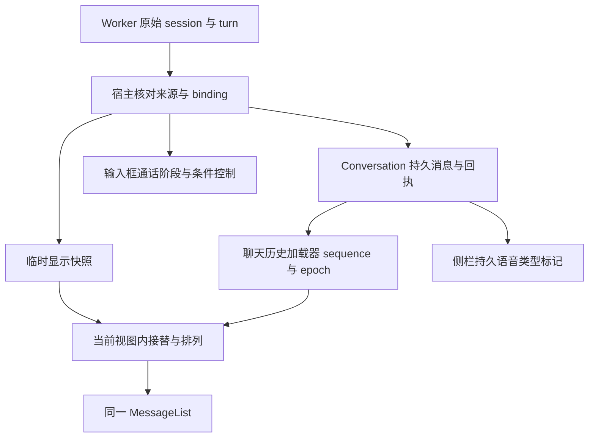

> **2026-10-24 复审修复更新**：F1–F3 已补齐同 renderer 跨挂载失效、首页原请求恢复与折叠标记；前端 147、共享历史 100 项通过，双语真实组件交互六条通过；完整 UI 构建通过，TS 61 项基线 delta 0。完整证据、实现取舍和边界见 [修复验证记录](REPAIR-VERIFICATION-2026-10-24.zh.md)。以下原始实施记录保留。

# 语音交互优化 rev2 · 实施与验证记录

> **状态**：E1–E3 已实施；E4 代码、服务与构建验证完成，原生视觉/物理设备边界未签核。
> **基准**：2026-10-24，`feat/voice-next`，HEAD `7de276e61e93836365c5a1c7e006c557ce3e3c6d`；变更留在工作区，未提交、未推送。
> **原则**：持久 Conversation 是事实来源；通话临时文字和工具通知各守其身份，界面只显示用户需要的阶段与操作。

## 1. 本轮解决的问题

| 修复前 | 当前实现 |
| --- | --- |
| E1 宿主不能编译，前端多出 session_id 类型错误 | Option ID 比较和 DTO/TS turn 契约已对齐 |
| 缺来源的旧轮次可能被新 binding 包装 | worker 每次新唤醒清易失轮次；宿主和前端逐轮核对原始 session |
| 外任务一刀切过滤会隐藏本会话合法输入 | 仅按真实轮次身份过滤；结果/审批派发另外按任务原 Conversation 选择 |
| 回执先到时文字消失，旧页/重挂载时旧内容回尾部 | 使用回执观察时的加载序号与 epoch；逐条接替、重挂载先核对已完成缓存轮次；按持久伙伴行拼接临时另一侧 |
| 独立状态栏重复显示路径、诊断、按钮 | 输入框 footer 显示图标/阶段；必要时展开审批、unknown 核对和队列取消 |
| 语音任务改名后失去类型线索 | 侧栏最右侧静态 Voice 声波读持久布尔标记；普通任务名称不影响类型 |
| 设置页暴露快模型 UUID、长容错宣告和重复模型/音色配置 | 快模型与任务诊断归高级折叠；删除长容错宣告和概览重复配置，保留缺模型 onboarding |

## 2. 实际数据流与边界

没有新增 ASR/TTS 模型、依赖、数据库迁移、权限模式或 harness 改动。任务仍走既有 runtime；用户显式模式优先及缺省 YOLO 行为保留。历史数据未删除、搬迁或重写。

## 3. 实施要点与代码入口

### 3.1 隔离与通知

- `apps/voice-companion/src/voice_events.rs`：turn 在 Transcribing 写入原 session；按钮与 KWS 新唤醒都清易失窗口；工具结果/审批合成通知不追加成普通问答，也不覆写最后一个真实 turn。审批保持已有 session。
- `crates/backend/nomifun-app/src/voice_companion_manager.rs` / `voice_dialogue.rs`：投影 ID 缓存使用 `(session_id, conversation_id, turn_id)`；不替缺来源的 turn 补身份。
- `voice_tasks.rs`：先按目标 Conversation 筛候选再选择待播结果；移除已无生产调用方的全局 `pending_result` 路径。查询候选不 claim；键盘任务沿用原有不自动播报规则。
- SSE 漏帧/重连时，状态查询与 SSE 共用 `project_with_binding`。恢复绑定仍核对宿主 generation 和当前 session，避免“任务完成但因漏绑定帧永远不播报”。

### 3.2 文字接替与排序

- `Messages/hooks.ts` 暴露最新页的 Conversation、epoch、请求序号，以及当前请求序号；旧 GET 不能作为新回执已接替的证明。
- `voiceSession/liveVoiceTurn.ts` 为挂载视图维护有界状态：退休的消息 ID、已观察到的真实轮次、重挂载待核对轮次及 reset 屏障，随 worker 三轮窗口修剪。没有全局无界退休 Set。
- 已显示的 live 文本在刷新中或失败时保留；用户和助手分别退休。首次挂载才见到的已完成缓存轮次先核对，避免分页窗口外的旧文字短暂追加到最新尾部。
- `mergeVoiceTranscript` 以持久的另一侧消息为位置锚点；后一轮先落盘不会把前一轮未落盘回答移到尾部。合并只影响 MessageList 展示，不写入持久消息缓存或导出数据。
- `NomiChat.tsx` 的失败重试是历史只读 GET；请求结果受视图身份保护，不重新调用模型或派发任务。清上下文后沿用 coordinator epoch 和既有刷新通道，旧临时轮次被当前视图屏障拦截。

### 3.3 输入框、列表与配置

- `VoiceComposerStatus.tsx` 接替已删除的 `VoiceConversationBar.tsx`：普通界面不再额外展示 workspace 路径、UUID、声学图或 router JSON 调试字段；审批与 unknown 状态核对有条件展示，当前会话队列可逐项取消。
- `ComposerSubmitCluster.tsx`：大主键保持停止任务 → 发送草稿 → 通话/挂断；发送或停止占主位时保留小型红色挂断。未知启动显示核对入口，沿用同一个 request_id；未绑定时不提供无身份挂断。
- 队列取消回调同时核对视图代次和原 command/message；原条目移除后释放其 pending，迟到错误不会附着到另一条队列项。最终定向复核见 `fix-queue-closure.txt`，最终类型检查见 `fix-typecheck-delivery.txt`。
- `utils/isVoiceConversation.ts` 共用于列表、聊天与发送：仅 nomi 且 `voice === true` 或旧 `is_default_voice === true`；unknown 仍需解析，名称、路径、模型都不作为类型。旧标记不会绕过宿主策略校验。
- `ConversationRow.tsx` 固定末端静态 14px 声波，菜单向左留位；移动状态也留出菜单位置。tooltip/aria 双语，不订阅每行的全局声学状态。
- 语音文字能力仍只接收纯文字：附件按钮、拖拽/粘贴文件、文件提及和显式技能选择受控；普通对话功能与已配置的 runtime 工具不删除。
- `VoiceSettings.tsx`：快模型/任务诊断置于高级折叠；诊断重听只允许匹配当前 binding 的任务。伙伴概览只在缺模型时提供原有 onboarding，正常选模由私聊拥有；`profile.voice.tts` 数据与机器人消费者保留。
- 首页入口沿用原有位置，双语为“语音通话 / Voice call”。桌宠原生透明首帧、配置就绪及保存位置机制未重写，执行了现有回归。

## 4. 关键取舍

| 决策 | 原因 |
| --- | --- |
| 不依据全局 task 来丢弃整份通话快照 | B 可以在后台任务 A 执行时继续有效说话 |
| 不依据 task-result/approval ID 前缀推断轮次类型 | 来源在 worker/宿主边界确定；合法轮次不因 ID 文本被误杀 |
| 回执后的最新页成功才退休缺行 | 回执前请求、失败请求、旧 epoch 不证明落盘接替 |
| 复用既有审批、FIFO 和启动接口 | 保留真实权限与幂等语义，不新建一套授权协议 |
| 诊断移入设置而非保留闲置组件 | 用户界面简化，同时保留恢复、错误核对和显式重听能力 |

## 5. 实跑证据与限制

日志目录为仓库忽略的 `build.noindex/voice-workspace-display-review/`。下表是最终成功运行或明确未通过的结果，不以旧报告代替实跑。

| 验证 | 结果 | 证据文件 |
| --- | --- | --- |
| `cargo test -p nomifun-app --lib voice_ --no-default-features` | 90 passed / 0 failed / 3 原有 ignored | `fix-host-complete.txt` |
| `cargo test -p voice-companion` | 各 suite 合计 47 passed / 0 failed / 1 原有 ignored；lib 17 | `fix-worker.txt` |
| `cargo test -p nomifun-app --test voice_dialogue_integration --no-default-features` | 26 passed / 0 failed | `fix-dialogue-integration.txt` |
| `cargo test -p nomifun-voice-terminal` | 41 passed / 0 failed / 1 原有 ignored | `fix-terminal.txt` |
| 前端相关 18 文件 | 142 passed / 0 failed / 1017 assertions | `fix-ui-closure.txt` |
| 桌宠/首页/普通粘贴补充 8 文件 | 54 passed / 0 failed / 166 assertions | `fix-pet-guid.txt` |
| 共享消息加载/分页/重置/刷新补充 9 文件 | 86 passed / 0 failed / 283 assertions | `fix-history-shared.txt` |
| `cargo check -p Flowy` | exit 0，5m 50s；含真实桌面 feature | `fix-desktop-check.txt` |
| `bun run build:ui` | exit 0，1m 48s；最终队列项防线补充后再次构建通过；依赖 eval/大 chunk 警告保留 | `fix-build-ui-delivery.txt` |
| TS 完整诊断集合 | 61 项既有诊断；最终队列项防线补充后与基线逐条比较新增 0、减少 0 | `fix-typecheck-delivery.txt` / `fix-typecheck-delivery-compare.json` |
| 受影响 6 个 Rust 文件 rustfmt check | 工作区 exit 0；HEAD 对照亦 exit 0 | `fix-fmt-summary.json` |
| 双语/主题/动效/图标/布局静态契约/错误面/支持面/进程边界/浏览器边界/Windows 隐窗/CodeMirror/CSS scope | 12 项均 exit 0 | `fix-gates-closure.json` |
| 动态 `check:button-layout` | **未通过**：临时 Edge profile 清理遇 EBUSY，停止复跑；随后确认该目录已删除、所属 Edge 进程为 0 | `gate-check-button-layout.mjs.txt` |
| `check:dead-css` | **未通过**：报告 codeBlock、Wallpaper、CloudLogin、videoCanvas 等本轮未修改文件的既有基线 | `gate-check-dead-css-utilities.mjs.txt` |

没有将上述结果称为“全仓检查全绿”。没有通过删除/忽略失败用例或放宽断言取得通过；删除的是需求明确废弃的组件及旧展示契约，原有保留能力改由新入口测试。新增反例覆盖缺失/跨 session、外任务不屏蔽合法输入、回执/分页/重挂载/reset、原 task 查询/取消、启动丢包幂等和严格类型标记。

原生 Tauri 透明度、真实 DPI 下的像素布局、物理麦克风/扬声器/AEC 体验不由 SSR、服务测试或桌面编译证明。本轮没有增加 AEC 或改变原有本地声学模型路线。

29 项逐条证据及局部待验收项见 [RESULTS.zh.md](RESULTS.zh.md)。历史审查全文见 [E1 独立审查](E1-independent-review-2026-10-23.zh.md)，其失败结论是修复前快照。

## 6. 后续交接边界

1. 原生界面验收只需复核当前实现：窄窗口/高 DPI、长标题及菜单、Bolt 首帧与保存位置、通话红色挂断、审批展开和队列取消。不要以浏览器页代签原生声学能力。
2. 动态布局门禁需先确认探针页面服务与浏览器清理条件。此次清理失败后未继续扩散实例；下次须限定 profile/实例/时间，先通过一例及清理，再扩展矩阵。
3. TS 61 项与 dead-css 为单独的既有基线维护事项，不应混入本轮语音交付。未自动提交、推送或启动下一轮任务。
4. 历史入口原文还引用若干当前分支不存在的旧方案文件。本轮新增的实施报告及入口链接已核对可达；未新建空文档冒充旧底稿，历史归档定位另行维护。

## 附录：需求与历史底稿

- [rev2 最终执行方案](../voice-ux-rev2-execution-plan-2026-10-23.zh.md)
- [执行任务书](../voice-ux-rev2-agent-brief-2026-10-23.zh.md)
- [原整合方案与诊断](../voice-composer-simplification-and-history-isolation-plan-2026-10-23.zh.md)
- [开工与过程记录](PROGRESS.md)

本记录新增于原稿之外；原方案、审查反例、开工回执和原始待验证矩阵均保留，当前结论以前置更新及本文件为准。
